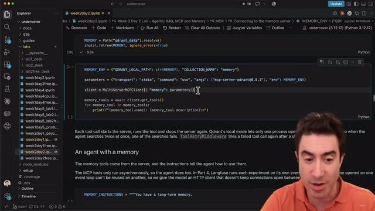
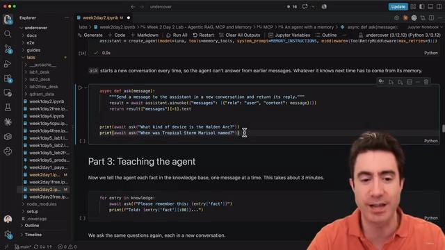
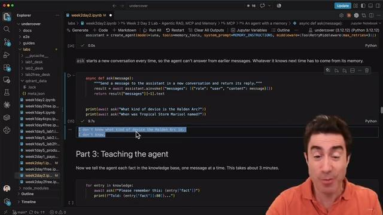
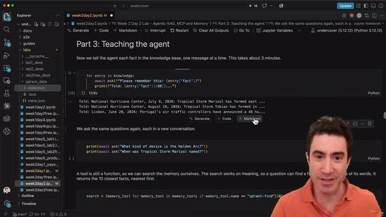
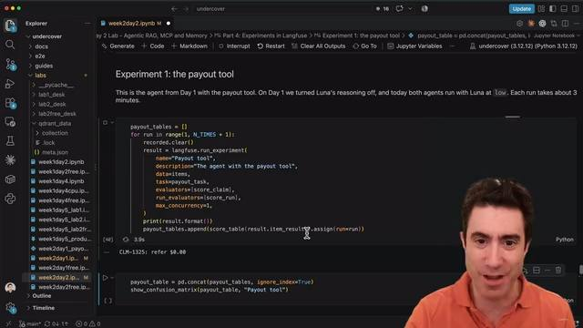
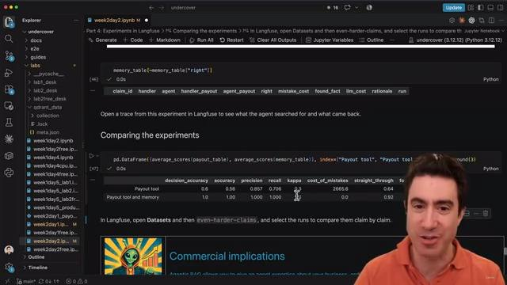
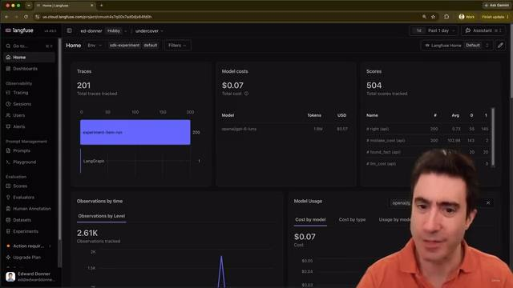
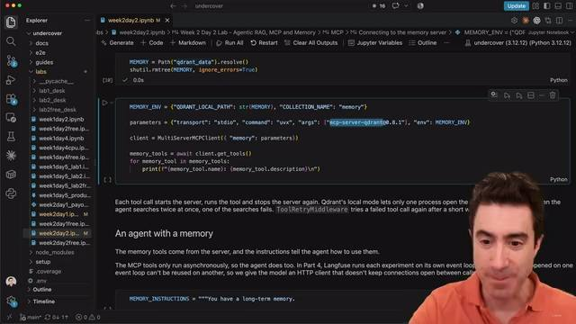
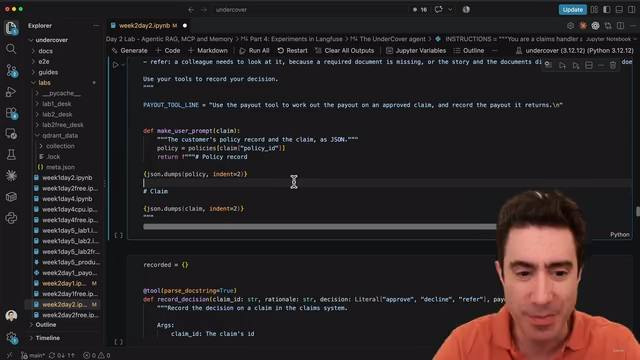
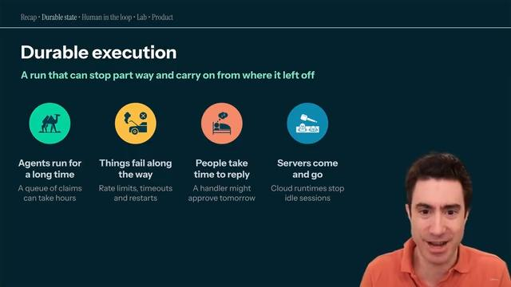

# AI FDE P59–P61 复现文档：用 Qdrant MCP 给 Claims Agent 加长期记忆，并用 Langfuse 做 A/B 评测

> 覆盖 P059–P061。P059/P060 是可跑的 notebook 项目，P061 是承上启下的概念课（durable execution / LangGraph / human-in-the-loop）。本文按「先把项目跑起来」重组，不按视频顺序流水账。

---

## 1. 这一节做什么

这三节连起来是一条完整的工程链路：

1. **P059**：用 `uvx` 拉起 Qdrant 官方的 MCP Server，通过 **STDIO** 传输接入 LangChain，拿到 `qdrant-find` 和 `qdrant-store` 两个工具；用一个 `create_agent` 建出带长期记忆的 agent，先空库提问（答「不知道」），再写入 33 条事实，再问同样的问题（答对），最后**绕过 agent 直接调用 `qdrant-find`**，用一句「a gadget for watching films on a wall」验证语义检索能命中「Holden ARC 便携投影仪」。
2. **P060**：把这套记忆接进 claims（理赔）处理场景，在 Langfuse 上做 **A/B 实验**：实验 1 用昨天的 `payout_agent`（无记忆）跑 `even_harder_claims` 数据集（25 条），实验 2 用新的 `memory_agent`（多一个只读 MCP 记忆工具）跑同一数据集。结果从 accuracy 60%、Kappa 0.3、mistake cost 非零，变成 accuracy 100%、Kappa 1.0、mistake cost 0；代价是 LLM 成本从约 1 美分涨到约 1.4 美分、延迟变长。
3. **P061**：讲师从「为什么 agent 需要 durable execution」讲起，引出 LangGraph：graph 是依赖图，`create_agent` 背后本来就是 LangGraph；今天要亲手建 graph，并落 durable execution 与 human-in-the-loop。这一节**没有代码**，只有概念和后面的课程地图。

一句话：**P059 造记忆，P060 证明记忆有用，P061 预告下一章怎么把这种 agent 做成生产级 durable workflow。**

---

## 2. 讲师原话（带出处）

> "首先创建变量 parameters，用它描述 MCP 的参数。我们告诉它要使用的传输方式：STDIO，即标准输入输出，这是本地 MCP 服务器最常用的传输方式。然后告诉它要使用的命令：UVX。"
> —— p059 [00:00]

> "传给 UVX 的内容，就是我们的 MCP 服务器名称：MCP Server Qdrant，也就是 Qdrant 官方的 MCP 服务器。"
> —— p059 [00:20]

> "这个 MCP 服务器让我们能够把数据写入该数据库，并为其关联一个向量；也能仅根据文本查询数据库，它会将文本转换为向量，并在数据库中查找相似信息。"
> —— p059 [00:35]

> "我们必须告诉它这个数据库在哪里，并通过这些环境变量传入。我希望你使用一个数据库表，也就是名为 memory 的集合，并告诉它位置就在这里，即 Qdrant_data。"
> —— p059 [00:55]

> "使用名为 MultiServerMCPClient 的对象创建一个新的 MCP 客户端，我们只需给它起名为 memory，并把这些参数传进去。"
> —— p059 [01:31]

> "它告诉我它有两个工具：一个叫 Qdrant Find，另一个叫 Qdrant Store。"
> —— p059 [02:44]

> "Qdrant Find：在 Qdrant 中查找记忆。当你需要按内容查找记忆、访问记忆以进行进一步分析，或获取用户的一些个人信息时，使用这个工具。Qdrant Store：当有人要求你记住某件事时，把该记忆保存下来供后续使用。"
> —— p059 [03:10]

> "你拥有长期记忆。当有人告诉你一个事实时，把它逐字存入你的记忆中。当有人问你问题时，搜索你的记忆并回答你找到的内容。如果你的记忆中没有相关内容，就说你不知道。"
> —— p059 [04:04]

> "我们会遍历全部 33 条记忆；对每一条，调用 ask，并说“请记住这一点”，然后填入该事实。"
> —— p059 [06:23]

> "我们可以取出那个工具，并用 ainvoke 调用 Qdrant Find 工具；还可以传入一些文本，比如“挂在墙上用来看电影的设备”。"
> —— p059 [07:53]

> "首先，我会再创建一个 MCP 客户端，名为只读客户端，它只能读取记忆，不能写入；否则，如果同一数据集运行两次，它就可能作弊。"
> —— p060 [00:47]

> "我们将设置三个工具：记录决策、计算赔付和记忆搜索。那里的 * 之所以存在，是因为 memory search 变量位于一个列表中，而 * 会把该列表展开。"
> —— p060 [01:17]

> "实验一将使用我们昨天结束时所用的完全相同的智能体，但完全不能访问它的记忆。实验二采用完全相同的设置和完全相同的数据，不过这次我们会给它一个能够访问 MCP 服务器的智能体。"
> —— p060 [04:02]

> "准确率为 60%，而拥有记忆时为 100%；精确率为 86%，对比 100%；召回率为 71%，对比 100%；Kappa 为 0.3，对比 1.0。"
> —— p060 [07:10]

> "这就是把业务知识交给智能体的方式。"
> —— p060 [09:48]

> "持久执行指的是让智能体运行一个工作流，该工作流可以在中途停止，然后从上次中断的地方继续，并且以可靠、万无一失的方式做到这一点。"
> —— p061 [02:48]

> "从第一周开始，我们就已经在使用 LangGraph 了；因为 LangChain 的 create_agent 函数在背后实际上就是使用 LangGraph。"
> —— p061 [06:19]

---

## 3. 从零复现

### 3.0 环境与目录

课里是 Jupyter notebook，逐字稿里出现了大量 cell 级操作。为了让读者能「保存成文件直接跑」，下面给出等价的 `.py` 脚本；如果你坚持用 notebook，把每个代码块粘进一个 cell 即可。

目录建议：

```text
ai-fde-p59-p60/
├── .env
├── requirements.txt
├── memory_mcp.py          # P059：Qdrant MCP 记忆
├── claims_eval.py         # P060：两个 agent + Langfuse 评测骨架
└── qdrant_data/           # 运行后由 mcp-server-qdrant 自动创建
```

`.env`（变量名课里口述为「base URL」「Luna」「collection memory」「Qdrant_data」，具体键名以你环境为准）：

```bash
OPENAI_API_KEY=sk-你的key
OPENAI_BASE_URL=https://你的兼容端点/v1
MODEL_NAME=luna
```

> 说明：课里说模型叫 **Luna**、用 **ChatOpenAI**、**low reasoning effort**，但**没有给出 model 字符串和 base URL 的完整值**。上面用 `MODEL_NAME` / `OPENAI_BASE_URL` 承接，运行前必须换成你实际可用的值。

### 3.1 安装依赖

```bash
python -m venv .venv
source .venv/bin/activate        # Windows: .venv\Scripts\activate
pip install langchain langchain-openai langchain-mcp-adapters mcp-server-qdrant
```

课里**没有锁定版本号**；`uvx` 第一次运行 `mcp-server-qdrant` 时会自己建隔离 Python 环境，所以本地不必预装 Qdrant 服务。逐字稿原话是「it's going to be installing it on my computer… building an isolated Python environment」（p059 [01:44]–[02:14]）。

### 3.2 创建 MCP 参数并连接

逐字稿的结构是：

- `transport` = `"stdio"`
- `command` = `"uvx"`
- `args` = `["mcp-server-qdrant"]`
- `env` 里指定 `COLLECTION_NAME=memory`、`QDRANT_LOCAL_PATH=qdrant_data`
- 用 `MultiServerMCPClient`，key 叫 `"memory"`

### 3.3 列出工具

```python
tools = await client.get_tools()
```

第一次会慢（课里实测 22 秒），因为要下载并启动 MCP server。预期看到两个工具：`qdrant-find`、`qdrant-store`。




### 3.4 空库测试

用逐字稿里的 system prompt 建 agent，先问：

- `What kind of device is the Holden ARC?`
- `When was Tropical Storm Marisol named?`

预期回答「I don't know」。课里特别强调：这不是普通回答，而是 agent **主动调用 qdrant-find 做了一次向量搜索**，发现库是空的才说不知道（p059 [05:54]）。



### 3.5 写入 33 条记忆

循环 33 次，每次 `Please remember this: <fact>`。运行过程中当前目录会出现 `qdrant_data/`，里面出现 `collection/` 目录，记忆开始以向量形式写入。





### 3.6 复问同样两个问题

预期答出：Holden ARC 是便携投影仪；Tropical Storm Marisol 命名于 7 月 9 日。

### 3.7 绕过 agent，直连工具做语义检索

```python
qdrant_find = next(t for t in tools if t.name == "qdrant-find")
result = await qdrant_find.ainvoke({"query": "a gadget for watching films on a wall"})
```

预期返回的**第一块结果**就是 Holden ARC。这句话和「Holden ARC」几乎没有共同词，字符串搜索找不到，向量搜索能找到——这就是课里要演示的 semantic search。

> 注意：`qdrant-find` 的入参字段名，课里只说了「pass in some text」，**没有在逐字稿里念出参数名**；上面写 `query` 是按 `mcp-server-qdrant` 的常见接口，**实际字段名请以你安装版本的输出为准**，不确定就先打印 `qdrant_find.args` 看一眼。

### 3.8 构建 claims 的两个 agent

在 P060 里，先准备：

- `make_user_prompt(policy, claim)`：把 policy 和 claim 拼成 user prompt
- `record_decision` 工具：`@tool(parse_docstring=True)`
- `calculate_payout` 工具：同样 `parse_docstring=True`
- `read_only_client`：只保留 `qdrant-find`，**不暴露 `qdrant-store`**，防止 agent 在评测中把答案写回记忆「作弊」

然后：

- `payout_agent` = 模型 + `[record_decision, calculate_payout]` + 基础 system prompt + payout 提示行
- `memory_agent` = 模型 + `[record_decision, calculate_payout, *memory_search]` + 基础 prompt + payout 提示行 + memory 提示行

`*memory_search` 是 Python 的列表解包：`memory_search` 本身是一个 list，`*` 把它展开成位置参数。

### 3.9 跑 Langfuse 两个实验

- 数据集：`even_harder_claims`，25 条，`n_times=1`
- 实验 1：`payout_task` → `payout_agent`
- 实验 2：`memory_task` → `memory_agent`
- 评分项在原有基础上新增 `found_fact`：这条 claim 需要知识库事实时，检索是否命中

### 3.10 看结果

实验 1 的 confusion matrix 明显变差，出现「本该 decline 却 approve」；payout 表 25 条里错 11 条。实验 2 的 confusion matrix 全对角线、payout 全对，accuracy 100%、Kappa 1.0、mistake cost 0。







---

## 4. 完整代码

> 说明：课里是 notebook，逐字稿只口述了变量名、函数名和系统提示词原文，**没有逐行念出完整源码**。下面给出的是「按逐字稿可确认的信息还原出的可运行文件」，凡是逐字稿没给具体值的地方，都用环境变量或注释标出，**不替讲师编造**。Langfuse 的 SDK 调用课里没有展示完整封装，`claims_eval.py` 只复现到 `decide` 函数为止，评测外壳请按 Langfuse 文档接。

### 4.1 `memory_mcp.py`（P059 完整可跑）

```python
"""
P059: 用 Qdrant MCP Server 给 agent 加长期记忆。
运行前：
  pip install langchain langchain-openai langchain-mcp-adapters mcp-server-qdrant
  在 .env 或 shell 里设置 OPENAI_API_KEY / OPENAI_BASE_URL / MODEL_NAME
"""
import asyncio
import os

from langchain.agents import create_agent
from langchain_mcp_adapters.client import MultiServerMCPClient
from langchain_openai import ChatOpenAI

# 课里：collection 叫 memory，数据库目录叫 qdrant_data
COLLECTION_NAME = "memory"
QDRANT_LOCAL_PATH = "qdrant_data"

# 课里口述的 MCP 参数：STDIO + uvx + mcp-server-qdrant
MCP_PARAMETERS = {
    "memory": {
        "transport": "stdio",
        "command": "uvx",
        "args": ["mcp-server-qdrant"],
        "env": {
            "COLLECTION_NAME": COLLECTION_NAME,
            "QDRANT_LOCAL_PATH": QDRANT_LOCAL_PATH,
        },
    }
}

# 逐字稿 p059 [04:04] 原文
SYSTEM_PROMPT = """You have a long term memory.
When you were told a fact, store it in your memory word for word.
When you're asked a question, search your memory and answer what you find.
If your memory has nothing on it, say that you don't know."""

# 课里：模型叫 Luna，用 ChatOpenAI，low reasoning effort
# 课里没给具体 model 字符串和 base URL，这里从环境变量读
MODEL = ChatOpenAI(
    model=os.environ.get("MODEL_NAME", "luna"),
    base_url=os.environ.get("OPENAI_BASE_URL"),
    reasoning_effort="low",
)


async def build_agent():
    client = MultiServerMCPClient(MCP_PARAMETERS)
    tools = await client.get_tools()
    print("Tools:")
    for t in tools:
        print(" -", t.name, "|", (t.description or "")[:120])
    # 课里还提到 retries，但没给参数名；按你的 langchain 版本补 max_retries 之类
    agent = create_agent(
        model=MODEL,
        tools=tools,
        system_prompt=SYSTEM_PROMPT,
    )
    return agent, tools


async def ask(agent, question: str) -> str:
    # 课里：ask 内部调 ainvoke
    result = await agent.ainvoke(
        {"messages": [{"role": "user", "content": question}]}
    )
    return result["messages"][-1].content


async def main():
    agent, tools = await build_agent()

    q1 = "What kind of device is the Holden ARC?"
    q2 = "When was Tropical Storm Marisol named?"

    # 3.4 空库测试
    print("\n[empty db]")
    print(await ask(agent, q1))
    print(await ask(agent, q2))

    # 3.5 写入 33 条记忆。课里用了 33 条具体事实，这里用占位替换
    memories = [
        "The Holden ARC is a pocket projector.",
        "Tropical Storm Marisol was named on July 9.",
        # ... 补到 33 条，内容换成你实际要测的事实
    ]
    print("\n[writing memories]")
    for fact in memories:
        print(await ask(agent, f"Please remember this: {fact}"))

    # 3.6 复问
    print("\n[after memory]")
    print(await ask(agent, q1))
    print(await ask(agent, q2))

    # 3.7 直接调用 qdrant-find
    qdrant_find = next(t for t in tools if t.name == "qdrant-find")
    # 字段名 query 以你安装的 mcp-server-qdrant 为准
    result = await qdrant_find.ainvoke(
        {"query": "a gadget for watching films on a wall"}
    )
    print("\n[direct qdrant-find]")
    print(result)


if __name__ == "__main__":
    asyncio.run(main())
```

### 4.2 `claims_eval.py`（P060 核心可跑，Langfuse 外壳待接）

```python
"""
P060: 构建 payout_agent 与 memory_agent，并在同一 claims 数据集上对比。
运行前：先跑过 memory_mcp.py，确保 qdrant_data/ 里已有记忆。
Langfuse 的数据集上传、评分、confusion matrix 封装课里没有逐行展示，
这里只复现讲师明确描述的 agent 构建和 decide 函数。
"""
import asyncio
import os

from langchain.agents import create_agent
from langchain_core.tools import tool
from langchain_mcp_adapters.client import MultiServerMCPClient
from langchain_openai import ChatOpenAI

MODEL = ChatOpenAI(
    model=os.environ.get("MODEL_NAME", "luna"),
    base_url=os.environ.get("OPENAI_BASE_URL"),
    reasoning_effort="low",
)

# 课里：claims handler + 必须选一个 decision + 用工具
SYSTEM_INSTRUCTIONS = """You are a claims handler.
You need to choose one decision and use your tools."""

PAYOUT_LINE = "Use the payout tool to work out the payout."

MEMORY_LINE = """You have a long term memory.
Before deciding, search your memory for relevant facts."""


def make_user_prompt(policy: str, claim: str) -> str:
    # 课里：把 policy 和 claim 塞进 user prompt
    return f"POLICY:\n{policy}\n\nCLAIM:\n{claim}"


# 课里：parse_docstring=True（讲师原话：Claude Code's revenge）
@tool(parse_docstring=True)
def record_decision(decision: str) -> str:
    """Record the final decision for a claim.

    Args:
        decision: One of approve, decline or refer.
    """
    return f"Recorded decision: {decision}"


@tool(parse_docstring=True)
def calculate_payout(amount: float) -> str:
    """Calculate the payout amount for an approved claim.

    Args:
        amount: The payout amount.
    """
    return f"Calculated payout: {amount}"


async def build_memory_search_tool():
    # 课里：read-only client，只保留 qdrant-find，防止写回记忆作弊
    params = {
        "memory-readonly": {
            "transport": "stdio",
            "command": "uvx",
            "args": ["mcp-server-qdrant"],
            "env": {
                "COLLECTION_NAME": "memory",
                "QDRANT_LOCAL_PATH": "qdrant_data",
            },
        }
    }
    client = MultiServerMCPClient(params)
    all_tools = await client.get_tools()
    return [t for t in all_tools if t.name == "qdrant-find"]


async def build_agents():
    memory_search = await build_memory_search_tool()

    # 课里：memory agent = 3 个工具，*memory_search 展开 list
    memory_agent = create_agent(
        model=MODEL,
        tools=[record_decision, calculate_payout, *memory_search],
        system_prompt="\n".join([SYSTEM_INSTRUCTIONS, PAYOUT_LINE, MEMORY_LINE]),
    )

    # 课里：payout agent = 同样的东西，但去掉 memory
    payout_agent = create_agent(
        model=MODEL,
        tools=[record_decision, calculate_payout],
        system_prompt="\n".join([SYSTEM_INSTRUCTIONS, PAYOUT_LINE]),
    )
    return memory_agent, payout_agent


async def decide(agent, item: dict):
    # 课里：decide 接收一个 agent 和一条 claim，跑完记录结果
    prompt = make_user_prompt(item["policy"], item["claim"])
    result = await agent.ainvoke(
        {"messages": [{"role": "user", "content": prompt}]}
    )
    return result


async def main():
    memory_agent, payout_agent = await build_agents()

    sample = {
        "policy": "POLICY-TEXT-HERE",
        "claim": "CLAIM-TEXT-HERE",
    }

    # 实验 1：无记忆
    print("[experiment 1: payout_agent]")
    print(await decide(payout_agent, sample))

    # 实验 2：有记忆
    print("\n[experiment 2: memory_agent]")
    print(await decide(memory_agent, sample))


if __name__ == "__main__":
    asyncio.run(main())
```

### 4.3 P061 的概念落成表（课里没有代码）

P061 全程是讲解，没有可运行代码。按讲师口述整理成表，方便你在接 Langfuse 评测时对齐下一章的设计：

| 概念 | 讲师口述要点 | 对应到本项目的落点 |
|---|---|---|
| Durable execution | workflow 可停在一半，从断点继续，保证不重复执行 | 25→25000 条 claims 时，单条 claim 的处理要能断点续跑 |
| LangGraph | `create_agent` 背后就是 LangGraph graph | 本节的 `create_agent` 已隐含 graph，下一章要手写 |
| Stateful agent | 状态持久化，可跨进程恢复 | 记忆由 Qdrant 承担；执行状态下一章交给 Supabase/SQLite |
| Human-in-the-loop | 大决策暂停等人批，人可能休假/隔天回 | claims 的 approve/decline 是典型可插人审的节点 |
| 失败来源 | rate limit、timeout、server down、业务逻辑错 | 评测脚本要能重试、能恢复，不能 Ctrl-C 就全丢 |
| 其他框架 | Google ADK、CrewAI flows 也有 graph 能力 | 课里说 LangGraph 的优势是「内置、基础」 |

---

## 5. 逐行解释

**`MCP_PARAMETERS` 为什么长这样。** `transport: "stdio"` 是本地 MCP server 最常见的方式：父进程（你的 Python）通过标准输入输出跟子进程（`uvx` 拉起的 `mcp-server-qdrant`）通信。在 Node.js 里对应 `child_process.spawn` + stdin/stdout 管道，概念完全一样。`command: "uvx"` 是 Python 的「不安装直接跑」工具，等价于 Node 的 `npx`；`args` 里放包名 `mcp-server-qdrant`，`uvx` 会临时建隔离环境再运行。

**`env` 里两个变量。** 课里原话是「collection called memory」和「Qdrant_data」，所以写成 `COLLECTION_NAME=memory`、`QDRANT_LOCAL_PATH=qdrant_data`。注意这是**本地文件模式**：Qdrant 不启服务，直接把向量写进当前目录的 `qdrant_data/`。所以你跑完会看到这个目录出现——课里 [03:10] 专门提醒「Look that directory appeared」。

**`MultiServerMCPClient` 的 key 为什么叫 `memory`。** 逐字稿说「we just give it what we want to call it memory」。这个 key 是客户端给这个 server 起的别名，后面 `get_tools()` 拿到的工具会带这个来源。

**`get_tools()` 为什么可能慢。** 它不是本地反射，而是真的把 MCP server 拉起来、握手、问「你有哪些工具」。课里第一次花了 22 秒（p059 [02:44]），慢在下载和建环境，不是你的代码问题。

**`create_agent` 的参数。** 逐字稿明确
说的是：

```python
create_agent(
    model=MODEL,        # 课里：用 Luna，ChatOpenAI，low reasoning effort
    tools=tools,        # 课里：这些工具来自 MCP server
    system_prompt=SYSTEM_PROMPT,   # 课里：就是那段 long term memory 提示词
)
```

课里还提到「we're putting something in to do some retries」，但**没有念出这个参数叫什么**；不同 langchain 版本里它可能是 `max_retries`、也可能放在 model 上，所以上面代码块里没写死，你按自己装的版本来补。



**`ask()` 里那层 `ainvoke` 壳子。** 讲师原话是「that just calls invoke, it's calling the ainvoke the async version of it if you want to read up about async python you can look in the guides but otherwise just ignore the a invoke and the await」（p059 [05:18]）。翻译成你熟悉的世界：`ainvoke` ≈ JavaScript 的 `await agent.invoke()`，返回 Promise 的版本；`asyncio.run(main())` ≈ 顶层的 `main().then(...)`，或者是 Node 里的 `await main()`。这段「稍微 hacky 的代码」讲师自己也说「don't worry about this unless you particularly want to」（p059 [04:24]）——它的存在只是因为 notebook 里反复用同一套 async 调用，需要一层封装避免事件循环打架。**在纯 `.py` 脚本里你其实可以省掉这层封装**，直接 `await` 就行，这正是本文改成脚本形态的原因之一。

**`reasoning_effort="low"`。** 课里说「we're going to use low reasoning effort」。这是推理型模型的可调档位：低档更快更省，高档更慢更贵。claims 这种「按政策判一条」的任务，低档就够，这也解释了后面为什么整轮实验只有 1 美分级别。**注意这不是 `temperature`**，别混用。

**`@tool(parse_docstring=True)`。** 讲师把它戏称为「Claude Code's revenge」（p060 [00:29]）。含义是：工具的入参描述直接从 docstring 里解析出来，于是你在 docstring 里写的 `Args:` 段落就成了模型看到的工具 schema。**写不清楚 docstring，模型就调不对工具**——这是本节最容易踩的坑，因为两个工具（`record_decision` / `calculate_payout`）长得像，模型全靠描述区分。

**`[record_decision, calculate_payout, *memory_search]`。** 讲师专门停下来解释这个星号：「The reason for that star there is because that memory search variable is inside a list and that star expands out the list and plucks out that item from it」（p060 [01:17]）。在 JS 里这就是 `[...memorySearch]` 的展开运算符。如果写成 `[record_decision, calculate_payout, memory_search]`，你就把一个数组当成了一个「工具」塞进去，模型侧会直接报工具 schema 非法。**这是 P060 里唯一一个纯语法陷阱。**



**为什么要专门的 read-only client。** 「when we're processing our claims we're not going to want to write new memories otherwise particularly if we run the same data set twice it's going to be able to cheat because it's done already」（p060 [00:47]）。这是评测设计里非常关键的一条纪律：**评测集和记忆必须隔离**。如果你把 `qdrant-store` 也暴露给被测 agent，第一次跑的时候它把「Holden ARC 是投影仪」写进记忆，第二次跑就有了答案，accuracy 会虚高。注意这里的做法是**同一个 MCP server 换一组参数、只过滤出 `qdrant-find`**，不是让 Qdrant 变成只读——真正的写权限隔离要靠传不同的启动参数或不同的 collection，课里没讲，属于你需要自己加固的地方。

**`decide()` 为什么被两个 task 共用。** p060 [03:21]：「a decide function that runs on a particular agent, runs a claim and records the results」，然后「two different variations of this… payout task is going to use the payout agent, memory task is going to use the memory agent」。这是标准的实验设计：**唯一变量是 agent，数据、评分逻辑、prompt 模板全部不变**，否则你没法把 60%→100% 的差异归因给记忆。你在 Langfuse 里对应要做的就是「同一个 dataset，两次 run」，而不是「两个 dataset」。

**「found_fact」这个新增评分项。** 课里说：「we're adding in one more score than before called found fact for a claim that needs a fact from the knowledge base whether the search is founded」（p060 [02:25]）。它测的不是最终决策对不对，而是**检索这一步命中没命中**——也就是 P061 里讲师回顾的那句「we looked at how you can measure the effectiveness of your retrieval step as well, evals specifically for retrieval」（p061 [02:28]）。前端类比：这就是给「数据请求层」单独埋点，而不是只看页面最终渲染对不对。

**Kappa 怎么读。** 课里给的定义是「Kappa goes between zero if it's just chance and one if it's perfect」（p060 [07:45]）。它衡量的是「扣掉瞎猜也能猜对的那部分之后，你真实做对了多少」。所以 accuracy 60% 但 Kappa 0.3，说明它的大部分正确是碰巧；accuracy 100% + Kappa 1.0 才是真的全对。**只看 accuracy 会被类别不平衡骗**，这个指标值得你在自己项目里带上。

---

## 6. 复现检查清单

按顺序打勾，任何一项不过就别往下走：

**环境**

- [ ] `python -m venv` 建好并激活，`pip install langchain langchain-openai langchain-mcp-adapters mcp-server-qdrant` 成功
- [ ] `uvx --help` 能跑出帮助（`uvx` 没装的话下面一切都会失败，课里默认你有）
- [ ] `.env` / shell 里已设置 `OPENAI_API_KEY`、`OPENAI_BASE_URL`、`MODEL_NAME`
- [ ] 先跑一句最小验证：`ChatOpenAI(...).invoke("hi")` 能返回内容（排除 key/base URL 问题）

**P059 记忆链路**

- [ ] 跑 `memory_mcp.py`，`get_tools()` 打印出两个工具，名字含 `qdrant-find` 与 `qdrant-store`
- [ ] 首次运行明显偏慢（课里 22 秒），这是 `uvx` 下载建环境，不是卡死
- [ ] 当前目录出现 `qdrant_data/`，里面出现 `collection/`
- [ ] 空库提问，两个问题都答「不知道 / I don't know」
- [ ] 写入记忆后，同样两个问题能答出「pocket projector」和「July 9」
- [ ] 直接用 `qdrant-find` 查「a gadget for watching films on a wall」，**第一条结果**是 Holden ARC
- [ ] 若直连工具报参数错误：打印 `qdrant_find.args` 看实际字段名，别硬套 `query`

**P060 评测链路**

- [ ] `read_only_client` 里只有 `qdrant-find`，**没有** `qdrant-store`（打印工具列表确认）
- [ ] `memory_agent` 的工具数是 3，`payout_agent` 是 2
- [ ] 两个 agent 的 system prompt 差异**只有** memory 那一行，其他一字不差
- [ ] 数据集固定 25 条，`n_times=1`，两次实验用**同一份**
- [ ] 实验 1 出现「本该 decline 却 approve」的格子；payout 表里错 11 条（课里是这个数，你的模型可能不同）
- [ ] 实验 2 confusion matrix 全对角线、Kappa 1.0、mistake cost 0
- [ ] 成本对比：有记忆那次更贵、更慢（课里约 1 美分 → 1.4 美分）

**P061 概念对齐**

- [ ] 能说清「durable execution」= 可停在半路、可从断点续跑、不重复执行
- [ ] 知道 `create_agent` 下面已经是 LangGraph graph，下一章要手写
- [ ] 知道 human-in-the-loop 要解决的是「人可能隔天才批」这种异步等待

---

## 7. 课里没讲但你会撞上的

**1. `uvx` 在 Windows 上不一定叫得动。** 课里直接 `command: "uvx"`，讲师环境是 macOS/Linux 风格。Windows 下如果 MCP server 起不来（表现为 `get_tools()` 超时或直接抛错），把 `command` 换成 `uvx.exe` 的绝对路径，或者先 `where uvx` 确认它在 PATH 里。课里没讲这个。

**2. 两个 client 同时打开同一个 `qdrant_data/` 可能互锁。** P060 里另起了一个 read-only client 指向**同一个** `QDRANT_LOCAL_PATH`，而 P059 的进程可能还没退干净。本地文件模式的向量库通常对同目录有独占倾向，撞上了会看到启动失败或写入异常。稳妥做法：跑评测前先确保 `memory_mcp.py` 已退出；或者给评测单独拷贝一份 `qdrant_data/`。**课里没讲并发/锁，这只是本地文件型数据库的通病。** 在 JS 世界这类似两个进程同时 `fs.open` 同一个 SQLite 文件。

**3. notebook 里的事件循环会打架。** 讲师自己都说那段代码「slightly hacky」（p059 [04:24]），原因就是 Jupyter 里已有事件循环，再 `asyncio.run` 会报 `This event loop is already running`。常见的绕法是装 `nest_asyncio` 并 `nest_asyncio.apply()`，或者改成脚本跑。**课里没讲具体绕法**，只说了「don't worry about this」。用本文的 `.py` 版本可以完全避开。

**4. 模型名 `luna` 和 base URL 是空白。** 逐字稿只说了「use Luna」和「that's the base URL」，**从没念出具体字符串**。你直接抄 `"luna"` 很可能 404。这不是文档漏写，是课里确实没给——必须以你自己的端点和模型 ID 为准。

**5. 工具入参字段名要现场确认。** `qdrant-find` 到底收 `query` 还是 `query_text`，取决于 `mcp-server-qdrant` 的版本，课里只说「pass in some text」。最稳的做法是先 `print(qdrant_find.args)`，照着 schema 填。

**6. `parse_docstring=True` 对 docstring 格式极其挑剔。** 少一个 `Args:`、缩进不齐、参数名和函数签名对不上，工具 schema 就会是空参数或干脆注册失败。课里只夸了它好用，没说它脆。**写完先打印一次工具 schema 自查。**

**7. 33 条记忆的具体内容课里没逐条念。** 只点名了两条（Holden ARC 是便携投影仪、Tropical Storm Marisol 于 7 月 9 日命名）。剩下 31 条你要自己造，而且**必须覆盖 `even_harder_claims` 里那些需要背景知识的 claim**，否则实验 2 也上不了 100%。这是复现里最容易被忽略的一步：**记忆不是随便灌 33 条，是要灌对评测集有用的 33 条。**

**8. Langfuse 的接入代码课里没展示。** 数据集上传、两条实验的 run、`found_fact` 评分、confusion matrix、成本/延迟对比，讲师全部是在界面上点出来的（p060 [08:46] 那段就是直接看 Langfuse 页面），没有逐行代码。所以本文的 `claims_eval.py` 只到 `decide()` 为止，**评分外壳需要你按 Langfuse 文档自己接**。这一点我不替课补。


**9. 「50% 更多成本」是个粗略数。** 课里说「about 50% more… 1.4 cents instead of 1 cent」（p060 [08:15]–[08:45]），这是 33 条记忆 + 25 条 claim 这一特定规模下的数字。规模一放大，每次决策都多一轮检索工具调用，成本曲线会和「把全部记忆塞进 prompt」交叉。讲师在 [10:17] 也提醒了：33 条时可以全塞进 prompt，但「as you scale up that wouldn't be possible at all」。

**10. P061 的四个生产级能力本节一个都没实现。** durable execution、stateful agent（Supabase/SQLite）、human-in-the-loop、防重复付款——讲师明确说这些是**今天（week 2 day 3）之后**的内容（p061 [01:21]：「you'll be able to recover from crashes in a number of ways… guarantee that you don't do something like a double payment」）。所以如果你照着 P059–P060 跑完，得到的只是一个**带记忆的评测脚本**，Ctrl-C 之后什么都没了。别误以为本节已经做到生产级。



**11. 讲师留的三个挑战，课里都没给答案。** ① 把 Qdrant MCP 换成对 knowledge JSON 做字符串搜索的 vanilla tool，看分数掉多少；② 给每个 agent 一份客户相关的记忆，用「读写 markdown 文件」的工具实现，然后把 `n_times` 调到大于 1 跑两次看会发生什么；③ 把 retrieval 拆成独立 sub-agent，通过工具调用（即更进阶的 agentic RAG 架构）。三个都是「你自己试」的作业，不是待补的代码（p060 [10:17]–[11:22]）。

---

**一句话收尾**：P059 证明「装一个 MCP server 就能获得长期记忆」，P060 用同一份数据、唯一变量、两条 run 证明「这个记忆真的把 60% 拉到 100%，只多花 0.4 美分」，P061 则告诉你——这套东西离生产还差 durable execution 和 human-in-the-loop，而这正是下一节要手写 LangGraph 的地方。