# AI FDE 课程复现文档：LangGraph 并发派发与 Agent Swarm（P72–P74）

## 1. 这一节做什么

这三节课要做出的东西只有一件：**一个能把 25 个 claim 并发派发给 25 个 worker 的 dispatcher（派发器）**，并且能通过一个参数 `max_concurrency` 控制同时跑几个 worker。做出来之后，再把「假的、睡一秒的 worker」换成「真正会调 LLM 的 claim agent」，最后用 Langfuse 看 trace、用一组指标对比 5 并发和 25 并发的差别。

整个项目的技术骨架来自 LangGraph，但用法刻意做得很「轻」：外层 dispatcher 是一个 vanilla LangGraph graph（不用 LLM），它的 `work_claim` 节点内部再去 `invoke` 另一个 graph（claim agent）。讲师反复强调，一个 LangGraph graph 调另一个 graph 没有魔法，因为「任何节点都只是一个 Python 函数」——p073 [01:59] 原话是「There's no magic about one line graph graph calling another line graph graph... any node in land graph, it's just a Python function」。

复现完成后你应该得到四样东西：

1. 一个 `DispatchState`，用 `operator.add` 作为 `results` 字段的 reducer，保证多个并行节点的输出能自动拼成一个长列表。
2. 一个 `fan_out` 条件边函数，遍历 claims，对每个 claim 返回一个 `Send("work_claim", claim_id)`。
3. 同一个 dispatcher，只改 `max_concurrency` 就能从「串行 25 秒」切到「5 并发 5 秒」再到「25 并发 1 秒」。
4. 一个带 `RetryPolicy(max_attempts=3)` 的版本，让指定 claim 第一次抛异常、重试成功，用来验证「retry 是开箱即用的」。p072 [11:04] 原话：「this is showing how retries just work out of the box」。

后面 P73 把 worker 换成 claim agent，P74 用指标和 Langfuse 打分对比 5 并发 vs 25 并发。整条链路是一个**可运行的 notebook**，不是一堆零散命令。

## 2. 讲师原话（带「—— pNNN [MM:SS]」）

先摘几段最关键的原话，后面所有代码都围绕这几句展开。

关于 reducer：

> "这里有个重要的东西，就是这个 operator.add。它是什么？这里是我们指定 reducer 的地方。我们在这里告诉 LangGraph：嘿，当你合并不同状态时，我希望你用一种特定的方式来合并结果……把它们互相追加，形成更大的列表。"
> —— p072 [01:18]

> "这是 reducer 的经典例子，意思是如果多个节点运行，也许是并行运行，也许很多节点同时运行……我就把它们塞在一起，全部加到一个长列表里。"
> —— p072 [01:55]

关于 `fan_out` 与 `Send`：

> "fan out 会遍历状态中的每一个 claim……然后为每一个创建这个对象。一个 send 对象，它是 LangGraph 对象，把 work claim 作为它要发送的工作，以及 claim ID。"
> —— p072 [03:01]

关于 `max_concurrency`：

> "我传入了这个字段，max concurrency 设为一。它的作用是告诉 LangGraph：嘿，你永远不允许同时并行运行超过一个节点。"
> —— p072 [05:41]

> "工程团队会把这个改成 5……如果我启动它，我们会让五个 worker 在一秒的任务上并发运行，每个都要做五次，这意味着总共要花五秒。"
> —— p072 [06:30]

关于 retry：

> "我们还给它加了一个重试策略，使用 LangGraph 对象的重试策略，设置 max attempts 为三，这样我们就给这个节点加上了这个策略，如果该节点抛出异常，它会自动为你处理整个事情。"
> —— p072 [09:52]

关于 graph 调 graph：

> "一个 LangGraph 图调用另一个 LangGraph 图并没有什么神奇的……LangGraph 中的任何节点都只是一个 Python 函数。那个 Python 函数可以做任何你想做的事。"
> —— p073 [01:59]

> "所以现在这只是一个名为 work claim 的 Python 函数，它会启动 agent 图。它用我们关心的用户提示来调用它。"
> —— p073 [02:22]

关于并发语义（不是按批，而是按槽位补位）：

> "你的 max concurrency 是五。但这意味着一旦这个完成了，在我们启动五个之后第一个完成的，这个就开始了。它不会等所有五个都完成才启动下一批五个。它只是把任务插进去，保证任何时候最多五个。"
> —— p073 [05:02]

关于 Langfuse trace 过滤：

> "你可以看到 root observation 是 true 还是 false？你想取消勾选 false，这样你只看到所谓的 true root observation，意思是主 trace，下面挂着很多子 trace。"
> —— p073 [06:07]

关于 5 并发与 25 并发的指标差异：

> "它提高了决策准确率，并降低了同时做 25 个时犯错的成本。你对此外有什么理论解释吗？有，就是噪声。就是噪声。它们都是独立的报警调用。"
> —— p074 [04:21]

> "秒数是我们预期看到的。那是最大的变化。在 25 个的 swarm 中运行当然比一次运行 5 个快得多。"
> —— p074 [04:51]

关于 thread ID：

> "有一种方法，就是我们在本实验中用的，所有东西都是一个 thread ID……另一种我们在产品中用的方式是每个 claim 是一个单独的 thread ID……如果你想能够，比如，对某个 claim 进行人工介入……那么最好为每个 claim 使用单独的 thread ID。"
> —— p074 [06:39]

这些原话基本覆盖了本节的所有设计决策。下面开始按项目实现顺序复现。

## 3. 从零复现

### 3.1 前置环境

课程在 VS Code 里用 Jupyter notebook 跑，语言是 Python。讲师开场说：

> "欢迎回到 VS Code。欢迎回到 Undercover 项目。打开 Labs。进入今天的实验，在这里，第 2 周第 4 天的 iPy notebook。然后过来这里，点击选择内核为 Undercover 内核。"
> —— p072 [00:00]

所以你需要：

- Python 3.11+（LangGraph 当前版本对 3.11/3.12 支持最好，**具体版本课里没讲**，以你装 LangGraph 时的要求为准）
- VS Code + Jupyter 扩展，或者直接用 Jupyter Lab
- 一个可用的 kernel（讲师叫它 `Undercover`，你自己建一个 venv 也行）
- `OPENROUTER_API_KEY`（讲师明确提到「make sure we've got an open root to API key」——p072 [00:00]，即 OpenRouter 的 key）
- Langfuse 的 public key / secret key / host（P73 要接 callback handler）
- 模型：讲师用的是 Luna，原话「We'll be using Lunar, by the way, in today's lab. If that works for you, or change it to any model of your choosing.」——p072 [00:00]。**模型名课里只念了「Lunar/Luna」，没有给完整 provider 串**，你可以换成任何 OpenAI 兼容模型。

目录结构建议如下（课程原目录名是 `Labs`，文件名 `week 2 day 4.ipynb`）：

```text
undercover/
├── .env
├── Labs/
│   └── week 2 day 4.ipynb      # 本节要复现的 notebook
├── data/
│   └── harder/                 # 25 claims / 25 labels / 25 policies
│       ├── claims.json
│       ├── labels.json
│       └── policies.json
└── requirements.txt
```

`.env` 里至少放这些变量名（**变量名以你实际使用的 SDK 为准，课里只念了 `OPENROUTER_API_KEY`**）：

```dotenv
OPENROUTER_API_KEY=sk-or-...
LANGFUSE_PUBLIC_KEY=pk-lf-...
LANGFUSE_SECRET_KEY=sk-lf-...
LANGFUSE_HOST=https://cloud.langfuse.com
MODEL_NAME=luna
```

### 3.2 安装依赖

课里没有念版本号，所以这里给的是安装命令而不是锁死版本。装完后把 `pip freeze` 的结果贴到你自己的 `requirements.txt`，这才是「可复现」的做法：

```bash
python -m venv .venv
source .venv/bin/activate        # Windows: .venv\Scripts\activate
pip install -U \
  langgraph \
  langchain \
  langchain-openai \
  langfuse \
  python-dotenv \
  matplotlib \
  jupyter
pip freeze > requirements.txt
```

注意：**`langgraph` 的 `Send`、`RetryPolicy`、`create_agent` 在不同版本里 import 路径会变**，这是本节最容易翻车的地方。第 7 节会专门列出来。

### 3.3 数据准备

讲师说用的是 harder 数据集，不是 even harder：

> "我们将使用 harder 数据集，而不是 even harder 那个，因为那个需要 MCP server 和 agentic rag……所以那是 25 个 claim，25 个标签，25 个策略。"
> —— p072 [00:29]

课里没有展示加载函数长什么样，只说了三个数量。为了让代码能直接跑，下面第 4 节用一个**等价的最小数据集**（25 个 `CLM-12xx` 形式的 claim id + 占位 labels/policies）代替。你要换成自己的 harder 数据集时，只要保证 `CLAIMS` 是 25 个字符串、`POLICIES` 能按 claim id 取到政策文本即可。

### 3.4 打开 notebook 并选 kernel

1. 在 VS Code 里打开 `Labs/week 2 day 4.ipynb`。
2. 右上角 kernel 选择器里选你建好的 venv / `Undercover` kernel。
3. 按顺序执行下面的 cell（第 4 节完整给出）。

### 3.5 Part 1：无 LLM 的 dispatcher

这一部分完全不碰模型，只验证「并发 + reducer + retry」三件事。顺序是：

1. 定义 `DispatchState`（两个字段：`claims`、`results`，后者用 `operator.add` 做 reducer）。
2. 定义 `list_claims` 节点，把 25 个 claim 塞进 state。
3. 定义 `fan_out` 条件边，对每个 claim 返回 `Send("work_claim", claim_id)`。
4. 定义 `stand_in` worker，`time.sleep(1)` 模拟工作。
5. 建图 `START → list_claims → fan_out → work_claim → END`。
6. 用 `max_concurrency` 取 1 / 5 / 25 各跑一次，记录耗时。
7. 把 worker 换成 `flaky_stand_in`，给节点加 `RetryPolicy(max_attempts=3)`，让 `CLM-1207` 第一次抛异常，验证自动重试。

第 2 步和第 3 步在同一个 cell 里，讲师原话：

> "下一个单元格做两件事。它定义了一个名为 list claims 的节点，并定义了一个条件边，条件边的条件名为 fan out。"
> —— p072 [02:25]

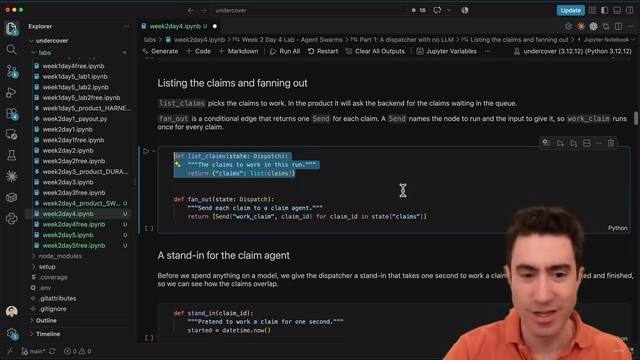

第 4 步的 stub 函数，讲师说它故意慢一秒：

> "它会执行 time.sleep(1)，在处理 claim 时睡眠一秒，它实际上没做什么，但会让它假装思考一秒。"
> —— p072 [03:56]

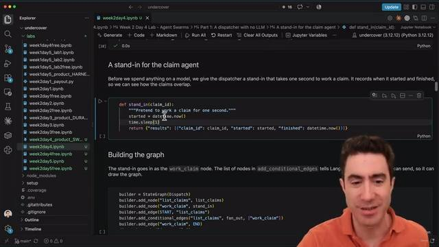

第 5 步建完图之后讲师会可视化一次，确认边连对了：

> "让我们看看图。这就是它的样子。希望这完全符合你的预期。"
> —— p072 [05:11]

> "这被称为条件边，因为我们在它如何被调用周围放了一些函数。但你我都知道它并不是真正的条件，它更像是一种扩展边。"
> —— p072 [05:11]

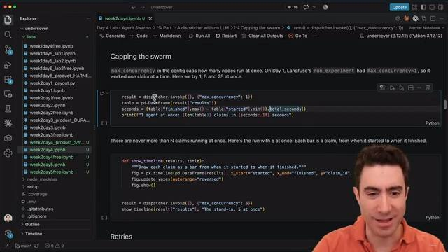

第 6 步，`max_concurrency=1` 跑完的结果：

> "一个 agent 一次处理 25 个 claim 用了 25.1 秒。"
> —— p072 [06:00]

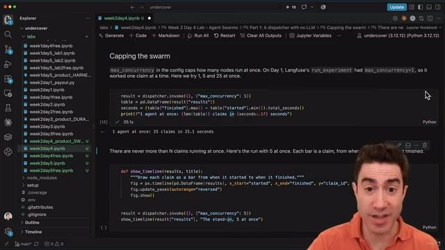

### 3.6 Part 2：把 worker 换成 claim agent

这部分的关键认知是：**外层 dispatcher 一行都不用改**，只把 `work_claim` 节点绑定的函数从 `stand_in` 换成 `work_claim_agent` 即可。讲师原话：

> "我们将保持它为 vanilla LangGraph 图。但然后我们要让它做的，不是这个替身、这个一秒延迟的 dummy 函数，而是让一个节点真正涉及 agent。"
> —— p073 [00:00]

claim agent 的构成：

- 系统 prompt：「You are a claims handler. Choose a decision.」
- 用户 prompt：「Here is a policy. Here is a claim.」
- 两个 tool：`record_decision`、`calculate_payout`
- 模型：ChatOpenAI 形式，低 reasoning effort
- 用 `create_agent` 包成 graph

讲师特别说明 `create_agent` 内部就是 LangGraph：

> "我们将使用 create agent。你忘了 create agent。所以我们知道它实际上会在幕后创建一个 LangGraph 图，但为了简单起见我们就用它。"
> —— p073 [01:07]

`work_claim` 函数把所有东西串起来：

> "现在这只是一个名为 work claim 的 Python 函数，它会启动 agent 图。它用我们关心的用户提示来调用它。例如，我们可以用 CLM1203 调用这个 Python 函数，那是罗马的入室盗窃案……我们会得到这种形式的结果，一组结果，包含 claim ID、prove 和 payout。"
> —— p073 [02:22]

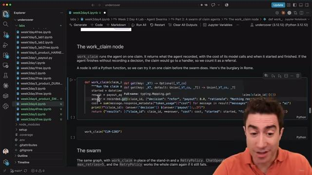

然后建外层 dispatcher（同样 `list_claims` + `work_claim`），用 5 并发跑 25 个 claim：

> "这里有 25 个 claim，我们现在要做的是同时运行所有，但以五个的 swarm……我们只需传入 max concurrency 是……"
> —— p073 [03:48]

跑完看 timeline，会发现不是按批（5 个一组）出块，而是「谁先完成谁补位」。讲师专门纠正了这个直觉：

> "最后几个之所以是五个一组，唯一原因是它们都同时完成了……它只是把任务插进去，保证任何时候最多五个。"
> —— p073 [05:02]

### 3.7 在 Langfuse 看 trace

P73 后半段全部在 Langfuse 里操作。步骤按讲师原话：

1. 进 Tracing，先改过滤器：**取消勾选 `root observation = false`**，只看 `true` 的根 trace，否则会看到一大堆子 trace 混在一个列表里。
2. 找到名为 `swarm of five` 的根 trace（这就是你这次跑的 run name）。
3. 点进去看 tree：能展开 `list_claims → fan_out → work_claim`，还能点开 `fan_out` 看到输入的 claims 和输出的每个 `Send`。
4. 点 **Timeline** 按钮看时间轴。
5. 点 **Graph** 按钮看节点和 tool 调用图。

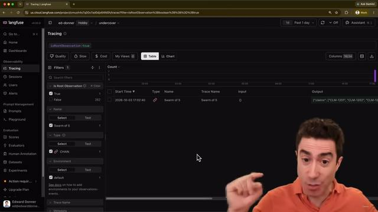

### 3.8 Part 3：指标与 scores

P74 复用 day 1 的指标函数，再加两个新指标：

> "新的一个是 slowest claim，就像最弱的一环，哪个花的时间最长。而 seconds per claim 是平均值。"
> —— p074 [00:16]

对 `swarm of 5` 跑一次指标，结果：

> "它在准确率、决策方面做得相当好……而且显然花了 28 秒。这是它弄错的 claim。错了三个 claim。"
> —— p074 [00:51]

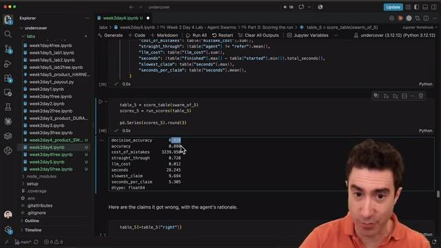

然后把指标通过 `langfuse.create_score` 上传：

> "Langfuse 有对象可以跟踪你运行的分数，你使用 langfuse.createScore 作为将分数上传到平台的方式。"
> —— p074 [01:18]

### 3.9 Part 4：swarm of 25

把 `max_concurrency` 从 5 改成 25 再跑一次：

> "我们决定五个不算 swarm，但 25 个算。25 个就是 swarm。没有规则。"
> —— p074 [02:33]

结果：25 个 claim 几乎同时开始，总耗时降到最慢那个 claim 的时间。讲师提醒 accuracy 的微小变化是噪声：

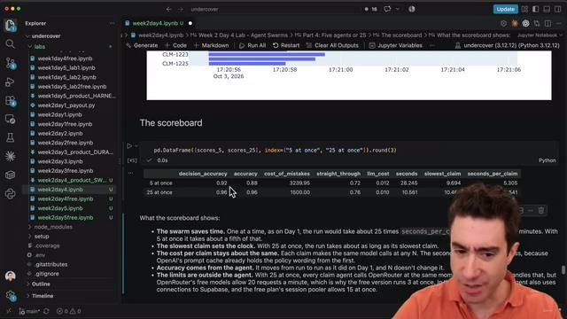

> "它提高了准确率……是的，就是噪声……秒数是我们预期看到的。那是最大的变化。"
> —— p074 [04:21]

最后回到 Langfuse，两个 root trace（5 和 25）可以点来点去对比 timeline。

### 3.10 跑完的完整操作顺序

1. 建 venv、装依赖、配 `.env`。
2. 打开 `week 2 day 4.ipynb`，选 kernel。
3. 执行 imports + 数据加载。
4. 执行 Part 1 的 state / 节点 / 建图 cell。
5. 执行 `max_concurrency=1/5/25` 三次调用，确认 25.1s / ~5s / ~1s。
6. 执行 flaky + retry cell，确认 `CLM-1207` 的 tries 计数是 2。
7. 执行 claim agent 构建 cell 和 `work_claim_agent` cell。
8. 执行 `max_concurrency=5` 的 dispatcher，带 Langfuse callback。
9. 进 Langfuse 看 tree / timeline / graph。
10. 执行指标计算和 `create_score`。
11. 执行 `max_concurrency=25`，再算一次指标、再上传 scores。
12. 对比两组指标，确认秒数差异、accuracy 差异是噪声。

这就是全部复现步骤。下面给完整代码。

## 4. 完整代码

以下每个代码块对应 notebook 的一个 cell，可以直接复制到 `.ipynb` 里按顺序运行。**凡是逐字稿没有给出确切写法的部分，都在注释里标注了「课里没讲」或「字段名以实际输出为准」。**

### Cell 1：环境与 imports

```python
# cell 1: imports
import os
import time
import operator
from typing import Annotated, TypedDict

from dotenv import load_dotenv
load_dotenv()

from langgraph.graph import StateGraph, START, END
from langgraph.types import Send

# RetryPolicy 的 import 路径随 langgraph 版本变化，可能是：
#   from langgraph.pregel import RetryPolicy
#   from langgraph.types import RetryPolicy
# 以你安装的版本为准
from langgraph.pregel import RetryPolicy

from langchain_openai import ChatOpenAI
from langchain_core.tools import tool
from langchain.agents import create_agent  # 旧版可能是 langgraph.prebuilt.create_react_agent

from langfuse.callback import CallbackHandler  # 新版可能是 langfuse.langchain.CallbackHandler

import matplotlib.pyplot as plt

MODEL_NAME = os.getenv("MODEL_NAME", "luna")
```

### Cell 2：数据（占位，替换成 harder 数据集）

```python
# cell 2: 数据
# 课里用的是 harder 数据集（25 claims / 25 labels / 25 policies），
# 但逐字稿没有念出加载函数。这里给一个等价的最小数据集，
# 保证 dispatcher 能跑起来；换成你自己的数据集即可。

CLAIM_IDS = [f"CLM-{1201 + i}" for i in range(25)]   # 含 CLM-1203、CLM-1207

CLAIMS = list(CLAIM_IDS)

# labels 的结构以 day 1 notebook 为准，这里只放最小占位
LABELS = {cid: {"decision": "accept", "payout": 1000.0} for cid in CLAIM_IDS}

# policies 按 claim id 取文本
POLICIES = {cid: f"Policy for {cid}: 标准家财险条款，含免赔额。" for cid in CLAIM_IDS}

assert len(CLAIMS) == 25
```

### Cell 3：state 定义（注意 reducer）

```python
# cell 3: DispatchState
class DispatchState(TypedDict):
    claims: list[str]
    results: Annotated[list, operator.add]   # 关键：reducer
```

### Cell 4：节点函数

```python
# cell 4: list_claims / fan_out / stand_in
def list_claims(state: DispatchState) -> dict:
    """把 25 个 claim 填进 state。"""
    return {"claims": CLAIMS}


def fan_out(state: DispatchState):
    """条件边：
对每个 claim 返回一个 `Send`，第二个参数是传给 `work_claim` 节点的 payload（这里就是 claim id）。
    """
    return [Send("work_claim", claim_id) for claim_id in state["claims"]]


def stand_in(claim_id: str) -> dict:
    """假的 worker：睡 1 秒，然后返回这个 claim 的起止时间。

    课里把它叫「stub function / stand-in」，作用是先把并发骨架跑通，
    后面再替换成真正的 agent（见 Cell 11）。
    """
    start = time.time()
    time.sleep(1)
    end = time.time()
    return {"results": [{"claim_id": claim_id, "start": start, "end": end}]}
```

> 注意 `stand_in` 的参数是 `claim_id` 而不是 `state`。这正是 `Send("work_claim", claim_id)` 的含义：payload 直接成为该节点的输入。所以 `results` 是唯一需要 reducer 的字段——每个并行节点都往它里面追加一条记录。

### Cell 5：建图（可复用，方便换 worker）

```python
# cell 5: build_dispatcher
# 讲师在笔记本里是直接把图建了两次（一次 stand_in，一次 flaky_stand_in）。
# 这里抽成一个函数，行为等价，少复制粘贴。
def build_dispatcher(worker, retry_policy=None):
    g = StateGraph(DispatchState)
    g.add_node("list_claims", list_claims)
    if retry_policy is None:
        g.add_node("work_claim", worker)
    else:
        # 参数名在不同 langgraph 版本里可能是 retry / retry_policy，以实际为准
        g.add_node("work_claim", worker, retry=retry_policy)

    g.add_edge(START, "list_claims")
    # 第三个参数是「fan_out 可能返回哪些节点名」，告诉编译器目标集合
    g.add_conditional_edges("list_claims", fan_out, ["work_claim"])
    g.add_edge("work_claim", END)
    return g.compile()


dispatcher = build_dispatcher(stand_in)
```

### Cell 6：可视化图结构

```python
# cell 6: 看一眼图。notebook 里会渲染成图片
try:
    from IPython.display import Image, display
    display(Image(dispatcher.get_graph().draw_mermaid_png()))
except Exception as e:
    # 本地没装 mermaid 渲染依赖时会失败，打印 mermaid 源码也行
    print(dispatcher.get_graph().draw_mermaid())
    print("render failed:", e)
```

### Cell 7：用 max_concurrency = 1 / 5 / 25 各跑一次

```python
# cell 7: 同一张图，只改 max_concurrency
for n in (1, 5, 25):
    t0 = time.time()
    out = dispatcher.invoke(
        {"claims": [], "results": []},          # 初始 state，课里说它「probably empty」
        config={"max_concurrency": n},          # 关键参数
    )
    dt = time.time() - t0
    got = len(out["results"])
    print(f"max_concurrency={n:>2}: {got} results in {dt:.1f}s")
```

预期（基于讲师报的数，p072 [06:00] / [07:04] / [07:23]）：

- `1` → 约 25 秒（讲师实测 25.1s）
- `5` → 约 5 秒
- `25` → 约 1 秒

你的机器上会多一点噪声，讲师自己也解释过 25.1 和 5 秒之外的零头是 Python 解释器开销（p072 [07:52]：「It's just because there's some noise added through the Python interpreter」）。

### Cell 8：timeline 绘图（讲师未给实现，以下是示意）

```python
# cell 8: show_timeline
# 讲师只说这是「a little bar chart drawer」（p072 [07:23]），
# 没有念出实现。以下是为了复现效果写的等价示意，字段名与你自己的 results 对齐即可。
def show_timeline(results, title="dispatch timeline"):
    if not results:
        print("no results")
        return
    t0 = min(r["start"] for r in results)
    rows = sorted(results, key=lambda r: r["start"])
    fig, ax = plt.subplots(figsize=(10, 0.3 * len(rows) + 1.5))
    for i, r in enumerate(rows):
        ax.barh(i, r["end"] - r["start"], left=r["start"] - t0, height=0.7)
        ax.text(r["end"] - t0 + 0.03, i, r["claim_id"], va="center", fontsize=7)
    ax.set_xlabel("seconds since first start")
    ax.set_ylabel("claim (sorted by start)")
    ax.set_title(title)
    plt.tight_layout()
    plt.show()


show_timeline(out["results"], title=f"max_concurrency={n}")
```

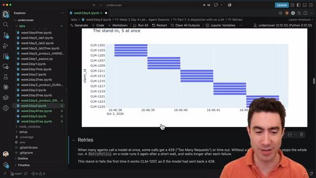

### Cell 9：flaky worker + RetryPolicy

```python
# cell 9: flaky_stand_in + 重试
TRIES: dict[str, int] = {}


def flaky_stand_in(claim_id: str) -> dict:
    # 讲师的原意：第一次记 0，之后往上 tick；第一次调用 CLM-1207 时抛异常
    TRIES[claim_id] = TRIES.get(claim_id, 0) + 1
    attempt = TRIES[claim_id]
    if claim_id == "CLM-1207" and attempt == 1:
        raise RuntimeError(f"pretend failure on {claim_id}")
    return stand_in(claim_id)


flaky_dispatcher = build_dispatcher(
    flaky_stand_in,
    retry_policy=RetryPolicy(max_attempts=3),   # 讲师原话：max attempts is three
)

TRIES.clear()
t0 = time.time()
out_retry = flaky_dispatcher.invoke(
    {"claims": [], "results": []},
    config={"max_concurrency": 25},
)
print(f"retry run: {len(out_retry['results'])} results in {time.time() - t0:.1f}s")
print("attempts for CLM-1207:", TRIES.get("CLM-1207"))
show_timeline(out_retry["results"], title="retry on CLM-1207")
```

期望：`TRIES["CLM-1207"] == 2`，timeline 上 `CLM-1207` 会出现两段——第一段失败、第二段成功。讲师在 p072 [11:04] 描述的就是这个画面：「the first time it was tried, it failed with an exception. and then it was tried again and on the retry we got good results」。

### Cell 10：claim agent 的两个 tool 与系统 prompt

```python
# cell 10: tools + agent
# 两个 tool 是讲师点名的：record_decision、calculate_payout。
# 参数签名课里没有逐字念，以下为可运行的示意，换成你业务的真实签名即可。
@tool
def record_decision(claim_id: str, decision: str) -> str:
    """Record the final decision for a claim. decision is one of accept / reject / refer."""
    return f"recorded decision={decision} for {claim_id}"


@tool
def calculate_payout(amount: float, already_paid: float, deductible: float) -> float:
    """Payout = benefit amount minus what has already been paid minus deductible, floored at 0."""
    return max(0.0, amount - already_paid - deductible)


SYSTEM_PROMPT = """You are a claims handler. Choose a decision.
Use record_decision to record the decision.
Use calculate_payout when a payout number is needed."""

model = ChatOpenAI(
    model=MODEL_NAME,
    # 讲师说「low reasoning effort」；参数名与可用值以你用的模型/SDK 为准
    reasoning_effort="low",
)

claim_agent = create_agent(
    model=model,
    tools=[record_decision, calculate_payout],
    system_prompt=SYSTEM_PROMPT,
)
```

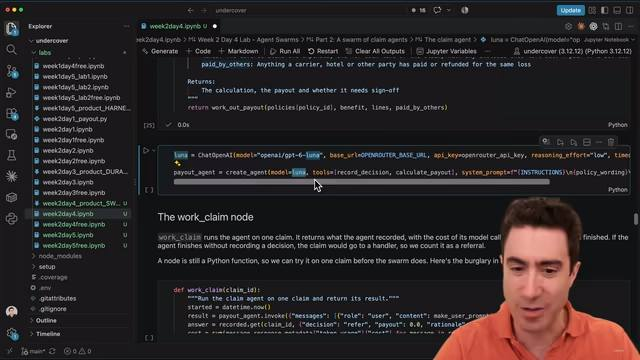

### Cell 11：work_claim 节点调用另一个 graph

```python
# cell 11: 外层节点内部 invoke 内层 agent graph
# 讲师原话：结果形如「a claim ID, a prove and the payout」，
# 转写里的 "a prove" 含义不明确（可能是 approve），字段名以你的实际输出为准。
def work_claim_agent(claim_id: str) -> dict:
    start = time.time()
    user_prompt = (
        f"Here is a policy:\n{POLICIES[claim_id]}\n\n"
        f"Here is a claim:\n{claim_id}"
    )
    agent_out = claim_agent.invoke(
        {"messages": [{"role": "user", "content": user_prompt}]}
    )
    end = time.time()
    final_message = agent_out["messages"][-1].content
    return {
        "results": [
            {
                "claim_id": claim_id,
                "final": final_message,
                "start": start,
                "end": end,
            }
        ]
    }
```

### Cell 12：swarm of five（带 Langfuse callback）

```python
# cell 12: 5 并发 + Langfuse trace
claim_dispatcher = build_dispatcher(work_claim_agent)

langfuse_handler = CallbackHandler()   # key/host 从环境变量读，构造参数以 SDK 为准

t0 = time.time()
out5 = claim_dispatcher.invoke(
    {"claims": [], "results": []},
    config={
        "max_concurrency": 5,
        "callbacks": [langfuse_handler],
        "run_name": "swarm of five",      # 让 Langfuse 的 root trace 叫这个名字
    },
)
print(f"swarm of five: {len(out5['results'])} results in {time.time() - t0:.1f}s")
show_timeline(out5["results"], title="swarm of five")
```

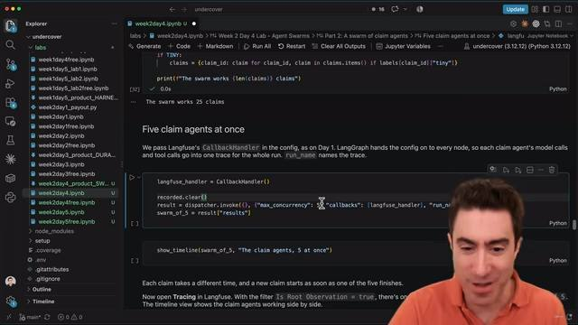

### Cell 13：swarm of 25

```python
# cell 13: 25 并发
t0 = time.time()
out25 = claim_dispatcher.invoke(
    {"claims": [], "results": []},
    config={
        "max_concurrency": 25,
        "callbacks": [langfuse_handler],
        "run_name": "swarm of 25",
    },
)
print(f"swarm of 25: {len(out25['results'])} results in {time.time() - t0:.1f}s")
show_timeline(out25["results"], title="swarm of 25")
```

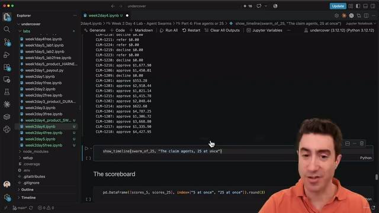

### Cell 14：指标（讲师未给实现，以下是骨架）

```python
# cell 14: 指标
# P74 [00:00] 讲师列出：decision accuracy / accuracy / cost of mistakes /
# straight through / cost / time / slowest claim / seconds per claim。
# 但没有在本节 notebook 里念出实现（说的是复用 day 1 的函数）。
# 以下只复现「时长类」指标骨架 + 一个需要你补的准确率占位。
def compute_timing_metrics(results):
    n = len(results)
    if n == 0:
        return {}
    durations = [r["end"] - r["start"] for r in results]
    return {
        "slowest_claim_seconds": max(durations),   # 讲师说的「weakest link」
        "seconds_per_claim": sum(durations) / n,   # 平均值
        "wall_clock_seconds": max(r["end"] for r in results) - min(r["start"] for r in results),
    }


print("swarm of five:", compute_timing_metrics(out5["results"]))
print("swarm of 25:  ", compute_timing_metrics(out25["results"]))
```

decision accuracy / cost of mistakes 这些需要你的 `labels` 里有金标准，并且要从 agent 输出里解析出 decision。**解析代码课里没讲**，按你自己的输出格式补。

### Cell 15：上传 scores 到 Langfuse

```python
# cell 15: scores
# 讲师念的是 langfuse.createScore；Python SDK 里方法名可能是 create_score / score，
# 参数名以实际 SDK 为准。
from langfuse import Langfuse

langfuse = Langfuse()


def upload_scores(trace_id: str, metrics: dict):
    for name, value in metrics.items():
        langfuse.create_score(
            trace_id=trace_id,
            name=name,
            value=float(value),
        )


# trace_id 需要从这次 run 里取。可取的方式：Langfuse UI 里点进 trace 看 id，
# 或用 handler 暴露的 trace id（各版本 API 不同，课里没讲）。
# upload_scores(trace_id_of_swarm_of_five, compute_timing_metrics(out5["results"]))
```

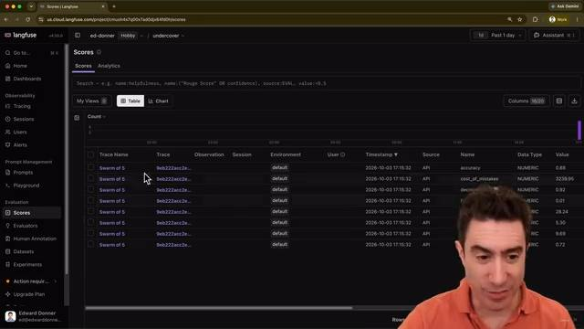

### Cell 16：清空 Langfuse（讲师的 housekeeping cell）

```python
# cell 16: 清空本项目 traces
# 讲师原话：把 clear_langfuse 从 False 改成 True 再执行。
# 具体删除 API 课里没有念，以下只示意开关，不写死某个方法名。
CLEAR_LANGFUSE = False

if CLEAR_LANGFUSE:
    # 具体方法名（如 delete_all / delete_traces）以你装的 langfuse SDK 为准；
    # API key 只作用于本项目，这点讲师明确说过。
    raise SystemExit("请按你的 langfuse SDK 版本补上删除调用，当前开关仅作防误触保护")
else:
    print("clear_langfuse is False, nothing deleted")
```

## 5. 逐行解释

**Cell 3 的 `Annotated[list, operator.add]`。** 整个实验室最不能省的一行。25 个 `work_claim` 节点是并行跑的，每个都会返回一个只含自己那条结果的 dict。如果 `results` 只是 `list`，LangGraph 合并 state 时就是「后写覆盖先写」，你最后只会拿到 1 条结果。加上 `operator.add` 之后，合并策略变成列表拼接，25 条才会都在。这正是讲师在 p072 [01:55] 讲的场景：「if multiple nodes run... I've got to combine them in some way... I just stuff them together」。

**`claims` 为什么不需要 reducer。** 因为只有 `list_claims` 一个节点写它，没有并发写冲突。reducer 只在「多个节点写同一个字段」时才必需。这是判断要不要加 reducer 的唯一标准，不需要背规则。

**`fan_out` 返回 `[Send("work_claim", claim_id) ...]`。** 这里有两个反直觉点。第一，它的返回值不是 state，而是一个 `Send` 列表；第二，`Send` 的第二个参数是**该节点的输入**，不是 state 补丁。所以 `stand_in` 的签名是 `(claim_id: str)` 而不是 `(state)`。讲师在 p072 [03:01] 把这件事说得很直白：「for each one it makes this object right here. a send object... with work claim as the thing that it's trying to send work a claim and the claim ID」。

**`add_conditional_edges("list_claims", fan_out, ["work_claim"])` 的第三个参数。** 它告诉编译器：`fan_out` 只会把任务发往 `work_claim`。这不是必须的（不给也能跑），但给了之后图可视化更准，也能提前做校验。

**`stand_in` 里的 `time.sleep(1)`。** 它不是为了模拟 LLM 延迟，而是为了让「并发数」这个变量可见。如果每个任务耗时 0 秒，1 并发和 25 并发看起来一样快，你就观察不到任何东西。讲师原话：「it's not actually doing anything but will make it pretend that it's thinking for a second」（p072 [03:56]）。

**`max_concurrency` 放在 `config` 里而不是图定义里。** 这是本节最重要的工程点：**同一张编译好的图，靠一次调用参数就能切换串行 / 5 并发 / 25 并发**。讲师的原话是「the engineering is going to be changing this one to A5」（p072 [06:30]）——所谓「扩展」在这里只是一次参数改动，不是重新架构。在 JS/Node 里对应的是 `p-limit` 这类并发闸门：你不会改业务函数，只会改外面那层 `limit(n)`。

**BSP 式的「补位」而不是「分批」。** 很多人第一次看到 5 并发的 timeline 会以为是「5 个一批，跑完一批开下一批」。讲师的 dashboard 之所以在假函数下呈现 5 个一组，纯粹是因为所有任务都恰好 1 秒、同时完成；换成真实 agent 后就变成谁先结束谁先补位（p073 [05:02]）。这一点直接影响容量估算：总耗时 ≈ `ceil(N / concurrency) × 单任务耗时`只在任务等长时成立，真实情况下总耗时由**最慢的那条链路**决定，讲师在 p074 [05:58] 把它叫「weakest link control the total amount of time」。

**`flaky_stand_in` 的计数写法。** `TRIES.get(claim_id, 0) + 1` 等价于讲师说的「put zero in the first time it's called and then start ticking up」。之所以要一个跨调用共享的模块级字典，是因为重试是**同一个节点被再次调用**，节点函数本身是无状态的，状态必须放在外面。在 JS 里就是模块作用域的 `Map`。

**`RetryPolicy(max_attempts=3)`。** 它挂在 `add_node` 上，而不是包在函数里。这个位置很重要：重试策略是**节点的属性**，所以它对节点的任何异常都生效，你不需要在业务代码里写 `try/except + for` 循环。这就是讲师说的「it will just handle the whole thing for you」（p072 [09:52]）。

**`work_claim_agent` 里再 `invoke` 一个 graph。** 很多人以为「graph 调 graph」需要特殊 API，其实不需要：外层节点的函数体里直接 `claim_agent.invoke(...)` 就行，因为 `claim_agent` 编译后本身就是一个可调用对象，而外层只把它当成「一个会返回 dict 的 Python 函数」。讲师在 p073 [01:59] 专门强调这一点。这也意味着内层 agent 可以有自己的 state、自己的 tools、自己的 retry，外层完全不用知道。

**`run_name` 让 Langfuse 的 root trace 好认。** 讲师在 Langfuse 里能一眼看到 `swarm of five` 和 `swarm of 25` 两条根 trace（p074 [05:52]），靠的就是给每次 invoke 一个可区分的 run name。没有它，你的两条 trace 会叫同一个默认名字，对比时只能靠时间戳猜。

**指标里的 `slowest_claim_seconds`。** 它不是「平均值的一个变体」，而是**决定总耗时的那个量**。P74 [05:28] 讲师的结论是：25 并发的总耗时约等于最慢那条 claim 的耗时；5 并发的总耗时约等于「5 批中最慢的那批」。所以并发数带来的收益上限，由「任务耗时的分布有多不均匀」决定——如果 25 个 claim 里有 1 个要跑 30 秒，你把并发从 5 提到 25 也只能把总时间从 60 秒压到 30 秒。

**accuracy 不随并发变。** P74 [04:21] 讲师看到 25 并发的 decision accuracy 略高，立刻判定是 noise：「They're all independent alarm calls」。这个判断在工程上很重要：**并发只影响时间维度，不影响模型输出分布**。如果你真的观察到稳定差异，那说明有共享状态被污染了（比如共用了可变对象、或 prompt 里混进了上一次的结果），不是并发的「好处」。

## 6. 复现检查清单

按顺序打勾，任何一项不过就不要往下走。

**环境**

- [ ] `python -m venv .venv` 建好并激活，`which python` 指向 `.venv`
- [ ] `pip install` 了 `langgraph` / `langchain` / `langchain-openai` / `langfuse` / `python-dotenv` / `matplotlib` / `jupyter`
- [ ] `pip freeze > requirements.txt` 已保存（这是唯一能保证别人复现的方式，课里没要求但必须做）
- [ ] `.env` 里有 `OPENROUTER_API_KEY`，且 `load_dotenv()` 后 `os.getenv` 能取到非空值
- [ ] `.env` 里有 `LANGFUSE_PUBLIC_KEY` / `LANGFUSE_SECRET_KEY` / `LANGFUSE_HOST`
- [ ] VS Code 打开的是 `.ipynb` 文件，右上角 kernel 选的是 `.venv`

**Part 1：无 LLM 的 dispatcher**

- [ ] `from langgraph.types import Send` 不报错
- [ ] `RetryPolicy` 能 import 成功（路径见第 7 节）
- [ ] `DispatchState` 的 `results` 字段确实带 `Annotated[list, operator.add]`
- [ ] `dispatcher.get_graph()` 输出里能看到 `list_claims → work_claim → END`
- [ ] `max_concurrency=1` 跑完，`len(out["results"]) == 25`
- [ ] 同上，耗时约 25 秒（±2 秒）
- [ ] `max_concurrency=5` 耗时约 5 秒
- [ ] `max_concurrency=25` 耗时约 1 秒
- [ ] 三次的 `len(out["results"])` 都是 25（这条最关键：如果 5 并发那次只有 5 条，说明 reducer 写错了）

**Part 1b：retry**

- [ ] `TRIES["CLM-1207"] == 2`
- [ ] `len(out_retry["results"]) == 25`（失败的 claim 最终也产出了结果）
- [ ] timeline 上 `CLM-1207` 有两段，且第一段很短（刚启动就抛异常）
- [ ] 故意把 `max_attempts` 改成 1，确认整个 run 会抛异常（验证 retry 真的在起作用，而不是异常被吞了）

**Part 2：agent**

- [ ] `create_agent` 能 import 成功
- [ ] `claim_agent.invoke` 单跑一个 claim（比如 `CLM-1203`）能返回带消息的结果
- [ ] 单跑时 Langfuse 里能出现一条对应的 trace（说明 callback 接上了）
- [ ] `work_claim_agent("CLM-1207")` 单独调用返回的 dict 里有 `results` 键

**Part 3/4：swarm 与 scores**

- [ ] `max_concurrency=5` 的 run 在 Langfuse 里的 root trace 名叫 `swarm of five`
- [ ] 该 trace 展开后能看到 `list_claims`、`fan_out`、多个 `work_claim`
- [ ] Timeline 视图能看到任务重叠，不是整齐的 5 个一块
- [ ] `max_concurrency=25` 的 run 的 timeline 里，绝大多数 claim 的起点几乎重合
- [ ] 两次 run 的 `seconds_per_claim` 接近，`wall_clock_seconds` 差距大（这是实验的结论）
- [ ] `upload_scores` 之后，Langfuse 的 Scores 页面能看到对应的 score
- [ ] 清空 cell 的 `CLEAR_LANGFUSE` 保持 `False`（除非你确定要删）

## 7. 课里没讲但你会撞上的

**1. `Send` 和 `RetryPolicy` 的 import 路径会随版本变。** 逐字稿里讲师直接用了这两个名字，没有念 import 语句。常见情况是 `Send` 在 `langgraph.types`，而 `RetryPolicy` 在 `langgraph.pregel` 或 `langgraph.types` 之间移动过。遇到 `ImportError` 时不要怀疑自己写错了逻辑，先 `python -c "导入 langgraph，并打印 langgraph.__version__。"` 看版本，再去对应版本的 API 文档找路径。

**2. `create_agent` 这个名字本身就不稳定。** 讲师说「we'll use create agent」，但在不同版本的 LangChain/LangGraph 里，这个能力可能叫 `create_react_agent`（在 `langgraph.prebuilt` 里）或 `create_agent`（在 `langchain.agents` 里），参数名可能是 `prompt` 而不是 `system_prompt`。这是本节最容易卡住的地方。先写一个最小例子跑通，再接到 dispatcher 里。

**3. `add_node(..., retry=...)` 的参数名可能不是 `retry`。** 你可能会遇到 `TypeError: add_node() got an unexpected keyword argument`。先 `inspect.signature(StateGraph.add_node)` 看一眼，再决定传什么。不要凭记忆硬填。

**4. `max_concurrency` 放错层级。** 它属于 invoke 的 `config`，不属于图、也不属于 `configurable` 里面的业务配置。如果你把它塞进 `config={"configurable": {"max_concurrency": 5}}`，不会被识别，表现为「怎么改都是串行」。

**5. `reasoning_effort="low"` 不是所有模型都认。** 讲师用的 Luna 支持这个参数，换成别的 OpenAI 兼容模型可能会直接 400。如果报错，先把这个参数去掉，确认链路通了再加回来。

**6. `time.sleep` 在同步 invoke 下会占住线程。** 假函数阶段这没问题，因为任务本来就短。但如果你把假函数换成一个同步的、耗 CPU 的 worker，`max_concurrency=25` 并不会真的并行 25 个——Python 有 GIL。真正的 agent 调用是网络 IO，释放 GIL，所以 25 并发是有效的。这一点课里没讨论，但你换成真实业务后一定会遇到。

**7. 25 并发会被模型侧限流。** 讲师在本地跑 25 个 agent 没有提限流，但你的 API key 可能有 RPM/TPM 限制。表现是部分 claim 抛 429，然后被 `RetryPolicy` 吃掉、变慢，最后总耗时远大于「最慢的那个 claim」。这时候把 `max_concurrency` 降到 10 左右往往比调大重试次数更有效。

**8. Langfuse 的 `CallbackHandler` 构造方式和 trace id 的取法会变。** 讲师只说「we're using this Langfuse handler as our callback handler」，没有念构造参数。如果构造时就要传 key，从环境变量读；如果 trace id 取不到，`create_score` 就无法关联到具体 run。稳妥做法是先在 UI 里手动看一次 trace，确认 callback 真的生效了，再写上传分数的代码。

**9. `results` 里到底该放什么，课里只给了一个模糊描述。** 讲师说 agent 的结果形如「a claim ID, a prove and the payout」，转写里的 "a prove" 含义不明确。你的 `compute_metrics` 需要从这个结构里取 decision，所以**必须先把你自己的输出结构定下来**（比如 `{"claim_id", "decision", "payout", "start", "end"}`），后面的指标和 scores 才有字段可用。这一步不能照抄，只能自己定。

**10. Langfuse 的 `root observation` 过滤器是「看不见结果」的头号原因。** 讲师在 p073 [06:07] 专门停下来讲这件事：如果不把 `root observation = false` 取消勾选，你会看到几十条子 trace 混在一个列表里，根本找不到你那次 run。这不是 bug，是默认视图的问题。

**11. 你可能会以为 25 并发「应该」比 5 并发准确率更高。** 讲师在 p074 [04:21] 直接否掉了：「Yes, it's just noise」。并发不改变模型的输入，所以不改变输出分布。如果你反复跑发现准确率稳定不同，去查是不是共享了可变状态（比如原代码里 `TRIES` 这类模块级字典被多个 claim 共用、或者 prompt 拼接时用了全局变量）。

**12. 断点续跑（PostgresSaver + Supabase）是作业，不是本节内容。** 讲师在 p074 [09:29] 把它作为技术作业布置：「put in place the check pointer, use the Postgres Saver to write this to Superbase, and then set it going and cause it to crash」。**课里没有现场实现**，所以本文档也没有给这段代码——如果你要写，需要自己装 `psycopg`、拿 Supabase 连接串、用 `PostgresSaver.from_conn_string(...)` 编译图，这些细节逐字稿里都没有。

**13. thread ID 的组织方式是一个需要你主动做的设计决策。** 本节全程用「一个 thread id 跑完整个 swarm」。讲师在 p074 [06:39] 指出另一种做法是「每个 claim 一个 thread id」，好处是单个 claim 可以独立做 human-in-the-loop、独立挂起而不拖住整张图。如果你后面要做人工审核，这个选择要在建图之前定下来，改起来会牵动 checkpointer 的存储结构。

**14. 在 JS/Node 里对应什么。** 这一节的所有概念都有直接映射：`operator.add` reducer ↔ 数组 `concat`；`Send` fan-out ↔ `Promise.all(items.map(fn))`；`max_concurrency` ↔ `p-limit` 的 `limit(n)`；`RetryPolicy` ↔ `p-retry`；LangGraph 的 checkpointer ↔ 自己维护的任务状态表。讲师讲的虽然是 Python，但这套「fan out + 固定并发闸门 + 自动重试」的模式在前端做批量请求（比如批量调翻译、批量生成缩略图）时完全通用——这也正是他在 p074 [08:21] 留的那个「不用 LLM 也能用」的商业作业的用意。