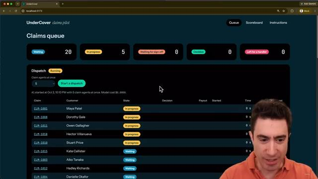
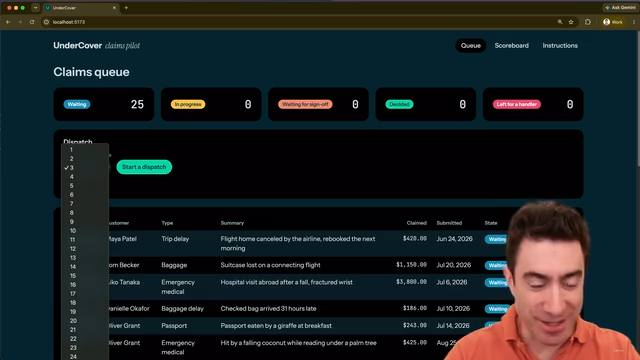
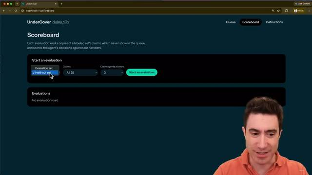
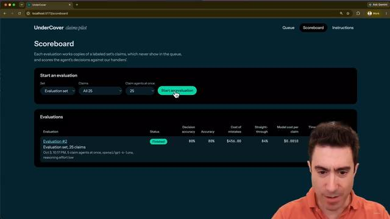
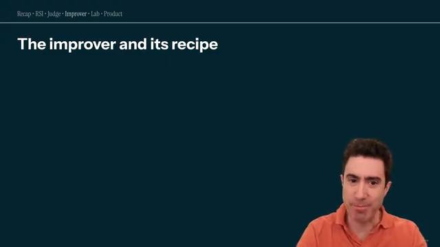
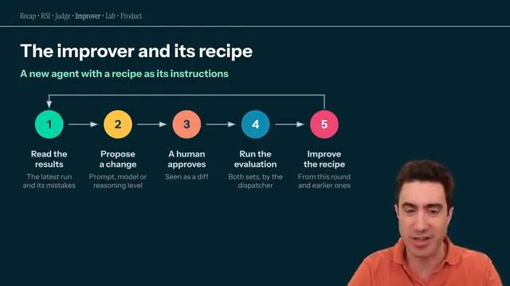
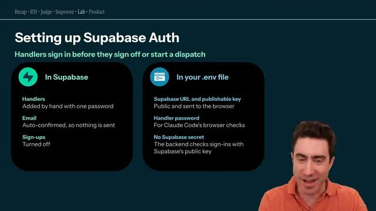
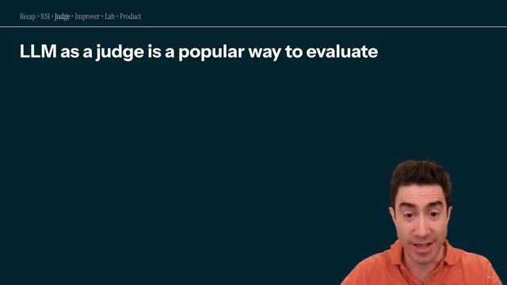

# AI FDE（BV1rJnm64Eq3）P75–P77 复现文档：从 Swarm 调度到 Scoreboard、LLM-as-Judge、Improver 与 Supabase Auth

## 1. 这一节做什么

这一段课程不是从零新建项目，而是在前几天的 **undercover** 产品上继续加三块能力：

1. **把单 agent 处理升级成 agent swarm（agent 群）**：在 dashboard 上选择一个数字 N，表示同时启动多少个 worker / claim agent；点击开始后，前端把请求发给后端，后端向 agents 派发任务，每个 agent 同时处理一定数量的 claims，结果再流回产品。
2. **把评估做成产品里的 Scoreboard**：可以选 evaluation set 或 held-out set，选 claims 数量和同时运行的 agents 数量，点击 Start an Evaluation，实时看到平均每 claim 模型成本、accuracy、decision accuracy、cost of mistakes、straight through 等指标；这些结果也会进入数据库和 Langfuse。
3. **为“自我改进”做设计**：P76–P77 讲 LLM-as-Judge、基于 reference answer 的 A/B/C/F 评分、Improver agent 的五步循环和四个工具，最后用 Supabase Auth 给 dashboard 加登录。

这一节的最终验收画面，是讲师在 P75 里展示的：dashboard 出现 **Dispatch** 和 **Scoreboard** 两个入口，Dispatch 可以输入 N 并启动 swarm；Scoreboard 可以跑 evaluation，并在页面上显示 headline stats。截图如下：



需要先说明：P75–P77 的逐字稿主要以“讲师演示 + 设计讨论”为主，**没有给出完整源码、依赖版本号、数据库表结构、启动命令**。所以本文档第 3 节会给可执行的复现流程，第 4 节按“纯讲解/设计课”的要求，把讲师的设计落成设计决策表、组件职责表、接口/数据模型草案和容量估算表；示意代码会明确标注“课里没有代码，以下为示意”，不会假装是课程源码。

---

## 2. 讲师原话

> "我们首先来改进仪表盘，让你可以在集群中选择工作进程的数量 N，然后启动集群。请求会经过后端，后端再向各个 agent 发送调度指令……"
> —— p075 [00:00]

这句话定下了 P75 的主线：**N 是产品里的并发旋钮**，前端只负责选 N 和触发，真正的派发在后端。

> "我们还会支持更新记分板，并在仪表盘中展示出来……把指标直接呈现在产品里往往非常有价值。"
> —— p075 [00:26]

Scoreboard 不是外部报表，而是产品里的一个页面/标签页。讲师也明确说，Langfuse 可以看 trace，但把指标直接放进产品里很有价值。

> "我们会有一个组件，负责评估并记录每一条理赔的成本和时间。"
> —— p075 [00:40]

每个 claim 都要记录成本和时间；这也是后面 Scoreboard 的 `average model cost per claim`、总耗时等指标的来源。

> "请按照 docs/swarm.md 中描述的内容规划一个集群。"
> —— p075 [04:17]

讲师的工作流是：把业务需求文档放到 `docs/swarm.md`，先让 coding agent **写计划**，而不是直接写代码。

> "请实现 plan swarm。"
> —— p075 [05:45]

计划确认后再让 agent 实现。P75 里讲师还提到要先 compact，避免上下文太满导致质量下降。

> "一种通用的做法叫“LLM 作为评判者”，就是用另一个 LLM 来评估你的 agent 系统给出的答案。"
> —— p076 [04:42]

P76 的核心概念：用另一个 LLM 按 rubric 给 agent 输出打分。

> "使用 LLM 作为评判者最好的方式之一，是让它以细致入微的方式将答案与参考答案进行对比评判。"
> —— p076 [00:59]

讲师更推荐“有 reference answer 的对比评分”，而不是完全盲评。P76 后面给出 A/B/C/F 的例子：F 是完全错，B 是与 reference 一致，A 是比 reference 更好、更清晰。

> "我们会给它一些必须严格遵守、不能退化的业务规则，然后再给它一些我们希望它改进的目标。"
> —— p077 [00:00]

P77 的 Improver 不是随便改 prompt，而是在硬约束内优化：不能低于 held-out accuracy，judge grade 不能更差，总预算不能超。

> "首先读取最新一次运行的结果……提出一项改动……经过人工审批环节……运行评估……改进它自己的配方。"
> —— p077 [02:13] 至 [02:52]

这是 Improver 的五步循环。第 5 步“改进自己的 recipe”就是讲师说的 recursive self-improvement 的演示点。

> "我们将通过 SuperBase 引入完善的身份认证。"
> —— p077 [04:08]

最后一块不是 AI，而是产品化必需的登录。用 Supabase Auth，设置 handlers 用户、假邮箱、同一密码、自动确认、关闭 signup，并在 `.env` 里加 Supabase URL、publishable key 和 handlers password。

---

## 3. 从零复现

这一节按“你手上已经有前几天的 undercover 代码库”来写。课里没有给依赖版本和启动命令，所以凡是课里没讲的，我会明确标注；你不要把本文档里的占位符当成课程原始变量名。

### 3.1 前置条件

你需要已经有：

- 前几天的 undercover 项目代码；
- Supabase Postgres 数据库；
- Langfuse（用于看 trace / score）；
- OpenRouter API key；
- 一个可用的 coding agent。讲师用的是 Claude Code，并说“You may use any coding agent of choice”。

课里没有讲 Node / 包管理器 / Next.js 的具体版本，也没有讲 `npm run dev` 之类的启动命令。**启动命令请沿用你仓库 README 或 `package.json` 里原有的脚本**，本文不编造。

### 3.2 找到并放置需求文档

逐字稿说：在 `labs` 目录里有 week two day four 的 `product swarm.md`，把它拖到 `docs` 目录并重命名为 `swarm.md`。

因为逐字稿没有给精确目录层级，先在仓库根目录定位：

```bash
find labs -iname '*swarm*.md' | grep -Ei 'week.*2.*day.*4'
```

找到后复制到 `docs/swarm.md`。如果你在 VS Code 里操作，直接拖拽并重命名也可以，避免路径猜错：

```bash
cp "<上一步找到的 product swarm.md>" docs/swarm.md
```

讲师还给了另一条路：直接 checkout 他的分支。逐字稿口述为 “week two day four start” 和 “week two day four dash end”，但**实际分支名以你的仓库为准**。可以先列分支：

```bash
git branch -a | grep -Ei 'week.?2.?day.?4'
```

然后 checkout 上一步列出的分支。课里没有保证分支名一定是某种固定写法，所以不要死记。

### 3.3 先让 coding agent 写计划

在 Claude Code（或其他 coding agent）里输入讲师用过的自然语言指令：

```text
please plan a swarm as described in docs/swarm.md
```

讲师说这个过程大约 20–30 分钟，产出了一份很详细的计划，包含 phases 和每个 phase 要检查的东西。你要重点看：

- 是否包含 dashboard 的 Dispatch；
- 是否有后端 dispatch；
- 是否有 claim 级成本/时间记录；
- 是否有 Scoreboard；
- 是否有 evaluation set / held-out set；
- 是否有 Langfuse 对接；
- 是否有测试和检查项；
- 是否提到需要 refactoring。

P75 里讲师还提到，agent 读了 human review 文档后主动说“需要 refactoring”，这是好事，说明计划不是只堆功能。

### 3.4 compact 后再实现

讲师在实现前先 compact，理由是上一次上下文太满，质量会下降。不同版本的 Claude Code 入口可能不同，课里没有讲具体命令；你只要在 agent 里执行“compact/压缩上下文”即可。

然后输入：

```text
please implement plan swarm
```

讲师这次实际等了 **2 小时 29 分钟**。他之前有一次花了 2 小时 46 分钟，并说希望别再来一次。所以你要有心理准备：这是一个长任务，不是几分钟的脚本。

### 3.5 启动产品并验收 Dispatch

启动命令课里没讲，沿用你现有 undercover 项目的启动方式。打开 dashboard 后，按讲师的操作验收：

1. 找到 **Dispatch** 区域；
2. 把 claims at once / workers 数量改成 `5`；
3. 点击 **Start a dispatch**；
4. 观察状态：应该出现 queued、in progress、decided、waiting sign off 等状态；
5. 改成 `25`，再点一次，观察是否 25 个 agent 同时跑。

P75 里 25 个 agents 同时跑时，页面上出现 “25 queued”“5 in progress” 之类的计数；讲师展示的 25 agents dispatch 完成后，顶部 headline stats 显示 total model cost 不到 3 美分、总耗时 41 秒。截图：



注意：课里说的“25 个 agents 同时跑”是产品层并发，不是让你在浏览器里 `Promise.all` 无限发请求。前端转 Node 的话，后端应该用 worker pool / 队列 / `p-limit` 这类方式限制真实并发；数据库写入也要考虑连接池和事务粒度。

### 3.6 验收 Scoreboard / Evaluation

进入 **Scoreboard** 标签页，讲师的操作是：

1. 选择数据集：`evaluation set` 或 `held-out set`；
2. 选择 claims 数量，例如全部 25；
3. 选择 agents at once，例如 5；
4. 点击 **Start an Evaluation**；
5. 观察实时更新的 stats；
6. 完成后记录：`average model cost per claim`、`accuracy`、`decision accuracy`、`cost of mistakes`、`straight through`、总耗时。

P75 里 5 agents 跑 25 claims 的 evaluation 花了 **1 分 33 秒**，平均每 claim 模型成本 **0.1 美分**，并显示 accuracy、decision accuracy、cost of mistakes `$456.84`、straight through。截图：



然后再把 agents at once 改成 25 跑一次。讲师观察到：指标和成本“非常相似”，但总时间没有变成 1/5；每个 claim 平均时间大约是 5 agents 时的 2 倍，总时间大约是 5 agents 时的 2/3。讲师判断最可能的原因是 **Supabase Postgres 的数据库竞争**：25 个 agent 每个步骤都在写 checkpoint 和 claim 细节。截图：



这里要记住：**并发提升不是线性的**。在 Node 里，checkpoint 写库如果每个步骤都 `await`，并发一高就会争连接池；可以把非关键写入批量合并、缩短事务、或降低 checkpoint 频率，但课里没有给具体优化代码。

### 3.7 用 Langfuse 验证 trace

讲师在 P75 末尾说：进 Langfuse，勾选只看 **root observations**，你会看到 LangGraph 的调用在 claim 级别，thread ID 就是 claim。可以点 timeline 看每个 claim 调了哪些工具。

你的验收动作：

- 找到本次 dispatch / evaluation 的 trace；
- 勾选 root observations；
- 确认每个 claim 有独立 thread；
- 点开一个 claim，看工具调用和耗时；
- 对照 Scoreboard 里的成本和时间。

### 3.8 复现 P76–P77 的“设计部分”

这一段课没有给完整代码，所以复现方式是“把设计落成配置和流程”：

1. **准备 judge rubric**：按 P76，rubric 可以包含 quality、precision、conciseness 等维度；给 A/B/C/D 或 A/B/C/F 的示例。讲师在 reference 评分段落用的是 A/B/C/F。
2. **准备 reference answer**：从 curated test set 里取 golden answers。课里没有给具体数据文件路径。
3. **选择 judge 模型**：讲师用 `Jeff` 这个 decision model，输出 A/B/C/F；如果你不用 Jeff，可以用 OpenRouter 上支持 structured outputs 的模型。讲师说 Jeff 很快，但成本并没有显著比 Luna 便宜。
4. **实现 Improver 五步循环**：读最新结果 → 提议 change（prompt / model / reasoning level）→ 人类批准 → 跑 evaluation → 根据结果更新 recipe。
5. **实现四个工具**：read results、propose change、run evaluation、propose recipe。
6. **加 Supabase Auth**：在 Supabase 里创建 handlers 用户，给假邮箱、同一密码、自动确认，关闭 signup；在 `.env` 里加 Supabase URL、publishable key、handlers password。
7. **给 OpenRouter API key 设固定上限**：讲师明确说这是 failsafe，因为 Improver 是自主的，可能改变自己的改进方式，必须在 API key 层有绝对预算限制。

P77 的五步循环和工具在截图里对应如下两帧：





Supabase Auth 的环境变量配置示意：



再次强调：课里只说“加 Supabase URL、publishable key、handlers password”，**没有给具体变量名**。下面第 4 节用占位符表示，实际请沿用你仓库已有命名，不要直接照抄占位符上线。

---

## 4. 完整代码

### 4.1 先说明：这一节不是课程源码复刻

P75–P77 的逐字稿没有给出完整文件，也没有给出依赖版本、数据库 schema、API 路由实现。按“纯讲解/设计课”的写法，这一节给出的是**可落地的设计产物**：

- 设计决策表；
- 组件职责表；
- 接口 / 数据模型草案；
- 容量估算表；
- 一段明确标注“课里没有代码，以下为示意”的 Improver 循环代码。

### 4.2 设计决策表

| 决策 | 讲师在课里的依据 | 你要怎么落地 | 不这样做会怎样 |
|---|---|---|---|
| Dispatch 由前端选 N，后端派发 | p075 [00:00] 说 dashboard 选 N，请求走后端，后端 send dispatch 给 agents | 前端只发一个 `dispatch` 请求，后端维护任务队列和并发 | 浏览器直接并发发 N 个请求，刷新页面就丢状态，也无法限制并发 |
| N 可调，5 和 25 都试 | p075 演示 5 和 25 | 把 `agentsAtOnce` 做成配置，不要写死 | 无法观察并发与数据库竞争 |
| 每个 claim 记录 cost 和 time | p075 [00:40] | claim 级写入成本、开始/结束时间 | Scoreboard 没有 `average model cost per claim` 和耗时 |
| Scoreboard 分 evaluation / held-out | p075 [09:21]、p077 [01:13] | 两个数据集分开，held-out 不参与提议 change | 用测试集调参，指标虚高 |
| 指标至少包含 accuracy、decision accuracy、cost of mistakes、straight through、avg cost | p075 [09:51] | 按这四个业务指标 + 成本展示 | 只看 accuracy 会漏掉错误成本和人工介入成本 |
| 改进必须超过 noise level 才保留 | p077 [02:13] | 设 `noiseLevel`，小于它视为波动 | 把随机波动当改进，越改越差 |
| held-out accuracy 有下限 | p077 [00:44]–[01:13] | 硬约束 `heldOutAccuracyFloor` | 在 evaluation set 上过拟合 |
| judge grade 不能更差 | p077 [01:43] | 硬约束 `judgeGradeFloor` | 为了成本/速度牺牲解释质量 |
| 总预算上限 | p077 [01:43]、[06:16] | 代码里累计 `spentUsd`，OpenRouter key 再设固定 limit | 自主 agent 可能烧穿预算 |
| 人类批准后才跑评估 | p077 [02:29] | 待办记录 + 批准/拒绝状态 | 有后果的改动无人审核 |
| 用 Supabase Auth，关闭 signup | p077 [04:34]–[04:47] | 固定 handlers 用户、假邮箱、同密码、自动确认 | 公开注册，dashboard 暴露 |
| publishable key 可进前端 | p077 [05:17] | 只把 publishable key 给前端 | 把 secret/service key 放前端会泄露 |

### 4.3 组件职责表

| 组件 | 职责 | 输入 | 输出 | 课里是否明确 |
|---|---|---|---|---|
| Dashboard / Dispatch UI | 输入 N，点击 Start a dispatch，显示 queued / in progress / decided / waiting sign off | N、当前用户 | dispatch 请求 | 是，P75 |
| Backend Dispatch API | 接收 dispatch，创建 run，向 agents 派发 | N、用户、claim 列表 | run id、任务状态 | 是，P75 说走后端 |
| Swarm Orchestrator | 控制并发、重试、checkpoint | run id、N | agent 任务 | 是，P75/P76 recap 提到 LangGraph、max concurrency、retry policy |
| Claim Agent | 处理单个 claim，产出 decision + amount + explanation | claim、policy 等 | 结果、成本、耗时 | 是 |
| Evaluator / Scoreboard | 跑 evaluation set / held-out set，汇总指标 | 数据集、claims 数、agents 数 | accuracy、decision accuracy、cost of mistakes、straight through、avg cost、duration | 是，P75 |
| Langfuse | trace、score、root observation | trace | 可观测性 | 是，P75 |
| Improver | 读结果、提议 change、等人批准、跑评估、更新 recipe | 最新结果、约束、recipe | change proposal、是否保留 | 是，P77 |
| Judge | 按 rubric + reference answer 给 A/B/C/F | agent 输出、reference、rubric | grade | 是，P76 |
| Auth | 登录 dashboard | email/password | session | 是，P77 |
| OpenRouter key limit | 绝对预算 failsafe | API key 配置 | 超限拒绝 | 是，P77 |

### 4.4 接口 / 数据模型草案

以下是**草案**，字段名不是课程源码；课里明确出现过的词包括 queued、in progress、decided、waiting sign off、accuracy、decision accuracy、cost of mistakes、straight through、average model cost per claim。表名课里没讲，下面用草案名。

```ts
// 课里没有给 TypeScript 接口，以下为本文档草案，不是课程源码。
type ClaimStatus = "queued" | "in_progress" | "decided" | "waiting_sign_off" | "failed";

interface DispatchRequest {
  agentsAtOnce: number; // 讲师在 dashboard 里选的 N
}

interface DispatchRun {
  id: string;
  agentsAtOnce: number;
  totalClaims: number;
  status: "running" | "completed" | "failed";
  totalModelCostUsd?: number;
  durationMs?: number;
}

interface ClaimRun {
  id: string;
  dispatchRunId: string;
  claimId: string;
  status: ClaimStatus;
  decision?: string;
  amount?: number;
  explanation?: string;
  modelCostUsd?: number;
  startedAt?: string;
  finishedAt?: string;
}

interface EvaluationRun {
  id: string;
  dataset: "evaluation" | "held_out";
  claimsCount: number;
  agentsAtOnce: number;
  status: "running" | "completed" | "failed";
  averageModelCostPerClaimUsd?: number;
  accuracy?: number;
  decisionAccuracy?: number;
  costOfMistakesUsd?: number;
  straightThrough?: number;
  durationMs?: number;
}

interface ChangeProposal {
  kind: "prompt" | "model" | "reasoning_level";
  target: string;
  before: string;
  after: string;
  rationale: string;
}

interface ImproverConstraints {
  heldOutAccuracyFloor: number;
  judgeGradeFloor: number;
  totalBudgetUsd: number;
  noiseLevel: number;
}
```

数据表草案：

| 表 | 关键字段 | 说明 |
|---|---|---|
| `dispatch_runs` | id, agents_at_once, total_claims, status, total_model_cost, duration_ms | 一次 Dispatch 一行 |
| `claim_runs` | id, dispatch_run_id, claim_id, status, decision, amount, explanation, model_cost, started_at, finished_at | 每个 claim 一行 |
| `evaluation_runs` | id, dataset, claims_count, agents_at_once, status, average_model_cost_per_claim, accuracy, decision_accuracy, cost_of_mistakes, straight_through, duration_ms | Scoreboard 一次评估一行 |
| `evaluation_results` | id, evaluation_run_id, claim_id, output, judge_grade, model_cost, latency_ms | 逐 claim 结果 |
| `improver_proposals` | id, kind, target, before, after, rationale, approved, accepted | 每次提议一行 |
| `improver_recipes` | id, version, steps_json | Improver 自己的 recipe |

### 4.5 容量估算表

| 场景 | 课里给出的观察 | 复现时怎么记 |
|---|---|---|
| Dispatch 25 agents | total model cost 不到 3 美分，总耗时 41 秒 | 记录 `totalModelCostUsd`、`durationMs` |
| Scoreboard 5 agents / 25 claims | 1 分 33 秒，average model cost per claim 0.1 美分 | 记录 `averageModelCostPerClaimUsd`、`durationMs`、accuracy、decision accuracy、cost of mistakes、straight through |
| Scoreboard 25 agents / 25 claims | 指标和成本与 5 agents 很相似；总时间约为 5 agents 的 2/3；每 claim 平均时间约为 2 倍 | 不要期待 5 倍加速 |
| 瓶颈假设 | 讲师判断最可能是 Supabase Postgres 竞争：25 个 agent 每步写 checkpoint 和 claim 细节 | 先量连接池、写入次数、事务时长，再优化 |

### 4.6 示意代码：Improver 五步循环

> **课里没有代码，以下为示意。** 这段代码只表达 P77 的循环和约束，不连接真实 Supabase / LangGraph / OpenRouter，不能直接上线。

```ts
// 课里没有代码，以下为示意：Improver 五步循环 + 四个工具接口。
type ChangeKind = "prompt" | "model" | "reasoning_level";

interface ChangeProposal {
  kind: ChangeKind;
  target: string;
  before: string;
  after: string;
  rationale: string;
}

interface EvalMetrics {
  accuracy: number;
  judgeGrade: number;
  avgModelCostPerClaimUsd: number;
  avgLatencyMs: number;
}

interface EvalResult {
  runId: string;
  metrics: EvalMetrics;
  totalCostUsd: number;
}

interface Constraints {
  heldOutAccuracyFloor: number;
  judgeGradeFloor: number;
  totalBudgetUsd: number;
  noiseLevel: number;
}

interface Recipe {
  version: number;
  steps: string[];
}

interface HistoryItem {
  proposal: ChangeProposal;
  result: EvalResult;
  accepted: boolean;
}

interface ImproverTools {
  readLatestResults(): Promise<EvalResult>;
  proposeChange(input: { latest: EvalResult; recipe: Recipe }): Promise<ChangeProposal>;
  runEvaluation(input: {
    proposal: ChangeProposal;
    dataset: "evaluation" | "held_out";
  }): Promise<EvalResult>;
  proposeRecipe(input: { history: HistoryItem[]; recipe: Recipe }): Promise<Recipe>;
  requestHumanApproval(input: { proposal: ChangeProposal; rationale: string }): Promise<boolean>;
}

export async function runImproverLoop(args: {
  tools: ImproverTools;
  constraints: Constraints;
  initialRecipe: Recipe;
  maxIterations: number;
}): Promise<void> {
  let recipe = args.initialRecipe;
  const history: HistoryItem[] = [];
  let spentUsd = 0;

  for (let i = 0; i < args.maxIterations; i++) {
    // 1. 读最新结果
    const latest = await args.tools.readLatestResults();

    // 2. 提议 change：prompt / model / reasoning level
    const proposal = await args.tools.proposeChange({ latest, recipe });

    // 3. 人类批准
    const approved = await args.tools.requestHumanApproval({
      proposal,
      rationale: proposal.rationale,
    });

    if (!approved) {
      history.push({ proposal, result: latest, accepted: false });
      recipe = await args.tools.proposeRecipe({ history, recipe });
      continue;
    }

    if (spentUsd >= args.constraints.totalBudgetUsd) {
      break;
    }

    // 4. 跑 evaluation，并跑 held-out 安全评估
    const candidate = await args.tools.runEvaluation({
      proposal,
      dataset: "evaluation",
    });
    spentUsd += candidate.totalCostUsd;

    const heldOut = await args.tools.runEvaluation({
      proposal,
      dataset: "held_out",
    });
    spentUsd += heldOut.totalCostUsd;

    const improves =
      candidate.metrics.accuracy > latest.metrics.accuracy + args.constraints.noiseLevel ||
      candidate.metrics.judgeGrade > latest.metrics.judgeGrade + args.constraints.noiseLevel;

    const safe =
      heldOut.metrics.accuracy >= args.constraints.heldOutAccuracyFloor &&
      candidate.metrics.judgeGrade >= args.constraints.judgeGradeFloor &&
      spentUsd <= args.constraints.totalBudgetUsd;

    const accepted = improves && safe;
    history.push({ proposal, result: candidate, accepted });

    // 5. 根据结果改进自己的 recipe，再回到第 1 步
    recipe = await args.tools.proposeRecipe({ history, recipe });
  }
}
```

---

## 5. 逐行解释

### 5.1 为什么先定义接口，而不是直接写业务代码

这段示意代码先定义 `ChangeProposal`、`EvalResult`、`Constraints`、`Recipe`、`ImproverTools`。原因是 P77 的 Improver 是**自主 agent**，它要调用工具，而不是把逻辑写死在一个大函数里。把工具接口化以后，你可以把真实实现替换成：

- `readLatestResults` 查 Supabase 里最近一次 `evaluation_runs`；
- `proposeChange` 调 LLM，让它输出结构化 JSON；
- `runEvaluation` 调你的 evaluation API；
- `proposeRecipe` 读历史，更新 step-by
-step 的改进逻辑。

这样做还有一个实际好处：P77 说 Improver 要“improve its own recipe”，如果 recipe 是代码里的 if-else，它根本改不了；只有把 recipe 变成 `Recipe { version, steps: string[] }` 这种数据，LLM 才有东西可改。在 Node/TypeScript 里这对应“把策略从代码里抽成配置”，前端同学可以理解成把硬编码的 switch 换成一份可编辑的 JSON 配置。

### 5.2 `readLatestResults()` 为什么放在循环第一步

P77 [02:13] 的原话是 “it's going to first read in the results from the latest run”。放在第一步有两个含义：

1. **不要凭记忆改**。Improver 每一轮都要重新读库，而不是复用上一轮的 `candidate`。因为上一轮可能被人类拒绝、可能评估失败、也可能你手动在 dashboard 上又跑了一次 evaluation。
2. **读的是“最新一次”而不是“最好一次”**。如果读最好一次，Improver 会一直拿历史最优当基线，改进幅度永远看起来不够，容易陷入死循环。课里没有讨论这个细节，但从“latest run”这个措辞看，基线应该跟着最新结果走。

在 JS/Node 里对应的是：每次循环都 `await db.query(...)`，不要在外面 `const latest = ...` 之后一直闭包引用。前端同学熟悉的状态管理直觉在这里要反过来——这里不需要“缓存”，需要“重新取数”。

### 5.3 `proposeChange()` 只允许三类改动

示意的 `ChangeKind` 是 `prompt | model | reasoning_level`，这直接来自 P77 [02:29]：“It could be a change to the prompt. It could be a change to the model that it uses or the reasoning level it uses.”

为什么要把改动限制成枚举，而不是让 LLM 自由返回一段 diff？因为：

- 枚举能被程序校验，非法值直接拒绝；
- 每类改动的作用范围不同，prompt 改动影响所有 claim，model 改动影响成本和延迟，reasoning level 影响 token 数和思考时长；
- 后面要判断“是否显著改进”，如果改动类型不固定，你没法解释指标为什么变。

课里没有讲它是否真的用了枚举。这里写成枚举是工程上的收紧，属于“讲师给了三类改动，我把它落成三个可选值”，不是讲师原话。

### 5.4 人类批准为什么放在评估之前

P77 [02:29]–[02:52] 的顺序是：读结果 → 提议 → 人类批准 → 跑评估 → 改进 recipe。批准在评估**之前**，不是之后。

这看起来很反直觉：人都没看到评估结果，批什么？但讲师的理由在 P77 [02:29] 说得很清楚：“this is something that is of course requiring a human in the loop because it's a decision that could have consequences.” 批的是**这个改动要不要花钱去试**，不是批“这个改动好不好”。

对应到代码里，`requestHumanApproval` 的入参只有 `proposal` 和 `rationale`，没有 `result`。如果你把评估结果也塞进批准弹窗，就变成了“先花钱再审批”，和讲师的设计相反。

前端同学可以把这理解成 CI 里的“手动触发 job”：先看要跑什么，点确认，才消耗 runner 分钟数。

### 5.5 预算检查为什么在批准之后、评估之前

示意代码里 `if (spentUsd >= args.constraints.totalBudgetUsd) break;` 放在批准之后。这个位置是有意的：

- 放在循环开头，会导致“明明还有余额，但因为上一轮刚好花完就整轮退出”，人类白批一次；
- 放在批准之前，人类批完才发现没预算，体验差；
- 放在评估之前，能保证这一轮不会超预算地开跑。

但要注意：这里的 `spentUsd` 是**代码层累计**，它挡不住 LLM 在单次调用里超支。所以 P77 [06:16] 讲师才强调要在 OpenRouter 的 API key 上设**固定 limit** 作为绝对 failsafe。两层限制缺一不可：代码层是“计划内不超”，key 层是“计划外也炸不了”。

### 5.6 为什么 evaluation 和 held-out 要跑两次

示意代码里先跑 `dataset: "evaluation"`，再跑 `dataset: "held_out"`。这对应 P77 [01:13] 的分工：

- evaluation set 是 Improver 用来“看改进”的数据；
- held-out set 是**它不能用来看改进**、只能用来“验伤”的数据。

讲师原话是 “accuracy on a held out data set that it doesn't get to use during the improvement loop”。所以严格来说，`proposeChange` 的入参里**不应该出现 held-out 的任何指标**。示意代码里 `proposeChange({ latest, recipe })` 的 `latest` 只来自 `readLatestResults()`，而 `EvalResult.metrics` 里没有区分数据集——这是一个潜在的泄漏点。复现时你要么把 `readLatestResults` 限定只返回 evaluation 结果，要么在 `EvalResult` 上加 `dataset` 字段并在 `proposeChange` 里过滤。课里没有给到这一层实现细节，属于你要自己补的纪律。

这也是为什么讲师说“anyone from a machine learning data science background knows well”——训练集/测试集分离。我们不改参数，但“用哪份数据驱动改动、用哪份数据验收”是同一条纪律。

### 5.7 `improves` 为什么用「大于 noiseLevel」而不是「大于 0」

P77 [02:13] 说：“it's going to decide to keep a change when one of their measures improves more than what we consider just a normal noise level.”

LLM 输出有随机性，同一份 prompt 跑两次 accuracy 就可能差一点。如果阈值是 0，任何一次随机波动都会被当成“改进”，然后被接受，几轮下来 recipe 会被噪声带偏。`noiseLevel` 就是给这种波动留的缓冲区。

这里要提醒：示意代码只比较了 `accuracy` 和 `judgeGrade` 两项，但 P77 [00:29] 列的改进目标是**四项**：acc accuracy、judge's grade、cost、LLM time。严格按讲师的设计，`improves` 应该覆盖四项，且要区分“越大越好”（accuracy、judge grade）和“越小越好”（cost、time）。示意代码做了简化，复现时你要按四项补全，方向不要搞反。

### 5.8 `safe` 里的三个条件分别对应什么

```ts
const safe =
  heldOut.metrics.accuracy >= args.constraints.heldOutAccuracyFloor &&
  candidate.metrics.judgeGrade >= args.constraints.judgeGradeFloor &&
  spentUsd <= args.constraints.totalBudgetUsd;
```

- 第一个对应 P77 [00:44]–[01:13]：held-out accuracy 不能低于下限；
- 第二个对应 P77 [01:43]：“there will be some kind of a flaw that it's not allowed to do worse at on the judge's grade”；
- 第三个对应 P77 [01:43] 的总预算约束。

注意 `judgeGrade` 在示意里是 number，但 P76 里讲师讲的是 **A/B/C/F** 这种字母等级。落地时要么把字母映射成分数（例如 A=4、B=3、C=2、F=1），要么在比较时用枚举顺序。课里没有讲它内部怎么存，这里必须标注：**grade 的存储形式请以你的实际实现为准，不要假设它一定是数字。**

### 5.9 第 5 步 `proposeRecipe` 为什么在每轮结束都调

P77 [02:52]：“it has an opportunity to improve its own recipe improve the way it follows that step number two in order to propose a change so that it can get better at getting better.”

也就是说，第 5 步改的不是 claim agent 的 prompt，而是 **Improver 自己“怎么提议改动”的方法**。示意代码里 `proposeRecipe({ history, recipe })` 吃的是完整历史，包括被拒绝的提议，这样它才能学到“哪类提议老是被人类拒”。

同一段讲师还给了免责声明：“recursive self-improvement is something that no one has cracked at this point... it more becomes about an agent gaming the metrics.” 这句话对你复现很重要：如果发现 Improver 的“改进”全是在钻指标空子（比如把 explanation 写得极短来降成本），那不是你实现错了，而是这个方法本身的已知问题。

### 5.10 Auth 部分为什么只需要两个公开值进前端

P77 [05:17] 说 Supabase URL 和 publishable key “are both sent to the front end and they're not secret”。原因是这两个值只回答“前端要连哪个 Supabase 项目”，不授予写权限；真正的权限由 Supabase 的 RLS（行级安全）和后端逻辑控制。

讲师还提到 `.env` 里要加 **handlers password**，目的是 “so that Claude code can test it out”。这句话很关键：这个密码是给自动化测试用的，不是给浏览器用的。所以：

- 前端能拿到：Supabase URL、publishable key；
- 前端拿不到：handlers password、数据库连接串、OpenRouter key。

课里没有讲 RLS 策略怎么写。但如果你用的是 publishable key 直连数据库，**必须确认 RLS 已开启**，否则 publishable 就变成了事实上的全权限 key。这是复现时最容易踩的坑之一。

P77 里 auth 的设置项清单如下：


### 5.11 Judge 用 A/B/C/F 而不是百分制的原因

P76 [07:31] 的原话是：“give, for example, greater A, B, C, or F, where F is, no, you're just completely wrong, B is a kind of sure that's consistent, and A is you gave an even better answer than the reference answer.”

这套等级的好处是**语义边界清楚**：

- A 不是“分数 90”，而是“比 reference 更好且忠于其信息”；
- B 不是“分数 70”，而是“和 reference 一致”；
- F 不是“分数 0”，而是“完全错”。

如果你换成 0–100，judge 会在 82 和 85 之间纠结，而这种差别对业务没有意义。等级制把“可判定的差异”留给 rubric，把“不可判定的差异”压掉。

代价是：等级少，指标的分辨率低，`noiseLevel` 的设定会更敏感。这也是为什么讲师反复强调要“tweak these examples like tweaking the rubric of an exam until it's getting really consistent”。

P76 讲 LLM-as-Judge 与 reference answer 对比的那一帧：



### 5.12 为什么讲师要用 Jeff 这种 decision model

P76 [08:31]：“Jev is known as a decision model, which means it doesn't spew out content using autoregressive techniques, but rather it just outputs an output based on its inputs.”

对复现来说，你不需要纠结 Jeff 本身。讲师也给了退路：“if you'd rather not use Jeff, you can just use a free model from OpenRooter, just one that can respond with structured outputs.” 关键约束只有一条：**judge 必须能稳定输出 A/B/C/F 这种结构化结果**。不能稳定输出结构化结果的模型，不能当 judge，因为你的下游代码没法解析。

至于讲师给的实测结论——“crazy cheap / crazy fast”，他后面又修正了：“I don't think it's significant cheaper than using something like Luna... I do think it's faster... about four times faster than Luna at the same task.” 所以选型时**延迟**是 Jeff 的卖点，**成本**不是。

### 5.13 为什么 Improver 要单独成一个 agent

P77 [00:00]：“it makes sense to have a separate agent, not because a human does that, but because it is a separate task that is going to be measured separately and doing something different.”

这句话是整节的设计原则：**按“任务 + 度量”拆 agent，而不是按“人”拆 agent**。Improver 的度量是“它提议的改动有没有让 claim agent 变好”，claim agent 的度量是“decision 对不对、explanation 好不好”。两者度量不同，就不该塞进同一个 agent 的上下文里。

对前端同学：这类似把“渲染组件”和“性能分析工具”分成两个包，虽然都是前端代码，但生命周期、度量方式、失败模式完全不同。

---

## 6. 复现检查清单

按顺序打勾。任何一项没过，不要往下走，否则后面的指标都不可信。

### 阶段 A：环境与代码基线

- [ ] 已确认手上有前几天的 undercover 代码库，且能按仓库原有方式启动（启动命令以你自己的 `package.json` / README 为准，课里没讲）。
- [ ] 已确认 Supabase 项目可连，数据库里有前几天的表。
- [ ] 已确认 Langfuse 可登录，能看到历史 trace。
- [ ] 已确认 OpenRouter API key 可用。
- [ ] 已在 OpenRouter 上给该 key 设置**固定消费上限**（P77 [06:16] 的 failsafe）。
- [ ] 已用 `find labs -iname '*swarm*.md'` 找到 week 2 day 4 的 `product swarm.md`。
- [ ] 已把它复制/拖拽为 `docs/swarm.md`，并打开确认内容包含 swarm + scoreboard 需求。
- [ ] 如果用分支方式，已用 `git branch -a | grep -Ei 'week.?2.?day.?4'` 列出真实分支名，没有凭记忆硬 checkout。

### 阶段 B：计划与实现

- [ ] 已向 coding agent 发出 “please plan a swarm as described in docs/swarm.md”（或等价指令）。
- [ ] 产出的计划里能看到 phases，且每个 phase 有“要检查什么”。
- [ ] 计划里包含：Dispatch 的 N 参数、后端派发、claim 级 cost/time、Scoreboard、evaluation set / held-out set、Langfuse 对接。
- [ ] 实现前已 compact 上下文（P75 [05:16] 的理由：上下文太满质量会降）。
- [ ] 已发出 “please implement plan swarm”（或等价指令），并接受这是一次长任务（讲师实测 2 小时 29 分）。
- [ ] 实现完成后，改动已按 phase 提交（讲师说 “commit each phase of the plan building out”）。

### 阶段 C：Dispatch 验收

- [ ] dashboard 上能看到 **Dispatch** 入口。
- [ ] 能把 claims at once / workers 数量改成 `5`。
- [ ] 点 **Start a dispatch** 后，能看到 run 进入 in progress。
- [ ] 能看到 queued / in progress / decided / waiting sign off 这几类状态在变化。
- [ ] 一轮结束后，能看到 headline stats（讲师展示的是 total model cost 和总耗时）。
- [ ] 把数量改成 `25` 再跑一次，能看到多个 claim 并行推进。
- [ ] 25 并发时没有出现整批失败；若有失败，确认有重试且最终收敛（P75 [07:47] 提到 coding agent 测试时见过失败重试，靠 LangGraph 自动恢复）。
- [ ] 点进一个 waiting sign off 的 claim，选择一个 handler（讲师选的是 Dana），点 sign off，状态变成 decided。

### 阶段 D：Scoreboard 验收

- [ ] dashboard 上能看到 **Scoreboard** 标签页。
- [ ] 数据集能在 evaluation set 和 held-out set 之间切换。
- [ ] claims 数量可选（讲师选的是全部 25）。
- [ ] agents at once 可选（先试 5）。
- [ ] 点 **Start an Evaluation** 后，统计数字会**实时更新**，不是跑完才一次性刷出。
- [ ] 完成后能看到：average model cost per claim、accuracy、decision accuracy、cost of mistakes、straight through、总耗时。
- [ ] 再用 25 agents 跑一次，并记录：指标是否接近、总耗时是否**没有**变成 1/5。
- [ ] 已把两次结果写下来做对比（不要只凭印象）。

### 阶段 E：Langfuse 验收

- [ ] 能按本次 run 找到 trace。
- [ ] 勾选 root observations 后，看到的是 claim 级别的调用。
- [ ] thread ID 能对应到具体 claim。
- [ ] 点开一个 claim，能看到它调用了哪些工具、每步耗时。
- [ ] Langfuse 里的成本/耗时与 Scoreboard 上的数字量级一致。

### 阶段 F：Judge 与 Improver

- [ ] 已准备好一份带 reference answer 的 curated test set。
- [ ] 已写好 rubric，包含多个维度（讲师举例：quality、precision、conciseness）和 A/B/C/F 的示例。
- [ ] judge 模型能**稳定**输出 A/B/C/F，且你的代码能解析（不稳定就换模型）。
- [ ] 已实现四个工具：read results、propose change、run evaluation、propose recipe。
- [ ] 已实现五步循环，且**人类批准在评估之前**。
- [ ] 已确认 held-out 指标没有进入 `proposeChange` 的输入（防泄漏）。
- [ ] 已确认改进判定覆盖四项（accuracy、judge grade、cost、time），且 cost/time 方向是“越小越好”。
- [ ] 已设置 `noiseLevel`，小于它的变化不算改进。
- [ ] 已设置 held-out accuracy 下限、judge grade 下限、总预算上限。
- [ ] 已跑通至少一轮“提议 → 批准 → 评估 → 更新 recipe”。

### 阶段 G：Auth 验收

- [ ] Supabase 里已创建 handlers 用户，邮箱是假邮箱。
- [ ] 这些用户已设为**自动确认**，不需要点邮件链接。
- [ ] 已关闭 signup。
- [ ] `.env` 里已有 Supabase URL 和 publishable key（变量名以你仓库为准）。
- [ ] `.env` 里已有 handlers password，仅供自动化测试使用。
- [ ] `.env` 已确认在 `.gitignore` 里，没有把 password 提交上去。
- [ ] 未登录访问 dashboard 会被拦住；登录后能正常用 Dispatch 和 Scoreboard。
- [ ] 已确认 publishable key 没有绕开 RLS 拿到不该拿的数据。

---

## 7. 课里没讲但你会撞上的

这一节全部是“课里没讲”的补充。凡是我给了建议，都标了来源是“通用做法”还是“从讲师某句话推导”。

### 7.1 环境变量名课里没给，别硬猜

P77 只说 `.env` 里要加 Supabase URL、publishable key、handlers password，**没有说变量名叫什么**。你可能在仓库里看到类似 `SUPABASE_URL`、`NEXT_PUBLIC_SUPABASE_URL`、`SUPABASE_ANON_KEY` 之类，但**具体以你仓库现有命名为准**。

一个安全做法是先看现有代码怎么读环境变量：

```bash
grep -R "process.env" -n --include='*.ts' --include='*.tsx' --include='*.js' . | head -50
```

（这条命令是本文档给的排查方式，课里没讲。）看完再决定加什么名字，不要新造一套前缀，否则前端读不到 `NEXT_PUBLIC_` 开头的变量（如果你用的是 Next.js 一类框架，前端只能读到特定前缀的变量，这一点课里也没讲，但属于框架常识）。

### 7.2 并发在 Node 里不等于 `Promise.all`

P75 里“25 agents at once”是**受控并发**。如果你在后端直接写：

```ts
// 课里没有代码，以下为反面示意：不要这样无上限并发
await Promise.all(claims.map((c) => runAgent(c)));
```

25 个还行，250 个就会同时打爆数据库连接池和 OpenRouter 限流。正确做法是用 worker pool 或并发限制库（例如 `p-limit`，这是通用做法，课里没提过这个库名）。如果你用 LangGraph，P76 [02:11] 的 recap 提到讲师用了 “max concurrency and retry policy”，那应该走框架自带的并发控制，而不是自己 `Promise.all`。

讲师在 P75 [11:40] 把 25 并发没加速 5 倍归因于 **Supabase Postgres 竞争**。在 Node 里对应的是：连接池大小、每个 agent 每步都 `await` 一次写库、以及事务持有时间。先把“每步写一次 checkpoint”降频或批量化，再谈加并发。

### 7.3 事务和锁在 JS/Node 里对应什么

课程没有深入讲数据库锁。你如果发现 25 并发时出现超时或死锁，要知道对应关系：

- 数据库事务 ≈ 你在 Node 里把多个 `await db.query` 包进一个 `BEGIN ... COMMIT`；
- 行锁 ≈ 同一行被两个事务同时更新时的等待；
- 连接池 ≈ Node 侧 `pg.Pool` 的 `max` 配置。

前端同学最容易犯的错是“每个小写入都开一个事务”，在低并发下没事，25 并发下就变成互相等锁。课里给的线索只有“checkpoint 写太多”，具体优化要你自己压测。

### 7.4 `cost of mistakes` 这个指标没有定义

P75 [09:51] 页面显示了 `cost of mistakes`，讲师读到的是 `$456.84`，但**没有讲这个数怎么算**。它可能是“错误决策导致的赔付金额总和”，也可能是“错误数 × 单次平均成本”。复现时你必须自己定义清楚，否则两次评估的数字不可比。

建议在 `evaluation_runs` 旁边写一句公式注释，并在文档里固定下来。课里没给公式，别照抄数字。

### 7.5 `straight through` 也没有定义

同样，P75 里出现 `straight through`，讲师没有解释它的计算方式。从上下文推测它和“无需人工 sign off 直接完成的占比”有关，但这是推测。落地时你要明确：分母是全部 claims 还是已完成的 claims，分子是否包含 waiting sign off。定义不同，数字会差很多。

### 7.6 judge 的不稳定性会污染 `noiseLevel`

P76 [06:27] 讲师自己就警告过：LLM 是在生成“看起来合理的评分”，不一定是真的事实判断。这带来一个工程后果：**judge 本身的方差会叠加到你的指标方差上**。如果你发现同一份输出跑两次 judge 得到 B 和 C，那 `noiseLevel` 就得设得更大，否则 Improver 会把 judge 的抖动当成改进。

一个缓解手段（课里提到方向，没给实现）：用与主 agent 不同的模型当 judge，增加多样性；以及把 rubric 的具体示例写厚。这两条都来自 P76 [06:57]–[07:27]。

### 7.7 held-out set 很容易被“顺手”泄漏

P77 强调 held-out 不参与改进循环，但实现时最容易泄漏的地方不是 `proposeChange`，而是：

- dashboard 上把 held-out 的分数也显示在同一个页面；
- `readLatestResults()` 返回了最近一次评估，而最近一次评估可能正好是 held-out；
- 日志里把 held-out 的逐条结果打出来，agent 读日志时看到了。

课里没有讲怎么隔离。工程上最简单的做法是：**held-out 的结果只写进一张单独的、Improver 工具无权读的表**，或者至少在 `readLatestResults` 里按 `dataset` 过滤。这一步不做，整个“自我改进”的结论就不可信。

### 7.8 预算 failsafe 有两层，少一层都不够

P77 [06:16] 明确要求 OpenRouter key 设固定 limit。但很多人只做这一层，结果 agent 在触顶后疯狂重试，把时间耗光；或者只做代码层预算，结果 LLM 单次调用就超支。

正确姿势是两层：代码层 `spentUsd` 累计 + key 层硬上限。代码层负责“优雅停下”，key 层负责“绝对兜底”。课里两层都提到了，但没给具体数值，你需要按自己的预算定。

### 7.9 dashboard 上的实时更新不是免费的

P75 [09:51] 讲师说 “I could watch the stats updating live as the results came in”。课里没有讲用什么实现的。你可能想用轮询（`setInterval` + fetch），也可能想用 SSE/WebSocket。**课里没有提过 WebSocket 或 SSE 这些名字**，所以不要以为是讲师指定的方案。

对前端同学，最省事的是轮询：每 2–3 秒拉一次 `evaluation_runs` 的聚合字段。代价是数据库多几次读，但在 25 claims 的量级下可以接受。等到并发上千再考虑推送。

### 7.10 Supabase Auth 与 RLS 的配合课里没讲

P77 只讲了怎么建用户、关 signup、放环境变量，**没有讲 RLS 策略**。但只要你用 publishable key 从浏览器直连数据库，RLS 就是唯一的权限边界。

复现时至少确认：

- 相关表已开启 RLS；
- 已登录用户能读自己的数据；
- 未登录用户读不到任何业务数据；
- service role key 只出现在服务端，不进前端包。

这部分是通用安全常识，不是讲师原话。但你如果不做，P77 加的 auth 就只是“有个登录框”，挡不住任何东西。

### 7.11 讲师的时间数据只能当参考，不能当 SLA

P75 里出现过这些数字：

- 计划阶段约 20–30 分钟；
- 实现阶段 2 小时 29 分（上一次 2 小时 46 分）；
- 5 agents 跑 25 claims 的 evaluation：1 分 33 秒；
- 25 agents dispatch：41 秒，成本不到 3 美分；
- 25 agents vs 5 agents 的 evaluation：总时间约为 2/3，每 claim 平均时间约为 2 倍。

这些数字依赖他的机器、他的 Supabase 实例、他的模型选择。你复现出来的数字不一样是正常的，**不要为了让数字对上而改指标定义**。讲师自己也说：“you should run more experiments with this and get your own sense and maybe you'll see different results to me.”

### 7.12 模型选型要看你自己的 `.env`

P75 [03:17] 讲师提到一个坑：上一次跑的时候产品被设成了 DeepSeek V4.1 Flash，但实验室用的是 Luna，他在 Langfuse 里才发现。所以他在需求文档里明确写“switch to Luna，除非 `.env` 里有模型名就用 `.env` 的”。

这条对你有两个提醒：

1. **需求文档里写死模型名是有风险的**，最好写成“默认 X，可由环境变量覆盖”；
2. **验收时去 Langfuse 确认实际调用的是哪个模型**，不要只看配置。配置和运行时不一致，是这类项目最常见的“指标对不上”的原因。

### 7.13 分支名别照抄逐字稿

P75 [01:29] 讲师口述的是 “week two day four start” 和 “week two day four dash end”，但口语转写成字符串后，连字符、下划线、大小写都不确定。逐字稿里甚至有 “Git, check out week two, day four” 这种断句。

**不要用口述字符串去 `git checkout`**。先 `git branch -a` 看真实名字，或者直接问仓库维护者。课里没有保证分支名的精确拼写。

### 7.14 这一节没有覆盖到的部分

为避免误导，明确列出课里没讲、本文档也没有替你编的内容：

- 具体的依赖版本号；
- 具体的启动命令（`npm run dev` 之类）；
- 数据库迁移文件；
- API 路由的具体路径；
- judge rubric 的具体文本；
- `cost of mistakes` 与 `straight through` 的计算公式；
- Supabase RLS 策略；
- OpenRouter key 的限额具体数值。

这些都需要你在自己的仓库里确定，并在 `docs/swarm.md` 或单独的 `docs/design.md` 里写清楚，否则下一个人（或下一个 agent）复现时还会再问一遍。