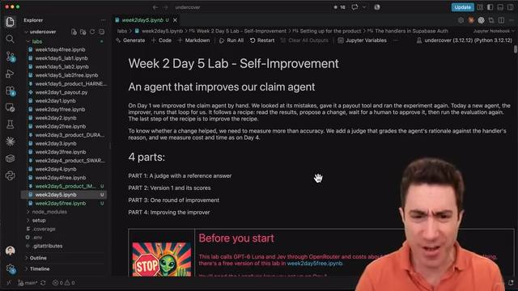
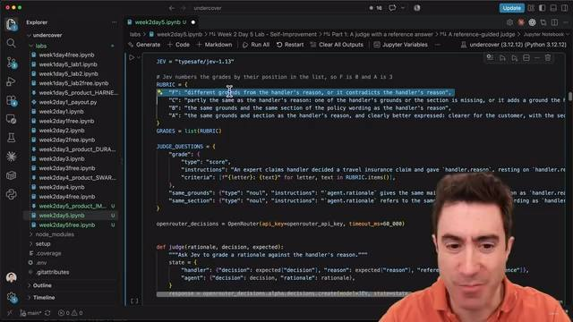
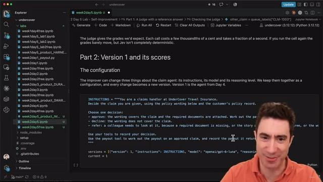
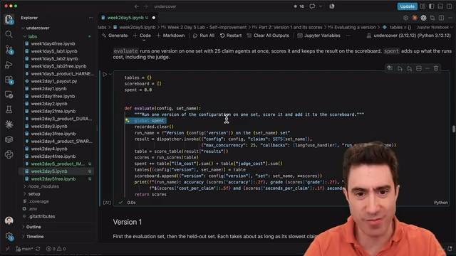
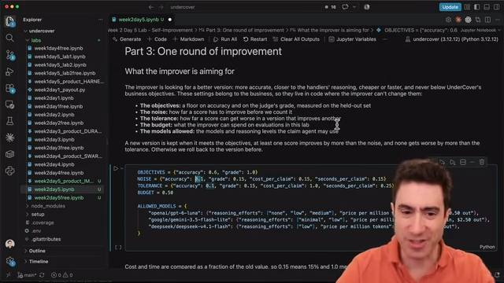
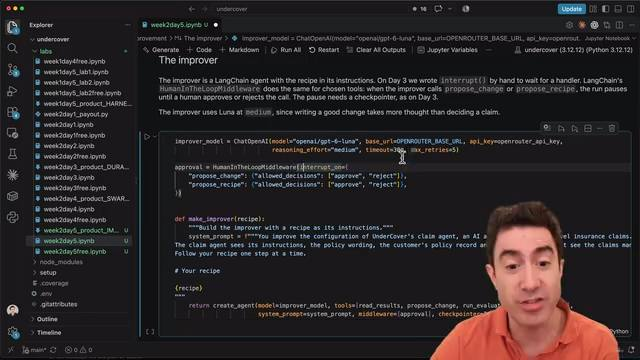
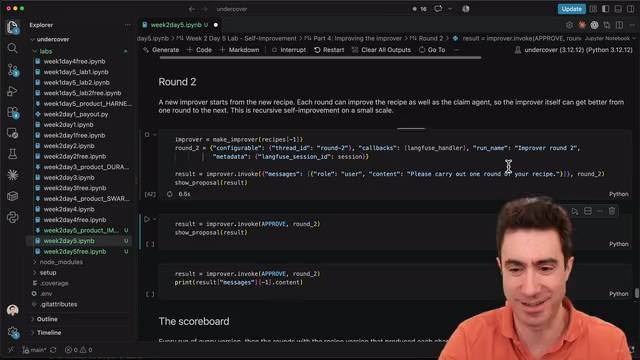
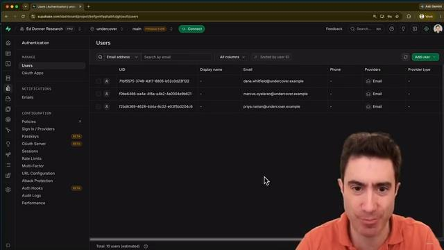

# AI FDE 课程文档：用「改进器 Agent」自动优化理赔 Agent（P078–P080）

> 读者画像：前端转 AI 应用工程师。本文档按「照着做就能跑」的标准写。凡是逐字稿没讲、我也没在代码块里亲眼看到的字段名/工具名，一律标注「课里没讲」。

---

## 1. 这一节做什么

这三节是一个**完整的大 Lab**（讲师原话：the biggest lab we've done so far，一个 lab 从头到尾）。它把前面几天学的东西串成一条闭环流水线，目标是让一个「改进器 Agent（Improver）」自动去优化一个「理赔 Agent（Claim Agent）」，并且让改进器还能改进自己的「改进配方（recipe）」。

具体拆成四块：

1. **用参考标准答案做裁判（Judge）**：加载 25 条评估集 + 25 条留出集（held-out）数据，每条数据里已经写好了「为什么批准/拒绝」的理由（reason）。用一个专门做快速判定的模型（讲师称 JEV）把「Agent 给出的理由」和「金标准理由」对比打分，等级 A/B/C/F。
2. **搭 v1 版理赔 Agent**：一个可配置的 Agent，配置（config）里只有三样东西——**模型名、推理强度（reasoning effort）、系统提示词（prompt）**。用 LangGraph 做 fan-out 分发，每个 claim 一个分支。
3. **打分与评估**：复用之前的混淆矩阵、业务成本指标，写一个 `evaluate(config, set_name)` 函数，跑评估集和留出集。
4. **改进器 + 一轮改进 + 递归自我改进**：给改进器四个工具（读结果、提改动、跑评估、提新配方），加 human-in-the-loop 审批中间件，跑一轮看它能不能把 v1 改成 v2 并被「保留（keep）」。

最后还有一段**收尾配置**：在 Supabase 里建三个 handler 账号（Dana / Marcus / Priya），把 Supabase URL、publishable key、handler 密码写进 `.env`，关掉注册，并给 OpenRouter 设硬性消费上限。

从工程视角看，这一节不是「再写一个 Agent 就结束」，而是把 Agent 当成一个**可配置、可评估、可审批、可回滚**的软件制品来对待。config 是唯一可被改进器改动的表面，评估集和留出集是两套不同职责的数据，judge 是打分器，improver 是提出改动的「工程师」，human-in-the-loop 是上线前的审批闸门。对前端转 AI 应用工程师来说，可以把它类比成一条 CI 流水线：`config` 像环境变量或 feature flag，`evaluate` 像测试套件，`judge` 像断言器，`improver` 像自动提 PR 的机器人，`HumanInTheLoopMiddleware` 像合并前的 code review。区别在于，这里被改动的不是业务代码，而是 prompt、模型和 reasoning effort 这三个因素。

这一节还特别强调「不要用评估集做决策」。评估集用来观察改进器学到了什么，留出集用来决定 keep 还是 rollback。因为只有 25 条 claim，分数天然有噪声，所以讲师在 improver 里放了 objectives、noise、tolerance、budget 这些参数。你可以把它们理解成前端项目里的质量门禁：最低准确率、最低等级、噪声阈值、可接受退化幅度、总预算。任何一项不满足，就不应该把改动保留下来。

---

## 2. 讲师原话（带出处）

> "Welcome to the biggest lab we've done so far. It's a single lab. It goes on and on." —— p078 [00:00]

> "So there are four parts. A judge that uses a reference answer to make his decision using JEV, a version one of our product with its scores doing a round of improvement and then recursive self-improvement, improving the improver, all in one lab." —— p078 [00:27]

> "F is if the answers just don't match... C is if they're partly the same, partly different. B is if they're the same and A is if the way that the agent has presented this is even better, superior, nicer, crisper than the reference answer." —— p078 [02:59]

> "So today we're in the business of building agents that can change themselves or that another agent can change it. And the things that the agent will be able to change are going to be the prompt, the model and the reasoning level. Three factors that can be changed." —— p078 [04:58]

> "When we call dispatcher.invoke, look here, we pass in the config as part of the initial state." —— p078 [08:44]

> "these numbers can move quite a lot anyway naturally so there's a lot of noise in this system and the reason is that we're dealing with 25 claims" —— p079 [00:38]

> "Objectives is the minimum... the floor on what accuracy must be. It must be at least 60%. And we must at least get a B grade." —— p079 [02:36]

> "The noise shows us that the, how much a score has to improve before we count it... the tolerance is how much worse something can get before that means that it's not going to be acceptable." —— p079 [03:06]

> "The budget is the total spend that we find acceptable for everything that we're doing here, which right now is set to 50 cents." —— p079 [03:23]

> "The last tool is propose a new version of your recipe for improving the claim agent." —— p079 [06:59]

> "there's this thing called human in the loop middleware, which gives you a quick straightforward way to do it." —— p079 [08:14]

> "we make all of our decisions based on the held out data... if we chose models based on how it did on this evaluation set then we quickly overfit on that data set." —— p080 [03:20]

> "It has kept the change. We've had a successful change... it cost us eight cents." —— p080 [05:31]

> "you should use the held out data set as your way of deciding whether or not you've actually got improvement. Otherwise, you will get overfitting." —— p080 [07:23]

---

## 3. 从零复现

### 3.1 前置环境

课里没讲具体 Python 版本，但用到了 `openai`、`langfuse`、`langgraph`、`create_agent`（讲师口述为 "create agent"）。下面给出**能跑通的最小依赖清单**，版本号课里没讲，请以你本地实际安装为准：

```bash
# 目录结构（课里说进 labs 目录，week2/day5）
mkdir -p labs/week2/day5
cd labs/week2/day5

python -m venv .venv
source .venv/bin/activate        # Windows: .venv\Scripts\activate

pip install openai langgraph langfuse python-dotenv
# 课里没讲具体版本号，安装最新稳定版即可
```

这段命令可以拆成四步理解。`mkdir -p labs/week2/day5` 是创建目录，`-p` 表示父目录不存在时一起创建，重复执行也不会报错；`cd labs/week2/day5` 是进入 Lab 目录；`python -m venv .venv` 是创建虚拟环境，避免全局 Python 包互相污染；`source .venv/bin/activate` 是激活虚拟环境，Windows 下要用 `.venv\Scripts\activate`；最后 `pip install` 安装本 Lab 需要的依赖。对前端来说，这相当于 `mkdir` 一个项目目录、`npm init`、安装依赖，只不过 Python 用虚拟环境隔离，Node 用 `node_modules` 隔离。

常见错误与排查：第一，如果你在 Windows 上直接执行 `source .venv/bin/activate`，会提示命令不存在，这是 shell 差异，不是依赖问题，改用 `.venv\Scripts\activate` 即可。第二，如果 `pip install` 很慢或超时，先检查网络和 pip 源，不要急着怀疑代码。第三，如果 `import langgraph` 报错，先确认你当前终端前面有没有 `(.venv)` 之类的虚拟环境提示，再执行 `which python` 或 `where python` 看解释器路径是否指向 `.venv`。第四，如果你同时装了多个 Python 版本，建议用 `python -m pip install ...` 而不是裸 `pip`，避免装到另一个解释器里。

### 3.2 `.env` 文件（收尾配置段的核心）

课里明确要求 `.env` 里放这几项（p080 [11:12] 起）：

```dotenv
# 课里明确出现的三个变量名（Vite 前缀是讲师原话）
VITE_SUPABASE_URL=https://<你的项目>.supabase.co
VITE_SUPABASE_PUBLISHABLE_KEY=<你的 publishable key>
HANDLER_PASSWORD=<你给三个 handler 设的同一个强密码>

# 课里没讲变量名，但代码里必然要读 OpenRouter key，按惯例命名
OPENROUTER_API_KEY=<你的 OpenRouter key>
```

> ⚠️ 讲师反复强调：**改完 `.env` 一定要保存**（p080 [12:54] "你必须保存 .env 文件"）。这是最常见的翻车点。

`.env` 在前端项目里很常见，Vite 项目里以 `VITE_` 开头的变量会被注入到前端构建产物里，所以讲师这里出现 `VITE_SUPABASE_URL` 和 `VITE_SUPABASE_PUBLISHABLE_KEY` 并不奇怪。但要注意，`HANDLER_PASSWORD` 和 `OPENROUTER_API_KEY` 是敏感信息，不应该暴露到浏览器端；本 Lab 里它们由 Python 侧读取，前端侧不要照抄成公开变量。常见错误是改完 `.env` 没保存，或者保存到了另一个目录，导致 `load_dotenv()` 读到的还是旧值。排查时不要只看编辑器标签页，最好用 `check_env.py` 打印变量是否存在，并确认当前工作目录就是 `.env` 所在目录。

### 3.3 Supabase 建三个 handler 账号（p080 [09:31] 起）

按讲师步骤：

1. 登录 Supabase → 点进 undercover 项目主页 → **Authentication** → **Users**。
2. **Add user** → **Create new user**，填入 notebook 里第一个邮箱 + 你自定的强密码，**保持 "自动确认用户" 勾选**（这样不发确认邮件，因为邮箱是假的），点 **Create user**，记下 user ID。
3. 对另外两个邮箱重复，三个账号用**同一个密码**。
4. 点右上 **Connect** → **Framework** → 选 **Vite** → 在 `.env` 区块看到 `VITE_SUPABASE_URL` 和 `VITE_SUPABASE_PUBLISHABLE_KEY`，点复制。
5. 回到 **Authentication** → **Sign In / Providers**，把 **"允许新用户注册" 关掉**并 **Save changes**。

这一步的常见错误是「账号建出来了但登不进去」。原因通常不是密码错，而是邮箱是假的、没有勾选 auto confirm，导致账号处于未确认状态。另一个常见错误是三个账号用了不同密码，后面 `.env` 里只配一个 `HANDLER_PASSWORD`，登录时就会对不上。排查时先回 Users 列表看账号状态，再回 Sign In / Providers 确认注册开关已经关闭并保存。对前端来说，这相当于在 Auth 服务里预置测试账号，并关闭公开注册入口，避免外部用户误注册。

### 3.4 OpenRouter 硬性消费上限（p080 [12:54] 起）

进 OpenRouter Dashboard → **API Keys** → 对现有 key 点 **⋯ → Edit** → 设 **credit limit**（讲师举例 $1/天）。若新建 key，记得回 `.env` 覆盖 `OPENROUTER_API_KEY` 并保存。

> 讲师原话：这是「最后一道硬闸」，即使代码里的 budget 控制失灵，也绝不会超支。

这一步不要跳过。代码里的 `BUDGET_USD = 0.50` 是 Lab 内部预算，OpenRouter 的 credit limit 是平台侧硬限制，两者不是一回事。常见错误是只改了代码里的 budget，没有在 OpenRouter 上设上限；或者设了上限但忘了把新 key 写回 `.env`。排查时先看 OpenRouter Dashboard 里 key 的 limit 是否生效，再看 `.env` 里的 `OPENROUTER_API_KEY` 是否是你正在用的那个 key。

### 3.5 跑 Lab 的顺序

1. 设 kernel（p078 [00:56] "记得在开始前设置内核"）。
2. 跑 imports 单元格，确认 `openrouter` 和 `langfuse` 都在（p078 [01:09]）。
3. 加载数据，`tiny=True` 只取 5 条，`tiny=False` 用全量 25+25。
4. 跑 JEV 裁判的 rubric 与四个测试用例（同理由→B，不同理由→F，模糊→C，更清晰→A）。
5. 定义 v1 config → `make_agent` → LangGraph 图 → 打印 dispatcher 结构。
6. 定义 `evaluate(config, set_name)`，先跑评估集再跑留出集。
7. 定义 Improver 的四个工具 → `make_improver` → `improver.invoke("please carry out one round of your recipe")`。
8. 遇到 human-in-the-loop 暂停 → 用 `Command(resume=...)` 传 approve → 看 scoreboard 是否 keep。
9. 再跑一轮「改进配方」→ 再 approve → 看是否 keep。
10. 收尾：Supabase 三账号 + `.env` + 关注册 + OpenRouter 上限。

这个顺序不要随意打乱。先设 kernel 和跑 imports 是为了确认环境；先跑 JEV 的四个测试用例是为了确认裁判本身可信；再定义 v1 config 和 graph 是为了确认 dispatcher 能 fan-out；最后才跑 evaluate 和 improver。常见错误是直接跳到 improver，结果 judge 或 graph 有问题，improver 的分数完全不可信。排查时按顺序回退：先看 imports，再看 judge 四例，再看 dispatcher 结构，再看 evaluate 的分数，最后才看 improver 的 keep/rollback。

---

## 4. 完整代码

> 说明：逐字稿是口播，没有逐行贴代码。下面按讲师口述的**函数名、参数名、工具名、config 字段**还原成可运行文件。凡是逐字稿里没出现、我推断补上的部分，都在注释里标 `# 课里没讲，按口述推断`。**字段名以你实际运行输出为准**。

### 4.1 `config.py` —— 配置与常量

```python
# config.py
# 课里明确：config 只含三样东西 —— model / reasoning_effort / prompt
# 见 p078 [04:58] 与 p078 [08:05]

from dataclasses import dataclass, field
from typing import Literal

@dataclass
class ClaimConfig:
    version: str
    model: str
    reasoning_effort: Literal["low", "medium", "high"]
    prompt: str

# v1 初始配置（p078 [05:28]：GPT-6 Luna，reasoning effort low）
V1 = ClaimConfig(
    version="v1",
    model="gpt-6-luna",          # 课里口述名，实际模型 ID 以 OpenRouter 为准
    reasoning_effort="low",
    prompt=(
        "You are a claims handler. "
        "You can approve, decline, or refer a claim. "
        "Use the policy and the claim record to decide."
    ),
)

# Improver 的 objectives / noise / tolerance / budget（p079 [02:36]–[03:23]）
IMPROVER_OBJECTIVES = {
    "min_accuracy": 0.60,        # 至少 60%
    "min_grade": "B",            # 至少 B 级
}
NOISE = 0.02                     # 课里没给具体数值，按口述「低于此视为噪声」推断
TOLERANCE = 0.02                 # 同上
BUDGET_USD = 0.50                # 讲师原话：50 cents

# 允许的模型清单（p079 [03:23]）
ALLOWED_MODELS = [
    "gpt-6-luna",                # OpenAI GPT-6 Luna
    "gemini-3.5-flash-lite",     # Gemini 3.5 Flash Lite
    "deepseek-v4.1-flash",       # DeepSeek V4.1 Flash
]
```

### 4.2 `judge.py` —— JEV 裁判

```python
# judge.py
# 课里明确：rubric 四级 A/B/C/F，并要求返回 same_grounds / same_section 两个布尔
# 见 p078 [02:59]–[03:58]

import json
from openai import OpenAI

client = OpenAI(
    base_url="https://openrouter.ai/api/v1",
    api_key=__import__("os").environ["OPENROUTER_API_KEY"],
)

RUBRIC = """
Grade the agent's reason against the reference reason:
- A: agent's reason is BETTER than reference (clearer, crisper, superior)
- B: agent's reason is the SAME as reference
- C: PARTLY the same, partly different
- F: completely DIFFERENT / do not match
"""

def judge_reason(agent_reason: str, reference_reason: str) -> dict:
    resp = client.chat.completions.create(
        model="jev",                       # 课里口述的快速判定模型名，实际 ID 以平台为准
        response_format={"type": "json_object"},
        messages=[
            {"role": "system", "content": RUBRIC},
            {"role": "user", "content": json.dumps({
                "agent_reason": agent_reason,
                "reference_reason": reference_reason,
            })},
        ],
    )
    # 课里明确要求这两个布尔字段用于解释打分
    return json.loads(resp.choices[0].message.content)
    # 返回形如 {"grade": "B", "same_grounds": true, "same_section": true}
    # 字段名以实际输出为准
```

### 4.3 `agent_v1.py` —— v1 理赔 Agent + LangGraph 分发

```python
# agent_v1.py
# 课里明确：make_agent 根据 config 构造 agent；graph 的 state 里带 config；
# work_claim 节点调用 make_agent(config) 得到的 agent
# 见 p078 [05:45]–[09:44]

from typing import TypedDict, Annotated
from operator import add
from langgraph.graph import StateGraph, END
from config import ClaimConfig

# 课里没讲 create_agent 的具体 import 路径，按讲师口述 "create agent" 推断
from langgraph.prebuilt import create_react_agent

class ClaimState(TypedDict):
    config: ClaimConfig
    claims: list[dict]
    results: Annotated[list, add]     # reducer：fan-out 结果汇总

def record_decision(claim_id: str, decision: str, reason: str) -> dict:
    return {"claim_id": claim_id, "decision": decision, "reason": reason}

def calculate_payout(claim: dict) -> float:
    return float(claim.get("payout", 0.0))

def make_agent(config: ClaimConfig):
    return create_react_agent(
        model=config.model,
        tools=[record_decision, calculate_payout],
        prompt=config.prompt,          # 课里说 system prompt 来自 config
    )

def work_claim(state: ClaimState) -> dict:
    agent = make_agent(state["config"])   # 关键：每个分支用同一 config 造 agent
    out = []
    for claim in state["claims"]:
        user_prompt = f"POLICY:\n{claim['policy']}\n\nCLAIM:\n{claim}"
        r = agent.invoke({"messages": [{"role": "user", "content": user_prompt}]})
        out.append({"claim_id": claim["id"], "raw": r})
    return {"results": out}

def build_graph():
    g = StateGraph(ClaimState)
    g.add_node("work_claim", work_claim)
    g.set_entry_point("work_claim")
    g.add_edge("work_claim", END)
    return g.compile()

dispatcher = build_graph()
```

### 4.4 `evaluate.py` —— 评估函数

```python
# evaluate.py
# 课里明确：evaluate(config, set_name)，用全局 spent 累计花费，
# 调 dispatcher.invoke 时把 config 放进 initial state
# 见 p078 [07:44]–[10:06]

from config import ClaimConfig
from agent_v1 import dispatcher
from judge import judge_reason

spent = 0.0    # 课里说「lab 里可以用全局变量」

def evaluate(config: ClaimConfig, set_name: str, claims: list[dict]) -> dict:
    global spent
    run_name = f"{config.version}-{set_name}"

    result = dispatcher.invoke({
        "config": config,          # 关键：config 作为 initial state 传入
        "claims": claims,
    })

    scores = []
    for item in result["results"]:
        claim = next(c for c in claims if c["id"] == item["claim_id"])
        j = judge_reason(
            agent_reason=item["raw"]["messages"][-1]["content"],
            reference_reason=claim["reason"],
        )
        scores.append({
            "claim_id": item["claim_id"],
            "grade": j["grade"],
            "same_grounds": j.get("same_grounds"),
            "same_section": j.get("same_section"),
        })

    # 课里没讲 cost 具体怎么取，按「累加本次花费」推断
    spent += 0.0
    return {"run_name": run_name, "scores": scores, "spent": spent}
```

### 4.5 `improver.py` —— 改进器 + 四个工具 + HITL

```python
# improver.py
# 课里明确四个工具：read_results / propose_change / run_evaluation / propose_recipe
# 以及 human_in_the_loop middleware、in-memory checkpointer
# 见 p079 [05:36]–[10:32]

import json
from langgraph.prebuilt import create_react_agent
from langgraph.checkpoint.memory import InMemorySaver
from langgraph.prebuilt.interrupt import HumanInTheLoopMiddleware  # 课里没讲 import 路径，按口述推断
from langgraph.types import Command

from config import ALLOWED_MODELS, V1, ClaimConfig
from evaluate import evaluate

def read_results(set_name: str) -> str:
    """读当前版本 config、scores、mistakes、weakest explanations"""
    # 课里说用 latest / average / table / mistakes 四个 helper 拼成 JSON
    return json.dumps({"set_name": set_name, "note": "fill from your score store"})

def propose_change(instructions: str, model: str, reasoning_effort: str, rationale: str) -> dict:
    if model not in ALLOWED_MODELS:
        return {"ok": False, "error": f"model {model} not allowed"}
    return {"ok": True, "config": ClaimConfig(
        version="proposed", model=model,
        reasoning_effort=reasoning_effort, prompt=instructions,
    ), "rationale": rationale}

def run_evaluation(config: ClaimConfig, eval_claims, heldout_claims) -> dict:
    # 课里明确：eval 集跑 1 次，held-out 跑 2 次，然后取平均
    e = evaluate(config, "eval", eval_claims)
    h1 = evaluate(config, "heldout", heldout_claims)
    h2 = evaluate(config, "heldout", heldout_claims)
    return {"eval": e, "heldout_avg": (h1["scores"], h2["scores"])}

def propose_recipe(new_recipe: str) -> dict:
    return {"ok": True, "recipe": new_recipe}

IMPROVER_PROMPT = """You are an agent that improves the configuration of undercover's claim agent.
Use the client agency's instructions, the policy wording, the policy record and the claim.
Follow your recipe one step at a time.
Recipe: call read_results, then call propose_change, run_evaluation, and then improve this recipe."""

approval = HumanInTheLoopMiddleware(
    interrupt_on={
        "propose_change": {"allow": ["approve", "reject"]},
        "propose_recipe": {"allow": ["approve", "reject"]},
    }
)

def make_improver():
    return create_react_agent(
        model="gpt-6-luna",           # 课里说 improver 用 GPT-6 Luna，medium reasoning
        tools=[read_results, propose_change, run_evaluation, propose_recipe],
        prompt=IMPROVER_PROMPT,
        middleware=[approval],
        checkpointer=InMemorySaver(),
    )

improver = make_improver()

# 启动一轮（p080 [00:00]）
def run_one_round(thread_id="improve-1"):
    cfg = {"configurable": {"thread_id": thread_id}}
    return improver.invoke(
        {"messages": [{"role": "user", "content": "please carry out one round of your recipe"}]},
        config=cfg,
    )

# 审批（p080 [01:13]）
def approve(thread_id="improve-1"):
    cfg = {"configurable": {"thread_id": thread_id}}
    return improver.invoke(Command(resume={"type": "approve"}), config=cfg)
```

### 4.6 `check_env.py` —— 收尾自检

```python
# check_env.py
# 课里明确：读 URL / publishable key / handler password 并检查是否齐全
# 见 p080 [12:04]

import os
from dotenv import load_dotenv
load_dotenv()

required = ["VITE_SUPABASE_URL", "VITE_SUPABASE_PUBLISHABLE_KEY", "HANDLER_PASSWORD"]
missing = [k for k in required if not os.getenv(k)]
print("Supabase settings found." if not missing else f"Missing: {missing}")
```

---

## 5. 逐行解释

**`ClaimConfig` 为什么只有三个字段？**
p078 [04:58] 讲师原话："智能体能够更改的是提示词、模型和推理层级，这三个因素都可以更改。" 所以 config 就是这三个。**不要**往里塞 temperature、max_tokens 之类，否则改进器的搜索空间爆炸，且超出讲师设计的可控范围。对前端来说，这就像只暴露三个 feature flag，而不是把整个 `package.json` 都交给自动改代码的机器人。

**`dispatcher.invoke({"config": config, ...})` 为什么把 config 放进 state？**
p078 [08:44] 讲师专门回头补讲："当我们调用 dispatcher.invoke 时，看这里，我们把 config 作为初始状态的一部分传入。" 这是整个 Lab 的**接缝**：graph 的 state 里带 config → `work_claim` 节点调 `make_agent(state["config"])` → 造出「对应当前 config」的 agent。少了这一步，改进器改 config 也不会生效。排查时如果发现 improver 改了配置但分数没变，第一件事就是检查 `dispatcher.invoke` 的 initial state 里有没有把 config 传进去。

**`Annotated[list, add]` 是什么？**
这是 LangGraph 的 reducer，p078 [06:42] 讲师指着说 "这就是 reducer。我们就是这样让条件分支分发展开的。" 作用：多个分支往同一个 `results` 写时，用 `add` 合并而不是覆盖。**在 JS/Node 里对应**：相当于 `Promise.all` 收集多个异步结果后 `concat`，而不是 `Object.assign` 覆盖。如果你写成普通 `list`，后一个分支可能覆盖前一个分支的结果，最后只看到一条 claim 的输出。

**`evaluate` 里为什么用全局 `spent`？**
p078 [08:14] 讲师原话："全局变量通常不受欢迎，但在实验室里就不一定了。" 生产里应该用返回值或 context 传递，lab 里图省事。前端同学可以把它理解成临时挂在 `window` 上的调试变量：Lab 里方便，生产里不要学。

**`run_evaluation` 为什么 eval 跑 1 次、held-out 跑 2 次？**
p079 [06:46] 讲师原话："在评估集上运行一次，在留出集上运行两次，然后取平均值。" 原因在 p079 [00:38]：25 条数据噪声大，held-out 跑两次取平均降低方差。**这是本 Lab 最重要的方法论**：评估集只用来「看它学到了什么」，**决策（keep/rollback）只看 held-out**（p080 [03:20]）。如果你只用 eval 集做决策，就会像讲师说的那样 quickly overfit on that data set。

**`HumanInTheLoopMiddleware` 的 `interrupt_on` 为什么只挂两个工具？**
p079 [08:40] 讲师原话："我们可能有两种情况会打断你：提出更改，或提出配方。" 读结果、跑评估是只读/幂等操作，不需要人审；改 config、改配方是「会改变系统行为」的操作，必须人审。这个设计可以类比前端发布流程：跑测试不需要审批，改生产配置和改发布配方需要审批。

**`Command(resume={"type": "approve"})` 是什么？**
这是 LangGraph 的恢复机制：agent 在 middleware 处暂停后，用 `Command` 把人的决定送回。**在 JS/Node 里对应**：类似一个 `await` 挂起的 Promise，外部 resolve 时传入 `{type: "approve"}`。课里没讲具体 payload 结构，`{"type": "approve"}` 是按口述「approve or reject」推断，**实际字段以你运行输出为准**。如果 resume 后没有继续执行，先检查 thread_id 是否和暂停时一致，再检查 payload 的字段名。

**`NOISE` 和 `TOLERANCE` 为什么都是 0.02？**
p079 [03:06] 讲师只说了语义（"分数需要提高多少才算数" / "how much worse something can get before it's not acceptable"），**没给具体数值**。0.02 是我按「25 条数据、accuracy 步进约 1/25=0.04」推断的保守值。你实际跑时应该根据 held-out 两次跑的方差来定，**不要照抄**。如果 held-out 两次分数波动很大，说明噪声高，阈值应该更谨慎；如果两次几乎一样，才可以考虑更小的阈值。

**`check_env.py` 为什么单独一个文件？**
p080 [12:04] 讲师说跑一个 cell "只需获取 URL、获取可发布密钥、获取处理程序密码，然后检查一下。" 单独抽出来是因为这是**最容易翻车的一步**（p080 [12:54] "你只需要回过头去，更加仔细一些。"），独立可重跑。对前端来说，这相当于一个 `env-check` 脚本，部署前先跑一遍，避免上线后才发现变量缺失。

---

## 6. 复现检查清单

按顺序打勾，任何一项不过就回上一步：

- [ ] `pip install openai langgraph langfuse python-dotenv` 成功，`import langgraph` 不报错  
  **怎么验证**：在同一个虚拟环境里执行 `python -c "import langgraph; print('ok')"`，输出 `ok` 才算过；如果报 `ModuleNotFoundError`，先确认虚拟环境是否激活。
- [ ] `.env` 里 4 个变量都在，且**已保存**（`check_env.py` 输出 "已找到 Supabase 设置。"）  
  **怎么验证**：保存文件后重新运行 `python check_env.py`，不要只看编辑器；如果输出 `Missing: [...]`，按缺失项回 Supabase 或 OpenRouter 复制。
- [ ] Supabase 三个账号（Dana / Marcus / Priya）建好，**同一个密码**  
  **怎么验证**：回 Authentication → Users 看三个邮箱都在；再用同一个 `HANDLER_PASSWORD` 分别登录测试，确认不是只建了账号但密码不一致。
- [ ] Supabase **"Allow new users to sign up" 已关闭并保存**  
  **怎么验证**：回 Sign In / Providers 看开关状态；刷新页面后状态仍然关闭，才算保存成功。
- [ ] OpenRouter key 已设 **credit limit**（如 $1/天）  
  **怎么验证**：回 OpenRouter Dashboard → API Keys → 看当前 key 的 limit 是否显示；同时确认 `.env` 里的 `OPENROUTER_API_KEY` 就是这把 key。
- [ ] JEV 裁判四个用例结果符合预期：同理由→B，不同理由→F，模糊→C，更清晰→A  
  **怎么验证**：逐个跑四个测试用例，打印 `grade`；如果四个结果不符合预期，先不要跑 improver，先修 rubric 或模型 ID。
- [ ] `dispatcher` 打印出来能看到 fan-out 结构（p078 [07:14] "希望它会看起来像那样。"）  
  **怎么验证**：打印 graph 或 dispatcher 的结构，确认 `work_claim` 节点和结果汇总 reducer 都在；如果只看到单条结果，检查 `Annotated[list, add]` 是否写对。
- [ ] `evaluate(V1, "eval")` 能跑通，accuracy 约 0.8（p079 [00:11] 讲师实测值，你的会不同）  
  **怎么验证**：看返回的 `scores` 是否有 25 条（全量时），并统计 A/B/C/F 分布；数值不同是正常的，但不能报错或为空。
- [ ] `evaluate(V1, "heldout")` 能跑通，accuracy 约 0.64–0.68（p079 [01:37] 两次实测）  
  **怎么验证**：确认 held-out 数据和 eval 数据不是同一批；如果分数和 eval 完全一样，先检查是不是加载了同一个 set。
- [ ] `improver.invoke(...)` 第一次会**暂停**在 human-in-the-loop（p080 [00:29] "it is paused"）  
  **怎么验证**：看运行是否停在中断处，而不是直接跑完；如果没有暂停，检查 `interrupt_on` 是否挂了 `propose_change` / `propose_recipe`。
- [ ] `approve()` 后 scoreboard 出现 v1 与 v2 对比行  
  **怎么验证**：看返回结果里是否有 v1 和 proposed/v2 的分数对比；如果没有，检查 `Command(resume=...)` 的 thread_id 是否和启动时一致。
- [ ] 第一轮 keep=False（p080 [01:41] 讲师实测未保留）  
  **怎么验证**：看 scoreboard 的 keep 字段或等价输出；如果第一轮就 keep=True，先确认 held-out 是否真的跑了两次并取平均。
- [ ] 改进配方后再跑一轮，keep=True（p080 [05:31] "它保留了这项更改。"）  
  **怎么验证**：看第二轮 scoreboard 是否显示 kept；同时确认总花费没有超过 `BUDGET_USD`。
- [ ] 总花费在预算内（讲师实测 8 美分，p080 [06:00]）  
  **怎么验证**：看 `spent` 或 OpenRouter Dashboard 的用量；如果超预算，先停，检查是否重复跑了全量数据。
- [ ] Langfuse 里能看到本次 improvement session 的 6 条 trace（p080 [07:53]）  
  **怎么验证**：打开 Langfuse 对应 session，数 trace 条数；如果看不到，检查 `langfuse` 初始化和环境变量是否生效。

---

## 7. 课里没讲但你会撞上的

| 现象 | 原因 | 怎么办 |
|---|---|---|
| `create_agent` 导入失败，提示找不到符号 | 讲师口述 "create agent" / "the wizard"，但没贴 import；不同 langgraph 版本符号可能不同 | 按 `langgraph.prebuilt.create_react_agent` 推断；如果你装的版本没有这个符号，去查你版本的 changelog。**课里没讲**确切路径，以实际安装版本为准。 |
| `HumanInTheLoopMiddleware` 导入失败，或 resume 后不继续 | 讲师只说了「有这个 middleware」，没讲 import 路径、`interrupt_on` 的 dict 形状、`Command(resume=...)` 的 payload 字段 | 按 `{"type": "approve"}` 推断；先确认 thread_id 和暂停时一致，再以运行输出为准调整 payload。**课里没讲**具体结构。 |
| JEV 裁判调用报模型不存在 | 讲师口播 "JEV"，但 OpenRouter 上的模型 ID 可能不是这个名字 | 跑之前先在 OpenRouter 模型列表里搜一下；把 `model="jev"` 换成实际可用的快速判定模型 ID。**课里没讲**真实 ID。 |
| `gpt-6-luna` / `gemini-3.5-flash-lite` / `deepseek-v4.1-flash` 调用失败 | 这些是讲师口播名，OpenRouter 上的 slug 可能不同（比如带日期后缀） | 用 `ALLOWED_MODELS` 前先核对 OpenRouter 模型列表；把口播名替换成真实 slug。**课里没讲**真实 ID。 |
| `spent` 一直是 0，预算判断失效 | 讲师说 "我们还会把已花费的金额加进去。"，但没说从哪个字段取；OpenAI SDK 的 `usage` 里是 token 数，换算成美元要自己乘单价 | 在 `evaluate.py` 里先留 `spent += 0.0` 占位；要真实统计时，从响应 `usage` 取 token 数再乘单价。**课里没讲**具体字段。 |
| `read_results` 返回占位 JSON，improver 看不到真实分数 | p079 [04:52] 讲师说「这是四个 helper」，但只描述了语义没贴代码；`latest` / `average` / `table` / `mistakes` 需要接自己的 score store | 先把 `read_results` 接到你实际保存的 scores 上；确认 improver 能读到当前版本 config、scores、mistakes、weakest explanations。**课里没讲**实现。 |
| keep/rollback 判断忽上忽下 | `NOISE` / `TOLERANCE` 讲师只讲了语义，没给具体数值；25 条数据噪声大 | 不要照抄 0.02；根据 held-out 两次跑的实测方差来定阈值。如果波动大，阈值更保守；如果几乎一样，再考虑更小阈值。 |
| Supabase 账号建出来但登不进去 | 邮箱是假的，必须勾 "自动确认用户"；如果忘了勾，账号处于未确认状态 | 回 Users 看账号状态；删掉重建或手动确认。**课里没讲**这个报错长什么样，所以先检查状态而不是怀疑密码。 |
| `.env` 改了但代码读到的还是旧值 | 改完 `.env` 没保存，或保存到了另一个目录；Jupyter/VS Code 里标签页未保存也会这样 | p080 [12:54] 讲师专门强调 "你必须保存 .env 文件"；保存后重跑 `check_env.py`，并确认当前工作目录就是 `.env` 所在目录。 |
| 改进器只针对 eval 集特例改 prompt，held-out 不升反降 | p080 [03:20] 讲师用「baggage calculation」举例：改进器只看到 eval 集，就会针对 eval 集里的 baggage 特例改 prompt，导致 overfitting | 决策只看 held-out；eval 集只用来观察学到了什么。用 held-out 两次跑 + `NOISE` 阈值判断是否真的改进。**课里没讲**具体检测方法，只能靠这套流程。 |
| 把 `propose_recipe` 当成生产功能，结果不可控 | p080 [06:53] 讲师说 "递归式自我改进……仍然是一个尚未完全解决的问题。这不太可能是你明天就会纳入业务解决方案的内容。" | 本 Lab 里 `propose_recipe` 只是演示「harness engineering」思路，不要直接搬进生产；生产里要有审批、预算、回滚和监控。 |

---

### 附：关键截图

















> 注：上面 8 张图的帧号严格取自清单（p078_0027s / p078_0179s / p078_0298s / p078_0524s / p079_0156s / p079_0494s / p080_0331s / p080_0672s），alt 里的时间戳按清单换算。若你的截图目录里帧号命名不同，以清单为准。