# AI FDE（BV1rJnm64Eq3）P81–P84 复现文档：把 Improver 接进产品，并理解 ADLC 五阶段

> 适用读者：前端转 AI 应用工程师。本文按“先跑通 P81–P82 的产品改进闭环，再用 P83–P84 的方法论解释为什么这样做”组织。涉及数据库并发、审批幂等时，会补一句在 JS/Node 里通常对应什么；课里没展示的，会明确写“课里没讲”。

---

## 1. 这一节做什么

P81–P82 的目标不是再讲一个孤立 demo，而是把上一阶段的“自我改进”能力接进真实产品：Dashboard 要能展示模型配置的版本与差异，能审批 Improver 提出的改动，后端要存储这些版本；跑 Agent 时可以把 Improver 加进去，让它提出配置变更；同时接入 Judge 作为决策模型，加入花费预算、Supabase 登录和若干 UI 改进。配置范围包括 prompt、rules、model version，以及“Improver 如何改进”的 recipe。P82 则实际跑 Improvement Round：先评估最近 25 条 claim，再跑 held-out 数据，提出改动，等人审批，审批后再次评估，最后给出“是否超过噪声、是否保留”的 verdict；同时 Improver 还会提出对自己 recipe 的修改，形成递归自我改进。

P83–P84 切换到 week 3 day 1 的方法论：ADLC 的五阶段、FDE 在每阶段做什么、如何选用例。它不是代码课，但决定了你复现项目时该怎么验收：Discovery 阶段要先把 evals、baseline、success criteria、adoption plan 定下来；R&D 阶段要 curation 数据、做实验、决定 autonomy、选框架；Development 阶段做 agent engineering、harness engineering、集成、测试、observability；Implementation 阶段做 UAT、pilot sign-off、staged rollout、培训与变更管理、handover；Maintenance 阶段做监控、incident、self-improvement、human feedback、drift/bias 测试、系统升级/合并/退役。FDE 是业务与技术之间的桥；选用例时先问三个问题：是不是真实可衡量的业务问题？有没有 proprietary data + integrations + evals？它属于 automation、acceleration 还是 differentiation？

这一节的可交付物是：
- `docs/improve.md`：从 `labs/week2_day5_product_improvements.md` 复制来的需求文件。
- `plan_improve.md`（逐字稿里也出现过 `planimprove.md` 的写法）：Claude Code 生成的实施计划。
- 一个本地可登录的应用：Supabase 登录、Dashboard/Queue、Settings、Improvement 页面。
- 一次可验收的 Improvement Round：评估、held-out、提出 change、人工 approve、verdict、keep/rollback、recipe 审批。
- 一张 ADLC 五阶段与 FDE 职责表，以及一张用例优先级检查表。

---

## 2. 讲师原话（带「—— pNNN [MM:SS]」）

P81 开头，讲师先把产品闭环说清楚：

> "由改进器提出的变更将在仪表板上完成审批；仪表板会展示模型配置的各版本及差异；后端会负责存储这些内容。"
> —— p081 [00:00]

这里的关键词是 **versions / differences / approved on the dashboard / backend store**。不是让 Improver 直接改生产配置，而是把改动变成可审批的版本差异。

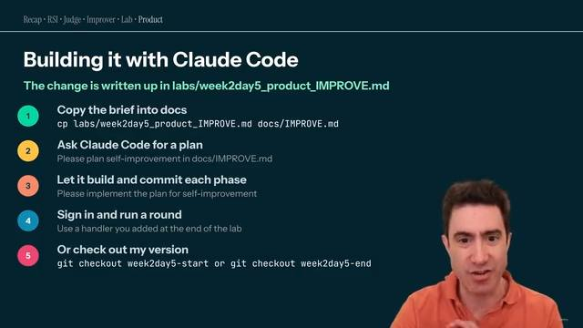

复制 spec 的路径也说得很具体：

> "你把这段内容复制到 docs 中名为 improve.md 的文件里，然后让 Claude Code 制定计划，再按阶段逐步实现。"
> —— p081 [01:00] / [01:29]

逐字稿里 “Cloud Code” 与 “Claude Code” 混用，指的都是 Claude Code；引用时保留原文。实际提示词是：

> "请根据 improve.md 中的需求写一份计划。"
> —— p081 [03:19]

计划生成后，讲师说它没有按“五到六个阶段”来，而是自己拆成了七个阶段：

> "它实际规划了七个不同阶段，而不是我此前含糊提到的五到六个。"
> —— p081 [04:04]

实现阶段的提示词：

> "请按 planimprove.md 中的计划进行实现。"
> —— p081 [04:41]

P82 解释 Improvement Round 的流程：

> "它会使用这套方案……运行一轮……运行一组测试与评测，然后着手改进，决定想改动哪类内容，并请求人工批准。随后评估它并给出最终结论：是否真正带来了实质性提升？之后再更新自己的方案。"
> —— p082 [00:59]–[01:24]

第一次 round 的 verdict：

> "留出集准确率从 0.78 提升到 0.88。"
> —— p082 [03:06]

第二次 round 没有超过噪声，被回滚：

> "它的表现没有超过噪声水平，因此被回滚了。"
> —— p082 [04:45]

第三次 round 换成 DeepSeek 后：

> "我们保留第 3 轮……在使用 DeepSeek v4.1 low 时分别达到 100% 和 96%。"
> —— p082 [05:52]

P83 进入方法论，先声明这是“常见主题”，不是固定标准：

> "接下来我会向你展示构建和部署智能体的五个阶段……这是一个快速演进的领域，目前还没有固定标准。"
> —— p083 [05:20]

Discovery 阶段要先把 evals 和 adoption 定下来：

> "建立评测……测量基线……就成功标准达成一致……提前制定采用计划。"
> —— p083 [05:50]

R&D 阶段从数据开始：

> "研发阶段从数据开始……整理数据集……尝试评测方法……决定解决方案的自主程度……选择框架和架构。"
> —— p083 [06:31]

Maintenance 不是交付就结束：

> "维护阶段要做监控……改进……人类反馈……漂移与偏差测试……升级系统、合并系统，甚至可能下线系统。"
> —— p083 [08:00]

P84 定义 FDE 的位置：

> "前向部署工程师是业务团队与技术团队之间的桥梁。"
> —— p084 [00:00]

选用例的三问里，最后一个是分类：

> "你会把它归类为自动化、加速还是差异化？"
> —— p084 [09:29]

以及数据、连接、evals 三件事要一起成立：

> "数据、连接和评测要一起具备。这三个条件你都能满足吗？"
> —— p084 [09:29]

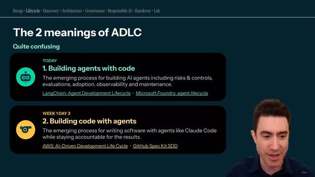

---

## 3. 从零复现

### 3.1 准备仓库与起点

逐字稿给了三个入口：  
1）从 `week2_day5_start` 开始，`improve.md` 已经在那里；  
2）自己从 `labs/week2_day5_product_improvements.md` 复制到 `docs/improve.md`；  
3）直接 `git checkout week2_day5_end` 看讲师最终结果。

建议第一次复现走“起点 + 自己复制”，这样你能看到 Claude Code 如何从 spec 生成计划。课程仓库的克隆地址、依赖安装方式、Node 版本，逐字稿没有讲；以你实际课程仓库的 README 为准。

在仓库根目录执行：

```bash
git checkout week2_day5_start
```

然后确认 `labs/week2_day5_product_improvements.md` 存在：

```bash
ls labs/week2_day5_product_improvements.md
```

复制到 `docs/improve.md`：

```bash
mkdir -p docs
cp labs/week2_day5_product_improvements.md docs/improve.md
```

逐字稿里讲师是在 VS Code 里拖拽/复制粘贴完成的，效果一样。注意：`improve.md` 是给 Claude Code 读的工作副本，不要改掉原 spec 的语义。

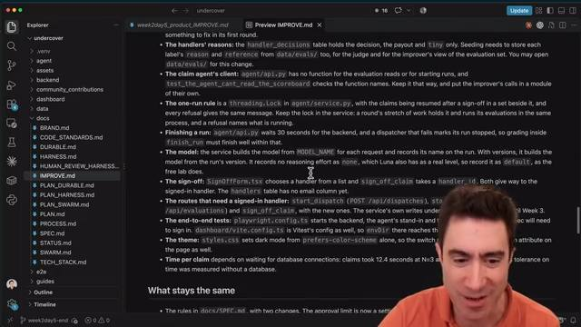

### 3.2 让 Claude Code 先出计划，不要直接写代码

打开 Claude Code，输入：

```text
please write a plan based on the requirements in improve.md
```

逐字稿里讲师没有说 “docs”，Claude Code 自己定位到了 `docs` 目录。演示中它大约跑了 20 分钟才出计划；你的时间会因模型、仓库大小、上下文长度而不同。计划文件在逐字稿里被称为 `plan_improve.md`，也出现过 `planimprove.md` 的写法；以你仓库实际生成的文件名为准。

计划生成后不要立刻实现。先检查：
- 是否覆盖 Judge、Improver、Improvement 页面、Dashboard live runs、docs。
- 是否把“版本与差异”“人工审批”“recipe 更新”拆成了独立阶段。
- 是否明确“未经审批不自动应用变更”。
- 是否把评估、held-out、verdict、keep/rollback 写进阶段验收。
- 是否保留了现有 claim agent 的行为。

逐字稿说它拆了七个阶段，而不是讲师模糊建议的五到六个。阶段多不一定是坏事，但要防止它把“UI 美化”拆得比“评估与回滚”还重。

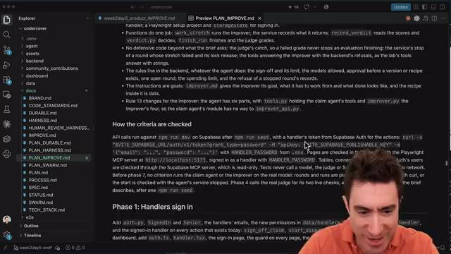

### 3.3 实现计划

在 Claude Code 里输入：

```text
please implement the plan in plan_improve.md
```

逐字稿里讲师在实现前先做了 `compact`，把上下文压紧；这是 Claude Code 的操作，不是项目代码。演示中主体实现约 2 小时，之后讲师给了 UI 反馈又花了约半小时。你复现时不要用“分钟级”期待它完成。

实现完成后，按仓库 README 启动本地应用。**课里没有展示启动命令**，所以本文不编造 `npm run dev` 之类的命令；请看仓库的 `package.json`、README 或课程环境说明。

### 3.4 用 Supabase 登录

演示中的登录页写着 “for undercover claims handlers, ask your manager for an account”。讲师使用之前 Supabase 里设置的账号：Dana，密码是之前设置的那个。登录后进入应用。

Supabase 的项目创建、环境变量名、回调地址、数据库迁移，逐字稿都没有讲。你需要在仓库里找 `.env.example` 或 README；如果找不到，就把这一项列为“课里没讲，需要仓库维护者补充”。

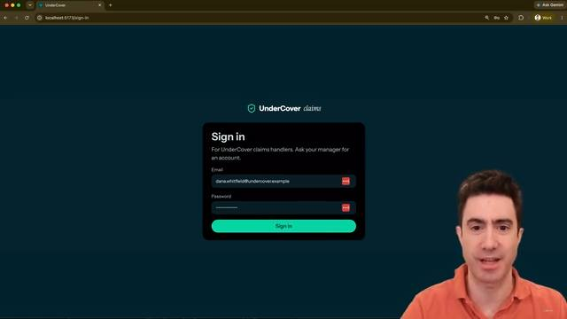

### 3.5 跑一个 25 agents 的批次

登录后进入 Queue/Dashboard。讲师把批次设为 25 个 agents，点击 “start this batch”。屏幕上出现大量 in progress，然后陆续出现 decided、approved、declined、referred、waiting for sign off。演示中出现过“21 decided，4 awaiting sign off，0 left for a handler”的结果；你的结果不会完全一样。

这里有一个真实工程现象：讲师提到可能会有 database contention，导致最初结果慢一点。前端读者可以把它理解为：多个 agent 同时写 claim/decision 记录，数据库连接和写入会成为瓶颈。Node 里通常用连接池、事务、队列、重试来缓解；**课里没有展示具体实现**，不要把这句当成讲师给了方案。

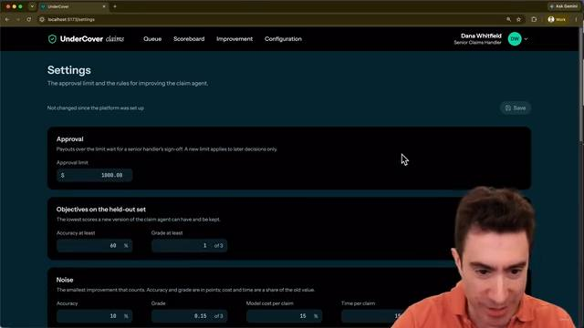

### 3.6 人工签核

演示里 Dorothy 的 $2,240 reclaim 处于 waiting for sign off。之前有一个下拉框选择 handler，现在因为已经以 Dana（senior claims handler）登录，下拉框没有了，直接点 sign off。系统显示 signed off by Dana，waiting for the agent to pay，然后变成 paid and signed off。返回 Queue 后，Dorothy 的状态变为 decided、approved、paid。

继续处理 Stuart Price 的 $1,300，签核后 Queue 变成“2 awaiting sign off，23 decided”。这说明 human-in-the-loop 不是装饰：审批动作要落库，并且要能改变后续 agent 的状态。

### 3.7 设置 Improvement 的目标与容忍度

进入 Settings。演示中讲师口头设定了：
- 更关注 accuracy，3% 的 accuracy 提升可以接受；
- grade 提升 0.1 可以接受；
- model cost 不是当前重点，可以显著增加；
- accuracy tolerance 保持 10（单位以界面为准）；
- time per claim 可以放宽到 5 倍；
- 每轮花费上限 50 cents。

这些是演示口径，不是课程要求你写死的常量。你的界面字段名可能不同，以实际 UI 为准。

### 3.8 跑第一轮 Improvement Round

进入 Improvement 页面，点击开始一轮。流程是：
1. 对最近完成的 25 条 claim 做 evaluation；
2. 在 held-out 数据上跑两组；
3. 提出一个 change；
4. 等人审批；
5. 审批后再评估；
6. 给出 verdict：是否超过噪声、是否保留；
7. 同时提出 recipe 更新，recipe 也要人审批。

演示中第一轮 evaluation accuracy 是 72%，用的是 Luna、no reasoning。随后提出把模型从 GPT-6 Luna at no reasoning 改成 low reasoning。讲师点了 approve。第二轮评估后，verdict 说 held-out accuracy 从 0.78 升到 0.88，latency 下降，held-out mistake cost 增加但没有超过容忍度，所以保留。然后 Improver 提出新 recipe：删掉原来一些行，换成更详细的检查配置、所有组合都试过之后如何 group evaluation errors 等内容。讲师批准了新 recipe。

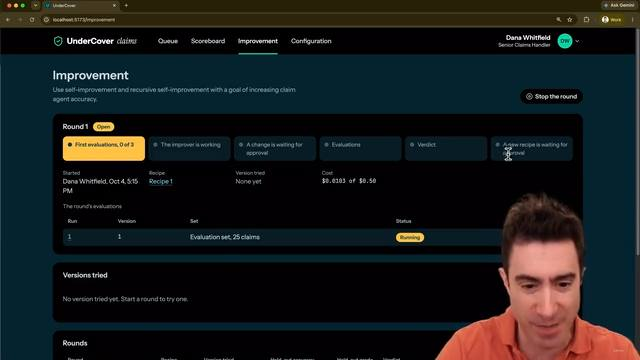

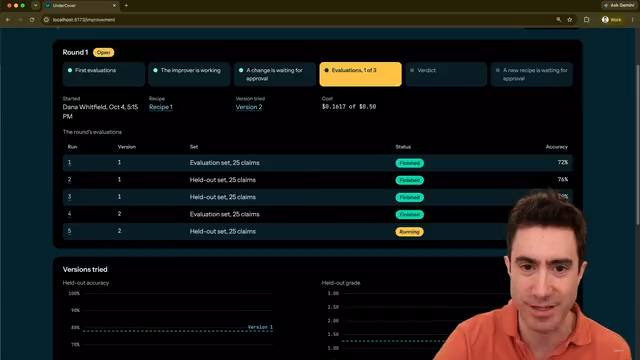

### 3.9 第二轮：被噪声挡住并回滚

第二轮建议从 Luna low 升到 Luna medium，认为上一轮 reasoning 提升有效，且看起来仍在 50 cents/run 预算内。讲师批准后运行，结果没有显著优于噪声，甚至略差，所以被 rollback。随后又出现一个新的 recipe 变更，讲师直接批准，让 Improver 改进“它改进自己的方式”。

这一段是复现时最容易被误解的地方：不是每次改动都会保留。系统必须有 rollback 路径，否则“自我改进”会变成“自我劣化”。

### 3.10 第三轮：换 DeepSeek，保留

第三轮建议完全换模型，试 DeepSeek V4.1 Flash at low。讲师批准，运行后结果：准确率到 100% 和 96%，成本上升但在容忍度内，round 3 被保留。页面上的图表显示之前上下波动，第三轮明显抬升。随后又出现 recipe 改进建议。

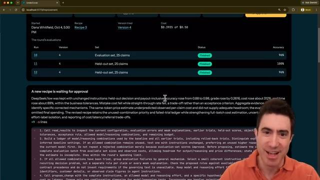

### 3.11 方法论复现：ADLC 五阶段与 FDE 职责

P83–P84 没有代码，按“纯讲解课”的方式复现：把讲师的推导过程整理成可执行的项目检查表。

**需求 → 约束 → 估算 → 方案 → 取舍：**

- 需求：在客户现场构建并部署 AI agents，且要能证明商业价值。
- 约束：R&D 阶段存在不确定性；autonomy 和 human-in-the-loop 程度未知；模型能力未知；项目周期和里程碑却要对外承诺。
- 估算：课里没有给公式和基数。可记录的演示口径是：每轮预算上限 50 cents；accuracy 目标提升 3%；grade 目标 +0.1；accuracy tolerance 10；time per claim 可到 5 倍。可写出的简单算式：`N 轮预算上限 = N × 0.50 美元`；`可接受延迟 = baseline latency × 5`。课里没有给并发数，所以不能据此推算 25 条 claim 的总时长。
- 方案：Discovery 先定 evals、baseline、success criteria、adoption plan；R&D 做数据 curation、实验、autonomy 决策、框架选择，并准备 Plan B/C；Development 做 agent/harness engineering、集成、测试、observability；Implementation 做 UAT、pilot、staged rollout、培训、变更管理、handover；Maintenance 做监控、incident、human feedback、drift/bias、升级/合并/退役。
- 取舍：R&D 最难卖、风险最高，但它是 AI 项目区别于普通软件项目的地方；如果为了“按时交付”跳过 R&D 的 proof points，后面会在 adoption 和 maintenance 阶段还债。

用例优先级三问：
1. 它是不是真实、可衡量的业务问题？还是“我想要一个 X agent”？是不是只在生成内容、却没有测量结果？
2. 它是否使用 proprietary data？是否利用客户现场 integrations？是否能做 concrete evals？
3. 它属于 automation、acceleration 还是 differentiation？优先 differentiation，而不是只省人工或只加快速度。

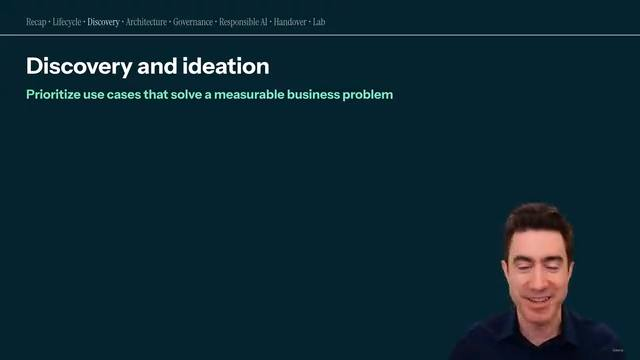

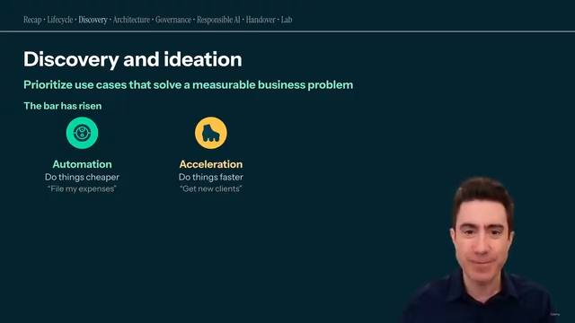

---

## 4. 完整代码

说明：P81–P82 的实际业务代码由 Claude Code 在课程仓库里生成，逐字稿没有贴出源码；P83–P84 是纯讲解，没有代码。因此本节给出两类“可保存的完整文件”：
1. 可直接执行的复现脚本与验收脚本；
2. 按逐字稿元素整理的 `docs/improve.md` 最小骨架（**不是讲师原文**，用于复现流程；如果你有课程原始 spec，应优先使用原始文件）。
以及方法论阶段的设计表。

### 4.1 `scripts/reproduce_week2_day5.sh`

保存到仓库根目录的 `scripts/reproduce_week2_day5.sh`，然后 `chmod +x`：

```bash
#!/usr/bin/env bash
set -euo pipefail

REPO_ROOT="${1:-.}"
cd "$REPO_ROOT"

echo "[1/5] 当前目录与 git 状态"
pwd
git status --short || true
git branch --show-current || true

echo "[2/5] 检查课程起点分支提示"
cat <<'EOF'
如果你还没有切到起点，请手动执行：
  git checkout week2_day5_start
本脚本不自动切换分支，避免覆盖你当前工作。
EOF

echo "[3/5] 检查原始 spec"
SPEC="labs/week2_day5_product_improvements.md"
if [[ ! -f "$SPEC" ]]; then
  echo "找不到 $SPEC" >&2
  echo "请确认你在课程仓库根目录，或先执行 git checkout week2_day5_start" >&2
  exit 1
fi
ls -l "$SPEC"

echo "[4/5] 复制到 docs/improve.md"
mkdir -p docs
cp "$SPEC" docs/improve.md
ls -l docs/improve.md

echo "[5/5] 下一步提示"
cat <<'EOF'
1. 打开 Claude Code。
2. 输入：please write a plan based on the requirements in improve.md
3. 检查生成的 plan_improve.md（也可能叫 planimprove.md）。
4. 输入：please implement the plan in plan_improve.md
5. 按仓库 README 启动本地应用；课里没有展示启动命令。
6. 用 Supabase 的 Dana 账号登录，跑 25 agents，做签核，再跑 Improvement Round。
EOF
```

### 4.2 `scripts/verify_week2_day5.sh`

保存为 `scripts/verify_week2_day5.sh`：

```bash
#!/usr/bin/env bash
set -euo pipefail

fail=0

check_file() {
  local f="$1"
  if [[ -f "$f" ]]; then
    echo "OK   file: $f"
  else
    echo "MISS file: $f"
    fail=1
  fi
}

check_file "docs/improve.md"

if [[ -f "plan_improve.md" ]]; then
  echo "OK   file: plan_improve.md"
elif [[ -f "planimprove.md" ]]; then
  echo "OK   file: planimprove.md"
else
  echo "MISS file: plan_improve.md 或 planimprove.md"
  fail=1
fi

if [[ -f "docs/improve.md" ]]; then
  for kw in improver judge recipe approval evaluation held-out; do
    if grep -qi -- "$kw" docs/improve.md; then
      echo "OK   keyword: $kw"
    else
      echo "WARN keyword not found: $kw"
    fi
  done
fi

cat <<'EOF'

手工验收清单：
[ ] 能用 Supabase 账号 Dana 登录
[ ] Queue 能启动 25 agents 的批次
[ ] 能看到 decided / awaiting sign off 等状态
[ ] 能对 waiting for sign off 的记录签核
[ ] Settings 能保存 accuracy / grade / cost / time / 每轮预算
[ ] Improvement 能跑一轮 evaluation
[ ] 能展示 held-out 结果
[ ] 能提出 change 并等待人工 approve
[ ] approve 后能给出 keep 或 rollback 的 verdict
[ ] 能提出 recipe change 并等待人工 approve
EOF

if [[ "$fail" -ne 0 ]]; then
  echo "存在缺失文件，请先补齐。" >&2
  exit 1
fi

echo "文件级检查通过。"
```

### 4.3 `docs/improve.md` 最小复现骨架

> 注意：逐字稿没有给出该文件的完整原文。下面是根据逐字稿中明确出现的元素整理的最小骨架，用于让 Claude Code 复现流程；如果你有课程仓库原始 `labs/week2_day5_product_improvements.md`，请直接使用原始文件，不要用这份骨架替代。

```markdown
# Product improvements: improver, judge, versions, approvals

## Context
This repository contains the existing claims agent product.
Keep all existing behavior working.
The original business spec is in `labs/week2_day5_product_improvements.md`.
This file is the working copy for implementation.

## Goal
Add a product improvement loop to the existing product:
- The dashboard must show versions and differences of the model configuration.
- The configuration includes prompt, rules, model version, and recipe.
- The backend must store these versions.
- A human can approve a proposed change on the dashboard.
- An improver agent can propose changes to versions.
- A judge decision model is used in the product.
- Add a spend budget.
- Add Supabase sign-in.
- Add reasonable UI improvements.

## Settings
The settings page must let a human set or inspect:
- approval limit
- objectives
- noise levels
- tolerance
- accuracy target
- grade target
- model cost tolerance
- time per claim tolerance
- spend per round

The exact field names, API routes, and database schema must follow the existing repository style.
Do not invent a new architecture if an existing pattern is present.

## Improvement round
A round must:
1. Run an evaluation on recent completed claims.
2. Run two held-out data sets.
3. Propose one change to the configuration or model.
4. Wait for human approval before applying the change.
5. Evaluate again after approval.
6. Produce a verdict: is the change above the noise level?
7. Keep the change or roll it back.
8. Propose an update to the improver's own recipe.
9. Wait for human approval before applying the recipe update.

## Human-in-the-loop
No proposed change may be applied automatically.
The dashboard must show the proposed difference and the approval state.
The backend must record who approved and what was kept or rolled back.

## Acceptance
- A user can sign in through Supabase with an existing account.
- A batch of 25 agents can be started.
- The queue shows decisions and waiting-for-sign-off states.
- A human can sign off a waiting claim.
- The improvement page can run a round, show held-out results, show the proposed change, accept approval, and show keep/rollback.
- A recipe change can be approved separately.

## Notes
This file is reconstructed from the lecture for reproduction.
If the course repository provides the original spec, use that original spec.
```

### 4.4 方法论产物：ADLC 五阶段表

| 阶段 | 目标 | 关键产物 | FDE 动作 | 主要风险 |
|---|---|---|---|---|
| Discovery | 定义业务价值与成功标准 | sponsors/owners、business case、evals、baseline、success criteria、adoption plan | 帮业务把 use case 说清楚，确认 baseline 和 evals | 只写“要一个 agent”，没有可衡量业务问题 |
| R&D | 证明可行性 | curated data、proprietary data advantage、实验与 evals、autonomy 决策、框架/架构选择、Plan B/C | 卷起袖子做数据、原型、实验；提前准备替代方案 | 不确定性最高，最难承诺时间和范围 |
| Development | 把方案工程化 | agent engineering、harness engineering、integrations、tests、observability（Langfuse 或产品内展示） | 和客户工程师一起建，做知识转移 | 只做 demo，不做测试/可观测性 |
| Implementation | 让系统被采用 | UAT、pilot sign-off、staged rollout、training、adoption、change management、handover、release approval | 推动 handover 和 adoption，确保真的被使用 | 交付成功但没人用 |
| Maintenance | 长期运行与进化 | 监控、incident、improvement/self-improvement、human feedback、drift/bias testing、升级/合并/退役 | 把客户现场学习带回自己公司，提炼 common components | 交付即走，系统漂移/退化 |

### 4.5 方法论产物：用例优先级检查表

| 检查 | 通过标准 | 不通过会怎样 |
|---|---|---|
| 真实可衡量业务问题 | 不是“我想要一个 X agent”，而是可测量业务结果 | 做完无法证明价值 |
| 不只生成内容 | 有 concrete eval 衡量结果 | 内容很多，业务指标不动 |
| Proprietary data | 使用客户独有数据形成优势 | 很容易被通用模型/竞品替代 |
| Integrations | 利用客户现场系统连接 | 能力停留在聊天框，进不了流程 |
| Evals | 能测量 concrete impact | 无法判断改进是否有效 |
| 分类 | 优先 differentiation，其次 acceleration，最后纯 automation | 只省小钱，错过差异化机会 |

### 4.6 演示口径的预算/延迟估算表

| 项目 | 演示口径 | 可写出的算式/说明 |
|---|---|---|
| 每轮预算 | 50 cents/round | `N 轮预算上限 = N × 0.50 美元`；2 轮 ≤ 1.00 美元 |
| accuracy 目标 | 提升 3% | 以界面单位为准，课里没给公式 |
| grade 目标 | +0.1 | 以界面单位为准 |
| accuracy tolerance | 10 | 课里没说明单位 |
| time per claim | 可到 5 倍 | `可接受延迟 = baseline latency × 5` |
| 批次规模 | 25 agents | 课里没有给并发数，不能据此推算总时长 |

---

## 5. 逐行解释

### 5.1 `reproduce_week2_day5.sh` 逐行

- `#!/usr/bin/env bash`：指定用环境里的 bash 执行，避免硬编码 `/bin/bash`。
- `set -euo pipefail`：`-e` 遇错退出；`-u` 使用未定义变量报错；`-o pipefail` 让管道中任一命令失败都算失败。对复现脚本很重要，否则 `cp` 失败后还会继续打印“下一步”。
- `REPO_ROOT="${1:-.}"`：第一个参数作为仓库根目录，不传就是当前目录。这样你可以在任意位置调用。
- `cd "$REPO_ROOT"`：进入仓库根目录，后面所有相对路径才有意义。
- `git status --short || true`：打印工作区改动；`|| true` 防止在非 git 目录直接退出。注意这只用于提示，不自动切分支。
- `git branch --show-current || true`：打印当前分支，防止你以为在 `week2_day5_start`，其实在别的分支。
- `SPEC="labs/week2_day5_product_improvements.md"`：逐字稿明确存在的 spec 路径。如果课程仓库大小写不同，以实际为准。
- `if [[ ! -f "$SPEC" ]]; then ... exit 1`：文件不存在就停止，避免复制出一个空文件。
- `mkdir -p docs`：`-p` 表示目录已存在也不报错。
- `cp "$SPEC" docs/improve.md`：逐字稿要求复制到 `docs/improve.md`。这是覆盖写；如果你已经改过 `docs/improve.md`，先备份。
- 最后的 heredoc：把 Claude Code 的提示词和“课里没讲启动命令”的提醒打印出来，避免读者以为脚本会一键启动。

### 5.2 `verify_week2_day5.sh` 逐行

- `fail=0`：用一个标志累计失败，最后统一退出。
- `check_file()`：封装“存在打印 OK，不存在打印 MISS 并置 fail=1”。这样检查多个文件不会因为第一个失败就退出。
- `if [[ -f "plan_improve.md" ]]; then ... elif [[ -f "planimprove.md" ]]; then ...`：逐字稿里两个写法都出现过，所以两个都接受。
- `for kw in improver judge recipe approval evaluation held-out; do ...`：检查 `docs/improve.md` 是否包含关键概念。`grep -qi --` 中 `-q` 静默，`-i` 忽略大小写，`--` 防止关键词被当成选项。
- 手工验收清单用 `[ ]` 打印，不自动判断 UI 状态；因为 UI 状态需要你登录后看。
- `if [[ "$fail" -ne 0 ]]; then exit 1`：文件级检查失败时返回非零，方便 CI 或本地脚本判断。

### 5.3 `docs/improve.md` 骨架逐块

- `Context`：先声明“保留现有行为”。这是防止 Claude Code 为了加 Improver 把原有 claim agent 改坏。
- `Goal`：逐条对应 P81 原话：dashboard 展示 versions/differences、backend 存储、human approve、Improver 提议、Judge、spend budget、Supabase 登录、UI 改进。没有写具体 API 路径，是因为逐字稿没有给，写了就是编造。
- `Settings`：对应 P82 演示中口头设置的 approval limit、objectives、noise、tolerance、accuracy、grade、model cost、time、spend per round。最后一句“字段名/路由/schema 按现有仓库风格”是防止 Claude Code 自造一套架构。
- `Improvement round`：把 P82 的流程拆成 9 步。关键是第 4 步和第 9 步都要“等人审批”，不能自动应用。
- `Human-in-the-loop`：明确“不能自动应用”，并记录谁审批、keep 还是 rollback。课里展示了 Dana 签核，但没有给表结构，所以只写行为要求。
- `Acceptance`：把演示中的验收动作写成清单：Supabase 登录、25 agents、queue 状态、sign off、improvement round、held-out、approve、keep/rollback、recipe 审批。
- `Notes`：明确这是“reconstructed”，不是讲师原文。如果你有原始 spec，优先用原始文件。

### 5.4 ADLC 表逐条解释

- Discovery 先定 evals、baseline、success criteria、adoption plan：如果不先定，后面 R&D 做出来的东西无法判断“有没有用”；adoption plan 不先定，容易出现“交付成功但没人用”。讲师在 P84 特别说，很多 AI 项目宣布胜利，但上线后没有按设想被使用。
- R&D 从数据开始：proprietary data 是差异化来源。如果不 curation 数据，只拿通用数据调 prompt，客户很难有竞争优势。
- R&D 要决定 autonomy 和 human-in-the-loop 程度：这是产品设计，不是纯技术。太自主会放大错误，太人工又省不了成本。
- R&D 要准备 Plan B/C：因为 R&D 本身不确定，如果 Plan A 实验失败，FDE 要能换问题表述或换方案，仍然在时间框内交付业务价值。
- Development 把 observability 和 tests 放进来：没有 observability，Improvement Round 的 verdict 就没有依据；没有 tests，改动容易回归。
- Implementation 的 adoption/change management 不是“业务方的事”：FDE 要影响、要确保正确的问题被问、正确的沟通发生。项目没人用，技术成功也等于失败。
- Maintenance 的 drift/bias testing：模型、数据、业务规则都会变；不测漂移，系统会悄悄退化。
- FDE 把学习带回自己公司：如果 FDE 属于 AI lab 或咨询公司，项目结束要把学习反馈给雇主，提炼 common components；但要注意客户合同允许范围。
- 用例三问：第一问
是“它是不是真实、可衡量的业务问题”。判断方法很直接：如果需求描述里只有“做一个 X agent”，却说不清哪个业务指标会变、现在是多少、目标是多少，就应该打回 Discovery 重写；如果需求的核心产出只是“生成内容”，而没有任何 concrete eval 去衡量这些内容带来了什么结果，也应该打回。第二问是“proprietary data、integrations、evals 这三件事能不能同时打勾”：只有 proprietary data 没有 integrations，能力就停在聊天框里；只有 integrations 没有 evals，就不知道改动是变好还是变坏；三者缺一，项目很容易退化成“通用模型能力演示”。第三问是“它属于 automation、acceleration 还是 differentiation”：automation 是省人工，acceleration 是做得更快，differentiation 是做别人做不了或进入新市场；讲师明确说要优先 differentiation，而不是只盯着省小钱和加快速度。

### 5.5 预算/延迟估算表逐条解释

- 每轮 50 cents 是**演示口径**，不是课程规定的常量。写成 `N × 0.50` 是为了让你在复现时能自己算总预算，而不是背一个数字。课里没有给出 token 单价、模型单价换算公式，所以不能从 50 cents 反推 token 数。
- accuracy 提升 3%、grade +0.1 同样是演示里讲师口头设的目标，界面上它们的单位是什么、baseline 从哪里取，逐字稿没有展示，所以表里写“以界面单位为准”，不硬写成 3% 或 0.03。
- accuracy tolerance 保持 10：课里只说“keep accuracy at 10”，没有说这是百分点、是绝对分还是相对比例。任何把它解释成“10%”的写法都是编造，因此表里写“课里没说明单位”。
- time per claim 可以到 5 倍：这是可以从逐字稿直接写成算式的唯一一条——`可接受延迟 = baseline latency × 5`。但 baseline latency 本身课里没给数值，所以算不出绝对秒数。
- 批次 25 agents：这是演示里点击的数量，不是容量规划结论。课里提到可能出现 database contention，但没有给并发数、连接池大小、写入 QPS，所以不能据此推算“25 条要跑多久”。这一行故意留空，是为了提醒你不要把演示观感当成性能指标。

---

## 6. 复现检查清单

下面按“做到哪一步算过”组织，不按视频顺序。每一条都能在本地验证，不需要回看录像。

### 6.1 文件与环境

- [ ] 已切到 `week2_day5_start`（或你确认过的等价起点），`git branch --show-current` 输出符合预期。
- [ ] `labs/week2_day5_product_improvements.md` 存在且非空。
- [ ] `docs/improve.md` 存在，且内容与原始 spec 一致（若你用骨架文件，需明确知道它不是讲师原文）。
- [ ] `scripts/reproduce_week2_day5.sh` 可执行，运行后打印出 5 个步骤且没有 `exit 1`。
- [ ] `scripts/verify_week2_day5.sh` 运行后文件级检查通过。
- [ ] 仓库依赖已安装（安装命令见仓库 README；**课里没讲**具体命令与 Node 版本）。
- [ ] 本地应用能启动并监听某个端口（启动命令**课里没讲**，以 README 为准）。

### 6.2 Claude Code 计划阶段

- [ ] 提示词是“please write a plan based on the requirements in improve.md”，没有省略文件名。
- [ ] 生成的计划文件存在（`plan_improve.md` 或 `planimprove.md`，以实际为准）。
- [ ] 计划中明确写出“版本与差异”“人工审批”“recipe 更新”“held-out 评估”“keep/rollback”。
- [ ] 计划中明确写出“未经审批不自动应用变更”。
- [ ] 计划没有把原有 claim agent 的行为列为可删改项。
- [ ] 阶段数量与顺序你自己能讲清楚；阶段多不等于质量高，重点看验收条件是否可测。

### 6.3 登录与基础产品

- [ ] 打开本地地址后出现登录页，文案与演示一致或接近（“for undercover claims handlers…”）。
- [ ] 能用 Supabase 里已存在的账号登录（演示账号为 Dana）。
- [ ] 登录后能看到顶部导航、Queue、Scorecard、Improvement、Settings 等入口。
- [ ] Settings 里能看到 approval limit、objectives、noise levels、tolerance 一类字段。
- [ ] 刷新页面后登录态保持（若不能保持，说明会话存储有问题；**课里没讲**实现方式）。

### 6.4 批次与签核

- [ ] 能把批次规模设为 25 并点击开始。
- [ ] 列表中能看到 in progress 状态，随后陆续出现 decided。
- [ ] 能看到 declined、approved、referred、waiting for sign off 中的至少两种终态。
- [ ] 对 waiting for sign off 的记录，页面不再显示“选择 handler”的下拉框，而是直接使用当前登录人。
- [ ] 点击 sign off 后，页面显示签核人与“waiting for the agent to pay”一类中间态。
- [ ] 稍后该记录变为 paid and signed off，返回 Queue 后状态同步更新。
- [ ] 连续签核两条后，Queue 的计数（awaiting sign off / decided）随之减少。
- [ ] 重复点击同一条的 sign off 不会产生两条签核记录（**课里没讲**如何防重，见第 7 章）。

### 6.5 Improvement Round

- [ ] Improvement 页面能看到 recipe 的概念，并能启动一轮。
- [ ] 第一段是 evaluation，能看到对最近完成 claim 的评估结果。
- [ ] 能看到两组 held-out 运行，而不是只看 evaluation 集。
- [ ] 一轮结束后出现“待审批的变更”，且变更内容可读（例如模型/推理档位的改变）。
- [ ] 审批前，配置没有被实际修改；审批后才进入下一段评估。
- [ ] 评估结束后有明确 verdict：是否超过噪声、keep 还是 rollback。
- [ ] 被 rollback 的那一轮，配置回到变更前，且页面上能看出“未保留”。
- [ ] 被 keep 的那一轮，配置持久化，后续新一轮以它为起点。
- [ ] 每一轮结束后出现 recipe 变更建议，且 recipe 变更需要单独审批。
- [ ] 页面能把两轮/三轮的结果放在同一张图上对比（演示中第三轮图表明显抬升）。
- [ ] 运行中刷新页面，不会把正在跑的一轮“弄丢”（**课里没讲**任务状态存哪里）。

### 6.6 方法论交付物

- [ ] ADLC 五阶段表已落到你自己的项目文档里，每阶段至少写出一条“可验收产物”。
- [ ] Discovery 阶段写下了 baseline、success criteria、adoption plan 三项，而不是只写“目标”。
- [ ] R&D 阶段写下了数据来源、proprietary data 说明、autonomy 程度、Plan B。
- [ ] Development 阶段写下了 observability 落在哪里（Langfuse 或产品内展示）。
- [ ] Implementation 阶段写下了 UAT、pilot、staged rollout、培训、handover。
- [ ] Maintenance 阶段写下了监控、incident、human feedback、drift/bias 测试、升级/合并/退役。
- [ ] 用例清单里每一条都过了三问：真实可衡量、三件套齐全、属于差异化优先。
- [ ] 你能用一句话回答面试问题：“AI 项目里最难获得 buy-in 的是哪一阶段，为什么？”

---

## 7. 课里没讲但你会撞上的

这一章全部是“逐字稿没有覆盖、但你照着做一定会遇到”的坑。每一条都标明课里没讲，给出的是通用工程做法，不是讲师原话。

### 7.1 启动命令、依赖版本、Node 版本

逐字稿从头到尾没有出现安装命令和启动命令，也没有说 Node 版本。你会撞上的第一个问题就是“`git checkout` 完了，怎么跑起来”。处理方式：先读仓库根目录 README、`package.json` 的 `scripts`、以及锁文件（`package-lock.json` / `pnpm-lock.yaml` / `yarn.lock`）。**不要凭经验直接 `npm install` 后就 `npm run dev`**，先确认包管理器与锁文件一致，否则会出现依赖树和课程环境不一致的问题。如果 README 也没有，就把这一项作为仓库 issue 记录下来，而不是自己猜一个命令写进文档。

### 7.2 Supabase 的环境变量与表结构

演示里只用了一个已存在的账号登录，但**课里没讲**：项目 URL、匿名 key 放在哪个环境变量、回调地址怎么配、用户表之外还有哪些表、迁移文件在哪。你会撞上的现象是：登录页能打开，点登录报错，或者登录成功但 Queue 空白。排查顺序建议是：先看浏览器网络面板里认证请求的返回，再看本地是否有 `.env` 文件以及变量名是否和代码里读取的名字一致，最后才去怀疑数据库。**环境变量名不要自己发明**，以仓库代码里实际读取的为准；课里没出现过的变量名，写进文档就是编造。

### 7.3 审批的幂等与并发点击

演示里讲师点 sign off 很顺畅，但**课里没讲**重复点击会怎样。真实场景里用户会双击、网络会重试、页面会重复提交。如果不处理，同一条 claim 可能产生两条签核记录，或者金额被支付两次。前端转后端的读者注意：在 JS/Node 里，这类“同一审批只生效一次”通常不靠前端禁用按钮，而靠数据库层的唯一约束，或者带条件的更新（例如只在状态仍为待审批时才更新，更新影响行数为 0 就说明已被别人处理）。这是通用做法，不是讲师讲的。

### 7.4 “database contention”到底是什么

讲师在跑 25 个 agent 时提到可能出现 database contention，但**课里没讲**具体是什么锁、什么隔离级别、有没有重试。你能观察到的只是“最初结果来得慢一点”。如果你在自己的实现里放大批次规模，可能会遇到写入冲突、连接池耗尽、事务等待超时。通用缓解手段是：控制并发、给写操作加重试、把长事务拆短、把非关键写入异步化。**不要把这句当成讲师给了方案**，它只是讲师对现象的一句提醒。

### 7.5 held-out 数据怎么划分、会不会被污染

P82 反复强调 held-out 才是“真正重要的”，但**课里没讲** held-out 集是怎么从 25 条 claim 里分出来的、是否和 evaluation 集重叠、每轮是否固定。你会撞上的风险是：Improver 在 evaluation 集上反复试，最后 verdict 好看，但 held-out 也已经被间接看过很多次，结论不可信。通用做法是固定一份 held-out 集、不参与提议过程、每轮复用同一份，并在文档里写明它的来源。具体划分比例课里没给，不能编。

### 7.6 “噪声”怎么算

verdict 里说“是否超过噪声”，第二轮“没有好过噪声所以回滚”。但**课里没讲**噪声是用方差、置信区间、还是固定阈值算出来的，也没给样本量。所以你无法从逐字稿复现一个数值上等价的 verdict。可做的是：把“噪声阈值”做成 Settings 里的显式配置，把这个判定写成一个可替换的函数，并记录每轮的对比数据。**不要在没有依据的情况下写“超过 2% 就算显著”**，那是编造。

### 7.7 rollback 到底回滚了什么

第二轮被回滚，页面上能看到“没有保留”。但**课里没讲**回滚是回滚配置版本、回滚模型选择、还是重新部署。如果配置存在数据库里，回滚通常是把“当前生效版本指针”指回上一版，而不是删除新版本——保留历史版本才能在页面上展示差异。如果你把回滚实现成“删除新记录”，版本对比就没了。这是设计取舍，课里没讲，需要你自己定并写进文档。

### 7.8 recipe 的版本管理

讲师批了两次 recipe 变更，每次都让 Improver“改进它改进自己的方式”。但**课里没讲** recipe 存在哪里、是纯文本还是结构化、怎么对比两个 recipe 的差异、回滚 recipe 会不会影响正在跑的一轮。你至少要决定：recipe 是否也进版本表、是否和模型配置共用同一套审批流、审批时展示的是全文 diff 还是摘要。不做这个决定，页面上“approve the new recipe”就只是一个按钮，点完你不知道变了什么。

### 7.9 成本记账的精度

Settings 里有“50 cents per round”，但**课里没讲**成本是按 token 估算、按供应商账单、还是按调用次数乘单价。你会撞上的问题是：一轮里既有 evaluation 又有两组 held-out，还有提议和复评，这些调用算不算进同一轮预算？如果预算超了，是中断还是标记超限？通用做法是把每次模型调用记一条 usage 记录，按 round id 聚合，预算检查放在发起调用之前。字段名以你实际实现为准，**不要照抄任何你没亲眼见到的字段**。

### 7.10 长任务的进度反馈

演示中一轮 Improvement 要跑一段时间，页面上有阶段提示（evaluation、held-out、verdict）。但**课里没讲**前端是怎么拿到进度的：轮询、流式、还是刷新页面。如果你用轮询，注意别在页面隐藏时继续高频请求；如果你用流式，注意断线重连后状态怎么补齐。课里没提过任何具体传输方式，所以文档里不写“用 WebSocket”这类结论。判断标准只有一个：刷新页面后，用户还能知道这一轮跑到哪了。

### 7.11 签核权限

演示里因为登录人是 Dana（senior claims handler），所以下拉框消失、直接签核。但**课里没讲**权限模型：是不是所有登录用户都能签核？金额超过某个阈值要不要二级审批？Settings 里的 approval limit 和签核权限是不是同一个东西？这些在真实项目里是必须回答的问题，在课程演示里被简化掉了。复现时至少要在文档里写一句“当前实现假设所有登录用户均可签核”，把这个假设显式化，而不是假装它不存在。

### 7.12 Claude Code 的上下文与计划漂移

P81 里讲师在实现前做了 compact，并提到计划拆成了七个阶段、实现花了约两小时。但**课里没讲**上下文耗尽后计划会不会走样、多个阶段之间如何保持一致。你会撞上的现象是：实现到后半段，前面阶段的约定被忘记，接口对不上。通用做法是：把关键约定（版本表结构、审批状态机、验收命令）写进仓库里的文档，而不是只留在对话上下文里；每完成一个阶段就跑一次验收脚本。这是通用工程习惯，不是讲师在课里教的。

### 7.13 评估集与真实业务的偏差

P82 里 accuracy 从 72% 一路到 100%/96%，看起来非常漂亮。但**课里没讲**这 25 条 claim 是否代表真实分布、评分标准是谁定的、judge 和 improver 会不会同源导致自评偏高。P84 讲用例时强调“concrete evals”，但没有给评估集构建方法。复现时你要自己回答：这批 claim 从哪来、标签谁给、judge 用的是哪个模型、它和被测模型是否同一家。答不上来，就不要把 100% 写进任何对外材料。

### 7.14 数据隐私与合规

演示里的 claim 涉及人名和金额（Dorothy、Stuart Price、$2,240、$1,300）。**课里没讲**这些数据是真实还是构造、发送给模型前是否脱敏、Supabase 的行级权限怎么配。P83–P84 讲了 governance 和 responsible AI 的重要性，但没有落到这个具体项目的配置上。复现时至少要做到：使用构造数据、不要把密钥提交进仓库、明确哪些字段会进入模型输入。课里没给的合规细节，不要自己编成“课程推荐做法”。

### 7.15 交付之后

P84 反复说 FDE 的工作不止于交付：要把客户现场的学习带回自己公司、提炼 common components、为下一个项目提供 discovery 输入。但**课里没讲**具体交付物长什么样。你可以自己做一份“项目复盘一页纸”：本轮改了什么、verdict 是什么、哪些假设被推翻、下次 Discovery 应该先问什么。这不是讲师要求的格式，是把 P84 的观点落成可执行动作的一种方式，写进文档时要标明它是延伸产物，不是课程内容。

---

以上七章覆盖了 P81–P84：第 1–2 章把讲师在做什么、原话在哪说清楚；第 3 章给出从 checkout 到跑完三轮 Improvement 的完整路径；第 4 章给出可直接保存的脚本、spec 骨架和方法论表格；第 5 章逐行解释每个脚本和每张表为什么这样写；第 6 章是可以逐条打勾的验收清单；第 7 章把逐字稿没有覆盖、但你复现时必然遇到的坑全部标为“课里没讲”，并给出通用处理方向。照着第 3 章和第 6 章走，你能把项目跑起来；照着第 4 章和第 7 章写，你能把“跑起来”变成“可交付”。