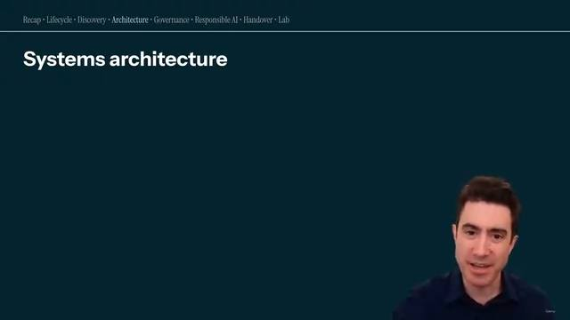
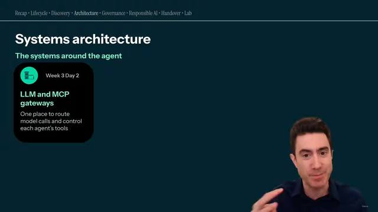
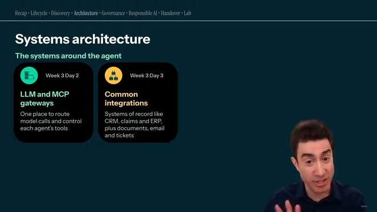
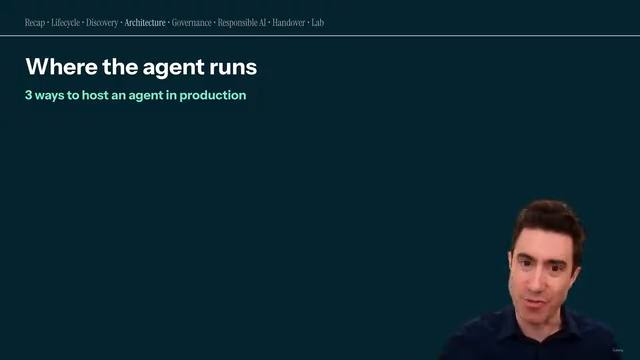
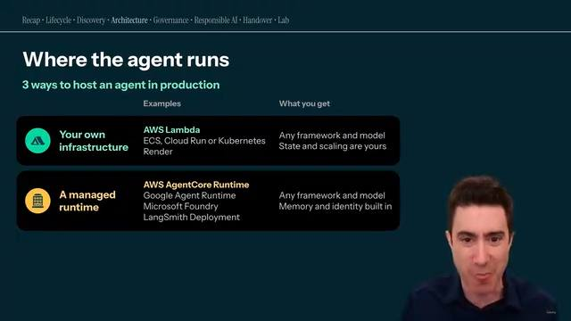
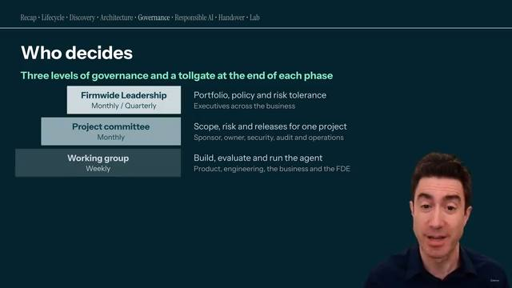
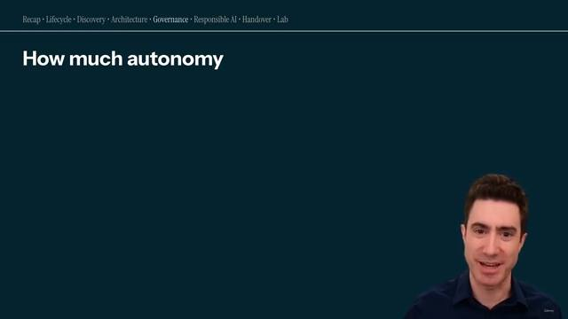
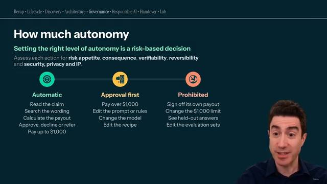
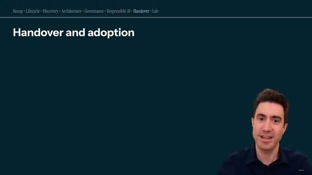

# AI FDE（BV1rJnm64Eq3）P085–P087：Agent 外围三层基础设施、运行时选型与项目治理

> 覆盖 P085 / P086 / P087 三节。这三节是讲师自己口中的“blah blah blah”段落——纯讲解，没有一行代码，也没有终端输出。讲师在 P087 结尾原话是「it's time to go back to the lab we've got some setting up to do ... I'll see you in the next lecture」，也就是说实操在下一节才开始。
>
> 因此这份文档按「纯讲解课」的方式复现：**不编造代码，但把讲师讲的那一堆判断，落成可以直接填、直接开会用的表格、schema 和清单**。读者照着做完，手里会有一份能交给客户的《Agent 落地前置决策包》。

---

## 1. 这一节做什么

上一周讲的是 agent harness 本身——那个跑循环、调工具、拿结果的 Python 程序。这三节讲的全部是 **harness 外面那一圈**：它连到哪个网关、部署在哪里、谁批准它上线、它能自己决定到什么程度、出事谁负责、交付完怎么撤人。

讲师在 P085 [00:00] 就把定位说清楚了：

> 「there is an aspect of agent architecture that I think is super important ... it's the bigger technical building blocks that sit around your agent infrastructure. Not the agent harness itself that we covered last week, but the bigger picture integrations and layers that sit around your agent harness.」

这三节的输出物不是程序，是六份文档 + 一份清单：

| 编号 | 产物 | 对应课程 | 谁签字 |
|---|---|---|---|
| 01 | 三层基础设施职责表（gateway / 集成 / 上下文） | P085 | 技术负责人 |
| 02 | 运行时选型表 | P085 | 技术负责人 |
| 03 | 治理三层角色表 + 五阶段门表 | P086 | 项目委员会 sponsor |
| 04 | 自主权（autonomy）风险矩阵 | P086 | 指导委员会 + 公司级领导小组批准 |
| 05 | Responsible AI 六支柱责任表 | P087 | 各支柱的 accountable owner |
| 06 | 交接与采纳清单 | P087 | 业务 lead |
| 附 | agent 资产清单 schema | P086 | 技术负责人 |

为什么前端转过来的工程师要特别认真读这一段：这里面的活，八成是**配置与边界**的活，跟你做 BFF、做 API 网关、做权限中间层是同一类思维。讲师说 agent 本身很轻，重活都在网关后面——这句话对前端出身的人其实是个好消息，你不擅长的并发、连接池、事务，恰恰不在你这一侧。



---

## 2. 讲师原话

按主题归并，不按页号流水账。

**关于三层基础设施**

> "围绕你的 AI 智能体有三层基础设施需要做好。第一层是 LLM 和 MCP 网关。这类基础设施就像门户，你只需配置一次，公司或客户公司里所有不同的智能体都可以通过这个门户连接外部世界。"
> —— p085 [00:16]–[00:46]

> "它指定要使用的模型和版本，还可以指定 MCP 工具、权限配置——哪个智能体被授权为哪种目的使用哪个工具——让你既能控制访问，又能对其进行监控。"
> —— p085 [00:46]–[01:10]

> "第二层是关于内部集成的公共集成点，比如连接 CRM 系统、ERP 系统、文档、邮件，或者连接 Confluence、JIRA、GitHub。"
> —— p085 [01:10]–[01:31]

> "有一个所谓的企业上下文层，负责从官方来源、从公司各处的可信数据源收集智能体需要了解的所有数据，确保数据高质量、一致并以某种方式规范化，随时可供智能体使用，并围绕数据建立适当的权限。"
> —— p085 [01:31]–[02:10]

**关于「先做轻」的个人立场**

> "我自己有一个特定的视角，这现在是我的个人观点，不一定是主流观点。我总是强调初期尽量保持简单。我建议不要投入建设大型的、有强主张的重型分层，尤其不要现在做，因为世界变化非常快，我相当怀疑我们现在构建的东西一年后可能就会显得过时。"
> —— p085 [02:38]–[03:07]

> "前一段时间，搭建中央提示词模板仓库是通行做法。而现在这感觉非常老套了。提示词变化很快，最好把提示词和你的产品、应用放在一起，中央提示词模板库感觉不是对时间的好用法。"
> —— p085 [03:37]

**关于 agent 运行时**

> "归根结底，AI 智能体只是一个软件。在我们的场景里，它是一个大量调用云的 Python 程序，就是你的智能体本身。它是一个 IO 密集型的 Python 程序，所以你可以把它部署到今天部署 Python 程序的任何地方。"
> —— p085 [04:31]–[05:01]

> "它可以是 AWS Lambda 无服务器函数，可以跑在 ECS 上，如果在 GCP 上可以跑在 Cloud Run 上，也可以放在 Kubernetes 上，Kubernetes 能跑的地方都行。如果做成了容器，还可以用 Render。"
> —— p085 [05:01]–[05:31]

> "智能体本身完成的工作——那段 Python 代码——非常轻量，是高度 IO 密集型的。它调用你的网关，而网关另一侧的一切才承担了繁重的工作。"
> —— p085 [05:58]–[06:28]

> "扩展它可以相对简单，特别是如果它实现了类似 vast API 这样的东西，你可以大规模地扩展它。"
> —— p085 [06:28]

（注：这一段逐字稿记的是 “something like a vast API”，大概率是 FastAPI 一类 Web 框架的口误或转录误差，**课里没有点明具体框架名**，我们后面在第 7 节把这个坑标出来。）

> "第二类越来越流行，是托管运行时。这类产品包括 AWS Agent Core，它的全名其实是 Amazon Bedrock Agent Core。"
> —— p085 [06:28]–[06:58]

> "还有 Google Agent Runtime，它以前有一个很长的名字，叫 Vertex AI agent 什么什么。还有 Microsoft Foundry，以及 LangChain 的 LangSmith deployment。如前所述，它以前叫 LangGraph platform，后来改名为 LangSmith deployment。"
> —— p085 [06:58]–[07:28]

> "对我来说，这里有点误导的是，这些产品之所以有用，与其说是因为它们能运行智能体并扩展它们，不如说是因为其他东西——身份管理、记忆管理，以及围绕权限和安全等增加的额外能力，这些才是它真正有用的原因。"
> —— p085 [07:40]

> "像 Anthropic 和 OpenAI 这样的实验室自己也提供托管运行时，比如 Claude managed agents，让你可以在 Anthropic 的硬件和沙箱上使用 Claude。但总的来说，这是我最难理解其价值主张的一类。"
> —— p085 [08:10]–[08:39]

**关于治理**

> "最重要的是要记住，你必须有治理机制，并且需要在项目一开始就达成一致并落实到位。"
> —— p086 [00:00]

> "最顶层是全公司范围的领导组，由职责跨越公司各部门的高管组成，可能每季度开一次会。然后向这个论坛汇报的可能是项目委员会、项目领导委员会。再向该组汇报的是项目工作组。"
> —— p086 [00:29]–[01:16]

> "FDE 肯定会参加工作组，很可能参加项目委员会、领导委员会，甚至可能参加全公司领导层会议，取决于其资历。"
> —— p086 [01:25]

**关于五道门**

> "发现阶段包括范围界定和预算获得批准，然后由公司领导层批准，特别是要检查与其他正在进行项目的重叠。对于研发，将根据研发结果批准开始构建，并就自主程度、人在回路等事项做出决定。开发阶段结束时，项目领导层会做出是否继续的决策。实施阶段结束时，他们会决定该项目是否可以被视为成功。"
> —— p086 [01:55]–[02:32]

**关于自主权**

> "项目团队必须做出的真正困难的决策之一，是给你的智能体 AI 系统多少自主权。再想象一下决定信用卡交易是否欺诈的系统，但存在某种连续谱，一端是那种系统，另一端是 Claude Code 这样的东西。"
> —— p086 [03:43]–[04:22]

> "通常这是基于风险的决策。对于每个决策，你需要了解公司的风险偏好水平是什么，如果出错后果是什么，可验证性如何，可逆性如何。"
> —— p086 [05:05]–[05:15]

> "向公司外部的电汇是完全不可逆的。在同一客户的一个账户和另一个账户之间转移资金，风险要低得多，也更可逆。"
> —— p086 [05:15]–[05:45]

> "在很多情况下，这可能转化为产品中的具体功能，比如供人审批的审核界面、展示所有发生事情的审计轨迹（就像在产品中呈现可观测性），以及流程中计划好的延迟点，比如一定金额的付款在一段延迟后才发出。"
> —— p086 [06:06]–[06:36]

**关于 agent roster（讲师明确表示怀疑）**

> "现在有些公司有了某种智能体名册，人们编制为公司构建的 AI 智能体清单并加以管理，有点像 AI 智能体的 HR 员工数据库。你知道，我对此感到有点不舒服，因为我觉得这是一种拟人化。"
> —— p086 [06:53]–[07:23]

> "围绕 AI 智能体建立身份管理、给它们限定范围的权限，这对我来说是合理的。当这种身份管理开始蔓延到名册这个概念时，我觉得就有点牵强了。关注它的技术收益，不要迷失在人力资源那一面。"
> —— p086 [07:53]

> "要以其解决的问题和带来的解决方案来框定它，而不是以它承担的角色和职责来框定。"
> —— p086 [09:52]–[10:08]

**关于 Responsible AI**

> "通常有六个不同的负责任 AI 支柱可能很重要。真正重要的是这六个支柱都已被考虑，并且如果它们确实影响你的项目，它们有负责人，问题在前期就被识别并签署确认，这样才不会最终成为项目的拦路虎。"
> —— p087 [00:24]–[00:38]

> "这里最重要的是确保你有全面的计划，在项目的每个阶段测试和考虑偏见，甚至要在前期的评估和数据整理阶段就做。"
> —— p087 [01:03]–[01:33]

**关于隐私**

> "请记住，像 OpenAI、Anthropic 和 Google 这样的主流实验室，如果你有付费企业账户，甚至只是任何付费账户，他们不会共享你的数据或用它训练。你可以找到他们关于此事的书面政策来核实，你的信息安全团队应该这么做。但这些公司都通过了 SOC2 认证并接受独立审计。"
> —— p087 [03:14]–[03:44]

> "务必提醒他们，这只是一个技术依赖，和其他依赖一样。你应该像对待与 Workday 处理 HR 数据（包括薪酬数据）、与 Microsoft 处理邮件的关系一样对待它。"
> —— p087 [04:08]–[04:38]

> "不发送你不需要的任何个人信息是一个良好的最佳实践。"
> —— p087 [04:38]–[05:08]

**关于问责与幻觉**

> "作为 AI 架构师或 AI 前驻工程师，那种做法对你不适用。你不是 AI 的使用者，你是在用 AI 构建。让这些 token 与你的业务目标对齐是你的工作。如果不是，如果错位了，你需要为此负责，而不是那台 token 预测机器。"
> —— p087 [06:29]–[07:28]

**关于交接与采纳**

> "交接就像那些约会应用说的“我们的目标是让你删掉这个应用”——那就是你的目标，你的目标是能够抽身离开项目，而它继续运行。"
> —— p087 [08:33]

> "采用率——我已经说过一千遍了——如果构建、交付和实施的东西没人用，那就没有意义。"
> —— p087 [09:33]

> "就个人而言，我非常不喜欢虚荣指标，比如消耗的 token 数量之类只会驱动错误行为的东西。"
> —— p087 [10:48]

---

## 3. 从零复现

这一节没有代码可跑，所以“复现”指的是**把讲师在脑中走的推导路径，按顺序在纸上走一遍**，产出物落在你本地的 `fde-p085-087/` 目录里。

建议的目录结构（这是本文档给的组织方式，课里没有规定）：

```
fde-p085-087/
├── 01-infra-layers.md
├── 02-runtime-choice.md
├── 03-governance.md
├── 04-autonomy-matrix.md
├── 05-responsible-ai.md
├── 06-handover-adoption.md
├── agent-inventory.schema.json
└── gateway.config.example.yaml
```

### 步骤 1：确认需求边界

需求一句话：客户要在自己的环境里跑一个 agent 产品，你是 FDE，负责交付并且要能撤走。你要在**写第一行 agent 代码之前**，把这六件事定死：三层基础设施、运行时、治理结构、自主权等级、responsible AI 责任归属、交接与采纳方案。

讲师在 P086 [00:00] 把时点说得非常重：「you need to agree it and put it in place at the very inception of the project」。所以步骤 1 的产物不是代码，是一份能拿去开会的 Markdown。

### 步骤 2：约束有哪些

从逐字稿能直接读出四条硬约束：

1. **世界变得快**（P085 [03:07]「the world is changing very fast ... whatever we build now might feel like it's obsolete in a year's time」）→ 任何“重”的层，一年后可能就是负债。
2. **agent 本身是 IO bound 的 Python 程序**（P085 [05:01]）→ 部署方案不需要为 CPU 做规划。
3. **治理必须在项目一开始就存在**（P086 [00:00]）→ 不能等项目上线前才补。
4. **问责必须落在人身上**（P087 [06:29] 及 P087 [05:38]）→ 每条 consequential 的决策都要有人签字或有人复核。

### 步骤 3：算一下到底要多大（容量估算）

讲师没给任何数字。下面这套算式是我按他给的**定性描述**搭的示意算例，用来验证他“agent 很轻、重活在网关后面”这个判断是否站得住。**这些假设数字课里没有，请按你的客户实际替换。**

用 Little's Law：并发在飞请求数 N = 到达率 λ × 平均停留时间 W。

- 假设客户有 50 人日常使用，每人每天 20 次任务 → 1000 任务/天
- 有效工作时间按 8 小时 = 28800 秒 → λ = 1000 / 28800 ≈ **0.035 任务/秒**
- 每个 agent 任务平均走 8 轮 loop，每轮网关往返 2.5 秒 → W ≈ 8 × 2.5 = **20 秒**
- 平均并发 N = 0.035 × 20 ≈ **0.69 个在飞任务**
- 取 5 倍峰值系数 → **≈ 3.5 个并发任务**

**结论：agent 这一侧 1 个 2 vCPU 的容器跑几个副本就够。** 再算网关侧：1000 任务/天 × 8 轮 = 8000 次模型调用/天；峰值 5 倍时 QPS ≈ 5 × 8000 / 28800 ≈ **1.4 QPS**。这个量级对云上推理而言是配额和成本问题，不是吞吐问题——正好印证讲师那句「everything that happening on the other side of that gateway is having to do the heavy lifting」。

> 如果你要把它写进客户的容量表，把“假设”列和“算式”列分开写，别把假设藏在结论里。

### 步骤 4：方案，按讲师给的三层去定

1. **第一层：LLM & MCP gateway。** 一个入口，锁模型版本，配 MCP 工具的授权关系（哪个 agent 能用哪个工具、为了什么用途），并且可监控。
2. **第二层：通用集成层。** CRM、ERP、文档/邮件、Confluence、JIRA、GitHub——这些是公司里反复被接入的东西，做一层公共的，别每个 agent 各接一遍。
3. **第三层：企业上下文层。** 从 source of truth 汇聚、清洗、归一化、带权限地提供给 agent。讲师明确说这层是「an evolving idea」「may need to invest in upfront」——要投，但**投在数据质量和治理框架上，不要投在重量级产品上**（这是他 P085 [02:38] 的个人立场，他自己标明「this is now my opinion no longer necessarily the prevailing opinion」）。

三层的取舍他给了个反例：**不要建中央 prompt 模板库**（P085 [03:37]「feels like real old hat」），prompt 跟产品走。

### 步骤 5：运行时选型，按他的三类去选

- 类 1（讲师推荐所有人从这里开始）：**自有基础设施**，当普通 Python 程序部署。候选：AWS Lambda、ECS、GCP Cloud Run、Kubernetes、Render（容器）。
- 类 2：**managed runtime**——Amazon Bedrock Agent Core、Google Agent Runtime、Microsoft Foundry、LangSmith deployment（原名 LangGraph platform）。讲师说这类产品的价值**不在“能跑 agent”**，在 identity management、memory management、权限与安全这些附加能力（P085 [07:40]）。
- 类 3：**实验室托管**（Claude managed agents 等）。讲师说这一类他「hardest time understanding the value proposition for」（P085 [08:10]）。

他的取舍结论（P085 [08:39]）：「my personal mindset is usually that simpler is better. So I prefer the first option, your own infrastructure, or sometimes the second option ... in the case where you will benefit from all these extra features」。本周的 lab 会用 Agent Core，因为「it's so popular」（P085 [06:28]）。

### 步骤 6：治理与自主权

治理：三层会议（firm-wide leadership / project committee / project working group），五道门（discovery / R&D / development / implementation / maintenance），每道门由坐在项目委员会上的 sponsor 签字。讲师强调「I don't want to be too prescriptive here these are just some of the common ingredients you see in practice」（P086 [02:32]）。

自主权：不按技术能力定，按风险定——风险胃口、出错后果、可验证性、可逆性。然后把它翻译成产品里的具体功能：复核屏、审计轨迹、延迟出账点（P086 [06:06]）。

### 步骤 7：过一遍 responsible AI 与交接

六支柱逐个问“跟我们有没有关系、有的话谁负责、什么时候签”。然后写交接方案：目标是让自己能被删掉（P087 [08:33]），配套持续测量（evals 漂移、采纳率、偏见测试）和由上而下的变革沟通。



---

## 4. 完整代码

> **本节为纯讲解课，讲师在 P085–P087 没有写任何代码，也没有给出任何配置格式或 schema。以下所有表格、YAML、JSON 都是把讲师的论述落成可填写的产物，其中的字段名是为了演示结构自拟的，不是课程原文。**

### 4.1 表 A：三层基础设施职责表（文件 `01-infra-layers.md`）

| 层 | 讲师给的职责（原话要点） | 必须是“一个公共入口”的理由 | 初始阶段要不要做成重型 |
|---|---|---|---|
| LLM & MCP gateway | 锁模型与版本；定义 MCP 工具；定义哪个 agent 在什么用途下能用哪个工具；控制访问并监控 | 全公司/客户公司的 agent 都从这里出去（P085 [00:46]） | 要建，但要窄：只做路由、授权、审计三件事 |
| 通用集成层 | CRM、ERP、文档、邮件、Confluence、JIRA、GitHub 的公共接入 | 这些是反复出现的接入点，不该每个 agent 各接一遍（P085 [01:10]） | 只封装客户实际在用的系统，没用的不建 |
| 企业上下文层 | 从官方来源 / source of truth 汇聚 agent 需要的数据；保证高质量、一致、归一化；带权限 | agent 需要的“事实”应该只从一处来（P085 [01:31]） | 讲师明确说这是 upfront 投资，但要轻；重的部分是数据质量与治理框架，不是产品 |
| （反例）中央 prompt 模板库 | 讲师认为已经过时 | —— | **不建**。prompt 跟产品和应用放在一起（P085 [03:37]） |



### 4.2 表 B：运行时选型表（文件 `02-runtime-choice.md`）

| 类别 | 讲师点名过的具体选项 | 讲师对它的评价 | 选它的判据 |
|---|---|---|---|
| 1. 自有基础设施 | AWS Lambda、ECS、GCP Cloud Run、Kubernetes、Render | 「an AI agent is just a piece of software」；「a lot of people are concerned about agent scalability」但实际很轻 | 默认从这里开始；你团队已经在用哪套就放哪套 |
| 2. Managed runtime | Amazon Bedrock Agent Core、Google Agent Runtime、Microsoft Foundry、LangSmith deployment（原 LangGraph platform） | 价值在 gateway、memory、identity、权限与安全等附加件，**不在“能跑 agent”** | 当你确实要用它的 identity / memory / 权限附加件时才选 |
| 3. 实验室托管 | Claude managed agents（Anthropic 硬件 + sandbox，由 Anthropic 决定 agent loop 怎么跑） | 「this is the one that I have the hardest time understanding the value proposition for」；企业场景更可能选前两类 | 企业场景一般不选 |

补充判据（讲师原话）：「in most cases the work that's being done by your agent itself that Python code is very light」（P085 [05:58]）——所以**不要为了“agent 会很多”去提前上重架构**，第 3 节的算式已经证明瓶颈不在这里。





### 4.3 网关配置草案（文件 `gateway.config.example.yaml`）

> 课里没有给出任何配置格式。以下 YAML 只是为了把 P085 [00:46] 那段“gateway 能配什么”变成可以填的东西。

```yaml
# 课里没有代码，以下为示意。字段名自拟，不是课程原文。
gateway:
  llm:
    # 讲师原话：gateway "specifies the models and versions to use"
    models:
      - id: "claude-family"
        version: "<锁定到具体版本号，不要用 latest>"
        enabled_for_agents: ["*"]
      - id: "gpt-family"
        version: "<锁定到具体版本号>"
        enabled_for_agents: ["*"]

  mcp:
    # 讲师原话：gateway 定义 "which agent is authorized to use which tool for which purpose"
    tools:
      - name: "crm.lookup_customer"
        purpose: "只读查询客户档案"
        allowed_agents: ["support-triage"]
      - name: "crm.update_record"
        purpose: "写回客户记录"
        allowed_agents: []          # 默认关闭，等治理委员会批
      - name: "payments.create_transfer"
        purpose: "发起转账"
        allowed_agents: []          # 默认关闭
        requires_human_approval: true

  access_policy:
    default_action: "deny"          # 未显式列出的工具一律拒绝
    log_every_call: true

  audit:
    # 讲师原话：gateway "allows you both to control that access but also to monitor it"
    capture_prompt_and_response: false   # 含 PII 时按 P087 的原则不应外传
    retention_days: 90
```

### 4.4 表 C：治理三层（文件 `03-governance.md`）

| 层级 | 讲师给的成员构成 | 讲师给的节奏与职责 |
|---|---|---|
| Firm-wide leadership group | 跨部门的 executives | 「perhaps they meet quarterly」；签总体预算；项目跑偏时纠偏；管跨部门风险；保证全公司做法一致（P086 [00:29]–[00:47]） |
| Project committee / leadership committee | 该项目所在部门的人：head of technology、business sponsor、business lead、head of information risk / cyber、operations、product | 项目层面的关键领导；sponsor 在五道门末尾签字（P086 [00:47]–[01:16]） |
| Project working group | 日常干活的人：project manager、product manager、operations lead 等 | 日常推进；FDE 一定在这里（P086 [01:25]） |

FDE 的出席位置（讲师原话）：「an FDE certainly attends the working group, probably attends the project committee, the leadership committee, and possibly even the firm-wide leadership, depending on their seniority.」



### 4.5 表 D：五阶段门（文件 `03-governance.md` 同文件后半）

| # | 阶段 | 门末要决定什么（讲师原话要点） | 谁签 |
|---|---|---|---|
| 1 | Discovery | scope 与 budget 签字，并由 firm leadership 批准，重点看与其他在建项目是否重叠 | 项目委员会 sponsor + firm leadership |
| 2 | R&D | 是否批准进入 build；同时定 autonomy 等级与 human-in-the-loop 安排 | 项目委员会 |
| 3 | Development | go / no-go | 项目领导层 |
| 4 | Implementation | 项目是否算成功：成功标准、采纳标准、开工时定的 evals 是否达标、ROI | 项目领导层 / program sponsors |
| 5 | Maintenance | 要上线的变更怎么放行 | program sponsors |

讲师自己加了注：「I don't want to be too prescriptive here these are just some of the common ingredients you see in practice」（P086 [02:32]）——照抄前先跟客户的既有 PMO 对齐。

### 4.6 表 E：自主权风险矩阵（文件 `04-autonomy-matrix.md`）

讲师给的四问：风险胃口多大、出错后果是什么、可验证性多高、可逆性多高（P086 [05:05]）。落成表：

| 决策动作 | 可逆性 | 出错后果 | 可验证性 | 讲师给的原话依据 | 落成的等级 |
|---|---|---|---|---|---|
| 同一客户名下两个账户之间划转 | 高（可冲正） | 低 | 高 | 「A transfer of funds between one customer account and a different account with the same customer is much lower risk and more reversible」（P086 [05:15]） | 阈值下自动；阈值上人工 |
| 向公司外电汇 | 无 | 高 | 中 | 「A wire transfer outside the firm is not reversible at all」（P086 [05:15]） | 一律人工 + 延迟出账 |
| 理赔三选一（通过 / 拒绝 / 待定） | 中 | 中高 | 中 | 讲师提到「our claims agent, the three possibilities and then also an ability for a human in the loop」（P086 [04:22]） | 拒绝与待定必须人工复核 |
| 卡片交易是否欺诈（类比） | 中 | 中 | 中 | 讲师用它做“统计型系统不是新东西”的类比（P086 [03:52]） | 沿用客户现有 operations team 的 false positive / negative 胃口 |

对应的产品功能（讲师在 P086 [06:06] 直接点名的三类）：**review screens（人工复核屏）、audit trail（把 observability 暴露到产品里）、planned delay points（超过一定金额的付款延迟出账）**。



### 4.7 表 F：Responsible AI 支柱责任表（文件 `05-responsible-ai.md`）

讲师说「usually there are six different pillars」，逐字稿里**明确点名的只有五个**，第六个没有点名——表里保留空行，开会时让客户 PMO 补。每行的判据是他 P087 [00:38] 那句：「if they do affect your project ... they have an owner, they have the issues being identified up front and being signed off on」。

| # | 支柱 | 讲师原话要点 | 是否影响本项目 | accountable owner | 什么时候签 |
|---|---|---|---|---|---|
| 1 | Safety and alignment | 「something we'll talk about tomorrow」（P087 [00:38]–[01:03]） | 待定 | 待填 | R&D 门之前 |
| 2 | Fairness and bias | 「testing for and accounting for bias at every stage ... even upfront in the evals and in the data curation」（P087 [01:03]） | 待定 | 待填 | Discovery 门之后进 evals 时 |
| 3 | Security and privacy | 与 safety 一起讲；隐私部分见下 | 多数项目为“是” | infosec 团队 | Discovery 门 |
| 4 | Transparency / explainability | 「partly explainability ... goes hand in hand with observability」；讲师指出 LLM 现在靠 reasoning traces 解释自己比过去容易（P087 [01:33]） | 待定 | 待填 | Development 门 |
| 5 | Accountability | 「making sure that there is a human on the line that blaming the LLM is never a possibility」（P087 [01:51]） | 是（无例外） | 项目 sponsor | 全程 |
| 6 | （讲师未点名） | —— | 待定 | 待填 | 待定 |

### 4.8 agent 资产清单 schema（文件 `agent-inventory.schema.json`）

讲师的立场很特别：**要登记 agent，但按“它解决什么问题”登记，不按“它扮演什么角色”登记**（P086 [09:52]「Have it be framed in terms of the problem it solves and the solution it brings rather than the role and responsibility that it takes」），并且要把它当软件资产而不是 HR 花名册（P086 [08:23]）。这个 schema 就是照这个立场写的。

```json
{
  "$schema": "https://json-schema.org/draft/2020-12/schema",
  "$comment": "课里没有代码，以下为示意。字段自拟，用途是把 P086 关于 agent roster 的论述落成可填写的东西。",
  "title": "agent-inventory-entry",
  "type": "object",
  "required": ["assetId", "humanOwner", "businessProblem", "capabilities", "runtime", "autonomyLevel", "reviewCadence"],
  "properties": {
    "assetId": {
      "type": "string",
      "description": "技术标识。等同于其他软件资产的主键，不是“员工编号”。"
    },
    "humanOwner": {
      "type": "string",
      "description": "人类责任人。讲师原话：blaming the LLM is never a possibility，所以这里不能填模型名。"
    },
    "businessProblem": {
      "type": "string",
      "description": "它解决什么业务问题。讲师要求按问题登记，不按角色登记。"
    },
    "capabilities": {
      "type": "array",
      "items": { "type": "string" },
      "description": "它能做什么功能，可测量。"
    },
    "runtime": {
      "type": "string",
      "enum": ["own-infra", "managed-runtime", "lab-managed"],
      "description": "对应表 B 的三类。"
    },
    "scopedPermissions": {
      "type": "array",
      "items": { "type": "string" },
      "description": "对应网关里给它的 MCP 工具授权清单。讲师认可“scoped permissions”这一面，不认可“org chart”那一面。"
    },
    "autonomyLevel": {
      "type": "string",
      "enum": ["fully-automatic", "human-approve-threshold", "human-approve-always", "prohibited"],
      "description": "取值来自表 E。讲师描述的谱系是「from fully automatic through to something that's completely prohibited」。"
    },
    "reviewCadence": {
      "type": "string",
      "description": "复评周期。讲师提到 bias testing 常是 quarterly exercise（P087 [09:03]）。"
    },
    "retireCriteria": {
      "type": "string",
      "description": "什么时候下线。讲师提到“when do we retire agents”这个讨论，但从技术角度建议谨慎推回。"
    }
  }
}
```



### 4.9 容量估算表（可直接贴进客户方案）

| 项 | 假设 | 算式 | 结果 |
|---|---|---|---|
| 日任务量 | 50 人 × 20 次/天 | 50 × 20 | 1000 任务/天 |
| 到达率 λ | 8 小时有效工作 | 1000 / 28800 | ≈ 0.035 任务/秒 |
| 单任务停留时间 W | 8 轮 × 2.5 秒 | 8 × 2.5 | 20 秒 |
| 平均并发 | Little's Law | 0.035 × 20 | ≈ 0.69 |
| 峰值并发 | 5 倍系数 | 0.69 × 5 | ≈ 3.5 |
| 网关侧日调用 | 8 轮/任务 | 1000 × 8 | 8000 次/天 |
| 网关侧峰值 QPS | 5 倍系数 | 5 × 8000 / 28800 | ≈ 1.4 |

**这张表的所有假设数字都是我为演示算式自拟的，课里一个数字都没给。** 它的作用是把讲师那句“agent 是 IO bound、很轻”变成可被客户财务和架构评审质询的形式。

### 4.10 交接与采纳清单（文件 `06-handover-adoption.md`）

讲师在 P087 [08:33] 之后给的具体项，逐条抄下来做勾选表：

| # | 项 | 讲师原话要点 | 完成判据 |
|---|---|---|---|
| 1 | 不依赖你的 ownership 与 escalation | 「making sure that there's ownership and escalation in place without you involved」 | 有一条不在你名下的值班/升级路径 |
| 2 | 知识转移 | 「making sure there's knowledge transfer so everything that you know about that team knows about」 | 团队能在你不在场时改 prompt、换模型版本 |
| 3 | 持续测量产品 | 「a program in place that is continually measuring the product」 | 有周期性跑的 evals |
| 4 | 模型漂移监测 | 「including measuring the evals for model drift」 | 有基线 + 告警 |
| 5 | 采纳率监测 | 「measuring the adoption to make sure it's still being used and the usage is increasing」 | 有使用率趋势图 |
| 6 | 偏见复测 | 「bias testing that's often a quarterly exercise」 | 排进季度日历 |
| 7 | 培训与支持 | 「significant training and support」 | 有培训材料与支持入口 |
| 8 | 自上而下的变革沟通 | 「Change management communication coming top-down. Sponsors are telling their teams the importance」 | sponsor 本人出面讲过 |
| 9 | 可证明的准确率指标 | 「be able to prove the accuracy of outputs」 | 有可对外引用的指标 |
| 10 | 真实用户 champion | 「cases of people in the trenches who are getting value ... not people that have been singled out」 | 至少 1 个非指定的自愿案例 |
| 11 | **不要** vanity metrics | 「numbers of tokens consumed and stuff that just drives the wrong behavior」 | 指标清单里没有 token 消耗量 |



---

## 5. 逐行解释

这一节逐条解释上一节每一个决策为什么这样定、不这样会怎样。

**表 A 第 1 行（gateway 收口）**
为什么把模型版本锁在网关、而不是每个 agent 自己配？因为讲师给的功能清单里，除了“路由”，还有“授权”和“监控”两件必须在中心做的事（P085 [00:46] 那段三个动作：control that access、monitor it）。如果每个 agent 各自持有模型凭据，你就无法回答“哪个 agent 在什么用途下用过哪个工具”这个问题——而这个问题的答案，恰好是表 D 第 4 道门（implementation 判定成功）和表 F 第 5 行（accountability）要用的证据。不这样会怎样：项目上线时你说不清它做了什么，审计轨迹无法从网关侧生成，只能事后从日志里捞。

**表 A 最后一行（不建中央 prompt 库）**
这是讲师的个人判断，他自己标了「this is now my opinion no longer necessarily the prevailing opinion」。理由是 prompt 变化快、跟产品走更合适（P085 [03:37]）。如果照旧建一个中央库：产品团队每次改一个字都要走一次跨团队流程，最后大家绕开它，你得到的是一个和线上实际使用的 prompt 不一致的库——比没有更糟。

**表 B 第 1 行（默认自有基础设施）**
判据不是“便宜”，是“agent 是 IO bound”（P085 [05:01]）加上第 4.9 节的算式。如果为了“以后 agent 会有很多”提前上 managed runtime：你在为不会到来的并发付钱，同时把 identity / memory 这些真正值钱的附加件绑死在一个你还没验证过要用的平台上。

**表 B 第 2 行（managed runtime 的真实价值）**
讲师的原话很关键：「it's a bit of a red herring that what makes these products useful is less about the fact that they can run agents and scale them and it's more about the other stuff」（P085 [07:40]）。所以选型问题不是“它能跑 agent 吗”，而是“我要不要 identity management、memory management、权限与安全这几件”。如果你只是要跑 Python，第 1 类就够了。不这样会怎样：你会用“性能”作为理由选了一个平台，然后在真正需要它的附加件时发现没配好。

**表 B 第 3 行（实验室托管）**
讲师说这是三类里他最难理解价值主张的一类，并给了理由：“in the enterprise context, you're much more likely to pick one of those first two approaches”（P085 [08:39]）。这条不写死，写清了是为了让你在客户提到“直接用 Claude 托管”时，有一个可引用的、来自讲师判断的对照。

**表 C（治理三层）**
为什么必须在 inception 就建？讲师原话：「the most important thing to remember is just that you need to have governance and that you need to agree it and put it in place at the very inception of the project」（P086 [00:00]）。如果拖到 R&D 之后：第 2 道门要定的 autonomy 等级没有合法的批准主体，你要么自己拍，要么让业务随便定——两种都是后面出事时的把柄。

注意三层的**节奏不同**：firm-wide 是「perhaps they meet quarterly」（P086 [00:29]），working group 是日常。写表时把节奏也写进去，否则客户会以为每一道门都要等一个季度。

**表 D（五道门）**
注意第 1 道门的细节：讲师说 firm leadership 要「particularly to look for overlap with other projects going on」（P086 [01:55]）。这一条决定了表 D 不是纯粹的时间表，是一张**查重表**——如果客户已经在建自己的上下文层，你的项目不该再建一个。

第 4 道门的
第 4 道门（Implementation）签的是“这个项目算不算成功”，判据是讲师给的四项：成功标准、采纳标准、开工时定的 evals 是否达标、ROI（P086 [02:14]–[02:32]）。注意这四项里有三项是**开工时就写下的**，所以表 D 的第 1 道门必须同时产出“成功判据初稿”，否则第 4 道门无从判定。这是很多项目最容易塌的地方：门 4 开会时大家凭感觉说“还行吧”。

第 5 道门（Maintenance）签的是变更放行，主体换成了 program sponsors（P086 [02:32]）。它和表 F 里“偏见复测是季度动作”、交接清单第 3–6 项是同一套节奏——上线之后不是结束，是进入一个有固定体检周期的状态。

**表 E（自主权矩阵）**
这张表最容易做错的地方，是把“可逆性”当成技术属性。讲师举的两个例子是同一种技术动作（转账），但可逆性完全不同（P086 [05:15]）：同客户名下账户间划转可冲正，向公司外电汇不可逆。所以表 E 的“可逆性”列必须写**业务上的可逆**，不是“有没有回滚脚本”。

第二个容易做错的地方：讲师说这是「a risk-based decision」，并且要「agreed by your steering group and then ratified by the firm-wide group」（P086 [04:52]）。也就是说这张表不是技术团队内部文档，是要上会的。所以每一行都要能被非技术出身的 exec 读懂——“出错后果”一列请不要写“模型幻觉率 3%”，写“客户收到错误的拒绝通知，需人工回电挽回”。

第三点：讲师把这张表直接翻译成三个产品功能（review screens / audit trail / planned delay points，P086 [06:06]）。这说明 autonomy 等级不是文档里的一个枚举值，它必须落到代码里：**枚举值决定的是这个动作走不走人工复核分支**。对前端出身的人，这三件东西你其实都熟——review screen 就是你做过无数次的审批弹窗，audit trail 是 append-only 的事件流，planned delay point 是一个带到期时间的任务队列（在 Node 里最接近 `setTimeout` / `BullMQ` 的 delayed job，但**课里没有提到任何队列工具，这里只是类比**）。

**表 F（六支柱）**
讲师说「usually there are six different pillars」，但逐字稿里能确认的只有五条：safety and alignment、fairness and bias、security and privacy、transparency、accountability（P087 [00:24]–[01:51]）。第六个没有点名——所以 4.7 表里保留空行。**不要凭常识去补第六个**，那是编造；正确做法是在客户 PMO 的会上问“你们用的 responsible AI 框架是哪一版”，让客户自己填。

这张表的真正用途不是学术分类，是讲师那句「they have an owner, they have the issues being identified up front and being signed off on so that this doesn't end up being a showstopper for your project」（P087 [00:38]）。换句话说，**这张表是防“上线前一周被信息安全部门叫停”的**。所以每一行的 accountable owner 必须是真人姓名，不能写“信息安全团队”——团队没有签字权。

公平性与偏见那一行的时间点是“进 evals 时”，讲师说得很明确：「even upfront in the evals and in the data curation」（P087 [01:03]）。这意味偏见测试不是上线前的合规模板，它是**数据集构建阶段就要跑的东西**。如果你把它排到开发后期，数据集已经定稿，你能做的只剩写一份解释文档。

**Accountability 那一行（表 F 第 5 行）为什么写“无例外”**
讲师在 P087 [05:38]–[07:58] 花了整整两分钟讲这一件事，而且预判了听众的反驳「what about hallucinations? Surely that is something that we can blame」。他的回答分两层：

1. 作为**用户**，你被幻觉坑了可以生气；
2. 但作为 **FDE / AI architect**，「That move is not available to you. You are not a user of AI. You are building with AI.」

再往下是他给的工作定义：「Making those tokens aligned with your business objective is your job. And if it's not, and if it's misaligned, then you need to be accountable for that, not the token prediction machine.」（P087 [06:59]）。这一段之所以要写进表 F，是因为它直接决定了表里“完成判据”的写法——判据不能是“模型表现好”，只能是“我们建了哪些控制、做了哪些测试、怎么验证了 LLM 的标注与证据”。

**schema 4.8（agent 资产清单）**
为什么字段是 `businessProblem` / `capabilities` 而不是 `role` / `reportsTo`？因为讲师在 P086 [07:23]–[09:52] 花了很长的篇幅批评“HR 花名册”式的 agent roster，并且明确说「I feel like it's anthropomorphism」。他并不否定登记本身——「I do think it's good to track AI agents in your organization. Don't get me wrong. And I think you should encourage that practice」——他否定的是登记的**框架**。

所以他给了一句几乎是 schema 设计规范的话：「Have it be framed in terms of the problem it solves and the solution it brings rather than the role and responsibility that it takes.」（P086 [09:52]）。这句话直接对应 schema 里的两个必填字段。

而 `scopedPermissions` 是他认可的另半边：「it makes sense to me that there is identity management built around AI agents in terms of giving them scoped permissions」（P086 [07:53]），以及他自己举的例子「the ability to have a limited payment account for an AI agent so that it's authorized to spend up to a certain amount」（P086 [07:23]）。这个例子值得直接演进 schema——它就是表 E 里 `human-approve-threshold` 一个等级的金额字段。**但逐字稿没给金额上限该怎么定，这个数字必须由客户按风险胃口填。**

**表 4.9（容量估算）**
这张表不是算给讲师看的，是算给客户架构评审看的。它要证明的三件事：

1. agent 侧并发是个**个位数**，说明“agent 会很多所以要重架构”这个担忧在这个量级上不成立；
2. 幂律在网关那一侧（8000 次/天 → 峰值 1.4 QPS），所以配额、限流、成本控制都在网关侧做；
3. 关键变量是 `W`（单任务轮数与单轮往返时间），而 `W` 由网关决定——这正好是讲师那句「everything that happening on the other side of that gateway is having to do the heavy lifting」（P085 [05:58]）的数学表达。

如果你把这表交给客户，务必保留“假设”列。把假设藏进结论里，是这类文档最容易挨打的地方。

**表 4.10（交接与采纳）**
第 11 项是一个**否定项**，这在这类清单里不常见，但它是讲师明确点名的：「Personally, I'm very much not a fan of vanity metrics, things like numbers of tokens consumed and stuff that just drives the wrong behavior」（P087 [10:48]）。为什么 token 消耗量是坏指标？因为它只随使用量上升，从不下降，看起来永远在“增长”，且和业务价值无关；更糟的是它会诱导团队把 prompt 写得更啰嗦。这一项写进清单的意义是：**评审时拿它当一条红线用**。

第 10 项（真实 champion）讲师给了一个很具体的限定：「It's not people that have been singled out to be the official champions. It's actually cases of people in the trenches who are getting value from the product and are willing to talk about it.」（P087 [10:48]–[11:17]）。所以判据写的是“非指定的自愿案例”，一旦出现“我们指定了张三做 champion”就视为未达标。

---

## 6. 复现检查清单

照这个顺序勾。没有代码，全部是文档与会议产出。**任何一项没勾，不要进 lab。**

### 准备

- [ ] 建目录 `fde-p085-087/`，建齐 8 个文件（6 个 .md + 1 个 .schema.json + 1 个 .example.yaml）
- [ ] 每个 .md 顶部写三行：客户名 / 本文件 accountable owner / 最后更新日期
- [ ] 确认自己没有把任何 prompt 存进一个“公共目录”——如果你建了，删掉（P085 [03:37]）

### 基础设施三层（对应 `01-infra-layers.md`）

- [ ] 网关：列出**当前已在用**的模型与版本，逐个写死版本号，不写 latest
- [ ] 网关：列出 MCP 工具清单，每个工具写 `purpose` 与 `allowed_agents`
- [ ] 网关：默认策略设为 deny（未列出的工具拒绝）
- [ ] 网关：确认能回答“过去 7 天哪个 agent 在什么用途下调用过哪个工具” —— 答不上来说明监控没落地
- [ ] 集成层：只列客户**真的在用**的系统；CRM / ERP / 文档 / 邮件 / Confluence / JIRA / GitHub 中不用的划掉
- [ ] 上下文层：写下“source of truth 是哪几个系统”，以及每个系统的数据质量责任人姓名
- [ ] 上下文层：写清“哪一类数据不给 agent”（这是 P087 隐私原则在这一层的落地）
- [ ] 反例核对：确认没有在建中央 prompt 模板库

### 运行时（对应 `02-runtime-choice.md`）

- [ ] 用 4.9 的算式算出本项目的 λ、W、N 三项，写在文档里
- [ ] 判断走表 B 哪一类，并写一句“为什么不是另外两类”
- [ ] 若选 managed runtime：写明**具体要用的是哪个附加件**（identity / memory / 权限 / 安全中的哪几个），不允许写“因为它更专业”
- [ ] 若选自有基础设施：写明部署平台与容器/函数形态

### 治理（对应 `03-governance.md`）

- [ ] 三层会议各自的成员名单（真实姓名）与节奏（周/月/季）
- [ ] 五道门每一道的**签字人姓名**与**判定判据**
- [ ] 第 1 道门附“查重清单”：客户方已在建的相关项目清单（对应 P086 [01:55] 的 overlap 要求）
- [ ] 第 1 道门同时产出“成功判据初稿”，否则第 4 道门无法判
- [ ] FDE 本人出现在 working group 名单里

### 自主权（对应 `04-autonomy-matrix.md`）

- [ ] 每个 consequential 动作一行，四个列全填：可逆性 / 后果 / 可验证性 / 等级
- [ ] 可逆性一列写的是**业务可逆**，不是技术回滚能力
- [ ] 每一行都被 steering group 过过，并记录 firm-wide 批准日期
- [ ] 三个产品功能有对应实现位置：review screen 在哪、audit trail 写去哪、delay point 的阈值与延迟时长是多少
- [ ] 阈值的具体数字由客户填，不是我填的（讲师未给任何数字）

### Responsible AI（对应 `05-responsible-ai.md`）

- [ ] 六行都在，第六行**留给客户 PMO 填**，不自拟
- [ ] 每行 accountable owner 是真人姓名
- [ ] fairness & bias 的检测动作**已排进数据集构建阶段**，不是排在开发后期
- [ ] 确认“不能责怪 LLM”这条已写进项目章程，并且有一条对应的控制措施（不只是口号）

### 资产登记（对应 `agent-inventory.schema.json`）

- [ ] schema 里没有 role / reportsTo / manager 一类字段
- [ ] 至少一条真实记录能通过 schema 校验
- [ ] 每条记录的 `humanOwner` 是真人
- [ ] 每条记录的 `businessProblem` 能被业务方读懂

### 交接与采纳（对应 `06-handover-adoption.md`）

- [ ] 11 项逐条打勾，第 11 项是“确认没有 vanity metrics”，反向检查
- [ ] 值班与升级路径的 on-call 名单里**没有我的名字**
- [ ] 客户团队有人能独立改 prompt、换模型版本（当面演示过一次）
- [ ] 指标清单里不含 token 消耗量、不含“对话轮数”这类只增不减的量
- [ ] 有至少一个非指定的用户自愿案例

### 隐私核对（P087 部分）

- [ ] 已拿到客户信息安全团队对所用模型厂商的书面评审（合同、训练政策、审计报告）
- [ ] 数据最小化：逐字段核对过“这个字段真的需要发给模型吗”
- [ ] 敏感字段（姓名、证件号一类）在进入网关前已被剥离或替换 —— 实现方式需要落地，不能只在文档里承诺

---

## 7. 课里没讲但你会撞上的

这一节全部是我的补充，不属于课程内容。每一条都标了“课里相关的那句话是什么”。

**7.1 “gateway”到底怎么实现，课里没讲**
讲师只说它是一个“portal”，能配模型版本、配 MCP 工具授权、能控制和监控（P085 [00:46]）。但用什么建——LiteLLM、自研 FastAPI 中间层、云厂商的现成产品——**一个字都没提**。你回到项目上第一周就会撞上这个问题。可用的思路是：它本质是一个**带鉴权和审计的反向代理**，你如果做过 BFF 就有直觉。选型时把 4.3 那份 YAML 的字段清单拿去和候选产品对表，谁能覆盖 `allowed_agents` + `purpose` + `default deny` + 可查审计，谁就合格。

**7.2 MCP 是什么，课里没解释**
讲师在 P085 [00:46] 直接用了 “MCP tools” 这个词，没有展开。如果你不清楚，这一节不会补——**去查官方文档**。这里只提醒一件事：本文档所有涉及 MCP 的地方，写的都是“工具授权关系”，不是“协议细节”。

**7.3 Amazon Bedrock Agent Core 怎么用，课里一个命令都没给**
P085 [06:28]–[06:58] 只说了它“很流行、本周会用、带 gateway / memory 等附加件”。P087 结尾说「it's time to go back to the lab we've got some setting up to do」——**设置步骤在下一节**。所以本文档刻意不写任何 Agent Core 的安装、鉴权、部署命令；写了就是编造。你要跑它，去看下一节的逐字稿。

**7.4 “something like a vast API” 是转录疑义**
P085 [06:28] 原文是「particularly if it's implemented something like a vast API, you can scale it up in a massive way」。从上下文（Python 程序、无状态、可水平扩展）看，极可能是 FastAPI 一类 Web 框架的口误或转录误差。**课程没有点明具体框架名**，所以本文档在任何地方都不写“讲师推荐 FastAPI”。

**7.5 延迟出账（planned delay point）在工程上是什么**
讲师只说要在流程里“planned delay points”，让超过一定金额的付款延迟出账（P086 [06:36]）。他没有说用什么实现。工程上它是一个**带到期时间的持久化任务 + 到点重新触发人工复核**。在 Node 里最接近的是 delayed job 队列（如 BullMQ 的 delayed job）或数据库里一张 `due_at` 表 + 定时扫描。**这里提到 BullMQ 只是类比，课程未提及任何队列工具。** 关键设计点：延迟期内必须允许撤销，且撤销动作本身要进审计轨迹。

**7.6 审计轨迹写在哪、写什么格式，课里没讲**
讲师要求「an audit trail that shows everything that happens like observability surfaced in product」（P086 [06:06]）。但存储、schema、保留期全没提。我的建议（非课程内容）：**append-only**，每条记录至少包含 agent 资产 ID、工具名、用途、人类复核人（若有）、时间戳、决策结果。这样它才能同时喂给表 D 第 4 道门和表 F 第 5 行。

**7.7 idempotency：agent 重试会重复下单**
这是纯工程坑，课里完全没提。agent 是循环调工具的，网络抖动会重试；一个“写回 CRM”或“发起转账”的工具被调用两次，就是两笔业务。**做法是在工具侧引入幂等键**（一次任务一个 key，重复请求返回同一结果）。这在后端是常识，但前端出身的同学容易漏——你在 JS 里发 `fetch` 时天然假设“要么成功要么失败”，而 agent 的循环会把这个假设打破。课里唯一的间接呼应，是讲师反复强调的“可逆性”（P086 [05:15]）：不可逆动作必须人工 + 延迟，本质上就是在绕开这个问题。

**7.8 并发与锁：这里其实没有你想的那种并发**
第 4.9 节算出来的峰值并发是个位数，所以**不要引入分布式锁**。真正需要互斥的地方只有一处：同一个人工复核任务不能被两个复核员同时放行。这在 Node 里就是一次带条件的数据库更新（`UPDATE ... WHERE status = 'pending'`），不需要 Redis 锁。**课里没有讨论并发控制**，这条只是提醒你别过度设计。

**7.9 “第六个支柱”是什么，取决于客户**
P087 [00:38] 说六个，实际点名五个。不要自己补。正确做法见 4.7 与第 6 节：让客户 PMO 按他们自己的框架填。你在会上问一句“你们用的是哪一版 responsible AI 框架”就够了。

**7.10 SOC2 这句话怎么用**
讲师说主流实验室「SOC2 certified and independently audited」（P087 [03:44]），并明确要求「your information security team should do exactly that」（去查他们公开的政策文档）。注意他的措辞是**让信息安全团队去查**，不是“你可以直接引用这句话交差”。所以文档里不要写“厂商已 SOC2 认证，无需评审”——恰恰相反，他是让你走完整评审流程，只是把这类厂商**当成普通技术依赖**对待（像 Workday、像微软邮件，P087 [04:38]）。

**7.11 “本地推理”这条退路**
讲师提到 week 1 day 4 里演示过在 RunPod 上跑模型，也提到「you can run it on-premises on your company's hardware」（P087 [02:21]–[03:14]）。如果你客户的信息安全部门一刀切禁止出境，这是唯一的技术退路。**但课里没有给这一节的配置步骤**，只说那是 week 1 的内容。你要复现得回去翻 week 1。

**7.12 采纳率怎么量才不算 vanity metric**
讲师否掉了 token 消耗量（P087 [10:48]），但**没有给替代指标**。这是你要自己定的。可用的方向（非课程内容）：能归因到具体业务结果的完成数（比如“本月由 agent 起草并被人工直接采纳的回复数”），以及“人工修改率”的下降趋势。原则是：**指标必须能下降**，只增不减的都不是采纳指标。

**7.13 FDE 的“撤走”在合同上意味着什么**
讲师说目标是「be able to walk away from the project and it keeps running」（P087 [08:33]）。这句话在商业合同里对应的是交付物的**可运维性条款**和知识转移验收项。他讲了理念，没讲合同怎么写。你如果在乙方，这一条要在 SOW 里落成可验收的条目（对应 4.10 的第 1、2 项），否则“撤走”只是口头承诺。

**7.14 不要把这套文档写成一次性交付**
讲师在 P087 [09:03] 说维护期要「continually measuring the product」，其中 bias testing「often a quarterly exercise」。这意味着 5.7 那张表是**活文档**，每季度回填一次。建议在文件头部加一列“上次复核日期”，否则半年后没人知道它是否还成立。

---

### 本节一句话收尾

P085–P087 三节没有一行可运行的代码，它们给的是**在写第一行 agent 代码之前必须签完字的六张表**。讲师自己在 P087 [11:17] 把这部分叫作“戴着顾问帽子”的活，并且承认它是 blah blah blah——但他同时说「I do think this is important stuff as wearing a consultant hat is part of being an FDE」。下一节回到 lab，去做 Agent Core 的环境搭建。