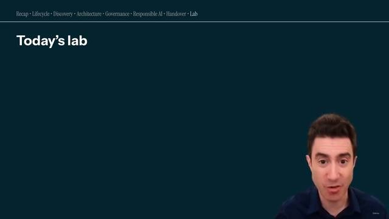
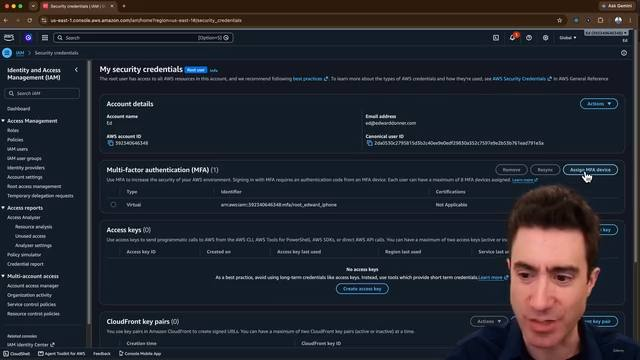
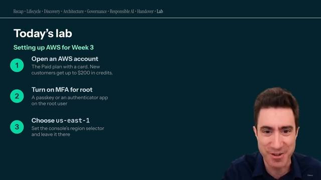
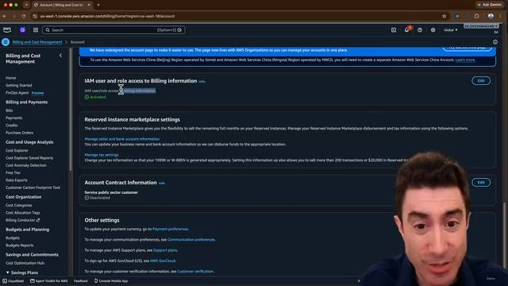
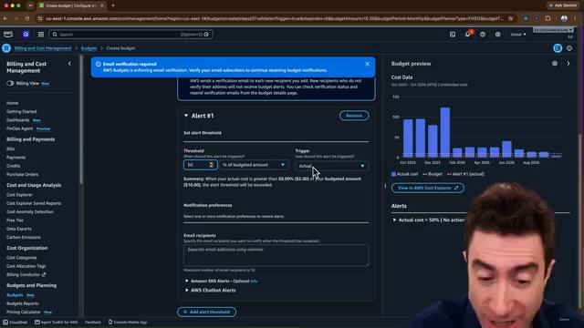
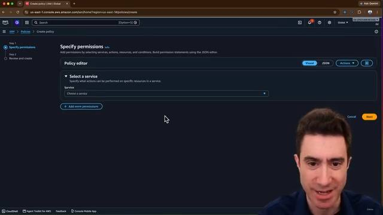
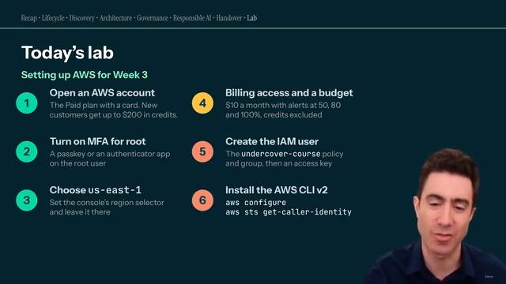
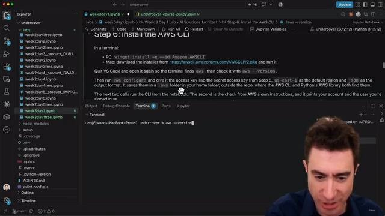
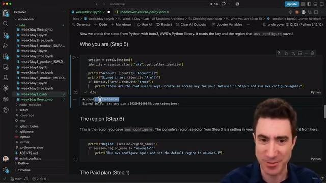
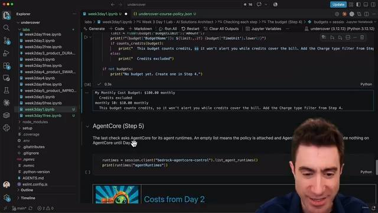

# AI FDE 第 88–90 讲：AWS 账户、预算告警、IAM 与 CLI 从零复现

## 1. 这一节做什么

这一节不是讲 Agent 业务逻辑，而是把后面要用的 AWS 底座搭好。按讲师的说法，今天只做一件事：**把 AWS 账户、权限、预算和告警配置正确**，Amazon Bedrock AgentCore 的运行时、Gateway、Policy 要等到下一节才碰。

具体要完成的东西有：

1. 注册或使用一个 **AWS 付费账户**，不是免费沙盒计划。
2. 用 root 账户登录，给 root 开启 **MFA**。
3. 把默认区域固定为 **US East 1 / us-east-1**。
4. 打开 IAM 用户对账单的访问权限。
5. 创建一个月度 **10 美元**预算，并在 **50%、80%、100%** 三个阈值发邮件告警。
6. 从课程仓库复制 `undercovercoursepolicy.json`，创建 IAM 策略。
7. 创建 IAM 用户组 `undercover-course`，把策略挂到组上。
8. 创建 IAM 用户 `undercover`，加入该组。
9. 给该用户创建 **Access Key**，用于 AWS CLI。
10. 安装 AWS CLI，执行 `aws configure`，把 Access Key、Secret Key、`us-east-1`、`json` 输出格式配置好。
11. 用 `aws --version`、`aws sts get-caller-identity` 和 Boto3 脚本验证身份、MFA、预算、AgentCore 访问权限。

这一节的核心不是“写业务代码”，而是**把云账号的权限边界和费用边界做出来**。讲师反复强调：AWS 是商业级、企业级平台，不是 Render、Fly.io、Vercel 那种消费级体验；你可以选择用 Render 免费替代，但如果你跟做 AWS，就要对费用负责。



---

## 2. 讲师原话（带「—— pNNN [MM:SS]」）

> “Today is just getting the account sorted out with the right permissions, budgeting, and alerts.”  
> 今天只是把账户、权限、预算和告警配置好。—— p088 [01:33]

> “Step 3 is we're going to choose the region US East 1 as the region of choice for this because it's a nice safe choice.”  
> 第三步是选择 US East 1 作为默认区域，因为它是一个比较安全、覆盖比较全的选择。—— p088 [02:24]

> “Set up billing access and make sure that there's a budget which sends an email if you spend more than $10 a month with multiple alerts.”  
> 打开账单访问权限，并设置一个月度 10 美元预算，超过时用多个阈值发邮件告警。—— p088 [03:23]

> “You will set up a new user. You will use your root user to create a second AWS user associated with the same account. And that other user is called the IAM user.”  
> 用 root 用户再创建一个同账户下的 IAM 用户，这个用户权限更窄，是课程里实际使用的身份。—— p088 [03:43]

> “If there's a discrepancy between this video and the document, the document wins.”  
> 如果视频和课程文档不一致，以文档为准。—— p089 [00:21]

> “Switch this over to JSON... replace the contents with the policy in this labs folder called undercovercoursepolicy.json.”  
> 把策略编辑器切到 JSON，把课程仓库 labs 目录里的 `undercovercoursepolicy.json` 内容贴进去。—— p089 [08:47]

> “It shows you that key only once. Keep it out of git, out of notebooks.”  
> Access Key 只显示一次，不要提交到 git，也不要写进 notebook。—— p089 [13:12]

> “Run AWS configure... set US East 1 as your default region and you pick JSON as the output format.”  
> 执行 `aws configure`，默认区域填 US East 1，输出格式选 JSON。—— p090 [01:18]

> “Boto3 is the library for accessing AWS stuff through Python code.”  
> Boto3 是用 Python 访问 AWS 的客户端库。—— p089 [00:48]

> “Agent Core that we'll be using this week needs the paid plan.”  
> 本周要用的 AgentCore 需要付费计划。—— p090 [02:36]

---

## 3. 从零复现

下面按“从空账号到可验证”的顺序做。建议你新建一个本地目录，例如：

```text
ai-fde-aws-lab/
├── .env.example
├── requirements.txt
├── policies/
│   └── undercovercoursepolicy.json   # 从课程仓库复制，逐字稿未给出内容
└── scripts/
    └── verify_aws_setup.py
```

### 3.1 创建 AWS 账户，并选择付费计划

打开：

```text
https://aws.amazon.com
```

点击 **Create an AWS account / Sign up for AWS**。需要准备：

- 一个邮箱；
- 一张信用卡；
- 一个手机号；
- 账户名称，例如 `Ed` 或你自己的名字。

讲师明确说：**要选 paid plan，不要选 free plan**。免费计划只适合教学沙盒，支撑不了后面 AgentCore 这类真实服务。大多数新账号会有免费 credits，但这不是“硬性预算上限”，只是抵扣额度。

创建完成后，用你注册时的邮箱和密码登录，这个身份就是 **root user**。root 用户拥有整个 AWS 账户的最高权限，所以第一步不是写代码，而是先把它锁住。

### 3.2 给 root 用户开启 MFA

登录 AWS Console 后，右上角会显示你的账户名。点击顶部菜单，进入：

```text
Security credentials
```

找到 **Multi-factor authentication**，点击 **Assign MFA device**。你可以选：

- Authenticator app，例如 Google Authenticator；
- Passkey；
- 其他你熟悉的 MFA 方式。

讲师的做法是使用 authenticator app。绑定完成后，root 账户就具备 MFA 保护。



### 3.3 固定区域为 us-east-1

在 AWS Console 右上角的区域选择器里，选择：

```text
US East (N. Virginia) / us-east-1
```

讲师选它的理由不是“离你近”，而是它通常服务覆盖最全、踩坑最少。AWS 的区域差异很大，有些新服务不是每个区域都有。对课程来说，最简单的方式就是**所有东西都固定在 us-east-1**，不要中途换区域。



### 3.4 打开 IAM 用户对账单的访问权限

在 AWS 顶部搜索框输入：

```text
account
```

进入 **Account** 页面，往下滚动，找到：

```text
IAM user and role access to billing information
```

点击 **Edit**，勾选允许 IAM 用户访问账单信息，然后保存。这样你后面用 `undercover` 这个 IAM 用户也能查看费用，而不是只能用 root 看账单。

### 3.5 创建 10 美元月度预算和三级告警

进入：

```text
Billing and Cost Management
→ Budgets
→ Create budget
```

选择 **Cost budget**，然后：

- Budget name：`monthly-10`
- Budget period：Monthly
- Budget type：Fixed amount
- Budget amount：`10`
- 范围：All AWS services

下一步添加告警阈值：

- 50% actual spend，发到你的邮箱；
- 80% actual spend，发到同一个邮箱；
- 100% actual spend，发到同一个邮箱。

讲师还保留了一个 100 美元的预算，但课程里新做的核心是 10 美元预算。注意：**预算不是硬性停机开关**，它只是告警。AWS 没有你想象中那种“花到 10 美元就自动全部停掉”的硬 ceiling。





### 3.6 创建 IAM 策略

进入 IAM：

```text
IAM → Policies → Create policy
```

把编辑器切换到 **JSON**，然后把课程仓库里的：

```text
undercovercoursepolicy.json
```

内容完整粘贴进去。这个文件的内容逐字稿没有给出，所以本文不伪造。你应当从课程仓库的 labs 目录复制原始文件。策略名称可以叫：

```text
undercover-course
```

创建完成后，这个策略就可以挂到用户组上。



### 3.7 创建用户组并挂策略

进入：

```text
IAM → User groups → Create group
```

组名：

```text
undercover-course
```

在权限策略里搜索 `undercover-course`，勾选刚才创建的策略，然后创建用户组。

### 3.8 创建 IAM 用户并加入组

进入：

```text
IAM → Users → Create user
```

用户名：

```text
undercover
```

不需要给这个用户开 Console 访问权限，因为课程里主要通过 CLI 和代码访问。下一步选择用户组时，勾选：

```text
undercover-course
```

创建用户。

### 3.9 创建 Access Key

进入 `undercover` 用户详情页，点击：

```text
Create access key
```

选择 **Command Line Interface (CLI)**，忽略 AWS 推荐的其他替代方案。创建后会得到：

- Access Key ID；
- Secret Access Key。

Secret Access Key 只显示一次。把它保存到安全的地方，不要提交到 git，不要写进 notebook，不要发到聊天窗口。课程里明确说：**treat it like a password / API key**。



### 3.10 安装 AWS CLI

Windows 上课程里提到用 `winget` 安装。完整包名课里没有逐字念出来，文档补充可用：

```powershell
winget install Amazon.AWSCLI
```

macOS 上按课程页面下载 Mac installer 安装。安装完成后，**退出 VS Code 再重新打开**，否则终端可能还找不到 `aws` 命令。

验证：

```bash
aws --version
```

你应该能看到 AWS CLI 的版本号。

### 3.11 配置 AWS CLI

执行：

```bash
aws configure
```

按提示输入：

```text
AWS Access Key ID [None]: 你的 Access Key ID
AWS Secret Access Key [None]: 你的 Secret Access Key
Default region name [None]: us-east-1
Default output format [None]: json
```

这些配置会写到你的用户目录下的 `.aws` 文件夹里，例如：

```text
~/.aws/credentials
~/.aws/config
```

它们不在项目仓库里，这是正确的。不要把密钥写进项目文件。



### 3.12 验证当前身份

执行：

```bash
aws sts get-caller-identity
```

这个命令用来确认你当前到底是谁。你应该能看到当前 IAM 用户或账户的身份信息。字段名以实际输出为准。

如果你在 Jupyter Lab 里，也可以用 `!` 前缀执行 shell 命令：

```python
!aws --version
!aws sts get-caller-identity
```

### 3.13 用 Boto3 做一次完整检查

安装依赖：

```bash
python -m venv .venv
source .venv/bin/activate        # Windows: .venv\Scripts\activate
pip install -r requirements.txt
```

然后运行本文第 4 节的 `scripts/verify_aws_setup.py`。它会检查：

- 当前调用者身份；
- root 账户 MFA 是否开启；
- 当前账户下的预算列表；
- 可选地尝试创建 `bedrock-agentcore-control` 客户端。

---

## 4. 完整代码

### 4.1 `requirements.txt`

```text
boto3>=1.34.0
```

> 说明：逐字稿没有给 Boto3 版本号。这里写一个较新的下限，实际以你安装到的稳定版为准。AgentCore 相关服务名如果在你本地 Boto3 中不存在，脚本会给出警告，不会中断。

### 4.2 `.env.example`

```text
AWS_REGION=us-east-1
```

复制成 `.env` 后使用：

```bash
cp .env.example .env
```

Windows 可以用：

```powershell
Copy-Item .env.example .env
```

### 4.3 `scripts/verify_aws_setup.py`

```python
#!/usr/bin/env python3
"""
AI FDE P88-P90 AWS 实验环境检查脚本。

用法：
    python scripts/verify_aws_setup.py

前置条件：
    1. 已安装 AWS CLI；
    2. 已执行 aws configure；
    3. 当前终端能访问 AWS；
    4. 已安装 boto3。
"""

from __future__ import annotations

import json
import os
import sys
from typing import Any, Callable

import boto3
from botocore.exceptions import BotoCoreError, ClientError

REGION = os.getenv("AWS_REGION", "us-east-1")


def title(text: str) -> None:
    print(f"\n=== {text} ===")


def call(label: str, fn: Callable[..., Any], **kwargs: Any) -> Any | None:
    try:
        return fn(**kwargs)
    except (BotoCoreError, ClientError) as exc:
        print(f"[WARN] {label} 调用失败：{exc}")
        return None


def main() -> int:
    session = boto3.Session(region_name=REGION)
    sts = session.client("sts")
    iam = session.client("iam")
    budgets = session.client("budgets")

    title("1. 当前调用者身份")
    identity = call("sts.get_caller_identity", sts.get_caller_identity)
    if identity:
        print(json.dumps(identity, indent=2, ensure_ascii=False, default=str))

    title("2. 账户级 MFA（root 用户）")
    summary = call("iam.get_account_summary", iam.get_account_summary)
    if summary:
        summary_map = summary.get("SummaryMap", {})
        print(json.dumps(
            {"AccountMFAEnabled": summary_map.get("AccountMFAEnabled")},
            indent=2,
            ensure_ascii=False,
        ))

    title("3. 当前账户下的预算")
    account_id = identity.get("Account") if identity else None
    if not account_id:
        print("[WARN] 没有拿到 Account，跳过预算检查。")
        return 1

    budget_resp = call(
        "budgets.describe_budgets",
        budgets.describe_budgets,
        AccountId=account_id,
    )
    if budget_resp is not None:
        budget_list = budget_resp.get("Budgets", [])
        if not budget_list:
            print("没有查到预算。")
        for budget in budget_list:
            print(json.dumps(
                {
                    "BudgetName": budget.get("BudgetName"),
                    "BudgetType": budget.get("BudgetType"),
                    "TimeUnit": budget.get("TimeUnit"),
                    "BudgetLimit": budget.get("BudgetLimit"),
                },
                indent=2,
                ensure_ascii=False,
                default=str,
            ))

    title("4. 可选：Bedrock AgentCore 控制面客户端")
    try:
        session.client("bedrock-agentcore-control", region_name=REGION)
        print("bedrock-agentcore-control 客户端创建成功。")
    except Exception as exc:  # noqa: BLE001
        print(f"[WARN] 未创建 bedrock-agentcore-control 客户端：{exc}")
        print("课里没有给出该服务的 API 名称；此项以课程仓库和实际 boto3 为准。")

    print("\n完成。")
    return 0


if __name__ == "__main__":
    sys.exit(main())
```

### 4.4 策略文件说明

`policies/undercovercoursepolicy.json` 必须从课程仓库的 labs 目录复制。逐字稿只说了文件名和用途，没有给出 JSON 内容，所以这里不能凭空编造。你应当：

```text
课程仓库 labs 目录
→ 找到 undercovercoursepolicy.json
→ 完整复制到 policies/undercovercoursepolicy.json
→ 在 IAM Create policy 的 JSON 编辑器里粘贴
```

如果你已经有生产课程的 IAM 用户，也可以把这份策略附加到现有用户上。讲师在 p090 开头明确说了这一点。



---

## 5. 逐行解释

### 5.1 为什么先创建 root，再创建 IAM 用户？

root 用户是账户的“总开关”，权限最大。日常写代码、跑 CLI 不应该用 root。正确做法是：

```text
root 用户 → 只用来开 MFA、开账单权限、创建 IAM 策略/组/用户
IAM 用户 undercover → 日常 CLI 和代码使用
```

这对应到 Node/前端世界，可以理解为：**不要用超级管理员 token 跑业务请求**，而是创建一个权限更窄的 service account。AWS 的 IAM 用户就类似“服务账号”。

### 5.2 为什么固定 `us-east-1`？

AWS 不同区域的服务可用性不同。讲师选 `us-east-1` 是因为它通常覆盖最全，不是因为它离你最近。课程里所有命令、Boto3 session、控制台操作都建议固定这个区域，避免“这个服务在另一个区域才有”的问题。

脚本里：

```python
REGION = os.getenv("AWS_REGION", "us-east-1")
session = boto3.Session(region_name=REGION)
```

就是把这个约定写死。你可以在 `.env` 里改，但课程跟做时建议保持 `us-east-1`。

### 5.3 `aws configure` 到底写了什么？

`aws configure` 会问你四个值：

```text
AWS Access Key ID
AWS Secret Access Key
Default region name
Default output format
```

它会把凭据写到：

```text
~/.aws/credentials
```

把区域和输出格式写到：

```text
~/.aws/config
```

所以这些密钥不会出现在项目目录里。你不需要在代码里写 `AWS_ACCESS_KEY_ID`，Boto3 会自动读取。只有在 CI、容器、临时环境里，才通常用环境变量注入。

### 5.4 `aws sts get-caller-identity` 是干什么的？

这是最常用的“我是谁”命令。它不会创建资源，只返回当前调用者身份。你配置完 CLI 后，先跑这个命令，确认不是 root、不是错误账号、不是旧 profile。

在 Node 里，对应的是 AWS SDK 的 STS `GetCallerIdentityCommand`。课里没有讲 Node 版本，这里只是类比。

### 5.5 脚本里的 `iam.get_account_summary()` 为什么能检查 MFA？

`get_account_summary()` 返回账户级摘要，其中 `SummaryMap` 里有一个 `AccountMFAEnabled` 字段，用来表示 root 用户是否开启 MFA。讲师在 p090 里检查的就是 root MFA，所以脚本用这个接口，而不是检查某个 IAM 用户的 MFA。

注意：**IAM 用户的 MFA 和 root 的 MFA 不是一回事**。课程先要求锁 root，这是最重要的一步。

### 5.6 预算检查为什么需要 `AccountId`？

`budgets.describe_budgets` 需要知道查哪个账户的预算。脚本先从 `sts.get_caller_identity()` 拿到 `Account`，再传给 Budgets API。这样你不需要手写账户 ID。

预算返回的字段包括 `BudgetName`、`BudgetType`、`TimeUnit`、`BudgetLimit`。这些字段名来自 Boto3 的实际返回结构；如果你本地版本不同，以实际输出为准。

### 5.7 为什么预算告警要设 50%、80%、100% 三档？

因为预算不是硬性停机。AWS 不会因为你到了 10 美元就自动把资源全关掉。你只能通过多档告警尽早发现异常。50% 是提前预警，80% 是接近上限，100% 是已经达到预算。讲师在 p089 里就是按这三个实际支出阈值配置的。

### 5.8 为什么 Access Key 只显示一次？

AWS 不会保存你的 Secret Access Key 明文。创建时只显示一次，关闭页面后无法再次查看。所以你必须当场保存到密码管理器或安全位置。课程里明确说：不要进 git，不要进 notebook。

如果你怀疑泄露，正确做法不是“改代码”，而是去 IAM 里**停用或删除该 Access Key**，然后创建新的。课里没有展开讲轮换流程，但这是你实际会遇到的。

### 5.9 为什么 Jupyter 里用 `!`？

Jupyter Lab 里，行首 `!` 表示把后面内容当 shell 命令执行：

```python
!aws --version
!aws sts get-caller-identity
```

这不是 Python 语法，是 notebook 的 shell 快捷方式。如果你在普通 `.py` 文件里写 `!aws`，会报语法错误。

---

## 6. 复现检查清单

做完下面每一项再进入下一节：

- [ ] 已注册或使用 AWS 账户，并确认是 **paid plan**。
- [ ] 已用 root 用户登录，并给 root 开启 MFA。
- [ ] 控制台区域已固定为 **US East 1 / us-east-1**。
- [ ] 已打开 **IAM user and role access to billing information**。
- [ ] 已创建 `monthly-10` 预算，金额 10 美元。
- [ ] 已配置 50%、80%、100% 三个 actual spend 邮件告警。
- [ ] 已从课程仓库复制 `undercovercoursepolicy.json`。
- [ ] 已创建 IAM 策略 `undercover-course`。
- [ ] 已创建 IAM 用户组 `undercover-course`，并挂上策略。
- [ ] 已创建 IAM 用户 `undercover`，并加入用户组。
- [ ] 已为 `undercover` 创建 Access Key，并安全保存 Secret。
- [ ] 已安装 AWS CLI，`aws --version` 有版本输出。
- [ ] 已执行 `aws configure`，区域为 `us-east-1`，输出为 `json`。
- [ ] `aws sts get-caller-identity` 能返回当前身份。
- [ ] `python scripts/verify_aws_setup.py` 能跑通。
- [ ] 脚本显示 root MFA 已开启。
- [ ] 脚本能列出预算。
- [ ] 已确认 Bedrock AgentCore 访问权限；如果脚本警告服务名不存在，以课程仓库和实际 Boto3 为准。
- [ ] 没有把 Access Key 写进 git、notebook 或聊天记录。



---

## 7. 课里没讲但你会撞上的

1. **预算不是硬性上限**  
   课里反复说 AWS 没有 hard ceiling。你设了 10 美元预算，不代表 10 美元后自动停机。它只是发邮件。真正要控制费用，需要你自己看告警、看 Billing 面板、及时删资源。

2. **账单和预算有延迟**  
   课里没有讲具体延迟多少分钟。实际使用中，费用不会像本地计时器一样实时刷新。不要因为“现在显示 0 美元”就认为绝对没花钱。

3. **IAM 权限传播有延迟**  
   你刚创建策略、组、用户，马上跑 CLI 可能偶尔遇到权限还没生效。课里没有讲等待时间。遇到 `AccessDenied` 时，先确认用户组和策略挂载正确，再等一会儿重试。

4. **Access Key 泄露的处理课里没讲**  
   课里只讲了“不要提交”。如果你真的泄露了，需要去 IAM 停用/删除 Access Key，再创建新的。不要只改 `.env`。

5. **MFA 设备丢失的恢复流程课里没讲**  
   root MFA 很重要，但如果你手机丢了，恢复流程要提前了解。课程没有展开。建议至少保留恢复码或第二个 MFA 设备。

6. **AgentCore 的服务名和 API 可能随版本变化**  
   逐字稿只说了“AWS Bedrock Agent Core”和“runtime”，没有给出 Boto3 服务名。本文脚本里的 `bedrock-agentcore-control` 是可选检查，失败会警告。实际以课程仓库和你的 Boto3 版本为准。

7. **Windows 的 `winget` 包名课里没逐字念**  
   课里只说用 `winget` 命令。本文补了 `winget install Amazon.AWSCLI`，如果包名变化，以 AWS 官方安装文档为准。

8. **不要用 root 跑日常命令**  
   课里让你创建 IAM 用户就是为了这个。root 只用来做账户级配置。你后面所有 `aws` 命令、Boto3 脚本都应该在 `undercover` 或你自己的 IAM 用户下跑。

9. **Render 是免费替代路线**  
   讲师明确说，如果你不想碰 AWS 费用，可以用 Render 免费替代。但这样你就不会拥有本节这套 IAM、预算、AgentCore 的完整体验。跟不跟做，自己选。

10. **课程文档优先于视频**  
    p089 开头说得很清楚：AWS 界面经常变，如果视频和文档不一致，以文档为准。你复现时如果发现按钮位置不同，先看课程仓库的最新说明。