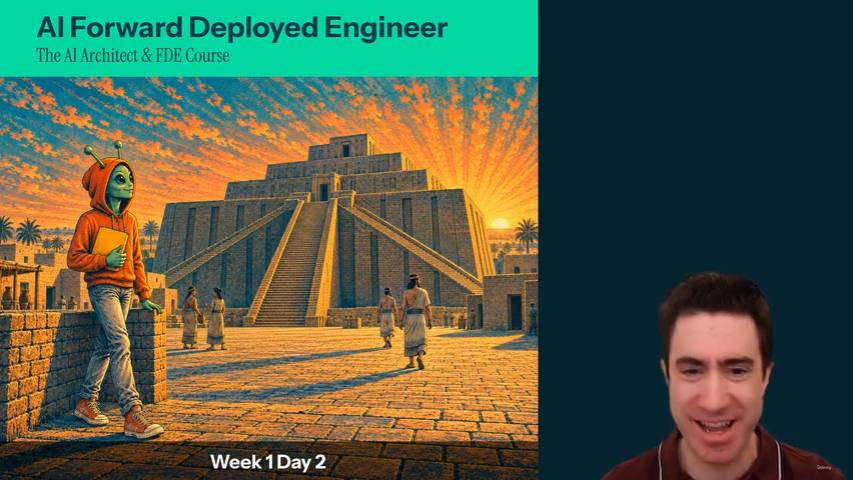
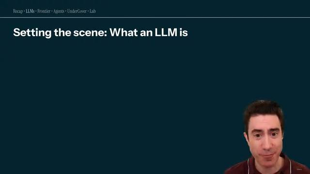
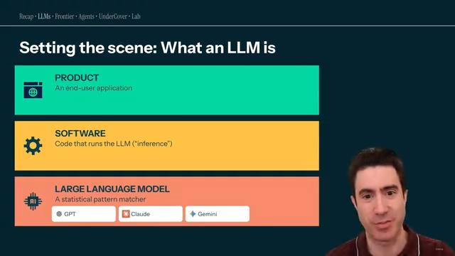
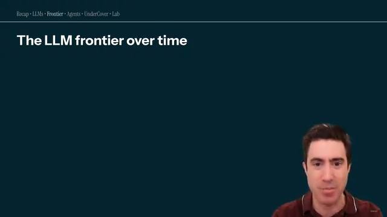
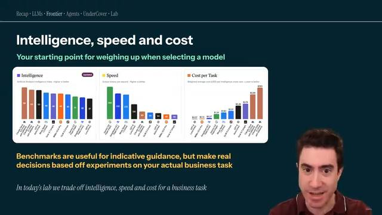
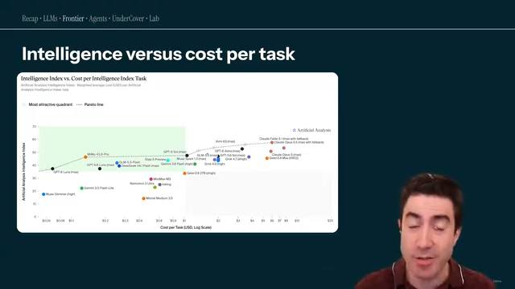

# AI FDE 课程文档：LLM 与 Agent 基础（P009–P011）

> 覆盖课程：BV1rJnm64Eq3 第 9–11 集
> 读者定位：前端转 AI 应用工程师
> 说明：这三集是**理论课**，逐字稿里没有可运行的代码。因此本文档第 3、4 章按「纯讲解课」规则改写：把讲师的推导过程复现成可操作的步骤，把结论落成可用的对照表与选型流程；第 4 章末尾附一段**明确标注「课里没有代码，以下为示意」**的脚本，用于把「模型选型」这件事变成可执行动作。

---

## 1. 这一节做什么

这三集要解决的是一个非常具体的问题：**你手上有一个业务任务，怎么从「一堆模型名字」里挑出该用的那一个，并且知道自己在为什么付钱。**

讲师把这件事拆成三层认知：

1. **认清 LLM 是什么**——它不是 ChatGPT。LLM 只是最底下那层「统计模式匹配器」，也就是「打了鸡血的输入法联想」。你在 ChatGPT 里感受到的一切「像人」，是上面两层（推理软件层、产品层）加上六个技巧堆出来的效果。搞不清这一点，你就会把产品的能力误当成模型的能力，选型时必然踩坑。
2. **认清从 GPT 到 ChatGPT 之间发生了什么**——六个技巧：自回归、chat 训练、reasoning、记忆的幻觉、context、tool calling。这六个词决定了你后面写 prompt、搭 agent、算成本时的每一个决策。
3. **认清怎么比较模型**——用 artificialanalysis.ai 这类基准站做**初筛**，用 intelligence / speed / cost 三个维度画散点图，找 Pareto Frontier（帕累托前沿）；但最终决策必须回到**你自己的业务任务上实测**。

产出物不是一段代码，而是三张表 + 一套选型流程：LLM 三层结构表、六技巧对照表、模型选型决策表。第 4 章会把它们写成可直接填写的模板。



---

## 2. 讲师原话

以下按主题归类引用，不按集数流水账排列。

**关于「LLM 不等于 AI 产品」：**

> "大多数人想到大语言模型时，实际想到的是像 ChatGPT 或 Claude Code 这样的人工智能产品。当然，这些产品和底层的大语言模型并不相同。我常说，可以把一个人工智能产品看作分为三层。"
> —— p010 [00:00]–[00:13]

> "最底层其实是大语言模型；众所周知，它本质上是一个统计模式匹配器。它是一个很聪明的程序，已经非常擅长预测某个输入序列后面应该接什么……说到底就是这样，它是强化版的预测文本。"
> —— p010 [00:42]

> "但我认为，要把大语言模型应用于商业问题，理解其工作原理最重要的部分之一，或许就是理解软件层和产品层这两层所带来的额外价值，因为正是这些让你从 GPT 走向 ChatGPT。"
> —— p010 [03:26]

**关于六个技巧：**

> "有六种不同的技术，能让你从单纯的 GPT——那个统计词元预测器——走向完整的 ChatGPT 体验。"
> —— p010 [03:56]

> "这就是自回归在实际运行中的样子。大语言模型只生成紧邻的下一个词元。但你可以把它放进一个紧凑的循环里，看起来就能生成一页又一页的内容。"
> —— p010 [05:11]

> "第二种技巧叫作对话。正是这项被发现的创新，在 2022 年底催生了 ChatGPT。"
> —— p010 [05:11]–[05:41]

> "如果你问它同一个问题，但在提示词末尾说“请一步一步思考”，那么它最初生成的词元就会是逐步推理过程的词元；完成这些之后，它才会生成最终输出的词元。"
> —— p010 [07:22]–[07:39]

> "每次调用大语言模型时，它都是完全无状态的，根本不知道你是谁，因为它只是一个词元预测计算器。"
> —— p010 [09:21]

> "最后但同样重要的是，我们昨天在实践中做的那项——工具调用，它当然是整个智能体人工智能理念的关键。"
> —— p010 [10:50]

**关于 token 与成本：**

> "对于普通英文文本，大约一千个词元对应约 750 个单词。"
> —— p010 [11:59]

> "每个大语言模型都有一个称为上下文窗口的限制，也就是它能够处理的输入和输出词元的最大数量……你在任何时候发送的词元都不能超过这个数量，否则它就会直接失败。"
> —— p010 [13:15]

> "如果你在短时间内用相同的输入、或者输入开头相同的请求连续调用，许多提供商会少收费……这被称为提示词缓存，费用通常只有四分之一。"
> —— p010 [13:45]–[14:15]

> "我建议先解决准确性问题，然后再寻找提高效率的方法。这有点像计算机科学里唐纳德·克努特那句老话：过早优化是万恶之源。"
> —— p010 [15:07]

> "还有一种误解，认为使用开源模型总是意味着基本上免费，但事实当然并非如此。"
> —— p010 [15:37]

**关于模型比较：**

> "我要带你看一个叫 artificialanalysis.ai 的网站。它非常出色，能提供你想了解的、关于当前这批模型的所有信息。"
> —— p011 [00:00]

> "有很多充分理由对基准测试保持怀疑。你应该带着很大的保留态度看待它。但尽管如此，它仍然有助于你初步直觉地理解不同模型为何更强或更弱。"
> —— p011 [00:45]

> "那条虚线是一条特殊的虚线，称为帕累托前沿，或称帕累托边界线。帕累托前沿——也就是那条虚线——向你展示了所能做出的最佳权衡。"
> —— p011 [09:47]–[10:12]

> "始终要围绕你的业务任务来衡量模型，并衡量价格点以及完成该业务任务的成本，再用这些来挑选合适的模型。把它只当作初步判断依据。"
> —— p011 [10:56]

> "这个任务的难度，就是人类平均需要多少小时来解决它。"
> —— p011 [12:47]

> "这也在衡量我们所说的 harness，也就是围绕大语言模型搭起的所有脚手架，使它能够从仅仅生成内容，变成可以独立分析、探索和解决问题的系统。"
> —— p011 [15:16]



---

## 3. 从零复现

这一章把讲师的推导过程按步骤复现。你不需要写代码，但需要**打开浏览器、打开一个记事本、按顺序做完下面 7 步**，最后你会得到一份属于你自己业务的模型选型结论。

### 步骤 0：准备（5 分钟）

- 一个能上网的浏览器。
- 一个空白的 Markdown 文件，命名 `model-selection.md`，放在你的项目根目录。
- 你的 OpenRouter API Key（第一天已经配好，在 `.env` 里）。课里没讲具体变量名，按你第一天的配置沿用即可。

### 步骤 1：把「AI 产品」拆成三层，写进文件

讲师的原话是 AI 产品有三层。照着填这张表，**每一层都要填一个你实际用过的例子**，不要抄讲师的例子：

| 层 | 是什么 | 讲师举的例子 | 你填的例子 |
|---|---|---|---|
| 第 3 层：产品 | 面向最终用户/企业的应用 | ChatGPT、Claude Code、Atlassian ROVO、Duolingo Premium | ______ |
| 第 2 层：推理软件 | 反复调用模型、把 token 流变成「像人」的输出的服务 | OpenAI Platform / API（chat completions、responses）、AWS Bedrock、OpenRouter | ______ |
| 第 1 层：模型 | 统计模式匹配器，预测下一个 token | GPT、Claude、Gemini | ______ |

填完之后问自己一句：**我平时说的「这个模型不行」，其实骂的是哪一层？** 大多数时候骂的是第 2 层或第 3 层。

### 步骤 2：把六个技巧列成对照表

讲师明确说这六个技巧是「从 GPT 到 ChatGPT」的全部秘密。按顺序填：

| # | 技巧 | 一句话机制 | 对选型/开发的直接影响 |
|---|---|---|---|
| 1 | 自回归（auto regression） | 只生成下一个 token，放进紧循环里反复调用，于是「流式」输出 | 输出成本按 token 计；流式是循环的副产品，不是模型特性 |
| 2 | chat 训练 | 用 user/assistant 结构的数据再训练，配合 RLHF | 老模型（GPT-3 那代）不会「回答问题」，只会「续写」 |
| 3 | reasoning | 让它先吐「一步步想」的 token，最终答案更准；配套 RLVR | 有 reasoning level 可选，思考 token 也算钱 |
| 4 | 记忆的幻觉 | 模型无状态，每次把整段对话重新传进去 | 对话越长，每次调用的输入 token 越多，成本线性上涨 |
| 5 | context | 除了对话历史，还能塞数据库捞出来的背景资料（RAG） | 输入 token 里最大的一块往往是 context，不是用户那句话 |
| 6 | tool calling | 给模型「去搜、去跑代码、去查库」的能力 | agent 的基石；也是 harness 的起点 |



### 步骤 3：算一遍你自己的 token 账

讲师给了两个可用的换算与约束：

- **1000 tokens ≈ 750 个英文单词**（讲师原话，针对 normal English prose）。
- **context window = 输入 token + 输出 token 的上限**，超了就直接失败。

在你的 `model-selection.md` 里写下一个算式，用你自己的场景：

```
单次调用输入 token ≈ 系统提示词 + 对话历史 + 用户这句话 + RAG 捞回来的资料
单次调用输出 token ≈ 期望回答长度
一次会话总成本 ≈ Σ(每次调用的输入 token × 输入单价 + 输出 token × 输出单价)
```

讲师特别提醒：**输出单价通常比输入高**。所以「让模型少说废话」比「让输入短一点」往往更省钱。

### 步骤 4：理解 prompt caching 的省钱逻辑

讲师的说法是：短时间内连续调用、且**开头部分相同**，那相同的开头部分按更低价格计费，通常是 4 倍便宜；隔太久（他举例说大约一小时）缓存失效，恢复原价。

复现动作：在你的算式下面加一行注释——

```
如果我的调用模式是「同一段长系统提示词 + 每次只追加一点新内容」，
则系统提示词部分应命中 prompt caching，按约 1/4 价格计。
反之，如果每次调用都重写系统提示词，缓存永远不命中。
```

这条直接决定了你后面写 agent 时**系统提示词要不要固定**。

### 步骤 5：打开 artificialanalysis.ai 做初筛

按讲师的操作顺序：

1. 打开 `artificialanalysis.ai`，收藏它（讲师原话：bookmark it, it's a keeper）。
2. 看 **blended intelligence index** 那张随时间变化的图——横轴是各模型发布日期，不同颜色是不同厂商。
3. 看当前**智能排行**，记下排在前面的几个名字。
4. 看页面顶部的 **intelligence vs speed vs cost** 摘要，分别记下「最强」「最快」「最便宜」三个冠军。
5. 找到 **intelligence vs cost 散点图**：横轴成本（对数刻度），纵轴智能，每个点是一个模型。
6. 找到那条**虚线 = Pareto Frontier**。落在虚线上的模型，是「给定预算下最聪明的」。

把你在第 3、4 步记下的名字填进你的文件：

```
候选模型池（来自 artificialanalysis 初筛）：
- 最强：______
- 最快：______
- 最便宜：______
- Pareto Frontier 上、且在我预算内的：______
```





### 步骤 6：把「智能」换成「你的业务指标」

这是讲师反复强调、也是最容易被跳过的一步。他的原话是：benchmark 只能当第一直觉，最终要用**你自己的业务任务**去测。

复现动作：在文件里定义你的评测集。

```
业务任务：______（一句话）
评测样本数：______（哪怕只有 20 条也比没有强）
判定标准：______（能自动判对错最好；不能就人工打分 1–5）
记录字段：模型名 / 是否正确 / 输入 token / 输出 token / 耗时(ms) / 单次成本
```

讲师在 p011 里提到 META 那套基准的做法值得借用：**用「人类专家解决这个任务平均要几小时」来定义任务难度**。你的业务任务也可以照这个思路标一个「人类耗时」，方便判断值不值得上 agent。

### 步骤 7：按「先准确、后省钱」的顺序收敛

讲师的原话是 solve for accuracy first，并引用了 premature optimization is the root of all evil。

复现动作，严格按这个顺序，不许跳步：

1. 在候选池里，**先用最强/最贵的模型**跑你的评测集，拿到一个「准确率天花板」。
2. 如果天花板都不够，说明是 prompt / context / 任务拆解的问题，**不是模型的问题**，回去改 prompt。
3. 天花板够了，再逐个换更便宜/更快的模型，看准确率掉多少。
4. 找到「准确率可接受 + 成本最低」的那个点，那就是你的选型结论。
5. 最后才去优化输入 token、上 prompt caching、压缩对话历史。



---

## 4. 完整代码

> **课里没有代码，以下为示意。** 这三集是纯理论课，讲师没有给出任何可运行脚本。下面这份 `model-selection.md` 模板是把第 3 章的 7 个步骤固化成可填写的产物；末尾那段 Node 脚本是**本文档补充的示意**，用于把「跑评测集」这一步变成可执行动作，不是讲师讲过的内容。

### 4.1 产物一：模型选型决策表（`model-selection.md`）

```markdown
# 模型选型决策表

## 1. AI 产品三层结构
| 层 | 是什么 | 我的例子 |
|---|---|---|
| 产品 | 面向最终用户的应用 | |
| 推理软件 | 反复调用模型的服务 | |
| 模型 | 统计模式匹配器 | |

## 2. 六技巧对照
| # | 技巧 | 机制 | 对我的影响 |
|---|---|---|---|
| 1 | 自回归 | 只生成下一个 token，紧循环 | 输出按 token 计费 |
| 2 | chat 训练 | user/assistant 结构 + RLHF | 老模型只会续写 |
| 3 | reasoning | 先吐思考 token，答案更准 | 思考 token 也算钱 |
| 4 | 记忆的幻觉 | 无状态，每次重传全对话 | 对话越长越贵 |
| 5 | context | 塞入 RAG 资料 | 输入大头常是 context |
| 6 | tool calling | 给模型外部能力 | agent 的基石 |

## 3. Token 账
- 换算：1000 tokens ≈ 750 英文单词
- 单次输入 ≈ 系统提示词 + 历史 + 用户句 + RAG
- 单次输出 ≈ 期望回答长度
- 输出单价 > 输入单价（通常）

## 4. Prompt Caching
- 命中条件：短时间连续调用 + 开头相同
- 折扣：约 4 倍便宜
- 失效：间隔过久（讲师举例约 1 小时）
- 结论：系统提示词必须固定

## 5. 候选模型池（artificialanalysis.ai 初筛）
- 最强：
- 最快：
- 最便宜：
- Pareto Frontier 内、预算内：

## 6. 业务评测集
- 任务：
- 样本数：
- 判定标准：
- 记录字段：模型名 / 是否正确 / 输入token / 输出token / 耗时ms / 单次成本

## 7. 收敛记录（先准确后省钱）
| 轮次 | 模型 | 准确率 | 平均输入token | 平均输出token | 平均耗时ms | 结论 |
|---|---|---|---|---|---|---|
| 1（天花板） | | | | | | |
| 2 | | | | | | |
| 3 | | | | | | |
```

### 4.2 产物二：评测脚本（示意，课里没有）

```javascript
// eval-models.mjs
// 课里没有代码，以下为示意：把「用业务评测集跑候选模型」这一步变成可执行动作。
// 依赖：Node 18+（自带 fetch），无需 npm install。

import fs from "node:fs/promises";

const API_KEY = process.env.OPENROUTER_API_KEY;
if (!API_KEY) {
  console.error("缺少环境变量 OPENROUTER_API_KEY");
  process.exit(1);
}

// 候选模型池：来自 artificialanalysis.ai 初筛（第 3 章步骤 5）
const CANDIDATES = [
  "openai/gpt-4o-mini",
  "anthropic/claude-3.5-haiku",
  "google/gemini-flash-1.5",
];

// 业务评测集：来自第 3 章步骤 6
const CASES = [
  { id: "c1", input: "把这句话改写成客服口吻：你的订单晚了。", expect: "客服口吻" },
  { id: "c2", input: "从这段文本里抽出公司名：我们和 Acme Corp 签了合同。", expect: "Acme Corp" },
  { id: "c3", input: "判断情感（正面/负面）：这个产品太差了。", expect: "负面" },
];

// 系统提示词固定，才能命中 prompt caching（第 3 章步骤 4）
const SYSTEM_PROMPT =
  "你是一个严谨的文本处理助手。只输出结果，不要解释。";

async function callModel(model, userInput) {
  const started = Date.now();
  const res = await fetch("https://openrouter.ai/api/v1/chat/completions", {
    method: "POST",
    headers: {
      Authorization: `Bearer ${API_KEY}`,
      "Content-Type": "application/json",
    },
    body: JSON.stringify({
      model,
      messages: [
        { role: "system", content: SYSTEM_PROMPT },
        { role: "user", content: userInput },
      ],
    }),
  });
  const elapsed = Date.now() - started;
  if (!res.ok) {
    return { ok: false, error: `HTTP ${res.status}`, elapsed };
  }
  const data = await res.json();
  const text = data?.choices?.[0]?.message?.content ?? "";
  // 字段名以实际返回为准：usage 下的输入/输出 token 字段请按真实响应核对
  const usage = data?.usage ?? {};
  return { ok: true, text, usage, elapsed };
}

function judge(text, expect) {
  return text.includes(expect) ? 1 : 0;
}

const rows = [];
for (const model of CANDIDATES) {
  for (const c of CASES) {
    const r = await callModel(model, c.input);
    rows.push({
      model,
      caseId: c.id,
      correct: r.ok ? judge(r.text, c.expect) : 0,
      inputTokens: r.usage?.prompt_tokens ?? null,
      outputTokens: r.usage?.completion_tokens ?? null,
      elapsedMs: r.elapsed,
      error: r.error ?? "",
    });
  }
}

// 汇总：每个模型的准确率与平均耗时
const summary = {};
for (const row of rows) {
  const s = (summary[row.model] ??= {
    total: 0,
    correct: 0,
    sumElapsed: 0,
    sumIn: 0,
    sumOut: 0,
  });
  s.total += 1;
  s.correct += row.correct;
  s.sumElapsed += row.elapsedMs;
  s.sumIn += row.inputTokens ?? 0;
  s.sumOut += row.outputTokens ?? 0;
}

const table = Object.entries(summary).map(([model, s]) => ({
  model,
  accuracy: `${s.correct}/${s.total}`,
  avgElapsedMs: Math.round(s.sumElapsed / s.total),
  avgInputTokens: Math.round(s.sumIn / s.total),
  avgOutputTokens: Math.round(s.sumOut / s.total),
}));

console.table(table);
await fs.writeFile("eval-result.json", JSON.stringify({ rows, table }, null, 2));
console.log("明细已写入 eval-result.json");
```

运行方式：

```bash
export OPENROUTER_API_KEY=你的key
node eval-models.mjs
```

> 注意：上面脚本里的 `prompt_tokens` / `completion_tokens` 是 OpenRouter 兼容 OpenAI 格式时的常见字段名，**课里没讲**，请以你实际拿到的响应为准；如果对不上，先 `console.log(data.usage)` 看一眼真实字段再改。

---

## 5. 逐行解释

### 5.1 三层结构表为什么这么填

- **第 1 层写「统计模式匹配器」而不是「神经网络」**：讲师明确说他讲 LLM 时不聚焦 transformer / 深度神经网络那部分，而聚焦「预测下一个 token」。这个视角对工程师更实用——因为它直接推出「无状态」「按 token 计费」「context window 是硬上限」这三条工程约束。
- **第 2 层必须单独列出来**：讲师说得很直白，是「软件反复运行 LLM，才让它生成看起来像人的输出」。你调 OpenRouter 时，你用的就是这一层。这一层的存在意味着：**同一个模型，换个推理服务商，延迟、价格、可用性都可能不同**。
- **第 3 层是产品**：ChatGPT、Claude Code、ROVO、Duolingo Premium。讲师特意说 Duolingo「背后就是 GPT，但你不需要知道」——这就是产品的价值：把第 1、2 层藏起来。

### 5.2 六个技巧，每一条为什么这样记

1. **自回归**：讲师说「LLM 只生成下一个 token，但放进紧循环就能生成几页内容」。所以你在 ChatGPT 里看到的打字机效果，不是模型在「边说边想」，是循环在一次次调用。工程含义：**流式输出是客户端/服务端循环的产物**，你要自己实现循环。
2. **chat 训练**：讲师举了 GPT-3 的例子——你问「法国首都」，它续写出「这是一个很好的地理问题，另一个问题可能是西班牙首都」。因为它只是在预测「这句话后面最可能接什么」。chat 训练（user/assistant 结构 + RLHF）之后，它才开始「回答」。工程含义：**如果你用的是一个没做过 chat 训练的 base model，你的 prompt 要写成续写格式**。
3. **reasoning**：讲师说这是他觉得最不可思议的一个——只是在 prompt 末尾加「please think step by step」，它先吐思考 token，最终答案就更准。配套的 RLVR 让模型越来越擅长生成这种中间 token。工程含义：**思考 token 也是输出 token，也要付钱**；reasoning level 是可调的旋钮。
4. **记忆的幻觉**：讲师原话「每次调用完全无状态，它就是个 token 预测计算器」。所谓「记得你」，是因为你每次都把整段对话重新传进去。工程含义：**对话轮次越多，每次调用的输入 token 越大**，成本是超线性增长的（因为历史在累积）。
5. **context**：在输入里除了对话历史，还能塞数据库捞出来的背景资料，讲师点名了 RAG。工程含义：**输入 token 的大头往往是 context，不是用户那句话**。优化成本要先看 context 有多大。
6. **tool calling**：讲师说这是 agentic AI 的关键，也是「给计算器加外挂」的戏法。工程含义：tool calling 本身也是「模型输出一段结构化文本 → 你的代码去执行 → 结果再塞回输入」，本质还是 token 循环。

### 5.3 token 账为什么这么算

- **1000 tokens ≈ 750 英文单词**：讲师给的经验值，只对 normal English prose 成立。中文、代码、JSON 的换算比例不同，**课里没讲**，你需要自己用实际调用测。
- **context window = 输入 + 输出**：讲师明确说「不能超过这个数，否则直接失败」。所以设计 prompt 时要给输出留余量。
- **输出单价 > 输入单价**：讲师说 costs are usually quoted in terms of a charge for input tokens and a charge for output tokens, normally higher（指输出更高）。这条决定了「让模型简短回答」的性价比。

### 5.4 prompt caching 为什么值 4 倍

讲师的原话是：短时间内连续调用、开头部分相同，那部分按更低价格计费，often it's four times less；隔太久（他举例约一小时）缓存重置，恢复全价。

这条对 agent 开发是决定性的：**agent 的系统提示词 + 工具定义通常很长，而且每次调用都一样**。如果你的系统提示词是固定的，这部分就一直在缓存里；如果你每次动态拼系统提示词，缓存永远不命中，成本直接翻几倍。

### 5.5 Pareto Frontier 怎么读

- 横轴成本（对数刻度），纵轴智能，每个点一个模型。
- **越往左上越好**：更便宜 + 更聪明。
- 虚线是 Pareto Front：给定预算下能拿到的最聪明模型。
- 讲师的态度很明确：**这是初筛工具，不是决策工具**。因为纵轴的 intelligence index 只是「一堆测验的混合分」，跟你的业务任务未必相关。

### 5.6 为什么「先准确后省钱」

讲师引用了 Knuth 那句 premature optimization is the root of all evil（逐字稿里念成了 Donald Nooth，实际是 Donald Knuth，这里按原文保留讲师说法并注明）。他的推理链是：

1. 如果你一开始就为了省钱去改 prompt，可能把准确率改坏了。
2. 而如果你先把 prompt 调到最准，**可能发现一个更便宜的模型就够了**。
3. 换模型对成本的影响，远大于抠输入 token 那点优化。

所以顺序必须是：准确率 → 模型档位 → token 优化。

### 5.7 评测脚本每一段在干什么（示意代码）

- `CANDIDATES`：对应第 3 章步骤 5 的初筛结果，**只放 3 个**，不要一上来放 20 个。
- `CASES`：对应步骤 6 的评测集。哪怕只有 3 条，也比你凭感觉选强。
- `SYSTEM_PROMPT` 抽成常量：对应步骤 4，固定系统提示词才能命中缓存。
- `callModel` 里记录 `elapsed`：对应讲师说的 speed 维度。
- `usage` 字段：对应 cost 维度。**字段名以实际返回为准**。
- `judge` 用 `includes` 是最粗糙的判定，真实项目要换成更严格的判定（讲师在 p011 提到 META 的基准都是 verifiable tasks，就是因为能自动判对错才跑得起来）。
- 最后的 `console.table` + 写 JSON：对应步骤 7 的收敛记录表。

---

## 6. 复现检查清单

按顺序打勾，任何一项没打勾不要往下走：

- [ ] `model-selection.md` 已创建，三层结构表三行都填了**自己的**例子
- [ ] 六技巧对照表六行都填了「对我的影响」这一列
- [ ] 写出了自己的 token 算式（输入 = 哪几项相加，输出 = 什么）
- [ ] 确认了自己的调用模式是否会命中 prompt caching（系统提示词是否固定）
- [ ] 打开过 artificialanalysis.ai，并收藏
- [ ] 记录了当前「最强 / 最快 / 最便宜」三个冠军的模型名
- [ ] 在 intelligence vs cost 散点图上找到了 Pareto Frontier，并记下预算内的模型
- [ ] 定义了自己的业务评测集（任务 + 样本数 + 判定标准）
- [ ] 用最强模型跑出了准确率天花板
- [ ] 天花板不够时，先改 prompt 而不是换模型
- [ ] 天花板够了之后，才逐个换便宜模型
- [ ] 收敛记录表至少填了 2 行
- [ ] （可选）跑通了 `eval-models.mjs`，`eval-result.json` 已生成
- [ ] 能用自己的话解释：为什么「开源模型 = 免费」是错的

---

## 7. 课里没讲但你会撞上的

这一节列的是逐字稿里**没有出现**、但你照着上面做一定会碰到的东西。写清楚哪些是课里的、哪些是补充的。

**1. OpenRouter 的具体请求格式**
课里只说「第一天你已经把 OpenRouter key 放进 `.env` 了」，但**没讲**请求体长什么样、endpoint 路径是什么。上面示意脚本里用的是 OpenAI 兼容格式（`/api/v1/chat/completions`），这是行业惯例，**不是讲师讲的**。第一次跑之前先看一眼 OpenRouter 官方文档。

**2. `usage` 里的字段名**
课里完全没提 API 返回结构。示意脚本里写的 `prompt_tokens` / `completion_tokens` 是 OpenAI 格式的常见字段，但 OpenRouter 或不同模型可能不同。**先 `console.log(data.usage)` 打出来看**，别照抄。

**3. 中文的 token 换算**
讲师的「1000 tokens ≈ 750 英文单词」只对英文成立。中文通常**一个汉字约 1–2 个 token**（取决于分词器），代码和 JSON 又不一样。这个比例课里没讲，必须自己测。

**4. reasoning 模型的输出结构**
讲师讲了 reasoning 是「先吐思考 token」，但**没讲** API 层面思考内容放在哪个字段（有的在 `reasoning_content`，有的混在 `content` 里）。如果你要用 reasoning 模型，先看该模型在你所用服务商上的返回样例。

**5. 并发与限流**
课里没讲。你如果照着评测脚本把 `CASES` 扩到 100 条、`CANDIDATES` 扩到 10 个，串行跑会很慢，改成 `Promise.all` 又可能撞 429。**在 JS/Node 里对应的是 `Promise.allSettled` + 手写并发池**（比如一次最多 5 个在飞），没有内置的「信号量」，得自己写或者用 `p-limit` 这类库。

**6. 评测的判定逻辑**
课里提到 META 的基准都是 verifiable tasks（能自动判对错），但**没讲**怎么给你的业务任务写判定器。上面脚本用的 `includes` 极其粗糙，真实项目要么写规则、要么用另一个 LLM 当裁判（这会引入新的成本和偏差）。

**7. 「harness」到底是什么**
讲师在 p011 说 harness 是「围在 LLM 外面的脚手架，让它从生成内容变成能分析、探索、独立解决问题」，并说这是接下来三周的大主题。但**这三集里没有展开 harness 的具体构成**。你现在只需要记住这个词，别急着实现。

**8. 成本估算里的隐藏项**
讲师讲了输入/输出 token 单价、prompt caching，但**没讲**：重试的成本、失败请求是否计费、不同 region 的价差、batch API 的折扣。这些在你真正上线时都会出现。

**9. 前端视角的对应关系**
- 「无状态、每次重传全对话」→ 在 React 里就像你每次请求都把整个 `messages` 数组 POST 上去，而不是只发最新一条。这就是为什么前端管好 `messages` 数组的长度，直接决定后端账单。
- 「流式输出是循环的产物」→ 对应前端消费 SSE / `ReadableStream` 的那套逻辑，你第一天已经写过。
- 「prompt caching 要求开头相同」→ 对应前端要保证 `messages[0]`（system）在整个会话里是同一个字符串常量，不要在渲染时动态拼时间戳之类的东西进去。

**10. 讲师提到的模型名会过时**
p011 里出现的 Opus 55、Fable 51、GPT-6 Astra、Gemini 38、Grok 4.7、GLM53、Qwen38、MIMO26、Kimi K3 等，是讲师录制时的榜单。讲师自己就说「你看到的时候肯定不一样了」。**照流程做，不要照名字抄**。

---

**一句话总结这三集**：LLM 是台无状态的 token 预测机，ChatGPT 是套在它外面的六层戏法；选模型先用 artificialanalysis 的 Pareto Frontier 初筛，再用你自己的业务评测集，按「先准确、后省钱」的顺序收敛。