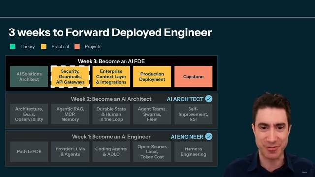
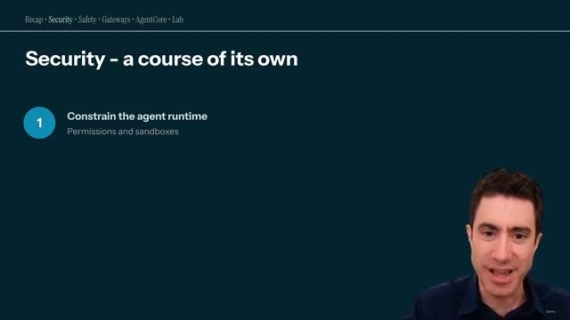
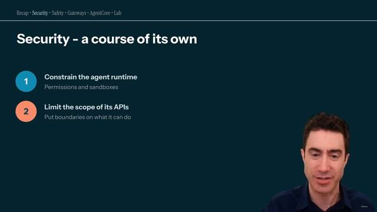
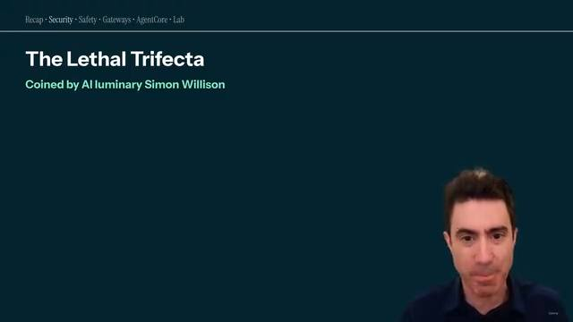
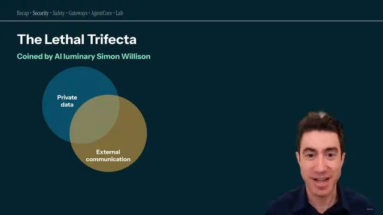
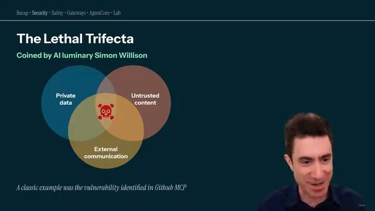
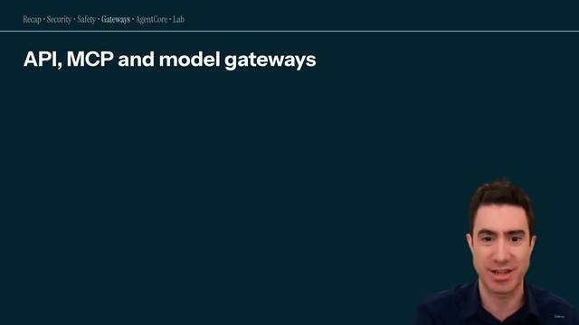
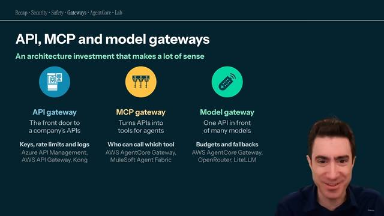
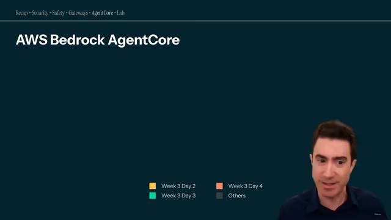

# AI FDE（BV1rJnm64Eq3）P91–P93 复现文档：Agent 安全、Lethal Trifecta 与三类企业网关

> 说明：P91–P93 是**纯讲解/架构决策课**。逐字稿里没有出现可运行代码、依赖版本、环境变量、启动命令或 AWS CLI 操作。因此本文不伪造“跑通命令”，而是把讲师在这三节里要求的判断过程，落成一套**可照着填写、可评审、可验收的复现包**。文中所有额外补出的表格、估算公式、JSON 草案，都会明确标注“课里没讲，以下为复现用示意”。  
> 截图均来自给定清单，路径原样保留。

---

## 1. 这一节做什么

这一节的目标不是写一个 Agent Demo，而是回答三个上线前必须回答的问题：

1. **这个 Agent 的安全风险在哪里？**  
   P91 把风险分成三类：Agent 运行时能不能被限制住；Agent 通过 API 能做什么；Agent 读到外部内容后会不会被 prompt injection 带偏。讲师特别强调：对商业生产 Agent，运行时通常放到类似 AWS Bedrock Agent Core 的受控环境里，更值得关注的是**你给了它哪些集成、哪些 API 权限**。

2. **这个方案是否踩中 Lethal Trifecta？**  
   P92 解释 Simon Willison 提出的“致命三件套”：Agent 能对外通信、能访问私有数据、能接触不可信内容。三者同时成立时，攻击者可能通过一段恶意内容诱导 Agent 把私有数据发出去。讲师的电商 CMS 例子非常典型：一开始只有“对外写内容”和“访问销售数据”两项，后来另一个团队把客户评论同步进 CMS，客户评论成为不可信内容，三件套就凑齐了。

3. **企业应该怎样选网关、怎样用 Agent Core 管住 Agent？**  
   P93 把企业网关拆成 API Gateway、MCP Gateway、Model Gateway 三类：API Gateway 管 key、日志、限流和内外部端点；MCP Gateway 管 Agent 能用哪些工具、工具映射和权限；Model Gateway 管模型路由、预算、fallback。然后讲师把 AWS Bedrock Agent Core 讲成一套面向 Agent 部署的标准服务集合，包括 Gateway、Policy、Identity、Observability，以及后续会讲的 Memory、Runtime 等。

**这一节的复现产物**不是源码，而是 6 份文档 + 1 张接口草案：

```text
ai-fde-p091-093/
├── README.md
├── 01-requirements.md
├── 02-risk-register.md
├── 03-gateway-decision.md
├── 04-agentcore-service-map.md
├── 05-guardrail-spec.md
├── 06-capacity-estimate.md
└── 07-acceptance-checklist.md
```

这 7 个文件的内容在本文第 4 节给出可直接复制的表结构和草案。课里没有给出这个目录；这是为了让读者能按同一套结构复现而整理的项目包。



---

## 2. 讲师原话（带「—— pNNN [MM:SS]」）

下面只摘与复现最相关的原话。英文为逐字稿原句或尽量贴近原句的摘录，中文是解释，不替代原话。

> "人们谈到智能体的安全性时，首先想到的往往是智能体运行所处的运行时环境以及它能做什么……它是否运行在沙箱里？我们给了它哪些权限？它能执行哪些 shell 脚本？"
> —— p091 [03:10]

讲师把第一层风险放在 **Agent 运行时**：是否在 sandbox 里、给了什么权限、能跑什么 shell 脚本。对商业生产 Agent，他提到通常会部署到类似 AWS Bedrock Agent Core 这样被 ring-fenced 的环境里，所以第一层“已经帮你解决”。复现时要记录：你的 Agent 到底跑在本地、容器、Lambda，还是 Agent Core Runtime；不同运行时的隔离边界不同。

> "你真正需要警惕的风险，与你给智能体接入的集成、以及它拥有的其他工具和能力有关。"
> —— p091 [04:10]

第二层风险是 **集成与工具权限**。不是“模型会不会说错话”，而是模型一旦说错话，它手里的 API 能造成什么后果。

> "……如果你把它接到一个邮箱上，那么也许应该只给它起草邮件的权限，而永远不让它发送……你可以用 API 范围来限制智能体的能力。"
> —— p091 [04:40]

讲师用邮箱举例：敏感邮箱只给 Agent 读、总结、起草，不给发送；如果确实要回复，就给 Agent 自己的邮箱，让外部一眼看出这是 AI 发的。关键句是：**用 API scope 限制能力，而不是只靠 prompt 让模型“记得说自己是 Agent”**。



> "……如果你给智能体开放 JIRA 的访问权限……你可以决定这个集成的范围……是只读还是可读可写……它以哪个用户身份登录……它能改动哪些项目？在这些项目里它又有哪些操作能力？"
> —— p091 [06:09]

JIRA 例子把权限拆成：集成 scope 是只读还是读写；Agent 以哪个用户登录；该用户能改哪些项目；在项目里是什么角色。复现时要把这些粒度写进权限表，而不是只写“可以访问 JIRA”。



> "……智能体可能会读到某些信息，而这些信息能诱骗它去做坏事。经典例子是：它从互联网上读到一段内容，而这段内容开头就是“忽略你之前的所有指令”。"
> —— p091 [07:20]

第三层是 **prompt injection / 外部内容攻击**。讲师说这类风险与前两类有重叠：如果被注入了，至少要让第一、第二层限制住损失。

> "第一，如果你的智能体系统会与外部通信……第二，如果它能访问私有数据……第三，如果智能体能够访问不受信任的内容。"
> —— p092 [00:31]

这是 Lethal Trifecta 的三个条件：对外通信、私有数据、不可信内容。注意讲师说的是“三者同时成立时要非常小心，并考虑额外控制”，不是“三者缺一就绝对安全”。

> "……这个网站还有供客户留下评价的区域……这些客户评价也会与 CMS 保持同步……它同样会看到客户评价……糟糕……这里存在不受信任的内容……这就构成了致命三要素的情形。"
> —— p092 [03:39]

电商 CMS 例子完整展示了“风险是后来才出现的”：最初两项条件不致命，另一个团队加入客户评论同步后，第三项不可信内容进入 Agent 的上下文，风险等级改变。复现时要记录“谁在什么时间新增了什么数据源”，不能只做上线前一次审查。





> "……私有数据和外部通信这两个气泡……也都可以被替换成一个气泡，上面只写着“范围过大的 API”……一个有能力造成破坏的 API。"
> —— p092 [06:51]

讲师补了一个重要变体：不一定非要“私有数据 + 对外通信”同时出现；一个**权限过宽的 API** 本身就可能替代前两个条件。例如 Agent 能通过 API 把钱转出公司，同时又能读不可信内容，这就是高风险。

> "最常见的防护措施是用 LLM 检查输出……你也可以用 Python 硬编码一些检查……检查有没有脏话……社保号或个人电话号码……API 密钥……sk-proj-……"
> —— p092 [06:51]

安全之外还有 safety/alignment：用 LLM 检查输出是否适合发给最终用户；用硬编码检查脏话、SSN、个人电话、API key；输入端和输出端都要检查；还要有用户 flag 机制和 golden test data。注意：讲师这里说的是 Python 硬编码示例，但这是概念示例，不是完整代码。



> "……一个公共基础设施，它成为你通往外部世界的门户……同时也是你通往内部世界的门户……"
> —— p093 [00:06]

讲师把企业网关定义成统一入口：既连接外部，也暴露内部服务。API Gateway 负责 key、日志、限流；MCP Gateway 负责工具映射和 Agent 能访问哪些工具；Model Gateway 负责把请求路由到不同 LLM、配置预算和 fallback。



> "……三款革命性产品……一台全新的宽屏 iPod……一部全新的移动电话……一台全新的互联网通信设备……这就是 iPhone……这里的情况很相似，很多人都已经转向用一款产品同时完成这三件事。"
> —— p093 [03:26]

讲师用 2007 年 iPhone 发布类比：过去 API Gateway、MCP Gateway、Model Gateway 像三个产品，现在越来越多产品把三者合成一个平台。复现时要判断：你是分别采购三个轻量组件，还是选择一个重型一体化平台。



> "……AI 智能体并没有什么特别之处。它们只是 Python 程序……在云端调用 LLM 的 API，然后做一些调用工具之类的事情……Agent Core 是……一套用于部署智能体的服务，尤其处理 AWS 配置中一些繁琐的部分……"
> —— p093 [08:39]

讲师明确说 Agent 本质上是 Python 程序，可以跑在 Lambda、容器或本地再部署到云上。Agent Core 的价值是把重复的 AWS 配置标准化：Gateway 把 API 变成 MCP 工具；Policy 在每次工具调用时检查规则；Identity 管理哪个 Agent 在做什么、能访问哪些 API key；Observability 接到 CloudWatch。后面还会讲 Memory、Runtime，以及 harness、evaluations、code interpreter、browser、web search、payments 等 bolt-on 功能。



---

## 3. 从零复现

这一节按“需求 → 约束 → 估算 → 方案 → 取舍”的顺序复现讲师的推导过程。再次强调：**课里没有代码、没有 AWS CLI、没有版本号、没有环境变量名、没有启动命令**。因此“从零复现”的产物是一套可评审的决策包，而不是一个能 `npm run dev` 的项目。

### 步骤 0：建立复现包目录

```text
ai-fde-p091-093/
├── README.md
├── 01-requirements.md
├── 02-risk-register.md
├── 03-gateway-decision.md
├── 04-agentcore-service-map.md
├── 05-guardrail-spec.md
├── 06-capacity-estimate.md
└── 07-acceptance-checklist.md
```

这不是课程原目录，只是为了让下面的表格有落点。每个文件内容在第 4 节给出。

### 步骤 1：写需求，先不要写方案

在 `01-requirements.md` 里回答：

- Agent 服务谁？内部员工、客户，还是外部合作伙伴？
- Agent 能对外发送什么？邮件、CMS 内容、JIRA 评论、社交平台、支付指令？
- Agent 能读什么私有数据？销售数据、客户资料、代码仓库、工单、财务数据？
- Agent 会读到哪些不可信内容？网页、客户评论、公开 issue、PR、第三方邮件、上传文档？
- Agent 能调用哪些工具/API？只读还是读写？以哪个身份调用？
- 哪些动作必须 human-in-the-loop？
- 失败时最坏后果是什么？泄露、错误发布、错误转账、错误删数据？

把这些写成表，不要写“给 Agent 一个 JIRA 工具”这种模糊描述。要写成“以 `agent-jira-bot` 身份，对项目 A/B 只读，对项目 C 可写 comment，不可 transition issue”。

### 步骤 2：把约束分成四类

1. **运行时约束**：本地、容器、Lambda、Agent Core Runtime？是否 sandbox？能否跑 shell？能否访问公网？
2. **API 约束**：scope 是只读还是读写？以哪个用户/服务账号登录？项目级角色是什么？有没有不可逆动作？
3. **数据约束**：私有数据分级；哪些字段不能进 LLM；日志里能不能出现 PII/API key。
4. **内容约束**：不可信内容从哪里进来；进 prompt 前是否剥离指令性文本；是否需要人工复核。

### 步骤 3：做估算，公式必须写出来

讲师没有给任何容量数字。下面公式是复现用模板，**数值必须由你的项目实测或业务方提供，不能从本文抄一个假数**。

```text
日请求量 = DAU × 人均会话数 × 每会话工具调用次数
峰值 RPS = 日请求量 × 峰值系数 ÷ 86400
网关预留 RPS = 峰值 RPS × 重试放大系数
日志字节/日 = 日请求量 × 每请求日志条数 × 每条日志字节
模型预算/日 = 输入 token/1000 × 输入单价
            + 输出 token/1000 × 输出单价
            + 工具调用次数 × 工具单价
```

这里要特别记录 `峰值系数` 和 `重试放大系数`。Agent 的工具调用经常比普通 Web 请求更重，且失败重试会放大网关压力。课里没有讲这些系数怎么取，复现时先写“待压测/待业务确认”，不要拍脑袋。

### 步骤 4：画 Lethal Trifecta 三圈图，再决定方案

在 `02-risk-register.md` 里为每个 Agent 画三个布尔字段：

- `external_communication`：是否能向外发送信息？
- `private_data_access`：是否能读私有数据？
- `untrusted_content_access`：是否能读外部不可信内容？
- `wide_scope_api`：是否存在一个权限过宽、能造成实质损害的 API？

判断规则：

1. 三项全为 true → 标记 Lethal Trifecta，必须有额外控制，或拆掉一项。
2. `wide_scope_api` + `untrusted_content_access` 同时为 true → 按高风险处理，即使没有传统意义的“私有数据 + 对外通信”。
3. 任何新增数据源、新增工具、新增外部写权限，都要重新跑这张表。

拆三件套的常见方式，来自讲师例子：

- 邮箱：只给 draft，不给 send；或给 Agent 独立邮箱。
- JIRA：只读；或限定项目；或限定角色；把 transition 权限拿掉。
- CMS：Agent 只写 draft，发布由人点；客户评论在进 prompt 前剥离“指令性内容”，或只给摘要。
- 支付/资金：不要给 Agent 直接转账的宽权限 API；改为生成待审批指令。

### 步骤 5：做网关选型

在 `03-gateway-decision.md` 里分别回答三类网关：

| 网关类型 | 你要回答的问题 | 讲师提到的例子 |
|---|---|---|
| API Gateway | key、日志、限流、内外部端点是否统一？ | Azure API Gateway、AWS API Gateway、Kong |
| MCP Gateway | 哪个 Agent 能访问哪个工具？工具如何映射到 endpoint 或 MCP server？scope 怎么管？ | AWS Bedrock Agent Core Gateway、Composio |
| Model Gateway | 请求如何路由到不同 LLM？预算、fallback 怎么配？ | OpenRouter、LiteLLM proxy、Agent Core 自带 gateway |

讲师的核心取舍是：**重型一体化平台省事、一致性强，但迁移成本高；轻量组件灵活、迁移容易，但你要自己拼。** 复现时不要只写“选 Agent Core”，要写“为什么选、如果未来迁走要改哪些点”。

### 步骤 6：把服务映射到 Agent Core

在 `04-agentcore-service-map.md` 里至少映射：

- Gateway：把内部/外部 API 变成 Agent 可用的 MCP 工具。
- Policy：每次工具调用前检查规则。
- Identity：识别哪个 Agent 在调用、能访问哪些 API key。
- Observability：把日志/指标接到 CloudWatch。
- Memory：后续课程讲，用于长期记忆。
- Runtime：后续课程讲，用于 serverless 运行 Agent。
- 其他：harness、evaluations、code interpreter、browser、web search、payments，讲师说这些是逐步增加的 bolt-on 功能。

### 步骤 7：写 guardrail 规格

在 `05-guardrail-spec.md` 里分输入/输出两端：

- LLM 校验器：检查输出是否适合最终用户。
- 硬编码检查：脏话、SSN、个人电话、API key（讲师举例 `sk-proj-`）。
- 用户 flag：坏回复、不当回复要能上报，并有运营流程跟进。
- golden test data：持续更新，用来测试 LLM validator 和规则是否有效。

### 步骤 8：验收

用第 6 节清单逐项打勾。没有通过安全评审、没有 golden test、没有 flag 流程的 Agent，不应进入生产。

---

## 4. 完整代码

**课里没有代码。** 以下是纯讲解课对应的“方案产物”。它们不是讲师原文件，而是按逐字稿整理出的可复制模板。依赖版本、环境变量、启动命令：**课里没讲，因此本节不提供，也不伪造。**

### 4.1 风险登记表：`02-risk-register.md`

| 风险 ID | Agent/场景 | 对外通信 | 私有数据 | 不可信内容 | 宽权限 API | 最坏后果 | 预防控制 | 检测/监控 | 负责人 | 验收 |
|---|---|---|---|---|---|---|---|---|---|---|
| R-001 | CMS 商品描述 Agent | 是，写入公开网站 | 是，销售数据 | 是，客户评论 | 否 | 销售数据/客户信息被写进公开页 | 评论进 prompt 前剥离指令；CMS 只写 draft；发布人工确认 | 发布前 diff；敏感字段扫描；用户 flag |  |  |
| R-002 | JIRA 工单 Agent | 可写评论 | 项目私有 issue | 公开 issue/PR 可能进入 | 是，若可 transition | 工单被错误关闭/泄露 | 只读 + 指定项目 + 指定角色；禁用 transition | 审计日志；异常操作告警 |  |  |
| R-003 | 邮箱助手 | 可发邮件 | 收件箱私有数据 | 外部邮件不可信 | 是，若可 send | 数据外泄/冒名发送 | 只给 draft；或独立 Agent 邮箱；发送需人工 | 发送日志；收件人白名单 |  |  |

### 4.2 网关决策表：`03-gateway-decision.md`

| 决策项 | 选项 A：轻量分开 | 选项 B：重型一体化 | 本项目选择 | 理由 | 迁移影响 |
|---|---|---|---|---|---|
| API Gateway | 自建/云厂商 API Gateway + Kong 等 | Agent Core Gateway 或 Azure API Management 统一管 | 待填 | key/日志/限流是否已存在 | 迁移要改 endpoint、鉴权、日志 |
| MCP Gateway | Composio、单独 MCP 网关 | Agent Core Gateway | 待填 | 工具数量、权限粒度、是否需要内部工具 | 工具映射和 scope 要重配 |
| Model Gateway | OpenRouter / LiteLLM proxy | Agent Core 自带 gateway | 待填 | 是否需要多模型路由、预算、fallback | 路由规则、预算、密钥要迁移 |
| 一致性 | 弱，各团队自管 | 强，企业统一 | 待填 | 企业规模、合规要求 | 迁移成本高 |
| 锁定风险 | 低 | 高 | 待填 | 未来 MCP/模型协议变化 | 需提前设计抽象层 |

### 4.3 Agent Core 组件职责表：`04-agentcore-service-map.md`

| 组件 | 职责 | 本项目是否使用 | 备注 |
|---|---|---|---|
| Gateway | 把 API 变成 MCP 工具；统一工具入口 | 待填 | 讲师说它可做 API→MCP 工具映射 |
| Policy | 每次工具调用检查规则 | 待填 | 规则语言课里没讲 |
| Identity | 管理 Agent 身份与 API key 访问 | 待填 | 具体 IAM 配置课里没讲 |
| Observability | 日志/指标接入 CloudWatch | 待填 | 与 Langfuse 的关系课里未展开 |
| Memory | 长期记忆 | 后续课程 | 本节不展开 |
| Runtime | serverless 运行 Agent | 后续课程 | 本节不展开 |
| harness | 托管运行 Claude Agent SDK 类能力 | 课里提到但未展开 | 不要当成已配置 |
| evaluations | 给 Agent 打分 | 课里提到但未展开 | 与 Langfuse 有重叠 |
| code interpreter | 云端跑代码 | 课里提到但未展开 | 沙箱细节未讲 |
| browser | 云端沙箱浏览器 | 课里提到但未展开 | 安全边界未讲 |
| web search | 联网搜索 | 课里提到但未展开 | 属于 bolt-on |
| payments | 支付能力 | 课里提到但未展开 | 高风险，需额外评审 |

### 4.4 Guardrail 规格表：`05-guardrail-spec.md`

| 检查 ID | 方向 | 检查内容 | 实现类别 | 命中动作 | 测试数据 | 负责人 |
|---|---|---|---|---|---|---|
| G-001 | 输出 | 脏话/不当词 | 硬编码规则 | 阻断并改写 | golden set |  |
| G-002 | 输入+输出 | SSN/个人电话等 PII | 硬编码 + 规则 | 阻断/脱敏 | golden set |  |
| G-003 | 输入+输出 | API key，如 `sk-proj-` | 硬编码正则 | 阻断并告警 | golden set |  |
| G-004 | 输出 | 是否适合最终用户 | LLM 校验器 | 重写/转人工 | 标注集 |  |
| G-005 | 全链路 | 用户 flag 坏回复 | 产品功能 + 运营流程 | 工单跟进 | 用户反馈样本 |  |
| G-006 | 全链路 | 变更后 flag 是否上升 | 监控 | 回滚/复查 | 时间序列 |  |

### 4.5 容量估算表：`06-capacity-estimate.md`

| 指标 | 公式 | 数值 | 数据来源 |
|---|---|---|---|
| 日请求量 | DAU × 人均会话数 × 每会话工具调用次数 | 待填 | 业务方/埋点 |
| 峰值 RPS | 日请求量 × 峰值系数 ÷ 86400 | 待填 | 压测/历史 |
| 网关预留 RPS | 峰值 RPS × 重试放大系数 | 待填 | 压测 |
| 日志量/日 | 日请求量 × 每请求日志条数 × 每条日志字节 | 待填 | 日志采样 |
| 模型预算/日 | 输入 token/1000 × 单价 + 输出 token/1000 × 单价 + 工具调用 × 单价 | 待填 | 供应商报价 |
| 月度安全余量 | 日预算 × 30 × 余量系数 | 待填 | 财务/业务确认 |

### 4.6 工具调用策略检查草案（示意，不是 Agent Core 官方 schema）

课里没有给出 Agent Core Policy 的具体字段和规则语言。下面只是帮助团队讨论“一次工具调用前要带哪些上下文”的草案，**不能当成官方 API**。

```json
{
  "agent_id": "cms-product-writer",
  "tool_name": "cms.write_product_description",
  "scope": ["cms:read", "cms:write:draft"],
  "data_classes": ["public_product", "private_sales"],
  "has_untrusted_content": true,
  "external_egress": true,
  "requested_action": "write_draft",
  "decision": "deny_or_require_human_approval"
}
```

### 4.7 验收记录：`07-acceptance-checklist.md`

见第 6 节，直接复制成 checklist。

---

## 5. 逐行解释

### 5.1 为什么先画三圈图，而不是先写 prompt

Lethal Trifecta 的价值在于把“感觉不安全”变成三个可检查的布尔值。讲师在 P92 的电商例子说明：同一个 Agent，上线时只满足两项，后来另一个团队把客户评论同步进 CMS，第三项变成 true，风险性质就变了。所以复现时要在变更记录里保留“数据源/工具/外部写权限”的变更历史。只写 prompt “不要泄露销售数据”不够，因为不可信内容可能诱导模型绕过 prompt；真正可靠的是 API scope、Policy、人工审批这些模型改不了的限制。

### 5.2 为什么 API scope 比 prompt 可靠

讲师在 P91 邮箱例子里说得很清楚：不要靠 prompt 让模型“记得说自己是 Agent”，而是通过 API scope 让 Agent 根本没有 send 权限。映射到 JS/Node：这类似 OAuth scope 或服务账号权限，配合 Express/Koa/Fastify 的鉴权中间件，在工具执行前检查当前 Agent 身份有没有这个 scope。它不是一个“提示词技巧”，而是授权层。课里没有讲具体 OAuth 实现，也没有讲 JWT 字段；这些需要按你的云平台文档补。

### 5.3 为什么运行时沙箱是第 0 层，但不是全部

P91 把运行时风险放第一位：sandbox、权限、shell 脚本。对生产 Agent，如果跑在 Agent Core 这类受控环境里，讲师认为这一层“已经帮你解决”。但这不等于安全完成，因为真正容易出事的是你给 Agent 接的 API。复现时要把“运行时隔离”和“工具权限”分开评审：前者问“它能不能逃出沙箱”，后者问“它在沙箱里合法调用 API 能造成什么损害”。

### 5.4 为什么 JIRA 要拆到项目级和角色级

讲师在 P91 的 JIRA 例子把权限拆成：集成 scope、登录用户、可改项目、项目内角色。原因是“能访问 JIRA”太粗。一个 Agent 能读所有项目、还能 transition issue，就可能误关高优先级工单。复现时至少写四列：scope（read/write）、身份、项目范围、角色/动作。课里没有给 JIRA 的具体权限名称，填写时以你实际 JIRA 管理后台为准。

### 5.5 为什么“宽权限 API”可以替代私有数据+对外通信

P92 末尾讲师说，私有数据和对外通信两个圈可以合并成一个“API with wide scope”。例如 Agent 能调用转账 API，同时又读不可信内容，即使没有传统“私有数据集”，也可能造成资金损失。复现时风险表要加一列 `wide_scope_api`，并明确“这个 API 最坏能做什么”。如果最坏后果不可逆，就必须加人工审批或去掉该 API。

### 5.6 为什么网关要分三类，而不是只买一个“AI 网关”

P93 把网关拆成 API、MCP、Model 三类，因为职责不同：API Gateway 管传统 endpoint、key、日志、限流；MCP Gateway 管 Agent 工具目录和工具权限；Model Gateway 管模型路由、预算、fallback。市场上很多产品把三者合并，但评审时仍要分别问清楚。否则容易出现“买了 AI 网关，但传统 API 的 key 和限流没人管”或“模型路由有了，但工具权限粒度不够”的漏洞。

### 5.7 为什么重型一体化平台要评估迁移成本

讲师明确说 Agent Core 是 all-in 方案，省事、一致性强，但如果未来要迁走，成本高。复现时在网关决策表里加“迁移影响”列：endpoint、鉴权、日志、工具映射、预算规则分别要改什么。轻量方案如 LiteLLM proxy、OpenRouter 也有自己的取舍。课里没有给迁移工作量数字，不要编造人天；先列迁移清单。

### 5.8 为什么 guardrail 要输入输出都查

P92 说 SSN 这类信息“不仅输出要查，输入也不能让 SSN 进 LLM”。这是数据最小化：能在进模型前阻断，就不要依赖模型“不记住”。API key 也一样，`sk-proj-` 这类模式如果进了日志或 prompt，就是事故。硬编码规则会有误报/漏报，所以还要 LLM 校验器、用户 flag 和 golden test。课里没有给正则和阈值，复现时先写规则所有者与测试集，不要假装一条正则解决所有问题。

### 5.9 容量公式为什么必须写“待填”

讲师没有给 DAU、token 单价、峰值系数。复现文档如果写“每天 10 万请求”就是编造。正确做法是保留公式和字段，让业务方/压测填。尤其是 `重试放大系数`：Agent 工具调用失败重试会直接放大网关和模型预算，课里没讲，但生产一定会遇到。

### 5.10 关于锁、事务、并发

这一节没有讲数据库锁、事务或并发控制。映射到 JS/Node：API scope 和 Policy 更像授权中间件，不是数据库事务；多个工具并发写外部系统时，是否要幂等键、顺序控制、去重，课里没讲。如果你的 Agent 会并发修改 JIRA/CMS/支付，必须另做设计，不能把“Policy 检查”当成事务隔离。

---

## 6. 复现检查清单

- [ ] 已建立 `ai-fde-p091-093/` 目录和 7 个文档文件。
- [ ] `01-requirements.md` 写清用户、外部通信、私有数据、不可信内容、工具/API、human-in-the-loop。
- [ ] `02-risk-register.md` 为每个 Agent 填了 `external_communication`、`private_data_access`、`untrusted_content_access`、`wide_scope_api`。
- [ ] 三项全 true 的场景已标记 Lethal Trifecta，并有“拆一项或加控制”的方案。
- [ ] `wide_scope_api` + 不可信内容 的组合已按高风险评审。
- [ ] API scope 写到“只读/读写、身份、项目范围、角色/动作”粒度。
- [ ] 运行时已确认：sandbox/容器/Lambda/Agent Core Runtime，shell 与公网访问边界已记录。
- [ ] 网关决策表覆盖 API Gateway、MCP Gateway、Model Gateway。
- [ ] 网关决策表记录了迁移影响和锁定风险。
- [ ] `04-agentcore-service-map.md` 已映射 Gateway、Policy、Identity、Observability；Memory/Runtime 标注为后续课程。
- [ ] Guardrail 覆盖输入和输出：脏话、SSN、电话、API key、LLM 输出校验。
- [ ] 有用户 flag 流程和负责人。
- [ ] 有 golden test data，并约定更新频率。
- [ ] 容量表公式已填，数值来源已标注；没有编造业务数字。
- [ ] 日志中不会记录 API key、SSN、完整私有数据。
- [ ] 已安排信息安全团队评审并签字。
- [ ] 已记录“课里没讲”的待补项：AWS IAM 细节、Agent Core Policy 规则语言、具体版本/环境变量/启动命令。

---

## 7. 课里没讲但你会撞上的

1. **没有代码仓库、依赖版本、环境变量、启动命令。**  
   这三节是架构与安全讲解，讲师没有给可运行项目。任何声称“按本文直接 `npm install` 就能跑 Agent Core”的说法都是伪造。你需要等后续 Runtime 实操课或查官方文档。

2. **AWS IAM 具体策略没讲。**  
   讲师说 Agent Core 会处理权限、区域等“grotty parts”，但没有给 IAM role、policy JSON、region 配置。复现时只能先写“需要哪些权限”，不能假装已经配好。

3. **Agent Core Policy 的规则语言没讲。**  
   讲师说 Policy 能在每次工具调用时检查规则，但没给语法。第 4.6 节的 JSON 只是讨论草案，不是官方 schema。

4. **网关的具体路由、预算、fallback 配置没讲。**  
   讲师讲了 Model Gateway 要管预算和 fallback，但没有给 OpenRouter/LiteLLM/Agent Core 的配置示例。复现时先写决策表，配置留到具体平台文档。

5. **PII/API key 检测的准确率问题。**  
   硬编码正则会有漏报和误报。课里没讲阈值、误报处理、脱敏策略。生产上要加人工复核和监控。

6. **成本、配额、超时、重试、幂等没讲。**  
   Agent 工具调用失败会重试，重试会放大网关和模型成本。课里没有给重试策略。你需要补：超时、最大重试、幂等键、死信/人工兜底。

7. **日志与合规没讲。**  
   CloudWatch 能接日志，但日志保留多久、是否含 PII、跨境数据怎么处理，课里没讲。别把完整 prompt 和 API key 打进日志。

8. **Node/TS 落地映射。**  
   在 Node 里，API scope 对应 OAuth scope/服务账号权限；Policy 检查对应工具执行前的授权中间件；Model Gateway 对应统一的模型调用客户端。锁/事务/并发这一节没讲；如果多工具并发写外部系统，需要你自己补幂等和顺序控制。

9. **“人类要为 AI 报告负责”。**  
   P91 最后讲师讲了一个很重要的点：用 Claude Code 找漏洞可以，但报告质量要人负责，不能把 LLM 生成的夸张内容直接发给开源社区。这个原则同样适用于 Agent 的安全评审：自动化能提速，但签字负责的必须是人。