# AI FDE 第三周第二天 Lab 2：把 Undercover 应用部署到 AWS 并挂上 AgentCore Gateway

> 覆盖 P097–P100。这是一节“部署 + 网关 + 策略”的实操课：把本地跑通的 Undercover 应用打包成 Lambda 函数、给它一个公网地址、用 AgentCore Gateway 把应用的 8 个 REST 接口暴露成 MCP 工具、再用 Cedar 策略在网关层拦截超额赔付，最后把基础设施拆掉。
>
> 说明：逐字稿是英文口语，本文按项目实现逻辑重组，不按 P 号流水账。凡逐字稿没讲的内容，一律标注“课里没讲”。

---

## 1. 这一节做什么

一句话：**把“只在你电脑上跑”的 Undercover 应用，变成“在 AWS 上跑、被 Agent 通过 MCP 调用、且被企业策略约束”的系统。**

拆成六步（讲师在 P097 开头明确列了六步）：

1. **部署应用到 Lambda**：把前端（dashboard）、后端（backend）、数据（data）、Python 依赖一起打包成 zip，上传成 AWS Lambda 函数，让它能被一个 URL 触发。
2. **创建 Gateway**：用 Amazon Bedrock AgentCore Gateway 把应用已有的 8 个 REST 接口（用 OpenAPI 文档描述的）暴露成 MCP 工具，供 Agent 使用。
3. **以 IAM 用户身份调用网关里的工具**：用 SigV4 签名请求，让网关认可“是我在调用”，然后真正 invoke 一个工具。
4. **加一条策略**：用 Cedar 语言写一条“赔付金额超过阈值就拒绝”的策略，先以 **log only（只记录不拦截）** 模式挂到策略引擎上。
5. **切换成 enforce（强制执行）**：再挂一次策略引擎，这次是强制执行，看到赔付被网关直接拒绝。
6. **拆除基础设施**：删掉 Gateway、策略引擎、凭证提供者、IAM 角色；Lambda 函数可以留着（不用就不花钱）。

这一节的“产出物”不是一堆知识点，而是：**一个公网可访问的 Undercover 应用 + 一个暴露了 8 个 MCP 工具的网关 + 一条生效的 Cedar 策略 + 一套可重复执行的清理脚本。**

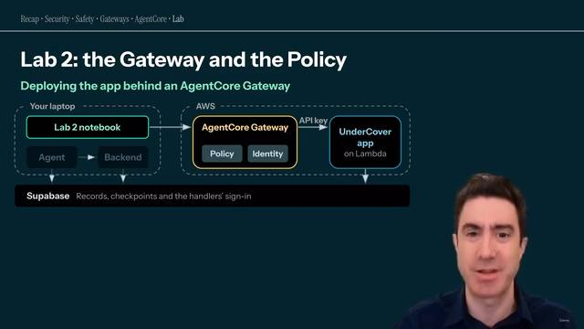

---

## 2. 讲师原话（带出处）

关于这节该“学到什么程度”，讲师给了一个非常明确的建议，值得先看，因为它决定了你复现时的目标：

> "第一种方式是先大致了解我在做什么，理解决策背后的直觉……不必纠结 Cedar 本身的技术细节，也不用管具体的 API 调用。"
> —— p097 [02:14]

> "对大多数人，我的建议是就用它来把握整体思路，建立直觉即可。"
> —— p097 [03:14]

理由他也讲了：

> "当你真正进去配置策略变更，或者可能是第一次设置它时——这种事大概每隔几个月才会发生一次——我会专门留出四五个小时查阅 AWS 的文档，重新熟悉 Cedar 的用法。"
> —— p097 [03:27] – [03:57]

也就是说：**这一节的目标是“能照着跑通 + 理解为什么这么做”，不是背下 Cedar 语法和 AgentCore 的 API 细节。** 下面第 3 节就按这个目标写：每一步都给可执行的东西，细节语法不展开。

关于为什么不用 Terraform / CDK：

> "Terraform 确实非常强大，但这周对我们来说有点大材小用……Amazon 自己推出的类似 Terraform 的产品 CDK……那也会有点过度……我们接下来要做的方式，也就是最简单、最省事的做法……就是直接使用 BOTO 库本身。"
> —— p097 [07:08] – [08:07]

关于打包时为什么要指定 Python 版本和平台：

> "我们是在告诉它，我们要用 Python 3.12……并且要针对这个系统架构来构建，也就是 x86 64 位 Linux 机器。这是因为 Lambda 用的就是这个架构。"
> —— p098 [00:50]

关于为什么敢给 Lambda 一个公网地址：

> "如果我们没有做这套 API 密钥方案，这就会成为问题。我们需要确保不是谁都能调用我们的 Lambda 函数。所以它由我们的代码来保护。"
> —— p098 [04:37]

关于 401 和 403 的口误纠正（讲师自己纠正了，值得记一下，因为复现时会看到状态码）：

> "抱歉，我刚才说成了“禁止”，但我想说的是“未授权”。当然，401 表示的就是未授权。"
> —— p098 [06:28]

关于策略先 log 后 enforce 的工程习惯：

> "我们首先要做的，是以仅记录模式接入这个策略引擎。这意味着它不会阻止任何事情发生，只会记录所有违规。这也是把它投入实际使用的一种常见路径。"
> —— p099 [06:49] – [07:11]

关于 enforce 生效那一刻：

> "被网关拒绝，工具执行被拒绝，因策略强制执行而不被允许。这下你就看到网关策略生效了。"
> —— p100 [00:10]

关于策略日志的延迟（复现时会撞上，别以为没生效）：

> "策略引擎的记录保存在 CloudWatch 里……不过它有点滞后。"
> —— p100 [00:38]

关于清理时保留什么：

> "现在我自己保留下来的是我们的 Lambda 函数。这很好。如果没人使用，它不产生任何费用。"
> —— p100 [02:23]

---

## 3. 从零复现

### 3.0 前置条件（先对齐，不然下面全跑不通）

- **工作目录**：`labs/` 目录下的 `week3/day2/lab2`（讲师说“We are in week three, day two lab two in the labs directory” —— p097 [04:39]）。所有 notebook 单元格里的 `cd ..` 都是相对这个目录往上跳到 `undercover/` 主项目目录，所以**你的目录层级必须和课程仓库一致**，否则 `!cd .. && npm run build` 会失败。
- **Python 版本**：3.12（打包时显式指定，见 p098 [00:50]）。
- **AWS 区域**：`us-east-1`（讲师明确说“that's the region I'm in US East 1 which you should be to if you followed my advice” —— p097 [06:38]）。
- **AWS 身份**：一个 IAM 用户（讲师用的是 `undercover`，如果你上过 production track 可能是 `ai-engineer`）。Boto3 会读你本机配置的凭证。
- **`.env` 文件**必须包含（讲师逐个点名检查过，p097 [08:37]）：
  - `DATABASE_URL`（Supabase 连接串）
  - `VITE_SUPABASE_URL`
  - `VITE_SUPABASE_PUBLISHABLE_KEY`
  - `UNDERCOVER_API_KEY`（昨天设的那个“特殊 key”）
- **如果你是用 `git checkout` 直接跳到这一天的**：`.env` 里不会有 `UNDERCOVER_API_KEY`，讲师说“you can just put one in there make it up give yourself a strong password” —— p097 [09:03]。**只用字母和数字**，因为 `$` 在 `.env` 里可能被解释、单引号可能被当成行尾（p097 [09:18]）。
- **Python 依赖**：`boto3`（AWS Python 客户端）、`uv`（讲师用 `uv run` 跑脚本）、以及后面 MCP 客户端要用的 LangChain MCP 相关包（具体包名课里没逐个念，以你环境里 `langchain-mcp-adapters` 一类实际安装为准）。

### 3.1 先开一个“花钱监控”终端（强烈建议，5 分钟）

讲师专门做了一个小工具，复现时先跑它，能省掉很多“我是不是在烧钱”的焦虑：

```bash
# 在 labs 目录下，新开一个终端（讲师用 Ctrl-Backtick 在 VS Code 里开）
uv run monitor.py
```

它会显示：从你第一次运行它那天起，到今天为止，你的 AWS 账户花了多少钱（p097 [05:17]）。讲师强调两点：

- **它不是权威数据源**，预算告警（budget alert）才是，AWS 控制台才是（p097 [05:41]）。
- **AWS 的成本数字一天只刷新大约三次**（p097 [06:08]），所以看到“没变化”不代表没在花钱。

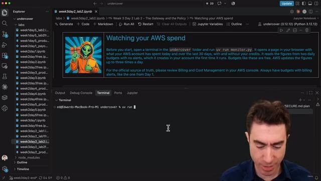

### 3.2 确认身份与区域

在 notebook 里（或任何 Python 环境）：

```python
import boto3

sts = boto3.client("sts")
print(sts.get_caller_identity())
```

你应该看到自己的 IAM 用户 ARN，区域是 `us-east-1`。讲师这一步的目的就是“check who is currently signed in”（p097 [06:38]）。

### 3.3 构建前端产物

notebook 单元格里以 `!` 开头表示当 shell 命令执行（p097 [09:48]）：

```bash
# 在 labs 目录下执行；cd .. 跳到 undercover 主项目
cd .. && npm run build
```

等价于：进到 `undercover/` 目录手动跑 `npm run build`。产物是 dashboard 的静态文件，后面会被一起打进 Lambda 的 zip 里。

> Windows 上有时输出不漂亮，但应该能构建成功（p097 [10:17]）。

### 3.4 打包成 Lambda 可用的 zip（核心步骤）

目标：生成 `build/lambda/undercover-app.zip`，里面同时包含 **依赖 + 后端代码 + 数据 + 前端**。

流程（p098 [00:00] – [01:53]）：

1. 创建 `build/` 目录，里面再建 `build/lambda/`。
2. 把当前 Python 环境的依赖导出成 `requirements.txt`。
3. 用 `pip install` 把依赖装进 `build/lambda/` 下的一个虚拟环境/目标目录，**关键参数**：
   - Python 3.12
   - 目标平台 `manylinux` x86_64（讲师原话是“an x86 64 bit Linux box”，因为 Lambda 就是这个架构）
4. 把后端代码、`data/`、`dashboard/`（前端产物）复制进 `build/lambda/`。
5. 整个 `build/lambda/` 打成 `undercover-app.zip`。

讲师跑完后 zip 是 **20 MB**，并说“Lambda can take up to 50 megabytes without a problem”（p098 [01:53]）。

> 课里没有给出这段打包脚本的逐行源码（notebook 里是现成单元格）。下面第 4 节给的是**按讲师描述还原的可执行版本**，参数与讲师口述一致；如果你要 100% 对齐课程，直接用课程仓库里 lab2 的 notebook 单元格。

### 3.5 创建日志组 + IAM 角色

- 创建 CloudWatch 日志组，**保留 7 天**（p098 [02:53]）。
- 创建一个 Lambda 可以“assume”的 IAM 角色，命名 `undercover-app-role`，并给它写日志的权限（p098 [03:23]）。

讲师的原话值得记：**“Even things like functions need to have a role and have permissions to do what they need to do”** —— 在 AWS 里，函数也有身份。

### 3.6 上传函数并给公网 URL

- 设置环境变量：`DATABASE_URL`、`VITE_SUPABASE_URL`、`UNDERCOVER_API_KEY`（p098 [04:08]）。
- 调 Boto3 的 `create_function` 上传 zip；如果函数已存在就 `update_function_code`。
- 给函数加一个 **Function URL**（公网地址）。

讲师特别解释了为什么敢给公网地址：**应用自身有 API key 保护**（p098 [04:37]）。

### 3.7 验证：冷启动 + 401/200

- 第一次请求会慢（AWS 要“spin up the box”），讲师实测 **3.6 秒**；第二次 **0.1 秒**（p098 [05:37]）。
- 不带 API key 请求 `claims/CLM1901` → **401**；带上 API key 头 → **200**（p098 [06:28]）。

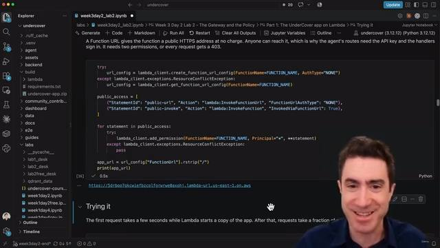

### 3.8 打开 dashboard 验证“数据还在”

浏览器打开 Function URL → 登录页 → 用 Dana Whitfield 的密码登录（**这是 Supabase 里给用户设的密码，不是 Supabase 项目密码**，p098 [07:07]）→ 看到平台页面，而且**里面已经有历史数据**。

原因讲师自己点破了：**前端和后端跑在 Lambda，数据仍然来自 Supabase**（p098 [07:37]）。

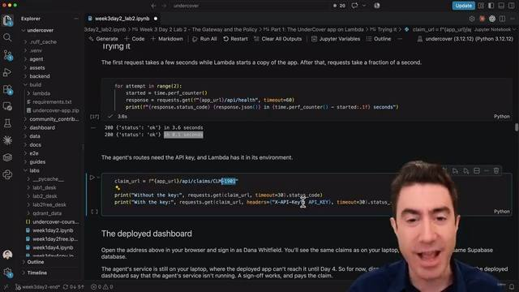

### 3.9 把 API key 放进 AgentCore Identity

网关要调你的应用，就得知道那个 API key。做法（p099 [00:00] – [00:38]）：

1. 在 AgentCore Identity 里找“credential provider”，找名字里带 `undercover` 的；
2. 没有就创建，命名为 `undercover-app-key`；
3. 把 `UNDERCOVER_API_KEY` 的值写进去。

### 3.10 给 Gateway 建 IAM 角色并授权读凭证

- 创建 Gateway 用的角色（p099 [01:07]）。
- 再给它“读写凭证存储”的权限（p099 [01:07] 之后那段“looks quite fiddly”的单元格）。

### 3.11 创建 Gateway

- 先写一个 helper 判断 gateway 是否已存在（p099 [01:36]）。
- 主函数调 `agentcore.create_gateway(...)`，传入细节。
- 创建成功后，你会拿到一个 **MCP 链接**——Agent 从这里“收集”网关暴露的所有工具（p099 [01:36] – [02:05]）。

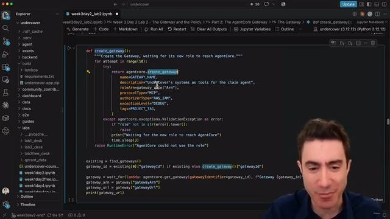

### 3.12 把 8 个 REST 接口变成 MCP 工具

关键概念：你的应用已经有 **8 个 API 路由**，并且用 **OpenAPI 文档**（讲师特意强调“not to be confused with open AI... formerly known as swagger”，p099 [02:18]）描述过。网关读这份文档，就能把每个路由变成一个带描述的 MCP 工具。

两个动作：

1. **修文档里的 URL**：把 OpenAPI 文档里的 server URL 指向你 Lambda 的 Function URL（p099 [02:39]，“something slightly fiddler”）。
2. **把文档作为 target configuration 传给网关**：讲师说“if you want to look at where the actual API is passed in, you will find that right here... That is where we turn the agent API into text and pass that in as the target configuration”（p099 [02:59] – [03:29]）。

### 3.13 用 MCP 客户端验证工具列表

- 先写一段 **SigV4 签名**代码（`Sigv4Auth` 一类），让请求带上 AWS 签名（p099 [03:29]）。
- 用 LangChain 的 multi-server MCP client 连网关：
  - 名字 `undercover`
  - 传输 `streamable HTTP`
  - URL = 上一步的 gateway URL
  - 用 SigV4 签名
- 调 `list_tools`，应该看到 **8 个工具**，每个都带“给模型看的描述文本”，而这些描述**来自 OpenAPI 文档**（p099 [04:28] – [04:58]）。

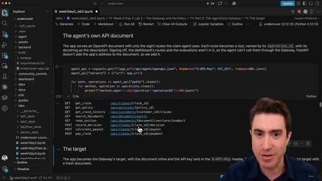

### 3.14 真正 invoke 一个工具

- `await tools.invoke(...)` 调 `get claim CLM1901` → 返回 claim ID。
- 链路：**MCP 客户端 → Gateway → 转成 API 请求 → Lambda 后端 → Supabase**，讲师说这一步耗时 **0.9 秒**（p099 [05:24] – [05:54]）。
- 再调 `search documents`（需要传参数）→ 返回结果，约 1 秒。
- 调不存在的 `CLM9999` → 返回 **MCP client error**，底层是 API 的 **404**（p099 [05:54] – [06:21]）。

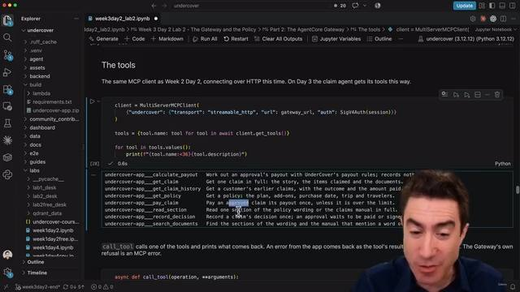

### 3.15 建策略引擎，先 log only

- 找名为 `undercover` 的 policy engine，没有就创建（p099 [06:21]）。
- 创建后第一件事：给它一个“允许做什么”的基础策略（讲师说“That's always the next step”）。
- 角色要能使用这个 policy engine。
- **以 log only 模式挂载**：不拦截，只记录违规（p099 [06:49]）。

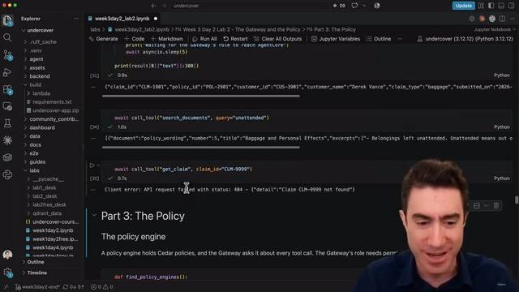

### 3.16 写 Cedar 策略

讲师给的核心策略（p099 [07:41] – [08:22]）：

- 一条 `permit`（放行基础动作）
- 一条 `forbid`：当 action 是 `pay claim` 且 `context.input.amount > decimal(1000)` 时拒绝

讲师明确说 **不展开 Cedar 语法**（“out of scope”），但指出“pretty much English readable”，并建议用 Claude 帮你把自然语言约束翻成 Cedar。

跑完后应该看到两条策略处于 active：`undercover-allow-agent-tools` 和 `undercover-payment-limit`（p099 [08:22] – [08:52]）。

### 3.17 在 log only 下试一笔 4800 的赔付

结果：**被拦住了，但不是被策略拦住的**——是应用后端的检查拦住的，报错大意是“payout over a thousand needs a handler sign off”（p099 [09:10]）。

讲师的重点：**“it shouldn't have even got there”** —— 策略只记录，没拦截，所以请求还是打到了后端。

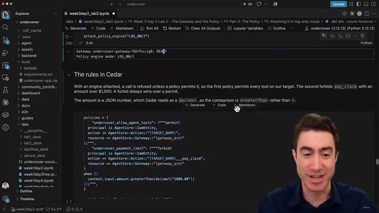

### 3.18 切换 enforce，看网关直接拒绝

再挂一次策略引擎，这次 **enforcing**（p100 [00:00]）。再试 4800：

> "被网关拒绝，工具执行被拒绝，因策略强制执行而不被允许。"
> —— p100 [00:10]

再试一笔 **400** 但“未审批”的赔付：**能过策略**，但仍然会在后端失败（p100 [00:38]）——说明策略只负责金额阈值这一层，业务审批是另一层。

### 3.19 看 CloudWatch 里的策略记录（注意延迟）

- 策略引擎记录写到 **CloudWatch**（p100 [00:38]）。
- **有延迟**：讲师第一次查时只看到“refused 1”，过几秒再查才变成“allowed 1, refused 1”（p100 [00:55] – [01:24]）。

讲师总结这一层的价值：现在支付相关有**三道检查**——模型层 guardrail、网关策略层、后端最终检查（p100 [01:24]）。

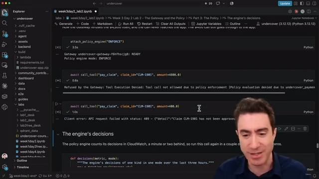

### 3.20 拆除基础设施

要删的（p100 [01:53]）：

- Lambda 函数 `undercover-app`（**可选保留**，不用不花钱）
- Gateway `undercover-gateway`
- 策略引擎
- API key provider（凭证提供者）
- IAM 角色

讲师说如果用 Terraform 就一句 `terraform destroy`，但这里“手动方式更清楚，没有 Terraform 魔法”（p100 [02:23]）。

删完后再跑一次“列出剩余资源”的单元格，应该只剩 `undercover-app` 和 `undercover-role`（p100 [04:09]）。

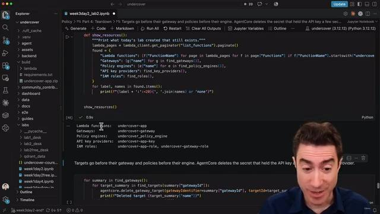

### 3.21 作业（讲师留的）

> "添加第三条 Cedar 策略……如果决策是批准超过 5,000 美元的付款，就拒绝记录该决策。先以仅记录模式运行，再以强制执行模式运行。"
> —— p100 [04:34] – [05:03]

---

## 4. 完整代码

> **重要说明**：这一节的 notebook 单元格在逐字稿里是“讲师直接执行现成单元格”，**逐字稿没有逐行念出源码**。下面给的是**按讲师口述的参数与流程还原的可执行脚本**，用于让你在没有课程仓库时也能跑通；字段名/参数名以你实际运行 AWS SDK 时的输出为准，不确定的地方我标了“以实际输出为准”。如果你有课程仓库，优先用仓库里的 lab2 notebook。

### 4.1 目录结构（复现时应该长这样）

```
undercover/                      # 主项目（npm run build 在这里跑）
├── backend/                     # 后端代码
├── data/                        # 数据
├── dashboard/                   # 前端源码（build 产物在 dist/ 一类目录）
├── .env                         # DATABASE_URL / VITE_* / UNDERCOVER_API_KEY
└── labs/
    └── week3/day2/lab2/
        ├── lab2.ipynb           # 课程 notebook
        └── monitor.py           # 讲师给的花费监控小工具
```

### 4.2 `build_lambda.py` —— 打包脚本（还原讲师口述流程）

```python
# build_lambda.py
# 放在 labs/week3/day2/lab2/ 下执行：python build_lambda.py
# 作用：生成 build/lambda/undercover-app.zip，供 Lambda 上传
import os
import shutil
import subprocess
import sys
import zipfile

# ---- 路径：从 labs 往上跳到 undercover 主项目 ----
LAB_DIR = os.path.dirname(os.path.abspath(__file__))
PROJECT_ROOT = os.path.abspath(os.path.join(LAB_DIR, "..", "..", ".."))  # undercover/
BUILD_DIR = os.path.join(PROJECT_ROOT, "build")
LAMBDA_DIR = os.path.join(BUILD_DIR, "lambda")
ZIP_PATH = os.path.join(BUILD_DIR, "undercover-app.zip")

def run(cmd, cwd=None):
    print(">>", " ".join(cmd))
    subprocess.run(cmd, cwd=cwd, check=True)

def main():
    # 1) 清空并重建 build/lambda
    if os.path.exists(BUILD_DIR):
        shutil.rmtree(BUILD_DIR)
    os.makedirs(LAMBDA_DIR, exist_ok=True)

    # 2) 导出依赖到 requirements.txt
    req_path = os.path.join(BUILD_DIR, "requirements.txt")
    with open(req_path, "w", encoding="utf-8") as f:
        subprocess.run([sys.executable, "-m", "pip", "freeze"],
                       stdout=f, check=True)

    # 3) 把依赖装到 build/lambda，指定 Python 3.12 + manylinux x86_64
    #    讲师原话：Python 312 / x86 64 bit Linux box（p098 00:50）
    run([
        sys.executable, "-m", "pip", "install",
        "-r", req_path,
        "-t", LAMBDA_DIR,
        "--platform", "manylinux2014_x86_64",
        "--python-version", "3.12",
        "--only-binary=:all:",
        "--upgrade",
    ])

    # 4) 复制后端、数据、前端产物
    for name in ["backend", "data"]:
        src = os.path.join(PROJECT_ROOT, name)
        dst = os.path.join(LAMBDA_DIR, name)
        if os.path.exists(src):
            shutil.copytree(src, dst, dirs_exist_ok=True)
        else:
            print(f"[warn] 未找到 {src}，请确认目录名与课程仓库一致")

    # 前端产物目录名以你项目实际为准（常见为 dashboard/dist）
    dashboard_dist = os.path.join(PROJECT_ROOT, "dashboard", "dist")
    if os.path.exists(dashboard_dist):
        shutil.copytree(dashboard_dist, os.path.join(LAMBDA_DIR, "dashboard"),
                        dirs_exist_ok=True)
    else:
        print("[warn] 未找到 dashboard/dist，请先执行 npm run build")

    # 5) 打 zip
    with zipfile.ZipFile(ZIP_PATH, "w", zipfile.ZIP_DEFLATED) as zf:
        for root, _, files in os.walk(LAMBDA_DIR):
            for fn in files:
                full = os.path.join(root, fn)
                rel = os.path.relpath(full, LAMBDA_DIR)
                zf.write(full, rel)

    size_mb = os.path.getsize(ZIP_PATH) / (1024 * 1024)
    print(f"done: {ZIP_PATH} ({size_mb:.1f} MB)")
    if size_mb > 50:
        print("[warn] 超过 50MB，Lambda 直传会失败，需要走 S3 或裁剪依赖")

if __name__ == "__main__":
    main()
```

### 4.3 `deploy_lambda.py` —— 建日志组、建角色、上传函数、开 Function URL

```python
# deploy_lambda.py
# 依赖：pip install boto3
# 运行前确保 AWS 凭证已配置（aws configure 或环境变量）
import json
import os
import time

import boto3
from botocore.exceptions import ClientError

REGION = "us-east-1"                      # 讲师指定区域（p097 06:38）
FUNCTION_NAME = "undercover-app"
ROLE_NAME = "undercover-app-role"
LOG_GROUP = "/aws/lambda/undercover-app"  # 命名以你实际创建为准
ZIP_PATH = os.path.join(os.path.dirname(__file__), "..", "..", "..",
                        "build", "undercover-app.zip")

iam = boto3.client("iam", region_name=REGION)
lam = boto3.client("lambda", region_name=REGION)
logs = boto3.client("logs", region_name=REGION)

# ---------- 1) 日志组，保留 7 天 ----------
def ensure_log_group():
    try:
        logs.create_log_group(logGroupName=LOG_GROUP)
        print("log group created")
    except logs.exceptions.ResourceAlreadyExistsException:
        print("log group already exists")
    logs.put_retention_in_days(logGroupName=LOG_GROUP, retentionInDays=7)

# ---------- 2) IAM 角色（Lambda assume role + 写日志） ----------
TRUST_POLICY = {
    "Version": "2012-10-17",
    "Statement": [{
        "Effect": "Allow",
        "Principal": {"Service": "lambda.amazonaws.com"},
        "Action": "sts:AssumeRole",
    }],
}

def ensure_role():
    try:
        iam.create_role(RoleName=ROLE_NAME,
                        AssumeRolePolicyDocument=json.dumps(TRUST_POLICY))
        print("role created")
    except iam.exceptions.EntityAlreadyExistsException:
        print("role already exists")
    # 附加 AWS 托管的基础执行策略（写 CloudWatch Logs）
    iam.attach_role_policy(
        RoleName=ROLE_NAME,
        PolicyArn="arn:aws:iam::aws:policy/service-role/AWSLambdaBasicExecutionRole",
    )
    return iam.get_role(RoleName=ROLE_NAME)["Role"]["Arn"]

# ---------- 3) 上传函数 ----------
def ensure_function(role_arn):
    env = {
        "DATABASE_URL": os.environ["DATABASE_URL"],
        "VITE_SUPABASE_URL": os.environ["VITE_SUPABASE_URL"],
        "UNDERCOVER_API_KEY": os.environ["UNDERCOVER_API_KEY"],
    }
    with open(ZIP_PATH, "rb") as f:
        code = f.read()

    try:
        lam.get_function(FunctionName=FUNCTION_NAME)
        lam.update_function_code(FunctionName=FUNCTION_NAME, ZipFile=code)
        print("function code updated")
    except lam.exceptions.ResourceNotFoundException:
        lam.create_function(
            FunctionName=FUNCTION_NAME,
            Runtime="python3.12",
            Role=role_arn,
            Handler="backend.lambda_handler.handler",  # 以你项目实际 handler 为准
            Code={"ZipFile": code},
            Environment={"Variables": env},
            Timeout=30,
            MemorySize=512,
        )
        print("function created")

# ---------- 4) Function URL（公网地址） ----------
def ensure_function_url():
    try:
        cfg = lam.get_function_url_config(FunctionName=FUNCTION_NAME)
        print("function url:", cfg["FunctionUrl"])
        return cfg["FunctionUrl"]
    except lam.exceptions.ResourceNotFoundException:
        cfg = lam.create_function_url_config(
            FunctionName=FUNCTION_NAME,
            AuthType="NONE",   # 应用自身用 API key 保护（p098 04:37）
        )
        print("function url created:", cfg["FunctionUrl"])
        return cfg["FunctionUrl"]

if __name__ == "__main__":
    ensure_log_group()
    role_arn = ensure_role()
    ensure_function(role_arn)
    url = ensure_function_url()
    print("done. URL =", url)
```

### 4.4 `verify_lambda.py` —— 验证 401 / 200

```python
# verify_lambda.py
import os
import requests

URL = os.environ["FUNCTION_URL"]          # 上一步打印出来的地址
KEY = os.environ["UNDERCOVER_API_KEY"]

# 不带 key：期望 401（讲师口误说 forbidden，随后自己纠正为 unauthorized）
r1 = requests.get(f"{URL}/claims/CLM1901")
print("no key ->", r1.status_code)

# 带 key：期望 200
r2 = requests.get(f"{URL}/claims/CLM1901",
                  headers={"x-api-key": KEY})   # header 名以你后端实际实现为准
print("with key ->", r2.status_code, r2.text[:200])
```

### 4.5 `gateway_setup.py` —— 凭证提供者 + 网关角色 + 创建网关 + 接入 OpenAPI

```python
# gateway_setup.py
# 说明：AgentCore 的具体 SDK 调用签名课里没有逐行念出，
# 下面按讲师口述的“动作顺序”组织；函数名/参数名请以你安装的 SDK 实际签名为准。
import json
import os

import boto3

REGION = "us-east-1"
GATEWAY_NAME = "undercover-gateway"
CRED_PROVIDER_NAME = "undercover-app-key"
GATEWAY_ROLE_NAME = "undercover-gateway-role"
OPENAPI_PATH = os.path.join(os.path.dirname(__file__), "openapi.json")

# 1) 把 API key 放进 AgentCore Identity 的 credential provider
#    讲师：找名字带 undercover 的，没有就创建，然后把 API key 写进去（p099 00:00-00:38）
def ensure_credential_provider(agentcore_identity_client):
    existing = agentcore_identity_client.list_credential_providers()
    for p in existing.get("credentialProviders", []):
        if CRED_PROVIDER_NAME in p.get("name", ""):
            print("credential provider exists")
            return p
    created = agentcore_identity_client.create_credential_provider(
        name=CRED_PROVIDER_NAME,
        apiKey=os.environ["UNDERCOVER_API_KEY"],
    )
    print("credential provider created")
    return created

# 2) 网关 IAM 角色 + 读写凭证存储的权限（p099 01:07）
def ensure_gateway_role(iam):
    trust = {
        "Version": "2012-10-17",
        "Statement": [{
            "Effect": "Allow",
            "Principal": {"Service": "bedrock-agentcore.amazonaws.com"},
            "Action": "sts:AssumeRole",
        }],
    }
    try:
        iam.create_role(RoleName=GATEWAY_ROLE_NAME,
                        AssumeRolePolicyDocument=json.dumps(trust))
        print("gateway role created")
    except iam.exceptions.EntityAlreadyExistsException:
        print("gateway role already exists")
    # 具体 policy ARN 以 AWS 文档为准；讲师那段“fiddly”的单元格就是挂这个
    return iam.get_role(RoleName=GATEWAY_ROLE_NAME)["Role"]["Arn"]

# 3) 创建网关（先 helper 判断是否存在，再 create）
def ensure_gateway(agentcore_client, role_arn):
    try:
        g = agentcore_client.get_gateway(name=GATEWAY_NAME)
        print("gateway exists:", g)
        return g
    except Exception:
        g = agentcore_client.create_gateway(
            name=GATEWAY_NAME,
            roleArn=role_arn,
        )
        print("gateway created")
        return g

# 4) 把 OpenAPI 文档作为 target configuration 接入（p099 02:18-03:29）
def attach_openapi(agentcore_client, gateway, lambda_url):
    with open(OPENAPI_PATH, encoding="utf-8") as f:
        spec = json.load(f)
    # 讲师强调：要把文档里的 server URL 改成 Lambda 的地址
    spec["servers"] = [{"url": lambda_url}]
    agentcore_client.add_target(
        gatewayName=GATEWAY_NAME,
        targetConfiguration=json.dumps(spec),
    )
    print("openapi attached as target configuration")

if __name__ == "__main__":
    # 客户端构造方式以 SDK 实际为准
    print("请按课程 notebook 里的 client 构造方式执行本脚本的各步骤")
```

### 4.6 `mcp_client.py` —— 用 MCP 客户端列工具、调工具

```python
# mcp_client.py
# 依赖：langchain-mcp-adapters 一类 MCP 客户端包（课里未逐个念包名）
import asyncio
import os

from langchain_mcp_adapters.client import MultiServerMCPClient

GATEWAY_URL = os.environ["GATEWAY_URL"]   # 创建网关后拿到的 MCP 链接

async def main():
    client = MultiServerMCPClient({
        "undercover": {
            "transport": "streamable_http",   # 讲师原话：streamable HTTP
            "url": GATEWAY_URL,
            # 这里需要 SigV4 签名（讲师用 Sigv4Auth 一类实现，p099 03:29）
            # 具体签名注入方式以你使用的 MCP 客户端支持为准
        }
    })

    tools = await client.get_tools()
    print("tools:", [t.name for t in tools])   # 期望 8 个

    # 调 get claim CLM1901
    claim_tool = next(t for t in tools if "claim" in t.name.lower())
    result = await claim_tool.ainvoke({"claim_id": "CLM1901"})
    print("claim result:", result)

    # 调不存在的 claim，期望 MCP client error（底层 404）
    bad = await claim_tool.ainvoke({"claim_id": "CLM9999"})
    print("bad result:", bad)

if __name__ == "__main__":
    asyncio.run(main())
```

### 4.7 Cedar 策略（讲师给的两条）

```cedar
// 1) 基础放行：确保至少有一条规则能命中（讲师称其为“a bit of a no-op”）
permit(
  principal,
  action,
  resource
);

// 2) 真正的业务约束：赔付金额 > 1000 时拒绝
forbid(
  principal,
  action == Action::"pay claim",
  resource
)
when {
  context.input.amount > decimal("1000")
};
```

> 语法细节讲师明确说不展开（p099 [07:53]）。上面第二条的 `Action::"pay claim"` 与 `context.input.amount` 的写法以你实际策略引擎接受的 schema 为准。

### 4.8 `teardown.py` —— 清理

```python
# teardown.py
# 讲师：删 gateway、policy engine、credential provider、role；
# Lambda 可选保留（不用不花钱，p100 02:23）
import os
import boto3

REGION = "us-east-1"
KEEP_LAMBDA = os.environ.get("KEEP_LAMBDA", "1") == "1"

iam = boto3.client("iam", region_name=REGION)
lam = boto3.client("lambda", region_name=REGION)

def delete_role(name):
    try:
        for p in iam.list_attached_role_policies(RoleName=name)["AttachedPolicies"]:
            iam.detach_role_policy(RoleName=name, PolicyArn=p["PolicyArn"])
        iam.delete_role(RoleName=name)
        print("role deleted:", name)
    except iam.exceptions.NoSuchEntityException:
        print("role not found:", name)

if __name__ == "__main__":
    # 网关 / 策略引擎 / 凭证提供者的删除调用以 SDK 实际签名为准
    delete_role("undercover-gateway-role")
    if not KEEP_LAMBDA:
        try:
            lam.delete_function(FunctionName="undercover-app")
            print("lambda deleted")
        except lam.exceptions.ResourceNotFoundException:
            print("lambda not found")
        delete_role("undercover-app-role")
    print("teardown done")
```

---

## 5. 逐行解释

**`build_lambda.py`**

- `PROJECT_ROOT = ... "..", "..", ".."`：从 `labs/week3/day2/lab2/` 往上三层到 `undercover/`。这解释了为什么 notebook 里用 `cd ..` 而不是 `cd ../..`——notebook 本身在 `labs/` 下，`cd ..` 就到 `undercover/`。**目录层级错了，后面全错**，这是复现第一个坑。
- `pip freeze > requirements.txt`：把“当前环境实际装了什么”固化下来。讲师说“export them into a requirements.txt file that will say exactly which Python dependencies we have”（p098 [00:29]）。
- `--platform manylinux2014_x86_64 --python-version 3.12 --only-binary=:all:`：这三个参数是**跨平台打包的核心**。你在 Mac（arm64）或 Windows 上开发，但 Lambda 跑在 x86_64 Linux 上；不指定平台，装进去的会是本机架构的 wheel，上传后 import 就崩。讲师原话“we want to build it for this system architecture, an x86 64 bit Linux box. And that's because that's what Lambda uses”（p098 [00:50]）。
- `--only-binary=:all:`：强制只用预编译 wheel。纯 Python 包没问题，但带 C 扩展的包如果没对应平台的 wheel，会直接报错而不是悄悄装错——**宁可早失败**。
- 复制 `backend`、`data`、`dashboard/dist`：讲师说“it's the back end code, it's the data and then we also basically put in the front end, the dashboard. So it's all there as well because that will be served up by the app”（p098 [01:33]）。**前端是被后端“serve up”的**，所以必须一起进 zip。
- 50MB 检查：讲师实测 20MB，并说“Lambda can take up to 50 megabytes without a problem”（p098 [01:53]）。超过 50MB 直传会失败，需要走 S3——课里没讲 S3 方案。

**`deploy_lambda.py`**

- `put_retention_in_days(..., 7)`：讲师明确“kept for seven days”（p098 [02:53]）。日志不设保留期会一直存，虽然便宜但没必要。
- `TRUST_POLICY` 里 `Service: lambda.amazonaws.com`：这就是“函数也有身份”的落地——Lambda 服务要能 assume 这个角色。讲师原话“Even things like functions need to have a role and have permissions to do what they need to do”（p098 [03:23]）。
- `AWSLambdaBasicExecutionRole`：AWS 托管策略，给的就是“写 CloudWatch Logs”权限。讲师说“the role can write to the log group”（p098 [03:23]）。
- `get_function` 抛 `ResourceNotFoundException` 才 `create_function`，否则 `update_function_code`：这就是讲师说的“we update the code and then we let it do its thing and it will complain if it has a problem”（p098 [04:08]）。**幂等**，可以反复跑。
- `AuthType="NONE"`：Function URL 本身不做 IAM 鉴权，靠应用自己的 API key。讲师原话“this would be a problem if we hadn't built this API key approach... it's protected by our code”（p098 [04:37]）。**这是本节最重要的安全设计决策**：公网可达 ≠ 公网可调用。
- `Handler="backend.lambda_handler.handler"`：**这个路径课里没讲**，以你项目实际的 handler 文件为准。填错会在调用时报 `Runtime.HandlerNotFound` 一类错误。

**`verify_lambda.py`**

- 第一次请求慢、第二次快：这是 Lambda 冷启动。讲师实测 3.6s → 0.1s（p098 [05:37]）。
- 401 vs 403：讲师自己纠正过，“401, of course, is unauthorized”（p098 [06:28]）。**看到 401 是对的，不是 bug**。
- header 名 `x-api-key`：**课里没讲具体 header 名**，以你后端中间件实际读的字段为准。

**`gateway_setup.py`**

- 先找 credential provider 再创建：讲师“we look for the one that has undercover in it if it's not there we create it”（p099 [00:23]）。幂等思路和 Lambda 那段一致。
- 网关角色 trust 里的 service principal：**课里没念具体字符串**，以 AgentCore 文档为准。讲师只说“this sets up the role for our gateway, make sure that it has the right permissions”（p099 [01:07]）。
- `spec["servers"] = [{"url": lambda_url}]`：这就是讲师说的“something slightly fiddler we need to do to make sure that the URL is set in these docs”（p099 [02:39]）。**不改这里，网关会去调文档里写的旧地址**。
- `targetConfiguration=json.dumps(spec)`：讲师原话“That is where we turn the agent API into text and pass that in as the target configuration”（p099 [03:29]）。**OpenAPI 文档 = 工具的“说明书”**，模型靠它知道每个工具干什么。

**`mcp_client.py`**

- `transport: "streamable_http"`：讲师原话“It's going to be streamable HTTP”（p099 [03:58]）。
- SigV4 签名：讲师说“this Sigv4Orth thing is going to allow us to sign any requests we make with Amazon's signature”（p099 [03:29]）。**没有签名，网关不认你**——这就是第 3 步“identify ourselves as our IAM user”的意义。
- `get_tools()` 期望 8 个：讲师说“I'm hoping it's going to say that the eight APIs that we set up and documented are all now exposed as MCP tools”（p099 [04:28]）。
- 调 `CLM9999` 得到 MCP client error：讲师说“we get a client error, an MCP error that's returned to us. that the API request with a 404”（p099 [05:54]）。**错误管理也是功能**。

**Cedar 策略**

- 第一条 `permit` 全放行：讲师称“a bit of a no-op. It's there to make sure that everything gets through at least one rule”（p100 [04:34]）。Cedar 是“默认拒绝”语义，没有 permit 兜底，正常请求也会被拒。
- 第二条 `forbid ... when amount > 1000`：讲师说“it's pretty much English readable. You can see that it's going to forbid it if the amount is greater than $1,000”（p099 [08:22]）。
- **为什么先 log only**：讲师说“you don't necessarily want to immediately stop things from running”（p099 [07:11]）。直接 enforce 可能把正常业务打挂，先观察违规记录再收紧，是标准上线路径。

**`teardown.py`**

- 先 detach 再 delete role：IAM 不允许删除还挂着策略的角色。**课里没讲这个细节**，但不这么做会报错。
- `KEEP_LAMBDA` 默认保留：讲师说“It doesn't cost anything if no one uses it”（p100 [02:23]）。但如果你要长期停课，讲师给了 `delete the app to true` 的选项（p100 [02:53]）。

---

## 6. 复现检查清单

按顺序打勾，任何一项不过就别往下走：

- [ ] `labs/week3/day2/lab2/` 目录存在，且 `cd ..` 能到 `undercover/`
- [ ] `.env` 里 4 个变量齐全：`DATABASE_URL`、`VITE_SUPABASE_URL`、`VITE_SUPABASE_PUBLISHABLE_KEY`、`UNDERCOVER_API_KEY`
- [ ] `UNDERCOVER_API_KEY` 只含字母数字（无 `$`、无单引号）
- [ ] `boto3` 能 `get_caller_identity()`，区域是 `us-east-1`
- [ ] `npm run build` 成功，`dashboard/dist` 有产物
- [ ] `build/lambda/undercover-app.zip` 生成，大小 < 50MB（讲师实测 20MB）
- [ ] zip 里能查到 `backend/`、`data/`、`dashboard/`、以及依赖包
- [ ] CloudWatch 日志组存在，保留 7 天
- [ ] IAM 角色 `undercover-app-role` 存在，挂了 `AWSLambdaBasicExecutionRole`
- [ ] Lambda 函数 `undercover-app` 存在，环境变量 3 个都在
- [ ] Function URL 能访问
- [ ] 不带 key → **401**；带 key → **200**
- [ ] 浏览器打开 Function URL → 登录页 → 用 Dana 的密码登录 → 看到历史数据（说明连的还是 Supabase）
- [ ] AgentCore Identity 里有 `undercover-app-key`，且 API key 已写入
- [ ] 网关角色存在，有读写凭证的权限
- [ ] Gateway `undercover-gateway` 创建成功，拿到 MCP 链接
- [ ] OpenAPI 文档的 `servers.url` 已改成 Function URL
- [ ] MCP 客户端 `list_tools` 返回 **8 个**工具，每个有描述文本
- [ ] invoke `CLM1901` 返回 claim ID（约 0.9s）
- [ ] invoke `CLM9999` 返回 MCP client error（底层 404）
- [ ] 策略引擎 `undercover` 存在，两条策略 active
- [ ] **log only** 下试 4800：请求到达后端，被后端拦（“needs a handler sign off”）
- [ ] 切 **enforce** 后试 4800：网关直接拒（“tool execution denied, not allowed due to policy enforcement”）
- [ ] enforce 下试 400 未审批：过策略，后端失败
- [ ] CloudWatch 里能看到策略记录（**等 30 秒以上**，有延迟）
- [ ] 清理后只剩 `undercover-app` 和 `undercover-role`（如果你保留了 Lambda）
- [ ] 作业：第三条 Cedar 策略（approve payout > 5000 时拒绝记录），先 log 后 enforce

---

## 7. 课里没讲但你会撞上的

1. **Handler 路径**。`create_function` 的 `Handler` 参数课里没念。填错会报 `Runtime.HandlerNotFound`。去你项目里找实际的 lambda handler 文件。
2. **API key 的 header 名**。课里只说“add in the API key as a header”，没说 header 叫什么。以你后端中间件实际读的字段为准。
3. **AgentCore SDK 的具体函数签名**。讲师是直接跑 notebook 单元格，没逐行念。`create_gateway`、`create_credential_provider`、`add_target` 的参数名以你安装的 SDK 为准。**这正是讲师说“几个月后要花四五个小时重读文档”的原因**（p097 [03:57]）。
4. **Cedar 的 schema**。`Action::"pay claim"` 和 `context.input.amount` 的写法依赖策略引擎接受的 schema。讲师明确说不展开（p099 [07:53]）。
5. **IAM 删角色的顺序**。必须先 detach 策略再 delete，否则报错。课里没讲。
6. **CloudWatch 延迟**。讲师说“it sort of lags a bit”（p100 [00:38]），实测约 30 秒。**别以为策略没生效就反复改配置**。
7. **AWS 成本数字一天只刷新约三次**（p097 [06:08]）。`monitor.py` 不是权威源，预算告警才是。
8. **Windows 上 `npm run build` 输出可能不漂亮**（p097 [10:17]），但应该能成功。如果失败，看退出码而不是看输出。
9. **`git checkout` 跳课的人没有 `UNDERCOVER_API_KEY`**（p097 [09:03]）。自己造一个强密码填进去，前后端和 agent 用的是同一个 key，只要一致就行。
10. **Supabase 用户密码 ≠ Supabase 项目密码**（p098 [07:07]）。登录 dashboard 用的是前者。忘了就得去 Supabase 改密码或重建账号。
11. **Lambda 冷启动**。第一次 3.6s 是正常的（p098 [05:37]）。如果你在 CI 里做健康检查，超时要放宽。
12. **50MB 上限**。超了直传失败，课里没讲 S3 方案。真超了要么裁依赖，要么查 AWS 文档走 S3。
13. **“在 JS/Node 里对应什么”**：这一节没有锁/事务/并发的内容，全是 AWS 资源编排。唯一有点“并发”味道的是 Lambda 冷启动和 CloudWatch 延迟——在 Node 里对应“首次请求慢、日志异步落盘”，不是锁问题。

---

**最后一句讲师的定位，值得放在文档末尾**：

> “80% 80% there 20% to go”
> —— p100 [06:30]

这一节把 Undercover 应用推上了 AWS、挂上了网关、加了策略；剩下的 20%（memory、把 agent 跑在 Bedrock AgentCore Runtime 而不是 notebook 里）在 day 3 和 day 4 完成。