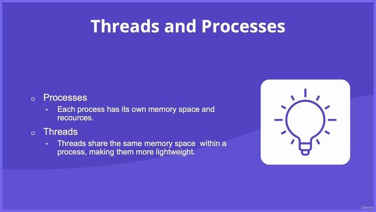
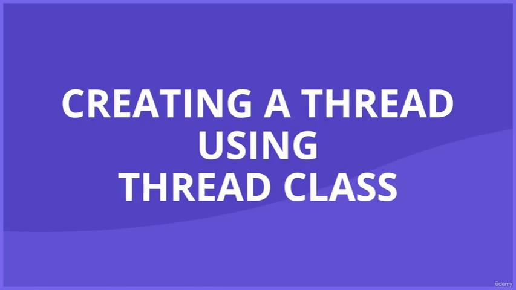
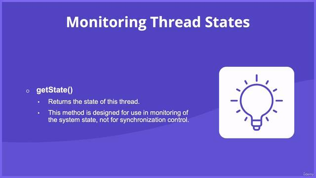
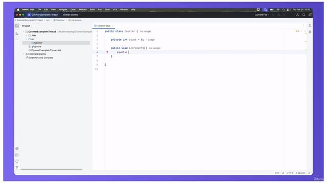
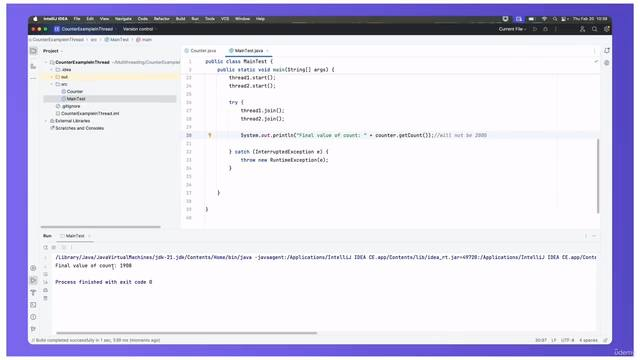
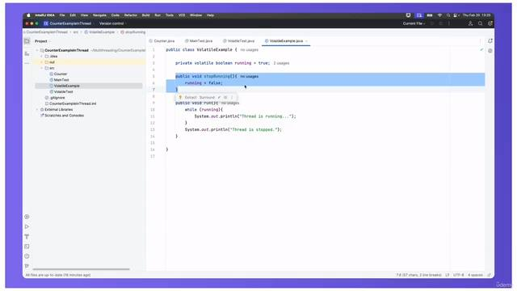

# Java 多线程与并发（P1–P10）复现文档

> 读者定位：前端转 AI 应用工程师。本文所有 Java 代码都是**完整文件**，可直接在 IntelliJ IDEA 里新建项目后保存运行。涉及锁/并发的地方会补一句「在 JS/Node 里对应什么」。Java 语法细节标注「知道即可」。

---

## 1. 这一节做什么

这 10 个视频（P1–P10）是一条**从零到能跑出正确结果**的最小闭环：

1. 建立概念：线程是什么、线程和进程的区别、Java 内存模型（JMM）怎么让线程之间「看见」彼此的数据（P1、P2、P5）。
2. 用两种方式创建线程：`extends Thread` 和 `implements Runnable`（P3、P4）。
3. 管理线程：为什么必须用 `start()` 而不是 `run()`、线程生命周期有哪些状态、怎么用 `getState()` 观察状态（P6、P7）。
4. 复现一个**真实的并发 bug**：两个线程各加 1000 次，结果不是 2000（P9 前半段）。
5. 用 `synchronized` 修好它，得到稳定的 2000（P9 后半段）。
6. 用 `volatile` 做一个「停止标志位」，理解它解决的是**可见性**而不是**原子性**（P10）。

最终你会得到 5 个可运行的小项目：`Threading`（Thread 版 + Runnable 版 + 状态监控版）、`CounterExampleInThread`（未同步版 + 同步版）、`VolatileExample`。**能亲手跑出「1998 / 2000」这种不确定结果，再跑出稳定的 2000，这门课的核心就拿到了。**



---

## 2. 讲师原话

> "实际上，可以把线程看作一种轻量级的执行单元，或者更简单地说，就是程序运行的一条路径。每个 Java 程序至少会从一个线程开始，这个线程称为主线程，它通过执行 main 方法来启动整个程序。"
> —— p002 [00:28]

> "首先可以看到，我们这里有一个名为 Threading 的项目。我选择 Java 21 作为版本，然后点击“创建”来建立项目。"
> —— p003 [00:00]

> "这里的关键在于，我们重写了 run 方法……当我们对线程对象调用 start 时，JVM 会在一个单独的线程中调用这个 run 方法。"
> —— p003 [00:56]

> "Runnable 接口让我们可以把任务与线程管理分离开来。这样会带来更大的灵活性，尤其是当你的类还需要继承其他类，或者你希望把任务逻辑与线程执行解耦时。"
> —— p004 [01:22]

> "进程是一个独立的程序，拥有自己的内存空间……而线程则是进程内部更小的单元……同一进程内的所有线程共享同一块内存空间。"
> —— p005 [00:28]

> "因此，我们不是直接调用 run 方法，而是使用 start 方法……如果直接调用 run，它会像当前线程中的任何其他方法一样执行，这意味着不会创建新线程，也就无法获得并行性。"
> —— p006 [00:28]

> "Java 其实提供了一个非常方便的方法，叫作 thread.getState。通过这个方法，我们可以准确查看线程在任意时刻所处的状态。"
> —— p007 [00:00]

> "volatile 能确保所有线程立即看到对变量最近一次写入的结果，但它并不保证原子性，因此无法帮助处理像递增一个值这样的复合操作。"
> —— p008 [01:23]

> "由于 count++ 不是原子操作，它实际上包含读取、递增和写回值这几个步骤，因此可能导致线程干扰和结果不一致。"
> —— p009 [01:14]

> "join 方法用于确保主线程等待线程 1 和线程 2 都执行完毕。如果没有 join，主线程可能会在这些线程完成计数器递增之前就继续打印结果，从而导致输出不一致。"
> —— p009 [04:55]

> "通过给 increment 方法加上 synchronized，我们确保同一时间只有一个线程能执行这个方法……最终结果将是正确的，也就是 2000。"
> —— p009 [07:43]

> "使用 volatile 时，变量始终从主内存读取并写回主内存，因此变更对所有线程都可见。"
> —— p010 [00:54]

---

## 3. 从零复现

### 3.1 环境准备

| 项 | 值 | 来源 |
|---|---|---|
| IDE | IntelliJ IDEA | p003 讲师在 IntelliJ 里演示 |
| JDK | **Java 21** | p003 [00:00] 明确说「I selected Java 21 as a version」 |
| 构建工具 | 无（纯 IDEA 项目，直接 Run） | 课里没讲 Maven/Gradle |
| 测试框架 | 课里提到 JUnit 会在后面出现（p001 [01:19]），但 **P1–P10 没有写任何测试代码** | p001 |

> 课里没讲 Maven/Gradle 的 `pom.xml` / `build.gradle`。如果你习惯用命令行，可以自己用 `javac` 编译、`java` 运行，本文所有代码都是单文件可编译的。

### 3.2 项目一：`Threading`（P3、P4、P7）

**Step 1** 打开 IntelliJ → New Project → 名字填 `Threading` → Language 选 Java → JDK 选 21 → Create。



**Step 2** 在 `src` 下新建 `MyThread.java`，内容见第 4 节代码块 1。

**Step 3** 在 `src` 下新建 `Main.java`，内容见第 4 节代码块 2。

**Step 4** 右键 `Main.java` → Run。控制台应看到两行（顺序可能互换）：

```
Thread is running
Thread is started
```

> 顺序互换是正常的——这正是多线程的意义：主线程和新线程在并行跑，谁先打印由操作系统调度决定。

**Step 5** 新建 `MyRunnable.java`（代码块 3）和 `MainRunnable.java`（代码块 4），运行 `MainRunnable`，输出同样是上面两行。

**Step 6** 新建 `StateMonitor.java`（代码块 5），运行它，观察 `getState()` 在 `start()` 前后的变化。



### 3.3 项目二：`CounterExampleInThread`（P9）

**Step 1** 新建项目 `CounterExampleInThread`，JDK 21。

**Step 2** 新建 `Counter.java`（代码块 6，**先不加 synchronized**）。

**Step 3** 新建 `Main.java`（代码块 7）。

**Step 4** 运行。**多跑几次**，你会看到类似 `Final count: 1987`、`Final count: 2000`、`Final count: 1993` 这种不稳定结果。这就是讲师说的 thread interference / race condition。



**Step 5** 把 `Counter.java` 里的 `increment()` 改成 `public synchronized void increment()`（代码块 8）。再跑几次，**每次都是 2000**。



### 3.4 项目三：`VolatileExample`（P10）

**Step 1** 新建项目 `VolatileExample`，JDK 21。

**Step 2** 新建 `VolatileExample.java`（代码块 9）。

**Step 3** 运行。控制台会先刷出一堆 `Thread is running`，约 1 秒后打印 `Thread has stopped`，然后 JVM 退出。



> 注意：这个例子**必须**用 `volatile`。如果去掉 `volatile`，在某些 JVM/CPU 上主线程改了 `running = false`，工作线程可能永远看不到，程序会卡死。这正是讲师要演示的点。

---

## 4. 完整代码

### 代码块 1：`MyThread.java`（P3，extends Thread 版）

```java
public class MyThread extends Thread {

    @Override
    public void run() {
        System.out.println("Thread is running");
    }
}
```

### 代码块 2：`Main.java`（P3，启动 Thread 版）

```java
public class Main {

    public static void main(String[] args) {
        MyThread myThread = new MyThread();
        myThread.start();
        System.out.println("Thread is started");
    }
}
```

### 代码块 3：`MyRunnable.java`（P4，implements Runnable 版）

```java
public class MyRunnable implements Runnable {

    @Override
    public void run() {
        System.out.println("Thread is running");
    }
}
```

### 代码块 4：`MainRunnable.java`（P4，启动 Runnable 版）

```java
public class MainRunnable {

    public static void main(String[] args) {
        MyRunnable myRunnable = new MyRunnable();
        Thread thread = new Thread(myRunnable);
        thread.start();
        System.out.println("Thread is started");
    }
}
```

### 代码块 5：`StateMonitor.java`（P7，观察线程状态）

```java
public class StateMonitor {

    public static void main(String[] args) {
        MyThread myThread = new MyThread();

        System.out.println("State before start: " + myThread.getState());

        myThread.start();

        System.out.println("State after start: " + myThread.getState());
    }
}
```

> 说明：`getState()` 返回的是 `Thread.State` 枚举。讲师在 p007 里只明确说了 `NEW` 和 `RUNNABLE` 两个值。`start()` 之后立刻打印，你**可能**看到 `RUNNABLE`，也可能看到 `TERMINATED`（如果线程已经跑完），这取决于调度时机——课里没讲这个细节，属于实际运行会撞上的情况（见第 7 节）。

### 代码块 6：`Counter.java`（P9，**未同步版**，先跑这个看 bug）

```java
public class Counter {

    private int count = 0;

    public void increment() {
        count++;
    }

    public int getCount() {
        return count;
    }
}
```

### 代码块 7：`Main.java`（P9，两个线程各加 1000 次）

```java
public class Main {

    public static void main(String[] args) {
        Counter counter = new Counter();

        Thread thread1 = new Thread(() -> {
            for (int i = 0; i < 1000; i++) {
                counter.increment();
            }
        });

        Thread thread2 = new Thread(() -> {
            for (int i = 0; i < 1000; i++) {
                counter.increment();
            }
        });

        thread1.start();
        thread2.start();

        try {
            thread1.join();
            thread2.join();
        } catch (InterruptedException e) {
            e.printStackTrace();
        }

        System.out.println("Final count: " + counter.getCount());
    }
}
```

### 代码块 8：`Counter.java`（P9，**同步版**，修好 bug）

```java
public class Counter {

    private int count = 0;

    public synchronized void increment() {
        count++;
    }

    public int getCount() {
        return count;
    }
}
```

> 把代码块 6 替换成代码块 8，`Main.java` 不用改，再跑就是稳定的 2000。

### 代码块 9：`VolatileExample.java`（P10，volatile 停止标志）

```java
public class VolatileExample {

    private volatile boolean running = true;

    public void stopRunning() {
        running = false;
    }

    public void run() {
        while (running) {
            System.out.println("Thread is running");
        }
        System.out.println("Thread has stopped");
    }

    public static void main(String[] args) {
        VolatileExample example = new VolatileExample();

        Thread thread = new Thread(example::run);
        thread.start();

        try {
            Thread.sleep(1000);
        } catch (InterruptedException e) {
            e.printStackTrace();
        }

        example.stopRunning();
    }
}
```

> 说明：讲师在 p010 里说「start a new thread and run the run method from that instance」，但**没有逐字念出** `new Thread(example::run)` 这一行。上面用的是方法引用写法，等价于 `new Thread(() -> example.run())`。如果你在 IDEA 里看到讲师用的是别的写法，以实际为准。

---

## 5. 逐行解释

### 代码块 1–2：`extends Thread`

- `public class MyThread extends Thread`：继承 `Thread` 类，`MyThread` 本身就是一个线程对象。**代价**：Java 单继承，`MyThread` 不能再继承别的类——这就是 P4 要换 `Runnable` 的原因。
- `@Override public void run()`：重写 `run()`，线程真正干的活写在这里。**注意**：`run()` 只是普通方法，直接调用它不会开新线程。
- `myThread.start()`：**关键行**。JVM 会创建一个新的执行路径，然后在新线程里回调 `run()`。讲师在 p006 [00:28] 强调：「if we call run directly, it will execute just like any other method in the current thread, meaning no new thread will be created」。
- `System.out.println("Thread is started")`：这行在主线程里跑，和 `run()` 里的打印**并行**，所以两行顺序不保证。

> **JS/Node 对照**：`start()` 有点像 `setTimeout(fn, 0)` 或 `queueMicrotask(fn)`——都是「把 fn 交给另一条执行路径」。区别是 Node 是单线程事件循环，Java 这里是真·多线程，`run()` 和主线程可能同时在不同 CPU 核上跑。

### 代码块 3–4：`implements Runnable`

- `implements Runnable`：只实现一个 `run()` 方法，类本身**不是**线程，只是「一段可被线程执行的任务」。
- `new Thread(myRunnable)`：把任务塞进线程对象。**任务逻辑**和**线程管理**分离——讲师 p004 [01:22] 原话：「Runnable interface allows us to separate the task from the thread management」。
- 好处：`MyRunnable` 还能 `extends` 别的类；同一个 `Runnable` 实例可以喂给多个 `Thread`（课里没演示，但这是标准用法）。

### 代码块 5：`getState()`

- `myThread.getState()` 返回 `Thread.State` 枚举。讲师 p006 [01:25] 列出的状态：`NEW`、`RUNNABLE`、`BLOCKED`、`WAITING`、`TIMED_WAITING`、`TERMINATED`。
- `start()` 之前一定是 `NEW`（线程对象刚 new 出来，还没启动）。
- `start()` 之后理论上是 `RUNNABLE`（「ready to run, but it might not start running immediately... has to wait for the operating system to give it some CPU time」，p006 [01:54]）。

### 代码块 6–7：未同步的 bug

- `private int count = 0`：共享变量，两个线程都会读写它。
- `count++`：**不是原子操作**。讲师 p009 [01:14] 拆得很清楚：「it consists of reading, incrementing, and writing the value」。三步之间可能被另一个线程插进来，导致一次自增丢失。
- `new Thread(() -> { for ... counter.increment(); })`：lambda 写法，等价于匿名 `Runnable`。两个线程各跑 1000 次。
- `thread1.start(); thread2.start();`：两个线程并行开始。
- `thread1.join(); thread2.join();`：**关键行**。`join()` 让主线程**阻塞等待**，直到 `thread1` 和 `thread2` 都跑完。讲师 p009 [04:55]：「Without join, the main thread might proceed to print the result before the threads are done incrementing the counter」。
- `catch (InterruptedException e)`：`join()` 会抛受检异常，必须处理。课里只写了 `e.printStackTrace()`，没有更细的处理逻辑。
- `System.out.println("Final count: " + counter.getCount())`：期望 2000，实际经常小于 2000。

> **JS/Node 对照**：`join()` 等价于 `await Promise.all([p1, p2])`——都是「等所有并发任务结束再往下走」。区别是 JS 里 `count++` 在单线程下天然原子（没有 await 打断的话），所以前端同学平时不会撞上这个 bug，但一旦用 Worker 或后端多线程就会。

### 代码块 8：`synchronized` 修好

- `public synchronized void increment()`：给方法加**对象级锁**。同一时刻只有一个线程能进入这个方法，另一个线程在方法外等（进入 `BLOCKED` 状态，对应 p006 讲的 blocked state）。
- 结果：`count++` 的三步被锁保护，不会被打断，最终稳定 2000。
- 讲师 p008 [00:54]：「when a method is marked as synchronized, only one thread can execute that method at any given time for that object」。

> **JS/Node 对照**：JS 没有 `synchronized` 关键字。Node 里如果要多进程/Worker 共享状态，通常靠消息传递或数据库事务；真要互斥得用 `Atomics` + `SharedArrayBuffer`（很底层）。所以这段对前端同学是「知道即可」——理解「锁 = 同一时刻只放一个进来」这个概念就够了。

### 代码块 9：`volatile`

- `private volatile boolean running = true`：`volatile` 保证**可见性**——一个线程改了 `running`，其他线程立刻能看到最新值，不会读到自己工作内存里的旧副本。
- `stopRunning()` 里 `running = false`：主线程调用，工作线程的 `while (running)` 循环会立刻感知到并退出。
- `while (running) { System.out.println("Thread is running"); }`：工作线程的主循环。
- `Thread.sleep(1000)`：主线程睡 1 秒，给工作线程时间刷屏。**注意**：`sleep` 声明抛 `InterruptedException`，必须 try-catch。
- `example.stopRunning()`：1 秒后主线程改标志位。
- **为什么不用 `synchronized`**：这里只是「读一个 boolean、写一个 boolean」，不需要原子性，`volatile` 更轻量。讲师 p010 [04:10]：「It's actually best used with simple flags like our running variable」。
- **`volatile` 不能替代 `synchronized`**：讲师 p008 [01:23] 明确说「it does not guarantee atomicity... it won't help with complex operations like incrementing a value」。所以代码块 6 的 `count++` 加 `volatile` 是**修不好**的。

> **JS/Node 对照**：`volatile` 有点像 JS 里「不要把这个值缓存到闭包局部变量，每次都从共享对象上读」。Node 单线程下不太会遇到，但如果你用 `worker_threads` + `SharedArrayBuffer`，就需要 `Atomics.load` / `Atomics.store` 来保证可见性——概念上对应 `volatile`。

---

## 6. 复现检查清单

按顺序打勾，全部通过说明你完整复现了 P1–P10：

- [ ] IntelliJ 新建项目 `Threading`，JDK 选 **21**（p003 [00:00]）
- [ ] `MyThread.java` + `Main.java` 能跑，控制台出现 `Thread is running` 和 `Thread is started`（顺序可互换）
- [ ] 把 `Main.java` 里的 `myThread.start()` 改成 `myThread.run()`，再跑——两行变成**固定顺序**（`Thread is running` 先，`Thread is started` 后），且**没有开新线程**。这是 p006 [00:28] 的核心验证点
- [ ] `MyRunnable.java` + `MainRunnable.java` 能跑，输出同上
- [ ] `StateMonitor.java` 能跑，`start()` 前打印 `NEW`
- [ ] 新建项目 `CounterExampleInThread`，用**未同步版** `Counter` 跑 `Main`，**多跑 5 次**，至少有一次结果 ≠ 2000
- [ ] 把 `Counter.increment()` 改成 `synchronized`，再跑 5 次，**每次都是 2000**
- [ ] 新建项目 `VolatileExample`，跑 `VolatileExample.java`，约 1 秒后打印 `Thread has stopped` 并退出
- [ ] （可选验证）把 `volatile` 去掉再跑，观察是否卡死——**不保证每次卡死**，取决于 JVM/CPU，但这是理解 `volatile` 必要性的最好方式

---

## 7. 课里没讲但你会撞上的

1. **`getState()` 在 `start()` 之后可能不是 `RUNNABLE`**
   讲师 p007 说「after we call start, it transitions into the runnable state」，但实际运行中，如果 `run()` 执行极快（我们这个例子就一行 println），主线程打印 `getState()` 时工作线程可能已经 `TERMINATED`。**这不是你写错了**，是调度时机问题。想稳定看到 `RUNNABLE`，可以在 `run()` 里加 `Thread.sleep(100)`——但课里没这么写，属于扩展。

2. **未同步版 `Counter` 不一定每次都出错**
   `count++` 的竞态窗口很小，现代 CPU 上跑 2000 次自增，有时也能碰巧得到 2000。**多跑几次**才能稳定复现 bug。讲师 p009 [05:53] 说「the final count may not be the expected 2,000」——用的是 **may**，不是 **will**。

3. **`Thread.sleep` 和 `join` 的 `InterruptedException` 处理**
   课里统一用 `e.printStackTrace()`。生产代码里通常要 `Thread.currentThread().interrupt()` 恢复中断标志，但**课里没讲**，P1–P10 不涉及。

4. **`synchronized` 加在方法上锁的是「当前对象」**
   代码块 8 里锁的是 `Counter` 实例。如果 `Main` 里 new 了两个 `Counter`，两个线程各操作一个，`synchronized` 就**不起作用**（锁的不是同一个对象）。课里只 new 了一个 `Counter`，所以没暴露这个问题。**课里没讲**锁粒度/类锁/`synchronized` 代码块的区别。

5. **`volatile` 例子去掉 `volatile` 不一定卡死**
   JIT 编译器可能把 `while (running)` 优化成死循环，也可能不优化。**行为不确定**，取决于 JVM 版本和 CPU。讲师 p010 的演示是「加了 volatile 一定正常」，但「不加一定卡死」不成立。

6. **`Thread` 类本身不推荐直接继承**
   现代 Java 更推荐 `Runnable` / `Callable` + 线程池（`ExecutorService`）。讲师 p001 [00:52] 提到后面会讲「executive framework and fork join pool」，但 **P1–P10 没有涉及**。如果你要写生产代码，别停在 `extends Thread`。

7. **没有讲 `wait()` / `notify()` / `Lock` / `ReentrantLock` / `AtomicInteger`**
   这些是并发编程的重头戏，但 P1–P10 只覆盖了 `synchronized` 和 `volatile` 两个最基础的。`AtomicInteger` 其实是修代码块 6 bug 的另一种更轻量的方案（`counter.incrementAndGet()`），但**课里没提**，不要以为是讲师推荐的。

8. **没有讲 JUnit 测试**
   p001 [01:19] 提到「we're also going to introduce some really great tools like Visual VM and JUnit」，但 P1–P10 里**一行测试代码都没有**。如果你要验证并发正确性，得自己写 JUnit 或循环跑 main 方法。

9. **`System.out.println` 本身是同步的**
   `PrintStream.println` 内部有锁，所以代码块 9 里工作线程疯狂打印时，主线程的 `stopRunning()` 不会被 println 阻塞太久——但这纯属巧合，**课里没讲**。真实场景里别依赖 println 的线程安全性。

10. **Java 21 的虚拟线程（Virtual Threads）完全没提**
    你选的是 JDK 21，它自带虚拟线程（`Thread.ofVirtual()`），是 Java 并发的大新闻。但**这门课的 P1–P10 完全没涉及**，讲的是经典平台线程模型。学完这 10 节后，虚拟线程是自然的下一步，但别把两者混为一谈。

11. **`Thread.State` 其实有六种，讲师只讲了三种**
    代码块 5 里 `getState()` 能打出六种值：`NEW`、`RUNNABLE`、`BLOCKED`、`WAITING`、`TIMED_WAITING`、`TERMINATED`。讲师 p007 只提到了 `NEW` / `RUNNABLE` / `TERMINATED`。剩下三种的触发条件很容易搞混：**抢不到 `synchronized` 锁**时是 `BLOCKED`（不是 WAITING）；**调用 `join()` 或 `wait()` 且没有超时**时是 `WAITING`；**调用 `sleep(ms)` 或带超时的 `join(ms)`** 时是 `TIMED_WAITING`。`BLOCKED` 和 `WAITING` 的区别在排查死锁时很关键——jstack 里看到 `BLOCKED` 说明有锁竞争，看到 `WAITING` 通常是在正常等待。

12. **偏向锁在 JDK 15 已被废弃、JDK 21 已移除**
    你可能在其他教程里看到「无竞争时 `synchronized` 会退化成偏向锁，开销接近于零」。这个说法在 JDK 21 上**已经不成立**：偏向锁通过 JEP 374 在 JDK 15 默认关闭，JDK 18 起彻底移除。你在 JDK 21 上写 `-XX:+UseBiasedLocking`，JVM 会直接报 `Unrecognized VM option` 拒绝启动。好消息是 `Lock Elision`（锁消除）和 `Lock Coarsening`（锁粗化）两个 JIT 优化仍然生效，所以单线程里跑 `synchronized` 方法依然会被优化掉——但这不是「偏向锁」的功劳，别把两个概念搞混。

13. **`volatile` 保证的不止「可见」，还有「有序」**
    讲师 p010 把 volatile 的语义说成「可见性」，这只讲了一半。JMM 的定义是：对 volatile 变量的**写** happens-before 后续对同一变量的**读**。这条规则的实际效果是——写线程在写 volatile 之前做的**所有**内存写操作，读线程在读到 volatile 新值之后都能看见。这就是单例双重检查（DCL）里那个 `instance` 必须声明成 `volatile` 的原因：不加的话，另一个线程可能拿到一个「引用已经赋值、但构造函数还没执行完」的半成品对象，因为指令重排把对象初始化和引用赋值调换了顺序。**课里没讲这一点，但它是 volatile 在生产代码里最主要的用途。**

14. **`Thread.stop()` 在 Java 20+ 直接抛异常**
    讲师用 `volatile` 标志位来停线程，没有解释「为什么不直接调 `stop()`」。答案是：`Thread.stop()` 从 Java 1.2 起就标了 `@Deprecated`，因为它会立刻抛出 `ThreadDeath` 并释放线程持有的**所有**监视器，让对象处于不一致的中间状态（比如转账扣了钱没加钱）。JDK 20 起它更进一步，直接抛 `UnsupportedOperationException`，已经不能用了。所以「`volatile` 标志位 + 定期检查」不是一种可选做法，而是 Java 20+ 里除 `interrupt()` 之外**唯一**能用的协作式停止方式。