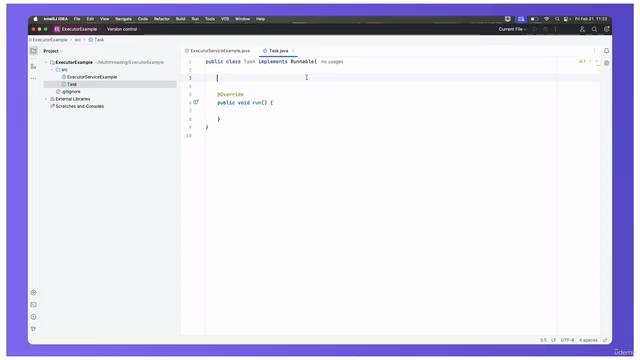
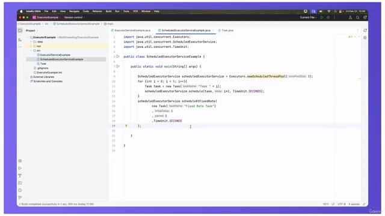
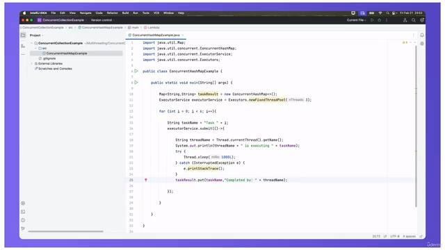
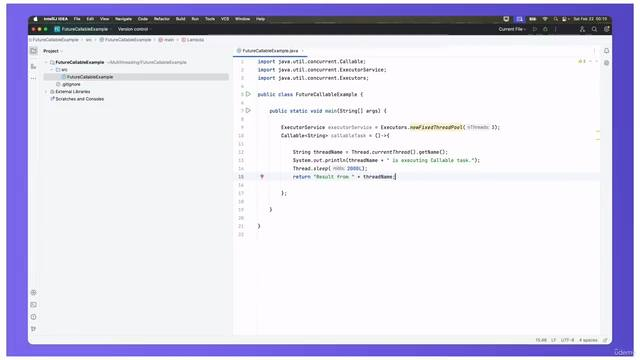
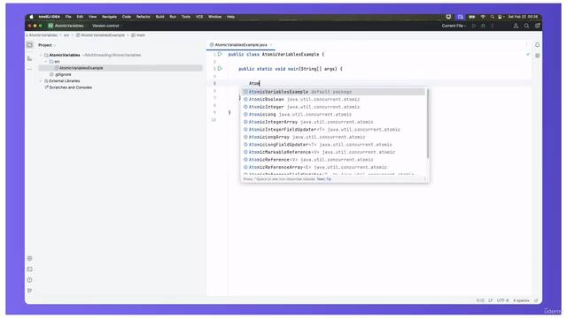
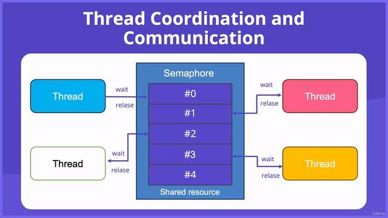
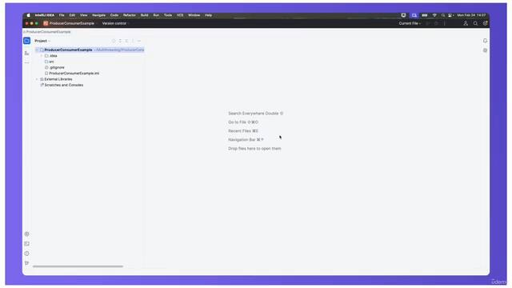

# Java Multithreading & Concurrency（P11–P18）可复现课程文档

## 1. 这一节做什么

这一组课的目标，是把 Java 里“手动 new Thread、手动加锁”的写法，推进到 `java.util.concurrent` 这套高层并发 API：用线程池提交任务，用 `ScheduledExecutorService` 做延迟/周期任务，用 `ConcurrentHashMap` 安全共享结果，用 `Future + Callable` 异步取结果，用 `AtomicInteger` 做无锁计数，最后用 `wait/notify` 实现生产者-消费者模型。

P11 是总览，先把 Executor Framework、并发集合、Future/Callable、原子变量串起来；P12–P18 则是逐个项目落地。学完后，你应当能自己建出 7 个可以独立运行的小项目，而不是只记住名词。


本文使用的环境说明：

- IDE：课里使用的是 IntelliJ IDEA。你用 VS Code、Eclipse 也可以，代码本身不依赖 IDE。
- JDK 版本：课里没有指定 JDK 版本。本文示例以 JDK 17 为例，所用 API 在常见 JDK 8+ 环境里都能找到；如果你本机是别的 JDK，以实际编译结果为准。
- 第三方依赖：无。
- 环境变量：本课没有需要配置的环境变量。
- 构建工具：课里没有使用 Maven/Gradle，本文也用最朴素的 `javac` / `java`，这样最容易照抄复现。

最终目录结构如下：

```text
concurrency-course/
├── executor-example/
│   └── src/
│       └── ExecutorServiceExample.java
├── scheduled-executor-example/
│   └── src/
│       └── ScheduledExecutorExample.java
├── concurrent-example/
│   └── src/
│       └── ConcurrentHashMapExample.java
├── future-callable-example/
│   └── src/
│       └── FutureCallableExample.java
├── atomic-variables-example/
│   └── src/
│       └── AtomicVariablesExample.java
├── semaphore-demo/
│   └── src/
│       └── SemaphoreDemo.java
└── producer-consumer-example/
    └── src/
        └── ProducerConsumerExample.java
```

注意：P17 讲的是 semaphore 的概念图，课里没有给出完整编码项目；本文中的 `SemaphoreDemo.java` 是为了帮助理解 P17 图而补的示意代码，不是讲师课堂代码。其余 P12–P16、P18 都是按讲师描述整理的完整可运行文件。

---

## 2. 讲师原话（带「—— pNNN [MM:SS]」）

> "执行器框架提供了一种将任务提交与实际执行解耦的方式。"
> —— p011 [00:27]

> "固定大小线程池会创建一个线程数固定的线程池。如果所有线程都忙，新任务就必须等待，直到有线程可用。"
> —— p011 [01:53]

> "我们使用执行器服务创建了一个包含三个线程的固定大小线程池……向执行器服务提交了六个任务。"
> —— p012 [06:48]

> "按固定速率调度的方法允许我们按固定间隔运行任务，而不考虑任务本身的耗时。按固定延迟调度的方法确保任务执行之间保持固定延迟，并把任务耗时计算在内。"
> —— p013 [06:43]

> "像 ConcurrentHashMap 这样的并发集合让多线程编程容易得多。"
> —— p014 [06:28]

> "FutureResult.get 会阻塞主线程，直到任务完成。"
> —— p015 [05:07]

> "由于我们提交了五个任务，最终值应该是 5。"
> —— p016 [04:55]

> "信号量是一种并发控制机制。"
> —— p017 [00:28]

> "当一个线程调用 wait 时，它会释放所持有对象的锁，并进入等待状态。"
> —— p018 [00:47]

这些原话对应的实现落点很明确：线程池负责复用线程，调度线程池负责任务的时间安排，并发集合负责安全写入，`Future` 负责取回异步结果，原子变量负责单个变量的无锁更新，`wait/notify` 负责两个线程之间的协调。

---

## 3. 从零复现

### 3.1 先确认 Java 能运行

在终端执行：

```bash
java -version
javac -version
```

只要两个命令都能输出版本号即可。课里没有要求特定 JDK 版本，所以不要因为版本号不是课程录制时的版本就卡住；如果语法报错，再回来看是否用了过新的写法。

### 3.2 创建目录

macOS / Linux：

```bash
mkdir -p concurrency-course/executor-example/src
mkdir -p concurrency-course/scheduled-executor-example/src
mkdir -p concurrency-course/concurrent-example/src
mkdir -p concurrency-course/future-callable-example/src
mkdir -p concurrency-course/atomic-variables-example/src
mkdir -p concurrency-course/semaphore-demo/src
mkdir -p concurrency-course/producer-consumer-example/src
cd concurrency-course
```

Windows PowerShell 也可以逐个创建：

```powershell
mkdir concurrency-course\executor-example\src
mkdir concurrency-course\scheduled-executor-example\src
mkdir concurrency-course\concurrent-example\src
mkdir concurrency-course\future-callable-example\src
mkdir concurrency-course\atomic-variables-example\src
mkdir concurrency-course\semaphore-demo\src
mkdir concurrency-course\producer-consumer-example\src
cd concurrency-course
```

### 3.3 第一个项目：固定大小线程池

把第 4 节的 `ExecutorServiceExample.java` 保存到：

```text
concurrency-course/executor-example/src/ExecutorServiceExample.java
```

编译运行：

```bash
cd executor-example
mkdir -p out
javac -d out src/ExecutorServiceExample.java
java -cp out ExecutorServiceExample
cd ..
```

这个项目对应 P12：创建 3 个线程的固定线程池，提交 6 个任务，每个任务睡眠 2 秒。你会看到最多 3 个任务并行开始，线程名类似 `pool-1-thread-1`、`pool-1-thread-2`、`pool-1-thread-3`，随后线程复用。



### 3.4 第二个项目：调度线程池

保存文件：

```text
concurrency-course/scheduled-executor-example/src/ScheduledExecutorExample.java
```

编译运行：

```bash
cd scheduled-executor-example
mkdir -p out
javac -d out src/ScheduledExecutorExample.java
java -cp out ScheduledExecutorExample
cd ..
```

程序会先提交 5 个延迟任务，延迟分别是 2、4、6、8、10 秒；再提交一个固定频率任务，初次延迟 1 秒、之后每 5 秒执行；再提交一个固定延迟任务，初次延迟 2 秒、每次任务完成后等 5 秒再执行。主线程睡 20 秒后关闭调度器。



### 3.5 第三个项目：ConcurrentHashMap 收集任务结果

保存文件：

```text
concurrency-course/concurrent-example/src/ConcurrentHashMapExample.java
```

编译运行：

```bash
cd concurrent-example
mkdir -p out
javac -d out src/ConcurrentHashMapExample.java
java -cp out ConcurrentHashMapExample
cd ..
```

这个项目对应 P14：3 个线程的线程池提交 5 个任务，每个任务模拟 1 秒工作，然后把“哪个线程完成了哪个任务”写进 `ConcurrentHashMap`。最后遍历 map 输出结果。由于 `ConcurrentHashMap` 自己不保证按插入顺序遍历，输出顺序不是重点。



### 3.6 第四个项目：Future + Callable

保存文件：

```text
concurrency-course/future-callable-example/src/FutureCallableExample.java
```

编译运行：

```bash
cd future-callable-example
mkdir -p out
javac -d out src/FutureCallableExample.java
java -cp out FutureCallableExample
cd ..
```

运行后应看到主线程先打印“继续做别的事”的信息，大约 2 秒后才打印 Callable 返回的结果。这正是 P15 强调的重点：提交任务后主线程不被阻塞，真正调用 `future.get()` 时才等待结果。



### 3.7 第五个项目：AtomicInteger 无锁计数

保存文件：

```text
concurrency-course/atomic-variables-example/src/AtomicVariablesExample.java
```

编译运行：

```bash
cd atomic-variables-example
mkdir -p out
javac -d out src/AtomicVariablesExample.java
java -cp out AtomicVariablesExample
cd ..
```

程序提交 5 个任务，每个任务只调用一次 `counter.incrementAndGet()`。最终值应为 5。中间打印的“增加到几”顺序可能变化，因为线程调度不由你控制。



### 3.8 第六个项目：P17 semaphore 概念示意

保存文件：

```text
concurrency-course/semaphore-demo/src/SemaphoreDemo.java
```

编译运行：

```bash
cd semaphore-demo
mkdir -p out
javac -d out src/SemaphoreDemo.java
java -cp out SemaphoreDemo
cd ..
```

再次强调：P17 课里只讲了信号量图和“获得 permit / 释放 permit”的流程，没有给完整代码。这个文件是本文用来复现该概念的示意代码，不是讲师原代码。



### 3.9 第七个项目：wait/notify 生产者-消费者

保存文件：

```text
concurrency-course/producer-consumer-example/src/ProducerConsumerExample.java
```

编译运行：

```bash
cd producer-consumer-example
mkdir -p out
javac -d out src/ProducerConsumerExample.java
java -cp out ProducerConsumerExample
cd ..
```

生产者生产 0 到 4 五个值，生产后睡眠 500 毫秒；消费者消费后睡眠 800 毫秒。输出应体现“生产一个、消费一个”的交替协调：缓冲区有数据时生产者等待，缓冲区空时消费者等待。



---

## 4. 完整代码

### 4.1 `concurrency-course/executor-example/src/ExecutorServiceExample.java`

```java
import java.util.concurrent.ExecutorService;
import java.util.concurrent.Executors;
import java.util.concurrent.TimeUnit;

public class ExecutorServiceExample {
    public static void main(String[] args) {
        ExecutorService executor = Executors.newFixedThreadPool(3);

        for (int i = 1; i <= 6; i++) {
            executor.submit(new Task("Task " + i));
        }

        executor.shutdown();

        try {
            if (!executor.awaitTermination(60, TimeUnit.SECONDS)) {
                executor.shutdownNow();
            }
        } catch (InterruptedException e) {
            executor.shutdownNow();
            Thread.currentThread().interrupt();
        }

        System.out.println("Executor finished.");
    }
}

class Task implements Runnable {
    private final String taskName;

    public Task(String taskName) {
        this.taskName = taskName;
    }

    @Override
    public void run() {
        System.out.println(taskName + " started by " + Thread.currentThread().getName());

        try {
            Thread.sleep(2000);
        } catch (InterruptedException e) {
            Thread.currentThread().interrupt();
            System.out.println(taskName + " was interrupted.");
            return;
        }

        System.out.println(taskName + " completed by " + Thread.currentThread().getName());
    }
}
```

### 4.2 `concurrency-course/scheduled-executor-example/src/ScheduledExecutorExample.java`

```java
import java.util.concurrent.Executors;
import java.util.concurrent.ScheduledExecutorService;
import java.util.concurrent.TimeUnit;

public class ScheduledExecutorExample {
    public static void main(String[] args) throws InterruptedException {
        ScheduledExecutorService scheduler = Executors.newScheduledThreadPool(3);

        for (int i = 1; i <= 5; i++) {
            final String taskName = "Delayed Task " + i;
            long delay = (long) i * 2;

            scheduler.schedule(
                    () -> print(taskName, "one-shot"),
                    delay,
                    TimeUnit.SECONDS
            );
        }

        scheduler.scheduleAtFixedRate(
                () -> print("Fixed Rate Task", "fixed-rate"),
                1,
                5,
                TimeUnit.SECONDS
        );

        scheduler.scheduleWithFixedDelay(
                () -> print("Fixed Delay Task", "fixed-delay"),
                2,
                5,
                TimeUnit.SECONDS
        );

        Thread.sleep(20_000);

        scheduler.shutdown();

        if (!scheduler.awaitTermination(5, TimeUnit.SECONDS)) {
            scheduler.shutdownNow();
        }

        System.out.println("Scheduled executor shutdown complete.");
    }

    private static void print(String taskName, String type) {
        System.out.println(
                taskName
                        + " [" + type + "]"
                        + " on " + Thread.currentThread().getName()
                        + " at " + System.currentTimeMillis()
        );
    }
}
```

### 4.3 `concurrency-course/concurrent-example/src/ConcurrentHashMapExample.java`

```java
import java.util.concurrent.ConcurrentHashMap;
import java.util.concurrent.ExecutorService;
import java.util.concurrent.Executors;
import java.util.concurrent.TimeUnit;

public class ConcurrentHashMapExample {
    public static void main(String[] args) throws InterruptedException {
        ConcurrentHashMap<String, String> results = new ConcurrentHashMap<>();
        ExecutorService pool = Executors.newFixedThreadPool(3);

        for (int i = 1; i <= 5; i++) {
            final int taskId = i;

            pool.submit(() -> {
                String taskName = "Task " + taskId;
                System.out.println(taskName + " executing on " + Thread.currentThread().getName());

                try {
                    Thread.sleep(1000);
                } catch (InterruptedException e) {
                    Thread.currentThread().interrupt();
                    return;
                }

                results.put(
                        taskName,
                        "completed by " + Thread.currentThread().getName()
                );
            });
        }

        pool.shutdown();
        pool.awaitTermination(10, TimeUnit.SECONDS);

        results.forEach((taskName, result) ->
                System.out.println(taskName + " -> " + result)
        );
    }
}
```

### 4.4 `concurrency-course/future-callable-example/src/FutureCallableExample.java`

```java
import java.util.concurrent.Callable;
import java.util.concurrent.ExecutionException;
import java.util.concurrent.ExecutorService;
import java.util.concurrent.Executors;
import java.util.concurrent.Future;

public class FutureCallableExample {
    public static void main(String[] args) {
        ExecutorService executor = Executors.newFixedThreadPool(3);

        Callable<String> task = () -> {
            System.out.println("Callable running on " + Thread.currentThread().getName());
            Thread.sleep(2000);
            return "Result from " + Thread.currentThread().getName();
        };

        Future<String> future = executor.submit(task);

        System.out.println("Main thread continues while callable runs...");

        try {
            String result = future.get();
            System.out.println(result);
        } catch (InterruptedException e) {
            Thread.currentThread().interrupt();
        } catch (ExecutionException e) {
            e.printStackTrace();
        }

        executor.shutdown();
    }
}
```

### 4.5 `concurrency-course/atomic-variables-example/src/AtomicVariablesExample.java`

```java
import java.util.concurrent.ExecutorService;
import java.util.concurrent.Executors;
import java.util.concurrent.TimeUnit;
import java.util.concurrent.atomic.AtomicInteger;

public class AtomicVariablesExample {
    public static void main(String[] args) throws InterruptedException {
        AtomicInteger counter = new AtomicInteger(0);
        ExecutorService pool = Executors.newFixedThreadPool(3);

        for (int i = 1; i <= 5; i++) {
            final int taskId = i;

            pool.submit(() -> {
                int updatedValue = counter.incrementAndGet();
                System.out.println(
                        "Task " + taskId
                                + " incremented to " + updatedValue
                                + " on " + Thread.currentThread().getName()
                );
            });
        }

        pool.shutdown();

        if (!pool.awaitTermination(10, TimeUnit.SECONDS)) {
            pool.shutdownNow();
        }

        System.out.println("Final counter value: " + counter.get());
    }
}
```

### 4.6 `concurrency-course/semaphore-demo/src/SemaphoreDemo.java`

> 说明：P17 课里没有代码，下面是本文示意代码，用来复现“多个线程争用有限 permit”的概念。

```java
import java.util.concurrent.Semaphore;

public class SemaphoreDemo {
    public static void main(String[] args) {
        Semaphore semaphore = new Semaphore(5);

        for (int i = 1; i <= 10; i++) {
            final int workerId = i;

            new Thread(() -> {
                try {
                    semaphore.acquire();

                    try {
                        System.out.println(
                                "Worker " + workerId
                                        + " acquired a permit on "
                                        + Thread.currentThread().getName()
                        );
                        Thread.sleep(1000);
                    } finally {
                        semaphore.release();
                        System.out.println("Worker " + workerId + " released a permit");
                    }
                } catch (InterruptedException e) {
                    Thread.currentThread().interrupt();
                }
            }, "worker-" + i).start();
        }
    }
}
```

### 4.7 `concurrency-course/producer-consumer-example/src/ProducerConsumerExample.java`

```java
public class ProducerConsumerExample {
    public static void main(String[] args) {
        SharedBuffer buffer = new SharedBuffer();

        Thread producer = new Thread(() -> {
            for (int i = 0; i < 5; i++) {
                try {
                    buffer.produce(i);
                    Thread.sleep(500);
                } catch (InterruptedException e) {
                    Thread.currentThread().interrupt();
                    return;
                }
            }
        }, "Producer");

        Thread consumer = new Thread(() -> {
            for (int i = 0; i < 5; i++) {
                try {
                    buffer.consume();
                    Thread.sleep(800);
                } catch (InterruptedException e) {
                    Thread.currentThread().interrupt();
                    return;
                }
            }
        }, "Consumer");

        producer.start();
        consumer.start();

        try {
            producer.join();
            consumer.join();
        } catch (InterruptedException e) {
            Thread.currentThread().interrupt();
        }
    }
}

class SharedBuffer {
    private Integer data;
    private boolean hasData = false;

    public synchronized void produce(int value) throws InterruptedException {
        while (hasData) {
            wait();
        }

        data = value;
        hasData = true;
        System.out.println("Produced: " + value);
        notify();
    }

    public synchronized void consume() throws InterruptedException {
        while (!hasData) {
            wait();
        }

        System.out.println("Consumed: " + data);
        data = null;
        hasData = false;
        notify();
    }
}
```

---

## 5. 逐行解释

### 5.1 ExecutorServiceExample

`Executors.newFixedThreadPool(3)` 创建固定 3 个线程的线程池。这里的 3 不是“最多提交 3 个任务”，而是“同一时刻最多 3 个任务真正并行执行”。第 4 个任务会进入队列，等某个线程空出来再执行。

`executor.submit(new Task("Task " + i))` 把 `Runnable` 任务交给线程池。P12 里讲师用 `submit` 这个词，强调提交动作和执行动作解耦：主线程不需要自己 `new Thread().start()`。

`Task implements Runnable` 是 Java 里“可被执行的任务”接口。`run()` 里的代码就是线程真正执行的逻辑。`taskName` 用来区分是哪一个任务，`Thread.currentThread().getName()` 用来打印当前是哪个线程执行的。

`Thread.sleep(2000)` 模拟耗时工作。它可能抛出 `InterruptedException`，所以放在 `try/catch` 中。捕获后调用 `Thread.currentThread().interrupt()` 是把中断标志补回去，这是并发代码里常见的好习惯。

`executor.shutdown()` 表示不再接收新任务，但已经提交的任务继续执行。`awaitTermination(60, TimeUnit.SECONDS)` 最多等 60 秒；如果超时，`shutdownNow()` 尝试停止。讲师在 P12 里说“wait termination to make the program wait for 60 seconds”，代码落点就是这里。

### 5.2 ScheduledExecutorExample

`Executors.newScheduledThreadPool(3)` 创建可调度任务的线程池。讲师解释“为什么是 3”时说过：最多 3 个任务并发，更多的排队。

`scheduler.schedule(..., delay, TimeUnit.SECONDS)` 是一次性延迟任务。循环里 `delay = i * 2`，所以第 1 个任务 2 秒后跑，第 2 个 4 秒后跑，以此类推。

`scheduleAtFixedRate(..., 1, 5, TimeUnit.SECONDS)` 表示初次延迟 1 秒，之后按固定频率每 5 秒触发一次。讲师强调它“regardless of task duration”，也就是按计划节奏触发；如果任务本身耗时超过周期，后续执行会被挤压，这是调度器行为，不是你手动控制的。

`scheduleWithFixedDelay(..., 2, 5, TimeUnit.SECONDS)` 表示初次延迟 2 秒，每次任务完成后再等 5 秒才执行下一次。它和 fixed rate 的区别是：fixed delay 把任务执行时间也考虑进去，固定的是“完成到下一次开始”的间隔。

`Thread.sleep(20_000)` 让主线程等 20 秒，否则主线程一结束，程序可能很快退出，你就观察不到周期任务。最后 `shutdown()` 是优雅关闭。

### 5.3 ConcurrentHashMapExample

`ConcurrentHashMap<String, String> results = new ConcurrentHashMap<>()` 是线程安全的 map。讲师在 P14 里强调，多个线程同时写入时，不需要你手写 `synchronized` 块。

`Executors.newFixedThreadPool(3)` 仍然是 3 个线程。循环提交 5 个任务，所以会有 2 个任务排队。

`results.put(taskName, "completed by " + Thread.currentThread().getName())` 是多个线程共同写入同一个 map 的关键行。普通 `HashMap` 在并发写入时可能产生数据不一致；`ConcurrentHashMap` 在内部处理并发安全。

`pool.shutdown(); pool.awaitTermination(10, TimeUnit.SECONDS);` 先停止接收新任务，再最多等 10 秒让已提交任务完成，最后遍历 map。这里没有手工锁，也没有 `Collections.synchronizedMap`。

### 5.4 FutureCallableExample

`Callable<String> task = () -> { ... return ...; }` 和 `Runnable` 最大的区别是：`Callable` 有返回值，也能抛出异常。P15 讲师反复强调“unlike Runnable, a callable can return a result”。

`Future<String> future = executor.submit(task)` 提交后立刻拿到一个 `Future`。它不是结果本身，而是“未来结果的凭证”。你可以先让主线程做别的事，之后再 `future.get()`。

`future.get()` 会阻塞主线程，直到任务完成并返回结果。讲师原话说“FutureResult.get will block the main thread until the task completes”。前端同学可以把它类比成 Promise 的 `await`，但要注意：Java 这里阻塞的是当前线程；JS 的 `await` 在主线程里不会阻塞事件循环，两者模型不同。

`catch (ExecutionException e)` 用于捕获 Callable 内部抛出的异常。`InterruptedException` 则是等待过程中当前线程被中断。

### 5.5 AtomicVariablesExample

`AtomicInteger counter = new AtomicInteger(0)` 创建一个原子整数，初始值为 0。P16 里讲师说它可以“safely increment or update an integer value in a multi-threaded environment without using synchronization or locks”。

`counter.incrementAndGet()` 原子地加 1 并返回新值。因为提交了 5 个任务，每个任务只加一次，所以最后 `counter.get()` 应该是 5。

`awaitTermination(10, TimeUnit.SECONDS)` 保证主线程不会在 5 个任务完成前提前打印最终值。注意：如果你把等待时间设得太短，可能打印出小于 5 的中间值，这不是原子变量错了，而是主线程没等任务完成。

### 5.6 SemaphoreDemo（P17 示意）

`new Semaphore(5)` 表示有 5 个 permit。`semaphore.acquire()` 拿一个 permit，拿不到就等待；`semaphore.release()` 归还 permit。

代码把 `release()` 放在 `finally` 里，确保即使线程睡眠时被中断，也会归还 permit，避免 permit 泄漏。这个模式对应 P17 图里“线程获得 permit 才能访问共享资源，用完必须释放”的流程。

课里没有给这段代码，所以这里只把它当作概念演示：如果有 10 个 worker、5 个 permit，你应看到最多 5 个 worker 同时进入“已获得 permit”的区域。

### 5.7 ProducerConsumerExample

`SharedBuffer` 里有两个关键状态：`data` 和 `boolean hasData`。`hasData` 表示缓冲区里有没有数据可消费。

`produce(int value)` 用 `synchronized` 修饰，表示同一时刻只能有一个线程进入这个方法。前端同学可以先把它理解成“给这个对象加了一把互斥锁”。Java 的 `synchronized` 方法和 `wait/notify` 必须配合同一个对象监视器使用。

`while (hasData) { wait(); }` 是生产者等待条件：如果缓冲区已经有数据，生产者不能继续生产，先 `wait()`。`wait()` 会释放锁并进入等待状态，直到别的线程调用 `notify()` 或 `notifyAll()`。

生产者放入数据后，把 `hasData` 设为 `true`，然后 `notify()` 唤醒等待中的消费者。

`consume()` 里 `while (!hasData) { wait(); }` 是消费者等待条件：没有数据就等待。消费后把 `hasData` 设为 `false`，再 `notify()` 唤醒生产者。

这里必须用 `while` 而不是 `if`：线程被唤醒后要重新检查条件，防止虚假唤醒或条件已经被别的线程改变。这一点课里通过“while has data loop”“while no equals has data loop”讲到了，代码里要如实保留。

在 JS/Node 里，没有和 Java `synchronized + wait/notify` 一模一样的对象锁写法。Node 主线程通常用事件循环、Promise、队列来协调；跨 Worker 共享内存时才涉及 `SharedArrayBuffer` / `Atomics` 这类机制。不要把 Java 的线程模型直接搬成“JS 里加个锁”。

---

## 6. 复现检查清单

- [ ] `java -version` 和 `javac -version` 都能正常输出。
- [ ] 7 个源文件都放在对应 `src` 目录，文件名与 `public class` 名一致。
- [ ] 每个项目都能执行 `javac -d out src/xxx.java`，没有编译错误。
- [ ] `ExecutorServiceExample` 输出里能看到最多 3 个线程名在并行执行 6 个任务，任务会复用线程。
- [ ] `ScheduledExecutorExample` 运行约 20 秒，能看到延迟任务、fixed-rate 任务、fixed-delay 任务的时间输出。
- [ ] `ConcurrentHashMapExample` 最后打印 5 条 `Task N -> completed by ...` 结果。
- [ ] `FutureCallableExample` 先打印主线程继续执行，约 2 秒后打印 Callable 返回值。
- [ ] `AtomicVariablesExample` 最后一行是 `Final counter value: 5`。
- [ ] `SemaphoreDemo` 中同一时刻最多看到 5 个 worker 获得 permit（这是示意项目，不是课堂原码）。
- [ ] `ProducerConsumerExample` 输出中 `Produced` 和 `Consumed` 交替出现，不会出现“缓冲区满还继续生产”或“空缓冲区消费”的明显错误。
- [ ] 如果某个输出顺序和本文不一样，先不要判定失败：多线程输出顺序本来就不保证，重点看最终值、是否阻塞、是否交替协调。

---

## 7. 课里没讲但你会撞上的

1. **`wait()` 必须在 `synchronized` 块里调用，否则抛 `IllegalMonitorStateException`**。生产者消费者模型里，`wait()` 和 `notify()` 都要求当前线程持有该对象的监视器。课里演示时整个方法都加了 `synchronized`，所以没暴露；如果你习惯性地把 `wait()` 挪到锁外面（比如为了「少占用锁时间」），运行时会直接抛异常，而且错误信息不会告诉你是哪一行缺了锁。

2. **`wait()` 应该放在 `while` 里而不是 `if` 里**。这是并发编程最经典的错误：`if (buffer.isEmpty()) wait();` 在**虚假唤醒**（spurious wakeup）时会直接往下走，此时 buffer 可能仍然是空的，`remove()` 就抛 `IndexOutOfBoundsException`。JVM 规范允许 `wait()` 无故返回，正确写法是 `while (buffer.isEmpty()) wait();`。

3. **`notifyAll()` vs `notify()` 的选择**。生产者消费者里如果有多个生产者线程和多个消费者线程，用 `notify()` 可能唤醒的是「同类」线程——比如缓冲区满了，生产者调用 `notify()` 却唤醒另一个生产者，被唤醒的线程发现条件不满足又回去等待，而消费者还在睡，整个系统就卡住了。`notifyAll()` 会唤醒所有等待线程，多一次上下文切换但不会死锁。课里用的是 `notifyAll()`，但没解释为什么。

4. **线程池的队列满了会抛 `RejectedExecutionException`**。P13 讲 `Executors.newFixedThreadPool` 时只演示了正常提交，没讲默认的 `LinkedBlockingQueue` 是**无界**的——任务堆积过多会 OOM 而不是拒绝。生产环境应该用 `new ThreadPoolExecutor(...)` 显式指定有界队列和拒绝策略（`CallerRunsPolicy` 等）。