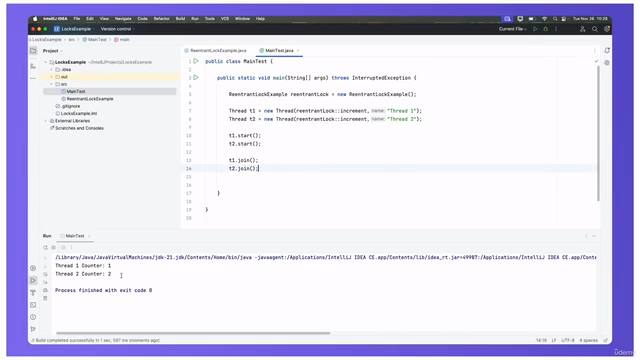
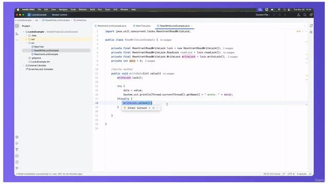
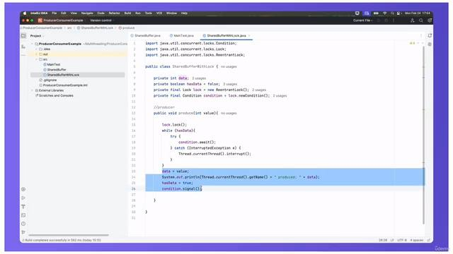
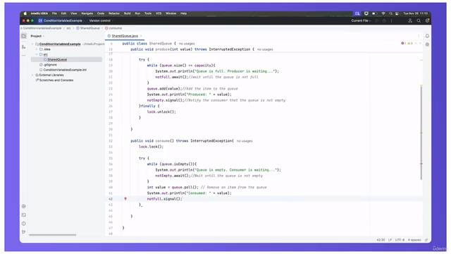
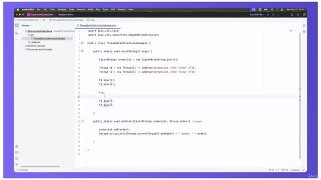
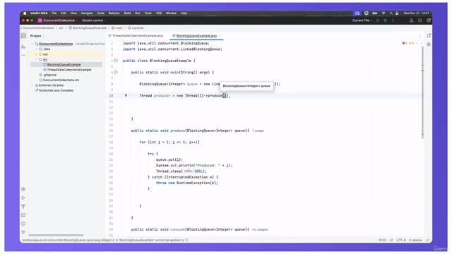

# Java 并发编程实战：Lock/Condition、读写锁、线程安全集合与阻塞队列（P19–P23）

> 读者定位：前端转 AI 应用工程师。本文所有 Java 代码都是**完整文件**，可直接在 IntelliJ IDEA 里新建项目后粘贴运行。涉及锁/并发的地方，我会补一句「在 JS/Node 里对应什么」，方便你迁移心智模型。Java 语法细节标注「知道即可」，不影响你跑通。

---

## 1. 这一节做什么

这五集（P19–P23）是一条完整的「从 `synchronized` 走向 `java.util.concurrent`」的升级路线，最终产出 **5 个可独立运行的 Java 程序**：

| 序号 | 程序 | 核心 API | 解决什么问题 |
|---|---|---|---|
| 1 | `SharedBufferWithLock` | `ReentrantLock` + `Condition` | 用显式锁 + 条件变量重写生产者-消费者（替代 `synchronized`/`wait`/`notify`） |
| 2 | `ReentrantLockExample` | `ReentrantLock` | 两个线程安全地自增同一个计数器 |
| 3 | `ReadWriteLockExample` | `ReentrantReadWriteLock` | 多读并发、写独占 |
| 4 | `SharedQueue` + 测试类 | `Condition`（`notFull`/`notEmpty`） | 有界队列的生产者-消费者，队列满/空时精确等待 |
| 5 | `ThreadSafeCollectionsExample` | `CopyOnWriteArrayList` | 多线程安全地读写同一个 List |
| 6 | `BlockingQueueExample` | `LinkedBlockingQueue` | 用阻塞队列一行 `put`/`take` 搞定生产者-消费者 |

注意：P19 和 P21 其实是同一个「生产者-消费者」主题的两次实现（P19 是单槽位 buffer，P21 是有界队列 + 两个条件变量），P20 拆成两个独立小例子（计数器 + 读写锁），P22 是线程安全集合，P23 是阻塞队列。下面按**项目实现逻辑**重组，不按集数流水账。

**环境要求**（课里没明确给版本，以下是能跑通这套代码的最低配置）：
- JDK 17 或以上（`ReentrantLock`、`Condition`、`CopyOnWriteArrayList`、`LinkedBlockingQueue` 都是 JDK 5+ 就有的，17 完全够）
- IntelliJ IDEA（讲师全程用 IDEA 演示）
- 不需要任何第三方依赖，纯 JDK

这一节的学习目标不是背 API，而是建立一条递进关系：先用 `ReentrantLock` 理解「显式加锁/解锁」比 `synchronized` 多了什么；再用 `Condition` 把「等待某个条件成立」从对象监视器里拆出来；然后用读写锁理解「读多写少」场景下为什么可以放宽并发；接着看 JDK 提供的线程安全集合如何替我们处理并发写入；最后用 `BlockingQueue` 把生产者-消费者这套模板代码收敛成 `put`/`take`。对前端来说，可以把它类比成：从手写 `Promise` 队列，升级到使用现成的异步队列库；底层思想仍是「谁在等、等什么条件、谁来通知、通知后如何重新检查条件」。

---

## 2. 讲师原话（带出处）

> "锁和条件变量实际上提供了更细粒度的控制，支持在复杂场景中使用多个条件变量，通过显式加锁和解锁获得更高灵活性，并且能够实现公平的加锁策略。"
> —— p019 [00:27]

这句话是整条路线的主旨：`Lock`/`Condition` 并不是单纯替换 `synchronized`，而是把「锁」和「等待条件」拆成更细的控制单元。后文 P21 的 `notFull`/`notEmpty` 就是「multiple conditioned variables」的直接体现；`new ReentrantLock(true)` 则对应「fair locking policies」。

> "因此我们总是在 finally 块中调用 lock.unlock，确保即使发生异常锁也会被释放，从而避免死锁。"
> —— p019 [04:06]

这句话对应第 4 节所有显式锁代码里的 `finally { lock.unlock(); }`。需要注意的是，它强调的是「释放锁要放在 `finally`」，而获取锁 `lock()` 通常要放在 `try` 外面，后文第 7 节会单独说明这个容易踩的坑。

> "可重入读写锁允许多个线程同时读取数据，这就是读锁；而只允许一个线程写入数据，这就是写锁。"
> —— p020 [01:19]

这句话解释了 `ReadWriteLockExample` 的预期输出：写线程先写，读线程可以并发读；写锁与读锁互斥，读锁之间不互斥。

> "条件变量与锁关联。它允许线程暂停执行，或等待直到收到显式信号后再恢复。"
> —— p021 [00:26]

这句话点明 `Condition` 必须从某个 `Lock` 上创建，例如 `lock.newCondition()`；`await()` 负责暂停，`signal()`/`signalAll()` 负责显式唤醒。

> "CopyOnWriteArrayList 是一种线程安全的列表实现。每次写操作都会创建底层数组的新副本，从而确保不会发生线程冲突。"
> —— p022 [02:50]

这句话解释了 `CopyOnWriteArrayList` 的核心机制：写时复制底层数组。读操作读的是旧快照，因此读多写少时很合适，写频繁时成本较高。

> "如果队列已满，生产者会阻塞，直到有可用空间；如果队列为空，消费者会阻塞，直到有元素加入。"
> —— p023 [01:23]

这句话是 `BlockingQueue` 的语义总结：`put` 在满时阻塞，`take` 在空时阻塞。P23 之所以能大幅简化代码，就是因为 JDK 已经把「满/空等待 + 通知」封装好了。

---

## 3. 从零复现

### 3.1 建项目

讲师在 P20 里新建项目叫 `locks example`，P21 叫 `condition variables example`，P22 叫 `concurrent collections`，P23 在同一个 `concurrent collections` 项目里加类。为了少建几个项目，我们**统一建一个项目**，用包区分：

1. 打开 IntelliJ IDEA → `New Project` → 语言选 **Java** → JDK 选 17 → 项目名 `concurrency-demo` → `Create`。
2. 在 `src` 下右键 → `New` → `Package`，建三个包：
   - `locks`（放 P19、P20 的类）
   - `conditions`（放 P21 的类）
   - `collections`（放 P22、P23 的类）
3. 每个类按下面第 4 节的完整代码新建文件粘贴进去。

> 课里讲师是每个例子单独建项目，你合并成一个项目完全等价，运行结果一样。

建包时要注意：包名必须和文件第一行的 `package` 完全一致。比如文件放在 `src/locks` 下，第一行就必须是 `package locks;`；如果文件放在 `src/conditions` 下，第一行就必须是 `package conditions;`。这是 Java 初学者最常见的红叉来源之一：类名、包名、目录三者不一致时，IDEA 可能提示「package does not correspond to the file path」或者运行时报 `NoClassDefFoundError`。对前端来说，可以把包名理解成模块路径，但 Java 这里更严格：目录结构要跟包名对齐。

### 3.2 运行方式

每个类都有 `main` 方法，在 IDEA 里点类名左边的绿色三角，或右键 → `Run '类名.main()'`。命令行方式（如果你装了 JDK）：

```bash
# 在项目根目录
javac -d out src/locks/*.java src/conditions/*.java src/collections/*.java
java -cp out locks.ReentrantLockExample
java -cp out locks.ReadWriteLockExample
java -cp out locks.SharedBufferWithLock
java -cp out conditions.SharedQueueDemo
java -cp out collections.ThreadSafeCollectionsExample
java -cp out collections.BlockingQueueExample
```

这段命令需要逐段理解。`javac` 是 Java 编译器；`-d out` 表示把编译出来的 `.class` 文件放到 `out` 目录，并按照包名自动创建子目录；后面的 `src/locks/*.java` 等表示把三个包里的所有 Java 源文件一起编译。因为 `SharedQueueDemo` 依赖 `SharedQueue`，`BlockingQueueExample` 只依赖 JDK 类，所以最省事的做法是一次把所有源文件都编译进去，不要只编译某一个文件。编译成功后，`out` 下会出现 `locks`、`conditions`、`collections` 三个目录，里面是 `.class` 文件。

`java -cp out locks.ReentrantLockExample` 里的 `-cp out` 表示 classpath 是 `out` 目录；后面的 `locks.ReentrantLockExample` 是**完整类名**，不是文件路径。注意这里写的是点号 `locks.`，不是斜杠 `locks/`。如果你写 `java -cp out src/locks/ReentrantLockExample`，会得到「找不到或无法加载主类」之类的错误。命令行运行时还要注意当前目录：上面的命令假设你在项目根目录执行，并且 `src`、`out` 都在当前目录下。如果使用 Windows PowerShell，`*` 通配符和路径分隔符一般也能工作；如果遇到问题，直接在 IDEA 里运行最稳。

常见错误与排查：第一，`javac` 报「找不到符号」，通常是没有把依赖类一起编译，或者包名写错；第二，`java` 报「找不到或无法加载主类」，先检查完整类名是否包含包名，再检查 `-cp` 是否指向 `out`；第三，IDEA 能跑但命令行不能跑，通常是工作目录不同，或者 JDK 版本不同，先用 `java -version` 和 `javac -version` 确认两者一致；第四，如果控制台中文乱码，检查文件编码和终端编码，本文代码输出都是英文，一般不受影响。

### 3.3 复现顺序建议

按「先简单后复杂」跑，每跑一个对照第 6 节检查清单：

1. `ReentrantLockExample`（最小可验证的锁）
2. `ReadWriteLockExample`（读写分离）
3. `SharedBufferWithLock`（P19 单槽位生产者-消费者）
4. `SharedQueueDemo`（P21 有界队列 + 两个条件变量）
5. `ThreadSafeCollectionsExample`（P22）
6. `BlockingQueueExample`（P23）

这个顺序背后的原因是：`ReentrantLockExample` 只验证「加锁后计数器不丢更新」，没有等待/通知，最容易确认环境没问题；`ReadWriteLockExample` 继续验证锁的获取与释放，但多了读写互斥；`SharedBufferWithLock` 开始引入 `Condition.await()`/`signal()`，是第一个可能「卡死」的例子；`SharedQueueDemo` 把条件变量拆成两个，复杂度和排查难度都更高；`ThreadSafeCollectionsExample` 不涉及显式锁，主要看并发集合的行为；`BlockingQueueExample` 则是用 JDK 封装替代手写逻辑，放在最后看会更容易体会「为什么实际项目优先用它」。

---

## 4. 完整代码

### 4.1 `src/locks/ReentrantLockExample.java`（P20 前半）

```java
package locks;

import java.util.concurrent.locks.Lock;
import java.util.concurrent.locks.ReentrantLock;

public class ReentrantLockExample {

    // 锁对象只创建一次，用 final 修饰，防止被重新赋值
    private final Lock lock = new ReentrantLock();

    // 被多个线程共享的计数器
    private int counter = 0;

    // 每次调用把 counter 加 1，全程持锁
    public void increment() {
        lock.lock();               // 获取锁，其他线程在此阻塞
        try {
            counter++;             // 临界区：只有持锁线程能执行
            System.out.println(
                Thread.currentThread().getName() + ", counter is " + counter
            );
        } finally {
            lock.unlock();         // 无论是否异常，一定释放锁
        }
    }

    public static void main(String[] args) throws InterruptedException {
        ReentrantLockExample example = new ReentrantLockExample();

        Thread t1 = new Thread(example::increment, "Thread 1");
        Thread t2 = new Thread(example::increment, "Thread 2");

        t1.start();
        t2.start();

        // 主线程等待两个子线程结束，避免程序提前退出
        t1.join();
        t2.join();
    }
}
```

**预期输出**（顺序可能互换，但 counter 一定是 1 然后 2）：

```
Thread 1, counter is 1
Thread 2, counter is 2
```



这段代码跑起来时，如果输出顺序变成 `Thread 2, counter is 1` 再 `Thread 1, counter is 2`，也是正确的：线程调度顺序不确定，但 `counter` 的两次打印一定是 1、2，不会出现两个线程都打印 1。若你注释掉 `lock.lock()` 和 `lock.unlock()` 再跑很多次，可能看到两个线程打印同一个值，这就是竞态条件。前端对照：JS 主线程单线程执行，普通变量自增通常不会遇到这种多线程交错；但 Node 里多个异步回调并发修改共享状态时，仍需要队列、锁或串行化来保证顺序。

### 4.2 `src/locks/ReadWriteLockExample.java`（P20 后半）

```java
package locks;

import java.util.concurrent.locks.ReadWriteLock;
import java.util.concurrent.locks.ReentrantReadWriteLock;

public class ReadWriteLockExample {

    // 读写锁对象：内部同时提供读锁和写锁
    private final ReadWriteLock readWriteLock = new ReentrantReadWriteLock();

    // 读锁：多个线程可同时持有
    private final java.util.concurrent.locks.Lock readLock = readWriteLock.readLock();

    // 写锁：同一时刻只能一个线程持有，且与读锁互斥
    private final java.util.concurrent.locks.Lock writeLock = readWriteLock.writeLock();

    // 被读写的共享数据
    private int data = 0;

    public void write(int value) {
        writeLock.lock();
        try {
            data = value;
            System.out.println(
                Thread.currentThread().getName() + " wrote " + value
            );
        } finally {
            writeLock.unlock();
        }
    }

    public void read() {
        readLock.lock();
        try {
            System.out.println(
                Thread.currentThread().getName() + " read " + data
            );
        } finally {
            readLock.unlock();
        }
    }

    public static void main(String[] args) throws InterruptedException {
        ReadWriteLockExample example = new ReadWriteLockExample();

        Thread writer = new Thread(() -> example.write(49), "Writer Thread");
        Thread reader1 = new Thread(example::read, "Reader 1");
        Thread reader2 = new Thread(example::read, "Reader 2");

        writer.start();
        reader1.start();
        reader2.start();

        writer.join();
        reader1.join();
        reader2.join();
    }
}
```

**预期输出**（读线程顺序可能互换，但写一定先于读完成）：

```
Writer Thread wrote 49
Reader 1 read 49
Reader 2 read 49
```



这段代码里，写线程先 `start()`，但不保证它一定先拿到写锁；只是在本例中写操作很快，通常先完成。更严谨地说，读线程可能先运行，但如果写锁已被写线程持有，读线程会等待；如果读线程先拿到读锁，写线程会等待读锁释放。观察输出时重点看：读到的值是不是 49，而不是 0。如果读到 0，说明读发生在写之前，这不一定违反锁语义，但不符合本例「先写后读」的演示预期。前端对照：可以类比「多个读者可以同时读同一份缓存，但写缓存时要独占」；`ReadWriteLock` 就是把这种读写权限分离的思路显式化。

### 4.3 `src/locks/SharedBufferWithLock.java`（P19）

```java
package locks;

import java.util.concurrent.locks.Condition;
import java.util.concurrent.locks.Lock;
import java.util.concurrent.locks.ReentrantLock;

public class SharedBufferWithLock {

    // 共享数据：是否已有数据
    private boolean hasData = false;

    // 显式锁，替代 synchronized
    private final Lock lock = new ReentrantLock();

    // 条件变量，替代 wait/notify
    private final Condition condition = lock.newCondition();

    // 生产者：放入数据
    public void produce() throws InterruptedException {
        lock.lock();
        try {
            while (hasData) {
                condition.await();       // 已有数据，生产者等待
            }
            hasData = true;
            System.out.println("Produced data");
            condition.signal();          // 唤醒消费者
        } finally {
            lock.unlock();
        }
    }

    // 消费者：取走数据
    public void consume() throws InterruptedException {
        lock.lock();
        try {
            while (!hasData) {
                condition.await();       // 没有数据，消费者等待
            }
            hasData = false;
            System.out.println("Consumed data");
            condition.signal();          // 唤醒生产者
        } finally {
            lock.unlock();
        }
    }

    public static void main(String[] args) {
        SharedBufferWithLock buffer = new SharedBufferWithLock();

        Thread producer = new Thread(() -> {
            try {
                for (int i = 0; i < 5; i++) {
                    buffer.produce();
                    Thread.sleep(500);
                }
            } catch (InterruptedException e) {
                Thread.currentThread().interrupt();
            }
        }, "Producer");

        Thread consumer = new Thread(() -> {
            try {
                for (int i = 0; i < 5; i++) {
                    buffer.consume();
                    Thread.sleep(500);
                }
            } catch (InterruptedException e) {
                Thread.currentThread().interrupt();
            }
        }, "Consumer");

        producer.start();
        consumer.start();
    }
}
```

**预期输出**（Produced / Consumed 交替出现 5 次）：

```
Produced data
Consumed data
Produced data
Consumed data
...
```



这个例子里只有一个 `Condition`，生产者和消费者共用同一个条件变量。`produce()` 在 `hasData` 为 `true` 时等待，`consume()` 在 `hasData` 为 `false` 时等待。因为只有一个槽位，`signal()` 唤醒的是同一个条件队列里的另一个线程，通常够用。如果你把 `while` 改成 `if`，在极端调度下可能被虚假唤醒打穿条件检查，导致错误地继续执行；第 7 节会展开。前端对照：`condition.await()` 类似「等待某个状态变化再继续」，但它是线程级阻塞，不是 JS 事件循环里的 `await`。

### 4.4 `src/conditions/SharedQueue.java`（P21）

```java
package conditions;

import java.util.LinkedList;
import java.util.Queue;
import java.util.concurrent.locks.Condition;
import java.util.concurrent.locks.Lock;
import java.util.concurrent.locks.ReentrantLock;

public class SharedQueue {

    // 用 LinkedList 当队列，存整数
    private final Queue<Integer> queue = new LinkedList<>();

    // 队列最大容量
    private final int capacity = 5;

    private final Lock lock = new ReentrantLock();

    // 生产者等待的条件：队列未满
    private final Condition notFull = lock.newCondition();

    // 消费者等待的条件：队列非空
    private final Condition notEmpty = lock.newCondition();

    public void produce(int item) throws InterruptedException {
        lock.lock();
        try {
            while (queue.size() == capacity) {
                notFull.await();          // 队列满，生产者等待
            }
            queue.add(item);
            System.out.println("Produced: " + item);
            notEmpty.signal();            // 通知消费者有数据了
        } finally {
            lock.unlock();
        }
    }

    public void consume() throws InterruptedException {
        lock.lock();
        try {
            while (queue.isEmpty()) {
                notEmpty.await();         // 队列空，消费者等待
            }
            int item = queue.poll();
            System.out.println("Consumed: " + item);
            notFull.signal();             // 通知生产者有空位了
        } finally {
            lock.unlock();
        }
    }
}
```

### 4.5 `src/conditions/SharedQueueDemo.java`（P21 测试类）

```java
package conditions;

public class SharedQueueDemo {

    public static void main(String[] args) {
        SharedQueue sharedQueue = new SharedQueue();

        Thread producer = new Thread(() -> {
            try {
                for (int i = 1; i <= 10; i++) {
                    sharedQueue.produce(i);
                }
            } catch (InterruptedException e) {
                Thread.currentThread().interrupt();
            }
        }, "Producer");

        Thread consumer = new Thread(() -> {
            try {
                for (int i = 1; i <= 10; i++) {
                    sharedQueue.consume();
                }
            } catch (InterruptedException e) {
                Thread.currentThread().interrupt();
            }
        }, "Consumer");

        producer.start();
        consumer.start();
    }
}
```

**预期输出**：`Produced: 1` … `Consumed: 1` … 交替出现，共 10 组。



`SharedQueue` 和 `SharedQueueDemo` 要放在同一个 `conditions` 包里，运行 `SharedQueueDemo`。如果只运行 `SharedQueue`，它没有 `main` 方法，IDEA 不会给出运行入口。`SharedQueueDemo` 里生产和消费都是 10 次，这是程序能自然结束的关键：生产 10 个、消费 10 个，两边循环次数对齐。若你擅自改成生产 10 个、消费 5 个，消费者退出后生产者还可能卡在 `notFull.await()`，主线程没有 `join` 也不会等待，程序可能看似结束但后台线程仍在；更常见的是你加了 `join` 后主线程一直等。排查这类问题时，先看两边循环次数是否一致，再看队列容量是否导致生产者长期阻塞。

### 4.6 `src/collections/ThreadSafeCollectionsExample.java`（P22）

```java
package collections;

import java.util.List;
import java.util.concurrent.CopyOnWriteArrayList;

public class ThreadSafeCollectionsExample {

    public static void main(String[] args) throws InterruptedException {
        // 线程安全的 List，写时复制
        List<String> orderList = new CopyOnWriteArrayList<>();

        Thread t1 = new Thread(() -> addOrder(orderList, "Order 1"));
        Thread t2 = new Thread(() -> addOrder(orderList, "Order 2"));

        t1.start();
        t2.start();

        t1.join();
        t2.join();

        System.out.println("Final order list: " + orderList);
    }

    private static void addOrder(List<String> orderList, String order) {
        orderList.add(order);
        System.out.println(
            Thread.currentThread().getName() + " added " + order
        );
    }
}
```

**预期输出**（线程名可能是 Thread-0 / Thread-1，顺序可能互换）：

```
Thread-0 added Order 1
Thread-1 added Order 2
Final order list: [Order 1, Order 2]
```



这段代码的重点不是输出顺序，而是 `CopyOnWriteArrayList` 在并发 `add` 时不会像普通 `ArrayList` 那样出现并发修改异常或丢失写入。两个线程各自 `add` 一次，最终列表里应有两条订单。你可以把 `CopyOnWriteArrayList` 换成 `new ArrayList<>()` 多跑几次，可能看到 `ConcurrentModificationException` 或结果不稳定；这正好说明并发集合的价值。前端对照：类似于「每次更新都产生新数组」的不可变数据流，读的人拿到的是稳定快照；但 Java 这里是容器内部替你做了复制。

### 4.7 `src/collections/BlockingQueueExample.java`（P23）

```java
package collections;

import java.util.concurrent.BlockingQueue;
import java.util.concurrent.LinkedBlockingQueue;

public class BlockingQueueExample {

    public static void main(String[] args) throws InterruptedException {
        // 容量为 3 的阻塞队列
        BlockingQueue<Integer> queue = new LinkedBlockingQueue<>(3);

        Thread producer = new Thread(() -> produce(queue), "Producer");
        Thread consumer = new Thread(() -> consume(queue), "Consumer");

        producer.start();
        consumer.start();

        producer.join();
        consumer.join();
    }

    private static void produce(BlockingQueue<Integer> queue) {
        try {
            for (int i = 1; i <= 5; i++) {
                queue.put(i);            // 队列满时阻塞
                System.out.println("Produced: " + i);
                Thread.sleep(500);
            }
        } catch (InterruptedException e) {
            Thread.currentThread().interrupt();
        }
    }

    private static void consume(BlockingQueue<Integer> queue) {
        try {
            for (int i = 1; i <= 5; i++) {
                int value = queue.take(); // 队列空时阻塞
                System.out.println("Consumed: " + value);
                Thread.sleep(500);
            }
        } catch (InterruptedException e) {
            Thread.currentThread().interrupt();
        }
    }
}
```

**预期输出**：`Produced: 1` … `Consumed: 1` … 交替，共 5 组。



这里 `LinkedBlockingQueue<>(3)` 的容量是 3。生产者最多连续放 3 个元素，第 4 个 `put` 会阻塞，直到消费者 `take` 走一个腾出空间；消费者在队列空时 `take` 会阻塞，直到生产者放入新元素。`Thread.sleep(500)` 只是放慢节奏，让输出更容易观察，不是阻塞队列语义的一部分。若去掉 `sleep`，程序仍然正确，只是输出可能瞬间完成。前端对照：类似一个有容量上限的异步任务队列，生产者 `push` 满时等待，消费者 `shift` 空时等待；区别是 Java 这里是线程级阻塞，Node 里通常用 Promise/事件循环表达等待。

---

## 5. 逐行解释

### 5.1 `ReentrantLockExample` 为什么这样写

- `private final Lock lock = new ReentrantLock();`：`Lock` 是接口，`ReentrantLock` 是实现。用 `final` 是因为锁对象**只创建一次**，讲师原话「this lock cannot be changed with a final statement. It is defined only once」（p020 [04:10]）。在 JS/Node 里，这相当于你模块顶层 `const mutex = new Mutex()`，全局唯一。若每个线程都 `new` 一个锁，那锁的是不同对象，等于没锁。
- `lock.lock()` 放在 `try` **外面**：这是关键。如果放在 `try` 里面，`lock()` 本身抛异常时 `finally` 里的 `unlock()` 会去解一个没拿到的锁，直接抛 `IllegalMonitorStateException`。讲师在 p019 [04:06] 强调「always call lock.unlock in a finally block」，但没细说 `lock()` 必须在 `try` 外——这是你实际会踩的坑，见第 7 节。正确结构是「先拿锁，再进入 `try`，最后在 `finally` 释放」。
- `counter++` 不是原子操作（读-改-写三步），两个线程不加锁会丢更新。加锁后 `Thread 1, counter is 1` / `Thread 2, counter is 2` 严格递增。这里的临界区不仅包括 `counter++`，还包括 `System.out.println`，因为打印时读取了 `counter` 的当前值；如果打印放在锁外，可能打印出被别人改过的值。
- `t1.join()` / `t2.join()`：主线程阻塞等子线程结束。不加的话 `main` 可能先退出，JVM 直接终止，你看不到完整输出。JS 里对应 `await Promise.all([p1, p2])`。注意 `join()` 本身也可能抛 `InterruptedException`，所以 `main` 方法声明了 `throws InterruptedException`。
- 常见错误：忘记 `unlock()` 会导致其他线程永久阻塞；`unlock()` 写在 `try` 里且前面抛异常则执行不到；锁对象被多个实例持有则无法互斥。排查时先看锁对象是不是同一个实例，再看 `lock()`/`unlock()` 是否成对且位置正确。

### 5.2 `ReadWriteLockExample` 为什么这样写

- `ReentrantReadWriteLock` 内部维护**两把锁**：`readLock()` 和 `writeLock()`。读锁可被多个线程同时持有（因为读不改数据），写锁独占且与读锁互斥。这里的「互斥」指写锁与任何读锁不能同时持有；读锁与读锁可以同时持有。
- 讲师原话（p020 [01:49]）：「reading operations can be done concurrently, but writing operations can be done just by the one thread」。所以 `Reader 1` 和 `Reader 2` 可以同时打印 `read 49`，但 `Writer Thread` 写的时候两个 reader 都得等。
- 为什么 `write` 里 `data = value` 之后才打印？因为打印也在锁内，保证「写」和「打印写的值」是原子的，不会出现打印时 data 已被别的线程改掉。同理，`read()` 里读取 `data` 和打印也在读锁内，保证读到的值在打印时不会被写线程改掉。
- 注意：`readLock` / `writeLock` 的类型我写成了全限定名 `java.util.concurrent.locks.Lock`，因为 `ReadWriteLock` 接口的 `readLock()` 返回的就是 `Lock`。你也可以在文件头 `import java.util.concurrent.locks.Lock;` 然后简写，效果一样。这里保留全限定名是为了让你看清返回类型，不影响运行。
- 常见错误：只给写加锁、读不加锁，读线程可能读到写了一半的中间状态；写锁里又去拿读锁，可能造成锁升级问题；读锁持有时间过长导致写线程饥饿。排查时先确认读操作是否真的只读，再确认读写锁是否成对释放。

### 5.3 `SharedBufferWithLock`（P19）为什么这样写

- 这是 P19 的核心：用 `ReentrantLock` + `Condition` **重写** `synchronized` + `wait`/`notify` 版本。讲师原话（p019 [02:38]）：「condition.await … replaces wait in the previous version」。对应关系是：`synchronized` 代码块对应 `lock.lock()`/`unlock()`；`wait()` 对应 `condition.await()`；`notify()`/`notifyAll()` 对应 `condition.signal()`/`signalAll()`。
- `while (hasData) condition.await();` 用 `while` 不用 `if`：被唤醒后要**重新检查条件**，因为可能被虚假唤醒（spurious wakeup），或唤醒后条件又被别的线程改了。这是 `wait`/`await` 的铁律。`if` 只检查一次，醒来后直接往下走，可能在不满足条件时修改共享状态。
- `condition.signal()` 只唤醒**一个**等待线程；`signalAll()` 唤醒全部。单槽位 buffer 只有一个生产者一个消费者，`signal()` 够用。注意 `signal()` 唤醒的是在同一个 `Condition` 上等待的线程；本例生产和消费共用一个 `Condition`，所以唤醒的是「另一个」线程。
- `finally { lock.unlock(); }` 保证即使 `await()` 抛 `InterruptedException` 也能释放锁。`await()` 会抛受检异常，所以 `produce()`/`consume()` 声明了 `throws InterruptedException`，调用方要处理。
- 常见错误：`await()` 写在 `if` 里导致条件失效；`signal()` 写在 `unlock()` 之后导致通知丢失或异常；忘记处理 `InterruptedException` 导致中断标志被吞掉。排查时先看 `await()` 外层是不是 `while`，再看 `signal()` 是否在持锁期间调用。

### 5.4 `SharedQueue`（P21）为什么这样写

- 相比 P19 的单槽位，这里用 `LinkedList` 做**有界队列**（`capacity = 5`），并用了**两个**条件变量：`notFull`（生产者等）和 `notEmpty`（消费者等）。这正是讲师在 p019 [00:27] 说的「multiple conditioned variables for complex scenarios」。
- 为什么两个条件变量比一个 `synchronized` + `wait`/`notify` 好？用 `notify()` 时你无法指定唤醒生产者还是消费者，可能唤醒「同类」导致死等；用两个 `Condition` 就能精确 `notEmpty.signal()` 只叫消费者、`notFull.signal()` 只叫生产者。比如队列满时，生产者都在 `notFull` 上等，消费者取走元素后调用 `notFull.signal()`，唤醒的必然是生产者；队列空时，消费者都在 `notEmpty` 上等，生产者放入元素后调用 `notEmpty.signal()`，唤醒的必然是消费者。
- `queue.size() == capacity` 判断满，`queue.isEmpty()` 判断空，都在锁内，安全。`queue.add(item)` 和 `queue.poll()` 也在锁内，保证队列状态和条件判断一致。若把 `size()` 判断放在锁外，判断和操作之间可能被其他线程插入，导致容量超限或空取。
- 测试类里 `for (int i = 1; i <= 10; i++)` 生产 10 个、消费 10 个，数量对齐，程序能自然结束。如果生产多于消费，消费者循环次数不够，生产者会永远卡在 `notFull.await()`——这是你改参数时会撞上的坑，见第 7 节。排查时先看生产者、消费者循环次数，再看 `capacity` 是否过小导致长期阻塞。
- 常见错误：`notFull`/`notEmpty` 用反了，导致生产者在队列空时等、消费者在队列满时等；`signal()` 调用错条件变量，导致该醒的线程没醒；`while` 条件写成 `if`。排查时把「谁等什么条件、谁负责通知」写成两行伪代码，再对照代码。

### 5.5 `ThreadSafeCollectionsExample`（P22）为什么这样写

- `CopyOnWriteArrayList` 的写操作会**复制整个底层数组**再替换引用，所以写很贵、读极快且无锁。讲师原话（p022 [06:35]）：「optimized for cases with more reads than writes. So each write involves creating a new array, and that could get kind of costly」。
- 所以它适合「订单列表读多写少」这种场景，不适合高频写。JS 里没有直接对应，最接近的是「每次更新都返回新数组」的不可变更新思路（如 Redux reducer）。读线程在遍历时拿到的是某一时刻的快照，不会被写线程的并发修改打断。
- `addOrder` 方法把 `orderList.add(order)` 和打印放一起，两个线程各调一次，`CopyOnWriteArrayList` 内部保证不冲突，你**不需要**自己加 `synchronized`。但要注意，「add 安全」不等于「整个业务操作原子」；如果业务要求「先检查再添加」，仍可能需要额外同步。
- 常见错误：把 `CopyOnWriteArrayList` 当成高频写场景的万能容器，导致大量数组复制；在迭代时期望看到最新元素，但迭代器是快照；误以为所有集合操作都自动复合原子。排查时先看读写比例，再看是否需要复合原子操作。

### 5.6 `BlockingQueueExample`（P23）为什么这样写

- `LinkedBlockingQueue<>(3)`：容量 3。`put()` 在满时阻塞，`take()` 在空时阻塞，**阻塞逻辑由 JDK 内部用锁 + 条件变量实现**，你一行同步代码都不用写。讲师原话（p023 [06:52]）：「handles thread safe access without external synchronization」。
- 这其实是 P19/P21 手写生产者-消费者的「终极简化版」：同样的语义，JDK 帮你封装好了。实际项目里优先用 `BlockingQueue`，别手写 `Lock` + `Condition`。尤其是业务代码里，手写等待/通知很容易漏掉 `while`、信号丢失、异常释放等问题。
- `Thread.sleep(500)` 只是为了让输出交替得好看，去掉也能跑，只是生产/消费会瞬间刷完。`put`/`take` 抛出的 `InterruptedException` 被捕获后，代码调用 `Thread.currentThread().interrupt()` 恢复中断标志，这是标准做法：捕获到中断后不要静默吞掉，否则上层无法知道线程被中断过。
- 常见错误：把 `put` 写成 `add`，队列满时直接抛异常而不是阻塞；把 `take` 写成 `poll`，队列空时返回 `null` 而不是等待；在 `take` 后忘记处理 `null`（如果用 `poll`）；捕获 `InterruptedException` 后不恢复中断标志。排查时先确认你用的是阻塞方法还是非阻塞方法，再看异常处理。

---

## 6. 复现检查清单

跑每个程序时对照打勾。下面每一条都补了「怎么验证」，不要只看输出像不像，要能解释为什么。

**通用**
- [ ] JDK 17+，`java -version` 能输出版本号  
  验证：终端执行 `java -version` 和 `javac -version`，两者大版本一致；IDEA 的 Project SDK 也选同一版本。
- [ ] 项目包结构是 `locks` / `conditions` / `collections` 三个包  
  验证：在 IDEA 左侧展开 `src`，三个包名与文件第一行 `package` 完全一致；没有文件直接躺在 `src` 根目录却声明了包名。
- [ ] 每个类文件第一行 `package` 与所在目录一致  
  验证：打开每个文件看第一行；`locks` 包下是 `package locks;`，`conditions` 下是 `package conditions;`，`collections` 下是 `package collections;`。
- [ ] 没有红色报错（IDEA 里 import 都能解析）  
  验证：Build 一次项目，控制台没有 `cannot find symbol`；如果有，先检查 JDK 和包名。

**ReentrantLockExample**
- [ ] 输出两行，counter 分别是 1 和 2  
  验证：多跑几次，允许线程名顺序互换，但数值必须是 1、2，不能是 1、1 或 2、2。
- [ ] 两行的线程名是 `Thread 1` / `Thread 2`（顺序可能互换）  
  验证：看输出前缀；若显示 `Thread-0`，说明你创建线程时没传名字，检查 `new Thread(..., "Thread 1")`。
- [ ] 程序正常退出，不挂起  
  验证：IDEA 运行窗口出现退出码 0；若一直转圈，检查是否忘记 `unlock()` 或 `join()` 等错对象。

**ReadWriteLockExample**
- [ ] 先出现 `Writer Thread wrote 49`  
  验证：看第一行是否是写线程输出；若读线程先输出 0，说明调度顺序不同，可多跑几次观察，但最终读到的值应为 49。
- [ ] 后出现两行 `read 49`（Reader 1 / Reader 2 顺序可能互换）  
  验证：两行读输出都应是 49；若出现 0，说明读发生在写之前，检查是否写线程没启动或锁没生效。
- [ ] 不会出现「读到 0」——说明写先于读完成  
  验证：在本例预期下，读应看到 49；若反复出现 0，检查 `writer.start()` 是否在 `reader.start()` 之前，以及写锁是否正常释放。

**SharedBufferWithLock**
- [ ] `Produced data` 和 `Consumed data` 交替出现  
  验证：看相邻两行是否一产一消；允许偶尔连续两行同类型吗？单槽位且 `signal()` 下通常交替，若出现连续生产，检查 `while (hasData)` 是否写对。
- [ ] 总共各 5 次  
  验证：数 `Produced data` 和 `Consumed data` 的行数，各 5 行；少一行说明某线程卡住或循环次数被改。
- [ ] 没有卡死（如果卡死，检查 `while` 条件是否写反）  
  验证：程序应在几秒内结束；若一直不结束，检查 `produce()` 的 `while (hasData)` 和 `consume()` 的 `while (!hasData)` 是否写反，以及 `signal()` 是否在持锁时调用。

**SharedQueueDemo**
- [ ] `Produced: 1` 到 `Produced: 10` 全部出现  
  验证：检查 1 到 10 是否每个数字都出现在 Produced 行；缺数字说明生产者被卡住或循环次数不对。
- [ ] `Consumed: 1` 到 `Consumed: 10` 全部出现  
  验证：检查 1 到 10 是否每个数字都出现在 Consumed 行；消费顺序不一定严格等于生产顺序，但每个数字应各出现一次。
- [ ] 队列从未超过 5 个元素（输出里不会连续出现 6 个 Produced 而无 Consumed）  
  验证：观察 Produced 连续行数，最多连续 5 个就应出现 Consumed；若连续 6 个，检查 `capacity` 和 `while (queue.size() == capacity)`。

**ThreadSafeCollectionsExample**
- [ ] 两行 `added Order 1` / `added Order 2`  
  验证：看两个线程各输出一行；若只有一行，检查线程是否都 `start()`。
- [ ] 最后一行 `Final order list: [Order 1, Order 2]`（顺序可能互换）  
  验证：最终列表应包含两个订单；若少一个，检查是否用了非线程安全 `ArrayList` 且发生了并发问题。
- [ ] 没有 `ConcurrentModificationException`  
  验证：控制台无异常堆栈；若有，检查是否误用了普通 `ArrayList` 并在并发下修改。

**BlockingQueueExample**
- [ ] `Produced: 1` 到 `Produced: 5` 全部出现  
  验证：检查 1 到 5 是否每个数字都出现在 Produced 行；缺数字说明生产者还在阻塞或循环次数不对。
- [ ] `Consumed: 1` 到 `Consumed: 5` 全部出现  
  验证：检查 1 到 5 是否每个数字都出现在 Consumed 行；消费顺序通常与生产顺序一致，但关键看是否全部消费。
- [ ] 生产与消费交替，不会连续 4 个 Produced（容量 3，第 4 个 put 会阻塞）  
  验证：数连续 Produced 行，最多 3 个就应出现 Consumed；若连续 4 个，检查队列容量是否真的传了 3，或是否误用了无界队列。

---

## 7. 课里没讲但你会撞上的

下表按「现象 / 原因 / 怎么办」整理。每一项都对应前面代码里容易忽略的细节，排查时先定位现象，再对照原因，最后按「怎么办」改。

| 现象 | 原因 | 怎么办 |
|---|---|---|
| 程序抛 `IllegalMonitorStateException`，提示当前线程未持有锁 | `lock()` 放在了 `try` 里面，`lock()` 本身抛异常时 `finally` 里的 `unlock()` 仍会执行，去解一个没拿到的锁 | 把 `lock.lock()` 放在 `try` 外面，进入 `try` 后再写临界区，`finally` 里只负责 `unlock()`；正确结构见 4.1 |
| 线程偶尔被唤醒后继续执行，但条件其实不成立，导致数据错乱 | `await()`/`wait()` 外层用了 `if`，没有在醒来后重新检查条件；可能遇到虚假唤醒，或醒来后条件又被别的线程改了 | 一律用 `while (条件不满足) condition.await();`，被唤醒后重新判断；课里代码已经用了 `while`，不要改成 `if` |
| `SharedQueueDemo` 运行后主线程一直不结束，或生产者线程卡住 | 生产/消费数量不对齐，例如生产 10、消费 5，消费者退出后生产者还卡在 `notFull.await()`；或队列容量太小导致长期等待 | 让生产与消费次数对齐；需要提前结束时用 `interrupt()` 打断等待，并正确处理 `InterruptedException`；排查时先数两边循环次数 |
| 遍历 `CopyOnWriteArrayList` 时看不到另一个线程新加的元素，但也没有抛异常 | `CopyOnWriteArrayList` 的迭代器基于写时复制的快照，迭代的是旧数组副本，不会看到迭代开始后的新写入 | 接受快照语义；如果必须看到最新数据，重新获取迭代器或改用其他并发策略；不要误以为这是 bug |
| `put`/`take` 方法编译报错，提示未处理 `InterruptedException` | `BlockingQueue.put()`/`take()` 是阻塞方法，阻塞期间线程可能被中断，JDK 用受检异常提醒你处理 | 用 `try-catch` 捕获 `InterruptedException`，捕获后调用 `Thread.currentThread().interrupt()` 恢复中断标志；课里 P21、P23 都这样处理 |
| 想让线程按排队顺序拿锁，但默认行为看起来像「插队」 | `new ReentrantLock()` 默认是非公平锁，不保证先等先得；讲师提到过公平锁策略但课里没演示 | 需要公平性时用 `new ReentrantLock(true)`；公平锁吞吐量通常更低，按业务取舍；课里例子都是非公平锁 |
| 调用 `condition.await()` 前后自己又手动 `unlock()`/`lock()`，结果抛异常或逻辑混乱 | `await()` 内部会先释放锁再挂起，被 `signal` 唤醒后重新获取锁再返回；调用者不需要手动释放/重新获取 | 在 `await()` 外层保持「已持锁」状态即可，不要在 `await()` 前后手动 `unlock()`/`lock()`；把 `await()` 放在 `while` 里，整体仍在 `try/finally` 内 |
| 以为 `Thread.sleep(500)` 会释放锁，结果其他线程还是进不来 | `Thread.sleep` 只是让当前线程休眠，不会释放它持有的锁；真正释放锁的是 `await()`/`wait()` 或 `unlock()` | 不要在持锁时用 `sleep` 等另一个线程；需要让出锁时用 `Condition.await()`；`sleep` 只用于模拟耗时或放慢输出 |
| 多生产者/多消费者时，`signal()` 偶尔唤醒「同类」线程，导致该醒的线程一直等 | `signal()` 只唤醒一个等待线程，且不区分你想叫生产者还是消费者；单生产者单消费者够用，多对多时可能叫错 | 多生产者多消费者场景优先用 `signalAll()`，或像 P21 一样用两个 `Condition` 分别管理 `notFull`/`notEmpty`；再不行改用 `BlockingQueue` |
| 不清楚 `add`/`offer`/`put` 和 `remove`/`poll`/`take` 的区别，线上偶发异常或拿到 `null` | 这些方法对「满/空」的处理不同：`add` 满时抛异常，`offer` 满时返回 `false`，`put` 满时阻塞；取侧 `remove` 空时抛异常，`poll` 空时返回 `null`，`take` 空时阻塞 | 按「要不要阻塞」选方法：需要等待就用 `put`/`take`；不想阻塞且能接受失败就用 `offer`/`poll`；明确要抛异常才用 `add`/`remove`；对 `poll` 的 `null` 做判空 |

**一句话总结这条学习路径**：P19 教你用 `Lock`+`Condition` 手写同步 → P20 拆出 `ReentrantLock` 和读写锁两个最小例子 → P21 用双条件变量做有界队列 → P22 告诉你集合也有现成的线程安全版 → P23 用 `BlockingQueue` 把 P19/P21 的手写逻辑一行 `put`/`take` 干掉。**实际写 AI 应用后端时，优先 P23 的 `BlockingQueue`，其次 P22 的并发集合，最后才手写 P19/P21 的锁。**