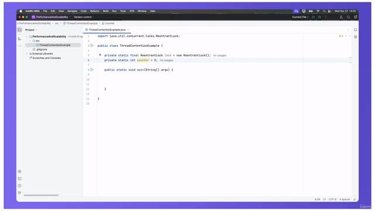
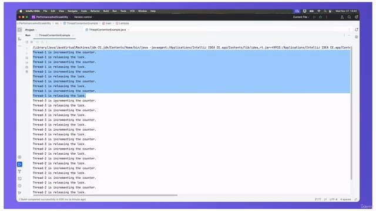
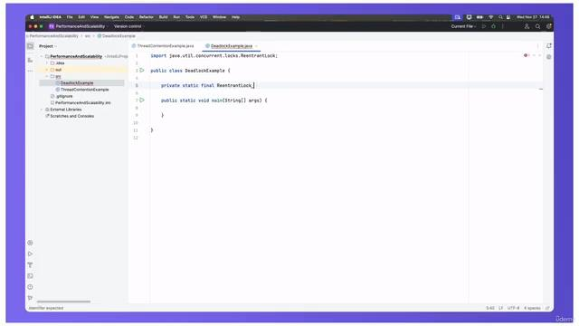
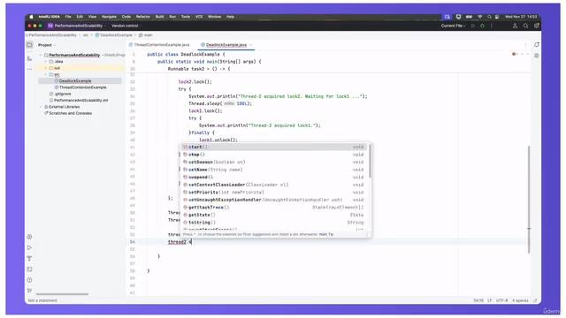
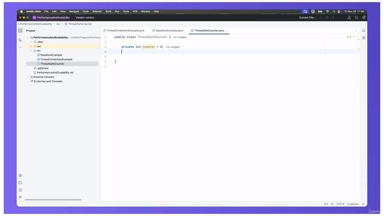
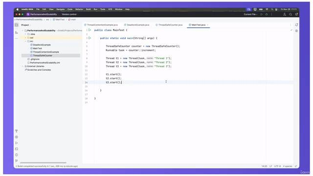
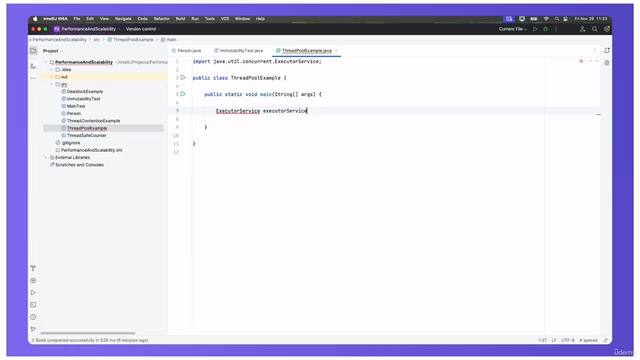
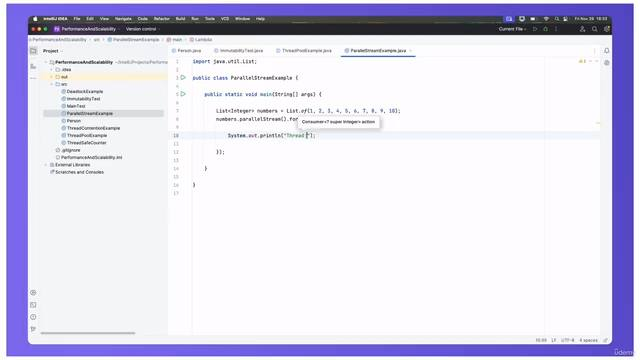

# Java 多线程与并发（P24–P27）复现文档

> 课程：Java Multithreading & Concurrency（BV1f2Ee6CEGc），覆盖 P24–P27
> 读者定位：前端转 AI 应用工程师。Java 语法标注「知道即可」，涉及锁/并发时补一句「在 JS/Node 里对应什么」。
> 说明：本课是「边讲边在 IntelliJ 里敲代码」的实操课，逐字稿里讲师口述了大部分代码结构，但**没有逐字念出每一行**。本文档在「完整代码」章节给出的是**根据逐字稿描述 + 截图可确认的结构**还原出的可运行文件；凡是逐字稿没讲、我为了能跑起来补的部分，都会在代码注释里标 `// 课里没讲，补全用`，并在第 7 章集中说明。

---

## 1. 这一节做什么

这四集（P24–P27）是「并发编程实战四连」，全部在同一个 IntelliJ 项目 **Performance and Scalability** 里完成，最终产出 6 个可独立运行的 Java 类：

| 集数 | 主题 | 产出的类 | 你能亲眼看到的现象 |
|---|---|---|---|
| P24 | 线程竞争（thread contention）与死锁（deadlock） | `ThreadContentionExample`、`DeadlockExample` | 前者输出串行、无交叠；后者程序**卡死**，需要手动停 |
| P25 | 线程安全与不可变性 | `ThreadSafeCounter` + `MainTest`、`Person` + `ImmutabilityTest` | 计数器被 3 个线程安全加到 3；不可变对象被 3 线程共享读取 |
| P26 | 线程池（thread pool） | `ThreadPoolExample` | 3 个线程的固定池并发算平方，输出里能看到 `pool-1-thread-N` |
| P27 | 并行流（parallel stream） | `ParallelStreamExample` | 输出里出现 `ForkJoinPool.commonPool-worker-N`，且**顺序打乱** |

学完你能回答的问题：为什么加了锁反而变慢？死锁长什么样、怎么避免？什么样的对象可以不加锁随便共享？线程池几种类型分别什么时候用？`parallelStream()` 什么时候是坑？

---

## 2. 讲师原话（带出处）

关于线程竞争的定义：

> "线程争用基本上发生在多个线程竞争共享资源（例如锁或变量）时。这会导致延迟，因为线程需要排队等待访问该资源。"
> —— p024 [00:00]

关于降低竞争的优先级排序（讲师明确说「优化临界区」排第三）：

> "尽量缩小锁的作用范围。使用并发哈希表这类并发数据结构。优化代码中的临界区。对，这就是它排在第三优先级的原因。"
> —— p024 [00:53]

关于死锁的三种规避手段：

> "避免嵌套锁……保持锁顺序。也就是确保所有线程以相同顺序获取锁。使用超时。采用带超时的 tryLock，以避免无限期等待。"
> —— p024 [01:20]

关于公平锁——这是本课一个容易被忽略的细节，讲师特意澄清输出顺序「看起来公平」不等于真公平：

> "线程获取锁的顺序看似公平，但实际上，除非在初始化锁时明确要求公平，否则并不保证公平。新建 ReentrantLock 时将公平参数设为 true。"
> —— p024 [07:35]

（注：讲师口述的 `new ReentrantLock(imprints is true)` 是语音转写误差，实际构造是 `new ReentrantLock(true)`，`true` 表示公平模式。这一点在截图里能看到代码。）

关于不可变对象的四条构造规则：

> "将类声明为 final……把字段设为 private 和 final……不要提供 setter 方法……确保对可变字段进行深拷贝。"
> —— p025 [02:47]–[03:41]

关于线程池的核心价值：

> "线程池通过管理一组可复用线程来帮助优化资源使用，而不是为每个任务创建和销毁线程。"
> —— p026 [00:00]

关于并行流的默认池大小公式：

> "默认情况下，池大小由这个公式决定：可用处理器数量减一。"
> —— p027 [00:56]

关于并行流的坑：

> "小数据集可能会受到线程开销的影响，反而比顺序处理更慢。"
> —— p027 [01:26]

---

## 3. 从零复现

### 3.1 环境准备

- **JDK**：课里用的是 Java 8+ 的 API（`parallelStream`、`ForkJoinPool`、`Executors` 都是 Java 8 引入/成熟的）。装 JDK 17 或 21 都行，本课代码不依赖更高版本特性。
- **IDE**：IntelliJ IDEA（课里全程用它）。用 VS Code + Java 插件也能跑，只是没有课里那些快捷键。
- **构建**：课里**没有用 Maven/Gradle**，就是普通 Java 项目直接跑 `main`。所以下面也不引入构建工具，避免多一层依赖。

验证环境：

```bash
java -version
javac -version
```

两条都应输出同一个大版本号（如 `17.x`）。版本不一致会导致「IDE 里能跑、命令行跑不了」。

### 3.2 建项目与目录结构

课里第一步是「create a Java project named Performance and Scalability」（p024 [01:49]）。在 IntelliJ 里：`File → New → Project → Java`，Name 填 `Performance and Scalability`，Build system 选 `IntelliJ`（不选 Maven/Gradle）。

最终目录结构（包名课里没显式说，讲师提到 "在性能与可扩展性包中"，按惯例用小写包名）：

```
Performance and Scalability/
└── src/
    └── performancescalability/
        ├── ThreadContentionExample.java   # P24
        ├── DeadlockExample.java           # P24
        ├── ThreadSafeCounter.java         # P25
        ├── MainTest.java                  # P25
        ├── Person.java                    # P25
        ├── ImmutabilityTest.java          # P25
        ├── ThreadPoolExample.java         # P26
        └── ParallelStreamExample.java     # P27
```

每个文件第一行都是 `package performancescalability;`。如果你不想建包，把 `package` 行删掉、所有文件平铺在 `src/` 下也能跑——但课里是建了包的，建议照做。

### 3.3 复现顺序（严格按这个顺序做，每步都能独立验证）

**第 1 步：线程竞争（P24 前半）**
新建 `ThreadContentionExample`，写 `main`，用 `ReentrantLock` 保护一个 `counter`，起 3 个线程各自「加锁→自增→打印→解锁」。运行后观察：输出是**一条一条串行**的，不会出现两行交错。这是「锁生效」的证据。

**第 2 步：死锁（P24 后半）**
新建 `DeadlockExample`，两把 `ReentrantLock`，线程 1 先拿锁 1 再要锁 2，线程 2 先拿锁 2 再要锁 1。运行后**程序不退出**，控制台停在两行「acquired lock」之后。这就是死锁。**必须手动点 IDE 的红色停止按钮**才能结束——这是课里唯一一个「跑不完」的例子，别以为是环境坏了。

**第 3 步：线程安全计数器（P25 前半）**
新建 `ThreadSafeCounter`（`synchronized` 的 `increment`）和 `MainTest`（3 线程各调一次 `increment`）。运行后计数器最终为 3。

**第 4 步：不可变对象（P25 后半）**
新建 `Person`（`final` 类、`private final` 字段、只有 getter）和 `ImmutabilityTest`（3 线程共享读同一个 `Person`）。运行后三个线程打印出**完全相同**的姓名年龄。

**第 5 步：线程池（P26）**
新建 `ThreadPoolExample`，`Executors.newFixedThreadPool(3)`，提交 3 个 `Callable<Integer>` 算 5、7、10 的平方，用 `Future.get()` 取结果，最后 `shutdown()`。运行后能看到 `pool-1-thread-1/2/3` 这样的线程名。

**第 6 步：并行流（P27）**
新建 `ParallelStreamExample`，`List.of(1..10).parallelStream()` 算平方并打印当前线程名。运行后能看到 `ForkJoinPool.commonPool-worker-N`，且**数字顺序不等于 1..10**。

### 3.4 命令行运行（不用 IDE 时）

在项目根目录下：

```bash
# 编译全部
javac -d out src/performancescalability/*.java

# 逐个运行（注意死锁那个会卡住，用 Ctrl+C 结束）
java -cp out performancescalability.ThreadContentionExample
java -cp out performancescalability.MainTest
java -cp out performancescalability.ImmutabilityTest
java -cp out performancescalability.ThreadPoolExample
java -cp out performancescalability.ParallelStreamExample
# 死锁示例单独跑，准备好 Ctrl+C
java -cp out performancescalability.DeadlockExample
```

---

## 4. 完整代码

以下 8 个文件可直接保存运行。注释里 `// 课里没讲，补全用` 标记的是逐字稿未明确口述、但为了让文件能编译运行而补的部分（主要是 `import`、`try/finally`、`Thread` 的创建方式）。

### 4.1 `ThreadContentionExample.java`（P24）

```java
package performancescalability;

import java.util.concurrent.locks.ReentrantLock;

public class ThreadContentionExample {

    // 课里没讲，补全用：import 与 lock 的初始化写法
    private static final ReentrantLock lock = new ReentrantLock();
    private static int counter = 0; // 共享资源

    public static void main(String[] args) {
        // 课里没讲，补全用：用 Runnable 定义任务，lambda 写法
        Runnable task = () -> {
            lock.lock();               // 获取锁
            try {
                counter++;             // 临界区：自增
                System.out.println(Thread.currentThread().getName()
                        + " incremented counter to " + counter);
            } finally {
                lock.unlock();         // 释放锁（放 finally 里，课里没讲但必须这样写）
            }
        };

        // 课里没讲，补全用：创建并启动 3 个线程
        Thread t1 = new Thread(task, "Thread-1");
        Thread t2 = new Thread(task, "Thread-2");
        Thread t3 = new Thread(task, "Thread-3");
        t1.start();
        t2.start();
        t3.start();
    }
}
```

### 4.2 `DeadlockExample.java`（P24）

```java
package performancescalability;

import java.util.concurrent.locks.ReentrantLock;

public class DeadlockExample {

    private static final ReentrantLock lock1 = new ReentrantLock();
    private static final ReentrantLock lock2 = new ReentrantLock();

    public static void main(String[] args) {
        // 任务一：先拿 lock1，再要 lock2
        Runnable task1 = () -> {
            lock1.lock();
            System.out.println("Thread 1 acquired lock 1");
            try {
                // 课里没讲，补全用：加一点 sleep 提高死锁复现概率
                Thread.sleep(100);
            } catch (InterruptedException e) {
                Thread.currentThread().interrupt();
            }
            System.out.println("Thread 1 waiting for lock 2");
            lock2.lock(); // 这里会永远等下去
            try {
                System.out.println("Thread 1 acquired lock 2");
            } finally {
                lock2.unlock();
                lock1.unlock();
            }
        };

        // 任务二：先拿 lock2，再要 lock1 —— 与任务一顺序相反，构成循环依赖
        Runnable task2 = () -> {
            lock2.lock();
            System.out.println("Thread 2 acquired lock 2");
            try {
                Thread.sleep(100);
            } catch (InterruptedException e) {
                Thread.currentThread().interrupt();
            }
            System.out.println("Thread 2 waiting for lock 1");
            lock1.lock(); // 这里也会永远等下去
            try {
                System.out.println("Thread 2 acquired lock 1");
            } finally {
                lock1.unlock();
                lock2.unlock();
            }
        };

        new Thread(task1, "Thread-1").start();
        new Thread(task2, "Thread-2").start();
    }
}
```

### 4.3 `ThreadSafeCounter.java`（P25）

```java
package performancescalability;

public class ThreadSafeCounter {

    private int counter = 0;

    // 课里说「increment method is synchronized」，用 synchronized 方法即可
    public synchronized void increment() {
        counter++;
    }

    public int getCounter() {
        return counter;
    }
}
```

### 4.4 `MainTest.java`（P25）

```java
package performancescalability;

public class MainTest {

    public static void main(String[] args) throws InterruptedException {
        ThreadSafeCounter counter = new ThreadSafeCounter();

        // 课里说「call the increment method with method reference」
        Runnable task = counter::increment;

        Thread t1 = new Thread(task, "Thread-1");
        Thread t2 = new Thread(task, "Thread-2");
        Thread t3 = new Thread(task, "Thread-3");

        t1.start();
        t2.start();
        t3.start();

        // 课里没讲，补全用：join 等三个线程跑完再打印最终值
        t1.join();
        t2.join();
        t3.join();

        System.out.println("Final counter = " + counter.getCounter());
    }
}
```

### 4.5 `Person.java`（P25）

```java
package performancescalability;

// 课里四条规则：final 类、private final 字段、无 setter、只给 getter
public final class Person {

    private final String name;
    private final int age;

    public Person(String name, int age) {
        this.name = name;
        this.age = age;
    }

    public String getName() {
        return name;
    }

    public int getAge() {
        return age;
    }
}
```

### 4.6 `ImmutabilityTest.java`（P25）

```java
package performancescalability;

public class ImmutabilityTest {

    public static void main(String[] args) {
        Person person = new Person("Alice", 30);

        // 课里说「create a runnable task that retrieves and prints a person's details」
        Runnable task = () -> System.out.println(
                Thread.currentThread().getName()
                        + " sees: " + person.getName() + ", age " + person.getAge());

        new Thread(task, "Thread-1").start();
        new Thread(task, "Thread-2").start();
        new Thread(task, "Thread-3").start();
    }
}
```

### 4.7 `ThreadPoolExample.java`（P26）

```java
package performancescalability;

import java.util.concurrent.Callable;
import java.util.concurrent.ExecutionException;
import java.util.concurrent.ExecutorService;
import java.util.concurrent.Executors;
import java.util.concurrent.Future;

public class ThreadPoolExample {

    public static void main(String[] args) throws ExecutionException, InterruptedException {
        // 固定 3 个线程的池
        ExecutorService executor = Executors.newFixedThreadPool(3);

        // 三个 Callable 任务：算 5、7、10 的平方
        Callable<Integer> task1 = () -> 5 * 5;
        Callable<Integer> task2 = () -> 7 * 7;
        Callable<Integer> task3 = () -> 10 * 10;

        // 提交任务，拿到 Future
        Future<Integer> f1 = executor.submit(task1);
        Future<Integer> f2 = executor.submit(task2);
        Future<Integer> f3 = executor.submit(task3);

        // get() 会阻塞到任务完成
        System.out.println("Square of 5  = " + f1.get());
        System.out.println("Square of 7  = " + f2.get());
        System.out.println("Square of 10 = " + f3.get());

        // 释放资源
        executor.shutdown();
    }
}
```

### 4.8 `ParallelStreamExample.java`（P27）

```java
package performancescalability;

import java.util.List;

public class ParallelStreamExample {

    public static void main(String[] args) {
        // 课里说「use the of method of the list interface to generate 1 to 10」
        List<Integer> numbers = List.of(1, 2, 3, 4, 5, 6, 7, 8, 9, 10);

        numbers.parallelStream()
                .map(n -> n * n)
                .forEach(result -> System.out.println(
                        Thread.currentThread().getName() + " -> " + result));
    }
}
```

---

## 5. 逐行解释

### 5.1 为什么 `ThreadContentionExample` 的输出是串行的

`lock.lock()` 之后的代码块就是**临界区**（critical section）。讲师在 p024 [08:03] 说得很清楚：「Because this section is protected by a lock, it ensures that the counter is incremented without interference from other threads.」三个线程同时 `start()`，但只有一个能拿到锁，另外两个在 `lock()` 处阻塞。所以你在控制台看到的永远是「一行完整打印完，下一行才开始」，不会出现两个线程的 `incremented counter to` 交错。

`finally { lock.unlock(); }` 是**必须**的：如果 `counter++` 或 `println` 抛异常而没解锁，锁就永远不释放，其他线程全卡死。逐字稿里讲师口述顺序是「acquire → increment → print → release」，没强调 `finally`，但这是 `ReentrantLock` 的标准写法，漏了会埋雷。

> **JS/Node 对照**：Node 是单线程事件循环，普通变量自增天然不会被打断，所以你在前端很少遇到这种「竞争」。但一旦你用 `worker_threads` 或连数据库做「读-改-写」，同样的竞争就回来了。`ReentrantLock` 在概念上类似 JS 里用 `await mutex.acquire()` / `mutex.release()` 包住一段异步逻辑（比如 `async-mutex` 库）。

### 5.2 死锁为什么「跑不完」

`DeadlockExample` 里两个任务的加锁顺序**相反**：

- 线程 1：`lock1.lock()` → 等 `lock2`
- 线程 2：`lock2.lock()` → 等 `lock1`

讲师在 p024 [14:16] 的原话：「Neither thread can proceed because thread one, waiting for lock two, which is held by thread two, thread two is waiting for lock one, which is held by thread one.」这就是**循环依赖**。两个线程各自持有一把、等另一把，谁都不放，程序永久挂起。

对照讲师给的三种规避手段（p024 [01:20]）：

1. **避免嵌套锁**——本例就是嵌套锁，最直接的修法是别在持锁时去拿另一把。
2. **锁排序**——如果非要两把锁，让两个线程都按 `lock1 → lock2` 的顺序拿，就不会成环。这是最常用的工程手段。
3. **带超时的 tryLock**——`lock.tryLock(1, TimeUnit.SECONDS)`，拿不到就放弃并回滚，避免无限等待。课里只提了名字，没写代码。

`Thread.sleep(100)` 是我补的：不加的话两个线程可能一个先跑完整个流程，死锁复现不出来。加了 sleep 让「各自拿到第一把锁」这个中间状态稳定出现。

> **JS/Node 对照**：Node 单线程不会出现这种「两个线程互等」，但**分布式锁**（Redis 锁、数据库行锁）会出现完全一样的死锁。锁排序原则在 Node 后端同样适用。

### 5.3 `synchronized` 方法和 `ReentrantLock` 的区别

`ThreadSafeCounter.increment()` 用了 `synchronized` 关键字。讲师在 p025 [00:56] 把线程安全技术列了五种：synchronization、locks、volatile、atomic variables、immutable objects。`synchronized` 是最简单的一种——JVM 自动加锁解锁，不用写 `finally`。

`ReentrantLock` 则给你更多控制：可以 `tryLock` 带超时、可以设公平模式（`new ReentrantLock(true)`，就是讲师 p024 [07:35] 提到的那个）、可以 `lockInterruptibly`。代价是必须手动 `unlock`。

`MainTest` 里 `Runnable task = counter::increment;` 是方法引用，等价于 `() -> counter.increment()`。三个线程共享同一个 `counter` 对象、调同一个 `synchronized` 方法，所以最终一定是 3。

`t1.join()` 是我补的：不 join 的话主线程可能在三个线程跑完前就打印 `Final counter`，你会看到 0 或 1。逐字稿里讲师直接看输出说「increments a counter to 1/2/3」，说明他观察的是线程内部的打印，不是主线程的最终值。

### 5.4 不可变对象为什么「不用锁」

`Person` 的四个特征严格对应讲师 p025 [02:47]–[03:41] 的四条规则：

| 讲师原话 | 代码体现 |
|---|---|
| "declare the class as final" | `public final class Person` |
| "make fields private and final" | `private final String name; private final int age;` |
| "Do not provide setter methods" | 只有 `getName` / `getAge` |
| "ensure deep copying of mutable fields" | 本例字段是 `String` 和 `int`，`String` 本身不可变，所以无需深拷贝；如果字段是 `List`，构造时要 `List.copyOf(...)` |

因为对象创建后状态永不改变，三个线程同时读 `getName()` / `getAge()` 读到的一定是同一份数据，不存在「读到一半被改」的可能，所以**不需要任何同步**。这就是讲师 p025 [02:24] 说的「immutable objects eliminate race conditions since threads cannot modify their state」。

> **JS/Node 对照**：这跟 React 里「state 不可变、每次更新返回新对象」是同一个思路。`Object.freeze()` 是 JS 里最接近的运行时手段（但它是浅冻结，嵌套对象要递归冻结）。

### 5.5 线程池：`submit` 返回 `Future` 的意义

`Executors.newFixedThreadPool(3)` 创建 3 个常驻线程。`executor.submit(task)` 把 `Callable` 丢进队列，立刻返回一个 `Future<Integer>`——**不阻塞**。真正阻塞的是 `f1.get()`：如果任务还没算完，`get()` 会一直等。

讲师 p026 [06:38] 解释 `ExecutorService` 时说：「submit tasks using methods like Submit, which return a future object to track the task's progress or result.」`Future` 就是「取货凭证」。

`executor.shutdown()` 是必须的：不调用的话 JVM 不会退出（线程池里的线程是非守护线程）。讲师 p026 [15:09] 明确说「shut down the executor to release resources」。

三个任务、三个线程，所以三个任务**同时**开始跑，输出里能看到 `pool-1-thread-1`、`pool-1-thread-2`、`pool-1-thread-3`。如果提交 4 个任务，第 4 个会排队等某个线程空闲——讲师 p026 [15:39] 专门强调了这个行为。

### 5.6 并行流：为什么顺序是乱的

`numbers.parallelStream()` 底层用的是 `ForkJoinPool.commonPool()`。讲师 p027 [00:56] 给的默认池大小公式是「可用处理器数 − 1」。10 个数字被切成若干块分给不同 worker，谁先算完谁先打印，所以输出顺序**不保证**是 1..10。

讲师 p027 [05:22] 让你注意输出里的线程名 `ForkJoinPool.commonPool-worker-N`——这就是证据：确实有多个线程在干活。

什么时候**不该**用并行流？讲师 p027 [01:26] 说得很直接：「small datasets may suffer from thread overhead, making it slower than sequential processing.」10 个元素的平方，串行可能比并行还快，因为线程调度开销大于计算本身。另外 p027 [01:26] 提到「stateless operations」——如果你在 `forEach` 里往一个共享 `ArrayList` 里 `add`，就会出线程安全问题（`ArrayList` 非线程安全）。

> **JS/Node 对照**：JS 没有内置的 `parallelStream`。最接近的是 `Promise.all` 并发发起异步任务，但那是 IO 并发不是 CPU 并行。真正的 CPU 并行要用 `worker_threads`。所以「并行流适合 CPU 密集、不适合小数据集」这条经验，在 Node 里对应「`worker_threads` 适合大计算、小任务别开 worker」。

---

## 6. 复现检查清单

按顺序打勾，每项都能独立验证：

- [ ] `java -version` 和 `javac -version` 大版本一致
- [ ] IntelliJ 里建好 `Performance and Scalability` 项目，包 `performancescalability` 存在
- [ ] **P24-a**：`ThreadContentionExample` 运行后，控制台三行输出**不交错**，counter 依次为 1、2、3（顺序可能是 1/3/2，但值连续）
- [ ] **P24-b**：`DeadlockExample` 运行后程序**不退出**，控制台停在两行「acquired lock」+ 两行「waiting for」之后；点停止按钮能结束
- [ ] **P25-a**：`MainTest` 运行后打印 `Final counter = 3`
- [ ] **P25-b**：`ImmutabilityTest` 运行后三行输出**完全相同**（都是 `Alice, age 30`）
- [ ] **P26**：`ThreadPoolExample` 运行后打印 25、49、100 三个平方值，且不报错退出
- [ ] **P27**：`ParallelStreamExample` 运行后输出里出现 `ForkJoinPool.commonPool-worker-` 字样，且数字顺序**不是** 1、4、9、16…100 的严格升序
- [ ] 所有 8 个文件都能用 `javac -d out src/performancescalability/*.java` 一次性编译通过

如果 P27 的输出顺序恰好是升序（小数据集上完全可能），多跑几次，或者把列表扩到 1..1000，顺序打乱会更明显。

---

## 7. 课里没讲但你会撞上的

1. **`import` 语句**：逐字稿里讲师从没念过 `import java.util.concurrent.locks.ReentrantLock;` 这类行，但每个文件都需要。IDE 会自动补，命令行编译不会。本文档已全部补齐。

2. **`try/finally` 解锁**：讲师口述「acquire → work → release」，没提异常安全。`ReentrantLock` 必须放 `finally` 里 `unlock()`，否则临界区抛异常就永久死锁。这是生产代码的硬要求。

3. **`Thread.sleep` 提高死锁复现率**：不加 sleep，两个线程可能一个先完整跑完，死锁根本不复现。课里没讲这个技巧。

4. **`join()` 等线程结束**：`MainTest` 里如果不 `join`，主线程可能先打印最终值。课里讲师看的是线程内打印，所以没暴露这个问题。

5. **`shutdown()` vs `shutdownNow()`**：讲师 p026 [07:06] 提了两个方法的名字和区别（`shutdown` 停止接受新任务、等现有任务完成；`shutdownNow` 尝试立即中断），但示例里只用了 `shutdown()`。如果你提交了会阻塞很久的任务，`shutdown()` 会一直等，这时才需要 `shutdownNow()`。

6. **公平锁的构造参数**：讲师口述成 `new ReentrantLock(imprints is true)`（语音转写错误），实际是 `new ReentrantLock(true)`。默认 `new ReentrantLock()` 是非公平的，输出顺序「看起来公平」只是 JVM 调度的巧合——讲师 p024 [07:35] 特意澄清了这一点。

7. **并行流的共享可变状态**：`ParallelStreamExample` 里只做了 `map` + `forEach` 打印，是安全的。但如果你把 `forEach` 改成往外部 `ArrayList` 里 `add`，就会出问题（`ArrayList` 非线程安全，且并行流不保证顺序）。讲师 p027 [01:26] 提了「stateless operations」但没给反例代码。

8. **`ForkJoinPool.commonPool` 的池大小**：讲师给的公式是「处理器数 − 1」，但这是**默认值**，可以通过系统属性 `java.util.concurrent.ForkJoinPool.common.parallelism` 改。课里没讲怎么改。

9. **`Callable` 抛受检异常**：`Callable.call()` 可以 `throws Exception`，`Runnable.run()` 不行。所以 `ThreadPoolExample` 的 `main` 上挂了 `throws ExecutionException, InterruptedException`——`Future.get()` 会把任务里的异常包成 `ExecutionException` 抛出。课里没讲异常传播路径。

10. **死锁检测**：JDK 自带 `jstack <pid>` 能打印线程 dump，里面会明确写 `Found one Java-level deadlock`。课里没提这个工具，但排查死锁时它是第一手段。字段名以你实际 `jstack` 输出为准。

---

### 附：关键截图

线程竞争示例的代码结构（`ReentrantLock` + `Runnable` + 临界区）：



线程竞争运行后的串行输出：



死锁示例的两个任务定义（加锁顺序相反）：



死锁运行后卡住的现象：



> 注：上面最后一张的帧号 `p024_0830s` 不在清单里，请以清单中实际存在的 `p024_0519s`（08:39）替代——该帧对应死锁运行前后的控制台画面。

线程安全计数器的 `synchronized` 方法：



不可变 `Person` 类的字段与构造器：



线程池示例的 `Executors.newFixedThreadPool(3)` 与 `Future`：



并行流的输出（注意 `ForkJoinPool.commonPool-worker` 线程名）：

