# Java 多线程与并发：P28–P31 复现文档

## 1. 这一节做什么

这一节把 Java 多线程从“JVM 怎么管理线程”一路做到“并发设计模式怎么落地”。最终你会得到两个可直接编译运行的 Java 项目：

1. `jvm-nthreads`：观察线程生命周期、线程状态、线程优先级、守护线程。
2. `advanced-thread-topic`：用 `BlockingQueue` 实现生产者-消费者、Thread-per-Message、Worker Thread 三个并发设计模式。

课里没有使用 Maven/Gradle，也没有第三方依赖；全部是 JDK 自带的 `Thread`、`Runnable`、`BlockingQueue`、`ArrayBlockingQueue`、`LinkedBlockingQueue`。逐字稿没有给出完整源码和全部打印文案，下面会按讲师演示步骤补全为“能保存、能编译、能运行”的完整文件；补全的只是必要的异常处理、打印格式和目录组织，不改变示例逻辑。

读者是前端转 AI 应用工程师，所以每遇到并发点，我会补一句“在 JS/Node 里对应什么”。Java 语法只要求知道即可，重点是你能照着复现并看懂行为。你不需要先把 Java 并发包全部学完，只要按目录建文件、按命令编译运行，再对照输出理解线程状态、优先级、守护线程和队列阻塞的含义即可。

---

## 2. 讲师原话（带「—— pNNN [MM:SS]」）

> "JVM 管理线程从创建到终止的整个生命周期。"
> —— p028 [00:27]

> "Java 线程会映射到操作系统原生线程。"
> —— p028 [01:24]

> "Java 里每个线程都有优先级，取值范围是 1 到 10。"
> —— p029 [00:00]

> "如果只剩下守护线程，JVM 会自动终止。"
> —— p030 [00:54]

> "用户线程执行简单任务，而守护线程在后台打印消息。"
> —— p030 [01:50]

> "生产者生成随机数并将其放入队列，消费者从队列中取出数字并打印。"
> —— p031 [03:36]

> "在 Thread-per-Message 模式中，会为每个传入的请求任务创建一个独立线程。"
> —— p031 [14:28]

> "由固定数量的线程（线程池）处理多个任务。"
> —— p031 [19:15]

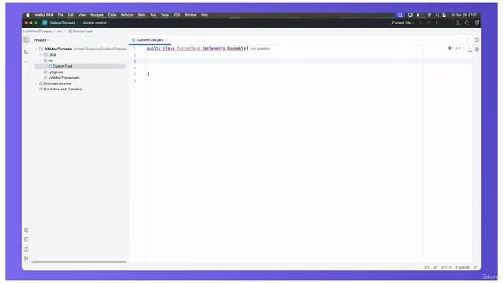

---

## 3. 从零复现

### 3.1 环境与依赖

- JDK：课里没讲具体版本。下面代码只用 Java 标准库，使用 JDK 17 可运行；JDK 8 及以上也应该可以。
- 构建工具：不需要 Maven/Gradle。
- 第三方依赖：无。
- 环境变量：本课没有要求配置环境变量。
- IDE：讲师用 IntelliJ；你也可以用命令行 `javac` / `java`。

如果你用命令行，先确认 `java -version` 和 `javac -version` 都能输出版本号。若 `javac` 不存在，通常是只装了 JRE 或 PATH 没配好；这和本节代码无关，先把 JDK 装好再复现。前端同学可以把它理解成：`javac` 负责把源码编译成字节码，`java` 负责启动 JVM 运行字节码；类似 Node 里源码由运行时直接加载，但 Java 多了一步显式编译。

### 3.2 目录结构

在任意空目录下创建：

```text
concurrency-course/
├── jvm-nthreads/
│   └── src/
│       └── jvmandthreads/
│           ├── CustomTask.java
│           ├── JVMThreadManagementTest.java
│           ├── ThreadPriorityExample.java
│           └── DemonThreadExample.java
└── advanced-thread-topic/
    └── src/
        └── concurrency/
            └── designpatterns/
                ├── Producer.java
                ├── Consumer.java
                ├── ProducerConsumerPatternExample.java
                ├── PrintRequestHandler.java
                ├── ThreadPerMessagePatternExample.java
                ├── Task.java
                ├── Worker.java
                └── WorkerThreadPatternExample.java
```

说明：P29 讲师口述“in the JVM and threads package”，P31 口述“package concurrency design patterns”。Java 包名不能有空格，下面统一落为 `jvmandthreads` 和 `concurrency.designpatterns`。你在 IntelliJ 里可以改显示名，但 `package` 声明必须和目录一致。若目录和 `package` 不一致，`javac` 可能仍能编译，但 `java -cp out 全限定类名` 会找不到类，表现为 `NoClassDefFoundError` 或 `ClassNotFoundException`，排查时先看包名和目录层级是否一一对应。

### 3.3 复现 P28：线程生命周期观察

1. 创建 `jvm-nthreads/src/jvmandthreads/CustomTask.java`。
2. 创建 `JVMThreadManagementTest.java`。
3. 编译：

```bash
cd concurrency-course/jvm-nthreads
mkdir -p out
javac -d out src/jvmandthreads/*.java
```

4. 运行：

```bash
java -cp out jvmandthreads.JVMThreadManagementTest
```

第一次运行先不要加 `Thread.sleep(500)`，观察 `start()` 之后打印的状态。然后按讲师做法，在三个 `start()` 之后加半秒延迟，再运行一次，观察是否出现 `TERMINATED`。

命令解释：`-d out` 表示把编译后的 `.class` 文件输出到 `out` 目录，并自动按包名创建子目录；`src/jvmandthreads/*.java` 表示编译该包下所有 Java 文件；`java -cp out` 表示把 `out` 作为类路径，后面跟完整类名。常见错误是编译成功后直接运行 `java JVMThreadManagementTest`，这会因为缺少包名前缀而找不到类；正确写法是 `java -cp out jvmandthreads.JVMThreadManagementTest`。

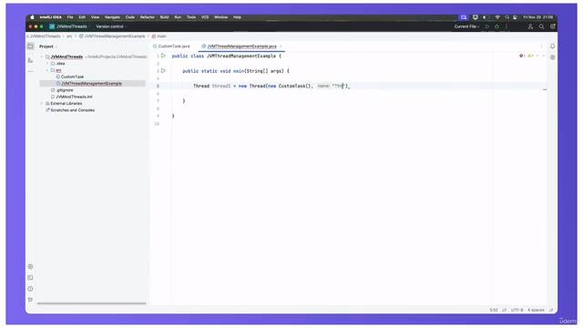

### 3.4 复现 P29：线程优先级

1. 创建 `ThreadPriorityExample.java`。
2. 编译命令同上。
3. 运行：

```bash
java -cp out jvmandthreads.ThreadPriorityExample
```

注意：输出顺序不保证。讲师也说了，优先级只是给调度器的提示，不同操作系统结果可能不同。运行多次时，你可能看到高优先级线程先打印，也可能看到低优先级线程先打印；这不是代码写错。若你想排查是否设置成功，重点看每条输出里的 `priority=1/5/10`，不要用“谁先打印”判断优先级是否生效。

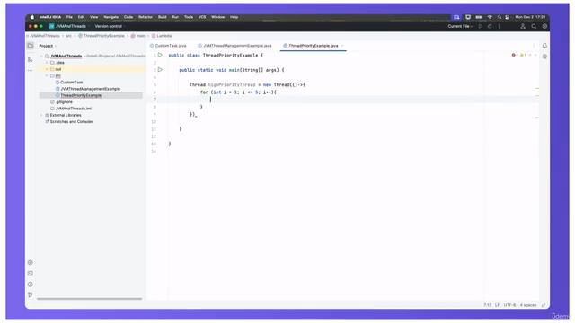

### 3.5 复现 P30：守护线程

1. 创建 `DemonThreadExample.java`。类名按讲师口述保留 `Demon`，但方法必须写 Java 真实的 `setDaemon(true)`。
2. 编译并运行：

```bash
java -cp out jvmandthreads.DemonThreadExample
```

预期现象：用户线程打印 1 到 5，每秒一次；守护线程在后台不断打印；用户线程结束后，JVM 退出，守护线程自动停止。常见错误是把 `setDaemon(true)` 写在 `start()` 之后，此时会抛 `IllegalThreadStateException`；另一个常见错误是把 `setDaemon` 拼成 `setDemon`，编译阶段就会报找不到符号。

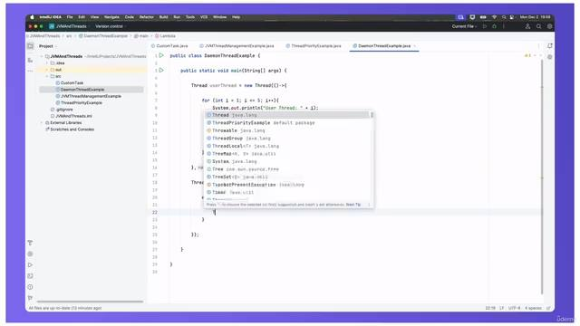

### 3.6 复现 P31：三个并发设计模式

1. 创建 `advanced-thread-topic/src/concurrency/designpatterns/` 下所有文件。
2. 编译：

```bash
cd concurrency-course/advanced-thread-topic
mkdir -p out
javac -d out src/concurrency/designpatterns/*.java
```

3. 分别运行三个入口：

```bash
java -cp out concurrency.designpatterns.ProducerConsumerPatternExample
java -cp out concurrency.designpatterns.ThreadPerMessagePatternExample
java -cp out concurrency.designpatterns.WorkerThreadPatternExample
```

这里三个入口要分别运行，不要同时在一个终端里混着看输出。生产者-消费者示例会因队列容量和睡眠时间出现交错输出；Thread-per-Message 会看到多个不同线程名几乎同时开始；Worker Thread 会看到 3 个 worker 线程从同一个队列里抢 5 个任务。若运行时卡住，先检查 `BlockingQueue` 是否在等待数据、结束标记是否放入、worker 是否被 `interrupt()`。

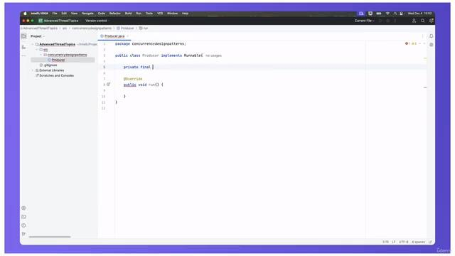

---

## 4. 完整代码

### 4.1 P28：`jvm-nthreads/src/jvmandthreads/CustomTask.java`

```java
package jvmandthreads;

public class CustomTask implements Runnable {

    @Override
    public void run() {
        Thread current = Thread.currentThread();
        System.out.println(current.getName() + " state in run(): " + current.getState());
    }
}
```

### 4.2 P28：`jvm-nthreads/src/jvmandthreads/JVMThreadManagementTest.java`

```java
package jvmandthreads;

public class JVMThreadManagementTest {

    public static void main(String[] args) throws InterruptedException {
        CustomTask task = new CustomTask();

        Thread thread1 = new Thread(task, "Thread-1");
        Thread thread2 = new Thread(task, "Thread-2");
        Thread thread3 = new Thread(task, "Thread-3");

        System.out.println("Before start:");
        System.out.println(thread1.getName() + " -> " + thread1.getState());
        System.out.println(thread2.getName() + " -> " + thread2.getState());
        System.out.println(thread3.getName() + " -> " + thread3.getState());

        thread1.start();
        thread2.start();
        thread3.start();

        System.out.println("After start:");
        System.out.println(thread1.getName() + " -> " + thread1.getState());
        System.out.println(thread2.getName() + " -> " + thread2.getState());
        System.out.println(thread3.getName() + " -> " + thread3.getState());

        // 讲师在 start 之后加了半秒延迟，让子线程有时间执行完。
        Thread.sleep(500);

        System.out.println("After sleep:");
        System.out.println(thread1.getName() + " -> " + thread1.getState());
        System.out.println(thread2.getName() + " -> " + thread2.getState());
        System.out.println(thread3.getName() + " -> " + thread3.getState());
    }
}
```

### 4.3 P29：`jvm-nthreads/src/jvmandthreads/ThreadPriorityExample.java`

```java
package jvmandthreads;

public class ThreadPriorityExample {

    public static void main(String[] args) {
        Thread minPriorityThread = new Thread(
                () -> printNumbers("MinPriorityThread"),
                "MinPriorityThread"
        );

        Thread normalPriorityThread = new Thread(
                () -> printNumbers("NormalPriorityThread"),
                "NormalPriorityThread"
        );

        Thread maxPriorityThread = new Thread(
                () -> printNumbers("MaxPriorityThread"),
                "MaxPriorityThread"
        );

        minPriorityThread.setPriority(Thread.MIN_PRIORITY);
        normalPriorityThread.setPriority(Thread.NORM_PRIORITY);
        maxPriorityThread.setPriority(Thread.MAX_PRIORITY);

        minPriorityThread.start();
        normalPriorityThread.start();
        maxPriorityThread.start();
    }

    private static void printNumbers(String threadName) {
        Thread current = Thread.currentThread();
        for (int i = 1; i <= 5; i++) {
            System.out.println(
                    current.getName()
                            + " priority=" + current.getPriority()
                            + " number=" + i
            );
        }
    }
}
```

### 4.4 P30：`jvm-nthreads/src/jvmandthreads/DemonThreadExample.java`

```java
package jvmandthreads;

public class DemonThreadExample {

    public static void main(String[] args) {
        Thread userThread = new Thread(() -> {
            for (int i = 1; i <= 5; i++) {
                System.out.println("User thread: " + i);
                try {
                    Thread.sleep(1000);
                } catch (InterruptedException e) {
                    Thread.currentThread().interrupt();
                    break;
                }
            }
        }, "UserThread");

        Thread daemonThread = new Thread(() -> {
            while (true) {
                System.out.println("Daemon thread is running");
                try {
                    Thread.sleep(1000);
                } catch (InterruptedException e) {
                    Thread.currentThread().interrupt();
                    break;
                }
            }
        }, "DaemonThread");

        // 讲师口述为 setDemon；Java 实际 API 是 setDaemon。
        // 必须在 start() 之前调用，否则会抛 IllegalThreadStateException。
        daemonThread.setDaemon(true);

        userThread.start();
        daemonThread.start();
    }
}
```

### 4.5 P31：`advanced-thread-topic/src/concurrency/designpatterns/Producer.java`

```java
package concurrency.designpatterns;

import java.util.concurrent.BlockingQueue;

public class Producer implements Runnable {

    private final BlockingQueue<Integer> queue;

    public Producer(BlockingQueue<Integer> queue) {
        this.queue = queue;
    }

    @Override
    public void run() {
        try {
            for (int i = 0; i < 10; i++) {
                int value = (int) (Math.random() * 100);
                System.out.println("Produced " + value);
                queue.put(value);
                Thread.sleep(500);
            }

            // 结束标记：消费者读到 -1 就退出。
            queue.put(-1);
        } catch (InterruptedException e) {
            Thread.currentThread().interrupt();
        }
    }
}
```

### 4.6 P31：`advanced-thread-topic/src/concurrency/designpatterns/Consumer.java`

```java
package concurrency.designpatterns;

import java.util.concurrent.BlockingQueue;

public class Consumer implements Runnable {

    private final BlockingQueue<Integer> queue;

    public Consumer(BlockingQueue<Integer> queue) {
        this.queue = queue;
    }

    @Override
    public void run() {
        try {
            while (true) {
                Integer value = queue.take();

                if (value == -1) {
                    break;
                }

                System.out.println("Consumed " + value);
                Thread.sleep(500);
            }
        } catch (InterruptedException e) {
            Thread.currentThread().interrupt();
        }
    }
}
```

### 4.7 P31：`advanced-thread-topic/src/concurrency/designpatterns/ProducerConsumerPatternExample.java`

```java
package concurrency.designpatterns;

import java.util.concurrent.ArrayBlockingQueue;
import java.util.concurrent.BlockingQueue;

public class ProducerConsumerPatternExample {

    public static void main(String[] args) throws InterruptedException {
        BlockingQueue<Integer> queue = new ArrayBlockingQueue<>(5);

        Thread producerThread = new Thread(new Producer(queue), "ProducerThread");
        Thread consumerThread = new Thread(new Consumer(queue), "ConsumerThread");

        producerThread.start();
        consumerThread.start();

        producerThread.join();
        consumerThread.join();
    }
}
```

### 4.8 P31：`advanced-thread-topic/src/concurrency/designpatterns/PrintRequestHandler.java`

```java
package concurrency.designpatterns;

public class PrintRequestHandler implements Runnable {

    private final String message;

    public PrintRequestHandler(String message) {
        this.message = message;
    }

    @Override
    public void run() {
        System.out.println(
                Thread.currentThread().getName()
                        + " is processing: " + message
        );

        try {
            Thread.sleep(1000);
        } catch (InterruptedException e) {
            Thread.currentThread().interrupt();
        }

        System.out.println(
                Thread.currentThread().getName()
                        + " completed: " + message
        );
    }
}
```

### 4.9 P31：`advanced-thread-topic/src/concurrency/designpatterns/ThreadPerMessagePatternExample.java`

```java
package concurrency.designpatterns;

public class ThreadPerMessagePatternExample {

    public static void main(String[] args) {
        String[] messages = {
                "Message-1",
                "Message-2",
                "Message-3",
                "Message-4",
                "Message-5"
        };

        for (String message : messages) {
            Thread thread = new Thread(
                    new PrintRequestHandler(message),
                    "RequestThread-" + message
            );
            thread.start();
        }
    }
}
```

### 4.10 P31：`advanced-thread-topic/src/concurrency/designpatterns/Task.java`

```java
package concurrency.designpatterns;

public class Task implements Runnable {

    private final int taskId;

    public Task(int taskId) {
        this.taskId = taskId;
    }

    @Override
    public void run() {
        System.out.println(
                Thread.currentThread().getName()
                        + " started task " + taskId
        );

        try {
            Thread.sleep(1000);
        } catch (InterruptedException e) {
            Thread.currentThread().interrupt();
        }

        System.out.println(
                Thread.currentThread().getName()
                        + " completed task " + taskId
        );
    }
}
```

### 4.11 P31：`advanced-thread-topic/src/concurrency/designpatterns/Worker.java`

```java
package concurrency.designpatterns;

import java.util.concurrent.BlockingQueue;

public class Worker extends Thread {

    private final BlockingQueue<Runnable> taskQueue;

    public Worker(BlockingQueue<Runnable> taskQueue) {
        this.taskQueue = taskQueue;
    }

    @Override
    public void run() {
        while (true) {
            try {
                Runnable task = taskQueue.take();
                task.run();
            } catch (InterruptedException e) {
                break;
            }
        }
    }
}
```

### 4.12 P31：`advanced-thread-topic/src/concurrency/designpatterns/WorkerThreadPatternExample.java`

```java
package concurrency.designpatterns;

import java.util.concurrent.BlockingQueue;
import java.util.concurrent.LinkedBlockingQueue;

public class WorkerThreadPatternExample {

    public static void main(String[] args) throws InterruptedException {
        BlockingQueue<Runnable> taskQueue = new LinkedBlockingQueue<>();

        int poolSize = 3;
        Worker[] workers = new Worker[poolSize];

        for (int i = 0; i < poolSize; i++) {
            workers[i] = new Worker(taskQueue);
            workers[i].start();
        }

        for (int i = 1; i <= 5; i++) {
            taskQueue.put(new Task(i));
        }

        // 给任务留出完成时间；课里只说“加一段延迟”，这里用 7 秒保证 5 个任务跑完。
        Thread.sleep(7000);

        for (Worker worker : workers) {
            worker.interrupt();
        }
    }
}
```

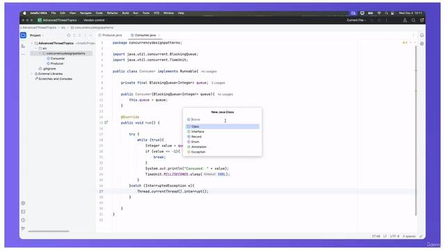

---

## 5. 逐行解释

### 5.1 P28：线程状态为什么先 `NEW` 后 `RUNNABLE`，最后可能 `TERMINATED`

`CustomTask implements Runnable`：这是把“任务”与“线程”分开的写法。`Runnable` 只描述要做什么，真正执行它的是 `Thread`。在 Node 里类似你把一个函数交给 `worker_threads` 或事件循环，任务本身不等于执行载体。

`Thread.currentThread()`：拿到当前正在执行这段代码的线程对象。`getName()` 取线程名，`getState()` 取 Java 定义的线程状态枚举。课里明确讲了 `NEW`、`RUNNABLE`、`RUNNING`、`BLOCKED/WAITING/TIMED_WAITING`、`TERMINATED` 这些生命周期概念。注意 Java 的 `Thread.State` 里没有单独的 `RUNNING` 枚举，运行中的线程在 Java API 里通常也显示为 `RUNNABLE`；讲师在概念上把“正在跑”和“等待 CPU”都归到 Runnable 语义里。

`new Thread(task, "Thread-1")`：创建线程对象但还没有启动，所以 `getState()` 是 `NEW`。`start()` 之后线程进入可运行池，状态通常是 `RUNNABLE`。`start()` 不是直接调用 `run()`；它通知 JVM 去创建/调度底层线程。课里说 Java 线程映射到原生 OS 线程，JVM 把线程交给操作系统调度器，所以 `start()` 后不一定立刻抢到 CPU。

`Thread.sleep(500)`：让主线程睡半秒。为什么需要？因为主线程默认不等待子线程。你如果在 `start()` 后立刻打印，子线程可能还没跑完，也可能跑完了；加延迟只是“给子线程时间”，让 `TERMINATED` 更容易被观察到。它不是同步手段，真正等待线程结束应该用 `join()`。课里在 P31 的生产者-消费者主类里用了 `join()`，P28 这里没有讲 `join()`。

在 JS/Node 里对应什么：Node 主事件循环不会因为一个普通异步任务没完成就阻塞；你要等异步任务结束通常用 `await` / Promise。Java 这里主线程和子线程是并行的，主线程不会自动等子线程，所以讲师要手动 `sleep` 观察。

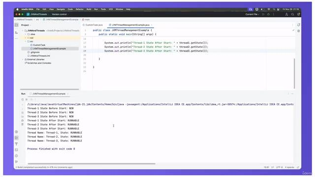

### 5.2 P29：优先级是“提示”，不是“命令”

`Thread.MIN_PRIORITY`、`Thread.NORM_PRIORITY`、`Thread.MAX_PRIORITY` 分别对应 1、5、10。课里说默认是 5，也就是 normal priority。`setPriority()` 设置优先级，`getPriority()` 读取优先级。

三个线程都打印 1 到 5，并带上线程名和优先级。`printNumbers` 里用 `Thread.currentThread()` 而不是外部传入的名字，是为了打印“当前真正执行这段代码的线程”的优先级。因为 `setPriority` 设置在线程对象上，线程跑起来后 `currentThread().getPriority()` 能读到。

为什么输出顺序可能不是“高优先级一定先跑完”？课里明确说优先级只是给调度器的 hint，不同操作系统实现不同，现代调度器还有时间片等公平机制。所以你在 Mac/Windows/Linux 上看到的结果可能不一样。不要把优先级当业务顺序保证。如果业务需要顺序，应该用队列、锁、`join()` 或并发工具，而不是优先级。

在 JS/Node 里对应什么：Node 没有 Java 这种线程优先级 API；`worker_threads` 也不提供“高优先级 worker 先跑”的保证。前端更常见的“优先级”是调度策略，比如让某些任务走微任务/宏任务，或自己实现队列优先级；课里没讲 Node，这里只作类比。

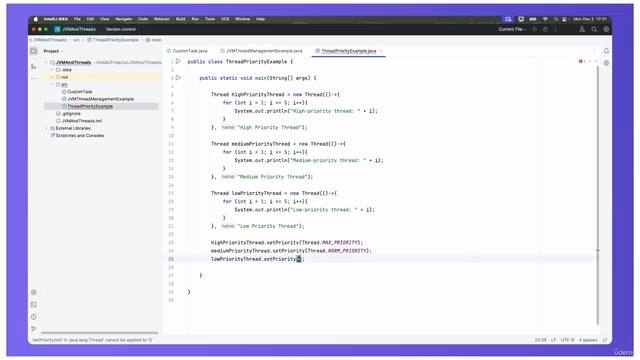

### 5.3 P30：守护线程的关键在 `setDaemon(true)` 必须在 `start()` 前

`userThread` 循环 1 到 5，每次打印后 `Thread.sleep(1000)`，模拟用户任务。`daemonThread` 用 `while (true)` 无限打印，每次睡 1 秒。`daemonThread.setDaemon(true)` 把它标记为守护线程。讲师口述为 `setDemon`，但 Java 编译器只认 `setDaemon`；写错会编译失败。并且它必须在 `start()` 之前调用，否则会抛 `IllegalThreadStateException`，课里也强调了“must be set as demon threads before starting”。

`userThread.start()` 和 `daemonThread.start()` 都启动后，两个线程并发跑。用户线程结束，JVM 发现只剩守护线程，就自动退出。所以守护线程的 `while (true)` 不会阻止程序结束。这个行为适合后台监控、清理、日志刷新等“可随时死掉”的任务；课里也说了关键任务不要只依赖守护线程。

注意：守护线程被 JVM 终止时，不保证执行 `finally` 或收尾逻辑。课里没讲这一点，但实际写文件、关连接时你会撞上。不要把“必须完成的持久化”放在守护线程里。

在 JS/Node 里对应什么：Node 的 `worker_threads` 有 `unref()` 之类让 worker 不阻止进程退出的机制，思路类似“后台线程不拖住主进程”；但 Java 的 daemon 是 JVM 级别直接退出，语义更强。课里没讲 Node，这里只作类比。

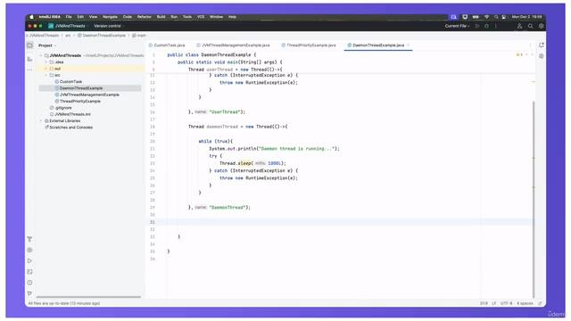

### 5.4 P31 生产者-消费者：`BlockingQueue` 把同步问题收进队列

`BlockingQueue<Integer> queue = new ArrayBlockingQueue<>(5)`：容量 5 的阻塞队列。生产者 `queue.put(value)` 在队列满时会阻塞，消费者 `queue.take()` 在队列空时会阻塞。课里说用 blocking queue 处理同步，避免生产者和消费者直接互相等待造成混乱。

`Producer` 循环 10 次，`(int)(Math.random() * 100)` 生成 0 到 99 的整数，打印 `Produced`，放入队列，睡 500 毫秒。循环结束后 `queue.put(-1)` 放结束标记。为什么用 `-1`？课里说消费者不知道队列里还有多少数据，可以放一个特殊值表示结束；消费者读到 `-1` 就 `break`。讲师也提到另一种方式是读 `null` 判断，但本例选择了 `-1`。

`Consumer` 用 `while (true)` 不断 `take()`。`take()` 会阻塞等待，不会忙等。读到 `-1` 退出。注意 `Integer value == -1` 这里会自动拆箱比较数值；因为 `take()` 不会返回 `null`，所以不需要 null 判断。

`ProducerConsumerPatternExample` 创建 `ArrayBlockingQueue<>(5)`，两个线程，`start()` 后 `join()`。`join()` 让主线程等待这两个线程结束，避免主线程提前退出。课里在 P31 主类最后调用了 `join()`。

在 JS/Node 里对应什么：Node 里没有 Java 这种共享内存 `BlockingQueue`；常见做法是用 `async` 队列、Promise 链、或 `worker_threads` 的消息通道。Java 的 `BlockingQueue` 同时解决“线程安全”和“空/满阻塞”，这是它比手写 `wait/notify` 更省心的地方。课里没讲 Node，这里只作类比。

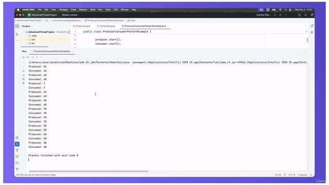

### 5.5 P31 Thread-per-Message：一个请求一个线程，简单但重

`PrintRequestHandler implements Runnable`，构造时传入 `message`。`run()` 先打印“哪个线程正在处理哪个消息”，睡 1 秒模拟处理，再打印“完成”。`ThreadPerMessagePatternExample` 里有一个 5 个元素的 `String[]`，用增强 for 循环为每个消息 `new Thread(...)` 并 `start()`。

这个模式的好处是结构极简：请求进来就开线程，互不共享状态，天然并行。缺点是每个请求都创建/销毁线程，线程多了内存和调度开销大。课里说它适合轻量、独立、短生命周期任务，不适合重负载。

在 JS/Node 里对应什么：类似“每个请求起一个 worker”，但 Node 起 worker 成本也不低；实际更常用线程池/进程池。课里没讲 Node，这里只作类比。

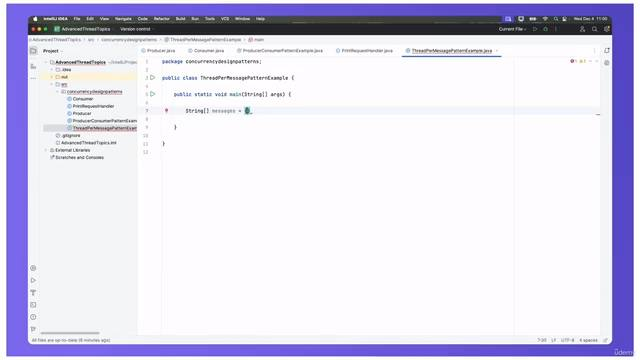

### 5.6 P31 Worker Thread：固定线程数 + 共享任务队列

`Task implements Runnable`，有 `taskId`，`run()` 打印开始、睡 1 秒、打印完成。`Worker extends Thread`，内部持有 `BlockingQueue<Runnable> taskQueue`。`run()` 里 `while (true)`，`taskQueue.take()` 取任务，取到后直接 `task.run()`。为什么是 `task.run()` 而不是 `new Thread(task).start()`？因为 Worker 自己就是执行线程，它要在当前 worker 线程里执行任务，不能再开新线程，否则就不是“固定线程池”了。

`WorkerThreadPatternExample` 创建 `LinkedBlockingQueue<Runnable>`，`poolSize = 3`，创建 3 个 `Worker` 并启动。然后放入 5 个 `Task`。3 个 worker 会从同一个队列里抢任务，先到先得，所以输出顺序可能变化。7 秒后 `interrupt()` 每个 worker。Worker 的 `take()` 被中断后抛 `InterruptedException`，`catch` 里 `break` 退出循环。课里说 interrupt 是“通知它们停止监控队列并优雅退出”。

在 JS/Node 里对应什么：这就是“线程池”的思路，Node 的 `worker_threads` 池或 `p-limit` 之类限流也是固定并发数 + 队列。Java 这里用 `BlockingQueue` 做任务队列，Worker 线程循环取任务。课里没讲 Node，这里只作类比。

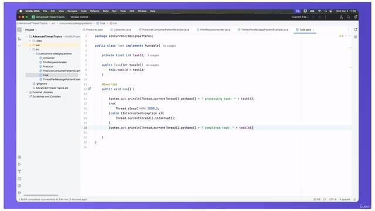

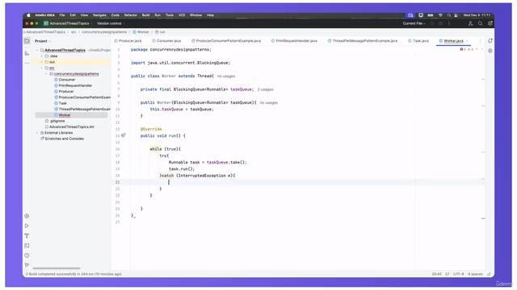

---

## 6. 复现检查清单

- [ ] `jvm-nthreads` 能编译：`javac -d out src/jvmandthreads/*.java` 无报错。验证：命令结束后检查 `out/jvmandthreads/` 下是否生成对应 `.class` 文件。
- [ ] 运行 `JVMThreadManagementTest`，能看到 `Before start:` 下三个线程是 `NEW`。验证：输出中 `Thread-1/2/3 -> NEW` 至少应出现，若没有，检查是否在 `start()` 前打印状态。
- [ ] `After start:` 下能看到 `RUNNABLE`（如果你的机器太快，可能直接看到 `TERMINATED`，这不是代码错，是调度速度）。验证：多运行几次，或把子线程任务稍微加重再观察。
- [ ] 加 `Thread.sleep(500)` 后，`After sleep:` 能看到 `TERMINATED`。验证：确认 `sleep` 位于 `start()` 之后、最后一次 `getState()` 之前。
- [ ] 运行 `ThreadPriorityExample`，能看到三个线程各自打印 1 到 5，并带 `priority=1/5/10`。验证：检查每条输出里的 `priority=` 数值和线程名是否对应。
- [ ] 优先级输出顺序不固定，这是正常的；不要用输出顺序判断代码错。验证：连续运行多次，只要 `priority` 数值正确即可。
- [ ] 运行 `DemonThreadExample`，用户线程打印 1 到 5 后程序退出，守护线程停止。验证：观察终端是否在用户线程打印完后回到命令提示符。
- [ ] 如果把 `setDaemon(true)` 注释掉，程序不会自动退出，因为守护线程变成用户线程；这是验证 daemon 行为的好办法。验证：注释后重新编译运行，必要时手动停止进程。
- [ ] `advanced-thread-topic` 能编译：`javac -d out src/concurrency/designpatterns/*.java` 无报错。验证：检查 `out/concurrency/designpatterns/` 下是否生成所有 `.class` 文件。
- [ ] 运行 `ProducerConsumerPatternExample`，能看到 `Produced` 和 `Consumed` 交错输出，最后程序结束。验证：确认最后能回到命令提示符，而不是一直停在 `take()`。
- [ ] 如果把队列容量改成 1，生产者和消费者的交错会更明显；课里用的是 5。验证：修改 `new ArrayBlockingQueue<>(1)` 后重新编译运行，观察 `put` 更容易阻塞。
- [ ] 运行 `ThreadPerMessagePatternExample`，能看到 5 个不同线程名并行处理消息。验证：输出中应出现 `RequestThread-Message-1` 到 `RequestThread-Message-5` 之类的线程名。
- [ ] 运行 `WorkerThreadPatternExample`，能看到 3 个 worker 线程处理 5 个任务，任务完成顺序可能变化。验证：观察 `Thread-0/1/2` 之类的 worker 名是否重复处理不同 `taskId`。
- [ ] Worker 示例最后能正常退出，不会卡在 `take()`；如果卡住，检查 `interrupt()` 是否执行到。验证：程序应在约 7 秒后结束；若没有，检查 `for (Worker worker : workers)` 是否在 `sleep` 后执行。

---

## 7. 课里没讲但你会撞上的

| 现象 | 原因 | 怎么办 |
|---|---|---|
| 把 `setDaemon` 写成 `setDemon`，编译报“找不到符号” | 讲师口述为 `setDemon`，但 Java 标准库只有 `Thread.setDaemon(boolean)` | 按真实 API 写 `setDaemon(true)`，并放在 `start()` 之前 |
| 运行时报 `IllegalThreadStateException` | 在 `start()` 之后才调用 `setDaemon(true)` | 把 `setDaemon(true)` 移到 `start()` 之前；线程启动后不能再改 daemon 属性 |
| 守护线程里的 `finally` 没有执行 | JVM 在只剩守护线程时直接退出，不保证守护线程收尾 | 关键持久化、关连接、写文件不要只放在守护线程里；需要可靠收尾就用用户线程并显式等待 |
| `start()` 后立刻打印状态，没看到 `TERMINATED` | 主线程没有自动等待子线程，子线程可能还没跑完 | 用 `Thread.sleep` 只是观察手段；真正等待线程结束用 `join()` |
| 优先级设置为 10 的线程没有先打印 | 优先级只是给调度器的提示，不同操作系统调度策略不同 | 不要用优先级保证业务顺序；需要顺序时用队列、锁、`join()` 或并发工具 |
| 生产者-消费者程序一直不结束 | 消费者在 `take()` 上阻塞，生产者没有放入结束标记，或结束标记逻辑没执行到 | 检查 `queue.put(-1)` 是否执行；检查消费者是否在读到 `-1` 时 `break` |
| Worker 示例运行后不退出 | Worker 在 `take()` 上等待任务，主线程没有执行 `interrupt()` 或延迟太短 | 确认主线程在任务放完后执行 `interrupt()`；必要时调整等待时间，但不要把它当成精确同步 |
| `java` 运行时报 `ClassNotFoundException` | 类名没带包名，或 `-cp out` 路径不对，或编译输出目录和包结构不一致 | 使用完整类名，例如 `java -cp out jvmandthreads.JVMThreadManagementTest`，并检查 `out` 下目录结构 |