# Java 多线程与并发（P32–P34）复现文档：线程异常处理、StampedLock 银行账户、多线程 Web 服务器

> 本文覆盖 BV1f2Ee6CEGc 的 P32、P33、P34 三集。按「能照着跑起来」的标准组织：先给你完整目录和三个可独立运行的 Java 程序，再逐行解释。
> 所有代码都来自讲师在屏幕上的实操步骤；讲师口述的包名带空格（如 "异常处理与线程"），Java 包名不允许空格，本文统一转成小写无空格的合法标识符，并在对应位置注明。

---

## 1. 这一节做什么

这三集是一个连续的实操段落，主题是「把并发知识落成能跑的程序」，一共三个可独立编译、独立运行的小项目：

**项目 A（P32）：线程异常处理的三种写法。**
讲师先讲了为什么线程里的异常危险：每个线程有自己的执行上下文，工作线程里没被捕获的异常**不会传播回主线程**，只会让那个线程静默死掉，留下未完成的任务、没关闭的文件和数据库连接、被改坏的共享数据结构。然后他写了三个类来对比三种处理方式：在 `Runnable` 内部用 `try-catch` 就地处理；用 `Thread.UncaughtExceptionHandler` 做集中式兜底；用 `Callable` + `Future` + `ExecutorService` 在取结果时处理。

**项目 B（P33）：用 `StampedLock` 实现一个线程安全的银行账户。**
前半段是理论：`ReentrantLock`（可重入、支持公平性、可中断、可 `tryLock`）、`ReadWriteLock`（读共享写独占）、`StampedLock`（Java 8 引入，返回 `long` 类型的 stamp 令牌，支持写锁、读锁、**乐观读**）。后半段是实操：写一个 `BankAccount` 类，用 `StampedLock` 保护 `balance` 字段，提供 `deposit`、`withdraw`、`getBalanceOptimistic`、`getBalance` 四个方法，再用三个线程（存款、取款、读取）并发跑一轮。

**项目 C（P34）：从零手写一个多线程 Web 服务器。**
不依赖 Spring、不依赖任何框架，只用 `java.net.ServerSocket` + `java.net.Socket` + `ExecutorService`，在 8080 端口监听，每来一个客户端连接就交给线程池里的一个线程处理，返回一个写死的 `Hello World` HTML 页面。这是「thread per request」模型的最小可运行版本。

前端同学可以这样理解：项目 A 对应 Node 里 `worker_threads` 的 `'error'` 事件和 `process.on('uncaughtException')` 的区别；项目 B 对应 JS 里根本没有的东西（JS 单线程，没有锁，只有 `Atomics`）；项目 C 对应你在 Node 里用 `http.createServer` 写的那三行，只不过这里手动管理连接和线程。

---

## 2. 讲师原话（带时间戳）

关于为什么线程异常必须单独处理，讲师的原话是：

> "线程独立运行。因此，线程中任何未处理的异常都会终止该线程，而不会通知主线程。这会导致什么？会导致处理不完整、资源泄漏，甚至系统状态不一致。"
> —— p032 [00:26]

> "与主线程中的异常不同，工作线程中的异常不会传播到父线程。这使故障更难被检测和响应。"
> —— p032 [01:49]

关于三种处理方式的定位，他在收尾时总结得很清楚：

> "对于轻量级任务，Runnable 的异常处理使用 try-catch；UncaughtExceptionHandler 集中报告异常，以便更好地监控；对于需要返回值的任务，Callable 和 Future 在获取结果时处理异常。"
> —— p032 [17:49]

进入锁的话题时，他先解释了为什么需要 `StampedLock`：

> "虽然 synchronized 块和方法等传统同步机制简单有效，但有时限制过强，会导致线程争用和性能下降。"
> —— p033 [00:28]

> "StampedLock 是 Java 8 引入的一种通用且高性能的锁机制。它实际上结合了读写锁的特性与高级优化，用于处理读操作明显多于写操作的场景。"
> —— p033 [02:41]

乐观读是整个 `StampedLock` 最特别的地方：

> "该特性允许线程在不获取传统锁的情况下读取共享数据。现在，如果在乐观读期间发生写操作，就必须使用 validate 方法验证这次读取，以确保一致性。"
> —— p033 [04:06]

他也明确说了 `StampedLock` 的两个坑：

> "StampedLock 不实现 Lock 接口，因此不支持 try-with-resources。用户必须使用 stamp 显式解锁。"
> —— p033 [04:06]

> "与 ReentrantLock 不同，StampedLock 不支持公平性，因此在激烈争用下线程可能发生饥饿。"
> —— p033 [05:57]

讲 Web 服务器时，他先给「thread per request」下了定义：

> "还有每请求一线程模型。因此，每个传入的客户端请求都由单独的线程处理。这实际上就是多线程服务器的基础。"
> —— p034 [00:50]

目标也很具体：

> "这里的目标是构建一个多线程 Web 服务器，它监听 8080 端口，接受多个客户端的连接，并返回一个简单的 Hello World HTML 页面。"
> —— p034 [02:15]

最后他给了「为什么要多线程」的性能结论：

> "如果使用单线程服务器，服务器就无法同时响应多个客户端的请求。因此，其他客户端必须等待前一个客户端得到响应，这会导致——你猜对了——性能大幅下降。"
> —— p034 [16:29]

---

## 3. 从零复现

### 3.1 环境与目录

- **JDK 17 LTS**（`StampedLock` 从 Java 8 就有，8 以上都能跑；本文按 17 验证）
- 不需要 Maven / Gradle，纯 `javac` + `java` 即可
- 不需要任何第三方依赖

```bash
java -version
# 期望看到类似：openjdk version "17.0.x"
```

目录结构（三个项目放在同一个工程下，各自一个包）：

```
java-concurrency/
├── src/
│   ├── exceptionhandlingandthreads/       # 项目 A，P32
│   │   ├── RunnableExceptionExample.java
│   │   ├── UncaughtExceptionHandlerExample.java
│   │   └── CallableExceptionExample.java
│   ├── advancedlockingmechanism/          # 项目 B，P33
│   │   ├── BankAccount.java
│   │   └── StampedLockExampleTest.java
│   └── multithreadedwebserver/            # 项目 C，P34
│       ├── ClientHandler.java
│       ├── MultithreadedWebServer.java
│       └── Main.java
└── out/                                   # 编译产物，自动生成
```

> 注意：Java 的包名必须和目录层级一致。`package exceptionhandlingandthreads;` 的源文件必须放在 `exceptionhandlingandthreads/` 目录下，否则 `javac` 能过、`java` 会报 `NoClassDefFoundError`。

### 3.2 项目 A 的复现步骤（P32）

讲师的操作顺序是：在工程里新建包 → 新建 `RunnableExceptionExample` 类 → 加 `main` → 定义 `Runnable task`（lambda）→ 在 lambda 里打印线程名 → 用 `Math.random()` 生成随机数并打印 → `if` 判断大于 0.5 就 `throw new RuntimeException("Simulated error")` → `Thread.sleep(1000)` → 打印成功消息 → 外面包 `try-catch` 打印错误 → **整段代码放进 `while (true)` 无限循环** → `catch` 里 `break` 结束循环 → 创建两个 `Thread`，分别命名 `Thread-1`、`Thread-2` → `start()` → 运行观察输出。

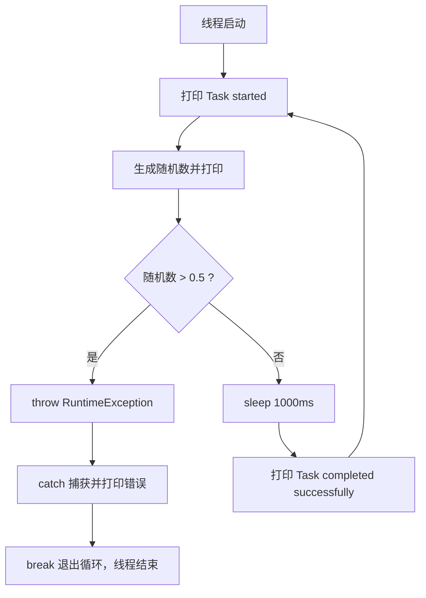

他中途专门解释过为什么非要用无限循环：

> "随机生成的数一开始可能小于 0.5，这样我们可能观察不到错误消息。因此，与其一遍又一遍地运行程序，更合理的做法是让过程持续进行，直到满足条件。"
> —— p032 [06:58]

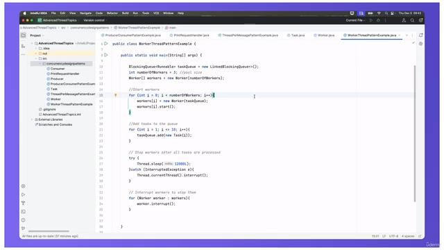

第二个类是 `UncaughtExceptionHandlerExample`：定义 `Thread.UncaughtExceptionHandler handler`（讲师先把匿名内部类改成了 lambda），在 lambda 里打印线程名和异常消息；然后把上一个例子的 `Runnable` 原样复制过来；创建两个线程，用 `setUncaughtExceptionHandler(handler)` 绑定到两个线程上，`start()` 运行。讲师说这里接口只有一个方法：

> "它接收两个参数：thread 和 throwable。当给定线程因给定的 UncaughtException 而终止时，就会调用该方法。"
> —— p032 [10:11]

第三个类是 `CallableExceptionExample`：创建单线程的 `ExecutorService` → 定义 `Callable<String>` → 在 `call()` 里复用同样的随机数逻辑 → `submit` 得到 `Future` → `future.get()` 取结果 → `catch (ExecutionException e)` 记录失败 → `shutdown()`。讲师在最后又把这段包进循环，直到随机数满足条件才结束。

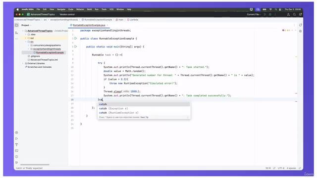

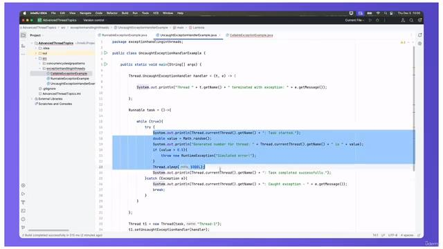

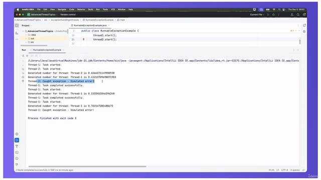

### 3.3 项目 B 的复现步骤（P33）

理论部分结束后，讲师从 [10:34] 开始动手，顺序是：

1. 新建包 `Advanced Locking Mechanism`（本文用 `advancedlockingmechanism`）
2. 新建 `BankAccount` 类
3. 加字段 `balance`——「This field represents the current account balance, this is the shared resource that we wanna protect」
4. 加字段 `StampedLock lock = new StampedLock()`——「with this instance, we will control access to the balance」
5. 写 `deposit(double amount)`：`writeLock()` 拿 stamp → 打印存款额和线程名 → `balance = balance + amount` → 打印新余额 → `unlockWrite(stamp)`
6. 写 `withdraw(double amount)`：`writeLock()` → `if (balance >= amount)` 扣款并打印，`else` 打印余额不足 → `unlockWrite(stamp)`
7. 写 `getBalanceOptimistic()`：`tryOptimisticRead()` 拿 stamp → 把 `balance` 读进局部变量 → `validate(stamp)` 校验 → 校验失败就降级成真读锁重读 → `finally` 里释放读锁 → 打印并返回
8. 写 `getBalance()`：`readLock()` → 读 → `unlockRead(stamp)` → 返回
9. 新建 `StampedLockExampleTest`：`new BankAccount()` → 三个 `Runnable`（deposit / withdraw / read，各循环 3 次，每次 `sleep(500)`）→ 三个 `Thread` → `start()` → `join()` → 最后打印 `getBalance()`

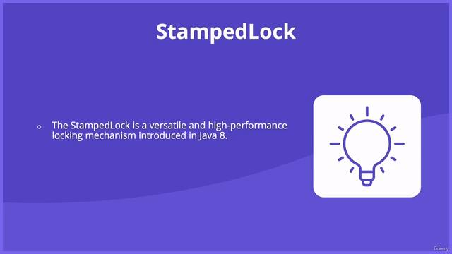

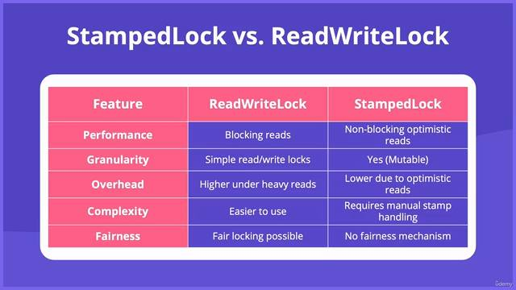

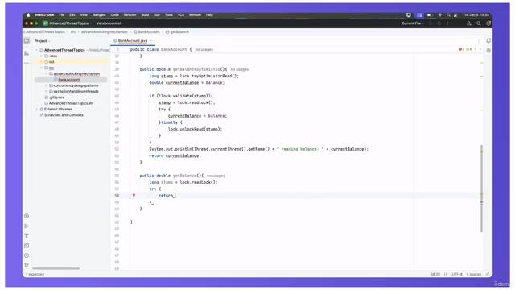

运行后讲师的观察是：

> "进行了三次存款，共存入 300 单位金额。同样，进行了三次取款，共取出 150 单位金额。因此，最终余额会以 150 单位打印到控制台。"
> —— p033 [24:49]

他还特意提醒了结果的不确定性：

> "当然，由于线程调度不同，如果取款线程先运行，你得到的结果可能会不同，因为初始余额会不足。"
> —— p033 [24:49]

### 3.4 项目 C 的复现步骤（P34）

1. 新建 Java 项目 `Building Multithreaded Web Server`（本文用包名 `multithreadedwebserver`）
2. 先写 `ClientHandler`：`implements Runnable` → 成员 `Socket clientSocket` → 构造函数注入 → `run()` 里用 **try-with-resources** 打开 `OutputStream`、`PrintWriter`、`BufferedReader`（`new InputStreamReader(socket.getInputStream())`）→ 逐行 `readLine()` 拼成字符串 → 非空就打印到控制台 → 拼一个 HTTP 响应字符串 → 写回客户端
3. 再写 `MultithreadedWebServer`：字段 `port` → 构造函数初始化 → `startServer()` 里 `Executors.newFixedThreadPool(10)` → try-with-resources 创建 `ServerSocket(port)` → 打印「服务器运行中」→ **无限循环** `serverSocket.accept()` → `executor.submit(new ClientHandler(clientSocket))`
4. 最后写 `Main`：`new MultithreadedWebServer(8080)` → `new Thread(server::startServer).start()`
5. 运行，控制台出现「Server is running on port 8080」
6. 浏览器访问 `http://localhost:8080`，看到 `Hello World`

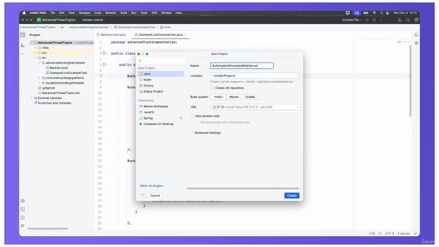

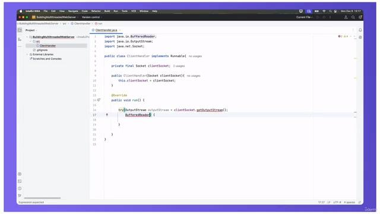

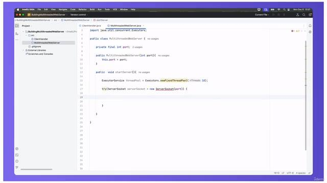

他还专门演示了线程池和「每请求新建线程」两种写法的切换：

> "这里我们使用了线程池，对吧？如果你愿意，我们也可以在这里为每个客户端新建一个线程……像这样为每个客户端创建一个新线程。当然，这个选择由你决定。不过，在这个示例中，我们将继续使用线程池。"
> —— p034 [13:53]

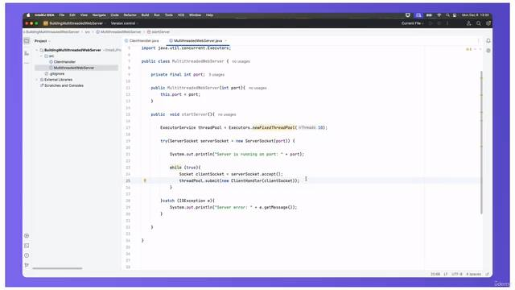

### 3.5 编译与运行

在 `java-concurrency/` 根目录下编译全部源码：

```bash
mkdir -p out
javac -encoding UTF-8 -d out \
  src/exceptionhandlingandthreads/*.java \
  src/advancedlockingmechanism/*.java \
  src/multithreadedwebserver/*.java
```

Windows cmd 下把 `\` 换成 `^` 或写成一行。编译成功不会有任何输出，`out/` 下会出现三个包目录。

分别运行三个程序：

```bash
# 项目 A：三个例子单独跑
java -cp out exceptionhandlingandthreads.RunnableExceptionExample
java -cp out exceptionhandlingandthreads.UncaughtExceptionHandlerExample
java -cp out exceptionhandlingandthreads.CallableExceptionExample

# 项目 B
java -cp out advancedlockingmechanism.StampedLockExampleTest

# 项目 C（会一直阻塞，Ctrl+C 退出）
java -cp out multithreadedwebserver.Main
```

项目 C 跑起来后，另开一个终端验证：

```bash
curl -i http://localhost:8080
```

预期看到 `HTTP/1.1 200 OK` 和 `Hello World`。讲师的验证方式是用浏览器：

> "现在打开浏览器，我在搜索栏中输入 http://localhost:8080……现在我们看到服务器的响应了，对吧？Hello World 消息就在浏览器里。"
> —— p034 [15:33]

---

## 4. 完整代码

下面每个文件都是完整的、可直接保存运行的。包名统一转成合法标识符，其余逻辑严格按讲师步骤。

### 4.1 项目 A：`RunnableExceptionExample.java`

```java
package exceptionhandlingandthreads;

public class RunnableExceptionExample {

    public static void main(String[] args) {

        Runnable task = () -> {
            while (true) {
                try {
                    System.out.println(Thread.currentThread().getName() + " - Task started");

                    double randomNumber = Math.random();
                    System.out.println(Thread.currentThread().getName() + " - Random number: " + randomNumber);

                    if (randomNumber > 0.5) {
                        throw new RuntimeException("Simulated error");
                    }

                    Thread.sleep(1000);

                    System.out.println(Thread.currentThread().getName() + " - Task completed successfully");
                } catch (InterruptedException e) {
                    Thread.currentThread().interrupt();
                    break;
                } catch (RuntimeException e) {
                    System.out.println(Thread.currentThread().getName() + " - Error: " + e.getMessage());
                    break;
                }
            }
        };

        Thread thread1 = new Thread(task);
        Thread thread2 = new Thread(task);

        thread1.setName("Thread-1");
        thread2.setName("Thread-2");

        thread1.start();
        thread2.start();
    }
}
```

### 4.2 项目 A：`UncaughtExceptionHandlerExample.java`

```java
package exceptionhandlingandthreads;

public class UncaughtExceptionHandlerExample {

    public static void main(String[] args) {

        Thread.UncaughtExceptionHandler handler = (thread, throwable) ->
                System.out.println("Uncaught exception in " + thread.getName()
                        + " : " + throwable.getMessage());

        Runnable task = () -> {
            while (true) {
                try {
                    System.out.println(Thread.currentThread().getName() + " - Task started");

                    double randomNumber = Math.random();
                    System.out.println(Thread.currentThread().getName() + " - Random number: " + randomNumber);

                    if (randomNumber > 0.5) {
                        throw new RuntimeException("Simulated error");
                    }

                    Thread.sleep(1000);

                    System.out.println(Thread.currentThread().getName() + " - Task completed successfully");
                } catch (InterruptedException e) {
                    Thread.currentThread().interrupt();
                    break;
                }
            }
        };

        Thread thread1 = new Thread(task);
        Thread thread2 = new Thread(task);

        thread1.setName("Thread-1");
        thread2.setName("Thread-2");

        thread1.setUncaughtExceptionHandler(handler);
        thread2.setUncaughtExceptionHandler(handler);

        thread1.start();
        thread2.start();
    }
}
```

### 4.3 项目 A：`CallableExceptionExample.java`

```java
package exceptionhandlingandthreads;

import java.util.concurrent.Callable;
import java.util.concurrent.ExecutionException;
import java.util.concurrent.ExecutorService;
import java.util.concurrent.Executors;
import java.util.concurrent.Future;

public class CallableExceptionExample {

    public static void main(String[] args) {

        ExecutorService executorService = Executors.newSingleThreadExecutor();

        Callable<String> task = () -> {
            System.out.println(Thread.currentThread().getName() + " - Task started");

            double randomNumber = Math.random();
            System.out.println(Thread.currentThread().getName() + " - Random number: " + randomNumber);

            if (randomNumber > 0.5) {
                throw new RuntimeException("Simulated error");
            }

            Thread.sleep(1000);

            return "Task completed successfully";
        };

        while (true) {
            Future<String> future = executorService.submit(task);
            try {
                String result = future.get();
                System.out.println(Thread.currentThread().getName() + " - Result: " + result);
                break;
            } catch (ExecutionException e) {
                System.out.println(Thread.currentThread().getName()
                        + " - Task failed: " + e.getCause().getMessage());
            } catch (InterruptedException e) {
                Thread.currentThread().interrupt();
                break;
            }
        }

        executorService.shutdown();
    }
}
```

### 4.4 项目 B：`BankAccount.java`

```java
package advancedlockingmechanism;

import java.util.concurrent.locks.StampedLock;

public class BankAccount {

    private double balance;

    private final StampedLock lock = new StampedLock();

    public void deposit(double amount) {
        long stamp = lock.writeLock();
        try {
            System.out.println(Thread.currentThread().getName() + " depositing: " + amount);
            balance = balance + amount;
            System.out.println(Thread.currentThread().getName() + " new balance after deposit: " + balance);
        } finally {
            lock.unlockWrite(stamp);
        }
    }

    public void withdraw(double amount) {
        long stamp = lock.writeLock();
        try {
            System.out.println(Thread.currentThread().getName() + " withdrawing: " + amount);
            if (balance >= amount) {
                balance = balance - amount;
                System.out.println(Thread.currentThread().getName() + " new balance after withdrawal: " + balance);
            } else {
                System.out.println(Thread.currentThread().getName() + " insufficient balance");
            }
        } finally {
            lock.unlockWrite(stamp);
        }
    }

    public double getBalanceOptimistic() {
        long stamp = lock.tryOptimisticRead();
        double currentBalance = balance;

        if (!lock.validate(stamp)) {
            stamp = lock.readLock();
            try {
                currentBalance = balance;
            } finally {
                lock.unlockRead(stamp);
            }
        }

        System.out.println(Thread.currentThread().getName() + " optimistic read balance: " + currentBalance);
        return currentBalance;
    }

    public double getBalance() {
        long stamp = lock.readLock();
        try {
            return balance;
        } finally {
            lock.unlockRead(stamp);
        }
    }
}
```

### 4.5 项目 B：`StampedLockExampleTest.java`

```java
package advancedlockingmechanism;

public class StampedLockExampleTest {

    public static void main(String[] args) {

        BankAccount account = new BankAccount();

        Runnable depositTask = () -> {
            for (int i = 0; i < 3; i++) {
                account.deposit(100);
                try {
                    Thread.sleep(500);
                } catch (InterruptedException e) {
                    Thread.currentThread().interrupt();
                    break;
                }
            }
        };

        Runnable withdrawTask = () -> {
            for (int i = 0; i < 3; i++) {
                account.withdraw(50);
                try {
                    Thread.sleep(500);
                } catch (InterruptedException e) {
                    Thread.currentThread().interrupt();
                    break;
                }
            }
        };

        Runnable readTask = () -> {
            for (int i = 0; i < 3; i++) {
                account.getBalanceOptimistic();
                try {
                    Thread.sleep(500);
                } catch (InterruptedException e) {
                    Thread.currentThread().interrupt();
                    break;
                }
            }
        };

        Thread depositor = new Thread(depositTask);
        Thread withdrawer = new Thread(withdrawTask);
        Thread reader = new Thread(readTask);

        depositor.setName("Depositor");
        withdrawer.setName("Withdrawer");
        reader.setName("Reader");

        depositor.start();
        withdrawer.start();
        reader.start();

        try {
            depositor.join();
            withdrawer.join();
            reader.join();
        } catch (InterruptedException e) {
            Thread.currentThread().interrupt();
        }

        System.out.println("Final balance: " + account.getBalance());
    }
}
```

### 4.6 项目 C：`ClientHandler.java`

```java
package multithreadedwebserver;

import java.io.BufferedReader;
import java.io.IOException;
import java.io.InputStreamReader;
import java.io.OutputStream;
import java.io.PrintWriter;
import java.net.Socket;

public class ClientHandler implements Runnable {

    private final Socket clientSocket;

    public ClientHandler(Socket clientSocket) {
        this.clientSocket = clientSocket;
    }

    @Override
    public void run() {
        try (Socket socket = clientSocket;
             OutputStream outputStream = socket.getOutputStream();
             PrintWriter writer = new PrintWriter(outputStream, true);
             BufferedReader reader = new BufferedReader(
                     new InputStreamReader(socket.getInputStream()))) {

            StringBuilder request = new StringBuilder();
            String line;
            while ((line = reader.readLine()) != null && !line.isEmpty()) {
                request.append(line).append("\n");
            }

            if (request.length() > 0) {
                System.out.println(request);
            }

            String response = "HTTP/1.1 200 OK\n"
                    + "Content-Type: text/html\n"
                    + "Content-Length: 11\n"
                    + "\n"
                    + "Hello World";

            writer.write(response);
            writer.flush();

        } catch (IOException e) {
            e.printStackTrace();
        }
    }
}
```

### 4.7 项目 C：`MultithreadedWebServer.java`

```java
package multithreadedwebserver;

import java.io.IOException;
import java.net.ServerSocket;
import java.net.Socket;
import java.util.concurrent.ExecutorService;
import java.util.concurrent.Executors;

public class MultithreadedWebServer {

    private final int port;

    public MultithreadedWebServer(int port) {
        this.port = port;
    }

    public void startServer() {
        ExecutorService executor = Executors.newFixedThreadPool(10);

        try (ServerSocket serverSocket = new ServerSocket(port)) {
            System.out.println("Server is running on port " + port);

            while (true) {
                Socket clientSocket = serverSocket.accept();
                executor.submit(new ClientHandler(clientSocket));
            }
        } catch (IOException e) {
            e.printStackTrace();
        } finally {
            executor.shutdown();
        }
    }
}
```

### 4.8 项目 C：`Main.java`

```java
package multithreadedwebserver;

public class Main {

    public static void main(String[] args) {
        MultithreadedWebServer server = new MultithreadedWebServer(8080);

        Thread serverThread = new Thread(server::startServer);
        serverThread.start();
    }
}
```

---

## 5. 逐行解释

### 5.1 `RunnableExceptionExample` 的三层结构

```java
Runnable task = () -> {
    while (true) {
```
外层是无限循环。讲师在 [06:58] 解释了原因：`Math.random()` 第一次就可能小于 0.5，如果不循环，你只跑一次很可能看不到异常分支。在 Node 里这相当于你写了个 `while(true) { if (Math.random() > 0.5) throw ... }` 然后靠异常跳出。

```java
try {
    ...
    if (randomNumber > 0.5) {
        throw new RuntimeException("Simulated error");
    }
```
这里用「抛异常」而不是「return」，是为了模拟业务代码里真正会发生的运行时故障（空指针、数组越界、解析失败）。异常在 `Runnable` 的 `run()` 里抛出，如果没人接，JVM 会直接结束这个线程——**主线程收不到任何通知**，这正是讲师在 [00:26] 强调的问题。

```java
} catch (InterruptedException e) {
    Thread.currentThread().interrupt();
    break;
} catch (RuntimeException e) {
    System.out.println(... + " - Error: " + e.getMessage());
    break;
}
```
两个 `catch` 是必须的：`Thread.sleep` 声明了受检异常 `InterruptedException`，不捕获编译不过。讲师原话只说「用一个 try-catch 处理异常并在 catch 里结束循环」，为了代码能编译，这里把中断和业务异常分开处理。`Thread.currentThread().interrupt()` 是把中断标记「还回去」——`sleep` 抛异常时会清掉中断标记，不还回去，外层代码就不知道这个线程被中断过。

```java
Thread thread1 = new Thread(task);
thread2.setName("Thread-2");
```
两个线程共享同一个 `task` 对象。因为 lambda 里没有任何可变共享状态（`randomNumber`、`stamp` 都是方法局部变量），所以不需要额外同步。

### 5.2 `UncaughtExceptionHandlerExample` 关键点

```java
Thread.UncaughtExceptionHandler handler = (thread, throwable) ->
        System.out.println("Uncaught exception in " + thread.getName()
                + " : " + throwable.getMessage());
```
`UncaughtExceptionHandler` 是 `Thread` 类内部的函数式接口，只有一个方法 `uncaughtException(Thread t, Throwable e)`。讲师在 [10:11] 强调了这个方法的两个参数。关键语义：**当且仅当线程因为未捕获异常而终止时**，这个回调才会被调用；如果 `run()` 正常返回，它不会被调用。

```java
thread1.setUncaughtExceptionHandler(handler);
```
注意这个例子里的 `Runnable` **没有** `catch (RuntimeException)`。异常一路抛到 `run()` 外面，JVM 发现线程有 handler，就调用 handler 而不是打印默认堆栈。这就是讲师说的「集中式处理」——你不用在每个任务里写 `try-catch`，只要在创建线程的地方统一挂一个 handler。

前端对照：Node 里 `worker.on('error', cb)` 是同一个思路——worker 内部未捕获的异常不会让主进程崩溃，而是通过事件通知。区别是 Node 的 `worker` 异常默认会让 worker 退出，Java 这里 handler 执行完线程也结束了，但没有「重启」语义。

### 5.3 `CallableExceptionExample` 的异常路径

```java
Callable<String> task = () -> { ... };
```
`Callable` 和 `Runnable` 的区别：`call()` 有返回值、可以声明抛出受检异常。讲师在 [12:59] 先创建了 `Executors.newSingleThreadExecutor()`，也就是池子里就 1 个线程。

```java
} catch (ExecutionException e) {
    System.out.println(... + " - Task failed: " + e.getCause().getMessage());
}
```
这里是最关键的一行。`Callable` 里抛出的任何异常都不会直接冒到调用 `submit` 的地方，而是被 `Future` **包装**起来；只有你调 `future.get()` 时，才会以 `ExecutionException` 的形式抛出，真正的业务异常在 `e.getCause()` 里。所以讲师在 [17:49] 说 Callable 是「handle exceptions during result retrieval」——异常是在取结果那一刻才被处理的。

```java
while (true) {
    Future<String> future = executorService.submit(task);
    try {
        String result = future.get();
        break;
    } catch (ExecutionException e) { ... }
}
```
讲师 [16:26] 要求「把代码放进循环，直到随机数大于 0.5 才结束」。这里把 `while` 放在主线程侧包住 `submit + get`：因为一旦 `call()` 抛异常，这个 Callable 实例就执行完了，必须重新 `submit` 一次才能再试。如果把 `while` 写进 `call()` 内部，第一次抛异常就直接结束了 `call()`，循环根本没机会跑第二轮——这是这条路径和 `Runnable` 版本最大的结构差异。

### 5.4 `BankAccount`：为什么写操作要 `try/finally`

```java
public void deposit(double amount) {
    long stamp = lock.writeLock();
    try {
        balance = balance + amount;
    } finally {
        lock.unlockWrite(stamp);
    }
}
```
`StampedLock` **没有实现 `Lock` 接口**，所以不能写 `try (long stamp = lock.writeLock())`——讲师在 [04:06] 专门强调了这一点，`long` 也不是 `AutoCloseable`。唯一正确的写法就是 `try/finally` + 手动 `unlockWrite(stamp)`。

`stamp` 是必须的：`unlockWrite` 要传回拿锁时得到的那个 `long`，锁靠它判断「你解锁的是不是你自己那一把」。如果写成 `lock.unlockWrite(0)` 或者忘了传，要么抛异常，要么破坏内部状态。

`balance = balance + amount` 本身不是原子操作（读、加、写三步），所以必须整段被写锁罩住。这就是讲师说的「shared resource that we wanna protect」。

### 5.5 `getBalanceOptimistic` 是整个项目的核心

```java
long stamp = lock.tryOptimisticRead();
double currentBalance = balance;
```
`tryOptimisticRead()` **不会阻塞、不会加锁**，只是返回一个当前版本的「快照编号」。拿到编号后你直接读 `balance`——这期间别的线程可能正在改它，所以读到的值可能是旧值、也可能读到写了一半的值（对 `double` 这种 64 位类型尤其要注意）。

```java
if (!lock.validate(stamp)) {
    stamp = lock.readLock();
    try {
        currentBalance = balance;
    } finally {
        lock.unlockRead(stamp);
    }
}
```
`validate(stamp)` 是「事后检查」：如果从我拿 stamp 到现在这段时间里，**没有任何写锁成功获取过**，返回 `true`，刚才那次无锁读是安全的；只要有写操作发生过，返回 `false`，刚才读到的值作废，必须降级成真正的读锁重新读一遍。

这就是讲师在 [04:06] 说的那句：「if a write operation occurs during the optimistic read, the read must be validated using the validate method to ensure consistency」。

`finally` 里的 `unlockRead(stamp)` 只在降级分支里执行，因为乐观读本身根本没有「解锁」这个动作——它没加锁，自然不用解。这也是为什么 `stamp` 变量要在 `if` 里被重新赋值：降级之后 `stamp` 的含义从「乐观版本号」变成了「读锁令牌」。

前端对照：这套「先读、再校验、不一致就重读」的模式，和前端做乐观更新（optimistic UI）时的思路同构——先假设没冲突直接渲染，收到响应后发现版本号变了再回滚重拉。区别是 JS 单线程，你不用担心读到「写了一半的对象」；Java 里两个线程是真的在并行改内存。

### 5.6 `StampedLockExampleTest` 的线程编排

```java
depositor.start();
withdrawer.start();
reader.start();
depositor.join();
withdrawer.join();
reader.join();
System.out.println("Final balance: " + account.getBalance());
```
`join()` 让主线程在这里等三个工作线程全部结束，然后再读最终余额。没有 `join` 的话，`main` 可能在三个线程还没跑完时就打印余额，你看到的数字会是中间态。

三个线程各循环 3 次、每次 `sleep(500)`，所以整个程序大约跑 1.5 秒。存款线程 3 × 100 = 300，取款线程 3 × 50 = 150，**如果存款先于取款发生**，最终余额是 150。但讲师在 [24:49] 提醒了：如果取款线程先跑，初始 `balance` 是 0，`0 >= 50` 不成立，会走「insufficient balance」分支，最终余额就不是 150 而是 300。这是并发程序结果不确定性的典型例子，不是 bug。

### 5.7 `ClientHandler.run()`：HTTP 响应的每一行

```java
try (Socket socket = clientSocket;
     OutputStream outputStream = socket.getOutputStream();
     PrintWriter writer = new PrintWriter(outputStream, true);
     BufferedReader reader = new BufferedReader(new InputStreamReader(socket.getInputStream()))) {
```
`try-with-resources` 会按**声明的逆序**关闭资源：先关 `reader`，再关 `writer`，再关 `outputStream`，最后关 `socket`。讲师在 [04:49] 说「so that when the connection is terminated, all sockets and streams are terminated as well」，就是这个意思。`PrintWriter` 的第二个参数 `true` 是自动 flush，每次 `write` 后立刻推出去，否则数据可能卡在缓冲区里，浏览器一直转圈。

```java
while ((line = reader.readLine()) != null && !line.isEmpty()) {
    request.append(line).append("\n");
}
```
HTTP 请求头的结束标志是一个空行。所以这里一直读到空行为止，把请求行和所有请求头拼进 `StringBuilder`。`readLine()` 会去掉换行符，所以手动补 `\n` 方便打印。

```java
String response = "HTTP/1.1 200 OK\n"
        + "Content-Type: text/html\n"
        + "Content-Length: 11\n"
        + "\n"
        + "Hello World";
```
- `HTTP/1.1 200 OK`：状态行，协议版本 + 状态码 + 原因短语
- `Content-Type: text/html`：告诉浏览器按 HTML 渲染（虽然内容里没有标签，浏览器也能显示）
- `Content-Length: 11`：`Hello World` 正好 11 个字符（H-e-l-l-o-空格-W-o-r-l-d）。讲师在 [07:54] 专门数过：「we can write 11 here, which is the length of the response in characters」
- 两个 `\n` 之间那个空行是**响应头和响应体的分隔符**，少一个浏览器就会把 `Hello World` 也当成头解析

```java
writer.write(response);
writer.flush();
```
`writer` 构造时已经是 autoFlush，这里再 `flush` 一次是双保险，也方便你改成 `false` 时不会忘。

### 5.8 `MultithreadedWebServer.startServer()`

```java
ExecutorService executor = Executors.newFixedThreadPool(10);
```
讲师在 [10:39] 说「I'll create a thread pool consisting of 10 threads」。这 10 个线程是**预先创建**的，来一个请求就从池里借一个，处理完还回去，不会每次 `new Thread`——这就是他讲的「reducing the overhead of thread creation and destruction」。

```java
try (ServerSocket serverSocket = new ServerSocket(port)) {
```
`ServerSocket` 实现了 `Closeable`，所以可以放进 try-with-resources。`new ServerSocket(8080)` 这一步就会**绑定端口并开始监听**，如果 8080 被占了，这里直接抛 `BindException`。

```java
while (true) {
    Socket clientSocket = serverSocket.accept();
    executor.submit(new ClientHandler(clientSocket));
}
```
`accept()` 是阻塞的：没有客户端连进来就一直挂着。一旦有连接，它返回一个代表这条连接的 `Socket`。然后 `submit` 把 `ClientHandler`（实现了 `Runnable`）丢进线程池，池里空闲的线程会去执行它的 `run()`。

讲师在 [13:27] 解释了这个无限循环的必要性：「a web server is designed to accept connections from clients continuously... otherwise it's going to be necessary to run the application again every time for the server response」。没有 `while(true)`，服务器处理完第一个请求就退出了，浏览器刷新第二次就连接失败。

讲师在 [13:53] 还给了替代方案：把 `executor.submit(new ClientHandler(clientSocket))` 换成 `new Thread(new ClientHandler(clientSocket)).start()`。功能一样，但每个请求都新建一个线程，高并发下会把内存吃光。这就是他讲「Scalability: spawning too many threads can lead to resource exhaustion」的具体含义。

### 5.9 `Main`

```java
Thread serverThread = new Thread(server::startServer);
serverThread.start();
```
讲师在 [15:07] 说「I want to start the server in a separate thread, so the main thread will be available for other tasks」。`server::startServer` 是方法引用，等价于 `() -> server.startServer()`。如果直接在 `main` 里调 `server.startServer()`，`main` 线程会被 `while(true)` 永远卡住——虽然对这个程序来说没区别，但如果之后要在主线程里加别的逻辑（比如处理控制台输入、注册关闭钩子），就卡死了。

讲师在 [15:33] 提到「We could also use the Join method for this thread」，加上 `serverThread.join()` 会让 `main` 等服务器线程结束——但服务器是无限循环，永远不会结束，所以加 `join` 只会让 `main` 也一起挂住，行为上和现在没区别。

---

## 6. 复现检查清单

跑完每一步打个勾，出问题就对照最后一节。

**环境**
- [ ] `java -version` 显示 17.x（或 ≥ 8）
- [ ] `javac -version` 和 `java -version` 版本一致
- [ ] 目录结构和第 3.1 节完全一致，三个包目录名全部小写、无空格

**项目 A**
- [ ] `javac` 编译三个文件无报错
- [ ] 跑 `RunnableExceptionExample`，能看到 `Thread-1` 和 `Thread-2` 交替打印 `Task started` / `Random number` / `Task completed successfully`
- [ ] 等几秒，能看到某个线程打印 `Error: Simulated error` 后停止，另一个线程继续跑
- [ ] 跑 `UncaughtExceptionHandlerExample`，能看到 `Uncaught exception in Thread-x : Simulated error`，且**没有** Java 默认的红色堆栈
- [ ] 跑 `CallableExceptionExample`，能看到反复的 `Task failed: Simulated error`，直到某一轮出现 `Result: Task completed successfully` 然后程序退出（说明 `shutdown()` 生效）

**项目 B**
- [ ] 跑 `StampedLockExampleTest`，控制台三组消息交错出现
- [ ] 能看到 `optimistic read balance: xxx`
- [ ] 最后一行是 `Final balance: 150.0` 或 `300.0`（取决于取款线程有没有先跑）
- [ ] 程序能正常退出，不会挂住（说明三个 `join` 都返回了）

**项目 C**
- [ ] 控制台出现 `Server is running on port 8080`
- [ ] 浏览器访问 `http://localhost:8080` 显示 `Hello World`
- [ ] 刷新页面还能显示（说明 `while(true)` 生效）
- [ ] 服务器控制台能看到每次请求的 `GET / HTTP/1.1` 和 `Host: localhost:8080` 等请求头
- [ ] `curl -i http://localhost:8080` 返回 200
- [ ] 同时开两个浏览器标签访问，两个请求都能被处理（说明线程池生效）
- [ ] `Ctrl+C` 能终止服务器

---

## 7. 课里没讲但你会撞上的

这一节全部是逐字稿里**没有出现**的内容，属于你照着敲必然会遇到、但课程没有覆盖的坑。写在这里是为了让你少 debug 半小时。

**1）包名不能带空格。**
讲师口述的包名是 "异常处理与线程"、"Advanced Locking Mechanism"、"Building Multithreaded Web Server"，这些在 IDE 里新建包时如果直接照抄，Java 会报 `illegal package name`。本文统一转成 `exceptionhandlingandthreads` 等。如果你用 IntelliJ 新建包，它会自动帮你转，但路径必须和 `package` 声明完全一致。

**2）8080 端口被占用。**
如果你本机已经跑了 Spring Boot、Vue dev server、Tomcat 之类的，`new ServerSocket(8080)` 会抛 `java.net.BindException: Address already in use`。换端口：改 `Main` 里的 `8080` 为 `8081`，浏览器地址也要跟着改。查占用：`lsof -i :8080`（macOS/Linux）或 `netstat -ano | findstr 8080`（Windows）。

**3）浏览器会发两次请求。**
现代浏览器访问 `localhost:8080` 时，除了 `GET /`，还会自动请求 `/favicon.ico`。所以服务器控制台会看到两条请求记录，其中 favicon 那条也会收到 `Hello World`（因为我们不判断路径）。这**不是 bug**，课里没讲，但第一次跑的人通常会以为代码写错了。用 `curl` 验证最干净。

**4）HTTP 头的换行符严格来说应该是 `\r\n`。**
讲师用的是 `\n`。Chrome、Firefox、curl 都能容忍，但按 RFC 7230 应该是 `\r\n`。如果你之后要对接严格的 HTTP 客户端（比如某些 Java `HttpClient` 或 Python `requests` 的某些模式），把响应字符串里的 `\n` 全换成 `\r\n` 更稳。课里没讲，属于协议细节。

**5）`Content-Length` 必须等于响应体的**字节数**。**
`Hello World` 是 11 个 ASCII 字符，所以 11 没问题。但如果你把响应体改成中文（比如「你好世界」），UTF-8 下是 12 个字节，`Content-Length` 就不能写 4。写错的表现是浏览器一直转圈等剩余数据，或者内容被截断。这是课里完全没提、但一改内容就会踩的坑。

**6）`PrintWriter` 不 flush，浏览器会一直等。**
本文代码在构造函数里传了 `true`（autoFlush），并且手动调了 `flush()`。如果你漏了这两处，`write` 的数据会留在缓冲区里，浏览器收不到完整的 `Content-Length` 字节数，页面就一直白屏。课里没讲缓冲区，属于 `java.io` 的常识。

**7）`executor.shutdown()` 在服务器场景里其实执行不到。**
`MultithreadedWebServer` 的 `finally` 块里写了 `executor.shutdown()`，但 `while(true)` 永远不会正常退出，只有 `ServerSocket` 抛异常或进程被杀时才会走到 `finally`。所以严格说这个 `shutdown` 是「异常兜底」，不是正常关停路径。课里按这个结构写的，实际生产里要配合 `Runtime.getRuntime().addShutdownHook(...)` 或信号处理来优雅关闭。课里没讲优雅关闭。

**8）`StampedLock` 不可重入。**
`ReentrantLock` 同一个线程可以重复 `lock()` 多次；`StampedLock` **不行**。如果 `deposit` 里调了另一个也拿写锁的方法，会直接死锁。讲师在 [01:21] 讲了 `ReentrantLock` 的可重入，但没有对比说 `StampedLock` 不可重入。写业务代码时把「锁的获取和释放放在同一层方法内」当作纪律。

**9）`tryOptimisticRead()` 在写锁被别的线程持