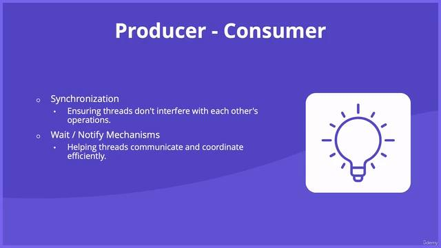
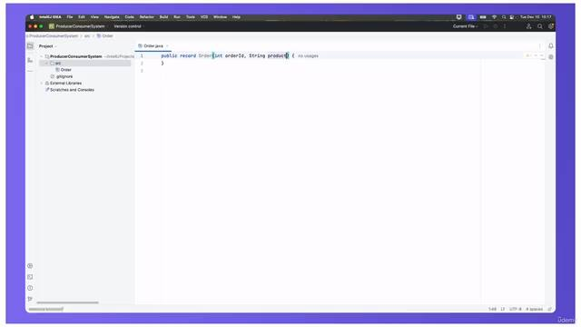
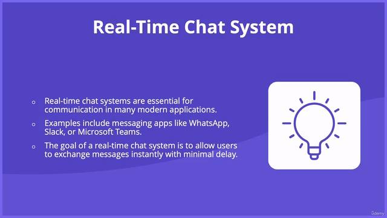
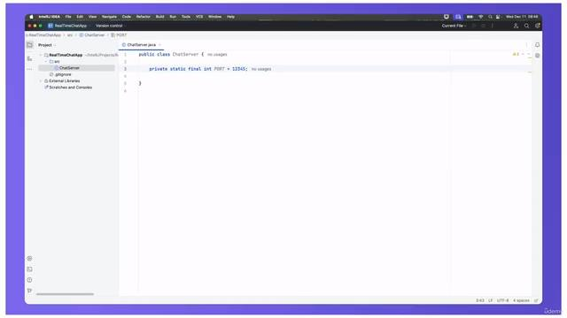
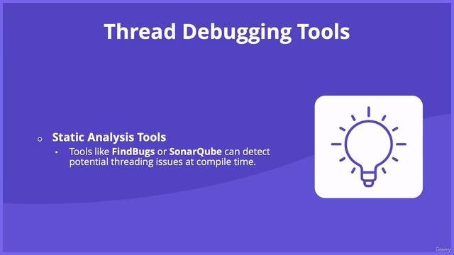
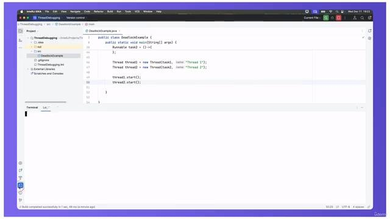
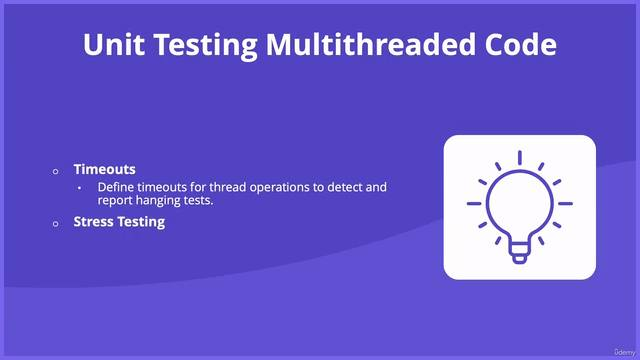
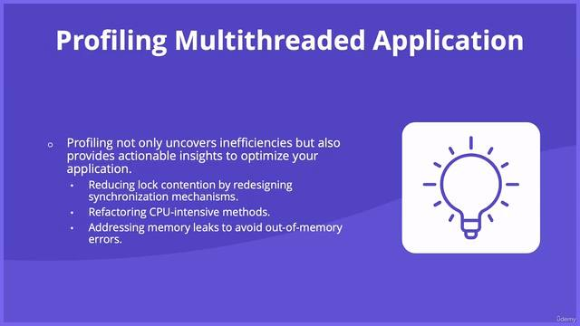

# Java 多线程与并发实战：生产者消费者、实时聊天、死锁调试、单元测试与性能剖析（P35–P39）

> 读者定位：前端转 AI 应用工程师。本课是 Java 课，Java 语法只需「知道即可」，但**并发模型**是通用的——每节我都会补一句「在 JS/Node 里对应什么」。
> 本课全部是**控制台程序**，没有前端、没有 Web 框架、没有数据库。所有代码都是完整文件，可直接保存运行。

---

## 1. 这一节做什么

P35–P39 是这门课从「讲概念」转向「做项目」的一段，一共五个可运行的小项目，每个都对应一个并发主题：

| 视频 | 项目名 | 主题 | 产出 |
|---|---|---|---|
| P35 | Producer Consumer System | 有界缓冲区 + `synchronized`/`wait`/`notifyAll` | 电商下单 → 配送的模拟系统 |
| P36 | Real-Time Chat App | Socket + 每客户端一线程 + 广播 | 多客户端控制台聊天室 |
| P37 | Thread Debugging | 死锁复现 + `jps`/`jstack` 定位 + 修复 | 一个死锁程序和一个修好的版本 |
| P38 | Unit Testing Multi-Threaded Code | JUnit 5 + `ReentrantLock` + 线程池 | 线程安全计数器的单元测试 |
| P39 | Profiling Multi-Threaded App | 银行账户模拟 + Java VisualVM | 线程状态/CPU 采样的观察记录 |

这五个项目**互相独立**，可以分开做。建议按顺序做，因为 P37 的死锁、P38 的锁、P39 的 `synchronized` 都建立在 P35 的锁概念上。

---

## 2. 讲师原话

> "在多线程环境中，一个常见挑战是管理共享资源的多个线程之间的交互。一个经典例子就是生产者—消费者问题。"
> —— p035 [00:41]

> "在本视频中，我们将使用一个容量固定的有界缓冲区，并实现正确的同步：缓冲区满时生产者等待，缓冲区空时消费者等待。"
> —— p035 [02:47]



> "生产者线程代表一个电子商务系统，客户在其中下单。每个订单包含订单编号、商品名称和数量。"
> —— p035 [03:25]

> "因此，这个类会把来自生产者的数据（例如订单）临时存储为共享数据结构，并允许消费者处理这些数据。"
> —— p035 [06:10]



> "在本视频中，我们将尝试开发一个控制台应用，在其中实现实时聊天。"
> —— p036 [00:28]

> "在服务器端，每个客户端都由一个独立线程处理，从而支持多个用户同时通信。"
> —— p036 [01:23]



> "因此，我们将把这个应用分成三个不同部分：聊天服务器、客户端处理器和聊天客户端。"
> —— p036 [03:14]

> "Collections.synchronizedSet 包装器可确保线程安全的操作，因为每个客户端对应一个线程，会有多个线程访问这个集合。"
> —— p036 [05:52]



> "因此，正如你可能想到的，由于线程具有并发特性，调试多线程应用本身就很困难。"
> —— p037 [00:00]

> "我们将调试一个出现死锁的简单多线程 Java 程序。这里要使用的程序会模拟两个不同的线程以相反顺序尝试获取两个共享资源上的锁。"
> —— p037 [03:14]



> "现在，让我们用 jstack 命令运行一下，看看会得到什么。对，看到了吗？它给出了包含死锁信息的线程转储。"
> —— p037 [10:36]



> "单元测试实际上是软件开发中的一个基础环节，用来确保各个组件按预期工作。不过，测试多线程代码会带来一些独特挑战。"
> —— p038 [00:00]

> "我们将为一个由多个线程访问的共享资源编写单元测试。这个场景会涉及一个线程安全的计数器类，它负责递增计数。"
> —— p038 [02:06]



> "因此，性能剖析使开发者能够分析应用的运行时行为，例如处理器和内存使用情况、线程状态以及同步开销。"
> —— p039 [00:00]

> "我们将尝试模拟一个银行系统，其中多个线程会并发更新账户余额。目标是确保线程安全，并使用性能剖析工具分析同步开销。"
> —— p039 [03:09]



---

## 3. 从零复现

### 3.0 环境准备（五个项目共用）

- **JDK**：课里用的是 IntelliJ IDEA 新建 Java 项目，JDK 版本课里没明说，建议 **JDK 17 或以上**（P35 用到了 `record`，JDK 16+ 才正式支持）。
- **IDE**：IntelliJ IDEA（课里全程用 IDEA 演示）。
- **P38 额外依赖**：JUnit 5（`junit-jupiter`），通过 IDEA 的 Project Structure → Modules → Dependencies → `+` → Library → Maven 搜索 `junit-jupiter` 添加。
- **P39 额外工具**：Java VisualVM，课里明确说「previously this came ready-made in JDK, but now it's not in JDK anyway, we need to download it manually from the internet」，去官网下载对应系统版本安装。

目录结构（每个项目一个独立目录，包名课里没显式声明，默认包即可）：

```
producer-consumer-system/
  src/
    Order.java
    SharedBuffer.java
    Producer.java
    Consumer.java
    Main.java

real-time-chat-app/
  src/
    ChatServer.java
    ClientHandler.java
    ChatClient.java

thread-debugging/
  src/
    DeadlockExample.java

unit-testing-multi-threaded-code/
  src/
    ThreadSafeCounter.java
    ThreadSafeCounterTest.java

profiling-multi-threaded-app/
  src/
    BankAccount.java
    BankingApp.java
```

### 3.1 P35 生产者消费者系统

**步骤 1**：新建 Java 项目 `Producer Consumer System`。
**步骤 2**：创建模型类 `Order`。课里讲师先写成普通 class，随后改成 `record`——「you might want to create this class as a record class... It's actually possible to define our model classes, that is our carrier classes with less code」。我们直接按最终形态写 `record`。
**步骤 3**：创建 `SharedBuffer`，两个字段：`LinkedList<Order>` 存订单、`int capacity` 存容量。两个方法 `produce` / `consume`，都加 `synchronized`，都用 `while` 检查边界，都用 `wait()` 等待、`notifyAll()` 唤醒。
**步骤 4**：创建 `Producer`（实现 `Runnable`），无限循环随机生成订单并 `produce`，每次间隔约 1 秒。
**步骤 5**：创建 `Consumer`（实现 `Runnable`），无限循环 `consume` 并打印「已配送」，每次间隔约 2 秒。
**步骤 6**：`Main` 里建 `SharedBuffer(5)`，起两个线程，`start()`。

### 3.2 P36 实时聊天

**步骤 1**：新建项目 `Real-Time Chat App`。
**步骤 2**：`ChatServer`：常量 `PORT = 12345`；`Set<ClientHandler>` 用 `Collections.synchronizedSet(new HashSet<>())` 包一层；`main` 里 `ServerSocket` 死循环 `accept()`，每来一个客户端就 `new ClientHandler(socket)`、加入集合、`new Thread(handler).start()`；`broadcast(message, sender)` 遍历集合跳过 sender 调 `sendMessage`；`removeClient(handler)` 从集合移除。
**步骤 3**：`ClientHandler implements Runnable`：持有 `Socket` 和 `PrintWriter`；`run()` 里用 `BufferedReader` 读客户端消息，非 null 就 `server.broadcast(msg, this)`；`finally` 里 `removeClient(this)` 并关 socket；`sendMessage(msg)` 判空后 `println`。
**步骤 4**：`ChatClient`：常量 `SERVER_ADDRESS = "localhost"`、`PORT = 12345`；`main` 里连服务器，起一个**独立线程**专门收消息并打印，主线程读控制台输入发给服务器。
**步骤 5**：测试。课里先在 IDEA 里跑，发现「发送者自己也收到了自己发的消息」这个逻辑错误，然后在 `broadcast` 里加了「跳过 sender」的判断修好。之后开三个终端（1 个 server + 2 个 client）用 `javac` / `java` 命令行验证广播。

### 3.3 P37 死锁复现与调试

**步骤 1**：新建项目 `Thread Debugging`，类 `DeadlockExample`。
**步骤 2**：两个 `ReentrantLock` 对象 `lock1`、`lock2`。
**步骤 3**：Task 1：先 `lock1.lock()` → 打印 → `Thread.sleep(500)` → `lock2.lock()` → 打印 → sleep → `lock2.unlock()` → sleep → `lock1.unlock()`。
**步骤 4**：Task 2：**顺序反过来**，先 `lock2.lock()` 再 `lock1.lock()`。
**步骤 5**：两个线程同时 `start()`，观察程序挂起。
**步骤 6**：终端里 `jps` 找到进程 ID，`jstack <pid>` 看线程转储，找 `Found one Java-level deadlock` 段落。
**步骤 7**：修复——把 Task 2 也改成先 `lock1` 再 `lock2`，重跑，程序正常结束。

### 3.4 P38 多线程单元测试

**步骤 1**：新建项目 `Unit Testing Multi-Threaded Code`。
**步骤 2**：`ThreadSafeCounter`：`int counter = 0` + `ReentrantLock lock`；`increment()` 里 `lock.lock()` → `counter++` → `lock.unlock()`；`getCounter()` 用 `try/finally` 保证 `unlock`。
**步骤 3**：加 JUnit 5 依赖（见 3.0）。
**步骤 4**：`ThreadSafeCounterTest`：`@Test` 方法里建 10 线程的线程池，循环 1000 次 `executor.submit(counter::increment)`，`shutdown()`，`awaitTermination(1, TimeUnit.SECONDS)`，最后 `assertEquals(1000, counter.getCounter(), "错误信息")`。
**步骤 5**：跑测试，绿色通过。

### 3.5 P39 性能剖析

**步骤 1**：新建项目 `Profiling Multi-Threaded App`。
**步骤 2**：`BankAccount`：`double balance = 0`；`synchronized deposit(amount)` 加钱并 `Thread.sleep(100)`；`synchronized withdraw(amount)` 判断余额够才减钱并 sleep；`synchronized getBalance()`。
**步骤 3**：`BankingApp`：建 `BankAccount`，定义任务「存 100 再取 50，重复 1000 次」，建 10 个线程各跑这个任务，全部 `start()` 后全部 `join()`，最后打印余额。
**步骤 4**：先直接跑，看余额是否符合预期。
**步骤 5**：把 sleep 时间调大一点（课里说「increase the delay times a little bit so the program doesn't terminate so quickly」），重跑。
**步骤 6**：打开 Java VisualVM，左侧找到运行中的应用，双击，看 Threads 标签页的线程状态、点 Thread Dump 按钮看转储、看 Sampler 标签页的 CPU 采样。

---

## 4. 完整代码

### 4.1 P35 生产者消费者系统

**`Order.java`**

```java
public record Order(int orderId, String productName, int quantity) {
}
```

**`SharedBuffer.java`**

```java
import java.util.LinkedList;
import java.util.List;

public class SharedBuffer {
    private final List<Order> orders;
    private final int capacity;

    public SharedBuffer(int capacity) {
        this.orders = new LinkedList<>();
        this.capacity = capacity;
    }

    public synchronized void produce(Order order) throws InterruptedException {
        while (orders.size() == capacity) {
            System.out.println("Buffer is full. Producer is waiting...");
            wait();
        }
        orders.add(order);
        System.out.println("Produced: " + order);
        notifyAll();
    }

    public synchronized Order consume() throws InterruptedException {
        while (orders.isEmpty()) {
            System.out.println("Buffer is empty. Consumer is waiting...");
            wait();
        }
        Order order = orders.remove(0);
        System.out.println("Consumed: " + order);
        notifyAll();
        return order;
    }
}
```

**`Producer.java`**

```java
import java.util.Random;

public class Producer implements Runnable {
    private final SharedBuffer buffer;
    private int orderId = 0;

    public Producer(SharedBuffer buffer) {
        this.buffer = buffer;
    }

    @Override
    public void run() {
        String[] products = {"Laptop", "Phone", "Headphones", "Monitor", "Keyboard"};
        Random random = new Random();
        while (true) {
            try {
                String product = products[random.nextInt(products.length)];
                int quantity = random.nextInt(1, 6);
                Order order = new Order(++orderId, product, quantity);
                buffer.produce(order);
                Thread.sleep(1000);
            } catch (InterruptedException e) {
                break;
            }
        }
    }
}
```

**`Consumer.java`**

```java
public class Consumer implements Runnable {
    private final SharedBuffer buffer;

    public Consumer(SharedBuffer buffer) {
        this.buffer = buffer;
    }

    @Override
    public void run() {
        while (true) {
            try {
                Order order = buffer.consume();
                System.out.println("Order delivered: " + order);
                Thread.sleep(2000);
            } catch (InterruptedException e) {
                break;
            }
        }
    }
}
```

**`Main.java`**

```java
public class Main {
    public static void main(String[] args) {
        SharedBuffer buffer = new SharedBuffer(5);
        Thread producerThread = new Thread(new Producer(buffer));
        Thread consumerThread = new Thread(new Consumer(buffer));
        producerThread.start();
        consumerThread.start();
    }
}
```

### 4.2 P36 实时聊天

**`ChatServer.java`**

```java
import java.io.IOException;
import java.net.ServerSocket;
import java.net.Socket;
import java.util.Collections;
import java.util.HashSet;
import java.util.Set;

public class ChatServer {
    private static final int PORT = 12345;
    private static final Set<ClientHandler> clients =
            Collections.synchronizedSet(new HashSet<>());

    public static void main(String[] args) {
        System.out.println("Chat server is running on port " + PORT);
        try (ServerSocket serverSocket = new ServerSocket(PORT)) {
            while (true) {
                Socket socket = serverSocket.accept();
                System.out.println("Client connected: " + socket.getInetAddress());
                ClientHandler handler = new ClientHandler(socket);
                clients.add(handler);
                new Thread(handler).start();
            }
        } catch (IOException e) {
            e.printStackTrace();
        }
    }

    public static void broadcast(String message, ClientHandler sender) {
        synchronized (clients) {
            for (ClientHandler client : clients) {
                if (client != sender) {
                    client.sendMessage(message);
                }
            }
        }
    }

    public static void removeClient(ClientHandler handler) {
        clients.remove(handler);
    }
}
```

**`ClientHandler.java`**

```java
import java.io.BufferedReader;
import java.io.IOException;
import java.io.InputStreamReader;
import java.io.PrintWriter;
import java.net.Socket;

public class ClientHandler implements Runnable {
    private final Socket clientSocket;
    private PrintWriter out;

    public ClientHandler(Socket clientSocket) {
        this.clientSocket = clientSocket;
    }

    @Override
    public void run() {
        try (BufferedReader in = new BufferedReader(
                new InputStreamReader(clientSocket.getInputStream()))) {
            out = new PrintWriter(clientSocket.getOutputStream(), true);
            String message;
            while ((message = in.readLine()) != null) {
                ChatServer.broadcast(message, this);
            }
        } catch (IOException e) {
            e.printStackTrace();
        } finally {
            ChatServer.removeClient(this);
            try {
                clientSocket.close();
            } catch (IOException e) {
                e.printStackTrace();
            }
        }
    }

    public void sendMessage(String message) {
        if (out != null) {
            out.println(message);
        }
    }
}
```

**`ChatClient.java`**

```java
import java.io.BufferedReader;
import java.io.IOException;
import java.io.InputStreamReader;
import java.io.PrintWriter;
import java.net.Socket;

public class ChatClient {
    private static final String SERVER_ADDRESS = "localhost";
    private static final int PORT = 12345;

    public static void main(String[] args) {
        try (Socket socket = new Socket(SERVER_ADDRESS, PORT);
             BufferedReader serverIn = new BufferedReader(
                     new InputStreamReader(socket.getInputStream()));
             PrintWriter out = new PrintWriter(socket.getOutputStream(), true);
             BufferedReader consoleIn = new BufferedReader(
                     new InputStreamReader(System.in))) {

            System.out.println("Connected to the server.");

            Thread receiver = new Thread(() -> {
                try {
                    String message;
                    while ((message = serverIn.readLine()) != null) {
                        System.out.println(message);
                    }
                } catch (IOException e) {
                    e.printStackTrace();
                }
            });
            receiver.start();

            String input;
            while ((input = consoleIn.readLine()) != null) {
                out.println(input);
            }
        } catch (IOException e) {
            e.printStackTrace();
        }
    }
}
```

**命令行运行（课里 P36 后半段演示的方式）**：

```bash
# 终端 1：进入 src 目录，编译并启动服务器
cd real-time-chat-app/src
javac ChatServer.java ClientHandler.java ChatClient.java
java ChatServer

# 终端 2、终端 3：各自进入 src 目录，启动客户端
cd real-time-chat-app/src
java ChatClient
```

### 4.3 P37 死锁复现与修复

**`DeadlockExample.java`（死锁版）**

```java
import java.util.concurrent.locks.ReentrantLock;

public class DeadlockExample {
    private static final ReentrantLock lock1 = new ReentrantLock();
    private static final ReentrantLock lock2 = new ReentrantLock();

    public static void main(String[] args) {
        Runnable task1 = () -> {
            try {
                lock1.lock();
                System.out.println("Thread 1 acquired Lock 1");
                Thread.sleep(500);
                lock2.lock();
                System.out.println("Thread 1 acquired Lock 2");
                Thread.sleep(500);
                lock2.unlock();
                Thread.sleep(500);
                lock1.unlock();
            } catch (InterruptedException e) {
                e.printStackTrace();
            }
        };

        Runnable task2 = () -> {
            try {
                lock2.lock();
                System.out.println("Thread 2 acquired Lock 2");
                Thread.sleep(500);
                lock1.lock();
                System.out.println("Thread 2 acquired Lock 1");
                Thread.sleep(500);
                lock1.unlock();
                Thread.sleep(500);
                lock2.unlock();
            } catch (InterruptedException e) {
                e.printStackTrace();
            }
        };

        new Thread(task1).start();
        new Thread(task2).start();
    }
}
```

**修复版**：把 `task2` 里的 `lock2.lock()` 和 `lock1.lock()` 顺序对调，`unlock` 顺序也相应调整，让两个线程都按 `lock1 → lock2` 的顺序获取：

```java
        Runnable task2 = () -> {
            try {
                lock1.lock();
                System.out.println("Thread 2 acquired Lock 1");
                Thread.sleep(500);
                lock2.lock();
                System.out.println("Thread 2 acquired Lock 2");
                Thread.sleep(500);
                lock2.unlock();
                Thread.sleep(500);
                lock1.unlock();
            } catch (InterruptedException e) {
                e.printStackTrace();
            }
        };
```

**调试命令**：

```bash
javac DeadlockExample.java
java DeadlockExample      # 程序会挂住，不要关

# 另开一个终端
jps                       # 找到 DeadlockExample 对应的进程 ID
jstack <进程ID>            # 输出线程转储，末尾找 "Found one Java-level deadlock"
```

### 4.4 P38 多线程单元测试

**`ThreadSafeCounter.java`**

```java
import java.util.concurrent.locks.ReentrantLock;

public class ThreadSafeCounter {
    private int counter = 0;
    private final ReentrantLock lock = new ReentrantLock();

    public void increment() {
        lock.lock();
        try {
            counter++;
        } finally {
            lock.unlock();
        }
    }

    public int getCounter() {
        lock.lock();
        try {
            return counter;
        } finally {
            lock.unlock();
        }
    }
}
```

**`ThreadSafeCounterTest.java`**

```java
import org.junit.jupiter.api.Test;

import java.util.concurrent.ExecutorService;
import java.util.concurrent.Executors;
import java.util.concurrent.TimeUnit;

import static org.junit.jupiter.api.Assertions.assertEquals;

public class ThreadSafeCounterTest {

    @Test
    public void testCounterWithMultipleThreads() throws InterruptedException {
        ThreadSafeCounter counter = new ThreadSafeCounter();
        ExecutorService executor = Executors.newFixedThreadPool(10);

        for (int i = 0; i < 1000; i++) {
            executor.submit(counter::increment);
        }

        executor.shutdown();
        executor.awaitTermination(1, TimeUnit.SECONDS);

        assertEquals(1000, counter.getCounter(), "Counter value should be 1000");
    }
}
```

### 4.5 P39 性能剖析

**`BankAccount.java`**

```java
public class BankAccount {
    private double balance = 0;

    public synchronized void deposit(double amount) {
        balance += amount;
        try {
            Thread.sleep(100);
        } catch (InterruptedException e) {
            e.printStackTrace();
        }
    }

    public synchronized void withdraw(double amount) {
        if (balance >= amount) {
            balance -= amount;
        }
        try {
            Thread.sleep(100);
        } catch (InterruptedException e) {
            e.printStackTrace();
        }
    }

    public synchronized double getBalance() {
        return balance;
    }
}
```

**`BankingApp.java`**

```java
public class BankingApp {
    public static void main(String[] args) {
        BankAccount account = new BankAccount();

        Runnable task = () -> {
            for (int i = 0; i < 1000; i++) {
                account.deposit(100);
                account.withdraw(50);
            }
        };

        Thread[] threads = new Thread[10];
        for (int i = 0; i < threads.length; i++) {
            threads[i] = new Thread(task);
        }
        for (Thread t : threads) {
            t.start();
        }
        for (Thread t : threads) {
            try {
                t.join();
            } catch (InterruptedException e) {
                e.printStackTrace();
            }
        }

        System.out.println("Final balance: " + account.getBalance());
    }
}
```

---

## 5. 逐行解释

### 5.1 P35 SharedBuffer 的 `while` + `wait` + `notifyAll`

- `while (orders.size() == capacity)`：**必须用 `while` 不能用 `if`**。被 `notifyAll` 唤醒后线程要重新检查条件，因为可能被别的线程抢先消费/生产了。这是「虚假唤醒」防护。
- `wait()`：释放锁并挂起，直到被 `notify`/`notifyAll` 唤醒。**在 JS/Node 里没有对应物**——Node 是单线程事件循环，不存在「挂起一个线程等条件」的模型，最接近的是 `await` 一个 Promise，但语义完全不同（不涉及锁）。
- `notifyAll()` 而不是 `notify()`：因为生产者和消费者都在同一个对象上等，`notify()` 可能唤醒同类线程导致死等。课里讲师两个方法都用了 `notifyAll`。
- `synchronized` 加在方法上 = 锁住 `this`。**在 JS 里对应什么**：JS 没有内置锁，单线程下靠事件循环天然串行；真要做跨进程/Worker 的互斥，得靠 `Atomics.wait` / `SharedArrayBuffer` 或外部锁（Redis 等），课里没讲。

### 5.2 P36 为什么用 `Collections.synchronizedSet`

- `HashSet` 本身不是线程安全的。服务器每来一个客户端就有一个线程去 `add`/`remove`/遍历这个集合，必须包一层。
- 注意 `broadcast` 里遍历时**额外加了 `synchronized (clients)`**：`synchronizedSet` 只保证单个方法调用安全，**遍历时仍要手动同步**，否则遍历过程中别的线程 `remove` 会抛 `ConcurrentModificationException`。课里讲师明确说「I'll also move this loop into the synchronized block to ensure that there are no conflicts while iterating over the set」。
- `PrintWriter(OutputStream, true)` 第二个参数 `autoFlush = true`：`println` 后自动 flush，否则消息可能卡在缓冲区发不出去。
- `broadcast` 里 `if (client != sender)`：这是课里**修 bug 的那一行**。最初没这行，发送者自己也会收到自己发的消息；加上后只发给其他人。
- 客户端用**独立线程收消息**：主线程阻塞在 `consoleIn.readLine()` 上等用户输入，如果收消息也在主线程，就收不到别人发的了。**在 JS 里对应什么**：类似 WebSocket 的 `onmessage` 回调天然异步，不需要你手动开线程。

### 5.3 P37 死锁为什么发生、`jstack` 看什么

- Task 1 拿 `lock1` 等 `lock2`，Task 2 拿 `lock2` 等 `lock1`，形成**循环等待**——死锁四个必要条件之一。
- `jstack` 输出里找 `Found one Java-level deadlock`，下面会列出两个线程各自「waiting to lock」和「locked」的对象，一眼看出循环依赖。**注意**：`jstack` 输出里具体字段名（如 `waiting to lock`、`locked`）请以你机器上的实际输出为准，不同 JDK 版本措辞略有差异。
- 修复原理：**所有线程按同一顺序获取锁**，破坏循环等待条件。课里讲师原话「If all threads acquire locks in the same order, deadlock does not occur」。
- **在 JS/Node 里对应什么**：Node 单线程没有这种锁死锁，但**异步死锁**存在（两个 Promise 互相 await 对方的结果），排查思路类似——找循环依赖。

### 5.4 P38 为什么 `getCounter` 也要加锁

- `counter++` 不是原子操作（读-改-写三步），多线程下会丢更新。`ReentrantLock` 保证同一时刻只有一个线程进临界区。
- `getCounter` 加锁是为了**可见性**：一个线程写完，另一个线程读的时候要能看到最新值。不加锁可能读到旧值（CPU 缓存）。
- `try/finally` 保证异常时也 `unlock`，否则锁永远不释放。
- 测试里 `awaitTermination(1, TimeUnit.SECONDS)`：给线程池 1 秒完成所有任务，超时就继续往下走（此时断言可能失败）。课里说「one second ought to be sufficient」。
- `assertEquals(1000, counter.getCounter(), "...")`：三个参数分别是期望值、实际值、失败时的错误信息。
- **在 JS 里对应什么**：JS 单线程下 `counter++` 天然原子（除非用 Worker + SharedArrayBuffer），所以前端很少遇到这类问题；但如果你写 Node 的 Worker Threads，就要用 `Atomics.add`。

### 5.5 P39 为什么 `synchronized` 方法里 `sleep`

- `deposit`/`withdraw` 都是 `synchronized`，同一时刻只有一个线程能进，其他线程**阻塞等待**——这就是「锁竞争 / synchronization overhead」，正是 VisualVM 里要观察的东西。
- `Thread.sleep(100)` 在锁内，**故意放大锁持有时间**，让 VisualVM 的 Threads 标签页能明显看到 `BLOCKED` 状态的线程。课里说「increase the delay times a little bit so the program doesn't terminate so quickly」就是这个目的。
- 最终余额 = 10 线程 × 1000 次 × (100 - 50) = 500000。课里说「this is the expected value」。
- VisualVM 里 Threads 标签页能看到 `Running` / `Waiting` / `Blocked` 状态；Thread Dump 按钮导出转储；Sampler 标签页看每个方法的 CPU 占用。**具体字段名以你 VisualVM 版本实际显示为准**。

---

## 6. 复现检查清单

**P35**
- [ ] `Order` 用 `record` 编译通过（JDK 16+）
- [ ] 运行后能看到 `Produced:` 和 `Consumed:` 交替出现
- [ ] 缓冲区满时打印 `Buffer is full. Producer is waiting...`
- [ ] 缓冲区空时打印 `Buffer is empty. Consumer is waiting...`
- [ ] 程序不会卡死（生产者 1 秒一个、消费者 2 秒一个，长期看消费者更慢，会周期性触发「满」）

**P36**
- [ ] `javac` 三个文件无报错
- [ ] 先起 `ChatServer`，再起两个 `ChatClient`
- [ ] 客户端 A 发消息，客户端 B 能收到，**A 自己收不到**
- [ ] 服务器控制台打印 `Client connected: /127.0.0.1`
- [ ] 关掉一个客户端，服务器不崩

**P37**
- [ ] 死锁版运行后**挂住不退出**，控制台只打印两行「acquired Lock X」
- [ ] `jps` 能看到 `DeadlockExample` 进程
- [ ] `jstack <pid>` 输出里能找到 `Found one Java-level deadlock`
- [ ] 修复版运行后**正常退出**，四行「acquired」都打印

**P38**
- [ ] JUnit 5 依赖已加，`@Test` 旁边出现绿色播放图标（没出现就 Rebuild Project，课里明确说「rebuilding the project will solve the problem」）
- [ ] 测试通过，绿色
- [ ] 把 `increment` 里的 `lock.lock()`/`lock.unlock()` 注释掉再跑，测试**应该失败**（验证测试真的在测并发）

**P39**
- [ ] 直接运行，最终余额打印 `500000.0`
- [ ] Java VisualVM 已安装并能打开
- [ ] 运行 `BankingApp` 时 VisualVM 左侧出现该进程
- [ ] Threads 标签页能看到线程状态变化
- [ ] Sampler 标签页能看到方法级 CPU 占用

---

## 7. 课里没讲但你会撞上的

1. **P35 的 `Main` 没有优雅停止机制**。两个线程都是 `while(true)`，只能 Ctrl+C 杀进程。课里没讲怎么优雅关闭（比如用 `volatile boolean running` 标志位 + `interrupt()`）。你做实验时如果想让程序自己停，得自己加。

2. **P36 的 `ChatClient` 没有处理「服务器断开」**。服务器挂了，客户端的 `receiver` 线程会读到 `null` 退出循环，但主线程还卡在 `consoleIn.readLine()` 上，程序不会退出。课里没讲这个场景。

3. **P36 的 `ClientHandler.out` 是 `run()` 里才赋值的**。如果 `broadcast` 在 `out` 赋值前被调用，`sendMessage` 里的 `if (out != null)` 会静默丢弃消息。课里没讨论这个竞态窗口。

4. **P37 的 `jstack` 输出字段名因 JDK 版本而异**。课里演示的措辞（`Found one Java-level deadlock`）在多数 JDK 上一致，但下面列线程时具体是 `waiting to lock` 还是 `waiting for` 请以实际输出为准，别照抄。

5. **P38 的 `awaitTermination(1, TimeUnit.SECONDS)` 是脆弱点**。机器慢的时候 1 秒可能不够 1000 次任务跑完，测试会偶发失败。课里没讲怎么调（比如改成 5 秒，或者用 `CountDownLatch` 精确等待）。

6. **P39 的 `withdraw` 在余额不足时静默跳过**。10 个线程各存 100 取 50，理论上余额永远够，但如果改成「取 200」就会出现「取款失败但不报错」的情况。课里没讲这种业务语义该怎么处理。

7. **Java VisualVM 在新版 JDK 上可能连不上进程**。课里说「previously this came ready-made in JDK, but now it's not in JDK anyway」，但没提新版 JDK 的 JMX/attach 机制变化可能导致 VisualVM 看不到进程——如果遇到，需要检查 JDK 版本兼容性，这部分课里没讲。

8. **五个项目都没有包名（默认包）**。课里全程在默认包下建类，`javac`/`java` 命令行能跑，但如果你以后要加包声明，`java` 命令要改成 `java com.example.ChatServer` 这种全限定名。课里没讲包管理。

9. **`record` 的 `toString()` 是自动生成的**。P35 讲师说「override the two-string method」（口误，指 `toString`），但改成 `record` 后就不需要手写了——`record` 自动生成 `toString`、`equals`、`hashCode`。课里没明说这个自动生成行为，你如果看到输出格式和手写版不同，是正常的。
10. **`record` 不能被继承**。`record` 默认是 `final` 的（隐式），所以它实现不了「有状态基类 + 子类扩展」这种模式。如果你原来的类是为了被继承才写的，改成 `record` 会编译失败。另外 `record` 的构造器是紧凑形式（compact constructor），想在构造时校验参数得写 `public Point { if (x < 0) throw new IllegalArgumentException(); }`——**没有参数列表**，这一点和普通构造器长得不一样，第一次见很容易以为写错了。
