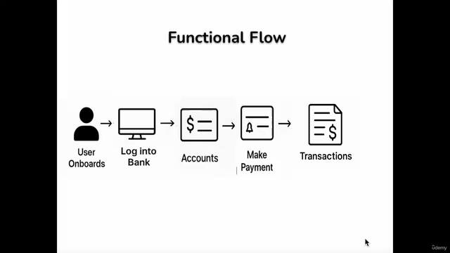
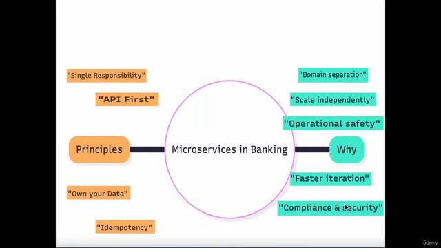
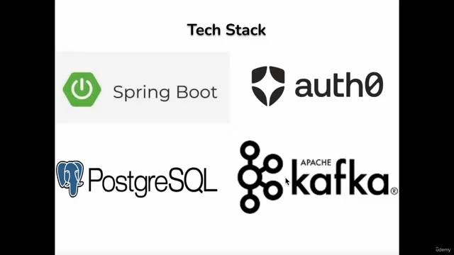
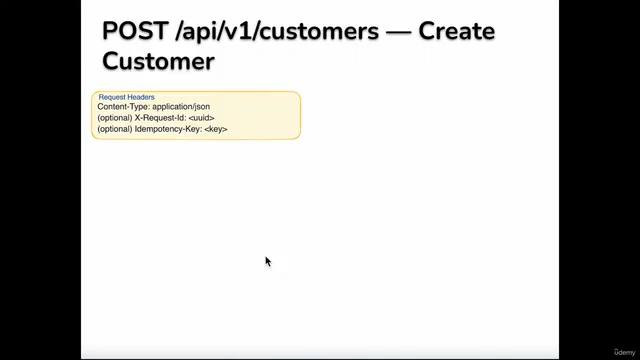

# 1. 这一节做什么

P1–P12 是这门课的第一阶段：**不是直接写 Spring Boot 代码，而是把“在线银行”从业务想法整理成可开发、可验收的设计契约**。讲师先收窄 MVP，再从用户旅程拆出领域服务，定下微服务原则和技术栈，然后以 Customer Service 为第一个样板，给出用例、API 契约、分层架构、数据模型，最后用 Sodelik 把需求拆成需求、特性、任务。后续代码课才会把这些设计落成可运行工程。

所以本文档的复现目标不是“在本机跑起一个银行系统”，而是**产出一套能直接交给开发继续写代码的设计产物**：MVP 范围、服务边界、API 表、数据模型表、需求 backlog、容量估算框架和取舍记录。P1–P12 的逐字稿中没有出现可运行代码、依赖版本、环境变量名、启动命令；这些内容课里没讲，本文会明确标出“课里没讲”，不会替讲师编造。



对前端转 AI 应用工程师的读者，先把几个后端概念翻译一下：这里的“服务”可以理解成一组独立部署的 API + 数据库 + 业务规则；“乐观锁”在 JS/Node 里通常对应“读取时拿到 version，写回时 `UPDATE ... WHERE id=? AND version=?`，影响行数为 0 就返回 409”；“幂等键”对应请求头里的 `Idempotency-Key` 加唯一索引/去重表，重复请求不能重复写。Java 语法本阶段知道即可，重点是边界和契约。

---

# 2. 讲师原话

下面引用逐字稿关键原句，后面附中文解释。时间点按逐字稿标注。

> “We'll focus on a carefully chosen set of core banking capabilities, the ones that form the foundation of almost every real bank.” —— p001 [00:23]

解释：课程刻意不把 lending、investments、rewards、cards、analytics 全做，而是抓住每家银行都有的核心能力，才能把流程做到生产级深度。

> “Onboard. First you onboard. Sign up, get your profile created.” —— p002 [00:00]

解释：MVP 的第一个用户旅程是注册开户，随后才是登录、账户、支付、交易历史。

> “Customer answers who you are in the bank. Auth user answers how you authenticate and what you are allowed to do.” —— p003 [00:55]

解释：Customer Service 管“你是谁、你的客户资料和 KYC 状态”；Auth user 管“你怎么认证、有什么角色和权限”。两者故意分开。

> “Balances are not the source of truth. Transactions are.” —— p003 [03:21]

解释：余额不是最终真相，交易流水才是银行可审计、可信赖的来源。

> “If bill pay glitches, accounts should keep run fine.” —— p004 [00:54]

解释：微服务拆分带来的隔离性：账单支付出问题，账户服务仍应正常运行。

> “Each service is the authority for its own database. No sneaky joins across schemas.” —— p004 [02:16]

解释：每个服务拥有自己的数据，不允许跨 schema 偷偷 join；账户拥有余额，就只有账户服务能写余额。

> “Idempotency... If something retries, it should never double charge a customer.” —— p004 [02:16]

解释：幂等性是银行支付的核心：重试不能重复扣款，一次动作只能一个结果。

> “All the backend services in this course will be built using Spring Boot.” —— p005 [00:27]

解释：所有后端服务使用 Spring Boot；Spring Boot 提供 REST API、校验、安全钩子、健康检查等生产能力，减少样板配置。

> “Kafka acts as the event backbone of the system.” —— p005 [01:23]

解释：Kafka 是异步事件骨干，用来做 Saga、重试和松耦合服务。逐字稿 p005 里把 Auth0 识别成 “OX0”，结合 p002 的 Auth0 上下文，本文统一写 Auth0。

> “This is called optimistic locking. Optimistic locking ensures you are updating the latest version so two clients don't overwrite each other.” —— p009 [01:21]

解释：ETag/If-Match 是乐观锁：更新必须基于最新版本，两个客户端不能互相覆盖。

> “Next, I break this feature down into tasks, the real actionable work items.” —— p012 [05:35]

解释：Sodelik 里需求拆成 Feature，再拆成 Task；Task 才是开发者拉进 sprint 的实际工作项。

---

# 3. 从零复现

本节按纯讲解课的复现方式，复现讲师的**推导过程**，不是复现代码。你可以用任意 Markdown 工具，把下面文件逐个写出来。下面目录是复现建议，**不是逐字稿里给出的目录**；P1–P12 没有给工程目录、依赖版本、环境变量和启动命令，课里没讲。

```text
banking-design/
├── 01-mvp.md
├── 02-service-map.md
├── 03-principles.md
├── 04-tech-stack.md
├── 05-customer-use-case.md
├── 06-api-contracts.md
├── 07-data-model.md
├── 08-customer-architecture.md
├── 09-sodelik-backlog.md
├── 10-capacity-estimate.md
└── 11-tradeoffs.md
```

## 步骤 0：先写“复现边界”

在 `01-mvp.md` 开头先写一句：本阶段只产出设计契约，不产出可运行 Spring Boot 工程；依赖版本、环境变量、启动命令课里没讲，等后续代码课确认。这样你不会把建议当成讲师原话。

## 步骤 1：定义 MVP 用户旅程

在 `01-mvp.md` 写五个阶段：

1. Onboard：注册、创建 profile。
2. Login：用 ID 和密码登录；课程使用 Auth0 处理认证。
3. Accounts：看到账户和余额。
4. Payments：自己账户间转账、转给别人、付账单；带幂等等保护。
5. Transactions：查看每一笔 debit、credit、posting 的历史。

再写“范围外”：P1 提到 lending、investments、rewards、cards、analytics 都很多，但课程刻意不做。复现时明确写“不在本期 MVP”。这样后续服务拆分不会失控。


## 步骤 2：把 MVP 映射成领域服务

在 `02-service-map.md` 建表，列“服务 / 职责 / 拥有数据 / 明确不知道什么”。按逐字稿至少写这些：

- Customer Service：客户资料、KYC 状态；回答“你在银行是谁”。
- Auth user / Auth0：身份、凭证、角色、权限；回答“你怎么认证、你能做什么”。
- Account Service：余额、可用资金、holds；是钱的单一真相。
- Payment Orchestrator：校验支付请求、让账户放 hold、用事件推动支付；它自己不移动资金，只协调步骤。
- Bill Service：校验用户要付给谁。
- Bill Pay Worker：把支付分组、准备结算。
- Settlement Service：对接外部系统、重试、acknowledgment。
- Transaction History / Ledger：维护 debit、credit、posting 的历史；余额不是真相，交易是。

每个服务后面写一句“它不拥有什么”。例如 Accounts 不知道 billers；Settlement 不知道 customers；Orchestrator 不知道 balances 的最终写入权。这不是多余，是设计边界。


## 步骤 3：写微服务原则

在 `03-principles.md` 写四条：

1. Single responsibility：一个服务一个职责，不做 God service。
2. API first：先定义 API，保持稳定并正确版本化。
3. Own your data：每个服务是自己数据库的权威，不允许跨 schema 偷偷 join。
4. Idempotency：重试不能重复扣客户钱；一次动作一个结果。

这四条后面会直接落到 Customer API 的 `Idempotency-Key`、`ETag`/`If-Match` 和错误码上。



## 步骤 4：记录技术栈，但不要编版本

在 `04-tech-stack.md` 写：

- Spring Boot：所有后端服务。
- Spring Data JPA：持久化，用 Java 领域模型，同时保留对存储和查询的控制。
- PostgreSQL：客户、账户、余额、支付、交易历史。
- Kafka：异步事件骨干，用于 Saga、重试、松耦合。
- Auth0：登录、签发 JWT、权限；用户 API 和服务间通信都靠它。

版本、环境变量名、启动命令、构建工具：**课里没讲**。复现时写“待后续代码课确认”，不要填假版本。



## 步骤 5：写 Customer onboarding 用例

在 `05-customer-use-case.md` 写：

- 目标：把 prospect 变成银行正式 customer。
- Actors：左边是填 signup form 的 customer；右边是校验并管理 onboarding 的 bank system。
- 旅程：Signup → Verification → Account ready。
- Happy path：
  1. 客户提交 signup form：first name、last name、email、phone、customer ID。
  2. 系统创建 customer 记录，状态不是 verified，而是 KYC pending。
  3. 检查通过后，状态翻到 verified；客户可以登录、开户、转账、支付。
- Variations：重复 email 拒绝；KYC failed 停止 onboarding。
- 业务规则：银行不能立刻信任用户输入；需要 ID 验证、合规筛查、欺诈检测。



## 步骤 6：写客户 API 契约

在 `06-api-contracts.md` 按课程命名写 create、read、update、health。注意：具体 URL 路径字符串课里没讲，复现时用“课程命名 + 待确认路径”记录，不要假装讲师给了 `/api/v1/customers` 这类路径。

Create customer：
- 公开端点；成功 201 created。
- Headers：`Content-Type: application/json`；`X-Request-ID` 可选，用于日志追踪；`Idempotency-Key` 可选，重试不重复创建。三个 header 都是 optional，客户端不发时后端自己生成。
- Body：first name、last name、email、phone、address、external ID。
- Response：201；Location header；body 含 external ID、KYC status = pending、version、createdAt。
- Errors：400 bad input；409 duplicate email 或 external ID；422 业务规则不满足；429 rate limiting；500 意外服务端错误。

Get customer：
- 非公开，需要 Authorization bearer JWT，JWT 要有合法 scope。
- `X-Request-ID` 追踪

## 步骤 7：写数据模型

在 `07-data-model.md` 里画三张表，每张都标注「谁是真相」：

- **customers**：id（UUID 或外部 ID）、first_name、last_name、email（唯一索引）、phone、kyc_status（`pending` / `verified` / `rejected`）、version、created_at、updated_at。
- **accounts**：id、customer_id（外键指向 customers，但**跨服务时不能靠数据库外键**，见步骤 9）、currency、status、version。
- **postings**：id、account_id、amount、direction（debit / credit）、transaction_id、created_at。

关键约束写在表下方，而不是只靠字段名：

1. `email` 必须 `UNIQUE`——重复邮箱注册是最常见的并发问题，靠应用层「先查再插」在并发下一定漏。
2. `version` 是乐观锁版本号，每次 update 加 1。
3. `postings` **只增不改**（append-only），错了用反向 posting 冲正，不 update 原记录。这是账务系统的铁律，也是「余额不是真相」的落地方式。

## 步骤 8：画架构图

在 `08-customer-architecture.md` 里用文字画两层图：

**上下文层**：客户（浏览器/App）→ API Gateway → Customer Service / Account Service。Gateway 负责 TLS 终止、JWT 校验、按 path 路由、限流。

**容器层**：每个服务一个进程 + 一个独立数据库；服务之间同步调用走 HTTP（带超时和重试），异步通知走 Kafka topic（每个服务一个 topic，事件类型如 `customer.created`、`account.opened`、`payment.initiated`）。

图上必须标出**不允许**的连线：

- 不允许 `Account Service` 直接读 `customers` 表。
- 不允许 `Payment Orchestrator` 直接调 `Settlement` 的外部接口，必须经过 `Settlement Service`。
- 不允许任何服务直接连 Kafka 的另一个服务的 consumer group。

## 步骤 9：写 backlog

在 `09-sodelik-backlog.md` 按「用户可见价值」排序，而不是按技术模块排序：

1. 客户能注册并登录（Customer Service + Auth0 集成）。
2. 客户能开户（Account Service 创建账户）。
3. 客户能看到余额（Account Service 查询）。
4. 客户能转账（Payment Orchestrator + 幂等 + Saga）。
5. 客户能看交易历史（Ledger 查询）。
6. 运营能人工审核 KYC（内部工具）。

每条 backlog 后面写「验收标准」，例如第 4 条的验收是：`Idempotency-Key` 相同重复提交只产生一笔转账；余额不足返回 422 而不是 500；Saga 任一步失败后账户余额回到转账前。

## 步骤 10：做容量估算

在 `10-capacity-estimate.md` 用「假设 + 计算」的形式，不追求准，追求**可讨论**：

- 假设 100 万注册用户、10 万日活、每人每天 5 次操作 → 50 万次请求/天 ≈ 6 QPS（平均），峰值按 10 倍算是 60 QPS。
- 但转账是写操作，且要求强一致，写 QPS 峰值假设 10；这意味着数据库连接池 20 个够用，不需要分库分表。
- 存储：每笔 posting 约 200 字节，100 万用户 × 每年 100 笔 = 2 亿行 × 200 字节 = 40GB/年，需要归档策略。

课里没给这些数字——这是你自己要补的，因为面试官问「你这个系统能撑多少」时，答「不知道」比答错更糟。

## 步骤 11：写权衡

在 `11-tradeoffs.md` 写下你**没选**的方案和原因，每条都写「什么时候该改」：

| 决策 | 选了 | 没选 | 什么时候该改 |
|---|---|---|---|
| 服务拆分 | 5 个服务 | 单体 | 团队 < 5 人时单体更快，拆服务是为了团队并行 |
| 一致性 | 强一致（乐观锁 + 事务） | 最终一致 | 跨服务时才需要 Saga，单库内别上 |
| 通信 | 同步 HTTP + 异步 Kafka | 纯 gRPC | 内部高性能 RPC 才值得上 gRPC |
| 幂等 | 客户端 `Idempotency-Key` | 服务端指纹去重 | 客户端不可控时用请求体哈希 |

这张表是 P1–P12 的**全部价值浓缩**：讲师讲的不是「应该怎么做」，而是「为什么这么做、代价是什么」。

---

## 5. 逐行解释

这一章没有代码，所以「逐行」解释的是 6 个 API 契约和 4 条微服务原则里**每一处设计选择背后的理由**。每一条都是面试里会被追问、自己写时容易写反的地方。

### 5.1 为什么 KYC 初始状态是 `pending` 而不是 `verified`

创建客户成功后立刻标 `verified`，是最常见的新手错误。它省掉了一个状态，但换来三个问题：第一，合规上不允许——银行必须做过 ID 验证才能把用户当「已验证」；第二，一旦 KYC 失败（冒用身份、制裁名单命中），你要回滚一个「已经生效」的客户，而回滚一个**未生效**的 de-facto 更简单；第三，`pending` 给了系统一个可观测的中间态——「有多少客户卡在 KYC」是一个运营指标，如果一开始就是 `verified`，这个指标永远为 0，你发现不了审核流程变慢。

所以状态机是 `pending → verified` 或 `pending → rejected`，**没有**从 `verified` 回退的路径（真有需要走人工冻结）。

### 5.2 409 和 422 为什么必须分开

`409 Conflict` 是「请求本身合法，但和当前资源状态冲突」——邮箱已存在、external ID 重复、乐观锁版本不匹配。`422 Unprocessable Entity` 是「语法没问题，但业务规则不满足」——余额不足、超过单笔限额、账户已冻结。

混用会导致前端无法区分该给什么提示：409 应该提示「这个邮箱已经注册过了，去登录」，422 应该提示「你的余额不足」。都返回 400 的话，前端只能显示一个笼统的错误。**HTTP 状态码是给调用方的机器可读契约**，比任何错误消息文本都稳定。

`400` 则严格留给「请求体格式错」——JSON 解析失败、必填字段缺失、类型不对。这三个码的分工在写接口文档时就要定死。

### 5.3 `Idempotency-Key`：为什么是客户端生成

课里强调重试不能重复扣钱。实现方式是客户端为**一次业务意图**生成一个 UUID，放在 `Idempotency-Key` 请求头里；服务端拿这个 key 去重：第一次处理时把 key 和响应存起来（24 小时 TTL），后续相同的 key 直接返回存好的响应，**不再执行**。

为什么是客户端生成而不是服务端？因为服务端拿不到「这是不是同一次重试」的信息——同一个用户的两次转账，请求体可能完全一样（转 100 元给张三），服务端无法区分「用户点了两次」和「网络重试了两次」。只有客户端知道「这是同一个意图」。**服务端用请求体哈希去重是错的**，会把合法的重复转账也吃掉。

key 必须和响应一起存，因为重试时要返回**相同的响应**（包括相同的 `Location` 和 ID），不能第二次返回 409 说「已存在」——那会让客户端以为失败了。

### 5.4 `ETag` / `If-Match`：乐观锁的 HTTP 表达

`ETag` 是服务端返回的版本标识（可以是版本号或者内容哈希），客户端更新时带 `If-Match: <etag>`，服务端比对：不一致返回 `412 Precondition Failed`（不是 409，412 是 HTTP 语义里专门给条件请求用的）。

为什么用乐观锁而不是悲观锁？因为银行账户的读远多于写，悲观锁（`SELECT ... FOR UPDATE`）会让所有读操作排队。乐观锁的代价是「冲突时要重试」，但冲突概率低时这是划算的。

注意：**更新余额时必须用 `UPDATE accounts SET balance = balance - 100, version = version + 1 WHERE id = ? AND version = ?`**，判断 `affectedRows === 0` 就是冲突。不能「先查出来算一下再写回去」——那中间有窗口，两个并发请求会互相覆盖（丢失更新）。

### 5.5 「余额不是真相，交易是真相」

这是讲师在 P1 反复强调的一句话，也是账务系统最反直觉的设计。余额（`accounts.balance`）是**从 postings 汇总出来的缓存**，真值是所有 debit / credit 记录的集合。

为什么？因为只要余额是唯一的真相，就一定会出现「余额和流水对不上」的争议，而你没有任何办法证明哪个是对的。反过来，只要流水完整，余额随时可以重算出来（`SUM(credits) - SUM(debits)`）。

工程上的落地：每次改余额必须在**同一个数据库事务**里写一条 posting；每天跑一次对账任务（reconciliation），用流水重算余额和缓存值比对，不一致就告警。这个任务不需要复杂逻辑，但必须有，而且告警必须有人看。

### 5.6 Payment Orchestrator 为什么不碰钱

课里明确说它「协调步骤，但不移动资金」。这不是官僚式分工，是因为**钱只能由持有余额的服务改**。如果 Orchestrator 也能改余额，那「账户的单一真相」就破了，两个服务都能改的数据等于没有服务拥有它。

正确的编排是：Orchestrator 收到请求 → 校验 → 调 Account Service 的 `POST /holds`（冻结金额）→ 发出 `payment.initiated` 事件 → Settlement 消费事件执行 → 成功发 `payment.settled`，失败发 `payment.failed` → Orchestrator 消费结果并调 Account Service 释放或扣减 hold。

**每一步都是幂等的**，因为 Saga 的每一步都可能重试。这就是为什么幂等不是「加个去重表」这么简单，它是整个架构的地基。

### 5.7 「Own your data」：禁止跨 schema join

单库单表时，`SELECT * FROM customers JOIN accounts ON ...` 是最自然的写法。拆服务之后这个写法就变成架构债：Customer 服务改一次表结构，所有 join 它的服务都跟着坏。

规则是：跨服务只能通过**接口**拿数据，接口返回的是 DTO 不是表行。代价是 N+1 查询（要查 100 个客户的账户，得调 100 次或者批量接口），所以每个服务都要提供批量查询接口（`GET /accounts?customerIds=a,b,c`），而不是让调用方循环。

**这条规则在团队规模小时看起来很浪费**，但它是「服务能独立部署」的前提——没有它，改一个字段要协调三个团队。

### 5.8 「API first」：版本化不是加 `/v2` 这么简单

课里说 API 要稳定并正确版本化。实践中的含义是：

- **只做加法不做减法**：新增字段是兼容的，改名、删字段、改类型都是破坏性的。
- **破坏性变更才升大版本**，而且新旧版本要并行跑一段时间。
- 版本放在 **URL path**（`/v1/customers`）而不是 header 里，因为 path 版本在日志、监控、网关路由里都可见，header 版本排查问题时要抓包才知道调的是哪个版本。

还有一点课里没展开：`X-Request-ID` 是可选的，但**服务端必须生成并回传**——客户端不发时也不能留空，否则一次请求跨越 5 个服务时，日志里没有任何字段能把它们串起来。

---

## 6. 复现检查清单

这一章是设计文档，验收方式是「拿你的文档回答下面这些问题」，答不上来就是没写清楚。

| # | 检查项 | 通过标准 |
|---|--------|----------|
| 1 | MVP 边界 | `01-mvp.md` 里明确列出「范围外」的五个方向（lending、investments、rewards、cards、analytics） |
| 2 | 服务清单 | `02-service-map.md` 至少 8 个服务，每个都有「不知道什么」 |
| 3 | 四条原则 | `03-principles.md` 四条齐全，且每条都能在后续 API 契约里找到落点 |
| 4 | 技术栈不编版本 | `04-tech-stack.md` 里没有出现任何具体版本号 |
| 5 | 用例有变化分支 | `05-customer-use-case.md` 里除了 happy path 至少写了 2 个 variations |
| 6 | API 契约完整 | create / read / update / health 四个都写了请求头、body、响应、错误码 |
| 7 | 三个可选的 header | `X-Request-ID`、`Idempotency-Key`、`Authorization` 每个都标注了「选填」还是「必填」 |
| 8 | 错误码分工 | 400 / 409 / 422 / 429 / 500 各自对应什么场景，没有混用 |
| 9 | 数据模型有唯一约束 | email 上有 UNIQUE，且说明了为什么不能靠应用层查重 |
| 10 | posting 只增不改 | `07-data-model.md` 里写了「冲正而不是修改」 |
| 11 | 架构图有禁止项 | `08-customer-architecture.md` 明确写了三条「不允许」的连线 |
| 12 | backlog 带验收 | 每条 backlog 后面都有可执行的验收标准 |
| 13 | 容量估算有假设 | `10-capacity-estimate.md` 每一行都是「假设 → 计算 → 结论」 |
| 14 | 权衡表有回退条件 | `11-tradeoffs.md` 每一行都写了「什么时候该改」 |
| 15 | 能从文档还原 | 换一个人只看这 11 个文件，能画出和讲师一样的架构图 |

第 15 条是最终标准：设计文档的价值不在于写得多全，而在于**别人能不能照着做出同样的决策**。

---

## 7. 课里没讲但你会撞上的

P1–P12 是纯设计课，没有一行可运行代码。这就意味着下面这些「设计文档里没写、但一动手就出问题」的地方，只能靠你自己补齐：

1. **服务拆分的粒度没有标准答案。** 课里给了 8 个服务，但如果你照着拆，第一个月就会发现自己拆细了——「Bill Service」和「Bill Pay Worker」在用户量小时完全没必要分开，合并成一个模块反而更快。拆分的判断标准是**团队边界**（Conway 定律），不是领域边界。一个人维护 8 个服务是灾难。

2. **分布式事务一定会变成噩梦。** 课里说 Kafka 做 Saga，但没讲 Saga 的补偿逻辑写起来有多难：每一步都要写「反向操作」，而有些操作**没有反向**（比如已经发出的外部通知）。真实系统里，Saga 的失败处理代码量通常是正常路径的 2–3 倍。

3. **`Idempotency-Key` 的存储会爆。** 每个 key 存 24 小时，按 60 QPS 算是 500 万个 key/天，如果每个 key 还存响应体，Redis 内存会很快告警。实践里要么只存 key + 状态码 + 响应 ID（让客户端重新查询），要么按业务重要性分级存储。

4. **JWT 的 scope 不是权限的全部。** 课里说 JWT 要有合法 scope，但 scope 是**粗粒度**的能力（「能读客户」），具体「能读哪个客户」必须在服务里查数据权限。只靠 JWT scope 会导致任意用户能读任意客户——这是最典型的越权漏洞（IDOR）。

5. **`X-Request-ID` 会被恶意伪造。** 如果直接把它写进日志，攻击者可以注入换行符做日志伪造，或者用超长 ID 撑爆日志存储。正确做法是校验格式（UUID 或 32 位十六进制），不合法就重新生成。

6. **POST 的 201 和 Location 要配套。** 返回 201 却不给 `Location` 是不合规范的，客户端没法知道新资源在哪。有些团队喜欢 200 + 返回 body 里的 ID，那样也行，但**要在 API 文档里统一**，不能一个接口 201 另一个 200。

7. **「健康检查」不只是 `GET /health` 返回 200。** 真正的健康检查要分两层：`liveness`（进程活着，不查依赖）和 `readiness`（能接流量，要查数据库和 Kafka）。混在一起会导致数据库一抖，k8s 把整个服务重启了——本来只是降级，变成了全挂。

8. **限流 429 要带 `Retry-After`。** 只返回 429 不给时间，客户端只能用指数退避猜，等于你的限流在教客户端重试风暴。`Retry-After` 可以是秒数，也可以是 HTTP 日期。

9. **数据库 schema 迁移没有「回滚」。** 课里没讲迁移，但拆服务之后每个服务一个库，迁移脚本必须有版本号（Flyway / Liquibase），而且**只能向前**——回滚脚本在数据已经变脏之后通常跑不通。这意味上线前要在 staging 用生产数据副本跑一遍。

10. **文档里写的架构，和真实跑起来的架构，中间隔着一个「服务发现」。** 服务之间怎么找到对方？课里默认了 API Gateway，但内网服务间调用要么走服务发现（Consul / k8s Service），要么走配置中心。这部分在 P1–P12 完全没提，但等你真正部署第二个服务时，第一个问题就是「它怎么知道对方的地址」。

如果这 11 份文档你能全部写完并且答得出上面 10 个问题，那 P1–P12 的设计部分就算真正消化了——接下来 P13 开始的 Spring Boot 工程，你会有地方放代码，而不是把代码堆在一个空目录里。