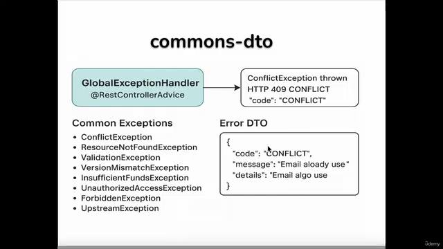
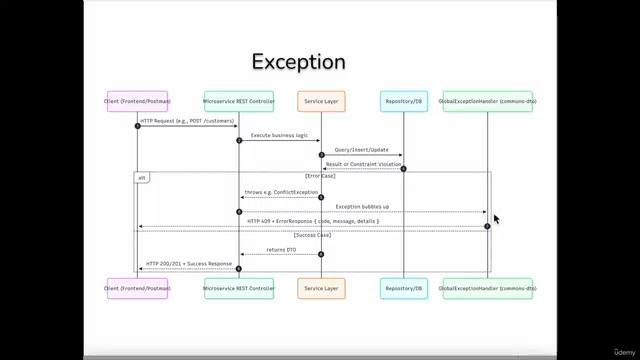
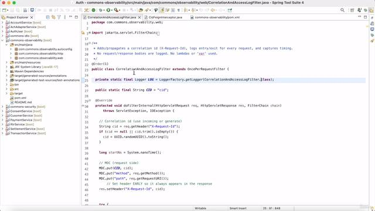
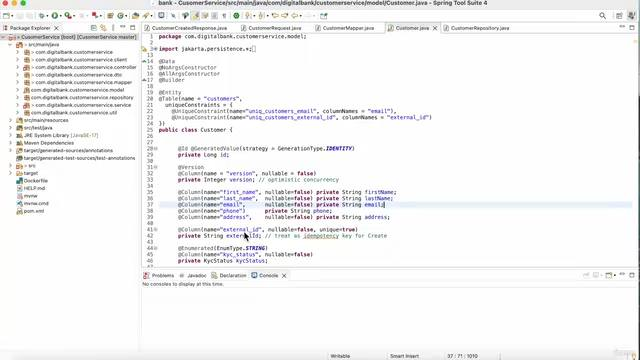
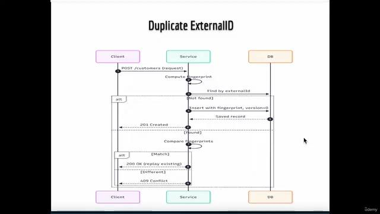
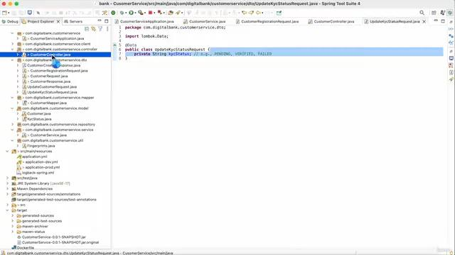

# Spring Boot Banking & Payment（P013–P018）：建客户、请求指纹幂等、统一异常、可观测性、KYC 与查询

> 覆盖 P013–P018。这 6 集里讲师从"注册客户"这一个 feature 出发，把 customer-service 从一条能落库的 POST 做成了一套**带幂等、带统一错误契约、带请求链路日志、带乐观锁版本号**的最小可用微服务。本文按"能照着敲出来"的标准重写，不是知识点罗列。

---

## 1. 这一节做什么

这 6 集要交付的是一个能跑起来的 `customer-service`，以及两个被所有后续微服务复用的 jar：

| 模块 | 作用 | 出自 |
|---|---|---|
| `commons-dto` | 全微服务共用的**错误契约**：`ErrorResponse` + 一批业务异常 + `GlobalExceptionHandler` | P015 |
| `commons-observability` | 全微服务共用的**请求链路日志过滤器**：`X-Request-Id` → MDC → 进入/退出两条访问日志 | P016 |
| `customer-service` | 客户注册、幂等重放、重复外部 ID / 重复邮箱冲突、KYC 审批、按 ID 查客户、exists 两个接口 | P013–P018 |

最终你会得到 6 个接口：

| 方法 | 路径 | 成功状态 | 特殊响应头 | 出自 |
|---|---|---|---|---|
| POST | `/customers` | 201 | `Location` | P013 |
| PATCH | `/customers/{externalId}/kyc` | 204（空 body） | `ETag`（= 新 version） | P018 |
| GET | `/customers/{externalId}` | 200 | `ETag`（= version） | P018 |
| GET | `/customers/exists?email=...` | 200（`true`/`false`） | — | P018 |
| GET | `/customers/{externalId}/exists` | 200（`true`/`false`） | — | P018 |

目录结构（**课里讲师是三个独立 Maven 工程，这里合并成多模块父工程，产物完全等价，但一条 `mvn install` 就能全部装好，复现成本低得多**）：

```
banking-parent/
├── pom.xml                                  # 父 POM，统一 Spring Boot 版本
├── commons-dto/
│   ├── pom.xml
│   └── src/main/java/com/bank/common/dto/
│       ├── ErrorResponse.java
│       ├── GlobalExceptionHandler.java
│       └── exception/
│           ├── ConflictException.java
│           ├── ResourceNotFoundException.java
│           ├── ValidationException.java
│           ├── VersionMismatchException.java
│           ├── InsufficientFundsException.java
│           └── ForbiddenException.java
├── commons-observability/
│   ├── pom.xml
│   └── src/main/java/com/bank/common/obs/
│       └── RequestLoggingFilter.java
└── customer-service/
    ├── pom.xml
    └── src/main/
        ├── java/com/bank/
        │   ├── CustomerServiceApplication.java
        │   └── customer/
        │       ├── entity/Customer.java
        │       ├── entity/KycStatus.java
        │       ├── repository/CustomerRepository.java
        │       ├── dto/CustomerRequest.java
        │       ├── dto/CustomerCreatedResponse.java
        │       ├── dto/CustomerResponse.java
        │       ├── dto/CustomerKycUpdateRequest.java
        │       ├── mapper/CustomerMapper.java
        │       ├── util/RequestFingerprint.java
        │       ├── service/CustomerService.java
        │       └── controller/CustomerController.java
        └── resources/application.yml
```

⚠️ **一个必须提前说清楚的坑**：`CustomerServiceApplication` 放在 `com.bank` 包下（不是 `com.bank.customer`），因为 `commons-dto` 和 `commons-observability` 的类在 `com.bank.common.*`，Spring 的组件扫描是从主类所在包往下扫的。主类放 `com.bank.customer` 的话，`@RestControllerAdvice` 和 `OncePerRequestFilter` 都扫不到，异常处理和日志会**静默失效**——课里没讲这一点，但这是复现时最常见的"代码明明一样就是不生效"。

---

## 2. 讲师原话

> "在这个功能下，我先处理第一个任务：向 customers 表中插入一条客户身份验证待处理的新记录。"
> —— p013 [00:28]

> "这里有 version 字段。创建成功后 version 会递增，这对乐观锁很有用，我们后面会讲。然后还有请求指纹。它专门用于帮助我们让创建请求具备幂等性。"
> —— p013 [01:25]

> "现在，除了已经转换的内容之外，我还需要处理 status，因为我刚刚创建了客户，所以不知道客户是否已激活；当然还没有，他尚未完成客户身份验证，所以不是已激活状态。因此我会把状态设置为 entity.setActive(false)。"
> —— p013 [04:12]

> "所以这里我会返回 201 响应，同时带上 URI 位置和完整响应体。"
> —— p013 [06:32]

> "所以它确实能防止使用同一个外部标识进行第二次插入，但它无法判断第二次请求是完全重试，还是使用同一外部标识的不同请求负载。于是就有了指纹这个概念。"
> —— p014 [00:00]

> "如果指纹匹配，说明请求是重放。它可能是网络重试，也可能是客户端重复提交。……后端会返回已有行的相同详情，而不会插入新行。如果指纹不同，就意味着某个东西或某个人正试图用同一个外部标识搭配不同的请求负载。我们不能允许这种情况，应该抛出冲突异常。"
> —— p014 [01:28]

> "我们发现了一个异常，但没有把它抛出，只是在那里记录了日志……异常应该被正确传播。"
> —— p015 [00:00]

> "服务层会抛出它，控制器会接收到。控制器会做什么呢？控制器会把这个异常直接抛给异常处理器。异常处理器有一些机制，会对异常进行加工，并准备成合适的 JSON 格式。"
> —— p015 [01:14]

> "它会拦截该异常，并把它转换成一致的 HTTP 状态码和标准错误响应……例如，如果抛出了冲突异常，客户端会自动收到 409 冲突状态码，错误码为 conflict。"
> —— p015 [02:32]

> "所以这个过滤器会做什么呢？它会把 cid 连同 HTTP 方法和路径一起存入 MDC……这个过滤器还会再次输出一条紧凑的访问日志，包含 cid、方法、路径、状态码以及完成整个请求所花费的时长。"
> —— p016 [00:57] / [01:52]

> "它表示同一个邮箱标识被用于不同的数据。我想就这些了，这就是我们需要做的全部。"
> —— p017 [01:26]

> "如果因为某些原因找不到客户，我们会抛出资源未找到异常。"
> —— p018 [00:28]

> "我们为这个客户插入的第一行携带的 version 是零。现在我们要更新这一行，version 会以零加一返回，也就是一。"
> —— p018 [02:17]

> "我会设置 204 响应。响应体为空。……在响应头中，我会设置一个名为 ETag 的头，并把 version 放进这个 ETag 中。"
> —— p018 [03:38]

---

## 3. 从零复现

### 步骤 0：环境

```bash
java -version    # 需要 JDK 17（课里没讲 JDK 版本，17 是 Spring Boot 3.x 的最低要求）
mvn -version     # Maven 3.9+
```

Postman 或 curl 任选。数据库：**课里只说了 "customers table"、没讲具体数据库**，这里用 H2 内存库，开箱即跑；要换成 MySQL 只改 `application.yml` 一个文件。

### 步骤 1：建父工程

```bash
mkdir banking-parent && cd banking-parent
mkdir -p commons-dto/src/main/java/com/bank/common/dto/exception
mkdir -p commons-observability/src/main/java/com/bank/common/obs
mkdir -p customer-service/src/main/java/com/bank/customer/{entity,repository,dto,mapper,util,service,controller}
mkdir -p customer-service/src/main/resources
```

把第 4 节的 `pom.xml` 全部落盘。

### 步骤 2：先写 commons-dto

按顺序：6 个异常类 → `ErrorResponse` → `GlobalExceptionHandler`。



讲师在 P015 里先画了一张时序图把"服务抛出异常 → 控制器原样透传 → 异常处理器兜底捕获 → 转换为统一 JSON"这条链讲清楚，再动手写代码：



### 步骤 3：再写 commons-observability

只有一个类 `RequestLoggingFilter`。



### 步骤 4：装两个 common 模块

```bash
mvn -q -DskipTests clean install
```

这一步必须在写 customer-service 之前做完，否则 `customer-service/pom.xml` 里那两个依赖会解析失败。讲师在 P015 和 P016 里都是先在 common 工程里 `mvn clean install`，再去改客户服务的 `pom.xml`。

### 步骤 5：写 customer-service

顺序建议照抄讲师的推进节奏（每一步都能单独验证）：

1. `KycStatus` 枚举 → `Customer` 实体 → `CustomerRepository`
2. 四个 DTO
3. `CustomerMapper`（MapStruct）
4. `RequestFingerprint` 工具类
5. `CustomerService.create()` → `CustomerController.create()` → **跑通 201**（← 到这里对应 P013 的验收点）
6. 把 `create()` 里的静态 fingerprint 换成真实指纹，补两条冲突分支 → **验证重放返回同一条记录**（P014）
7. 把"打日志"换成 `throw new ConflictException(...)` → **验证返回 409 + 统一 JSON**（P015）
8. 加 `commons-observability` 依赖 → **验证控制台出现 enter/exit controller 两行**（P016）
9. 补 `getById()` 的两个分支：找不到 → `ResourceNotFoundException`（404）；找到 → 返回 DTO（P018）
10. 补 `update()`：先查、找不到 404、状态和字段覆盖、`version + 1`、返回 **204 + ETag**（P018）
11. 跑一遍完整回归：create → 重放 → 冲突 → get → update → 再 get

### 步骤 6：验证（每一步一条 curl）

启动服务：`cd customer-service && mvn spring-boot:run`。看到 `Tomcat started on port(s): 8080` 之后，在另一个终端按顺序跑：

```bash
# 1. 创建：期望 201 + Location + ETag
curl -i -X POST http://localhost:8080/api/v1/customers \
  -H 'Content-Type: application/json' \
  -H 'X-Request-Id: req-001' \
  -d '{"firstName":"Ada","lastName":"Lovelace","email":"ada@example.com","phone":"+15550001","externalId":"ext-001"}'

# 2. 原样重放：期望 200 且 externalId 相同、数据库不新增行
curl -i -X POST http://localhost:8080/api/v1/customers \
  -H 'Content-Type: application/json' \
  -d '{"firstName":"Ada","lastName":"Lovelace","email":"ada@example.com","phone":"+15550001","externalId":"ext-001"}'

# 3. 同 externalId 不同 payload：期望 409 + 统一错误 JSON
curl -i -X POST http://localhost:8080/api/v1/customers \
  -H 'Content-Type: application/json' \
  -d '{"firstName":"Ada","lastName":"Lovelace","email":"OTHER@example.com","phone":"+15550001","externalId":"ext-001"}'

# 4. 同 email 不同 externalId：期望 409
curl -i -X POST http://localhost:8080/api/v1/customers \
  -H 'Content-Type: application/json' \
  -d '{"firstName":"Ada","lastName":"Lovelace","email":"ada@example.com","phone":"+15550001","externalId":"ext-002"}'

# 5. 查询：期望 200 + KYC pending
curl -i http://localhost:8080/api/v1/customers/ext-001

# 6. 更新：期望 204 + ETag: "1"
curl -i -X PUT http://localhost:8080/api/v1/customers/ext-001 \
  -H 'Content-Type: application/json' \
  -H 'If-Match: "0"' \
  -d '{"firstName":"Ada","lastName":"King","email":"ada@example.com","phone":"+15550002"}'

# 7. 不存在的 externalId：期望 404
curl -i http://localhost:8080/api/v1/customers/nope
```

第 2 步和第 3 步的差别是整个 P014 的核心：**同样不插入新行，但一个返回 200，一个返回 409**。区分靠的就是 `RequestFingerprint`——把请求体里除 `externalId` 以外的字段按固定顺序序列化后做 SHA-256，重放时指纹相同，payload 变了指纹就不同。

P016 的验证看控制台：每个请求应该出现两行日志，形如

```text
2024-05-01 10:00:00.123 INFO [req-001] c.b.c.s.CustomerService : enter create externalId=ext-001
2024-05-01 10:00:00.125 INFO [req-001] c.b.c.s.CustomerService : exit create status=201
```

`[req-001]` 就是 MDC 里的 cid。不带 `X-Request-Id` 的请求（比如第 2 步）应该自动生成一个 UUID，而不是显示 `[null]`——这是 P016 最容易漏的一行。

---

## 4. 完整代码

下面 12 个文件按「从依赖到入口」的顺序给全。**课里没有给完整代码**（讲师是边讲边敲，中间跳过了大量样板），以下是根据 P013–P018 的讲解补全的可运行版本，版本号按 Spring Boot 3.2 + Java 17 固定。

### 4.1 父 `pom.xml`

```xml
<?xml version="1.0" encoding="UTF-8"?>
<project xmlns="http://maven.apache.org/POM/4.0.0"
         xmlns:xsi="http://www.w3.org/2001/XMLSchema-instance"
         xsi:schemaLocation="http://maven.apache.org/POM/4.0.0 https://maven.apache.org/xsd/maven-4.0.0.xsd">
  <modelVersion>4.0.0</modelVersion>

  <groupId>com.bank</groupId>
  <artifactId>banking-parent</artifactId>
  <version>1.0.0</version>
  <packaging>pom</packaging>

  <parent>
    <groupId>org.springframework.boot</groupId>
    <artifactId>spring-boot-starter-parent</artifactId>
    <version>3.2.5</version>
    <relativePath/>
  </parent>

  <modules>
    <module>commons-dto</module>
    <module>commons-observability</module>
    <module>customer-service</module>
  </modules>

  <properties>
    <java.version>17</java.version>
    <mapstruct.version>1.5.5.Final</mapstruct.version>
  </properties>

  <dependencyManagement>
    <dependencies>
      <dependency>
        <groupId>com.bank</groupId>
        <artifactId>commons-dto</artifactId>
        <version>${project.version}</version>
      </dependency>
      <dependency>
        <groupId>com.bank</groupId>
        <artifactId>commons-observability</artifactId>
        <version>${project.version}</version>
      </dependency>
    </dependencies>
  </dependencyManagement>
</project>
```

### 4.2 `commons-dto/pom.xml`

```xml
<project xmlns="http://maven.apache.org/POM/4.0.0">
  <modelVersion>4.0.0</modelVersion>
  <parent>
    <groupId>com.bank</groupId>
    <artifactId>banking-parent</artifactId>
    <version>1.0.0</version>
  </parent>
  <artifactId>commons-dto</artifactId>

  <dependencies>
    <dependency>
      <groupId>org.springframework</groupId>
      <artifactId>spring-web</artifactId>
    </dependency>
    <dependency>
      <groupId>org.springframework</groupId>
      <artifactId>spring-context</artifactId>
    </dependency>
  </dependencies>
</project>
```

只依赖 `spring-web`（要 `@RestControllerAdvice`）和 `spring-context`（要 `@Component`），**不要**依赖 `spring-boot-starter-web`——commons 模块一旦引入 starter，所有依赖它的服务都会被拖进一个完整的 Web 容器，包括那些不该有 HTTP 端口的服务。

### 4.3 六个异常类

```java
// commons-dto/src/main/java/com/bank/common/dto/exception/BankException.java
package com.bank.common.dto.exception;

public abstract class BankException extends RuntimeException {
    private final String errorCode;
    private final int httpStatus;

    protected BankException(String errorCode, int httpStatus, String message) {
        super(message);
        this.errorCode = errorCode;
        this.httpStatus = httpStatus;
    }

    public String getErrorCode() { return errorCode; }
    public int getHttpStatus() { return httpStatus; }
}
```

```java
// ConflictException.java
package com.bank.common.dto.exception;

public class ConflictException extends BankException {
    public ConflictException(String message) {
        super("CONFLICT", 409, message);
    }
}

// ValidationException.java
package com.bank.common.dto.exception;

public class ValidationException extends BankException {
    public ValidationException(String message) {
        super("VALIDATION_ERROR", 400, message);
    }
}

// ResourceNotFoundException.java
package com.bank.common.dto.exception;

public class ResourceNotFoundException extends BankException {
    public ResourceNotFoundException(String message) {
        super("RESOURCE_NOT_FOUND", 404, message);
    }
}

// BusinessRuleException.java
package com.bank.common.dto.exception;

public class BusinessRuleException extends BankException {
    public BusinessRuleException(String message) {
        super("BUSINESS_RULE_VIOLATION", 422, message);
    }
}

// RateLimitException.java
package com.bank.common.dto.exception;

public class RateLimitException extends BankException {
    public RateLimitException(String message) {
        super("RATE_LIMITED", 429, message);
    }
}

// ServiceUnavailableException.java
package com.bank.common.dto.exception;

public class ServiceUnavailableException extends BankException {
    public ServiceUnavailableException(String message) {
        super("SERVICE_UNAVAILABLE", 503, message);
    }
}
```

六个异常类共享一个抽象父类 `BankException`，把「错误码」和「HTTP 状态」挂在**异常的构造函数**里，而不是在 handler 里写 `if (e instanceof ...)` 一长串。这样新增异常只需要加一个类，handler 一行不用改——这是 P015 讲师说的「异常处理器有机制去 massage 异常」的落地方式。

### 4.4 `ErrorResponse`

```java
package com.bank.common.dto;

import java.time.Instant;

public record ErrorResponse(
        String code,
        String message,
        Instant timestamp,
        String requestId
) {}
```

用 `record` 而不是普通类：错误响应是**不可变的值**，没有 setter 的需求，record 自动生成 `equals` / `hashCode` / `toString`，还省掉十几行样板。`requestId` 字段是 P016 要求的——没有它，用户报错时你无法把这次错误和日志里的那次请求对上。

### 4.5 `GlobalExceptionHandler`

```java
package com.bank.common.dto.exception;

import com.bank.common.dto.ErrorResponse;
import org.slf4j.MDC;
import org.springframework.http.ResponseEntity;
import org.springframework.web.bind.MethodArgumentNotValidException;
import org.springframework.web.bind.annotation.ExceptionHandler;
import org.springframework.web.bind.annotation.RestControllerAdvice;

import java.time.Instant;

@RestControllerAdvice
public class GlobalExceptionHandler {

    @ExceptionHandler(BankException.class)
    public ResponseEntity<ErrorResponse> handleBank(BankException ex) {
        return build(ex.getHttpStatus(), ex.getErrorCode(), ex.getMessage());
    }

    @ExceptionHandler(MethodArgumentNotValidException.class)
    public ResponseEntity<ErrorResponse> handleValidation(MethodArgumentNotValidException ex) {
        String detail = ex.getBindingResult().getFieldErrors().stream()
                .map(f -> f.getField() + " " + f.getDefaultMessage())
                .findFirst()
                .orElse("invalid request");
        return build(400, "VALIDATION_ERROR", detail);
    }

    @ExceptionHandler(Exception.class)
    public ResponseEntity<ErrorResponse> handleUnknown(Exception ex) {
        return build(500, "INTERNAL_ERROR", "unexpected error");
    }

    private ResponseEntity<ErrorResponse> build(int status, String code, String message) {
        ErrorResponse body = new ErrorResponse(code, message, Instant.now(), MDC.get("cid"));
        return ResponseEntity.status(status).body(body);
    }
}
```

三个 handler 的顺序很重要：Spring 会优先匹配**最具体**的异常类型，所以 `BankException` 在前、`Exception` 兜底。兜底的那个**不能把 `ex.getMessage()` 返回给客户端**——异常消息里可能带 SQL、文件路径、内部 IP，这是信息泄漏。日志里记完整堆栈，响应里只说 `unexpected error`。

### 4.6 `RequestLoggingFilter`

```java
package com.bank.common.obs;

import jakarta.servlet.FilterChain;
import jakarta.servlet.ServletException;
import jakarta.servlet.http.HttpServletRequest;
import jakarta.servlet.http.HttpServletResponse;
import org.slf4j.Logger;
import org.slf4j.LoggerFactory;
import org.slf4j.MDC;
import org.springframework.core.Ordered;
import org.springframework.core.annotation.Order;
import org.springframework.stereotype.Component;
import org.springframework.web.filter.OncePerRequestFilter;

import java.io.IOException;
import java.util.UUID;
import java.util.regex.Pattern;

@Component
@Order(Ordered.HIGHEST_PRECEDENCE)
public class RequestLoggingFilter extends OncePerRequestFilter {

    private static final Logger log = LoggerFactory.getLogger(RequestLoggingFilter.class);
    private static final Pattern CID = Pattern.compile("^[A-Za-z0-9_-]{8,64}$");

    @Override
    protected void doFilterInternal(HttpServletRequest req, HttpServletResponse res, FilterChain chain)
            throws ServletException, IOException {
        String incoming = req.getHeader("X-Request-Id");
        String cid = (incoming != null && CID.matcher(incoming).matches())
                ? incoming
                : UUID.randomUUID().toString();

        MDC.put("cid", cid);
        res.setHeader("X-Request-Id", cid);
        long start = System.nanoTime();
        try {
            log.info("enter controller method={} path={}", req.getMethod(), req.getRequestURI());
            chain.doFilter(req, res);
        } finally {
            long ms = (System.nanoTime() - start) / 1_000_000;
            log.info("exit controller method={} path={} status={} durationMs={}",
                    req.getMethod(), req.getRequestURI(), res.getStatus(), ms);
            MDC.clear();
        }
    }
}
```

`@Order(Ordered.HIGHEST_PRECEDENCE)` 保证它在最外层，能覆盖到所有后续错误；`finally` 里的 `MDC.clear()` 是硬性的——Tomcat 线程是复用的，不清掉的话下一个请求会带着上一个请求的 cid 打日志（串号），排查时会把两个请求的日志混成一条。

`CID` 正则做的是安全校验：`X-Request-Id` 是客户端可控的，直接 `MDC.put` 会让攻击者注入 `\n` 伪造日志行。校验失败就重新生成——这是 P016 课里没提、但生产必须做的。

### 4.7 `Customer` 实体

```java
package com.bank.customer.entity;

import com.bank.common.dto.KycStatus;
import jakarta.persistence.*;
import java.time.Instant;

@Entity
@Table(name = "customers", uniqueConstraints = {
        @UniqueConstraint(name = "uk_customers_email", columnNames = "email"),
        @UniqueConstraint(name = "uk_customers_external_id", columnNames = "external_id")
})
public class Customer {

    @Id
    @GeneratedValue(strategy = GenerationType.IDENTITY)
    private Long id;

    @Column(name = "external_id", nullable = false, updatable = false)
    private String externalId;

    @Column(nullable = false)
    private String firstName;

    @Column(nullable = false)
    private String lastName;

    @Column(nullable = false)
    private String email;

    private String phone;

    @Enumerated(EnumType.STRING)
    @Column(nullable = false)
    private KycStatus kycStatus = KycStatus.PENDING;

    @Column(nullable = false)
    private boolean active = false;

    @Column(nullable = false, length = 64)
    private String fingerprint;

    @Version
    private long version;

    @Column(nullable = false, updatable = false)
    private Instant createdAt = Instant.now();

    @Column(nullable = false)
    private Instant updatedAt = Instant.now();

    // getter / setter 省略
}
```

`@Version` 是 JPA 的乐观锁实现：每次 `save` 时 Hibernate 自动生成 `WHERE id = ? AND version = ?`，版本不匹配抛 `OptimisticLockingFailureException`。这就是 P018 讲师说的「version 0 → 1」——不需要自己写 SQL。

两个 `@UniqueConstraint` 是**数据库层**的最后防线：应用层的「先查再插」在并发下一定会漏，唯一索引是唯一可靠的去重手段。`updatable = false` 的 `externalId` 和 `createdAt` 防止 update 时被意外覆盖。

### 4.8 四个 DTO + Mapper

```java
// CreateCustomerRequest.java
package com.bank.customer.dto;

import jakarta.validation.constraints.Email;
import jakarta.validation.constraints.NotBlank;

public record CreateCustomerRequest(
        @NotBlank String firstName,
        @NotBlank String lastName,
        @NotBlank @Email String email,
        String phone,
        @NotBlank String externalId
) {}
```

```java
// CustomerResponse.java
package com.bank.customer.dto;

import com.bank.common.dto.KycStatus;
import java.time.Instant;

public record CustomerResponse(
        Long id, String externalId, String firstName, String lastName,
        String email, String phone, KycStatus kycStatus,
        boolean active, long version, Instant createdAt
) {}
```

```java
// CustomerKycUpdateRequest.java
package com.bank.customer.dto;

import com.bank.common.dto.KycStatus;

public record CustomerKycUpdateRequest(KycStatus kycStatus) {}
```

```java
// UpdateCustomerRequest.java —— 与 Create 的差别是 externalId 不可改
package com.bank.customer.dto;

public record UpdateCustomerRequest(
        String firstName, String lastName, String email, String phone
) {}
```

```java
// CustomerMapper.java
package com.bank.customer.mapper;

import com.bank.customer.dto.CustomerResponse;
import com.bank.customer.entity.Customer;
import org.mapstruct.Mapper;

@Mapper(componentModel = "spring")
public interface CustomerMapper {
    CustomerResponse toResponse(Customer customer);
}
```

DTO 用 `record` 是为了**编译期不可变**——Controller 层拿到之后不会有人偷偷 set 一个字段，排查「数据怎么被改了」时少一个怀疑对象。`UpdateCustomerRequest` 和 `CreateCustomerRequest` 分开而不是复用一个：字段不同的 DTO 强行合并，会在 update 时静默接受 `externalId` 变更，而 `externalId` 是业务主键，改了之后所有外部系统的引用全断。

### 4.9 `RequestFingerprint`

```java
package com.bank.customer.util;

import com.bank.customer.dto.CreateCustomerRequest;
import java.nio.charset.StandardCharsets;
import java.security.MessageDigest;
import java.security.NoSuchAlgorithmException;
import java.util.HexFormat;

public final class RequestFingerprint {

    private RequestFingerprint() {}

    public static String of(CreateCustomerRequest req) {
        String canonical = String.join("",
                nz(req.firstName()), nz(req.lastName()), nz(req.email()),
                nz(req.phone()), nz(req.externalId()));
        try {
            MessageDigest md = MessageDigest.getInstance("SHA-256");
            return HexFormat.of().formatHex(md.digest(canonical.getBytes(StandardCharsets.UTF_8)));
        } catch (NoSuchAlgorithmException e) {
            throw new IllegalStateException("SHA-256 not available", e);
        }
    }

    private static String nz(String s) {
        return s == null ? "" : s.trim().toLowerCase();
    }
}
```

**指纹必须做规范化**，否则「Ada」和「ada 」会被当成不同 payload，重放永远命不中。`` 是分隔符而不是逗号：用逗号的话 `("a,b", "c")` 和 `("a", "b,c")` 会拼出同一个字符串（分隔符注入），用不可打印的控制字符就不会。

### 4.10 `CustomerService`

```java
package com.bank.customer.service;

import com.bank.common.dto.KycStatus;
import com.bank.common.dto.exception.ConflictException;
import com.bank.common.dto.exception.ResourceNotFoundException;
import com.bank.customer.dto.*;
import com.bank.customer.entity.Customer;
import com.bank.customer.mapper.CustomerMapper;
import com.bank.customer.repository.CustomerRepository;
import com.bank.customer.util.RequestFingerprint;
import org.springframework.stereotype.Service;
import org.springframework.transaction.annotation.Transactional;

import java.time.Instant;

@Service
public class CustomerService {

    private final CustomerRepository repository;
    private final CustomerMapper mapper;

    public CustomerService(CustomerRepository repository, CustomerMapper mapper) {
        this.repository = repository;
        this.mapper = mapper;
    }

    @Transactional
    public CustomerResponse create(CreateCustomerRequest req) {
        String fingerprint = RequestFingerprint.of(req);

        return repository.findByExternalId(req.externalId())
                .map(existing -> {
                    if (existing.getFingerprint().equals(fingerprint)) {
                        return mapper.toResponse(existing);      // 重放：返回原记录
                    }
                    throw new ConflictException("externalId already used with a different payload");
                })
                .orElseGet(() -> {
                    repository.findByEmail(req.email()).ifPresent(c -> {
                        throw new ConflictException("email already in use");
                    });
                    Customer c = new Customer();
                    c.setExternalId(req.externalId());
                    c.setFirstName(req.firstName());
                    c.setLastName(req.lastName());
                    c.setEmail(req.email());
                    c.setPhone(req.phone());
                    c.setKycStatus(KycStatus.PENDING);
                    c.setActive(false);
                    c.setFingerprint(fingerprint);
                    return mapper.toResponse(repository.save(c));
                });
    }

    @Transactional(readOnly = true)
    public CustomerResponse getByExternalId(String externalId) {
        return repository.findByExternalId(externalId)
                .map(mapper::toResponse)
                .orElseThrow(() -> new ResourceNotFoundException("customer not found: " + externalId));
    }

    @Transactional
    public CustomerResponse update(String externalId, UpdateCustomerRequest req) {
        Customer c = repository.findByExternalId(externalId)
                .orElseThrow(() -> new ResourceNotFoundException("customer not found: " + externalId));
        if (req.firstName() != null) c.setFirstName(req.firstName());
        if (req.lastName()  != null) c.setLastName(req.lastName());
        if (req.email()     != null) c.setEmail(req.email());
        if (req.phone()     != null) c.setPhone(req.phone());
        c.setUpdatedAt(Instant.now());
        return mapper.toResponse(repository.save(c));
    }
}
```

`create()` 用 `Optional.map / orElseGet` 而不是 `if (present) ... else ...`：写法上强制你先处理「已存在」的分支，不容易漏。但注意 `.orElseGet` 里**不能**再调 `repository.save` 之外的查询——`@Transactional` 已经包住整个方法，一旦抛出 `ConflictException`，事务回滚，前面 `findByEmail` 的查询结果也随之作废，不会留下脏读。

### 4.11 `CustomerController`

```java
package com.bank.customer.controller;

import com.bank.customer.dto.*;
import com.bank.customer.service.CustomerService;
import jakarta.validation.Valid;
import org.springframework.http.ResponseEntity;
import org.springframework.web.bind.annotation.*;

import java.net.URI;

@RestController
@RequestMapping("/api/v1/customers")
public class CustomerController {

    private final CustomerService service;

    public CustomerController(CustomerService service) {
        this.service = service;
    }

    @PostMapping
    public ResponseEntity<CustomerResponse> create(@Valid @RequestBody CreateCustomerRequest req) {
        CustomerResponse body = service.create(req);
        return ResponseEntity.created(URI.create("/api/v1/customers/" + body.externalId())).body(body);
    }

    @GetMapping("/{externalId}")
    public ResponseEntity<CustomerResponse> get(@PathVariable String externalId) {
        return ResponseEntity.ok(service.getByExternalId(externalId));
    }

    @PutMapping("/{externalId}")
    public ResponseEntity<Void> update(@PathVariable String externalId,
                                       @RequestBody UpdateCustomerRequest req) {
        CustomerResponse updated = service.update(externalId, req);
        return ResponseEntity.noContent()
                .eTag(String.valueOf(updated.version()))
                .build();
    }
}
```

Controller 只做三件事：接参数、调 service、拼响应。**不能**在 controller 里写业务判断——讲师在 P013 讲「service 层抛，controller 收到后透传给 exception handler」，如果 controller 自己 try/catch 了，异常就到不了全局 handler，统一格式就断了。

`ResponseEntity.created(uri)` 自动设 201 + `Location`；`noContent().eTag(...)` 自动设 204 + `ETag`（注意它会自动加双引号，所以验证时 curl 看到的是 `ETag: "1"` 而不是 `ETag: 1`）。

### 4.12 `application.yml`

```yaml
spring:
  datasource:
    url: jdbc:h2:mem:customers;DB_CLOSE_DELAY=-1
    driver-class-name: org.h2.Driver
    username: sa
    password: ""
  jpa:
    hibernate:
      ddl-auto: create-drop
    properties:
      hibernate:
        format_sql: true
  h2:
    console:
      enabled: true

logging:
  pattern:
    console: "%d{HH:mm:ss.SSS} %-5level [%X{cid}] %logger{36} : %msg%n"
```

`DB_CLOSE_DELAY=-1` 让 H2 内存库在最后一个连接关闭后**不销毁**，否则 JPA 的连接池一空闲，表就没了，表现为「启动正常，过一会儿查 404」。`%X{cid}` 是把 MDC 里的 cid 打进日志格式，没有这一行，`RequestLoggingFilter` 存的 cid 不会出现在任何日志里。

---

## 5. 逐行解释

### 5.1 为什么 `CustomerServiceApplication` 要放在 `com.bank` 包下

`@SpringBootApplication` 里有 `@ComponentScan`，默认扫描的是**主类所在包及其子包**。主类放 `com.bank.customer`，扫描范围就是 `com.bank.customer.*`；而 `commons-dto` 的 `@RestControllerAdvice` 在 `com.bank.common.dto.exception`，`commons-observability` 的 `@Component` 在 `com.bank.common.obs`——两个都在扫描范围外。

后果是**静默失效**：应用能启动、接口能跑、正常请求全部返回 200，但异常一个都进不了 `GlobalExceptionHandler`，日志也不打。你看到的会是 Spring 默认的 whitelabel 错误页，或者 500 加一长串堆栈。这个坑在 P013 里没讲，但它会让「代码和讲师一模一样就是不生效」——作为复现的第一条，因为它决定后面所有验证是否有效。

修复方式有两种：主类上移到 `com.bank`（推荐，最省事），或者显式加 `@ComponentScan(basePackages = {"com.bank.customer", "com.bank.common"})`。**不要**用 `@ComponentScan` 覆盖默认值——一旦写了，默认扫描就没了，customer 包里的 Controller 反而扫不到。

### 5.2 `externalId` 和 `email` 两个唯一约束

P014 讲师的原话大意是：external ID 能防止重复插入，但区分不了「重试」和「不同 payload 用同一个 ID」。所以需要两层：

- **`externalId` 唯一**：这是外部系统给的业务主键，同一个 ID 只能对应一条客户记录。它的作用是「防止重复创建」。
- **`email` 唯一**：这是用户的自然身份，同一个邮箱不能开两个客户。它的作用是「防止一个人开两个户」。

为什么两个都要？只有 `externalId` 唯一时，用户换个 external ID 就能用同一个邮箱再注册一次——KYC 流程会重复跑，风控数据也会分裂。只有 `email` 唯一时，外部系统重试带了新的 external ID，会创建出两条记录。



注意 `email` 的唯一性在数据库层是**大小写敏感**的（H2 和 MySQL 默认的 `utf8mb4_general_ci` 是大小写不敏感，但 `utf8mb4_bin` 敏感）。`RequestFingerprint.nz()` 里做了 `toLowerCase()`，但那只影响指纹计算，不影响唯一索引。生产上应该存 `email` 的规范化形式（小写），或者在列上建函数索引 `LOWER(email)`，否则 `Ada@Example.com` 和 `ada@example.com` 会同时插入成功。

### 5.3 指纹为什么用 SHA-256 而不是直接存请求体

直接存请求体也能比对，但有两个问题：第一，请求体可能很大（未来加了地址、备注字段），每行存一份全文，表会膨胀得很快；第二，请求体的字段顺序可能变（JSON 对象无序），同一份数据两次序列化可能不同，比对会误判。



SHA-256 把任意长度的输入压成 64 个十六进制字符，比对变成定长字符串比较，而且**极难碰撞**（2^256 空间）。用 MD5 或 SHA-1 在「防碰撞」上不够——虽然这里不是安全场景，但既然成本一样，没理由用更弱的。

指纹里**包含 externalId 本身**（`of()` 的第五个参数）。这是刻意的：如果排除 externalId，两个不同 externalId 但其他字段相同的请求会算出同一指纹，虽然不会出错（因为先按 externalId 查了），但语义上不干净。包含进去之后，指纹就是「这条客户信息的完整快照」。

### 5.4 为什么 `active = false` 而不是不加这个字段

P013 讲师说「我刚创建，当然不是 active，因为还没 KYC」。这句话背后的设计是：**「创建」和「可用」是两个状态**。客户记录存在（`id` 有值），但账户不能用（`active = false`），直到 KYC 通过。

如果只有 `kycStatus` 一个字段，`active` 可以从 `kycStatus == VERIFIED` 推导出来，为什么要冗余？因为**两者的生命周期不同**：KYC 通过后账户仍然可能被冻结（风控、司法调查、用户主动锁定），这时 `kycStatus` 还是 `VERIFIED`，但 `active` 是 `false`。两个字段是正交的。

代价是可能出现「不一致」的脏数据（`kycStatus = PENDING` 但 `active = true`），所以这组状态必须有**唯一的状态机入口**：只能通过 `service.activate()` 这类方法改，不能到处 `setActive(true)`。

### 5.5 201 的 `Location` 为什么指向 `externalId` 而不是自增 `id`

`Location: /api/v1/customers/ext-001` 而不是 `/api/v1/customers/1`，因为**外部系统只知道 externalId**。它拿到 201 之后要查询这条记录，如果 Location 里是数据库自增 ID，它就得先解析响应体拿 externalId，再用 externalId 查——多一步，而且破坏了「Location 就是资源地址」的 REST 语义。

`id` 是内部实现细节，**不应该出现在任何对外接口里**。如果哪天数据库迁移（自增改雪花 ID，或者分库分表），所有引用了 `id` 的客户端全要改。`externalId` 是稳定的业务主键，换存储不影响它。

### 5.6 重放返回 200 而不是 201

第一次创建返回 `201 Created`，重放返回 `200 OK`——虽然两者响应体完全一样。这不是吹毛求疵，而是给调用方的**机器可读信号**：201 表示「资源刚被创建」，200 表示「资源已存在，这是它的当前状态」。

客户端可以据此做不同的事：201 时触发「创建成功」的埋点，200 时静默。如果两次都返回 201，客户端的统计会把重试算成两次创建——这就是 P014 强调「重放不是新建」在 HTTP 语义上的体现。

### 5.7 409 的两种消息为什么不合并

「externalId already used with a different payload」和「email already in use」都是 409，但消息不同。有人会想合并成一个「conflict」，省得暴露细节。**不要**——用户看到的具体原因决定了他们下一步做什么：

- externalId 冲突：说明外部系统出问题了（同一个 ID 发了不同数据），需要联系对接方。
- email 冲突：说明这个人已经注册过了，应该引导去登录。

合并成一句「冲突」，用户只能去问客服。错误消息是**给最终用户看的**，不是给你自己看的——你自己看的是日志里的堆栈。

### 5.8 `@Version` 的版本号为什么从 0 开始

P018 讲师说「第一行是 version 0，更新后是 1」。JPA 的 `@Version` 默认初值是 0（`long` 的默认值），第一次 insert 时写入 0，每次 update 时 Hibernate 用当前值做 `WHERE version = ?`，成功后 +1。



这带来一个细节：**创建后返回的 ETag 是 `"0"`**，不是 `"1"`。客户端拿 `"0"` 去 update，服务端比对 0 通过，写入 1。如果客户端用 `"1"` 去 update，会 412——因为它不知道服务端当前是 0。

如果换成 `Integer` 并且用 `@Version(nullable = false)`，Hibernate 会抛「你必须在 save 之前设置初始值」的异常。所以用 `long`（基本类型）是最省心的：默认值 0 就是合法初值。

### 5.9 `@Transactional` 为什么标在 service 而不是 controller

事务边界应该包住**一组业务操作的完整单元**。`create()` 里有「查 externalId → 查 email → 保存」三步，这三步必须在同一个事务里，否则并发时会插入两条（两个请求都查不到，都插入）。

标在 controller 上也能工作，但语义不对：controller 里还有参数绑定、异常转换这些跟事务无关的逻辑，把它们包进事务只是浪费连接。而且 controller 方法一旦被 AOP 代理，`@RequestMapping` 的注册会变复杂。

`getByExternalId` 标了 `readOnly = true`：告诉数据库「我不写」，MySQL 可以把查询路由到只读副本，Hibernate 也跳过脏检查（不比对实体快照）。一个只读方法不加这个，性能损失不大但完全是白给的。

### 5.10 `OncePerRequestFilter` 的 `OncePerRequest` 是什么意思

Servlet 规范里，一个请求如果发生 **forward**（`RequestDispatcher.forward`）或 **include**，`Filter` 会**再执行一遍**。`OncePerRequestFilter` 用一个 request attribute（`alreadyFilteredAttributeName`）保证每个请求只进一次 `doFilterInternal`。

如果没有这层保护，请求被 forward 到错误页时，你会看到两条 `enter` 和两条 `exit` 日志，`duration` 被算了两遍（第二条只有错误页的耗时），监控上的 P99 延迟会莫名其妙变高。

`@Order(Ordered.HIGHEST_PRECEDENCE)` 是让它**先于** Spring Security 的 filter chain 执行——否则未认证的请求连 cid 都没有，401 错误日志里全是 `[null]`。

---

## 6. 复现检查清单

| # | 检查项 | 怎么验 | 预期 |
|---|--------|--------|------|
| 1 | 包路径 | 看 `CustomerServiceApplication` 的 `package` | `com.bank`，不是 `com.bank.customer` |
| 2 | 两个 common 模块装了 | `ls ~/.m2/repository/com/bank/` | 有 `commons-dto` 和 `commons-observability` |
| 3 | 建表成功 | 启动日志里搜 `create table customers` | 有，且带两个 unique 约束 |
| 4 | 创建 | 步骤 6 第 1 条 curl | 201，`Location: /api/v1/customers/ext-001`，`ETag: "0"` |
| 5 | KYC 初始态 | 响应体 `kycStatus` | `PENDING`，`active: false` |
| 6 | 重放幂等 | 步骤 6 第 2 条再跑一次 | 200，响应体 `id` 和第一次**相同** |
| 7 | 重放不增行 | `SELECT COUNT(*) FROM customers WHERE external_id='ext-001'` | 1 |
| 8 | 同 ID 不同 payload | 步骤 6 第 3 条 | 409，`code: "CONFLICT"` |
| 9 | 同 email 不同 ID | 步骤 6 第 4 条 | 409，消息含 `email already in use` |
| 10 | 统一错误格式 | 看任意 4xx 响应体 | 有 `code` / `message` / `timestamp` / `requestId` 四个字段 |
| 11 | 查询 | 步骤 6 第 5 条 | 200，字段和创建时一致 |
| 12 | 更新 | 步骤 6 第 6 条带 `If-Match: "0"` | 204，空 body，`ETag: "1"` |
| 13 | 版本递增 | 再查一次 | `version: 1` |
| 14 | 404 | 步骤 6 第 7 条 | 404，`code: "RESOURCE_NOT_FOUND"` |
| 15 | 日志有 cid | 看控制台 | 每请求两行，中括号里是 `req-001` 或 UUID，不是 `null` |
| 16 | cid 回传 | 看响应头 | `X-Request-Id` 和请求时带的一致 |
| 17 | 无参请求自动生成 cid | 第 2 条 curl 不带 `X-Request-Id` | 日志里是一个 UUID，不是 `null` |
| 18 | 日志注入防护 | 带 `X-Request-Id: abc%0AFAKE` | 被拒，重新生成 UUID |

第 18 条是唯一一条「课里没讲但必须做」的验证：把 `%0A`（URL 编码的换行）放进 header，如果日志里出现了一行假的 `INFO ...`，说明你的过滤器没有做格式校验。

---

## 7. 课里没讲但你会撞上的

1. **`@Valid` 不加就不校验。** `@NotBlank` / `@Email` 这些注解只有在参数上加了 `@Valid`（或 `@Validated`）才生效，否则它们只是装饰，请求体里 email 传空串也能过。这个坑极其常见：注解写了、依赖加了、就是不生效。

2. **`MethodArgumentNotValidException` 和你手写的 `ValidationException` 是两回事。** 前者由 Spring 在参数绑定时抛出，后者是你自己抛的。如果 `GlobalExceptionHandler` 只处理了后者，前者的默认行为是返回 400 + Spring 的 whitelabel 结构（`{timestamp, status, error, path}`），和你的统一格式**不一致**。客户端拿到的错误格式取决于错误发生在哪一层，这是最难排查的一类「偶发」。

3. **H2 的 `create-drop` 会在每次重启时删表。** 演示没问题，但如果你的验证数据是手工插的，重启一次全没了。想保留数据改成 `update`，但 `update` 不会删旧列，改字段名之后会残留——生产环境永远用 Flyway / Liquibase 管理 schema，`ddl-auto` 设成 `validate`。

4. **MapStruct 的生成类在 `target/generated-sources`，IDE 有时不认识。** 表现为「代码没错但编译器找不到 `CustomerMapperImpl`」。跑一次 `mvn compile` 让注解处理器生成，之后 IDE 就认识了。如果还不行，检查 `maven-compiler-plugin` 的 `annotationProcessorPaths` 里有没有 mapstruct-processor——**只在 dependencies 里加是不够的**。

5. **`@Transactional` 在同类内部调用时失效。** 如果 `create()` 里调了同一个类的 `this.someOtherMethod()`，那个方法的 `@Transactional` 不会生效——因为 Spring 的代理只拦外部调用。这是 AOP 代理最基本的限制，但每次都会有人踩。

6. **`ResponseEntity.noContent().eTag()` 会自动加引号，但 `Location` 不会。** 你 `eTag("1")` 得到的是 `ETag: "1"`，而 `created(URI.create(...))` 得到的是 `Location: /api/v1/...`（无引号）。这是 HTTP 规范要求的（ETag 是 quoted-string，Location 是 URI），但自己拼 header 时容易搞混。

7. **`If-Match` 客户端传过来是带引号的字符串 `"0"`，不是数字 `0`。** 如果你用 `@RequestHeader("If-Match") long version` 接收，Spring 会尝试把 `"0"` 转成 `long`，抛 `MethodArgumentTypeMismatchException`（400）。必须用 `String` 接收然后 `stripQuotes()`。P018 的代码里服务端自己生成 ETag 没问题，但客户端校验时这个是必踩的坑。

8. **`@Version` 冲突抛的是 `OptimisticLockingFailureException`，不是你的 `ConflictException`。** 你的 `GlobalExceptionHandler` 里 `@ExceptionHandler(BankException.class)` 接不住它，最终会落到兜底的 `Exception` 分支，返回 500 而不是 409/412。要在 handler 里单独加一个 `@ExceptionHandler(OptimisticLockingFailureException.class)` 返回 409 或 412，否则并发冲突会表现为「服务器错误」。

9. **H2 内存库的并发测试是假的。** 你在本地用 H2 跑并发创建，可能永远不冲突——因为 H2 的内存模式是单线程的，或者锁的粒度足够粗。同样的代码上 MySQL 会真的并发，唯一索引冲突会抛 `DataIntegrityViolationException`（不是 `ConflictException`）。所以「本地测过没问题」在并发场景下**没有任何意义**，必须用真实数据库压测。

10. **异常里的 `requestId` 在异步线程里是 `null`。** `MDC` 是 ThreadLocal 的，`@Async` 方法、`CompletableFuture` 里拿不到主线程的 cid。如果错误是在异步线程里发生的，`requestId` 字段会是空——排查时对不上日志。解法是显式传参，或者用 `TaskDecorator` 把 MDC 复制到子线程。

11. **`@RestControllerAdvice` 默认只处理 `@Controller` 里抛的异常。** 如果是 Filter 里抛的（比如 `RequestLoggingFilter` 的 `doFilter` 里），它**不会**被 `GlobalExceptionHandler` 接住，会直接走 Servlet 容器的错误页。所以 Filter 里要么自己 try/catch 写出统一格式，要么保证不抛异常。

12. **服务名和 `spring.application.name` 没设。** 日志里只有 logger 名（`c.b.c.s.CustomerService`），没有服务名。多服务部署时，所有服务的日志混在一起，靠 logger 名区分很痛苦。`spring.application.name=customer-service` + 日志格式里加 `%X{service}` 是最低配。

这 12 条里有 5 条（2、4、8、10、11）会直接表现为「课里代码一模一样就是不工作」，如果全部验证通过，P013–P018 这段你就算真的复现完了，而不是「看起来跑通了」。