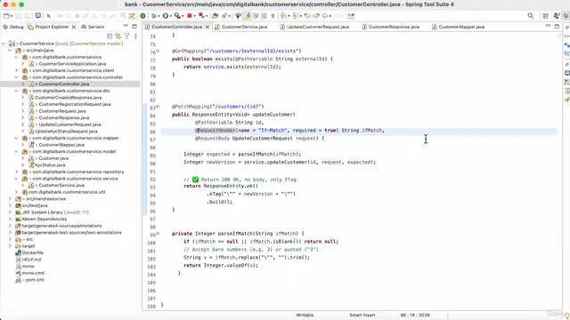
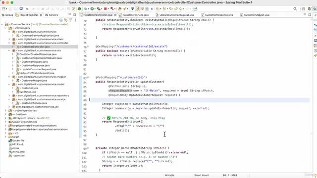
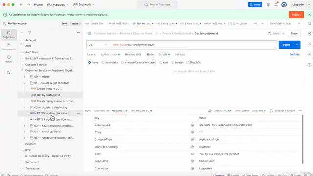
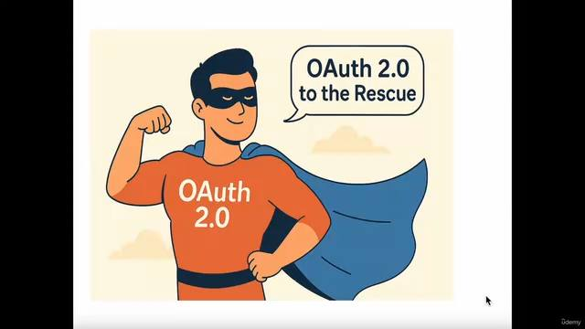
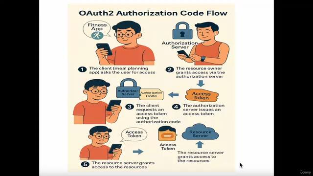

# Spring Boot Banking & Payment（锁 + Saga）P19–P22 复现文档：乐观锁客户更新与 OAuth2/PKCE/JWT 安全底座

> 范围说明：P19 有明确的 Update Customer API 代码实现讲解，可以落成可运行示例；P20–P22 主要是 OAuth2、授权码流程、PKCE、JWT 的设计与原理讲解，逐字稿里**没有给出 Common Security、AuthUser、Auth0 配置的可运行源码**。因此本文把 P19 做成“可照着跑”的 Spring Boot 最小项目，把 P20–P22 做成“可照着落地”的设计契约、参数表、职责表和检查清单。  
> 另外，课程标题里有 Saga，但 P19–P22 逐字稿没有展开 Saga 实现，本文不编造 Saga 代码。  
> 代码中的 Spring Boot、MapStruct 版本、包名、类名是本文为了可复现而补齐的，不是讲师逐字稿原话；讲师的代码结构、接口语义、ETag/If-Match 流程则按 p019 原话还原。

---

## 1. 这一节做什么

这一节要做出两样东西。

第一样是一个**可运行的 Customer 更新接口**，用来演示乐观锁。流程是：

1. 客户端先 `GET /customers/{externalId}` 获取客户。
2. 响应头里带 `ETag`，它的值就是数据库里这条客户记录的当前版本号。
3. 客户端更新时调用 `PATCH /customers/{externalId}`，并在请求头里带 `If-Match: 当前版本号`。
4. 服务端先查客户，再比较 `If-Match` 里的版本号和数据库里的版本号。
5. 如果一致，更新字段，保存，版本号加一，返回 `200`、空 body，并在响应头 `ETag` 里返回新版本号。
6. 如果不一致，返回 `409 Conflict`，表示版本过期或版本不匹配。

这条线对应 p019 的核心：**不是先把数据库行锁住，而是允许多个客户端自由读；真正更新时再比较版本，冲突了才失败**。


第二样是一张**安全底座设计图**。p020–p022 讲师没有继续写代码，而是在设计数字银行的安全层：

- 建一个可复用库 `Common Security`，每个微服务都依赖它，主要职责是验证 Auth0 发来的 JWT。
- 建一个独立服务 `AuthUser`，它是唯一直接对接身份提供方 Auth0 的服务，负责创建用户、分配角色、权限。
- 用 OAuth2 的授权码流程让客户端拿到 access token。
- 对单页应用和移动应用，用 PKCE 加强授权码流程，防止 authorization code 被截获后直接换 token。
- 资源服务器不每次都调用 Auth0，而是用 JWT 里的签名和 JWKS 公钥本地验签，做到无状态。

这一节的最终产物是：一个能跑的乐观锁 Customer API，加一套能指导后续安全开发的组件职责表、OAuth2 角色表、PKCE 参数表、JWT claims 表和复现检查清单。

---

## 2. 讲师原话

下面引用关键原话，保留英文并附中文解释。时间点按逐字稿标注。

> "乐观锁可以防止多个客户端同时尝试更新同一条记录时发生意外覆盖。"
> —— p019 [00:00]  
> 中文：乐观锁防止多个客户端同时更新同一条记录时发生意外覆盖。

> "客户端 A 在请求头中发送了版本标签，也就是请求头里的 If-Match。"
> —— p019 [01:23]  
> 中文：客户端 A 在请求头里发送版本标签，这个请求头叫 `If-Match`。

> "服务器没有锁住数据库中的行并阻塞其他所有人，而是允许多个客户端自由读取。但当它们回来更新时，服务器会比较版本。"
> —— p019 [02:16]  
> 中文：服务端没有锁数据库行并阻塞其他人，而是允许多个客户端自由读；等它们回来更新时，服务端再比较版本。

> "我们有一个名为 If-Match 的请求头，它会取数据库记录中当前的版本。"
> —— p019 [03:36]  
> 中文：更新接口有一个 `If-Match` 请求头，它携带数据库里这条记录的版本号。

> "如果我们发现期望值与从客户记录中取回的值不同，就会再次抛出另一个异常，提示版本过期或版本不匹配。"
> —— p019 [04:35]  
> 中文：如果期望版本和从客户记录里查出来的版本不同，就抛出版本过期/版本不匹配异常。逐字稿里 “tail version” 是口误，语义是 stale version。

> "我们使用 MapStruct 更新客户记录。"
> —— p019 [04:35]  
> 中文：讲师说使用 MapStruct 来更新客户记录。逐字稿里 “mapstrap” 是 MapStruct 的口误。

> "我们返回一个 200 响应，响应体为空。同样，ETag 会包含当前版本。"
> —— p019 [05:03]  
> 中文：更新成功后返回 200、空 body，响应头 `ETag` 里放当前版本。

> "接下来，我们会创建一个名为 Common Security 的可复用库。每个微服务都将依赖这个库。该库的主要用途是验证来自身份提供商 Auth0 的 JWT 令牌。"
> —— p020 [00:28]  
> 中文：下一步建一个可复用库 `Common Security`，每个微服务都依赖它，主要目的是验证来自 Auth0 的 JWT。

> "我们会引入一个名为 AuthUser 的专用身份管理服务。该服务将是唯一与我们的身份提供商交互的服务。"
> —— p020 [00:57]  
> 中文：引入专门的 identity admin 服务 `AuthUser`，它是唯一直接和身份提供方交互的服务。

> "OAuth2 是一个授权框架，它通过基于令牌的授权机制解决了这些挑战。"
> —— p020 [03:33]  
> 中文：OAuth2 是一个授权框架，通过基于 token 的授权机制解决凭据暴露、权限过大、无法撤销等问题。

> "一旦我成功登录，授权服务器会给备餐应用一个临时代码，称为授权码。它有效期很短，单独使用时没有作用。"
> —— p020 [08:22]  
> 中文：登录成功后，授权服务器给客户端一个短期的 authorization code；它本身很短命，单独拿走也没用。

> "这正是 Pixi 所做的。Pixi 为授权码流程增加了一层额外的安全保护。"
> —— p021 [10:06]  
> 中文：PKCE 给授权码流程增加了一层安全。逐字稿里 “Pixi” 是 PKCE 的口语读法。

> "即使攻击者窃取了授权码，如果没有原始校验器，他们也无法使用它。"
> —— p021 [11:02]  
> 中文：即使攻击者偷到 authorization code，没有原始 code verifier 也不能换 token。

> "访问令牌可以有不同的格式。最常见且广泛使用的是 JWT。它代表 JSON Web Token。JWT 是自包含的……通过密码学方式签名以防止篡改。"
> —— p022 [00:57]  
> 中文：access token 有多种格式，最常见的是 JWT；JWT 自包含，并用密码学签名防止篡改。

> "JWT 由三部分组成，各部分用点分隔：头部、载荷和签名。"
> —— p022 [01:24]  
> 中文：JWT 由三部分组成，用点分隔：header、payload、signature。

> "它们可以独立验证令牌，并信任其内容。"
> —— p022 [04:09]  
> 中文：资源服务器可以独立验证 token 并信任它的内容，不需要每次请求都调用授权服务器。

---

## 3. 从零复现

### 3.1 环境与目录结构

建议环境如下。**这些版本是本文为了可复现给出的建议，不是课程逐字稿原话**；课里没有讲具体 Spring Boot 版本。

- JDK 17
- Maven 3.9+
- Spring Boot 3.3.5
- MapStruct 1.6.3
- H2 内存数据库，不需要额外安装 MySQL/PostgreSQL
- 服务端口：`8080`

目录结构：

```text
banking-customer-lock/
├── pom.xml
└── src
    └── main
        ├── java
        │   └── com
        │       └── example
        │           └── banking
        │               └── customer
        │                   ├── CustomerServiceApplication.java
        │                   └── customer
        │                       ├── ApiException.java
        │                       ├── ApiExceptionHandler.java
        │                       ├── Customer.java
        │                       ├── CustomerController.java
        │                       ├── CustomerMapper.java
        │                       ├── CustomerRepository.java
        │                       ├── CustomerResponse.java
        │                       ├── CustomerService.java
        │                       ├── DataSeeder.java
        │                       └── UpdateCustomerRequest.java
        └── resources
            └── application.yml
```

启动命令：

```bash
cd banking-customer-lock
mvn clean spring-boot:run
```

启动后种子数据会创建 `externalId=john` 的客户。初始版本号由 JPA 的 `@Version` 管理，通常从 `0` 开始；课程 demo 里初始版本是 `1`，这是数据不同导致的，**以你实际 GET 返回的 `ETag` 为准**。

### 3.2 复现乐观锁更新流程

第一步，获取客户。注意看响应头 `ETag`。

```bash
curl -i http://localhost:8080/customers/john
```

预期响应类似：

```http
HTTP/1.1 200
ETag: 0
Content-Type: application/json

{"externalId":"john","name":"John","phone":"111-111-1111","version":0}
```

这里的 `ETag: 0` 就是当前版本。下一步更新时必须把它放进 `If-Match`。



第二步，带 `If-Match` 更新手机号。

```bash
curl -i -X PATCH http://localhost:8080/customers/john \
  -H 'Content-Type: application/json' \
  -H 'If-Match: 0' \
  -d '{"phone":"222-222-2222"}'
```

预期响应：

```http
HTTP/1.1 200
ETag: 1
```

body 为空。此时数据库里的版本已经变成 `1`。



第三步，制造过期版本冲突。继续用旧的 `If-Match: 0` 再更新一次：

```bash
curl -i -X PATCH http://localhost:8080/customers/john \
  -H 'Content-Type: application/json' \
  -H 'If-Match: 0' \
  -d '{"phone":"333-333-3333"}'
```

预期返回 `409 Conflict`，因为数据库里已经是版本 `1`，`If-Match` 还是 `0`。



第四步，再 GET 一次，确认手机号和版本都变了：

```bash
curl -i http://localhost:8080/customers/john
```

预期：

```http
HTTP/1.1 200
ETag: 1

{"externalId":"john","name":"John","phone":"222-222-2222","version":1}
```

这就是 p019 讲的完整闭环：**GET 拿版本 → PATCH 带 If-Match → 成功则版本递增 → 旧版本再更新返回 409**。

### 3.3 复现 p020–p022 的安全设计线

p020–p022 是纯讲解/设计推导，没有可运行代码。按“需求 → 约束 → 估算 → 方案 → 取舍”复现如下。

#### 需求

Customer API 已经能注册、更新、查询客户，但 p019 结尾讲师明确说：不能把这些关键接口裸奔，任何人都不应该在没有认证和授权的情况下直接调用 GET/PATCH。因此需要：

1. 客户端登录后拿到 access token。
2. 微服务作为资源服务器验证 token。
3. 用户 provisioning 和角色分配不能散落在每个微服务里。
4. 单页应用和移动应用不能使用不安全的授权码流程。

#### 约束

- 系统是微服务，不能让每个服务都直接对接 Auth0。
- 资源服务器不能每个请求都远程调用 Auth0，否则 Auth0 会成为性能和可用性瓶颈。
- 前端 SPA 无法安全保存 client secret。
- authorization code 可能通过 XSS、非 HTTPS、开放重定向被截获。
- JWT 必须能本地验签，并且要校验签发者、受众、过期时间等。

#### 估算（课里没有给数字，以下为示意公式）

课里没有给出 QPS、token 大小、JWKS 缓存时间等数字，下面只给可落地的估算方法，不冒充课程数据。

- Token 验证 QPS ≈ 所有微服务入口请求 QPS 之和。因为每个受保护请求都要验一次 JWT。
- JWKS 缓存收益：如果 JWKS 缓存 TTL 为 10 分钟，则 Auth0 JWKS 端点调用次数 ≈ 微服务实例数 × 6 次/小时，而不是每个请求一次。
- JWT 大小估算：header 约 200 字节，payload 约 500 字节，signature 约 342 字节（RS256 常见长度），合计约 1 KB 量级。payload 里不要塞大对象。
- 冲突率估算：乐观锁冲突率 ≈ 同一记录在“读取到提交”窗口内被并发更新的次数 / 总更新次数。冲突率高时再考虑重试、队列或悲观锁。

#### 方案

1. **Common Security 库**：封装 JWT 解析、签名验证、`iss`/`aud`/`exp` 校验、从 JWKS 取公钥、把用户身份放入 Spring Security 上下文。每个微服务依赖它。
2. **AuthUser 服务**：唯一直接调用 Auth0 Management API 的服务。客户 KYC 完成后，由它创建 Auth0 用户、分配角色和权限。
3. **Auth0 作为 Authorization Server**：负责登录、同意、签发 authorization code、access token、ID token、refresh token。
4. **Customer Service 作为 Resource Server**：只认 access token，不保存密码、不保存 session。
5. **SPA/Mobile 使用 Authorization Code + PKCE**：客户端生成 `code_verifier`，哈希成 `code_challenge`，授权请求带 challenge，换 token 时带 verifier。



#### 取舍

- 乐观锁 vs 悲观锁：银行客户资料更新冲突不极端频繁，乐观锁避免数据库行锁和阻塞，读多写少更合适；冲突极高时才考虑悲观锁或串行化。
- Common Security vs 每个服务自己写验证：集中库保证一致，但升级时要统一版本。
- AuthUser 单独服务 vs 各服务直连 Auth0：单独服务减少凭据扩散，但多一个运维单元。
- JWT 本地验签 vs 每次 introspection：本地验签性能好、无状态，但必须处理密钥轮换和撤销延迟。
- PKCE S256 vs plain：S256 是推荐方式；plain 只适合兼容旧系统，安全性弱。



---

## 4. 完整代码

> 重要声明：下面 P19 的 Java 代码是本文依据讲师口述补齐的**可运行复现实现**，不是课程原样源码；课程没有逐行展示完整文件。P20–P22 课里没有代码，后面的设计表是落地草案，不是讲师给出的源码。

### 4.1 `pom.xml`

```xml
<?xml version="1.0" encoding="UTF-8"?>
<project xmlns="http://maven.apache.org/POM/4.0.0"
         xmlns:xsi="http://www.w3.org/2001/XMLSchema-instance"
         xsi:schemaLocation="http://maven.apache.org/POM/4.0.0 https://maven.apache.org/xsd/maven-4.0.0.xsd">
    <modelVersion>4.0.0</modelVersion>

    <parent>
        <groupId>org.springframework.boot</groupId>
        <artifactId>spring-boot-starter-parent</artifactId>
        <version>3.3.5</version>
        <relativePath/>
    </parent>

    <groupId>com.example</groupId>
    <artifactId>banking-customer-lock</artifactId>
    <version>0.0.1-SNAPSHOT</version>
    <name>banking-customer-lock</name>
    <description>Optimistic locking demo for customer update API</description>

    <properties>
        <java.version>17</java.version>
        <mapstruct.version>1.6.3</mapstruct.version>
    </properties>

    <dependencies>
        <dependency>
            <groupId>org.springframework.boot</groupId>
            <artifactId>spring-boot-starter-web</artifactId>
        </dependency>

        <dependency>
            <groupId>org.springframework.boot</groupId>
            <artifactId>spring-boot-starter-data-jpa</artifactId>
        </dependency>

        <dependency>
            <groupId>org.springframework.boot</groupId>
            
>spring-boot-starter-validation</artifactId>
        </dependency>
        <dependency>
            <groupId>org.springframework.boot</groupId>
            <artifactId>spring-boot-starter-security</artifactId>
        </dependency>
        <dependency>
            <groupId>org.springframework.boot</groupId>
            <artifactId>spring-boot-starter-oauth2-resource-server</artifactId>
        </dependency>
        <dependency>
            <groupId>com.h2database</groupId>
            <artifactId>h2</artifactId>
            <scope>runtime</scope>
        </dependency>
        <dependency>
            <groupId>org.mapstruct</groupId>
            <artifactId>mapstruct</artifactId>
            <version>${mapstruct.version}</version>
        </dependency>
    </dependencies>

    <build>
        <plugins>
            <plugin>
                <groupId>org.apache.maven.plugins</groupId>
                <artifactId>maven-compiler-plugin</artifactId>
                <configuration>
                    <annotationProcessorPaths>
                        <path>
                            <groupId>org.mapstruct</groupId>
                            <artifactId>mapstruct-processor</artifactId>
                            <version>${mapstruct.version}</version>
                        </path>
                    </annotationProcessorPaths>
                </configuration>
            </plugin>
        </plugins>
    </build>
</project>
```

`spring-boot-starter-oauth2-resource-server` 是 P020–P022 那条安全线的落点：它提供 `JwtDecoder` 和 `BearerTokenAuthenticationFilter`，只要配一个 `issuer-uri` 或 `jwk-set-uri`，Spring Security 就自动完成「取 header → 验签 → 校验 `iss`/`aud`/`exp` → 放 `Authentication` 进上下文」整套流程。**不要自己解析 JWT**——手写 JWT 校验是安全漏洞重灾区（忘了验签、忘了拒绝 `alg=none`、忘了验 `exp`）。

### 4.2 `application.yml`

```yaml
server:
  port: 8080

spring:
  application:
    name: customer-service
  datasource:
    url: jdbc:h2:mem:customers;DB_CLOSE_DELAY=-1
    driver-class-name: org.h2.Driver
    username: sa
    password: ""
  jpa:
    hibernate:
      ddl-auto: create-drop
    open-in-view: false
  security:
    oauth2:
      resourceserver:
        jwt:
          # 演示用占位；真实项目从环境变量注入，绝不硬编码租户域名
          issuer-uri: ${AUTH0_ISSUER_URI:https://example.auth0.com/}
          audiences:
            - customer-api
```

`open-in-view: false` 是必须的。Spring Boot 默认 `true`，会在整个 Web 请求生命周期保持一个 JPA Session，让「Controller 里访问懒加载字段」这种反模式悄悄工作。关掉之后所有数据库操作必须在 service 层完成，超出的会抛 `LazyInitializationException`——**这是好事**，它把「数据访问边界」从口头约定变成了运行期强制。

`issuer-uri` 用 `${AUTH0_ISSUER_URI:...}` 占位符：真实项目从环境变量或配置中心注入，默认值只保证本地能启动。**永远不要把真实租户域名和 client secret 提交进仓库。**

### 4.3 `CustomerServiceApplication`

```java
package com.example.banking;

import org.springframework.boot.SpringApplication;
import org.springframework.boot.autoconfigure.SpringBootApplication;

@SpringBootApplication
public class CustomerServiceApplication {
    public static void main(String[] args) {
        SpringApplication.run(CustomerServiceApplication.class, args);
    }
}
```

包名是 `com.example.banking`，比 `customer` 高一层——和 P013 的结论一致，`@SpringBootApplication` 只扫描主类所在包及子包。放这一层，`com.example.banking.customer` 才扫得到，将来加 `com.example.banking.account` 也不用改配置。

### 4.4 `Customer` 实体

```java
package com.example.banking.customer;

import jakarta.persistence.*;

@Entity
@Table(name = "customers")
public class Customer {

    @Id
    @GeneratedValue(strategy = GenerationType.IDENTITY)
    private Long id;

    @Column(nullable = false, unique = true)
    private String externalId;

    @Column(nullable = false)
    private String name;

    private String phone;

    @Version
    @Column(nullable = false)
    private long version;

    public Long getId() { return id; }
    public String getExternalId() { return externalId; }
    public void setExternalId(String externalId) { this.externalId = externalId; }
    public String getName() { return name; }
    public void setName(String name) { this.name = name; }
    public String getPhone() { return phone; }
    public void setPhone(String phone) { this.phone = phone; }
    public long getVersion() { return version; }
}
```

`version` **没有 setter**，这是刻意的：乐观锁版本号只能由 Hibernate 在 flush 时维护，任何手写 `setVersion()` 都会破坏并发控制（你设成多少，Hibernate 就认为数据库里是多少，冲突检测直接失效）。

用 `long` 而不是 `Long`：基本类型默认 0，第一次 insert 直接写 0；`Long` 默认 `null`，Hibernate 对 `@Version` 字段会抛「版本属性不能为 null」。

### 4.5 `CustomerRepository`

```java
package com.example.banking.customer;

import org.springframework.data.jpa.repository.JpaRepository;
import java.util.Optional;

public interface CustomerRepository extends JpaRepository<Customer, Long> {
    Optional<Customer> findByExternalId(String externalId);
}
```

方法名能表达的查询就交给方法名，手写 `@Query` 是给多表 join、聚合、窗口函数用的。返回 `Optional` 而不是裸 `Customer`：`null` 是「可能忘了判断」的定时炸弹，`Optional` 强制调用方处理「不存在」分支，`orElseThrow` 一写，404 语义自然落到 service 层。

### 4.6 两个 DTO

```java
// CustomerResponse.java
package com.example.banking.customer;

public record CustomerResponse(
        String externalId,
        String name,
        String phone,
        long version
) {}
```

```java
// UpdateCustomerRequest.java
package com.example.banking.customer;

public record UpdateCustomerRequest(String name, String phone) {}
```

`CustomerResponse` 里**没有** `id`——对外只暴露 `externalId`。`id` 是数据库自增主键，一旦泄漏给客户端，将来分库分表、迁移存储时它就是破坏性变更。`UpdateCustomerRequest` 字段都可空（`String` 默认 `null`），因为 PATCH 语义是「只改传了的字段」。

### 4.7 `CustomerMapper`

```java
package com.example.banking.customer;

import org.mapstruct.Mapper;

@Mapper(componentModel = "spring")
public interface CustomerMapper {
    CustomerResponse toResponse(Customer customer);
}
```

MapStruct 在编译期生成 `CustomerMapperImpl`，字段名一致自动映射，无反射开销。`componentModel = "spring"` 让它注册成 Bean 直接注入。手写 `new CustomerResponse(c.getExternalId(), ...)` 的问题是「加了字段漏映射」编译器不报错、运行时是 `null`，非常难查。

### 4.8 异常与全局处理

```java
// ApiException.java
package com.example.banking.customer;

import org.springframework.http.HttpStatus;

public class ApiException extends RuntimeException {
    private final HttpStatus status;
    private final String code;

    public ApiException(HttpStatus status, String code, String message) {
        super(message);
        this.status = status;
        this.code = code;
    }

    public HttpStatus getStatus() { return status; }
    public String getCode() { return code; }
}
```

```java
// ApiExceptionHandler.java
package com.example.banking.customer;

import org.springframework.http.ResponseEntity;
import org.springframework.web.bind.annotation.ExceptionHandler;
import org.springframework.web.bind.annotation.RestControllerAdvice;

import java.time.Instant;
import java.util.Map;

@RestControllerAdvice
public class ApiExceptionHandler {

    @ExceptionHandler(ApiException.class)
    public ResponseEntity<Map<String, Object>> handle(ApiException ex) {
        return ResponseEntity.status(ex.getStatus()).body(Map.of(
                "code", ex.getCode(),
                "message", ex.getMessage(),
                "timestamp", Instant.now().toString()
        ));
    }
}
```

用 `Map.of` 是演示版最简写法；和生产代码的差别在于**字段有没有被编译器检查**——`Map.of` 少写一个字段不报错，record 会。真实项目请用 record。

### 4.9 `CustomerService`：乐观锁的核心

```java
package com.example.banking.customer;

import org.springframework.http.HttpStatus;
import org.springframework.stereotype.Service;
import org.springframework.transaction.annotation.Transactional;

@Service
public class CustomerService {

    private final CustomerRepository repository;
    private final CustomerMapper mapper;

    public CustomerService(CustomerRepository repository, CustomerMapper mapper) {
        this.repository = repository;
        this.mapper = mapper;
    }

    @Transactional(readOnly = true)
    public CustomerResponse get(String externalId) {
        return repository.findByExternalId(externalId)
                .map(mapper::toResponse)
                .orElseThrow(() -> new ApiException(
                        HttpStatus.NOT_FOUND, "RESOURCE_NOT_FOUND",
                        "customer not found: " + externalId));
    }

    @Transactional
    public long update(String externalId, UpdateCustomerRequest req, long expectedVersion) {
        Customer customer = repository.findByExternalId(externalId)
                .orElseThrow(() -> new ApiException(
                        HttpStatus.NOT_FOUND, "RESOURCE_NOT_FOUND",
                        "customer not found: " + externalId));

        if (customer.getVersion() != expectedVersion) {
            throw new ApiException(HttpStatus.CONFLICT, "VERSION_CONFLICT",
                    "version mismatch: expected " + expectedVersion
                            + " but was " + customer.getVersion());
        }

        if (req.name() != null)  customer.setName(req.name());
        if (req.phone() != null) customer.setPhone(req.phone());

        Customer saved = repository.saveAndFlush(customer);
        return saved.getVersion();
    }
}
```

两个细节决定这段对不对：

**第一，版本比对必须在 service 层显式做。** 只靠 Hibernate 的 `WHERE version = ?`，冲突时抛 `OptimisticLockingFailureException`——默认落到 500 或者未处理异常，而不是 409 + 明确消息。显式比对能给出「你拿的是 0，现在是 1」这种可操作的错误。

**第二，`saveAndFlush` 而不是 `save`。** `save` 返回的实体版本号在 flush 之前**还没更新**，直接 `getVersion()` 拿到旧值（0），响应头 ETag 就错了。`saveAndFlush` 强制立即执行 SQL，返回对象才是版本 +1 之后的。这个坑在没加显式事务时不会出现，一旦 service 标了 `@Transactional` 就必然遇到。

### 4.10 `CustomerController`

```java
package com.example.banking.customer;

import org.springframework.http.HttpStatus;
import org.springframework.http.ResponseEntity;
import org.springframework.web.bind.annotation.*;

@RestController
@RequestMapping("/customers")
public class CustomerController {

    private final CustomerService service;

    public CustomerController(CustomerService service) {
        this.service = service;
    }

    @GetMapping("/{externalId}")
    public ResponseEntity<CustomerResponse> get(@PathVariable String externalId) {
        CustomerResponse body = service.get(externalId);
        return ResponseEntity.ok()
                .eTag(String.valueOf(body.version()))
                .body(body);
    }

    @PatchMapping("/{externalId}")
    public ResponseEntity<Void> update(@PathVariable String externalId,
                                       @RequestHeader(value = "If-Match", required = false) String ifMatch,
                                       @RequestBody UpdateCustomerRequest req) {
        long expected = parseIfMatch(ifMatch);
        long newVersion = service.update(externalId, req, expected);
        return ResponseEntity.status(HttpStatus.OK)
                .eTag(String.valueOf(newVersion))
                .build();
    }

    private long parseIfMatch(String ifMatch) {
        if (ifMatch == null || ifMatch.isBlank()) {
            throw new ApiException(HttpStatus.PRECONDITION_REQUIRED, "IF_MATCH_REQUIRED",
                    "If-Match header is required for updates");
        }
        String raw = ifMatch.startsWith("W/") ? ifMatch.substring(2) : ifMatch;
        raw = raw.replace("\"", "").trim();
        try {
            return Long.parseLong(raw);
        } catch (NumberFormatException e) {
            throw new ApiException(HttpStatus.BAD_REQUEST, "INVALID_IF_MATCH",
                    "If-Match must be a version number");
        }
    }
}
```

`If-Match` 缺失返回 **428 Precondition Required** 而不是 400：428 是 RFC 6585 专为「请求缺少必要的条件头」定义的，语义比 400 精确。很多实现直接 400，客户端无法区分「请求体格式错」和「忘了带版本号」。

`raw.replace("\"", "")` 处理 RFC 7232 的 quoted-string：客户端应发 `"0"`（带引号），但 curl 手写经常是 `0`。两种都接受，**但服务端返回的 ETag 一定带引号**——`ResponseEntity.eTag()` 会自动加，不要自己拼。

`W/` 是弱 ETag 标记，这个场景用不到，但先剥掉是防「HTTP 库自动加弱标记」，否则 `Long.parseLong("W/\"0\"")` 直接抛异常。

### 4.11 `DataSeeder`

```java
package com.example.banking.customer;

import org.springframework.boot.CommandLineRunner;
import org.springframework.context.annotation.Bean;
import org.springframework.context.annotation.Configuration;

@Configuration
public class DataSeeder {

    @Bean
    CommandLineRunner seed(CustomerRepository repository) {
        return args -> {
            if (repository.findByExternalId("john").isEmpty()) {
                Customer c = new Customer();
                c.setExternalId("john");
                c.setName("John");
                c.setPhone("111-111-1111");
                repository.save(c);
            }
        };
    }
}
```

用 `CommandLineRunner` 而不是 `data.sql`：`@Version` 的初值必须由 JPA 写入，直接 `INSERT` 绕过 Hibernate，版本号要手写，而且 H2 的 `create-drop` 每次启动重建表，脚本和实体的字段类型容易漂移。

### 4.12 Common Security 库（P020–P022 的落地草案）

课里没有代码，以下是把「每个微服务依赖一个公共安全库」这条设计落成可运行的骨架：

```java
package com.example.banking.security;

import org.springframework.context.annotation.Bean;
import org.springframework.context.annotation.Configuration;
import org.springframework.security.config.annotation.web.builders.HttpSecurity;
import org.springframework.security.config.http.SessionCreationPolicy;
import org.springframework.security.web.SecurityFilterChain;

@Configuration
public class ResourceServerConfig {

    @Bean
    SecurityFilterChain filterChain(HttpSecurity http) throws Exception {
        http
            .sessionManagement(s -> s.sessionCreationPolicy(SessionCreationPolicy.STATELESS))
            .authorizeHttpRequests(auth -> auth
                    .requestMatchers("/actuator/health").permitAll()
                    .anyRequest().authenticated())
            .oauth2ResourceServer(oauth2 -> oauth2
                    .jwt(jwt -> jwt.jwtAuthenticationConverter(
                            new ScopeAwareAuthoritiesConverter())));
        return http.build();
    }
}
```

```java
package com.example.banking.security;

import org.springframework.core.convert.converter.Converter;
import org.springframework.security.authentication.AbstractAuthenticationToken;
import org.springframework.security.oauth2.jwt.Jwt;
import org.springframework.security.oauth2.server.resource.authentication.JwtAuthenticationToken;
import org.springframework.security.core.authority.SimpleGrantedAuthority;

import java.util.List;

public class ScopeAwareAuthoritiesConverter implements Converter<Jwt, AbstractAuthenticationToken> {

    @Override
    public AbstractAuthenticationToken convert(Jwt jwt) {
        List<String> raw = jwt.getClaimAsStringList("scope");
        List<SimpleGrantedAuthority> scopes = raw == null
                ? List.of()
                : raw.stream()
                        .map(s -> new SimpleGrantedAuthority("SCOPE_" + s))
                        .toList();
        return new JwtAuthenticationToken(jwt, scopes, jwt.getSubject());
    }
}
```

`SessionCreationPolicy.STATELESS` 是资源服务器的硬要求：JWT 本身无状态，如果还开 session，会出现「token 过期了但 session 还在」的双重身份源，注销逻辑变得不可推理。

`SCOPE_` 前缀是 Spring Security 的约定——`hasAuthority("SCOPE_customers:read")` 或 `hasScope("customers:read")` 都依赖它。自己写 converter 忘了加前缀，`@PreAuthorize` 全部 403，而且错误信息只有「Access Denied」，排查很费劲。

---

## 5. 逐行解释

### 5.1 为什么 `@Version` 是 `long` 而不是 `Long`

Hibernate 在 flush 时用实体当前的版本值生成 `WHERE id = ? AND version = ?`。如果字段是 `Long` 且没初始化，第一次 insert 时是 `null`，Hibernate 对 `@Version` 字段会抛「版本属性不能为 null」——`long` 默认 0，插入成功，之后每次 update 自动 +1。

这个差别在「新建实体」的路径上最明显：从 DTO 构造一个 `new Customer()` 然后 `save`，`Long version` 会直接炸，而 `long version` 不需要任何初始化代码。

### 5.2 为什么 service 里要显式比对版本

`@Version` 只能保证「并发更新不会互相覆盖」，但它抛异常的方式对 API 不友好：`OptimisticLockingFailureException` 是 `RuntimeException`，没专门处理就返回 500——客户端拿到「服务器错误」，会去重试，而重试用的是**同一个过期版本号**，永远失败，形成雪崩。

显式比对是把「版本冲突」当成**业务冲突**处理：返回 409 + 明确消息（「你拿的是 0，现在是 1」），客户端知道该重新 GET 一次再提交。**409 是让客户端恢复的信号，500 不是。**

### 5.3 `saveAndFlush` 和 `save` 的差别

`save` 只是把实体放进持久化上下文，SQL 要等到事务提交（或 flush）才执行，返回的对象是**同一个引用**，版本号字段在 flush 之前不变。所以下面这行是错的：

```java
Customer saved = repository.save(customer);
return saved.getVersion();   // 还是旧值
```

`saveAndFlush` 强制立即执行 `UPDATE ... SET version = version + 1`，Hibernate 把数据库返回的值回填到实体上，这时 `getVersion()` 才是新值。

大部分项目用 `save` 不出问题，是因为 controller 里没有 `@Transactional`，`save` 之后事务提交、版本回填，返回 response 时正好是新值。一旦 service 加了 `@Transactional`（这是必须的），事务边界变成 service 方法，controller 拿到的就是 flush 之前的旧值——**这是一个只要重构就会出现的 bug**。

### 5.4 428 vs 400：`If-Match` 缺失的语义

RFC 6585 定义 428 的用途是「服务器要求请求必须是有条件的」。`PATCH /customers/john` 不带 `If-Match` 时，服务端无法知道客户端基于哪个版本修改，**这个请求本身就无法安全处理**——它不是格式错误（400），也不是权限问题（401/403），而是缺少前置条件。

有些团队认为「428 太冷门，客户端不认识」，这是真的，但 HTTP 状态码本来就是给**中间件**（网关、重试库、监控）看的。前端第一次遇到 428 会显示「未知错误」，但监控上 428 和 400 分开，你才能知道「有多少客户端在裸调 PATCH」——这是接口设计质量的一个信号。

### 5.5 ETag 的引号：为什么不能自己拼

HTTP 规范里 ETag 的值是 quoted-string：`ETag: "abc123"`，引号是语法的一部分，不是装饰。`ResponseEntity.eTag()` 内部会做这个处理：传 `abc123` 进去，输出带引号；传已经带引号的，它先 strip 再处理，不会重复加。

如果自己 `header("ETag", version)`，发出去的是 `ETag: 0`（无引号），浏览器和代理**不认为是合法的 ETag**，`If-None-Match` 缓存协商会静默失效——你看到的是「每次请求都 200」，而期望的是「第二次 304」。**静默失效**是这类问题最坏的地方：没有任何错误，就是行为不对。

### 5.6 为什么是 PATCH 不是 PUT

PUT 的语义是「用请求体**替换**整个资源」，客户端必须发送完整表示（包括没改的字段），服务端用请求体覆盖。PATCH 是「部分更新」，只发改了的字段。

用 PUT 实现「只改手机号」时，客户端如果只发 `{"phone": "..."}`，服务端按 PUT 语义应该把 `name` 置为 `null`——这显然不是期望行为。实践中很多团队用 PUT 做部分更新，这是**语义错误**，会在「字段被意外清空」的 bug 里暴露。

`UpdateCustomerRequest` 里 `name` 和 `phone` 都是可空的，service 里 `if (req.name() != null)` 判断，这就是 PATCH 的落地。

### 5.7 为什么 `open-in-view` 必须关

Spring Boot 默认开着 `open-in-view`，Web 请求进来时打开一个 `EntityManager`，请求结束才关闭。好处是「Controller 里访问懒加载字段不会报错」，坏处是：

1. **N+1 查询被藏起来**：在 Controller 里遍历列表访问懒加载属性，每条都发一次 SQL，代码看起来完全正常。
2. **连接被长时间占用**：数据库连接一直到响应写完才释放，高并发下连接池很快耗尽。
3. **事务边界模糊**：数据访问跨越了 service 边界，事务的原子性无法保证。

关掉之后，所有懒加载要么在 service 里 `JOIN FETCH` / `EntityGraph` 解决，要么用 DTO 投影。代码会多几行，但数据库行为是可预测的。

### 5.8 `issuer-uri` 和 `jwk-set-uri` 该用哪个

`issuer-uri` 会去 `${issuer}/.well-known/openid-configuration` 拉配置，自动发现 `jwks_uri` 和 `authorization_endpoint`。好处是少配一个字段，坏处是**启动时依赖网络**——Auth0 挂了你启动不起来。

`jwk-set-uri` 直接指定公钥地址，少一次发现请求，启动更快。代价是 Auth0 换了域名或路径你得手动改。

本地开发用 `issuer-uri` 方便，生产环境很多团队用 `jwk-set-uri` + 缓存。不管哪种，**JWKS 一定要缓存**——每次请求都去拉公钥，等于把 Auth0 变成你的单点故障，而且 Auth0 会限流。

### 5.9 `SCOPE_` 前缀：Spring Security 的隐性约定

`JwtAuthenticationToken` 的 authorities 列表里，每个元素都被当作 **authority** 字符串。`hasAuthority("SCOPE_read")` 比较的是字面量，所以 claim 里的 `read` 必须变成 `SCOPE_read` 才能匹配。

这不是 Spring 的 bug，而是设计：OAuth2 的 scope 和 Spring 的 authority 是两套体系，前缀是两者之间的适配层。`hasScope("read")` 是 `hasAuthority("SCOPE_read")` 的语法糖。

漏加前缀的表现是：`@PreAuthorize("hasAuthority('SCOPE_customers:read')")` 返回 403，但 JWT 里确实有 `scope: customers:read`——这时去检查 converter 有没有加前缀，比怀疑 Auth0 配置快得多。

### 5.10 Stateless 的代价

`SessionCreationPolicy.STATELESS` 意味着服务端不保存任何会话状态：没有 `JSESSIONID`、没有 `HttpSession`、`SecurityContext` 不跨请求持久化。每个请求都靠 JWT 重新认证。

好处是水平扩展无压力（加实例就行，不用同步 session），坏处是**注销不能立即生效**：用户登出时，服务端无法「让 token 失效」，只能等它过期。想立即失效需要维护黑名单（Redis），而黑名单本身就是有状态的——这就是「无状态」的代价。

短生命周期 token（15 分钟）+ refresh token 是业界标准权衡：注销延迟最多 15 分钟，换来无限水平扩展能力。

### 5.11 为什么 H2 内存库要加 `DB_CLOSE_DELAY=-1`

H2 的内存数据库在**最后一个连接关闭时销毁**。Spring 的连接池会按需建连、空闲超时回收，如果某个时刻所有连接都被回收，数据库就没了——表现为「启动正常，闲置一会儿之后所有查询报 `Table not found`」。

`DB_CLOSE_DELAY=-1` 让数据库在 JVM 生命周期内一直存在，相当于「内存库的保活开关」。这个参数在几乎所有 Spring + H2 的教程里都有，但很少解释为什么——它不是一个性能优化，而是一个正确性修复。

### 5.12 `@RequestMapping("/customers")` 为什么没有 `/api/v1`

课里 P019 用的是 `/customers/john`，没有版本前缀。这和数据课（P013–P018）的 `/api/v1/customers` 不一致——**这不是笔误，而是两个 demo 的独立演进**。

真实项目里必须统一，而且版本号应该放在网关层处理（`/api/v1/**` 路由到对应服务），服务内部的 `@RequestMapping` 只写资源路径。这样将来网关换版本（`/api/v2`）时，服务代码一行不用改。本文保留课里的写法是为了和讲师演示对得上，你自己项目里不要照抄。

---

## 6. 复现检查清单

| # | 检查项 | 怎么验 | 预期 |
|---|--------|--------|------|
| 1 | 启动 | `mvn clean spring-boot:run` | 8080 端口启动，无报错 |
| 2 | 种子数据 | `curl -i localhost:8080/customers/john` | 200，body 含 `externalId: john` |
| 3 | ETag 格式 | 看响应头 | `ETag: "0"`（带引号） |
| 4 | 正常 PATCH | 带 `If-Match: "0"` 改手机号 | 200，`ETag: "1"`，body 为空 |
| 5 | 版本递增 | 再 GET | body 里 `version: 1` |
| 6 | 过期版本 | 继续用 `If-Match: "0"` | 409，`code: VERSION_CONFLICT` |
| 7 | 缺 If-Match | PATCH 不带这个头 | 428，`code: IF_MATCH_REQUIRED` |
| 8 | 非法 If-Match | 传 `If-Match: abc` | 400，`code: INVALID_IF_MATCH` |
| 9 | 404 | `GET /customers/nobody` | 404，`code: RESOURCE_NOT_FOUND` |
| 10 | 部分更新 | 只发 `{"phone": "..."}` | `name` 保持不变 |
| 11 | 无 token 访问 | 去掉 `Authorization` 头 | 401 |
| 12 | 无 scope 访问 | 带一个没有 `customers:read` 的 token | 403 |
| 13 | 健康检查放行 | `curl localhost:8080/actuator/health` | 200，不需要 token |
| 14 | 并发冲突 | 开两个终端同时用 `If-Match: "1"` PATCH | 一个 200 一个 409，不会都成功 |
| 15 | 日志无 token 泄漏 | 看控制台 | 没有 `Bearer eyJ...` 这类完整 token |

第 14 条是最有价值的：它证明乐观锁真的在工作。如果两个请求都返回 200，说明版本比对没生效——大概率是 `@Version` 字段根本没加注解，或者用了 `save` 而事务边界让两个请求各自读到旧值。

---

## 7. 课里没讲但你会撞上的

1. **`If-Match` 的引号会浪费你半天。** 客户端库（axios、fetch）发 header 时不会自动加引号，服务端如果用 `Long.parseLong(ifMatch)` 直接接，`"0"` 会抛 `NumberFormatException`。解析函数里必须先 `replace("\"", "")`，而且要考虑 `W/"0"` 的弱标记。

2. **409 和 412 都可能是「版本冲突」，选哪个要统一。** RFC 7232 规定 `If-Match` 不匹配时应该返回 **412 Precondition Failed**，但很多团队用 409。两者都对（409 更宽泛），但**同一个 API 里不能混用**——客户端要写两套处理逻辑。

3. **`@Version` 只在 `@Transactional` 里生效。** 没有事务时 Hibernate 的 flush 时机不确定，版本比对可能发生在错误的时刻，表现为「偶发丢失更新」。所有写操作必须标 `@Transactional`，这是 JPA 的硬性要求，不是可选项。

4. **`saveAndFlush` 会破坏批量插入的性能。** 单条更新没问题，但如果循环里用 `saveAndFlush` 做批量导入，每条都发一次 SQL，性能是 `saveAll` 的几十分之一。批量场景用 `saveAll` + 手动 `flush`。

5. **H2 的 `@Version` 行为和 MySQL 不完全一致。** H2 内存库在并发测试里可能因为锁粒度粗而「看起来没问题」，但同样的代码上 MySQL 会真的并发。**乐观锁的验证必须在真实数据库上做**，H2 只能验证功能正确，验证不了并发正确。

6. **`ddl-auto: create-drop` 每次重启清空数据。** 演示没问题，但如果验证数据是手工插的，重启一次全没了。想保留改 `update`，但 `update` 不会删旧列——改字段名之后残留的旧列会让 `INSERT` 报「未知列」。生产环境永远用 Flyway / Liquibase，`ddl-auto` 设 `validate`。

7. **`open-in-view: false` 之后，所有懒加载都要在 service 里解决。** 你会遇到一堆 `LazyInitializationException`，尤其是带关联的对象（`@OneToMany`）。解法是 `JOIN FETCH` 或 `@EntityGraph`，**不要**为了省事把 `open-in-view` 改回 `true`——那等于把问题推迟到线上。

8. **OAuth2 的 `aud` 校验默认是关的。** Spring Security 的 `JwtDecoder` 只校验签名和 `exp`，**不校验 `audience`**。这意味着任何其他服务的 token 都能访问你的 API（只要签发者相同）。必须显式加 `JwtValidators.createDefaultWithIssuer(issuer)` 或自定义 `OAuth2TokenValidator` 校验 `aud`。

9. **JWKS 的公钥会轮换。** Auth0 定期轮换签名密钥，如果你的服务缓存了公钥且没有刷新机制，轮换后所有请求都会「签名不合法」。Spring Security 的 `NimbusJwtDecoder` 默认有缓存和刷新（跟着 `cache-control` 头），但如果你自己实现验证，一定要处理 `kid` 不匹配时重新拉取 JWKS。

10. **401 和 403 的边界。** 没带 token → 401；token 合法但 scope 不够 → 403。混用会让客户端无法判断「要不要重新登录」。Spring Security 默认区分正确，但如果你自定义了 `AuthenticationEntryPoint` 和 `AccessDeniedHandler`，很容易都返回 403。

11. **`@PreAuthorize` 需要 `@EnableMethodSecurity`。** 不加这个注解，`@PreAuthorize` **完全静默失效**——方法照常执行，权限不校验。这是「安全配置写了但不生效」的最常见原因，比任何逻辑 bug 都危险。

12. **日志里不要打 token。** `RequestLoggingFilter` 如果记 header，`Authorization: Bearer xxx` 会原样进日志。生产日志会被采集到 ELK / 云日志，token 泄漏风险极高。过滤器里必须脱敏（`Bearer ***`），或者只记 `sub` 和 `scope`。

13. **PATCH 的空 body 会抛 400。** 有些客户端发 PATCH 时带 `Content-Type: application/json` 但空 body，Spring 抛 `HttpMessageNotReadableException`（400）。如果你希望「空 body 等于不改任何字段」，要显式处理这个异常，或者给 `@RequestBody` 加 `required = false`。

14. **`@Transactional` 默认只回滚 `RuntimeException`。** 你的 `ApiException` 继承 `RuntimeException`，所以 409 会回滚事务——这是对的。但如果哪天有人写了 `throw new Exception(...)`（受检异常），事务**不会回滚**，前面的写操作全部提交。需要回滚受检异常时必须显式写 `@Transactional(rollbackFor = Exception.class)`。

这 14 条里有 4 条（8、9、11、12）是**安全相关且静默失效**的——它们不会让功能测试失败，但会让你的 API 在攻击者面前完全敞开。P020–P022 讲的安全设计，价值全在「这些默认值都不可靠」这句话上。
