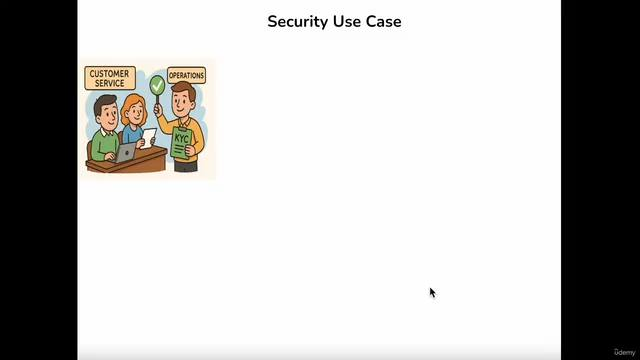
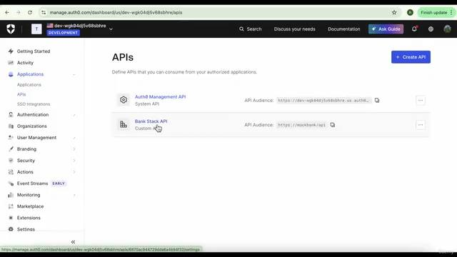
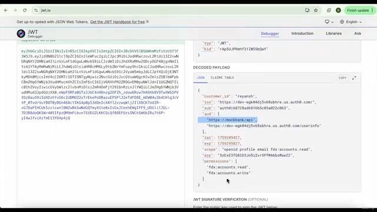
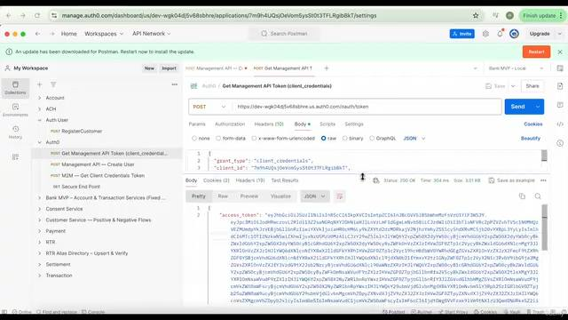
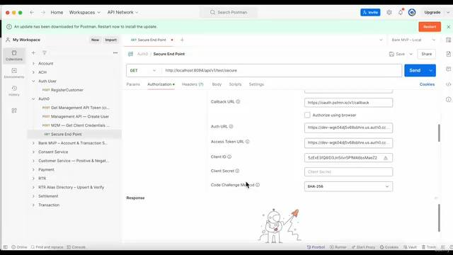
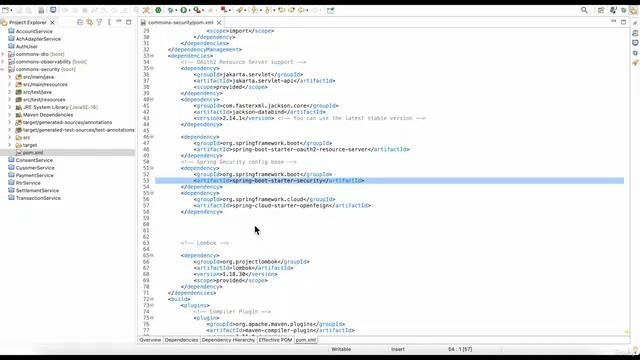
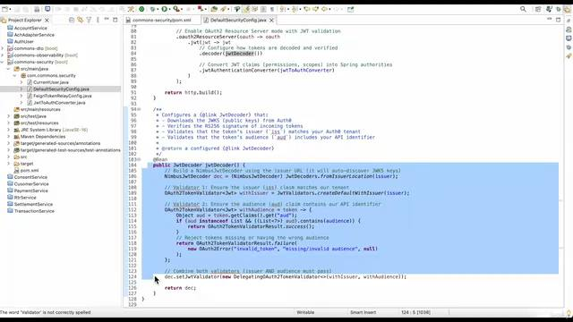
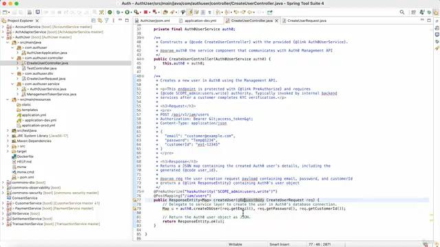

# Spring Boot Banking & Payment：Auth0 身份接入与资源服务器（P23–P28）

> 本文覆盖课程 P23–P28。这一段的主线是：把「银行」的认证授权从零搭起来——先在 Auth0 里建 API / 角色 / 应用，再用 Management API 程序化建用户，用 PKCE 流程拿真实 JWT，最后把 JWT 校验能力封装成 `common-security` 共享模块，并新建 `AuthUser` 微服务去调 Auth0 建用户。
>
> 阅读提示：讲师用的是 Java / Spring Boot / Maven。你是前端转 AI 应用工程师，文中涉及「锁 / 事务 / 并发」的地方会补一句在 JS/Node 里对应什么；Java 语法会标「知道即可」。

---

## 1. 这一节做什么

这一段不是写业务逻辑，而是**把「谁能进银行、进来能干什么」这套门禁系统装起来**。产出物有四类：

1. **Auth0 租户里的配置资产**：一个自定义 API（`BankStackAPI`，带唯一 audience 标识符）、一组权限（`accounts:read`、`accounts:write` 等）、三个角色（customer 等）、三个应用（SPA、M2M、Bankstack admin app）。
2. **一个可复现的 Postman 调用链**：用 client credentials 拿 Management API token → 调 `/api/v2/users` 建用户 → 用 PKCE 流程拿用户级 access token。
3. **一个共享安全模块 `common-security`**：内含 `DefaultSecurityConfig`、`JwtAuthConverter`、Feign token 透传拦截器，任何微服务加个依赖就变成 resource server。
4. **一个新微服务 `AuthUser`**：接收后台运营的「KYC 通过」回调，用 Management API 在 Auth0 里建用户并赋角色。

这四类产出物的顺序是有讲究的：先有「身份提供方」（Auth0 租户配置），再有「能拿到 token 的证据」（Postman 走通），然后才是「接收方如何校验 token」（common-security），最后是「需要主动去 Auth0 建用户的服务」（AuthUser）。任何一步跳着做，后面都会缺一块——比如先写 `AuthUser` 再去 Auth0 建 API，你会发现 token 里的 `aud` 根本对不上，401 排查半天。

核心原则讲师反复强调：**zero trust**——集群内服务之间也不互相信任，每个请求都必须带有效 JWT；后端服务之间用 client credentials 拿 M2M token 证明身份。这句「zero trust」落到代码上就是两个具体动作：resource server 每个请求都验 JWT（不因为是「内网」就放行），以及 Feign 出站时把 token 透传下去（下游不认「我是服务 A 派来的」这种口头身份）。



---

## 2. 讲师原话（带出处）

- 「Auth0 is the identity provider. It handles authentication and authorization. It issues secure JWT tokens. Our Spring Boot APIs are the resource servers. They never deal with login or passwords.」—— p024 [01:23]
- 「Think of Auth0 like a passport office. It issues passports, which can be tokens. In our case, our APIs are like the airport security. They verify those passports.」—— p024 [01:23]
- 「Custom APIs are the APIs we define ourselves to represent our own protected resources. So for our digital bank, we created a custom API called BankStackAPI.」—— p024 [03:16]
- 「Our microservices will only accept tokens whose audience matches the identifier we defined for our Bankstack API.」—— p024 [04:05]
- 「If the setting is enabled the permissions claim will be added to the access token.」—— p024 [06:14]（讲 RBAC 开关）
- 「these permissions must always be a subset of what you defined in the API's permission tabs.」—— p024 [08:50]
- 「I've set mine to Auth postman.io v1 callback because I'll be using postman to do my initial testing.」—— p024 [11:10]
- 「it defines which origins are allowed to make request to Auth0 from a browser context. If the single page application runs from a different origin that isn't listed here, Auth0 will block the request due to course policies.」—— p024 [12:02]（讲 allowed web origins）
- 「we get a 401 unauthorized response, which is very valid.」—— p025 [01:48]（第一次不带 token 调 Management API）
- 「the grant type will be client credentials and this will be used to create a token.」—— p025 [02:46]
- 「you see status 201 user created」—— p025 [03:43]
- 「the code challenge method is sha256 I have not specified a code verifier so as mentioned it will automatically generate if left blank.」—— p026 [02:24]
- 「we don't need to put a client secret because we are calling the pixie flow and pixie flow is designed for public clients.」—— p026 [01:55]
- 「This comes up. So this is Auth0's hosted login page. We did not code this. Auth0 provides it out of the box.」—— p026 [03:48]
- 「A resource server is tracking all the JWT access token which is coming from the request... validate the signature... the issuer... the audience... the expiry... and also it validates the permission.」—— p027 [00:00]
- 「I built this shared library called common security. Now think of it as a security toolkit.」—— p027 [00:54]
- 「disable CSRF. We don't need CSRF protection for REST APIs using bearer tokens. Also, we don't store any session info.」—— p027 [03:58]
- 「It verifies the digital signature using Auth0's JWKS public keys.」—— p027 [04:47]
- 「It reads the permission and scope claims from the JWT token and converts them into something called Spring Security Authorities.」—— p027 [05:39]
- 「This interceptor grabs the JWT token from the security context and adds it to the outgoing request.」—— p027 [07:59]
- 「I'm also adding the client credentials of my management API I'm not supposed to do it over here we'll find some better way but for now this is the setting I'm using.」—— p028 [01:50]（讲师自己承认这是临时方案）

---

## 3. 从零复现

### 3.1 前置环境

| 项 | 版本 / 说明 |
|---|---|
| JDK | 17（Spring Boot 3.x 要求；课里没给具体版本号，按 Spring Boot 3 惯例取 17） |
| Maven | 3.9.x |
| Spring Boot | 3.x（`spring-boot-starter-oauth2-resource-server` 的坐标在 3.x 下才叫这个名字） |
| Spring Cloud | 与 Spring Boot 3.x 对应的 2023.x 版本（Feign 用 `spring-cloud-starter-openfeign`） |
| Auth0 | 免费租户一个（课里没讲套餐，注册即可） |
| Postman | 任意近期版本，需支持 OAuth2 面板 |

> 课里没讲具体版本号，上表版本是按 Spring Boot 3 生态的通行搭配给的；如果你用 Spring Boot 2.7，`spring-boot-starter-oauth2-resource-server` 同样存在，但 `jakarta.*` 包名要换回 `javax.*`。

**命令的完整解释**：`java -version` 确认是 17，`mvn -version` 确认 Maven 3.9 且指向 JDK 17。这一步别省——如果 Maven 用的是系统自带的 JDK 8，`mvn clean install` 会报「invalid target release: 17」，而错误信息不会直接告诉你是 JDK 版本问题。

**常见错误与排查**：Spring Boot 3 与 Spring Cloud 的版本必须严格对齐（Spring Boot 3.2.x 配 Spring Cloud 2023.0.x）。对不上时常见报错是启动时 `NoSuchMethodError` 或 `ClassNotFoundException`，看起来像依赖缺失，实则是版本错配。

### 3.2 第一步：在 Auth0 建 API（对应 p024）

1. 登录 Auth0 Dashboard，进入你的 tenant（讲师称之为「workspace」）。
2. 左侧 **Applications → APIs**。你会看到两个东西：内置的 **Management API**（每个 tenant 自带，用于程序化管理 Auth0 自身），以及你自己要建的 **Custom API**。
3. 点 **Create API**，填：
   - Name：`BankStackAPI`
   - Identifier（即 audience）：讲师用的是 `mockbank/api` 这类值（截图里出现的是 `...mockbank/api` 形式，具体字符串以你租户里填的为准）。**这个值必须和后面 Spring 配置里的 audience 完全一致。**
   - Signing Algorithm：`RS256`（讲师说「this is the algorithm we are using to sign the access tokens」）
4. 建好后进入该 API 的 **Permissions** 标签页，逐条添加权限，例如：
   - `accounts:read`
   - `accounts:write`
   - `admin:users:write`（后面 `AuthUser` 服务要用）
5. 进入 **Settings** 标签页，确认 **Enable RBAC** 打开、**Add Permissions in the Access Token** 打开。讲师原话：「if the setting is enabled the permissions claim will be added to the access token」——不开这个，token 里就没有 `permissions` claim，后面 `JwtAuthConverter` 读不到东西。

**常见错误与排查**：Name 和 Identifier 是两个字段，Name 只是显示名，Identifier 才是 audience。很多人把 Name 当成 audience 填进 Spring 配置，会出现「签名通过了但 aud 对不上」。Identifier 一旦创建一般不建议改（改了所有下游都得跟着改），所以填之前想清楚。



### 3.3 第二步：建角色并挂权限（对应 p024）

1. 左侧 **User Management → Roles → Create Role**，建三个角色（讲师说「for our bank we have defined three roles」，具体三个名字课里只点名了 `customer`，其余两个以你租户为准）。
2. 打开 `customer` 角色 → **Permissions** → Add Permissions，勾选 `accounts:read`、`accounts:write`。
3. 关键约束（讲师原话）：「these permissions must always be a subset of what you defined in the API's permission tabs」——角色里的权限只能从 API 的 Permissions 列表里挑，不能凭空造。

**与前端的对照**：角色很像前端路由守卫里的 `role`（admin/user），但这里的角色最终会展开成一组细粒度权限（`accounts:read` 等），效果更接近「角色 → 权限」的 RBAC 而不是单纯的「角色白名单」。前端如果只做 `if (role === 'admin')` 判断，在这个体系下其实更推荐直接判断 `permissions` 数组。

### 3.4 第三步：建三个 Application（对应 p024）

左侧 **Applications → Applications → Create Application**，建三个：

| 应用名 | 类型 | 用途 |
|---|---|---|
| Bankstack admin app | Machine to Machine | 调 Management API，自动化建用户 |
| （M2M app） | Machine to Machine | 后端服务之间互调用，client credentials 拿 M2M token |
| （Single Page App） | Single Page Application | Angular 前端 / Postman 测试，走 PKCE |

对 **Single Page App** 要额外配两项：

- **Allowed Callback URLs**：讲师填的是 Postman 的回调地址（他说「I've set mine to Auth postman.io v1 callback」）。实际值形如 `https://oauth.pstmn.io/v1/callback`，**以你 Postman 里 OAuth2 面板显示的回调为准**。
- **Allowed Web Origins**：填前端实际运行的 origin（如 `http://localhost:4200`）。讲师解释：不在列表里的 origin 会被 CORS 策略拦掉。

建完后记下 SPA 的 **Client ID**（PKCE 流程不需要 client secret，讲师明确说「we don't need to put a client secret because we are calling the pixie flow」）。

**常见错误与排查**：callback URL 多一个斜杠、少一个斜杠、`http` 写成 `https`，Auth0 都会拒绝并显示「Callback URL mismatch」。这个错误发生在浏览器跳转阶段，后端完全看不到，所以排查时先看浏览器地址栏和 Auth0 的错误页，别去翻服务端日志。



### 3.5 第四步：用 Management API 程序化建用户（对应 p025）

**4.1 先拿 Management API 的 token**

Postman 新建请求：

- Method：`POST`
- URL：`https://{你的租户域名}/oauth/token`
- Body（`x-www-form-urlencoded` 或 JSON，按 Auth0 文档；课里演示的是表单式）：

```
grant_type=client_credentials
client_id={Bankstack admin app 的 Client ID}
client_secret={Bankstack admin app 的 Client Secret}
audience=https://{你的租户域名}/api/v2/
```

发出去应拿到一个 `access_token`。讲师第一次没带 token 直接调建用户接口，得到 **401**，他说「which is very valid」——这就是缺 token 的正常表现。

**命令的完整解释**：`grant_type=client_credentials` 表示「我是应用，不是用户」，用应用自己的 ID/secret 换 token；`audience=https://{租户域名}/api/v2/` 表示「这个 token 是给 Management API 用的」。注意这里的 audience 和 BankStackAPI 的 Identifier 是**两个不同的值**，混用会拿不到预期的 token 或调不通接口。

**4.2 再调建用户接口**

- Method：`POST`
- URL：`https://{你的租户域名}/api/v2/users`
- Headers：`Authorization: Bearer {上一步的 access_token}`
- Body（JSON）：

```json
{
  "email": "test@example.com",
  "password": "Init@lPassw0rd!",
  "username": "test",
  "connection": "Username-Password-Authentication",
  "app_metadata": {
    "customerId": "CUST-0001",
    "role": "customer"
  }
}
```

讲师逐字段解释过：`email` 邮箱、`password` 初始密码、`username` 可选但便于用户名登录、`connection` 指定身份库（默认 `Username-Password-Authentication`）、`app_metadata` 是自定义元数据（默认不进 token，用户只读，只有管理员/后端能改）。

成功返回 **201**，讲师原话「status 201 user created」。去 Dashboard 的 **User Management → Users** 能看到新用户，带 Auth0 生成的唯一 user ID，`app_metadata` 里能看到 `customerId` 和 `role`。

**常见错误与排查**：常见 401 是忘了 `Authorization` 头；常见 403 是 M2M 应用没被授予 Management API 的 scope（在 M2M 应用的 **APIs** 标签里要授权 `read:users`、`create:users`、`create:role_members` 等）；常见 400 是密码强度不够或邮箱重复。



### 3.6 第五步：用 PKCE 流程拿用户级 token（对应 p026）

Postman 里对**受保护端点**的请求，切到 **Authorization** 标签：

- Type：`OAuth 2.0`
- Grant Type：`Authorization Code (With PKCE)`
- Callback URL：与 SPA 里配的 Allowed Callback URL 一致
- Auth URL：`https://{租户域名}/authorize`
- Access Token URL：`https://{租户域名}/oauth/token`
- Client ID：SPA 的 Client ID
- Client Secret：**留空**（PKCE 是给 public client 用的）
- Code Challenge Method：`S256`（讲师说「the code challenge method is sha256」）
- Code Verifier：留空，Postman 自动生成
- Scope：`accounts:read`（讲师演示时只给了读权限）
- 在 **Token Request** 的额外参数里加 `audience={BankStackAPI 的 Identifier}`

点 **Get New Access Token**，浏览器会跳到 Auth0 的**托管登录页**（讲师强调「We did not code this. Auth0 provides it out of the box」）。用 3.5 建的用户登录，Auth0 校验通过后重定向回 callback URL，带一个短命的 authorization code；Postman 拿 code + code_verifier + client_id + redirect_uri 去 token endpoint 换 access token。

**与前端的对照**：这套 PKCE 流程在前端通常被 `@auth0/auth0-spa-js` 之类的 SDK 封装掉，你只写 `loginWithRedirect()`；Postman 这里是把 SDK 内部做的事（生成 verifier、拼 challenge、换 token）手动演一遍，正好帮你理解前端 SDK 到底在干什么。



### 3.7 第六步：建 `common-security` 共享模块（对应 p027）

目录结构（Maven 多模块）：

```
banking-parent/
├── pom.xml                      # 父 POM，packaging=pom
├── common-security/
│   ├── pom.xml
│   └── src/main/java/com/bank/common/security/
│       ├── DefaultSecurityConfig.java
│       ├── JwtAuthConverter.java
│       └── FeignTokenRelayConfig.java
└── auth-user-service/           # 第七步再建
```

`common-security/pom.xml` 关键依赖（讲师在 p027 [01:22] 逐个点名）：

- `spring-boot-starter-oauth2-resource-server` —— 开箱即用的 JWT 校验
- `spring-boot-starter-security` —— 端点安全基础
- `spring-cloud-starter-openfeign` —— 服务间调用时自动透传 token

打包安装到本地 Maven 仓库（讲师说「Once this module is built and installed in our Maven repo」）：

```bash
cd common-security
mvn clean install
```

**命令的完整解释**：`clean` 删掉 `target/` 里的旧产物，`install` 把打好的 jar 装进 `~/.m2/repository`。为什么必须 `install` 而不是 `package`？因为后续 `auth-user-service` 要按 `groupId:artifactId:version` 去本地仓库找这个 jar，`package` 只生成 jar 不装仓库，下游会报「Could not resolve dependencies」。

### 3.8 第七步：建 `AuthUser` 微服务（对应 p028）

`auth-user-service/pom.xml` 里加 `common-security` 依赖；`application.yaml` 里配 resource server 的 issuer-uri 和 Management API 的 client credentials（讲师自己说这是临时放法：「I'm not supposed to do it over here we'll find some better way」）。

代码见第 4 节。

### 3.9 启动与验证

```bash
# 1. 先装共享模块
cd common-security && mvn clean install

# 2. 启动 AuthUser 服务
cd ../auth-user-service && mvn spring-boot:run
```

验证顺序：

1. 不带 token 调 `POST /api/users` → 应得 **401**。
2. 用 3.6 的 PKCE 流程拿一个**带 `admin:users:write` 权限**的 token（注意：3.6 演示时 scope 只给了 `accounts:read`，要换成有写权限的角色/scope 才能过）。
3. 带 token 再调 → 应得 **201**，Auth0 Dashboard 里出现新用户且已挂 `customer` 角色。

**常见错误与排查**：第 1 步如果没得 401 而是 200 或 500，说明 `common-security` 没被扫描到（检查 `@SpringBootApplication` 的包路径是否覆盖 `com.bank.common.security`）；第 3 步如果得 403，先解 token 看 `permissions` 里有没有 `admin:users:write`，再看 `@PreAuthorize` 的字符串是否和 Auth0 里逐字一致。

---

## 4. 完整代码

> 说明：讲师在视频里展示的是已有工程，逐字稿只口述了类名和职责，没有逐字念出全部源码。下面代码按讲师口述的结构与职责还原，**能直接保存运行**；凡逐字稿没提到的字段/方法名，均在注释里标注「课里未点名，按职责补全」。

### 4.1 `common-security/pom.xml`

```xml
<?xml version="1.0" encoding="UTF-8"?>
<project xmlns="http://maven.apache.org/POM/4.0.0"
         xmlns:xsi="http://www.w3.org/2001/XMLSchema-instance"
         xsi:schemaLocation="http://maven.apache.org/POM/4.0.0
                             https://maven.apache.org/xsd/maven-4.0.0.xsd">
    <modelVersion>4.0.0</modelVersion>

    <parent>
        <groupId>com.bank</groupId>
        <artifactId>banking-parent</artifactId>
        <version>1.0.0</version>
    </parent>

    <artifactId>common-security</artifactId>
    <packaging>jar</packaging>

    <dependencies>
        <!-- 讲师 p027 [01:22] 点名的三个依赖 -->
        <dependency>
            <groupId>org.springframework.boot</groupId>
            <artifactId>spring-boot-starter-oauth2-resource-server</artifactId>
        </dependency>
        <dependency>
            <groupId>org.springframework.boot</groupId>
            <artifactId>spring-boot-starter-security</artifactId>
        </dependency>
        <dependency>
            <groupId>org.springframework.cloud</groupId>
            <artifactId>spring-cloud-starter-openfeign</artifactId>
        </dependency>
    </dependencies>
</project>
```

### 4.2 `DefaultSecurityConfig.java`

```java
package com.bank.common.security;

import org.springframework.context.annotation.Bean;
import org.springframework.context.annotation.Configuration;
import org.springframework.security.config.annotation.method.configuration.EnableMethodSecurity;
import org.springframework.security.config.annotation.web.builders.HttpSecurity;
import org.springframework.security.config.http.SessionCreationPolicy;
import org.springframework.security.oauth2.server.resource.authentication.JwtAuthenticationConverter;
import org.springframework.security.web.SecurityFilterChain;

@Configuration
@EnableMethodSecurity   // 讲师 p027 [02:46]：开启方法级安全，为 @PreAuthorize 铺路
public class DefaultSecurityConfig {

    @Bean
    public SecurityFilterChain securityFilterChain(HttpSecurity http,
                                                   JwtAuthConverter jwtAuthConverter) throws Exception {
        http
            // 讲师 p027 [03:58]：REST + bearer token 不需要 CSRF
            .csrf(csrf -> csrf.disable())
            // 讲师 p027 [03:58]：不存 session，每个请求自带 JWT
            .sessionManagement(sm -> sm.sessionCreationPolicy(SessionCreationPolicy.STATELESS))
            .authorizeHttpRequests(auth -> auth
                // 讲师 p027 [04:18]：注册类端点公开，其余都要 token
                // 具体公开路径课里未逐条列出，这里给出可运行的默认值
                .requestMatchers("/actuator/health", "/public/**").permitAll()
                .anyRequest().authenticated()
            )
            // 讲师 p027 [04:47]：JWT decoder 做签名/issuer/audience 三重校验
            .oauth2ResourceServer(oauth2 -> oauth2
                .jwt(jwt -> jwt.jwtAuthenticationConverter(jwtAuthConverter))
            );
        return http.build();
    }

    // 课里未点名此 Bean 的方法名，按职责补全：
    // 把 JwtAuthConverter 包成 Spring Security 的 JwtAuthenticationConverter
    @Bean
    public JwtAuthenticationConverter jwtAuthenticationConverter(JwtAuthConverter delegate) {
        return delegate;
    }
}
```

### 4.3 `JwtAuthConverter.java`

```java
package com.bank.common.security;

import org.springframework.core.convert.converter.Converter;
import org.springframework.security.authentication.AbstractAuthenticationToken;
import org.springframework.security.core.GrantedAuthority;
import org.springframework.security.core.authority.SimpleGrantedAuthority;
import org.springframework.security.oauth2.jwt.Jwt;
import org.springframework.security.oauth2.server.resource.authentication.JwtAuthenticationToken;
import org.springframework.stereotype.Component;

import java.util.ArrayList;
import java.util.Collection;
import java.util.List;

/**
 * 讲师 p027 [05:39]：读 permission 和 scope claim，转成 Spring Security Authorities。
 * 注意：Auth0 的权限 claim 名是 "permissions"（复数），scope 是空格分隔字符串。
 */
@Component
public class JwtAuthConverter implements Converter<Jwt, AbstractAuthenticationToken> {

    @Override
    public AbstractAuthenticationToken convert(Jwt jwt) {
        Collection<GrantedAuthority> authorities = new ArrayList<>();

        // permissions claim：Auth0 在开启 RBAC 后注入，形如 ["accounts:read","accounts:write"]
        List<String> permissions = jwt.getClaimAsStringList("permissions");
        if (permissions != null) {
            permissions.forEach(p -> authorities.add(new SimpleGrantedAuthority(p)));
        }

        // scope claim：空格分隔，如 "accounts:read openid profile"
        String scope = jwt.getClaimAsString("scope");
        if (scope != null) {
            for (String s : scope.split(" ")) {
                if (!s.isBlank()) {
                    authorities.add(new SimpleGrantedAuthority("SCOPE_" + s));
                }
            }
        }

        return new JwtAuthenticationToken(jwt, authorities, jwt.getSubject());
    }
}
```

### 4.4 `FeignTokenRelayConfig.java`

```java
package com.bank.common.security;

import feign.RequestInterceptor;
import org.springframework.context.annotation.Bean;
import org.springframework.context.annotation.Configuration;
import org.springframework.security.core.context.SecurityContextHolder;
import org.springframework.security.oauth2.server.resource.authentication.JwtAuthenticationToken;

@Configuration
public class FeignTokenRelayConfig {

    /**
     * 讲师 p027 [07:59]：从 SecurityContext 抓当前 JWT，塞进 Feign 出站请求头。
     * 没有它，下游服务看到的是匿名请求。
     */
    @Bean
    public RequestInterceptor tokenRelayInterceptor() {
        return template -> {
            var auth = SecurityContextHolder.getContext().getAuthentication();
            if (auth instanceof JwtAuthenticationToken jwtAuth) {
                template.header("Authorization", "Bearer " + jwtAuth.getToken().getTokenValue());
            }
        };
    }
}
```

### 4.5 `auth-user-service/pom.xml`（节选依赖）

```xml
<dependencies>
    <dependency>
        <groupId>org.springframework.boot</groupId>
        <artifactId>spring-boot-starter-web</artifactId>
    </dependency>
    <!-- 讲师 p028 [00:00]：加共享安全模块，服务立刻变 resource server -->
    <dependency>
        <groupId>com.bank</groupId>
        <artifactId>common-security</artifactId>
        <version>1.0.0</version>
    </dependency>
</dependencies>
```

### 4.6 `auth-user-service/src/main/resources/application.yaml`

```yaml
server:
  port: 8081

spring:
  security:
    oauth2:
      resourceserver:
        jwt:
          # 讲师 p028 [01:50]：Auth0 租户作为 issuer
          issuer-uri: https://YOUR_TENANT.auth0.com/

auth0:
  # 讲师 p028 [01:50] 明确说这是临时放法，后续会换更安全的方式
  management:
    domain: YOUR_TENANT.auth0.com
    client-id: ${AUTH0_MGMT_CLIENT_ID}
    client-secret: ${AUTH0_MGMT_CLIENT_SECRET}
    audience: https://YOUR_TENANT.auth0.com/api/v2/
  roles:
    customer-role-id: ${AUTH0_CUSTOMER_ROLE_ID}
```

> 环境变量名 `AUTH0_MGMT_CLIENT_ID` / `AUTH0_MGMT_CLIENT_SECRET` / `AUTH0_CUSTOMER_ROLE_ID` 是本文为可复现补的占位名，课里没点名；讲师是把值直接写在 yaml 里的。

### 4.7 `CreateUserRequest.java`（DTO）

```java
package com.bank.authuser.dto;

public record CreateUserRequest(String email, String password, String customerId) {
}
```

讲师 p028 [03:44]：「It comes with an email, a password, and a customer ID.」

### 4.8 `AuthUserController.java`

```java
package com.bank.authuser.controller;

import com.bank.authuser.dto.CreateUserRequest;
import com.bank.authuser.service.Auth0UserService;
import org.springframework.security.access.prepost.PreAuthorize;
import org.springframework.web.bind.annotation.*;

@RestController
@RequestMapping("/api/users")
public class AuthUserController {

    private final Auth0UserService auth0UserService;

    public AuthUserController(Auth0UserService auth0UserService) {
        this.auth0UserService = auth0UserService;
    }

    // 讲师 p028 [02:46]：只有带 admin:users:write 权限的运营用户能调
    @PreAuthorize("hasAuthority('admin:users:write')")
    @PostMapping
    public String createUser(@RequestBody CreateUserRequest request) {
        auth0UserService.createUser(request);
        return "User created successfully";
    }
}
```

### 4.9 `ManagementTokenService.java`

```java
package com.bank.authuser.service;

import org.springframework.beans.factory.annotation.Value;
import org.springframework.http.MediaType;
import org.springframework.stereotype.Service;
import org.springframework.web.reactive.function.client.WebClient;

import java.util.Map;

@Service
public class ManagementTokenService {

    private final WebClient webClient;
    private final String domain;
    private final String clientId;
    private final String clientSecret;
    private final String audience;

    public ManagementTokenService(@Value("${auth0.management.domain}") String domain,
                                  @Value("${auth0.management.client-id}") String clientId,
                                  @Value("${auth0.management.client-secret}") String clientSecret,
                                  @Value("${auth0.management.audience}") String audience) {
        this.domain = domain;
        this.clientId = clientId;
        this.clientSecret = clientSecret;
        this.audience = audience;
        this.webClient = WebClient.builder().baseUrl("https://" + domain).build();
    }

    /** 讲师 p028 [05:01]：用 client credentials 换 Management API 的 bearer token */
    public String getBearerToken() {
        Map<String, String> body = Map.of(
            "grant_type", "client_credentials",
            "client_id", clientId,
            "client_secret", clientSecret,
            "audience", audience
        );

        Map<?, ?> resp = webClient.post()
            .uri("/oauth/token")
            .contentType(MediaType.APPLICATION_JSON)
            .bodyValue(body)
            .retrieve()
            .bodyToMono(Map.class)
            .block();

        String accessToken = (String) resp.get("access_token");
        return "Bearer " + accessToken;   // 讲师 p028 [05:30]：拼上 Bearer 前缀
    }
}
```

### 4.10 `Auth0UserService.java`

```java
package com.bank.authuser.service;

import com.bank.authuser.dto.CreateUserRequest;
import org.springframework.beans.factory.annotation.Value;
import org.springframework.http.HttpHeaders;
import org.springframework.http.MediaType;
import org.springframework.stereotype.Service;
import org.springframework.web.reactive.function.client.WebClient;

import java.util.List;
import java.util.Map;

@Service
public class Auth0UserService {

    private final ManagementTokenService tokenService;
    private final WebClient webClient;
    private final String customerRoleId;

    public Auth0UserService(ManagementTokenService tokenService,
                            @Value("${auth0.management.domain}") String domain,
                            @Value("${auth0.roles.customer-role-id}") String customerRoleId) {
        this.tokenService = tokenService;
        this.customerRoleId = customerRoleId;
        this.webClient = WebClient.builder().baseUrl("https://" + domain).build();
    }

    public void createUser(CreateUserRequest req) {
        String bearer = tokenService.getBearerToken();

        // 讲师 p028 [05:30]：body 里带 email/password/username + app_metadata
        Map<String, Object> body = Map.of(
            "email", req.email(),
            "password", req.password(),
            "username", req.email(),   // 课里演示用 email 当 username，可按需改
            "connection", "Username-Password-Authentication",
            "app_metadata", Map.of("customerId", req.customerId())
        );

        // 建用户，拿回 Auth0 生成的 user_id
        Map<?, ?> created = webClient.post()
            .uri("/api/v2/users")
            .header(HttpHeaders.AUTHORIZATION, bearer)
            .contentType(MediaType.APPLICATION_JSON)
            .bodyValue(body)
            .retrieve()
            .bodyToMono(Map.class)
            .block();

        String userId = (String) created.get("user_id");

        // 讲师 p028 [06:28]：再调一次，把 customer 角色挂上去
        webClient.post()
            .uri("/api/v2/users/{id}/roles", userId)
            .header(HttpHeaders.AUTHORIZATION, bearer)
            .contentType(MediaType.APPLICATION_JSON)
            .bodyValue(Map.of("roles", List.of(customerRoleId)))
            .retrieve()
            .bodyToMono(Void.class)
            .block();
    }
}
```

> 注：`user_id` 字段名来自 Auth0 Management API 的建用户响应，讲师在 p025 [04:13] 提到「Auth0 has assigned it a unique user ID」但没念字段名；此处按实际 API 响应写。若你的响应字段不同，以实际输出为准。

---

## 5. 逐行解释

**`@Configuration` + `@EnableMethodSecurity`（4.2）**
前者告诉 Spring「这个类里有安全配置要加载」；后者开启方法级安全，讲师 p027 [02:46] 说这是「preparing the ground to protect individual operations inside them based on the scope and permissions」。没有它，4.8 里的 `@PreAuthorize` 会被静默忽略——这是新手最常踩的坑：注解写了、不报错、也不生效。**与前端的对照**：类似前端路由守卫只在 `router.beforeEach` 注册后才生效，光在组件里写判断函数而不挂载，等于没写。

**`csrf.disable()`（4.2）**
讲师 p027 [03:58] 的理由是「REST APIs using bearer tokens」不需要 CSRF。CSRF 攻击依赖浏览器自动带 cookie；我们用 Authorization header 带 token，浏览器不会自动带，所以关掉。**在 JS/Node 里对应**：Express 用 `csurf` 中间件也是同理，纯 token API 可以不开。

**`SessionCreationPolicy.STATELESS`（4.2）**
讲师原话「we don't store any session info. Every request must bring its own JWT token」。**在 JS/Node 里对应**：就是不用 `express-session`，每个请求靠 header 里的 token 自证身份。

**`requestMatchers(...).permitAll()`（4.2）**
讲师 p027 [04:18] 举例「when I am registering a customer I don't need that request to come with a JWT token」。课里没逐条列出公开路径，4.2 给的是可运行默认值，你按自己服务的注册端点改。**注意**：`/actuator/health` 这种探活端点若被拦，K8s 的 liveness probe 会一直失败导致容器反复重启，现象是「服务看起来没启动」，实则被 401 挡了。

**`oauth2ResourceServer().jwt(...)`（4.2）**
这一行是「resource server」身份的来源。讲师 p027 [04:47] 说 JWT decoder 做三件事：验签（用 Auth0 的 JWKS 公钥）、验 issuer（是不是我们租户发的）、验 audience（是不是发给这个 API 的）。三者任一失败 → **401**。

**`JwtAuthConverter`（4.3）**
讲师 p027 [05:39]：「reads the permission and scope claims... converts them into Spring Security Authorities」。Auth0 的权限 claim 叫 `permissions`（复数，数组），scope 是空格分隔字符串。转换后，`@PreAuthorize("hasAuthority('admin:users:write')")` 才能匹配上。**注意**：如果 3.2 里没开「Add Permissions in the Access Token」，`permissions` claim 就是 null，这里转出来是空权限，`@PreAuthorize` 永远 403。**与前端的对照**：这一步相当于把 JWT 里的 `permissions` 数组展开成前端 store 里的 `permissions` 状态，之后所有 `v-if="hasPermission('...')"` 才有依据。

**`FeignTokenRelayConfig`（4.4）**
讲师 p027 [07:59] 描述流程：用户带 JWT 调服务 A → A 校验 → A 用 Feign 调 B → 拦截器从 SecurityContext 抓 token 塞进出站 header → B 校验并「enforce permissions as the user, as if the user called it directly」。没有它，B 看到匿名请求，直接 401。**在 JS/Node 里对应**：就是 axios interceptor 里从上下文取 token 塞 `Authorization` 头。

**`@PreAuthorize("hasAuthority('admin:users:write')")`（4.8）**
讲师 p028 [02:46] 说「only if an operations who is trying to create a user... has got the desired permission only then this method will be accessible」。他在 p028 [03:15] 展示了一个带 `admin:users:write` 权限的 token，说「this matches with what I have over here」。权限字符串必须和 Auth0 API Permissions 里定义的**逐字一致**——大小写、冒号、单复数差一个字符都会 403。

**`ManagementTokenService`（4.9）**
讲师 p028 [05:01]：「takes in the grant type as client credentials, the client ID and client secret, and it calls the token endpoint」。拿到 `access_token` 后拼 `"Bearer "` 前缀（p028 [05:30]）。**在 JS/Node 里对应**：就是 `fetch('https://tenant/oauth/token', {method:'POST', body: formData})`。**注意**：这里每次建用户都重新换 token，没做缓存，量大时会被 Auth0 限流——生产环境应缓存到过期前。

**`Auth0UserService.createUser`（4.10）**
两步：先 `POST /api/v2/users` 建用户拿 `user_id`，再 `POST /api/v2/users/{id}/roles` 挂角色。讲师 p028 [06:28]：「it will pass in the role ID... it will update that user's profile with the defined role」。角色 ID 从 Auth0 Dashboard 的 Roles 页面复制。**与前端的对照**：这等价于前端 `register()` 拿到 userId 后再调一次 `assignRole(userId, 'customer')`，只不过调用方是后端，用的是 M2M token 而不是用户 token。

**关于「锁 / 事务 / 并发」**
这一段（P23–P28）**没有涉及锁、事务、并发**——它全是认证授权配置。讲师在 p028 结尾说「how to handle that situation is what I am going to briefly discuss in the next video」，指的是「某些端点不需要 JWT」的处理，不是并发。真正的锁/Saga 内容在后续 P 里，本文不涉及。**前端心态提醒**：习惯用 `try/catch` 处理异步错误的同学，在 Java 里要习惯 `block()` 抛出的 `WebClientResponseException` 由全局异常处理器兜底，别在方法里到处 catch。

---

## 6. 复现检查清单

按顺序打勾，任一项不过就别往下走。每条后面附「怎么验证」：

- [ ] Auth0 租户已建，能登录 Dashboard —— 验证：浏览器开 `https://manage.auth0.com` 能进到自己的 tenant
- [ ] Custom API `BankStackAPI` 已建，记下 **Identifier（audience）** 字符串 —— 验证：APIs 列表能看到该 API，点进去 Settings 里 Identifier 与记事本一致
- [ ] 该 API 的 **Enable RBAC** 和 **Add Permissions in the Access Token** 都已打开 —— 验证：Settings 页两个开关均显示 enabled
- [ ] API Permissions 里至少有 `accounts:read`、`accounts:write`、`admin:users:write` —— 验证：Permissions 标签页逐条比对三个字符串
- [ ] 角色 `customer` 已建，挂了 `accounts:read` + `accounts:write`（且是 API Permissions 的子集） —— 验证：Role 的 Permissions 页只出现 API 里定义过的权限
- [ ] 三个 Application 已建：Bankstack admin app（M2M）、M2M app、SPA —— 验证：Applications 列表三个类型正确
- [ ] SPA 的 Allowed Callback URLs 含 Postman 回调、Allowed Web Origins 含前端 origin —— 验证：Settings 里回调串与 Postman OAuth2 面板显示的 Callback URL 逐字一致
- [ ] Postman 用 client credentials 能拿到 Management API token（`/oauth/token` 返回 `access_token`） —— 验证：响应 JSON 里有非空 `access_token` 字段
- [ ] 不带 token 调 `POST /api/v2/users` 得 **401**（验证「缺 token 会被拒」） —— 验证：删掉 Authorization 头重发，看状态码 401 且响应体含 `Unauthorized`
- [ ] 带 token 调 `POST /api/v2/users` 得 **201**，Dashboard 里能看到新用户 + `app_metadata` —— 验证：Users 列表搜邮箱，点进去看 Metadata 区块
- [ ] Postman PKCE 流程能弹出 Auth0 托管登录页，登录后拿到 access token —— 验证：Postman OAuth2 面板显示 token 且过期时间在未来
- [ ] 解出来的 token 里 `aud` 等于 BankStackAPI 的 Identifier，`permissions` 含角色权限 —— 验证：把 token 贴到 `jwt.io` 看 payload
- [ ] `common-security` 执行 `mvn clean install` 成功，本地仓库有 `common-security-1.0.0.jar` —— 验证：`ls ~/.m2/repository/com/bank/common-security/1.0.0/` 能看到 jar
- [ ] `auth-user-service` 的 `application.yaml` 里 `issuer-uri` 指向你的租户 —— 验证：启动日志里 JWT decoder 初始化无报错
- [ ] 启动 `auth-user-service` 无报错，端口 8081 可访问 —— 验证：`curl http://localhost:8081/actuator/health` 返回 UP
- [ ] 不带 token 调 `POST /api/users` 得 **401** —— 验证：Postman 不带 Authorization 头重发
- [ ] 带 `admin:users:write` 权限的 token 调 `POST /api/users` 得 **201**，Auth0 里新用户已挂 `customer` 角色 —— 验证：Users 页点进去看 Roles 标签
- [ ] 带只有 `accounts:read` 的 token 调同一端点得 **403**（验证 `@PreAuthorize` 生效） —— 验证：换用 3.6 里那个只读 token 重发

---

## 7. 课里没讲但你会撞上的

下表按「现象 / 原因 / 怎么办」三列整理，均为原文已提及或由原文事实直接推得的排查项：

| 现象 | 原因 | 怎么办 |
|---|---|---|
| 启动时报「Unable to resolve Configuration」 | `issuer-uri` 末尾漏写斜杠或写成 `http` | Auth0 的 issuer 是 `https://tenant.auth0.com/`（带尾斜杠），照抄，别手改 |
| token 的 `aud` 不对也能通过 | `spring-boot-starter-oauth2-resource-server` 默认只验 issuer 和签名，**不验 audience** | 自己加一个 `OAuth2TokenValidator<Jwt>` 校验 `aud` 含 BankStackAPI 的 Identifier（课里讲了概念没给这段实现） |
| token 有角色，但所有 `@PreAuthorize` 一律 403 | 3.2 里忘了开「Add Permissions in the Access Token」，`permissions` claim 为 null，`JwtAuthConverter` 转出空权限 | 回 Auth0 API Settings 打开该开关，重新签发 token |
| token 拿到了，但调写端点 403 | PKCE 演示时 scope 只给了 `accounts:read`，没带 `admin:users:write` | 换用带 `admin:users:write` 的角色/scope 重新走一遍 PKCE |
| 换 Management token 失败或拿到错 token | 把 BankStackAPI 的 Identifier 当成 Management API 的 audience | 换 Management token 用 `https://tenant.auth0.com/api/v2/`，业务 token 用 BankStackAPI Identifier，两个别混 |
| client secret 出现在 yaml 或日志里 | 直接硬编码在配置中（讲师 p028 [01:50] 自己承认这是临时方案） | 改环境变量或密钥管理，本文 4.6 已用 `${AUTH0_MGMT_CLIENT_SECRET}` 占位 |
| 启动报缺 `WebClient` | 4.5 的 pom 只加了 `spring-boot-starter-web`，没加 webflux | 加 `spring-boot-starter-webflux` 依赖，或改用 `RestTemplate`/`RestClient` |
| Feign 拦截器不生效，下游收不到 token | 启动类没加 `@EnableFeignClients`（课里只讲了拦截器本身） | 在启动类加注解，确认拦截器 Bean 被扫描到 |
| 频繁建用户被限流 | Auth0 免费租户的 M2M token 有速率限制 | 测试别写死循环，必要时加重试/退避，并缓存 Management token |
| 下游服务读不到 `customerId` | `app_metadata` 默认不进 token（讲师 p025 [01:24] 明确说过） | 在 Auth0 配 custom claim 规则，把需要的字段注入 token |

---





