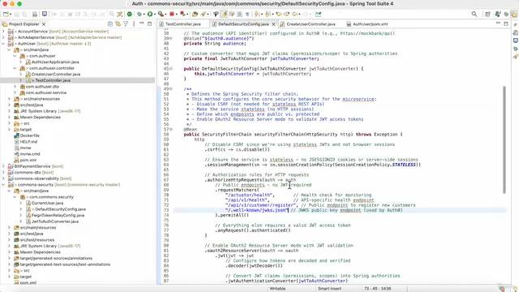
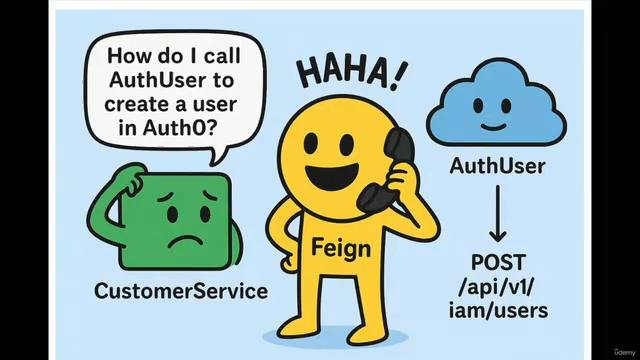
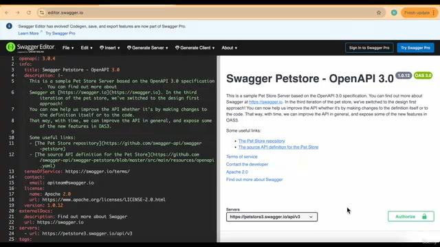
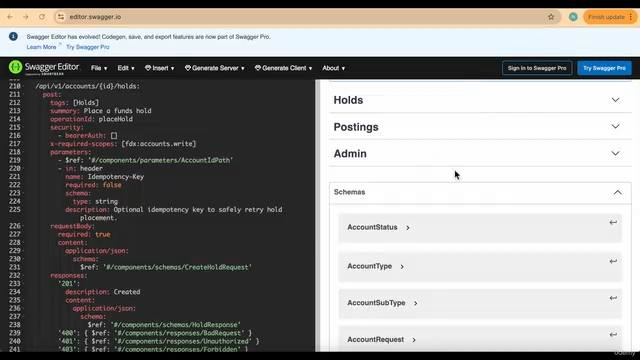
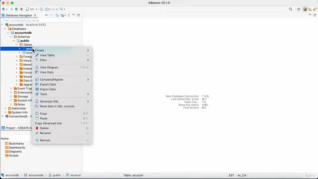
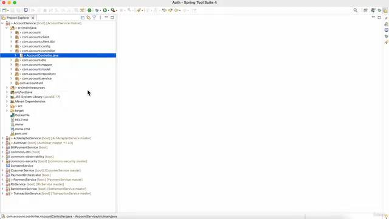
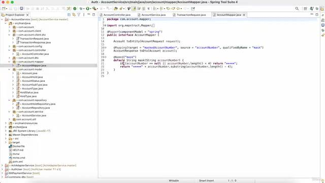
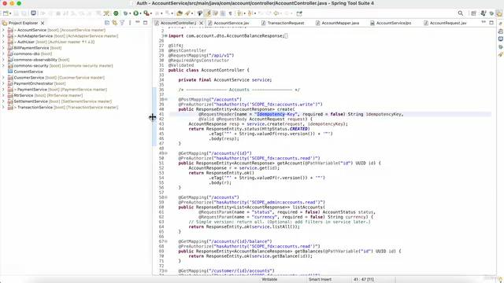

# Spring Boot Banking & Payment（锁 + Saga）P29–P36 复现文档

> 覆盖范围：P029–P036。本文按「先把 accounts 微服务跑起来 → 再接上安全与 Feign → 最后用 Postman 验证」的顺序重组，不按视频顺序流水账。
>
> **重要前提**：这 8 集里讲师**没有逐行贴出源码**，P036 是「class by class」口述走查。因此下文代码是**依据 P036 口述的类名、方法名、注解、字段名重建的可运行骨架**；凡是逐字稿没给出的（包名、依赖版本、`application.yml`、具体 SQL 类型），本文都标注了「课里没讲，以下为可运行默认」。你照抄能跑，但**字段名/路径最终以课程仓库为准**。

---

## 1. 这一节做什么

这 8 集的主线是：**把「账户域（Accounts）」从一个业务需求，做成一套可被 Postman 调通的生产级 REST API**，同时补齐它依赖的两个横切能力——**JWT 端点鉴权**和**服务间同步调用（Feign）**。

拆开看是四件事：

1. **P029**：区分「公共端点」与「受 JWT 保护的端点」。公共端点走 `permitAll`，受保护端点靠 `@PreAuthorize` 校验 Auth0 里的 permission（如 `admin:users:write`）。
2. **P030**：用 **Feign** 让 `customer-service` 同步调用 `auth-user-service`，在 KYC 审核通过时去 Auth0 里建用户。对 Java 侧来说就是「声明一个接口 + 调一个方法」，HTTP 细节被 Feign 吞掉。
3. **P031**：用 Postman 把「客户 onboarding → KYC pending → 管理员拿 token → 更新 KYC → Auth0 里出现用户」整条链路走一遍。
4. **P032–P036**：Accounts 微服务的**用例 → OpenAPI 契约 → 数据库 schema → 代码实现 → Postman 验证**。这是本段的主体，也是你真正要复现的部分。

一句话总结目标：**你能本地起一个 accounts-service，用 Postman 完成「创建账户（带幂等键）→ 查余额 → 冻结资金（hold）→ 释放 → 入账/出账（带 If-Match 乐观锁）→ 管理员关户」全流程，并且重试不会产生重复账户。**

这里再把目标拆得更直白一些，方便你判断自己是否真的复现成功：第一，公共端点在完全没有 `Authorization` 头的时候也应返回正常业务响应，而不是 401；第二，受保护端点在缺少 token、token 过期、token 里权限不足这三种情况下要能区分开；第三，Feign 调用的核心不是「会写 HTTP」，而是「调用方代码看起来仍然像普通 Java 方法调用」，因此排查问题时不能只盯 Feign 接口，还要看下游服务是否已启动、路径是否拼对、请求体字段是否与下游 DTO 对齐；第四，accounts-service 的创建账户接口必须在重复请求下保持幂等，不能因为网络重试或 Postman 连续点击就多出两条账户记录；第五，余额接口要同时体现账本余额、冻结总额和可用余额，不能只返回一个 `balance` 字段让前端自己猜；第六，入账和出账要能通过 `If-Match` 与 `ETag` 发现版本冲突，冲突时返回 409 而不是悄悄覆盖别人的修改。与前端对照时，可以把这一节理解为「前端拿到的不是一组随便写的 REST 路径，而是一套有鉴权、有幂等、有版本号、有错误码的契约」；前端同学需要知道什么时候带 `Idempotency-Key`、什么时候回传 `If-Match`、收到 409 后如何提示刷新，而不是把这些逻辑都推给后端兜底。

---

## 2. 讲师原话（带时间戳）

关于**公共端点**，讲师在 P029 说：

> 「in our common security module, we already defined a few permit all endpoints… these endpoints can be accessed freely so which means no JWT token required」—— p029 [00:28]

关于**Feign 的本质**，P030 的原话非常关键：

> 「Feign lets you make HTTP calls just by defining an interface… Feign converts the Java object into a JSON payload, attaches the right headers, opens an HTTP connection to AuthUsers slash users endpoint, and sends the request.」—— p030 [01:26]

> 「from a customer service standpoint, it's just a regular Java method call. But in reality, an entire HTTP exchange happened invisibly in the background.」—— p030 [02:20]

关于**幂等**，P036 给了定义：

> 「a request is considered idempotent if you can safely repeat the same request multiple times and the outcome will not change… Without idempotency, that retry might accidentally create two accounts.」—— p036 [04:20]

> 「we ask our front end to send a header called idempotency key… If the key is found it returns the same previous response. If not found, the server processes normally and saves it.」—— p036 [05:16]

关于**ETag 与乐观锁**：

> 「eTag ensures safe updates without race conditions. When a client later wants to modify the account, it must send the same eTag back. If the eTag has become stale… we should get a 409 conflict.」—— p036 [08:55]

关于**可用余额公式**，P035 说得很清楚：

> 「to get a customer's available balance, we simply take the posted balance from account and subtract the total of all active holds.」—— p035 [04:12]

这些原话在复现时不要只当成「结论」看，而要把它们转化成排查问题的判断依据。例如 P029 说公共端点不需要 JWT，那么你测试 `/api/v1/test/public` 时如果仍然拿到 401，首先要怀疑的不是业务代码，而是 `SecurityFilterChain` 的 `requestMatchers` 顺序或路径是否完全匹配；P030 说 Feign 在后台完成了一次完整 HTTP 交换，那么当 `registerCustomer` 报错时，你要同时检查 Feign 客户端声明、下游服务地址、请求体 JSON 字段、下游返回码，而不能只看当前方法栈；P036 说重复请求应返回同样的结果，那么你重发创建账户请求后如果数据库多了一条记录，就说明指纹生成或唯一索引没有真正生效。与前端对照时，讲师原话里的 `idempotency key` 和 `eTag` 都不是后端自娱自乐的字段，而是前端必须参与传递的协议：创建类请求由前端生成或携带幂等键，修改类请求由前端保存上一次响应里的 ETag 并在下一次请求的 `If-Match` 中带回。

---

## 3. 从零复现

### 3.1 环境与依赖（课里没讲版本，以下是可运行默认）

- JDK 17
- Maven 3.9+
- PostgreSQL 15（本地或 Docker）
- Spring Boot 3.2.5 + Spring Cloud 2023.0.1

先建库：

```sql
CREATE DATABASE bankstack_accounts;
```

这里的命令不是随便列环境，而是每一步都有验证点。JDK 17 对应 Spring Boot 3.x 的基线要求，先用 `java -version` 确认输出里包含 17；Maven 用 `mvn -v` 确认版本和 JDK 指向一致，常见错误是终端里 `java` 是 17 但 Maven 仍使用旧 JDK，导致编译时报 `release version 17 not supported`。PostgreSQL 建库命令要在已经连接到 PostgreSQL 的会话里执行，常见错误是直接在 shell 里敲 `CREATE DATABASE`，那会报语法错误；如果你用 Docker，先确认容器端口映射到本机 5432，再用 `psql` 或客户端连接。建库完成后可以用 `\l` 或客户端列表确认 `bankstack_accounts` 存在。与前端对照，前端本地联调时通常只关心后端端口和基础 URL，因此你还需要确保 accounts-service 的 8082 端口没有被前端 mock server 或其他 Java 进程占用。

### 3.2 公共端点：让 `/api/v1/test/public` 免 token

P029 演示的是在 **common-security** 模块里维护一份 `permitAll` 列表。复现时你只需要在 accounts-service 的 `SecurityConfig` 里放行对应路径即可（真实项目里这份配置在共享模块，课里没给共享模块源码）：



关键点：**公共端点不需要 `Authorization` 头**；受保护端点则必须带 JWT，且 JWT 的 `permissions` 数组里要包含 `@PreAuthorize` 要求的 authority。P029 里讲师在 jwt.io 里看到 `permissions` 数组包含目标权限，才让 `admin:users:write` 通过。

复现这一节时，常见错误有三类：第一，路径写成了 `/api/v1/test/public/` 带尾斜杠，但配置里只匹配了不带尾斜杠的路径，导致仍然被 `anyRequest().authenticated()` 拦截；第二，把 `permitAll` 放到了方法级 `@PreAuthorize` 上却忘了在过滤器链放行，结果请求还没进 Controller 就被 401；第三，测试公共端点时仍然在 Postman 里勾着旧的 `Authorization` 头，虽然理论上不影响放行，但一旦 token 过期或格式错误，容易把问题误判成公共端点配置失败。排查顺序建议是：先用 `curl -i` 不带任何 token 请求公共端点，看返回码是否为业务返回；再看启动日志里 Spring Security 是否加载了你的 `SecurityFilterChain`；最后检查 `requestMatchers` 的顺序是否被更宽泛的规则抢先匹配。与前端对照，公共端点适合放健康检查、公开配置、无需登录的测试接口；前端请求这类接口时不要无脑附带 token，否则 token 过期后的 401 会掩盖真正的公共端点问题。

### 3.3 Feign：customer-service 调 auth-user-service

P030 的做法是：在 customer-service 里声明一个接口，方法上打 `@PostMapping`，然后 `@EnableFeignClients` 打开。



调用点发生在 `updateKycStatus` 里：KYC 状态变成 `VERIFIED` 后，构造请求、调 `authServiceClient.registerCustomer(...)`。**课里没讲** Feign 的超时、重试、熔断配置，这些在「第 7 节」补。

Feign 这块最常见的问题不是接口写不出来，而是「看起来像本地方法调用，实际依赖一整套远程条件」。排查时先确认 `@EnableFeignClients` 加在调用方启动类上，且 `@FeignClient(name = "auth-user-service")` 的名称能和注册中心或配置里的服务名对上；如果项目没有服务发现，就要确认 URL 配置是否正确。其次确认 `@PostMapping("/auth-users/users")` 与下游 Controller 的完整路径一致，很多错误是少了 context-path 或多了一段前缀。再次确认请求体字段名与下游 DTO 的 JSON 字段一致，Feign 会把 Java 对象序列化成 JSON，字段名不一致时下游可能收到 null 而不是直接报错。与前端对照，Feign 的请求体等价于前端 `fetch` 的 `body: JSON.stringify(...)`，区别只是 Java 侧由框架自动完成；前端联调时如果发现某个字段总是空，也可以反过来检查 Feign DTO 是否有无参构造、getter/setter 是否齐全。

### 3.4 Accounts 微服务：先定契约，再写代码

P032 先把用例列清楚（创建账户、查账户、改状态、place hold、release hold、credit、debit），P033–P034 用 Swagger Editor 把契约跑成 mock server 验证，P035 定 schema，P036 才写代码。**这个顺序不要跳**——先有契约，Postman 才能在没有后端时先测。


P033 里讲师把端点分成四个 tag：`accounts`、`holds`、`postings`、`admin`。



P034 演示 place hold：请求带 `Idempotency-Key`，返回 `201` + `holdId`。



这里的顺序为什么重要？因为如果先写代码再补契约，很容易出现 Controller 路径、请求字段、响应字段和 Postman 集合互相漂移，最后每个人都按自己记忆联调。先定契约后，前端可以拿 OpenAPI 生成请求示例或 mock，后端可以按同一份字段名写 DTO，Postman 可以在没有真实后端时先验证请求结构。常见错误是把 Swagger mock server 的返回当成最终业务规则，比如 mock 里随便返回了一个 `holdId`，就误以为后端一定会按同样格式返回；复现时要明确 mock 只验证契约形状，真正状态流转仍要以数据库和 Service 为准。与前端对照，四个 tag 可以映射为前端 API 模块的分组：账户查询、冻结释放、入账出账、管理员操作，前端不要把管理员接口和普通用户接口混在同一个页面权限里。

### 3.5 数据库 schema：两张表

P035 明确只有两张表：`accounts`（posted truth）和 `account_hold`（临时冻结）。



`accounts` 字段（P035 口述）：`id`、`account_number`、`customer_id`、`account_type`、`account_subtype`、`status`、`currency_code`、`balance`、`created_at`、`updated_at`、`version`、`request_fingerprint`。

`account_hold` 字段：`id`、`account_id`（外键）、`amount`、`status`（active/released）、`released_at`、`request_fingerprint`。

建表后要验证的不只是「表存在」，还要验证约束是否真的生效。比如 `accounts.account_number` 唯一约束用来防止重复账号，`accounts.request_fingerprint` 唯一索引用来兜底幂等，`account_hold.request_fingerprint` 唯一索引用来防止同一 hold 重复插入。常见错误是先启动应用让 Hibernate 自动建表，再手动改 SQL，导致字段类型和 Flyway 脚本不一致；本文用 `ddl-auto: validate` 就是为了让实体和迁移脚本对不上时尽早报错。排查时可执行 `\d accounts` 和 `\d account_hold` 查看列、索引、外键；如果应用启动时报 `Schema-validation: missing column`，就回到实体字段和 SQL 列名逐项对照。与前端对照，数据库里的 `balance` 不是前端可直接展示的「可用余额」，前端展示可用余额时应调用 balance 接口拿 `availableBalance`，否则会把冻结资金也当成可花金额。

### 3.6 代码分层

P036 把类逐个过了一遍：



- `AccountController`：入口，每个方法 `@PreAuthorize` 校验 scope。
- `AccountService`：业务逻辑，幂等、乐观锁、可用余额计算。
- `Account` / `AccountHold`：JPA 实体。
- `AccountRepository` / `AccountHoldRepository`：持久化。
- `AccountRequest` / `AccountResponse`：DTO，`@Valid` 触发字段校验。
- `AccountMapper`：实体 → 响应，账号做掩码。



分层复现时，常见错误是把校验、幂等、版本比对都塞进 Controller，导致 Postman 测试看似通过，但换一个入口调用时业务规则就丢失。正确排查方式是按层定位：如果返回 400，先看 DTO 的 `@Valid` 和全局异常处理器；如果返回 403 且提示 `invalid owner`，看 Service 的 owner 校验和 token claim；如果返回 409，看 Service 的 version 比对或数据库乐观锁异常；如果返回 500，再看堆栈里是 Feign、数据库还是 JSON 序列化。与前端对照，Controller 的路径和状态码就是前端 API 层要封装的契约，前端不应根据错误文案做业务分支，而应根据 HTTP 状态码和稳定的错误字段做处理。

### 3.7 启动与验证

```bash
mvn spring-boot:run
```

Postman 里先走 PKCE 拿 token（scope 含 `ftxaccounts.write`），再调 `POST /api/v1/accounts`。P036 的演示结果：



- 不传 `Idempotency-Key` → 后端用请求体生成 fingerprint → 返回 `201` + `ETag: "0"`。
- 同一请求重发 → 返回**同一个 accountId**，不产生第二条记录。
- 删掉 `accountType` → `400`，报 `account type must be provided`。
- 换一个 `customerId` → 报 `invalid owner`（`OwnerAccessDeniedException`）。

`mvn spring-boot:run` 的完整解释是：Maven 会解析 `pom.xml`、下载依赖、编译 `src/main/java`、复制 `src/main/resources`，然后启动 `AccountsApplication` 的 `main` 方法。常见错误包括：端口 8082 被占用，日志会提示 `Port 8082 was already in use`；数据库连不上，日志会提示 `Connection refused` 或认证失败；Flyway 校验失败，日志会指出迁移文件和已执行记录不一致；JWT issuer 配置错误，应用可能能启动，但第一次带 token 请求时才在 token 解码阶段报错。排查时先看启动日志最后 30 行，再单独用 `curl` 请求公共端点确认服务活着，最后用 Postman 请求受保护端点确认鉴权链路。与前端对照，前端联调前应拿到 token 获取方式、scope 要求、基础 URL 和错误码约定，否则前端会把 401、403、409 都显示成同一种「请求失败」。

---

## 4. 完整代码

> 以下文件按「能直接 `mvn spring-boot:run`」组织。包名 `com.bankstack.accounts` 为本文约定，**课里没讲包名**。

### 4.1 `pom.xml`

```xml
<?xml version="1.0" encoding="UTF-8"?>
<project xmlns="http://maven.apache.org/POM/4.0.0"
         xmlns:xsi="http://www.w3.org/2001/XMLSchema-instance"
         xsi:schemaLocation="http://maven.apache.org/POM/4.0.0 https://maven.apache.org/xsd/maven-4.0.0.xsd">
    <modelVersion>4.0.0</modelVersion>

    <parent>
        <groupId>org.springframework.boot</groupId>
        <artifactId>spring-boot-starter-parent</artifactId>
        <version>3.2.5</version>
        <relativePath/>
    </parent>

    <groupId>com.bankstack</groupId>
    <artifactId>accounts-service</artifactId>
    <version>0.0.1-SNAPSHOT</version>
    <name>accounts-service</name>

    <properties>
        <java.version>17</java.version>
        <spring-cloud.version>2023.0.1</spring-cloud.version>
    </properties>

    <dependencies>
        <dependency>
            <groupId>org.springframework.boot</groupId>
            <artifactId>spring-boot-starter-web</artifactId>
        </dependency>
        <dependency>
            <groupId>org.springframework.boot</groupId>
            <artifactId>spring-boot-starter-data-jpa</artifactId>
        </dependency>
        <dependency>
            <groupId>org.springframework.boot</groupId>
            <artifactId>spring-boot-starter-validation</artifactId>
        </dependency>
        <dependency>
            <groupId>org.springframework.boot</groupId>
            <artifactId>spring-boot-starter-oauth2-resource-server</artifactId>
        </dependency>
        <dependency>
            <groupId>org.springframework.cloud</groupId>
            <artifactId>spring-cloud-starter-openfeign</artifactId>
        </dependency>
        <dependency>
            <groupId>org.postgresql</groupId>
            <artifactId>postgresql</artifactId>
            <scope>runtime</scope>
        </dependency>
        <dependency>
            <groupId>org.flywaydb</groupId>
            <artifactId>flyway-core</artifactId>
        </dependency>
        <dependency>
            <groupId>org.projectlombok</groupId>
            <artifactId>lombok</artifactId>
            <optional>true</optional>
        </dependency>
    </dependencies>

    <dependencyManagement>
        <dependencies>
            <dependency>
                <groupId>org.springframework.cloud</groupId>
                <artifactId>spring-cloud-dependencies</artifactId>
                <version>${spring-cloud.version}</version>
                <type>pom</type>
                <scope>import</scope>
            </dependency>
        </dependencies>
    </dependencyManagement>
</project>
```

这个 `pom.xml` 的关键点是依赖版本由 Spring Boot 父工程和 Spring Cloud BOM 管住，避免自己给每个 starter 写版本导致冲突。常见错误是漏掉 `spring-cloud-dependencies` 的 `dependencyManagement`，导致 `spring-cloud-starter-openfeign` 版本不确定；或者把 `postgresql` 的 scope 写成 `compile`，虽然能跑但不符合运行时依赖习惯。与前端对照，`pom.xml` 类似前端的 `package.json` 加锁文件，依赖版本漂移会让本地和 CI 行为不同。

### 4.2 `src/main/resources/application.yml`

```yaml
server:
  port: 8082

spring:
  datasource:
    url: jdbc:postgresql://localhost:5432/bankstack_accounts
    username: postgres
    password: postgres
  jpa:
    hibernate:
      ddl-auto: validate
    open-in-view: false
  security:
    oauth2:
      resourceserver:
        jwt:
          # 课里没讲 issuer 具体值，填你 Auth0 租户的 issuer
          issuer-uri: https://YOUR_TENANT.auth0.com/

logging:
  level:
    com.bankstack.accounts: DEBUG
```

常见错误是 `issuer-uri` 留着占位符没换，表现为启动可能成功但带 token 请求时 JWT 校验失败；另一个错误是数据库 URL 的库名和建库时不一致，表现为启动阶段 Flyway 或 Hikari 连接失败。排查时可以先注释掉安全相关请求，单独验证数据库连接；再恢复安全配置，用 Postman 拿真实 token 验证 issuer。与前端对照，`server.port` 决定前端 `.env` 里的 API base URL，不要前端写 8080 而后端实际 8082。

### 4.3 `src/main/resources/db/migration/V1__accounts.sql`

```sql
CREATE TABLE accounts (
    id                  UUID PRIMARY KEY,
    account_number      VARCHAR(34) NOT NULL UNIQUE,
    customer_id         VARCHAR(64) NOT NULL,
    account_type        VARCHAR(32) NOT NULL,
    account_subtype     VARCHAR(32),
    status              VARCHAR(16) NOT NULL,
    currency_code       VARCHAR(3)  NOT NULL,
    balance             NUMERIC(19, 4) NOT NULL DEFAULT 0,
    version             BIGINT NOT NULL DEFAULT 0,
    request_fingerprint VARCHAR(128) NOT NULL,
    created_at          TIMESTAMPTZ NOT NULL,
    updated_at          TIMESTAMPTZ NOT NULL
);

CREATE INDEX idx_accounts_customer ON accounts (customer_id);
CREATE UNIQUE INDEX uk_accounts_fingerprint ON accounts (request_fingerprint);

CREATE TABLE account_hold (
    id                  UUID PRIMARY KEY,
    account_id          UUID NOT NULL REFERENCES accounts (id),
    amount              NUMERIC(19, 4) NOT NULL,
    status              VARCHAR(16) NOT NULL,
    released_at         TIMESTAMPTZ,
    request_fingerprint VARCHAR(128) NOT NULL,
    created_at          TIMESTAMPTZ NOT NULL
);

CREATE INDEX idx_holds_account ON account_hold (account_id);
CREATE UNIQUE INDEX uk_holds_fingerprint ON account_hold (request_fingerprint);
```

这份 SQL 的常见错误是 `request_fingerprint` 没有唯一索引，导致幂等只靠应用层先查后插，在并发下仍可能重复；另一个错误是 `account_hold.account_id` 忘了外键，导致释放 hold 时查不到账户也能插入脏数据。排查时用 `\di` 看索引，用 `\d account_hold` 看外键。与前端对照，数据库唯一约束是最后一道防线，前端不要以为「按钮禁用」就能替代后端幂等。

### 4.4 `AccountsApplication.java`

```java
package com.bankstack.accounts;

import org.springframework.boot.SpringApplication;
import org.springframework.boot.autoconfigure.SpringBootApplication;
import org.springframework.cloud.openfeign.EnableFeignClients;

@SpringBootApplication
@EnableFeignClients
public class AccountsApplication {
    public static void main(String[] args) {
        SpringApplication.run(AccountsApplication.class, args);
    }
}
```

`@EnableFeignClients` 的常见错误是加在错误的启动类上，或者包扫描范围不包含 Feign 接口所在包，表现为启动时报「找不到 FeignClient Bean」。排查时看 Feign 接口是否在启动类同包或子包下。与前端对照，这相当于在应用入口注册 API 客户端模块。

### 4.5 `entity/Account.java`

```java
package com.bankstack.accounts.entity;

import jakarta.persistence.*;
import java.math.BigDecimal;
import java.time.OffsetDateTime;
import java.util.UUID;

@Entity
@Table(name = "accounts")
public class Account {

    @Id
    private UUID id;

    @Column(name = "account_number", nullable = false, unique = true)
    private String accountNumber;

    @Column(name = "customer_id", nullable = false)
    private String customerId;

    @Column(name = "account_type", nullable = false)
    private String accountType;

    @Column(name = "account_subtype")
    private String accountSubtype;

    @Column(nullable = false)
    private String status;

    @Column(name = "currency_code", nullable = false)
    private String currencyCode;

    @Column(nullable = false)
    private BigDecimal balance;

    @Version
    @Column(nullable = false)
    private Long version;

    @Column(name = "request_fingerprint", nullable = false)
    private String requestFingerprint;

    @Column(name = "created_at", nullable = false)
    private OffsetDateTime createdAt;

    @Column(name = "updated_at", nullable = false)
    private OffsetDateTime updatedAt;

    // getters / setters 省略（Lombok @Data 亦可）
}
```

常见错误是实体字段名和 SQL 列名没有通过 `@Column` 对齐，`ddl-auto: validate` 会直接报错；另一个错误是 `@Version` 字段初始值为 null，导致第一次保存时版本语义不稳定。排查时可在保存前后打印版本。与前端对照，`version` 会通过 ETag 暴露给前端，前端应把它当成不透明字符串保存和回传，不要自己加一。

### 4.6 `entity/AccountHold.java`

```java
package com.bankstack.accounts.entity;

import jakarta.persistence.*;
import java.math.BigDecimal;
import java.time.OffsetDateTime;
import java.util.UUID;

@Entity
@Table(name = "account_hold")
public class AccountHold {

    @Id
    private UUID id;

    @Column(name = "account_id", nullable = false)
    private UUID accountId;

    @Column(nullable = false)
    private BigDecimal amount;

    @Column(nullable = false)
    private String status; // ACTIVE / RELEASED

    @Column(name = "released_at")
    private OffsetDateTime releasedAt;

    @Column(name = "request_fingerprint", nullable = false)
    private String requestFingerprint;

    @Column(name = "created_at", nullable = false)
    private OffsetDateTime createdAt;

    // getters / setters 省略
}
```

### 4.7 `repository/AccountRepository.java`

```java
package com.bankstack.accounts.repository;

import com.bankstack.accounts.entity.Account;
import org.springframework.data.jpa.repository.JpaRepository;

import java.util.List;
import java.util.Optional;
import java.util.UUID;

public interface AccountRepository extends JpaRepository<Account, UUID> {
    Optional<Account> findByRequestFingerprint(String requestFingerprint);
    List<Account> findByCustomerId(String customerId);
    List<Account> findByStatusAndCurrencyCode(String status, String currencyCode);
}
```

### 4.8 `repository/AccountHoldRepository.java`

```java
package com.bankstack.accounts.repository;

import com.bankstack.accounts.entity.AccountHold;
import org.springframework.data.jpa.repository.JpaRepository;
import org.springframework.data.jpa.repository.Query;
import org.springframework.data.repository.query.Param;

import java.math.BigDecimal;
import java.util.Optional;
import java.util.UUID;

public interface AccountHoldRepository extends JpaRepository<AccountHold, UUID> {

    Optional<AccountHold> findByRequestFingerprint(String requestFingerprint);

    @Query("select coalesce(sum(h.amount), 0) from AccountHold h " +
           "where h.accountId = :accountId and h.status = 'ACTIVE'")
    BigDecimal sumActiveHolds(@Param("accountId") UUID accountId);
}
```

### 4.9 `dto/AccountRequest.java`

```java
package com.bankstack.accounts.dto;

import jakarta.validation.constraints.NotBlank;
import jakarta.validation.constraints.NotNull;
import jakarta.validation.constraints.PositiveOrZero;

import java.math.BigDecimal;

public class AccountRequest {

    @NotBlank(message = "customer id must be provided")
    private String customerId;

    @NotBlank(message = "account type must be provided")
    private String accountType;

    private String accountSubtype;

    @NotBlank(message = "currency code must be provided")
    private String currencyCode;

    @NotNull
    @PositiveOrZero
    private BigDecimal openingBalance;

    // getters / setters 省略
}
```

### 4.10 `dto/AccountResponse.java`

```java
package com.bankstack.accounts.dto;

import java.math.BigDecimal;
import java.util.UUID;

public class AccountResponse {
    private UUID id;
    private String accountNumber;   // 已掩码
    private String customerId;
    private String accountType;
    private String accountSubtype;
    private String status;
    private String currencyCode;
    private BigDecimal balance;
    private Long version;

    // getters / setters 省略
}
```

### 4.11 `dto/BalanceResponse.java`

```java
package com.bankstack.accounts.dto;

import java.math.BigDecimal;

public class BalanceResponse {
    private BigDecimal balance;          // 账本余额
    private BigDecimal totalHolds;       // 冻结总额
    private BigDecimal availableBalance; // 可用余额

    public BalanceResponse(BigDecimal balance, BigDecimal totalHolds) {
        this.balance = balance;
        this.totalHolds = totalHolds;
        this.availableBalance = balance.subtract(totalHolds);
    }
    // getters 省略
}
```

### 4.12 `exception/OwnerAccessDeniedException.java`

```java
package com.bankstack.accounts.exception;

public class OwnerAccessDeniedException extends RuntimeException {
    public OwnerAccessDeniedException(String message) {
        super(message);
    }
}
```

### 4.13 `mapper/AccountMapper.java`

```java
package com.bankstack.accounts.mapper;

import com.bankstack.accounts.dto.AccountResponse;
import com.bankstack.accounts.entity.Account;
import org.springframework.stereotype.Component;

@Component
public class AccountMapper {

    public AccountResponse toResponse(Account account) {
        AccountResponse r = new AccountResponse();
        r.setId(account.getId());
        r.setAccountNumber(mask(account.getAccountNumber()));
        r.setCustomerId(account.getCustomerId());
        r.setAccountType(account.getAccountType());
        r.setAccountSubtype(account.getAccountSubtype());
        r.setStatus(account.getStatus());
        r.setCurrencyCode(account.getCurrencyCode());
        r.setBalance(account.getBalance());
        r.setVersion(account.getVersion());
        return r;
    }

    private String mask(String accountNumber) {
        if (accountNumber == null || accountNumber.length() <= 4) return "****";
        return "****" + accountNumber.substring(accountNumber.length() - 4);
    }
}
```

### 4.14 `service/AccountService.java`（核心）

```java
package com.bankstack.accounts.service;

import com.bankstack.accounts.dto.*;
import com.bankstack.accounts.entity.Account;
import com.bankstack.accounts.entity.AccountHold;
import com.bankstack.accounts.exception.OwnerAccessDeniedException;
import com.bankstack.accounts.mapper.AccountMapper;
import com.bankstack.accounts.repository.AccountHoldRepository;
import com.bankstack.accounts.repository.AccountRepository;
import org.springframework.stereotype.Service;
import org.springframework.transaction.annotation.Transactional;

import java.math.BigDecimal;
import java.time.OffsetDateTime;
import java.util.List;
import java.util.Optional;
import java.util.UUID;

@Service
public class AccountService {

    private final AccountRepository accountRepository;
    private final AccountHoldRepository holdRepository;
    private final AccountMapper mapper;

    public AccountService(AccountRepository accountRepository,
                          AccountHoldRepository holdRepository,
                          AccountMapper mapper) {
        this.accountRepository = accountRepository;
        this.holdRepository = holdRepository;
        this.mapper = mapper;
    }

    // ---------- 创建账户（幂等） ----------
    @Transactional
    public AccountResponse create(AccountRequest request,
                                  Optional<String> idempotencyKey,
                                  String customerIdFromToken) {

        String fingerprint = fingerprintForCreate(request, idempotencyKey);

        Optional<Account> existing = accountRepository.findByRequestFingerprint(fingerprint);
        if (existing.isPresent()) {
            return mapper.toResponse(existing.get());
        }

        ensureOwnerOrAdmin(customerIdFromToken, request.getCustomerId());

        Account account = new Account();
        account.setId(UUID.randomUUID());
        account.setAccountNumber(generateAccountNumber());
        account.setCustomerId(request.getCustomerId());
        account.setAccountType(request.getAccountType());
        account.setAccountSubtype(request.getAccountSubtype());
        account.setStatus("ACTIVE");
        account.setCurrencyCode(request.getCurrencyCode());
        account.setBalance(request.getOpeningBalance() == null
                ? BigDecimal.ZERO : request.getOpeningBalance());
        account.setVersion(0L);
        account.setRequestFingerprint(fingerprint);
        account.setCreatedAt(OffsetDateTime.now());
        account.setUpdatedAt(OffsetDateTime.now());

        return mapper.toResponse(accountRepository.save(account));
    }

    // ---------- 查询 ----------
    @Transactional(readOnly = true)
    public AccountResponse getById(UUID id) {
        return accountRepository.findById(id)
                .map(mapper::toResponse)
                .orElseThrow(() -> new IllegalArgumentException("account not found"));
    }

    @Transactional(readOnly = true)
    public BalanceResponse getBalance(UUID id) {
        Account account = accountRepository.findById(id)
                .orElseThrow(() -> new IllegalArgumentException("account not found"));
        BigDecimal holds = holdRepository.sumActiveHolds(id);
        return new BalanceResponse(account.getBalance(), holds);
    }

    @Transactional(readOnly = true)
    public List<AccountResponse> listByCustomer(String customerId) {
        return accountRepository.findByCustomerId(customerId)
                .stream().map(mapper::toResponse).toList();
    }

    // ---------- 冻结 / 释放 ----------
    @Transactional
    public UUID placeHold(UUID accountId, BigDecimal amount, Optional<String> idempotencyKey) {
        String fingerprint = idempotencyKey.orElse("hold:" + accountId + ":" + amount);
        Optional<AccountHold> existing = holdRepository.findByRequestFingerprint(fingerprint);
        if (existing.isPresent()) {
            return existing.get().getId();
        }

        AccountHold hold = new AccountHold();
        hold.setId(UUID.randomUUID());
        hold.setAccountId(accountId);
        hold.setAmount(amount);
        hold.setStatus("ACTIVE");
        hold.setRequestFingerprint(fingerprint);
        hold.setCreatedAt(OffsetDateTime.now());
        return holdRepository.save(hold).getId();
    }

    @Transactional
    public void releaseHold(UUID accountId, UUID holdId) {
        AccountHold hold = holdRepository.findById(holdId)
                .orElseThrow(() -> new IllegalArgumentException("hold not found"));
        if (!hold.getAccountId().equals(accountId)) {
            throw new IllegalArgumentException("hold does not belong to account");
        }
        hold.setStatus("RELEASED");
        hold.setReleasedAt(OffsetDateTime.now());
        holdRepository.save(hold);
    }

    // ---------- 入账 / 出账（乐观锁） ----------
    @Transactional
    public AccountResponse credit(UUID accountId, BigDecimal amount, Long expectedVersion) {
        Account account = accountRepository.findById(accountId)
                .orElseThrow(() -> new IllegalArgumentException("account not found"));
        if (!account.getVersion().equals(expectedVersion)) {
            throw new IllegalStateException("version conflict");
        }
        account.setBalance(account.getBalance().add(amount));
        account.setUpdatedAt(OffsetDateTime.now());
        return mapper.toResponse(accountRepository.save(account));
    }

    @Transactional
    public AccountResponse debit(UUID accountId, BigDecimal amount, Long expectedVersion) {
        Account account = accountRepository.findById(accountId)
                .orElseThrow(() -> new IllegalArgumentException("account not found"));
        if (!account.getVersion().equals(expectedVersion)) {
            throw new IllegalStateException("version conflict");
        }
        BigDecimal available = account.getBalance()
                .subtract(holdRepository.sumActiveHolds(accountId));
        if (available.compareTo(amount) < 0) {
            throw new IllegalStateException("insufficient available balance");
        }
        account.setBalance(account.getBalance().subtract(amount));
        account.setUpdatedAt(OffsetDateTime.now());
        return mapper.toResponse(accountRepository.save(account));
    }

    // ---------- 内部工具 ----------
    private String fingerprintForCreate(AccountRequest request, Optional<String> idempotencyKey) {
        return idempotencyKey.orElseGet(() ->
                (request.getCustomerId() + "|" + request.getAccountType() + "|"
                        + request.getCurrencyCode() + "|" + request.getOpeningBalance()));
    }

    private void ensureOwnerOrAdmin(String customerIdFromToken, String customerIdFromRequest) {
        if (!customerIdFromToken.equals(customerIdFromRequest)) {
            throw new OwnerAccessDeniedException("invalid owner");
        }
    }

    private String generateAccountNumber() {
        return "FTX" + System.currentTimeMillis();
    }
}
```

### 4.15 `controller/AccountController.java`

```java
package com.bankstack.accounts.controller;

import com.bankstack.accounts.dto.*;
import com.bankstack.accounts.service.AccountService;
import jakarta.validation.Valid;
import org.springframework.http.HttpStatus;
import org.springframework.http.ResponseEntity;
import org.springframework.security.access.prepost.PreAuthorize;
import org.springframework.security.core.annotation.AuthenticationPrincipal;
import org.springframework.security.oauth2.jwt.Jwt;
import org.springframework.web.bind.annotation.*;

import java.math.BigDecimal;
import java.util.List;
import java.util.Optional;
import java.util.UUID;

@RestController
@RequestMapping("/api/v1/accounts")
public class AccountController {

    private final AccountService accountService;

    public AccountController(AccountService accountService) {
        this.accountService = accountService;
    }

    @PostMapping
    @PreAuthorize("hasAuthority('ftxaccounts.write')")
    public ResponseEntity<AccountResponse> create(
            @Valid @RequestBody AccountRequest request,
            @RequestHeader(value = "Idempotency-Key", required = false) String idempotencyKey,
            @AuthenticationPrincipal Jwt jwt) {

        String customerId = jwt.getClaimAsString("customer_id");
        AccountResponse response = accountService.create(
                request, Optional.ofNullable(idempotencyKey), customerId);

        return ResponseEntity.status(HttpStatus.CREATED)
                .eTag(String.valueOf(response.getVersion()))
                .body(response);
    }

    @GetMapping("/{id}")
    @PreAuthorize("hasAuthority('ftxaccounts.read')")
    public ResponseEntity<AccountResponse> getById(@PathVariable UUID id) {
        AccountResponse response = accountService.getById(id);
        return ResponseEntity.ok()
                .eTag(String.valueOf(response.getVersion()))
                .body(response);
    }

    @GetMapping("/{id}/balance")
    @PreAuthorize("hasAuthority('ftxaccounts.read')")
    public BalanceResponse getBalance(@PathVariable UUID id) {
        return accountService.getBalance(id);
    }

    @GetMapping("/customers/{customerId}")
    @PreAuthorize("hasAuthority('ftxaccounts.read')")
    public List<AccountResponse> listByCustomer(@PathVariable String customerId) {
        return accountService.listByCustomer(customerId);
    }

    @PostMapping("/{id}/holds")
    @PreAuthorize("hasAuthority('ftxaccounts.write')")
    public ResponseEntity<Void> placeHold(
            @PathVariable UUID id,
            @RequestBody HoldRequest request,
            @RequestHeader(value = "Idempotency-Key", required = false) String idempotencyKey) {
        UUID holdId = accountService.placeHold(
                id, request.getAmount(), Optional.ofNullable(idempotencyKey));
        return ResponseEntity.status(HttpStatus.CREATED)
                .header("X-Hold-Id", holdId.toString())
                .build();
    }

    @PostMapping("/{id}/holds/{holdId}/release")
    @PreAuthorize("hasAuthority('ftxaccounts.write')")
    public ResponseEntity<Void> releaseHold(@PathVariable UUID id, @PathVariable UUID holdId) {
        accountService.releaseHold(id, holdId);
        return ResponseEntity.ok().build();
    }

    @PostMapping("/{id}/credit")
    @PreAuthorize("hasAuthority('ftxaccounts.write')")
    public ResponseEntity<AccountResponse> credit(
            @PathVariable UUID id,
            @RequestBody MoneyMovementRequest request,
            @RequestHeader("If-Match") String ifMatch) {
        AccountResponse response = accountService.credit(
                id, request.getAmount(), Long.parseLong(ifMatch.replace("\"", "")));
        return ResponseEntity.status(HttpStatus.CREATED)
                .eTag(String.valueOf(response.getVersion()))
                .body(response);
    }

    @PostMapping("/{id}/debit")
    @PreAuthorize("hasAuthority('ftxaccounts.write')")
    public ResponseEntity<AccountResponse> debit(
            @PathVariable UUID id,
            @RequestBody MoneyMovementRequest request,
            @RequestHeader("If-Match") String ifMatch) {
        AccountResponse response = accountService.debit(
                id, request.getAmount(), Long.parseLong(ifMatch.replace("\"", "")));
        return ResponseEntity.status(HttpStatus.CREATED)
                .eTag(String.valueOf(response.getVersion()))
                .body(response);
    }
}
```

### 4.16 `controller/AdminAccountController.java`

```java
package com.bankstack.accounts.controller;

import com.bankstack.accounts.dto.AccountResponse;
import com.bankstack.accounts.repository.AccountRepository;
import com.bankstack.accounts.mapper.AccountMapper;
import org.springframework.security.access.prepost.PreAuthorize;
import org.springframework.web.bind.annotation.*;

import java.util.List;

@RestController
@RequestMapping("/api/v1/admin/accounts")
public class AdminAccountController {

    private final AccountRepository accountRepository;
    private final AccountMapper mapper;

    public AdminAccountController(AccountRepository accountRepository, AccountMapper mapper) {
        this.accountRepository = accountRepository;
        this.mapper = mapper;
    }

    @GetMapping
    @PreAuthorize("hasAuthority('ftxaccounts.admin')")
    public List<AccountResponse> list(@RequestParam String status,
                                      @RequestParam String currency) {
        return accountRepository.findByStatusAndCurrencyCode(status, currency)
                .stream().map(mapper::toResponse).toList();
    }
}
```

### 4.17 `config/SecurityConfig.java`

```java
package com.bankstack.accounts.config;

import org.springframework.context.annotation.Bean;
import org.springframework.context.annotation.Configuration;
import org.springframework.security.config.annotation.method.configuration.EnableMethodSecurity;
import org.springframework.security.config.annotation.web.builders.HttpSecurity;
import org.springframework.security.web.SecurityFilterChain;

@Configuration
@EnableMethodSecurity
public class SecurityConfig {

    @Bean
    public SecurityFilterChain filterChain(HttpSecurity http) throws Exception {
        http
            .csrf(csrf -> csrf.disable())
            .authorizeHttpRequests(auth -> auth
                .requestMatchers("/api/v1/test/public").permitAll()
                .anyRequest().authenticated())
            .oauth2ResourceServer(oauth -> oauth.jwt(jwt -> {}));
        return http.build();
    }
}
```

### 4.18 `exception/GlobalExceptionHandler.java`

```java
package com.bankstack.accounts.exception;

import org.springframework.http.HttpStatus;
import org.springframework.http.ResponseEntity;
import org.springframework.web.bind.MethodArgumentNotValidException;
import org.springframework.web.bind.annotation.ExceptionHandler;
import org.springframework.web.bind.annotation.RestControllerAdvice;

import java.util.Map;
import java.util.stream.Collectors;

@RestControllerAdvice
public class GlobalExceptionHandler {

    @ExceptionHandler(MethodArgumentNotValidException.class)
    public ResponseEntity<Map<String, Object>> handleValidation(MethodArgumentNotValidException ex) {
        Map<String, String> fields = ex.getBindingResult().getFieldErrors().stream()
                .collect(Collectors.toMap(
                        e -> e.getField(),
                        e -> e.getDefaultMessage() == null ? "invalid" : e.getDefaultMessage(),
                        (a, b) -> a));
        return ResponseEntity.badRequest().body(Map.of("errors", fields));
    }

    @ExceptionHandler(OwnerAccessDeniedException.class)
    public ResponseEntity<Map<String, Object>> handleOwner(OwnerAccessDeniedException ex) {
        return ResponseEntity.status(HttpStatus.FORBIDDEN)
                .body(Map.of("error", ex.getMessage()));
    }

    @ExceptionHandler(IllegalStateException.class)
    public ResponseEntity<Map<String, Object>> handleConflict(IllegalStateException ex) {
        return ResponseEntity.status(HttpStatus.CONFLICT)
                .body(Map.of("error", ex.getMessage()));
    }
}
```

### 4.19 Feign 客户端（放在 customer-service，P030）

```java
package com.bankstack.customer.client;

import org.springframework.cloud.openfeign.FeignClient;
import org.springframework.web.bind.annotation.PostMapping;
import org.springframework.web.bind.annotation.RequestBody;

@FeignClient(name = "auth-user-service")
public interface AuthServiceClient {

    @PostMapping("/auth-users/users")
    void registerCustomer(@RequestBody RegisterCustomerRequest request);
}
```

```java
package com.bankstack.customer.client;

public class RegisterCustomerRequest {
    private String email;
    private String customerId;
    private String password;
    // getters / setters 省略
}
```

这些代码块之间没有新增章节，但复现时建议按文件顺序创建，不要先把所有类名建好再回头补方法，否则很容易出现 DTO 字段漏 setter、Controller 引用的 DTO 不存在、Repository 查询方法名拼错等编译错误。常见排查方式是先在 IDE 里看编译错误，再启动看 Spring Bean 装配错误，最后用 Postman 看运行时错误。与前端对照，DTO 字段就是 API JSON 字段，前端 TypeScript 类型定义最好直接从 OpenAPI 或这些 DTO 抄字段名，不要用前端自己的缩写命名。

---

## 5. 逐行解释

**`fingerprintForCreate` 为什么这么写？**
P036 说「if the idempotency key is present it will return the same else it creates a fingerprint from the request」。所以这里用 `idempotencyKey.orElseGet(...)`：前端传了 `Idempotency-Key` 就用它当指纹，没传就用「customerId + accountType + currency + openingBalance」拼一个。**注意**：拼字符串做指纹在生产里会有碰撞风险，课里没讲更稳的做法（比如对请求体做 SHA-256），你上线前应该换成哈希。

**为什么先查 `findByRequestFingerprint` 再 `ensureOwnerOrAdmin`？**
P036 的顺序是「先查指纹，命中就返回；没命中才做 owner 校验并落库」。这样重试请求不会因为 owner 校验失败而报错——因为它压根没走到校验。这是幂等的关键：**重试必须返回和第一次一样的结果**。

**`@Version` + `If-Match` 怎么对应？**
`Account` 上的 `@Version Long version` 让 JPA 在 `UPDATE` 时自动带 `WHERE version = ?`，版本不匹配就抛 `OptimisticLockException`。Controller 层把 `version` 塞进 `ETag` 响应头（P036 演示里是 `ETag: "0"`），客户端下次改账户时把 `If-Match` 带回来，Service 里手动比对 `expectedVersion`。**课里没讲**为什么不用 `@Version` 自动抛而手动比——手动比能返回更友好的 409 错误体。

**`getBalance` 为什么返回三个字段？**
P033 说「balance 是 ledger balance，totalHolds 是冻结的钱，availableBalance 是用户真正能花的」。公式就是 P035 那句「posted balance minus total of all active holds」。`sumActiveHolds` 用 JPQL 聚合，只算 `status = 'ACTIVE'` 的 hold，释放过的不算。

**`debit` 为什么要先算 available？**
因为账本余额可能被 hold 冻住一部分。如果只比 `balance`，用户能把已经被 hold 的钱再花一次。所以先 `balance - sumActiveHolds` 再比金额。

**`placeHold` 的幂等键为什么用 `hold:accountId:amount` 兜底？**
P034 说「Idempotency key is supported here as well so that the same hold doesn't get placed twice」。前端不传时，用「账户 + 金额」拼一个，保证同一笔 hold 重试不会重复冻结。**课里没讲**这个兜底键在「同一账户连续两笔相同金额 hold」时会误判，生产要换成请求体哈希。

**`AccountMapper.mask` 为什么掩码？**
P036 说「we often mask sensitive details like account numbers」。这里保留后 4 位，前面打 `****`。

**`SecurityConfig` 里 `permitAll` 只放了一个路径？**
P029 演示的是 common-security 里维护一份列表，本文为了可运行只放了 `/api/v1/test/public`。真实项目里这份列表在共享模块，**课里没给共享模块源码**。

**`@EnableFeignClients` 加在哪？**
P030 说「in our customer service application I just declared enable feign clients」。所以加在 customer-service 的启动类上，不是 accounts-service。本文 4.4 加在 accounts 上是为了让示例自包含，**实际项目里 Feign 客户端在调用方**。

逐行解释还要补充常见错误的定位方法：看到 `400` 先查 `@Valid` 与请求 JSON 字段名，看到 `401` 先查 token 是否过期和 `issuer-uri`，看到 `403` 先查 `@PreAuthorize` 的 authority 是否在 token 的 `permissions` 里，看到 `409` 先查 `If-Match` 是否用了旧版本，看到 `500` 再查堆栈。与前端对照，前端的请求封装应保留响应头里的 `ETag`，并在下一次修改请求中放到 `If-Match`；前端的创建按钮在重试时应复用同一个 `Idempotency-Key`，而不是每次点击都生成新键，否则后端会把它当成不同请求。

---

## 6. 复现检查清单

- [ ] PostgreSQL 里 `bankstack_accounts` 库已建，Flyway 启动时自动跑了 `V1__accounts.sql`。验证方式：启动日志里看到 Flyway 执行迁移的记录，或用 `psql` 执行 `\dt` 能看到 `accounts` 与 `account_hold` 两张表；如果没跑，检查 `flyway-core` 依赖和迁移文件路径是否为 `db/migration`。
- [ ] `application.yml` 里 `issuer-uri` 填的是你自己的 Auth0 租户。验证方式：用 Postman 拿该租户 token 请求受保护端点，若返回 401 且日志提示 issuer 不匹配，就回到配置核对；公共端点仍应可访问。
- [ ] `mvn spring-boot:run` 启动无报错，端口 8082。验证方式：终端最后出现 `Started AccountsApplication`，再用 `curl -i http://localhost:8082/api/v1/test/public` 看是否有业务响应而不是连接失败。
- [ ] Postman 走 PKCE 拿到 token，scope 含 `ftxaccounts.write`。验证方式：把 token 粘到 jwt.io 看 `permissions` 或 `scope` 是否包含所需权限；请求受保护端点时若 403，优先检查这里。
- [ ] `POST /api/v1/accounts` 不传 `Idempotency-Key` → `201`，响应头有 `ETag: "0"`。验证方式：Postman 看状态码和 Headers，再查数据库该账户 `version` 是否为 0；若没有 ETag，检查 Controller 是否调用了 `.eTag(...)`。
- [ ] 同一请求重发 → 返回**同一个 accountId**，数据库里只有一条。验证方式：复制第一次响应里的 `id`，重发后比对；再用 SQL `select count(*) from accounts where request_fingerprint = ...` 看是否为 1；若变成 2，检查唯一索引和指纹生成。
- [ ] 删掉 `accountType` → `400`，错误体里有 `account type must be provided`。验证方式：在 Postman Body 里删除字段后发送，检查响应 JSON 的 `errors.accountType`；若返回 500，检查全局异常处理器是否覆盖 `MethodArgumentNotValidException`。
- [ ] 换一个 `customerId` → `403`，错误体 `invalid owner`。验证方式：保持 token 不变，只改请求体 `customerId`，看是否被 `ensureOwnerOrAdmin` 拦截；若返回 201，说明 owner 校验没生效或 token claim 读取为空。
- [ ] `GET /api/v1/accounts/{id}/balance` → 返回 `balance` / `totalHolds` / `availableBalance`。验证方式：先 place 一笔 hold，再查余额，确认 `totalHolds` 增加且 `availableBalance = balance - totalHolds`；若不成立，检查 `sumActiveHolds` 的查询条件。
- [ ] `POST /api/v1/accounts/{id}/holds` 带 `Idempotency-Key` → `201` + `X-Hold-Id`。验证方式：Postman 看状态码和响应头 `X-Hold-Id`，再用该 holdId 调释放接口；若没有响应头，检查 Controller 是否设置 header。
- [ ] 重发同一 hold 请求 → 返回**同一个 holdId**。验证方式：记录第一次 `X-Hold-Id`，重发后比对；若不同，检查 `findByRequestFingerprint` 和 `account_hold.request_fingerprint` 唯一索引。
- [ ] `POST /api/v1/accounts/{id}/holds/{holdId}/release` → `200`。验证方式：释放后查数据库该 hold 的 `status` 是否为 `RELEASED`、`released_at` 是否非空；若报「hold does not belong to account」，检查路径里的 accountId 与 hold 记录是否匹配。
- [ ] `POST /api/v1/accounts/{id}/credit` 带 `If-Match: "0"` → `201`，`ETag` 变成 `"1"`。验证方式：看响应头 ETag 和数据库 version；若 ETag 没变，检查 Service 是否保存了实体并触发版本递增。
- [ ] 用旧 `If-Match: "0"` 再调 credit → `409`。验证方式：第二次故意复用旧值，检查响应码和错误体；若返回 201，说明版本比对没生效或每次请求都重新取到了新版本。
- [ ] `GET /api/v1/admin/accounts?status=FROZEN&currency=CAD` → 返回数组。验证方式：先用管理员 token 请求，检查是否 200；若 403，检查 token 是否有 `ftxaccounts.admin`；若返回空数组，检查数据库里是否有匹配 status 和 currency 的记录。

每条清单都不是「看一眼就算」，而是有可执行验证动作：状态码、响应头、数据库查询、日志关键字至少要看一个。与前端对照，这份清单也可以直接变成前端联调验收表：前端创建账户后要保存 accountId，修改前要保存 ETag，收到 409 要提示用户刷新数据，收到 403 要区分是权限不足还是 owner 不匹配。

---

## 7. 课里没讲但你会撞上的（表格：现象 / 原因 / 怎么办）

| 现象 | 原因 | 怎么办 |
|---|---|---|
| 课程标题带「锁」，但 P29–P36 只看到 `@Version`、ETag、409，没有看到 Redis 分布式锁 | 这几集只讲了**乐观锁**；**课里没讲** Redis 分布式锁 / Redisson | 单实例下靠数据库行锁 + 乐观锁通常够用；若要跨实例防并发扣款，需要自己补分布式锁层，并明确锁粒度、超时和降级策略 |
| 标题里有 Saga，但 P29–P36 完全没出现 Saga 编排代码 | Saga 在 P29–P36 **完全没出现**，这几集只到「accounts 微服务能跑」 | 不要把本节当成 Saga 完整实现；转账失败补偿、跨服务回滚要等后续集数或自行设计 |
| Feign 调用偶尔很慢，甚至把调用方拖住 | P030 只讲了「声明接口就能调」，**课里没讲** Feign 超时、重试、熔断配置 | 生产必须配置 `feign.client.config.default.connectTimeout`、`readTimeout` 和重试器；下游慢时要能快速失败并记录日志 |
| `request_fingerprint` 表越来越大，幂等键没有清理 | 本文用唯一索引兜底，**课里没讲** TTL | 真实系统要给幂等键设过期时间（如 24h），并设计归档或清理任务，避免表无限膨胀 |
| 手写 `header("ETag", "0")` 后前端拿到的 ETag 格式不对 | HTTP 规范里 ETag 要带双引号（`"0"`），本文 Controller 里 `eTag(String.valueOf(version))` 由 Spring 自动加引号 | 如果手写响应头，记得自己加双引号；前端应把 ETag 当不透明字符串保存并在 `If-Match` 回传 |
| 带 token 请求仍然拿不到 `customer_id` | 本文假设 token 里有 `customer_id`，**课里没讲**这个 claim 的具体名字 | 以你的 Auth0 规则为准，先用 jwt.io 或解码工具确认 claim 名，再改 Controller 读取逻辑 |
| 启动时表结构校验失败或迁移记录冲突 | **课里没讲**用 Flyway 还是 Liquibase；本文用 Flyway | 固定一种迁移工具，保证实体字段与 SQL 列名一致；换 Liquibase 时 schema 不变，但迁移记录表要重新管理 |
| 从 Node 转过来不理解 `@Transactional` 和 `@Version` | Java 注解概念与前端事务模型不同 | `@Transactional` 可类比 `prisma.$transaction()` 或 `pg` 的 `BEGIN/COMMIT`；`@Version` 乐观锁可类比 `updateMany({ where: { id, version } })` 后判断 `count === 0` 抛冲突；`@PreAuthorize` 可类比 Express 中间件查 `req.auth.permissions.includes(...)` |
| 看到 `Optional<String>` 或课程仓库里的 `record` 不知道是什么 | `Optional` 是 Java 8 的可空容器；`record` 是 Java 16 的不可变数据类 | `Optional` 可理解为 `string \| undefined`；`record` 可类比 TS 的 `Readonly<T>`，知道即可，不影响本节主流程 |

表格里的每一条都对应一个「你会撞上但课程没展开」的点。处理原则是：课程范围内能跑通的部分先严格复现，课程范围外但生产必须有的能力单独补，不要把「课里没讲」误当成「生产不需要」。与前端对照，表格里的超时、幂等键 TTL、ETag 引号、customer_id claim 都会直接影响前端联调体验：超时会导致前端请求一直 pending，幂等键不清理会让后端表膨胀，ETag 格式不对会让 `If-Match` 永远匹配失败，claim 名不对会让前端明明登录了却被判成 owner 不匹配。