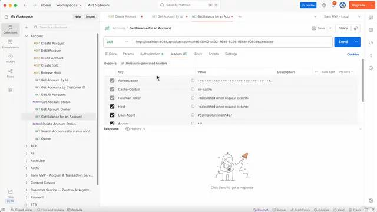
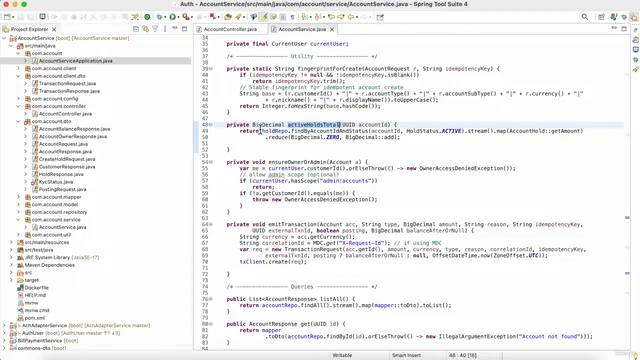
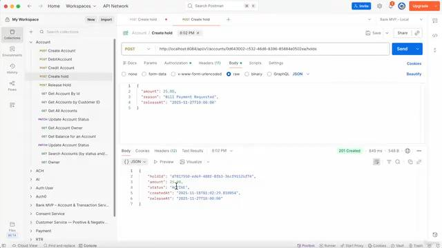
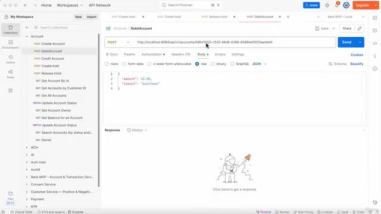
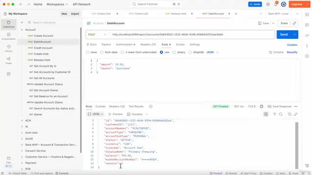
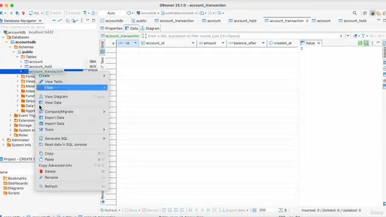
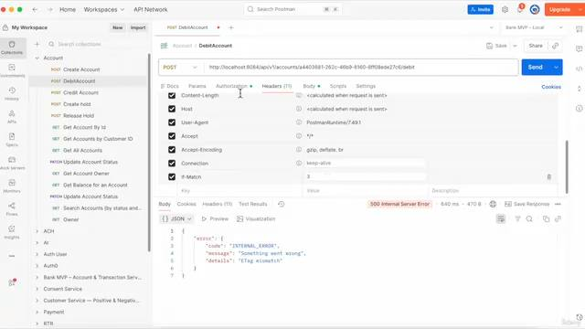
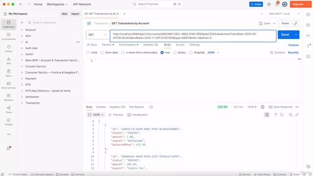

# Spring Boot Banking & Payment：账户读操作、资金写操作、交易流水与分页（P37–P40）

> 读者定位：前端转 AI 应用工程师。本文所有 Java 语法只需「知道即可」，重点看**请求怎么发、数据怎么存、失败怎么回滚**——这些概念在 Node/TypeScript 里一一对应，我会在关键处标注。

---

## 1. 这一节做什么

这四集把「账户微服务」从「能开户」推进到「能安全地动钱」，并补上银行系统最不能缺的一环：**流水账**。具体交付四块能力：

1. **读操作收尾（P37）**：按 ID 查账户（返回 ETag 版本号）、列出账户、查余额（区分 ledger balance / holds / available balance）、管理员改账户状态。
2. **四个写操作（P38）**：place hold（冻结资金）、release hold（解冻）、debit（扣款）、credit（入账）。写操作把 **Idempotency-Key**（防重复提交）和 **If-Match**（乐观锁版本校验）真正用起来。
3. **交易流水（P39）**：每次 debit/credit/hold/release 都在**同一个数据库事务**里写一条 account_transaction 记录——余额更新和流水插入要么都成功、要么都回滚。
4. **服务端分页（P40）**：交易流水按日期、类型过滤 + limit/offset 分页，避免一次拉几万条。

跑通这四集之后，你会得到一个可以用 Postman 完整演示的账户服务：开户 → 查余额 → 冻结 → 解冻 → 扣款 → 查流水 → 翻页，并且能亲眼看到「故意抛异常后余额没变、流水没多」的回滚效果。

从学习路径上看，P37 到 P40 不是四个孤立接口，而是一条完整链路：先能读账户和余额，再能在可用余额上做冻结与解冻，然后在版本号保护下做扣款和入账，最后把每一次资金动作记录成可查询的流水。对前端转 AI 应用工程师来说，可以把这几块类比成：读接口像 `GET /resource`，ETag 像前端经常打交道的乐观锁 token，Idempotency-Key 像提交表单时带的 `requestId`，数据库事务像 Prisma 的 `$transaction`，分页则像常见的 `limit/offset` 查询参数。复现时不要只盯 Java 语法，而要观察一个请求从 Controller 进来、经过 Service 校验、落到 Repository、最后在数据库里留下什么痕迹。

---

## 2. 讲师原话（带出处）

> "每次读取账户时，都会得到一个更新后的 eTag 响应头，它表示该记录的版本。后续在贷记或借记等操作中，我们会使用这个 eTag，确保两次更新不会发生冲突。"
> —— p037 [00:27]

> "余额指的是账面余额，然后还有冻结金额，最后是可用余额……可用余额等于账面余额减去冻结金额总额。"
> —— p037 [03:50] / [04:15]

> "我希望前端发送这个幂等键，尽管我把它标记成了 false……现在我把幂等键标记为可选，所以如果它不存在，我的代码就会出错。因此，现在就留给你在练习这段代码时来修复它。"
> —— p038 [00:55] / [01:52]

> "如果那个版本与我们传入的 eTag 版本不匹配，我们就会判定为 eTag 不匹配，因此不会处理这个请求。"
> —— p038 [08:20]

> "我觉得 save 方法没有把内容刷新到数据库。我应该写成 save 和 flush。"
> —— p038 [11:29]（讲师现场踩坑并修复：`save` 不刷新，响应里的 ETag 版本号是旧的）

> "银行交易是领域事件。数据库事务是提交和回滚的边界。这完全是两个不同的概念。"
> —— p039 [01:25]

> "一次 API 调用，比如一次借记 API 调用，就等于一个数据库事务，其中包含余额更新和交易记录插入。因此，它们要么一起提交，要么一起回滚。"
> —— p039 [02:24]

> "在这个注解中，我们把传播行为设置为 propagation.required。这意味着，如果事务已经存在，这个方法就会加入该事务；如果不存在，Spring 会为整个借记流程开启一个新事务。"
> —— p039 [08:48]

> "我会在借记流程中间故意抛出一个运行时异常……因此，账户余额和交易记录都不会被保存。"
> —— p039 [12:07]

> "offset 除以 limit，这意味着我们传给它的是一个页码……第 1 页从 offset 0 开始，第 2 页则直接从 offset 5 开始。"
> —— p040 [03:20] / [01:54]

这些原话可以拆成三条主线：第一条是「读出来的 ETag 要用于后续写操作」，对应乐观锁；第二条是「余额不是单一数字，而是 ledger、holds、available 三个视角」，对应冻结资金语义；第三条是「一次 API 调用对应一次数据库事务」，对应余额更新与流水插入的原子性。后面的代码和检查清单，都是围绕这三条主线展开的。

---

## 3. 从零复现

### 3.1 前置条件

- 已完成前序课程：customer 微服务、accounts 微服务（开户 API）、Keycloak/Universal Login 的 JWT 鉴权。本节的接口全部要求 `Authorization: Bearer <JWT>`，且 token 里带对应 scope（读操作要 `account read`，写操作要写权限的 scope）。
- 数据库里已有 `account` 表和 `account_hold` 表（前序课程建的），本节**新增** `account_transaction` 表。
- 工具：JDK 17+、Maven、Postman、一个能连的 PostgreSQL（或课程用的库，以你实际配置为准）。

这里的 JWT 和 scope 不是装饰，而是本节所有请求能进入 Controller 的前置门槛。实际复现时，先在 Postman 里配置好 token，再把它放进 `Authorization` 请求头；如果只启动 accounts 服务而没有启动鉴权服务，或者 token 过期、scope 不匹配，你看到的会是 401/403，而不是业务代码里的余额错误。前端对照上，这相当于 axios 拦截器统一加 `Authorization`，并且后端路由守卫检查权限；排查时先看 HTTP 状态码，再去看 Controller 日志。

### 3.2 目录结构（在 accounts 微服务内新增/修改）

```
accounts-service/
└── src/main/java/.../accounts/
    ├── controller/
    │   ├── AccountController.java          # 改：加 getById / listAll / getBalance / updateStatus
    │   └── TransactionController.java      # 新：交易流水查询（分页）
    ├── service/
    │   ├── AccountService.java             # 改：读方法 + hold/release/debit/credit + emitTransaction
    │   └── TransactionService.java         # 新：save（含 fingerprint 去重）
    ├── repository/
    │   ├── AccountRepository.java
    │   ├── AccountHoldRepository.java
    │   └── AccountTransactionRepository.java  # 新
    ├── entity/
    │   ├── Account.java
    │   ├── AccountHold.java
    │   └── AccountTransaction.java         # 新
    ├── dto/
    │   ├── AccountResponse.java
    │   ├── BalanceResponse.java
    │   ├── CreateHoldRequest.java
    │   ├── HoldResponse.java
    │   ├── PostingRequest.java
    │   ├── PostingResponse.java
    │   ├── TransactionRequest.java
    │   └── TransactionResponse.java
    └── spec/
        └── TransactionSpecifications.java  # 新：JPA Specification 工厂
```

这个目录结构对应典型分层：Controller 负责接收 HTTP 请求和返回响应，Service 负责业务校验和事务边界，Repository 负责数据库访问，Entity 映射表结构，DTO 负责对外的请求/响应形状，Specification 负责动态拼接查询条件。对前端来说，Controller 类似 route handler，Service 类似领域逻辑层，Repository 类似 ORM 查询，Specification 类似动态构造 `where` 条件。常见错误是包名不一致导致 Spring 扫不到 Bean，或者把 DTO 和 Entity 混用导致序列化出多余字段；复现时先确认启动类所在包能覆盖这些子包。

### 3.3 数据库变更

```sql
-- 新增交易流水表（字段名以课程实体为准，下面与实体一一对应）
CREATE TABLE account_transaction (
    id              BIGSERIAL PRIMARY KEY,
    account_id      BIGINT        NOT NULL,
    amount          NUMERIC(19,2) NOT NULL,
    currency        VARCHAR(3)    NOT NULL,
    type            VARCHAR(20)   NOT NULL,   -- DEBIT / CREDIT / HOLD / RELEASE
    reason          VARCHAR(255),
    balance_after   NUMERIC(19,2) NOT NULL,
    fingerprint     VARCHAR(128)  NOT NULL UNIQUE,  -- 防重复流水
    occurred_at     TIMESTAMP     NOT NULL
);
CREATE INDEX idx_txn_account_occurred ON account_transaction (account_id, occurred_at DESC);
```

> 课里没有给出建表 DDL 原文，上面是按讲师描述的实体字段（accountId / amount / currency / type / reason / balanceAfter / fingerprint / occurredAt）还原的，字段名请以你实际实体为准。

逐列理解这张表：`id` 是流水主键；`account_id` 指向账户；`amount` 和 `currency` 记录金额与币种；`type` 区分 DEBIT / CREDIT / HOLD / RELEASE；`reason` 保存业务原因；`balance_after` 保存这笔动作完成后的余额快照；`fingerprint` 用唯一约束防重复流水；`occurred_at` 是发生时间。索引 `(account_id, occurred_at DESC)` 是为了按账户查最新流水时更快。常见错误是数据库字段类型和实体不一致，例如金额精度、时间类型或 `fingerprint` 唯一约束缺失；如果 `spring.jpa.hibernate.ddl-auto=validate`，启动时就会直接报 schema 校验失败。前端对照上，这相当于 migration 和 schema 定义必须与 ORM model 对齐。

### 3.4 启动与验证顺序

1. 启动 Keycloak（或课程用的鉴权服务）→ 启动 accounts 服务。
2. Postman 里先拿 token（带 `account read` scope），调 `GET /accounts/{id}`，**在响应头里记下 ETag**。
3. 调 `GET /accounts/{id}/balance`，确认三个字段：balance / holds / availableBalance。
4. 调 `POST /accounts/{id}/holds`，Header 带 `Idempotency-Key`，Body 带金额、原因、释放时间 → 期望 201 + holdId。
5. 调 `POST /accounts/{id}/holds/{holdId}/release` → 状态变 released。
6. 调 `POST /accounts/{id}/debit`，Header 带 `If-Match: <上一步的ETag版本>` → 期望返回新余额 + 新 ETag。
7. 查数据库 `account_transaction` 表，确认多了一条 DEBIT 流水。
8. 调 `GET /accounts/{id}/transactions?startDate=...&endDate=...&type=DEBIT&limit=5&offset=0`，再改 `offset=5` 拿第二页。
9. **回滚验证**：在 `TransactionService.save` 里临时 `throw new RuntimeException("账户余额更新后的模拟故障")`，重放一次 debit（记得更新 If-Match），确认余额没变、流水没多，然后删掉这行异常。

验证顺序的解释：第 2 步的重点不是只看响应 body，而是看响应头里的 `ETag`，它代表当前记录版本；第 4 步的 `Idempotency-Key` 用于防重复提交，重复发同一个 key 应该返回同一个 hold，而不是新增一条；第 6 步的 `If-Match` 必须与刚才读到的版本一致，否则会被判为 ETag mismatch；第 7 步要同时看账户余额和流水表，确认余额更新与流水插入是配套发生的；第 9 步是整节最关键的实验，它验证 `@Transactional` 的原子性。常见排查方式是：接口报 401/403 先看 token 和 scope，报 404 先看路径和账户 ID，报业务异常先看 Service 校验，数据库没变化则看事务是否回滚。

### 3.5 关键截图对照

读账户返回 ETag 的现场：



余额三字段（ledger / holds / available）的演示：



hold 请求成功后数据库里插入的 hold 行：



debit 的 If-Match 与版本号对应关系：



`save` 改 `saveAndFlush` 的现场修复：



交易流水写入成功后的数据库状态：



故意抛异常后余额回滚的证据：



分页第二页（offset=5）的返回：



这些截图不是装饰，而是复现时的对照点：第一张确认响应头有 ETag；第二张确认余额三字段的关系；第三张确认 hold 落表；第四张确认 If-Match 与数据库 version 的对应；第五张确认 `saveAndFlush` 修复的动机；第六、七张确认流水插入与回滚；第八张确认 `offset/limit` 的翻页效果。你复现时可以在相同位置截图或记下实际值，逐项对照。

---

## 4. 完整代码

> 说明：课程是讲师在自己的工程里逐段演示，下面按「一个文件一个文件」还原成可直接保存的完整文件。包名 `com.example.accounts` 请换成你自己的；实体字段与 DTO 字段严格按逐字稿描述命名，未提到的字段（如 `createdAt`）我标注了「课里没讲，可自行补」。

### 4.1 `entity/Account.java`

```java
package com.example.accounts.entity;

import jakarta.persistence.*;
import java.math.BigDecimal;

@Entity
@Table(name = "account")
public class Account {

    @Id
    @GeneratedValue(strategy = GenerationType.IDENTITY)
    private Long id;

    private Long customerId;

    @Column(precision = 19, scale = 2)
    private BigDecimal balance;

    private String currency;

    private String status; // ACTIVE / FROZEN / CLOSED

    @Version
    private Long version;  // 乐观锁版本号，对应 ETag

    // getters / setters 省略，请用 Lombok @Getter @Setter 或手写
    public Long getId() { return id; }
    public void setId(Long id) { this.id = id; }
    public Long getCustomerId() { return customerId; }
    public void setCustomerId(Long customerId) { this.customerId = customerId; }
    public BigDecimal getBalance() { return balance; }
    public void setBalance(BigDecimal balance) { this.balance = balance; }
    public String getCurrency() { return currency; }
    public void setCurrency(String currency) { this.currency = currency; }
    public String getStatus() { return status; }
    public void setStatus(String status) { this.status = status; }
    public Long getVersion() { return version; }
    public void setVersion(Long version) { this.version = version; }
}
```

这个实体是账户主表映射，重点是 `@Version`。它让 Hibernate 在更新时自动带上版本条件，更新成功后版本自增；读接口把这个版本放进 ETag，写接口再用 If-Match 带回来。常见错误是忘记给 `version` 提供 getter/setter，或者数据库没有对应列；前端对照上，这就像资源附带一个 `_version` 字段，更新时必须回传。

### 4.2 `entity/AccountHold.java`

```java
package com.example.accounts.entity;

import jakarta.persistence.*;
import java.math.BigDecimal;
import java.time.LocalDateTime;

@Entity
@Table(name = "account_hold")
public class AccountHold {

    @Id
    @GeneratedValue(strategy = GenerationType.IDENTITY)
    private Long id;

    private Long accountId;

    @Column(precision = 19, scale = 2)
    private BigDecimal amount;

    private String reason;

    private String status; // ACTIVE / RELEASED

    private LocalDateTime releaseAt;

    private String fingerprint; // 来自 Idempotency-Key

    public Long getId() { return id; }
    public void setId(Long id) { this.id = id; }
    public Long getAccountId() { return accountId; }
    public void setAccountId(Long accountId) { this.accountId = accountId; }
    public BigDecimal getAmount() { return amount; }
    public void setAmount(BigDecimal amount) { this.amount = amount; }
    public String getReason() { return reason; }
    public void setReason(String reason) { this.reason = reason; }
    public String getStatus() { return status; }
    public void setStatus(String status) { this.status = status; }
    public LocalDateTime getReleaseAt() { return releaseAt; }
    public void setReleaseAt(LocalDateTime releaseAt) { this.releaseAt = releaseAt; }
    public String getFingerprint() { return fingerprint; }
    public void setFingerprint(String fingerprint) { this.fingerprint = fingerprint; }
}
```

`AccountHold` 表示一笔冻结资金记录。`status=ACTIVE` 的 hold 会参与 available balance 计算；`fingerprint` 来自请求头里的 Idempotency-Key，用于重复提交时直接返回已有 hold。常见错误是把 release 做成删除行而不是改状态，导致历史不可追溯；本代码采用状态变更，更符合银行流水思路。

### 4.3 `entity/AccountTransaction.java`

```java
package com.example.accounts.entity;

import jakarta.persistence.*;
import java.math.BigDecimal;
import java.time.LocalDateTime;

@Entity
@Table(name = "account_transaction")
public class AccountTransaction {

    @Id
    @GeneratedValue(strategy = GenerationType.IDENTITY)
    private Long id;

    private Long accountId;

    @Column(precision = 19, scale = 2)
    private BigDecimal amount;

    private String currency;

    private String type; // DEBIT / CREDIT / HOLD / RELEASE

    private String reason;

    @Column(precision = 19, scale = 2)
    private BigDecimal balanceAfter;

    @Column(unique = true)
    private String fingerprint;

    private LocalDateTime occurredAt;

    public Long getId() { return id; }
    public void setId(Long id) { this.id = id; }
    public Long getAccountId() { return accountId; }
    public void setAccountId(Long accountId) { this.accountId = accountId; }
    public BigDecimal getAmount() { return amount; }
    public void setAmount(BigDecimal amount) { this.amount = amount; }
    public String getCurrency() { return currency; }
    public void setCurrency(String currency) { this.currency = currency; }
    public String getType() { return type; }
    public void setType(String type) { this.type = type; }
    public String getReason() { return reason; }
    public void setReason(String reason) { this.reason = reason; }
    public BigDecimal getBalanceAfter() { return balanceAfter; }
    public void setBalanceAfter(BigDecimal balanceAfter) { this.balanceAfter = balanceAfter; }
    public String getFingerprint() { return fingerprint; }
    public void setFingerprint(String fingerprint) { this.fingerprint = fingerprint; }
    public LocalDateTime getOccurredAt() { return occurredAt; }
    public void setOccurredAt(LocalDateTime occurredAt) { this.occurredAt = occurredAt; }
}
```

这个实体对应交易流水表，`fingerprint` 上的唯一约束是防重复流水的数据库兜底。常见错误是只在 Service 里查重但数据库没有唯一约束，并发下仍可能插入重复记录；排查时要同时看代码和 DDL。

### 4.4 `repository/AccountTransactionRepository.java`

```java
package com.example.accounts.repository;

import com.example.accounts.entity.AccountTransaction;
import org.springframework.data.jpa.repository.JpaRepository;
import org.springframework.data.jpa.repository.JpaSpecificationExecutor;

import java.util.Optional;

public interface AccountTransactionRepository
        extends JpaRepository<AccountTransaction, Long>,
                JpaSpecificationExecutor<AccountTransaction> {

    Optional<AccountTransaction> findByFingerprint(String fingerprint);
}
```

这个接口同时继承 `JpaRepository` 和 `JpaSpecificationExecutor`：前者提供基础 CRUD，后者支持 Section 4.8 的动态查询条件。`findByFingerprint` 用于幂等判断。常见错误是只继承 `JpaRepository` 却在 Controller 调用 `findAll(spec, pageable)`，会编译失败。

### 4.5 `dto/` 下的请求/响应对象

```java
package com.example.accounts.dto;

import java.math.BigDecimal;
import java.time.LocalDateTime;

public record AccountResponse(
        Long id,
        Long customerId,
        BigDecimal balance,
        String currency,
        String status,
        Long version
) {}

public record BalanceResponse(
        BigDecimal balance,
        BigDecimal holds,
        BigDecimal availableBalance
) {}

public record CreateHoldRequest(
        BigDecimal amount,
        String reason,
        LocalDateTime releaseAt,
        String idempotencyKey   // 从 header 取，讲师在 DTO 里也留了这个字段
) {}

public record HoldResponse(
        Long holdId,
        BigDecimal amount,
        String status
) {}

public record PostingRequest(
        BigDecimal amount,
        String reason
) {}

public record PostingResponse(
        BigDecimal balance,
        Long version
) {}

public record TransactionRequest(
        Long accountId,
        BigDecimal amount,
        String currency,
        String type,
        String reason,
        BigDecimal balanceAfter
) {}

public record TransactionResponse(
        Long id,
        Long accountId,
        BigDecimal amount,
        String currency,
        String type,
        String reason,
        BigDecimal balanceAfter,
        LocalDateTime occurredAt
) {}
```

> 上面把多个 record 写在一个代码块里方便阅读，实际请一个文件一个 record（record 名 = 文件名）。

这些 DTO 定义了对外的数据形状。`AccountResponse` 带 `version`，因为读账户要返回 ETag；`BalanceResponse` 明确三个余额字段；`CreateHoldRequest` 把 header 里的 idempotencyKey 也放进请求对象；`PostingResponse` 返回新余额和新版本。常见错误是直接把 Entity 返回给前端，导致内部字段泄露或序列化循环；前端对照上，DTO 就像 TypeScript 的 interface，前后端约定好字段名。

### 4.6 `service/AccountService.java`（核心，含读 + 四个写 + emitTransaction）

```java
package com.example.accounts.service;

import com.example.accounts.dto.*;
import com.example.accounts.entity.Account;
import com.example.accounts.entity.AccountHold;
import com.example.accounts.repository.AccountHoldRepository;
import com.example.accounts.repository.AccountRepository;
import org.springframework.stereotype.Service;
import org.springframework.transaction.annotation.Propagation;
import org.springframework.transaction.annotation.Transactional;

import java.math.BigDecimal;
import java.util.List;

@Service
public class AccountService {

    private final AccountRepository accountRepo;
    private final AccountHoldRepository holdRepo;
    private final TransactionService transactionService;

    public AccountService(AccountRepository accountRepo,
                          AccountHoldRepository holdRepo,
                          TransactionService transactionService) {
        this.accountRepo = accountRepo;
        this.holdRepo = holdRepo;
        this.transactionService = transactionService;
    }

    // ---------- 读操作（P37） ----------

    public AccountResponse getById(Long accountId) {
        Account account = accountRepo.findById(accountId)
                .orElseThrow(() -> new RuntimeException("Account not found"));
        return toResponse(account);
    }

    public List<AccountResponse> listAll() {
        return accountRepo.findAll().stream().map(this::toResponse).toList();
    }

    public BalanceResponse getBalance(Long accountId) {
        Account account = accountRepo.findById(accountId)
                .orElseThrow(() -> new RuntimeException("Account not found"));
        BigDecimal holds = sumActiveHolds(accountId);
        BigDecimal available = account.getBalance().subtract(holds);
        return new BalanceResponse(account.getBalance(), holds, available);
    }

    @Transactional
    public void updateStatus(Long accountId, String newStatus, Long requesterCustomerId, boolean isAdmin) {
        Account account = accountRepo.findById(accountId)
                .orElseThrow(() -> new RuntimeException("Account not found"));
        if (!isAdmin && !account.getCustomerId().equals(requesterCustomerId)) {
            throw new RuntimeException("Not allowed to change this account");
        }
        account.setStatus(newStatus);
        accountRepo.save(account);
    }

    // ---------- 写操作（P38） ----------

    @Transactional
    public HoldResponse createHold(Long accountId, CreateHoldRequest req) {
        Account account = accountRepo.findById(accountId)
                .orElseThrow(() -> new RuntimeException("Account not found"));

        // 幂等：同一个 Idempotency-Key 直接返回已有 hold
        if (req.idempotencyKey() != null) {
            var existing = holdRepo.findByFingerprint(req.idempotencyKey());
            if (existing.isPresent()) {
                AccountHold h = existing.get();
                return new HoldResponse(h.getId(), h.getAmount(), h.getStatus());
            }
        }

        BigDecimal holds = sumActiveHolds(accountId);
        BigDecimal available = account.getBalance().subtract(holds);
        if (req.amount().compareTo(available) > 0) {
            throw new RuntimeException("Insufficient funds");
        }

        AccountHold hold = new AccountHold();
        hold.setAccountId(accountId);
        hold.setAmount(req.amount());
        hold.setReason(req.reason());
        hold.setReleaseAt(req.releaseAt());
        hold.setStatus("ACTIVE");
        hold.setFingerprint(req.idempotencyKey());
        AccountHold saved = holdRepo.save(hold);

        emitTransaction(account, req.amount(), "HOLD", req.reason());
        return new HoldResponse(saved.getId(), saved.getAmount(), saved.getStatus());
    }

    @Transactional
    public HoldResponse releaseHold(Long accountId, Long holdId) {
        AccountHold hold = holdRepo.findById(holdId)
                .orElseThrow(() -> new RuntimeException("Hold not found"));
        if (!hold.getAccountId().equals(accountId)) {
            throw new RuntimeException("Hold does not belong to this account");
        }
        hold.setStatus("RELEASED");
        hold.setReason("manual release");
        holdRepo.save(hold);

        Account account = accountRepo.findById(accountId)
                .orElseThrow(() -> new RuntimeException("Account not found"));
        emitTransaction(account, hold.getAmount(), "RELEASE", "manual release");
        return new HoldResponse(hold.getId(), hold.getAmount(), hold.getStatus());
    }

    @Transactional
    public PostingResponse debit(Long accountId, Long ifMatchVersion, PostingRequest req) {
        Account account = accountRepo.findById(accountId)
                .orElseThrow(() -> new RuntimeException("Account not found"));

        if (ifMatchVersion != null && !ifMatchVersion.equals(account.getVersion())) {
            throw new RuntimeException("ETag mismatch");
        }

        BigDecimal holds = sumActiveHolds(accountId);
        BigDecimal available = account.getBalance().subtract(holds);
        if (available.compareTo(req.amount()) < 0) {
            throw new RuntimeException("Insufficient funds");
        }

        account.setBalance(account.getBalance().subtract(req.amount()));
        // 关键：saveAndFlush 才会把 @Version 自增后的新值刷回实体，响应里的 ETag 才是新的
        Account saved = accountRepo.saveAndFlush(account);

        emitTransaction(saved, req.amount(), "DEBIT", req.reason());
        return new PostingResponse(saved.getBalance(), saved.getVersion());
    }

    @Transactional
    public PostingResponse credit(Long accountId, Long ifMatchVersion, PostingRequest req) {
        Account account = accountRepo.findById(accountId)
                .orElseThrow(() -> new RuntimeException("Account not found"));

        if (ifMatchVersion != null && !ifMatchVersion.equals(account.getVersion())) {
            throw new RuntimeException("ETag mismatch");
        }

        account.setBalance(account.getBalance().add(req.amount()));
        Account saved = accountRepo.saveAndFlush(account);

        emitTransaction(saved, req.amount(), "CREDIT", req.reason());
        return new PostingResponse(saved.getBalance(), saved.getVersion());
    }

    // ---------- 交易流水（P39） ----------

    @Transactional(propagation = Propagation.REQUIRED)
    public void emitTransaction(Account account, BigDecimal amount, String type, String reason) {
        TransactionRequest txReq = new TransactionRequest(
                account.getId(),
                amount,
                account.getCurrency(),
                type,
                reason,
                account.getBalance()
        );
        transactionService.save(txReq);
    }

    // ---------- 私有工具 ----------

    private BigDecimal sumActiveHolds(Long accountId) {
        return holdRepo.findByAccountIdAndStatus(accountId, "ACTIVE")
                .stream()
                .map(AccountHold::getAmount)
                .reduce(BigDecimal.ZERO, BigDecimal::add);
    }

    private AccountResponse toResponse(Account a) {
        return new AccountResponse(a.getId(), a.getCustomerId(), a.getBalance(),
                a.getCurrency(), a.getStatus(), a.getVersion());
    }
}
```

这是本节核心类。读方法负责返回 DTO 和余额视图；写方法分别处理 hold、release、debit、credit；`emitTransaction` 把流水写入委托给 `TransactionService`。注意 `debit` 和 `credit` 都先校验 If-Match，再计算 available，最后 `saveAndFlush` 后写流水。常见错误是以为 `@Transactional` 写在 private 方法上也生效，实际上 Spring AOP 对自调用和 private 方法有代理限制；本代码把事务放在 public 的 `debit`/`credit` 和 `emitTransaction` 上，复现时不要随意改成 private。

### 4.7 `service/TransactionService.java`

```java
package com.example.accounts.service;

import com.example.accounts.dto.TransactionRequest;
import com.example.accounts.entity.AccountTransaction;
import com.example.accounts.repository.AccountTransactionRepository;
import org.springframework.stereotype.Service;
import org.springframework.transaction.annotation.Propagation;
import org.springframework.transaction.annotation.Transactional;

import java.nio.charset.StandardCharsets;
import java.security.MessageDigest;
import java.time.LocalDateTime;

@Service
public class TransactionService {

    private final AccountTransactionRepository repo;

    public TransactionService(AccountTransactionRepository repo) {
        this.repo = repo;
    }

    @Transactional(propagation = Propagation.REQUIRED)
    public void save(TransactionRequest req) {
        String fingerprint = fingerprintOf(req);

        // 幂等：同一笔请求不重复落流水
        if (repo.findByFingerprint(fingerprint).isPresent()) {
            return;
        }

        AccountTransaction tx = new AccountTransaction();
        tx.setAccountId(req.accountId());
        tx.setAmount(req.amount());
        tx.setCurrency(req.currency());
        tx.setType(req.type());
        tx.setReason(req.reason());
        tx.setBalanceAfter(req.balanceAfter());
        tx.setFingerprint(fingerprint);
        tx.setOccurredAt(LocalDateTime.now());

        repo.save(tx);

        // 回滚演示用：取消下面这行注释即可复现 P39 的 rollback 实验
        // throw new RuntimeException("simulated failure after account balance update");
    }

    private String fingerprintOf(TransactionRequest req) {
        String raw = req.accountId() + "|" + req.amount() + "|" + req.type()
                + "|" + req.reason() + "|" + req.balanceAfter();
        try {
            MessageDigest md = MessageDigest.getInstance("SHA-256");
            byte[] digest = md.digest(raw.getBytes(StandardCharsets.UTF_8));
            StringBuilder sb = new StringBuilder();
            for (byte b : digest) sb.append(String.format("%02x", b));
            return sb.toString();
        } catch (Exception e) {
            throw new RuntimeException(e);
        }
    }
}
```

`TransactionService.save` 用 fingerprint 去重，并且通过 `@Transactional(propagation = Propagation.REQUIRED)` 加入调用方事务。回滚实验的异常就注释在这里，复现时取消注释即可。常见错误是以为这里会新开事务；`REQUIRED` 的语义是“已有事务就加入，没有才新建”，所以 debit 的余额更新和这里的流水插入共享同一个提交边界。

### 4.8 `spec/TransactionSpecifications.java`

```java
package com.example.accounts.spec;

import com.example.accounts.entity.AccountTransaction;
import org.springframework.data.jpa.domain.Specification;

import java.time.LocalDateTime;

public class TransactionSpecifications {

    public static Specification<AccountTransaction> accountEquals(Long accountId) {
        return (root, query, cb) -> cb.equal(root.get("accountId"), accountId);
    }

    public static Specification<AccountTransaction> withFilters(
            LocalDateTime startDate, LocalDateTime endDate, String type) {
        return (root, query, cb) -> {
            var predicates = cb.conjunction();
            if (startDate != null) {
                predicates = cb.and(predicates,
                        cb.greaterThanOrEqualTo(root.get("occurredAt"), startDate));
            }
            if (endDate != null) {
                predicates = cb.and(predicates,
                        cb.lessThanOrEqualTo(root.get("occurredAt"), endDate));
            }
            if (type != null && !type.isBlank()) {
                predicates = cb.and(predicates, cb.equal(root.get("type"), type));
            }
            return predicates;
        };
    }
}
```

这两个静态方法分别构造“账户相等”和“可选过滤条件”。`withFilters` 里只有参数非空才加条件，避免把 `null` 拼进 SQL。常见错误是日期范围顺序写反，或者忘记给 `occurredAt` 加索引导致查询慢；前端对照上，这类似在前端动态构造 query object。

### 4.9 `controller/AccountController.java`

```java
package com.example.accounts.controller;

import com.example.accounts.dto.*;
import com.example.accounts.service.AccountService;
import org.springframework.http.HttpStatus;
import org.springframework.http.ResponseEntity;
import org.springframework.web.bind.annotation.*;

import java.util.List;

@RestController
@RequestMapping("/accounts")
public class AccountController {

    private final AccountService accountService;

    public AccountController(AccountService accountService) {
        this.accountService = accountService;
    }

    @GetMapping("/{accountId}")
    public ResponseEntity<AccountResponse> getById(@PathVariable Long accountId) {
        AccountResponse body = accountService.getById(accountId);
        return ResponseEntity.ok()
                .eTag(String.valueOf(body.version()))   // ETag = 版本号
                .body(body);
    }

    @GetMapping
    public List<AccountResponse> listAll() {
        return accountService.listAll();
    }

    @GetMapping("/{accountId}/balance")
    public BalanceResponse getBalance(@PathVariable Long accountId) {
        return accountService.getBalance(accountId);
    }

    @PatchMapping("/{accountId}/status")
    public ResponseEntity<Void> updateStatus(@PathVariable Long accountId,
                                             @RequestParam String status) {
        // 讲师原话：内部 admin 开关，返回 200 + 空 body
        accountService.updateStatus(accountId, status, null, true);
        return ResponseEntity.ok().build();
    }

    @PostMapping("/{accountId}/holds")
    public ResponseEntity<HoldResponse> createHold(
            @PathVariable Long accountId,
            @RequestHeader(value = "Idempotency-Key", required = false) String idempotencyKey,
            @RequestBody CreateHoldRequest req) {
        CreateHoldRequest withKey = new CreateHoldRequest(
                req.amount(), req.reason(), req.releaseAt(), idempotencyKey);
        return ResponseEntity.status(HttpStatus.CREATED)
                .body(accountService.createHold(accountId, withKey));
    }

    @PostMapping("/{accountId}/holds/{holdId}/release")
    public HoldResponse releaseHold(@PathVariable Long accountId,
                                    @PathVariable Long holdId) {
        return accountService.releaseHold(accountId, holdId);
    }

    @PostMapping("/{accountId}/debit")
    public ResponseEntity<PostingResponse> debit(
            @PathVariable Long accountId,
            @RequestHeader(value = "If-Match", required = false) Long ifMatch,
            @RequestBody PostingRequest req) {
        PostingResponse body = accountService.debit(accountId, ifMatch, req);
        return ResponseEntity.ok().eTag(String.valueOf(body.version())).body(body);
    }

    @PostMapping("/{accountId}/credit")
    public ResponseEntity<PostingResponse> credit(
            @PathVariable Long accountId,
            @RequestHeader(value = "If-Match", required = false) Long ifMatch,
            @RequestBody PostingRequest req) {
        PostingResponse body = accountService.credit(accountId, ifMatch, req);
        return ResponseEntity.ok().eTag(String.valueOf(body.version())).body(body);
    }
}
```

Controller 负责把 HTTP 语义映射到 Service：GET 读、POST 写、PATCH 改状态；`getById` 和 debit/credit 都把 version 放进响应 ETag；hold 接口从 header 取 Idempotency-Key 后重新构造请求对象。常见错误是 `@RequestHeader` 名字拼错或大小写不一致导致取不到值；前端对照上，这就是在 fetch/axios 里设置 headers。

### 4.10 `controller/TransactionController.java`

```java
package com.example.accounts.controller;

import com.example.accounts.dto.TransactionResponse;
import com.example.accounts.entity.AccountTransaction;
import com.example.accounts.repository.AccountTransactionRepository;
import com.example.accounts.spec.TransactionSpecifications;
import org.springframework.data.domain.PageRequest;
import org.springframework.data.domain.Sort;
import org.springframework.data.jpa.domain.Specification;
import org.springframework.format.annotation.DateTimeFormat;
import org.springframework.web.bind.annotation.*;

import java.time.LocalDateTime;
import java.util.List;

@RestController
@RequestMapping("/accounts/{accountId}/transactions")
public class TransactionController {

    private final AccountTransactionRepository repo;

    public TransactionController(AccountTransactionRepository repo) {
        this.repo = repo;
    }

    @GetMapping
    public List<TransactionResponse> list(
            @PathVariable Long accountId,
            @RequestParam(required = false) @DateTimeFormat(iso = DateTimeFormat.ISO.DATE_TIME) LocalDateTime startDate,
            @RequestParam(required = false) @DateTimeFormat(iso = DateTimeFormat.ISO.DATE_TIME) LocalDateTime endDate,
            @RequestParam(required = false) String type,
            @RequestParam(defaultValue = "5") int limit,
            @RequestParam(defaultValue = "0") int offset) {

        int pageNumber = offset / limit;   // 讲师原话：offset / limit 得到页码
        PageRequest pageable = PageRequest.of(
                pageNumber, limit, Sort.by(Sort.Direction.DESC, "occurredAt"));

        Specification<AccountTransaction> spec =
                TransactionSpecifications.accountEquals(accountId)
                        .and(TransactionSpecifications.withFilters(startDate, endDate, type));

        return repo.findAll(spec, pageable).stream()
                .map(t -> new TransactionResponse(
                        t.getId(), t.getAccountId(), t.getAmount(), t.getCurrency(),
                        t.getType(), t.getReason(), t.getBalanceAfter(), t.getOccurredAt()))
                .toList();
    }
}
```

交易流水查询接口把日期、类型、limit、offset 作为查询参数，使用 `offset / limit` 计算页码，再按 `occurredAt` 倒序返回。常见错误是 `offset` 和 `limit` 的整除关系导致丢数据；另外日期参数格式必须匹配 `DateTimeFormat.ISO.DATE_TIME`，否则会 400。

### 4.11 `application.yml` 关键片段

```yaml
spring:
  datasource:
    url: jdbc:postgresql://localhost:5432/accounts_db
    username: accounts
    password: accounts
  jpa:
    hibernate:
      ddl-auto: validate   # 表已用 DDL 建好，用 validate 更稳
    properties:
      hibernate:
        format_sql: true
server:
  port: 8082
```

这里用 `ddl-auto: validate` 表示表结构由 DDL 管理，应用启动时只校验不自动改表。常见错误是实体字段和数据库列不一致导致启动失败；排查时先看启动日志里的 schema validation 报错，再对照 SQL 和实体。

---

## 5. 逐行解释

**`@Version private Long version;`（Account 实体）**
这是 JPA 的乐观锁字段。每次 `save` 时 Hibernate 会执行 `UPDATE ... WHERE id=? AND version=?`，成功则 version+1。前端拿到的 ETag 就是这个 version。**在 Node/Prisma 里对应**：自己维护一个 `version` 列，更新时 `where: { id, version }`，`data: { version: { increment: 1 } }`，返回 0 行就说明冲突。常见错误是读接口返回了 version，但写接口没有校验 If-Match，乐观锁就形同虚设；排查时看更新 SQL 的 where 条件里有没有 version。

**`getById` 里 `ResponseEntity.ok().eTag(...)`**
把 version 塞进 HTTP 响应头 `ETag`。讲师在 Postman 里专门指了响应头，强调「every read returns the latest ETag」。前端后续 debit 时要把这个值原样放进 `If-Match`。常见错误是只看响应 body 不看 header，导致后续写操作拿不到版本；前端对照上，这类似从 response.headers 里取 token。

**`getBalance` 的三段计算**
`balance` 是账本余额（ledger），`holds` 是 `account_hold` 表里 status=ACTIVE 的金额之和，`availableBalance = balance - holds`。讲师用「支票入账但资金被冻结」的例子解释：钱已经记进 ledger，但暂时不能花。常见错误是 hold 校验时用 balance 而不是 available，导致同一笔钱被重复冻结；排查时把三个字段一起打印出来看关系。

**`createHold` 里的幂等分支**
先按 `Idempotency-Key` 查 `account_hold.fingerprint`，命中就直接返回旧 hold，不再扣额度。讲师明确说「我把 idempotency key 标成 optional，所以不传会 NPE，这是留给你练习的作业」——上面代码里我加了 `!= null` 判断，属于替你把作业做了。常见错误是只在前端防重复点击，后端没有幂等键，网络重试仍会产生两条 hold；前端对照上，这类似表单提交带 `requestId` 并由后端去重。

**`createHold` 的余额校验**
`available = balance - sumActiveHolds`，请求金额大于 available 就抛 `Insufficient funds`。注意这里校验的是 **available** 而不是 balance，否则冻结过的钱会被重复冻结。常见错误是漏掉 status=ACTIVE 过滤，把已释放的 hold 也算进冻结金额。

**`releaseHold` 的双重校验**
先按 holdId 查，查不到抛异常；再比对 `hold.accountId == 路径里的 accountId`，不等就抛「hold does not belong to this account」。这是防越权：A 账户不能释放 B 账户的 hold。常见错误是只按 holdId 查就释放，忽略 accountId 归属校验。

**`debit` 里的 `ifMatchVersion` 校验**
`if (ifMatchVersion != null && !ifMatchVersion.equals(account.getVersion())) throw "ETag mismatch"`。这就是乐观锁：你读到的版本是 2，别人先改了变成 3，你拿 2 来提交就会被拒。**Node 对应**：`UPDATE accounts SET balance=?, version=version+1 WHERE id=? AND version=?`，`rowCount===0` 就返回 409。常见错误是把 If-Match 当可选参数且不校验 null，导致并发下覆盖别人更新；本代码允许 null 是为了课堂演示，生产应强制。

**`saveAndFlush` 而不是 `save`（P38 的现场 bug）**
讲师第一次演示 debit 时，数据库 version 已经是 3，但响应里返回的还是 2。原因：`save` 只是把实体放进持久化上下文，`@Version` 自增后的新值要等 flush 才回写到实体对象上。改成 `saveAndFlush` 后响应 ETag 正确变成 4。**这是本节最值得记住的坑**——如果你在 Node 里用 ORM 的 `save()` 后立刻读 `entity.version`，也可能读到旧值，要么手动 `+1`，要么用 `returning` 拿数据库返回值。排查时对比响应 ETag、数据库 version 和下一次请求的 If-Match 是否一致。

**`emitTransaction` 上的 `@Transactional(propagation = REQUIRED)`**
讲师原话：「if a transaction already exists, this method joins it」。debit 方法本身有 `@Transactional`，emitTransaction 被调用时不会开新事务，而是加入同一个。所以余额更新和流水插入共享一个 commit/rollback 边界。**Node 对应**：Prisma 的 `$transaction(async (tx) => { ... })`，把两次写包在同一个回调里。常见错误是把 emitTransaction 改成 `REQUIRES_NEW`，结果余额回滚了但流水提交了。

**`TransactionService.save` 里的 fingerprint 去重**
同一笔交易请求算出一个唯一指纹，已存在就跳过。防止网络重试导致流水重复。注意它和 hold 的 Idempotency-Key 是两套机制：hold 用前端传的 key，流水用后端算的指纹。常见错误是 fingerprint 算法包含时间戳，导致每次重试指纹都不同；本代码用业务字段拼接。

**`TransactionController` 的 `offset / limit`**
讲师原话：「offset divided by limit this means that we are giving it a page number」。offset=0、limit=5 → page 0；offset=5、limit=5 → page 1。配合 `Sort.by(DESC, "occurredAt")` 实现「最新在前」。**Node 对应**：`skip: offset, take: limit, orderBy: { occurredAt: 'desc' }`。常见错误是 offset 不是 limit 整数倍时页码计算丢数据。

**`TransactionSpecifications` 的两个静态方法**
`accountEquals` 是必选条件（只查这个账户），`withFilters` 是可选条件（日期、类型，传了才加）。讲师称之为「mini bean class factory」。最后 `.and()` 拼成一个 Specification，Spring Data 据此生成 SQL。**Node 对应**：动态拼 `where` 对象。常见错误是日期参数为 null 时仍然拼进 SQL，导致查询报错。

**回滚实验**
在 `TransactionService.save` 末尾 `throw new RuntimeException(...)`，debit 流程在余额已改、流水未落时抛异常，`@Transactional` 捕获到 RuntimeException 标记整个事务 rollback。讲师在数据库里验证：余额仍是 940，流水表没多。**这就是 ACID 里的 A（原子性）**。常见错误是抛了 checked exception 却没用 `rollbackFor`，导致事务仍提交。

---

## 6. 复现检查清单

- [ ] `account_transaction` 表已建，`fingerprint` 列有 UNIQUE 约束
  - 验证：连数据库执行表结构查看，确认列名、类型、唯一约束和索引都存在；再插入两条相同 fingerprint 测试第二条被拒绝。
- [ ] `GET /accounts/{id}` 响应头里有 `ETag`，值等于数据库 `version`
  - 验证：Postman 看 Headers 里的 ETag，再查 `account` 表对应行的 version，两者应一致；刷新后 ETag 应随写操作变化。
- [ ] `GET /accounts/{id}/balance` 返回三个字段，且 `availableBalance = balance - holds`
  - 验证：记录 balance 和 holds，手工做减法与返回的 availableBalance 对比；再造一条 ACTIVE hold 后重查，holds 应增加。
- [ ] `POST /accounts/{id}/holds` 带 `Idempotency-Key`，重复发同一 key 返回同一个 holdId，不新增行
  - 验证：同一请求体、同一 header 连发两次，比较响应 holdId；查 `account_hold` 表确认只有一行 fingerprint 对应记录。
- [ ] hold 金额超过 available 时返回 insufficient funds
  - 验证：先查 available，再发一个大于该值的 hold，期望业务异常；查数据库确认没有新增 hold 行。
- [ ] `POST /accounts/{id}/holds/{holdId}/release` 后 hold 状态变 RELEASED
  - 验证：调用后查 `account_hold.status`，并重查 balance 接口确认 holds 减少、available 增加。
- [ ] 用错误的 holdId 配对的 accountId 调 release，返回「hold does not belong to this account」
  - 验证：用 A 账户路径释放 B 账户的 holdId，期望异常；查 B 的 hold 状态仍为 ACTIVE。
- [ ] `POST /accounts/{id}/debit` 带正确 `If-Match` 成功，返回新余额 + 新 ETag
  - 验证：先 GET 拿 ETag，再 debit 带上该值；响应 body 的 balance 应减少，响应头 ETag 应比旧值大。
- [ ] 带过期 `If-Match` 调 debit，返回 ETag mismatch
  - 验证：先故意用一个旧版本号提交，期望异常；查余额确认没有变化。
- [ ] debit 成功后 `account_transaction` 多一条 DEBIT 记录，`balanceAfter` 等于新余额
  - 验证：查最新流水行的 type、amount、balance_after；与账户表当前 balance 对比。
- [ ] `GET /accounts/{id}/transactions?limit=5&offset=0` 返回最新 5 条；`offset=5` 返回下一批
  - 验证：先造至少 10 条流水，分别请求两页，比较 id 和 occurred_at 不重叠，并且第一页是最新在前。
- [ ] 加 `type=DEBIT` 过滤后只返回 debit 流水
  - 验证：响应中每一条 type 都应为 DEBIT；再换 CREDIT 验证过滤生效。
- [ ] 在 `TransactionService.save` 抛异常后重放 debit：余额不变、流水不增（回滚生效）
  - 验证：记录 debit 前余额和流水条数，取消注释异常后调用，期望报错；再查账户余额和流水条数均未变化。
- [ ] 删掉异常代码，服务恢复正常
  - 验证：重新编译启动，重复一次正常 debit，确认余额和流水都按预期变化。

---

## 7. 课里没讲但你会撞上的

| 现象 | 原因 | 怎么办 |
| --- | --- | --- |
| 调 hold