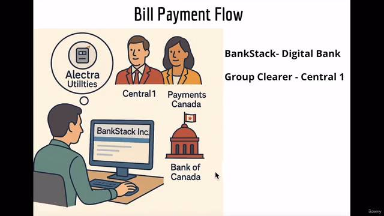
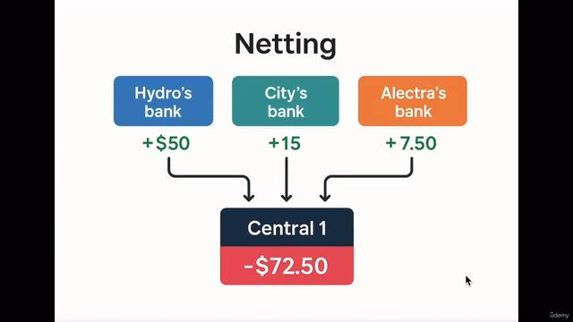
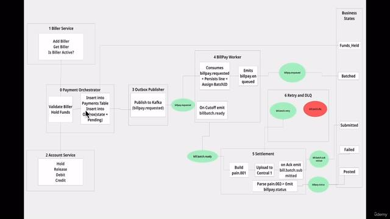
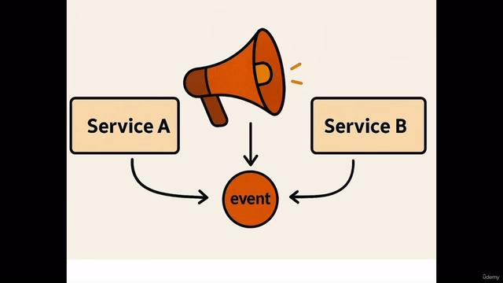
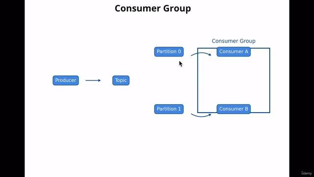
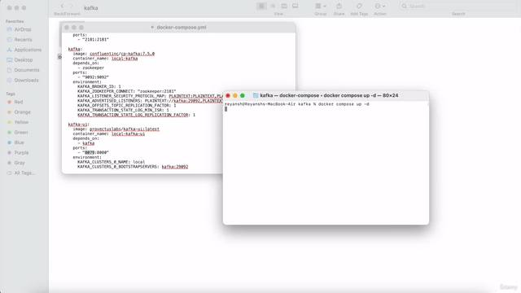
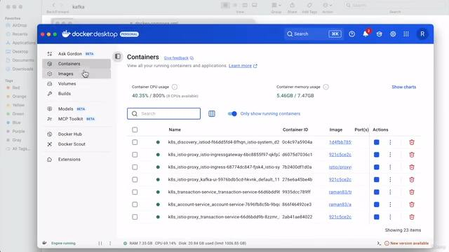
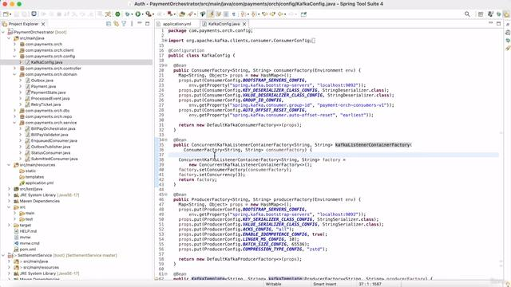

# Spring Boot Banking & Payment（锁 + Saga）— P41–P45 复现文档

> 覆盖 P41–P45：加拿大账单支付业务流 → 事件驱动架构 → Kafka 概念 → Docker 本地跑 Kafka → Spring Boot 接入 Kafka。
> 读者定位：前端转 AI 应用工程师。涉及 Java 语法会标注「知道即可」；涉及并发/锁会补一句「在 JS/Node 里对应什么」。
> 说明：P41–P45 是「业务流 + 架构 + Kafka 基础设施」阶段，**讲师在这 5 集里没有给出完整的业务代码**（支付编排、Saga、锁的代码在后续视频）。因此本文档第 4 节给出的是**这 5 集真正能跑起来的东西**：Docker Compose 起 Kafka + Spring Boot 的 Kafka 配置。业务类代码会明确标注「课里没有代码，以下为示意」。

---

## 1. 这一节做什么

这 5 集要解决的是「在写支付代码之前，先把地基和地图铺好」。它不是一上来就写业务逻辑，而是先把支付业务的语言、系统之间的边界、以及本地可运行的基础设施讲清楚。具体产出三样东西：

1. **一张业务地图**（P41）：一笔 50 加元的账单支付，从客户点「Bill Pay」到钱真正落到收款方银行，中间经过 Bankstack（虚构小银行）→ Central 1（集团清算行）→ ACSS（自动清算结算系统）→ 加拿大央行（Bank of Canada）→ 收款方银行。你要能说清楚「清算（clearing）」和「结算（settlement）」是两件事。清算更接近「算账」：ACSS 收集交易、计算净头寸、告诉谁欠谁；结算更接近「动钱」：加拿大央行根据结果调整结算账户。讲师用「math mode / money mode」来区分这两个阶段，意思是 ACSS 算完并不等于钱已经到账。这个区别对前端转后端尤其重要：接口返回「已受理」不等于资金已经结算完成，页面上的状态文案不能把「处理中」写成「已到账」。
2. **一张架构图**（P42）：Bill Service、Payment Orchestrator、Outbox Publisher、BillPay Worker、Settlement Service、Dummy Central 1 六个组件，用 Kafka 串起来，业务状态机是 `funds held → batched → submitted → posted / failed`，并带重试 + DLQ。这里的关键不是「服务越多越高级」，而是每个组件只负责一段职责：接收请求、编排状态、可靠发事件、执行支付、对接清算、模拟外部系统。服务之间尽量不直接同步调用，而是通过 Kafka 事件推进状态。这样做的好处是削峰、解耦、可重放；代价是最终一致性、幂等、顺序、重复消费这些问题必须自己处理。
3. **一套能跑的基础设施**（P43–P45）：用 Docker Compose 在本机起 Zookeeper + Kafka Broker + Kafka UI，然后在 Spring Boot 的 `application.yaml` 和 `KafkaConfig.java` 里把生产者和消费者接上。注意，这一步只是「Kafka 能连上」，还不是「支付业务能跑通」。P41–P45 没有把 Payment Orchestrator、Outbox Publisher、BillPay Worker、Settlement Service 的业务代码贴出来，所以复现目标要定准：先把本地 Kafka 三件套跑起来，再让 Spring Boot 启动时不出 Kafka 连接错误。

**这一节结束时你应该能达成的验收标准**：`docker compose up -d` 后三个容器都是 running，浏览器打开 `localhost:8079` 能看到 Kafka UI，Spring Boot 应用启动不报 Kafka 连接错误。进一步说，`docker compose ps` 的三个服务状态应为 `Up` 或 `running`，Kafka UI 左侧能看到 Topics 菜单，Spring Boot 日志里能看到应用成功启动，并且没有 `Connection to node -1 could not be established`、`UnknownHostException`、`TimeoutException` 这类 Kafka 连接失败信息。此时还没有业务事件在跑，这是正常的；真正的 bill payment 事件流在后续视频里写。

---

## 2. 讲师原话（带出处）

关于业务流，讲师把「谁欠谁」讲得很直白：

> "ACSS 负责收集交易、计算净头寸，并公布谁欠谁。等 ACSS 完成这些计算后，加拿大银行再调整结算账户。"
> —— p041 [01:20]

> "在这个阶段，ACSS 只计算了债务关系，资金还没有实际流转，加拿大银行也尚未更新任何人的结算账户。这仍处于计算模式，而不是资金模式。"
> —— p041 [05:52]

这两句要连起来理解：ACSS 做的是收集交易、计算净头寸、公布债权债务关系；加拿大央行做的是调整结算账户。前者是清算，后者是结算。讲师反复强调「math mode, not money mode」，就是提醒不要看到 ACSS 处理完成就以为钱已经动了。对写代码的人来说，这意味着状态机里要区分「已计算 / 已提交 / 已入账」等不同阶段，不能用一个 `success` 把所有阶段糊在一起。

关于为什么必须用 Outbox，讲师的原话是：

> "如果我们先把支付保存到数据库，再单独向 Kafka 发布消息，就总会有一种可能：其中一步成功、另一步失败，这在银行业会造成彻底的混乱。采用发件箱模式后，数据库就成为唯一事实来源。"
> —— p042 [05:13]

这段话讲的是 dual write 问题：数据库写成功、Kafka 发失败，或者 Kafka 发成功、数据库写失败，都会造成不一致。Outbox 的思路是把「业务数据」和「待发送事件」放在同一个数据库事务里，让数据库成为事实来源，再由后台任务把 outbox 里的记录可靠地发到 Kafka。

关于 Kafka 的定位：

> "Kafka 不只是一个消息系统，它是我们支付平台的主干。我们的服务不再为每件小事直接相互调用，而主要通过各种异步事件进行通信。"
> —— p042 [02:24]

这里要抓住「backbone」和「asynchronous events」两个词。Kafka 在这套架构里不是简单的消息队列，而是服务之间的异步事件骨干。服务不直接互相调用每一个小步骤，而是通过事件推进状态，这样 Payment Orchestrator、BillPay Worker、Settlement Service 之间可以解耦。

关于分区与顺序：

> "如果我们用 payment ID 作为键，Kafka 就会把该支付的所有事件发送到同一个分区，这意味着在需要保证顺序的地方，顺序得以保留。"
> —— p043 [06:30]

Kafka 只保证同一个 partition 内的消息顺序，不保证整个 topic 的全局顺序。用 payment ID 做 key，就能让同一笔支付的事件落到同一个 partition，从而保证这笔支付内部的事件顺序。对支付系统来说，这比「所有支付全局有序」更现实，也更必要。

关于本地环境：

> "与其在 2025 年还像原始人一样手动安装 Kafka 和 Zookeeper，我们不如使用 Docker 和 Docker Compose。一个文件、一条命令，Kafka 就能启动。"
> —— p044 [00:00]

这句话对应的操作就是 `docker compose up -d`。讲师的意思是不要把时间浪费在本机手工装 Zookeeper、Kafka、配环境变量上，而是用 Compose 文件把三个服务一次拉起。

关于 Spring Boot 侧要配什么：

> "我们会配置生产者设置和消费者设置，设置用于发送事件的 Kafka 模板，以及用于接收事件的监听器工厂。"
> —— p045 [00:00]

这句话是 P45 的提纲：生产者配置、消费者配置、`KafkaTemplate` 发事件、`ListenerFactory` 收事件。后面第 4 节的 `KafkaConfig.java` 就是围绕这四件事展开的。

---

## 3. 从零复现

### 3.1 前置环境

| 项 | 要求 | 说明 |
|---|---|---|
| Docker Desktop | 已安装并处于运行状态 | 讲师用 Mac，Windows 同理。装完自带 `docker`、`docker compose` 两个命令 |
| JDK | 17（Spring Boot 3.x 的常见要求） | 课里没讲具体版本，按你 Spring Boot 版本走 |
| Maven 或 Gradle | 任一 | 课里没讲用哪个，本文档用 Maven |
| 端口占用 | 2181 / 9092 / 29092 / 8079 空闲 | 被占用就改映射 |

先验证 Docker 装好了（讲师在 p044 [01:22] 演示的就是这两条命令）：

```bash
docker --version
docker compose version
```

两条都打印出版本号，才继续往下。

这里要把命令解释完整：`docker --version` 验证的是 Docker CLI 是否存在，通常会输出 `Docker version ...`；`docker compose version` 验证的是 Docker Compose V2 插件是否存在，通常会输出 `Docker Compose version v2.x.x`。如果第一条成功、第二条报 `docker: 'compose' is not a docker command`，说明你的 Docker 版本较旧或 Compose 插件没装好。不要用老式的 `docker-compose` 命令硬套，本文档和讲师演示使用的是 `docker compose`（中间是空格）。如果报 `Cannot connect to the Docker daemon`，不是命令装错了，而是 Docker Desktop 没启动，先启动 Docker Desktop 再试。前端同学可以把它类比成「Node 装好了，但 dev server 没起来」：命令存在不代表服务在跑。

另外建议顺手验证 Java 和 Maven：

```bash
java -version
mvn -version
```

`java -version` 应显示 17 或你项目实际使用的版本；`mvn -version` 应显示 Maven 版本以及它识别到的 Java 版本。常见错误是系统里有多个 JDK，`java -version` 是一个版本，Maven 实际用的是另一个版本，导致 Spring Boot 编译或启动时报 `Unsupported class file major version`。遇到这种问题，先检查 `JAVA_HOME`，再检查 IDE 里的 Project SDK。前端类比：就像 `node -v` 和项目 `.nvmrc` 不一致时，依赖安装能过但运行会出怪问题。

### 3.2 第一步：建目录、写 Docker Compose

新建一个目录，比如 `kafka/`，在里面创建 `docker-compose.yaml`。这个文件启动三个服务（讲师 p044 [01:47] 明确说「starts three services: zookeeper, Kafka broker, Kafka UI」）：

- **Zookeeper**：Kafka 的协调者，管 broker、topic、partition 的元数据，端口 2181
- **Kafka Broker**：真正存消息的服务器，对外暴露 `localhost:9092` 给 Spring Boot，容器内部用 `29092`
- **Kafka UI**：网页版监控面板，浏览器访问 `localhost:8079`

完整文件见第 4 节 4.1。

这一步的常见错误是 YAML 缩进和文件名。Compose 文件对缩进敏感，必须用空格，不要用 Tab；`services:` 下面的服务名要与后面 `docker compose` 输出对得上。文件名建议就用 `docker-compose.yaml`，与讲师演示保持一致。Docker Compose V2 也能识别 `compose.yaml`，但为了避免「我照着文档做却找不到文件」的干扰，复现阶段不要改名。前端类比：这就像 `package.json` 的脚本，文件名和字段错一个，命令就跑不起来；但 Compose 是给基础设施用的，不是给浏览器打包用的。

还要理解 `depends_on` 只保证启动顺序，不保证服务「已经可用」。Zookeeper 容器先启动，不代表它已经能接受连接；Kafka 容器先启动，也不代表 topic 元数据已经就绪。所以启动后不要只看 `docker compose up -d` 有没有报错，还要看 `docker compose ps` 和日志。这个问题在本地通常等几秒就好，但在排查时要知道：容器 `Up` 不等于应用一定能连上。

### 3.3 第二步：启动并验证

在 `docker-compose.yaml` 所在目录执行（讲师 p044 [03:13] 的原命令）：

```bash
docker compose up -d
```

`up` = 启动所有服务，`-d` = 后台运行。然后验证：

```bash
docker compose ps
```

三个容器状态应为 `running`。也可以打开 Docker Desktop，在 Containers 里搜 `kafka`，能看到 Kafka UI、Kafka、Zookeeper 三个（讲师 p044 [03:39] 就是这么看的）。

再打开浏览器访问 `http://localhost:8079`，能看到 Kafka UI 的界面，左侧有 Topics 菜单（讲师 p044 [04:06] 演示了这一步）。

这里的命令要再解释清楚：`docker compose up -d` 会读取当前目录下的 Compose 文件，拉取镜像（第一次会比较慢），创建网络，按依赖顺序启动容器，并把容器放到后台。`-d` 是 detached，意思是终端不被容器日志占住。想停止并删除容器用 `docker compose down`；想只看日志用 `docker compose logs -f kafka`；想只重启 Kafka 用 `docker compose restart kafka`。常见错误一：`port is already allocated`，说明 2181、9092、29092 或 8079 被占用，先用 `lsof -i :9092` 查，或者改 Compose 里的宿主机端口映射。常见错误二：容器刚起来就退出，用 `docker compose logs zookeeper` 或 `docker compose logs kafka` 看原因，常见是内存不足、镜像拉取失败、环境变量拼写错误。常见错误三：Kafka UI 打不开，先确认 `docker compose ps` 里 kafka-ui 是 Up，再确认端口映射是 `8079:8080`，浏览器访问的是 `localhost:8079` 而不是容器内的 8080。前端类比：`npm run dev` 起来了但页面打不开，先看端口、进程和控制台，不要先怀疑框架。

### 3.4 第三步：建 Spring Boot 工程

用 Spring Initializr 建一个 Maven 工程，依赖勾选：

- Spring Web
- Spring for Apache Kafka

`pom.xml` 关键依赖（版本以你 Spring Boot parent 为准，课里没指定具体版本号）：

```xml
<dependency>
    <groupId>org.springframework.kafka</groupId>
    <artifactId>spring-kafka</artifactId>
</dependency>
```

这一步的常见错误是 Spring Boot 版本和 Java 版本不匹配。Spring Boot 3.x 通常要求 Java 17+，如果你用 Java 8 建工程，编译或启动会报错。另一个常见错误是只加了 `spring-kafka` 但没加 Spring Web，本文档的验证不依赖 Web 接口，所以不加 Web 也能启动；但如果你后面想写一个 HTTP 接口触发发消息，加 Spring Web 会更方便。前端类比：这就像建 React 项目时选 Vite 还是 CRA，依赖选错了不是不能改，但会多绕路。复现阶段按最小依赖来，不要一开始就把数据库、Security、Actuator 全勾上，减少变量。

### 3.5 第四步：写 application.yaml

把 Kafka 地址、消费者组、序列化方式配进去。完整文件见 4.2。要点（讲师 p045 [01:27]–[02:44] 逐条讲过）：

- `bootstrap-servers: localhost:9092` —— Kafka 在本机 Docker 里
- `group-id: payment-org-consumers-v1` —— 应用作为消费者组的身份标识
- `auto-offset-reset: earliest` —— 新消费者从 topic 开头读，不跳过
- 序列化/反序列化都用 String —— Kafka 存的是字节，收发要转换
- `listener.type: single` —— 每个 listener 一次处理一条记录（默认行为）

这一步最容易犯的错是把 `localhost:9092` 和 `kafka:29092` 搞混。Spring Boot 跑在宿主机上，所以用 `localhost:9092`；Kafka UI 跑在容器网络里，所以它连 `kafka:29092`。如果你在宿主机上的 Spring Boot 里写 `kafka:29092`，通常会报 `UnknownHostException: kafka` 或连接超时，因为宿主机不认识 Docker Compose 里的服务名。反过来，如果你把容器里的 Kafka UI 配成 `localhost:9092`，它连的是容器自己的 localhost，不是宿主机，也会失败。前端类比：这就像浏览器里请求 `http://localhost:3000` 和容器内请求 `http://api:3000` 的区别，所处网络不同，地址就不同。

### 3.6 第五步：写 KafkaConfig.java

把 `application.yaml` 里的值变成 Spring 能用的 Bean：ConsumerFactory、ListenerFactory（容器工厂）、ProducerFactory、KafkaTemplate。完整文件见 4.3。

这一步的常见错误是 `@Value("${...}")` 里的属性名和 `application.yaml` 不一致，启动时会报 `Could not resolve placeholder`。另一个常见错误是 `@Configuration` 没加，或者类不在 Spring Boot 主启动类所在包及其子包下，导致 Bean 没被扫描到。前端类比：这就像 NestJS 里写了 provider 但没在 module 里注册，运行时依赖注入找不到。复现时先保证包名和启动类包名有父子关系，比如启动类在 `com.bankstack.payment`，配置类在 `com.bankstack.payment.config`，这样默认扫描能覆盖到。

### 3.7 第六步：启动应用验证

```bash
mvn spring-boot:run
```

启动日志里不应出现 `Connection to node -1 could not be established` 之类的 Kafka 连接错误。此时 Kafka 已经「接上了」，但还没有业务事件在跑——真正的 bill payment 事件流在后续视频里写。

验证时要看几个点：日志里应出现 `Started ...Application in ... seconds`；不应出现反复重连 Kafka 的 WARN/ERROR；如果加了 4.4 的 `@KafkaListener`，启动时不应报 topic 不存在或反序列化错误。常见错误是 Docker 没启动、Kafka 容器没 running、`bootstrap-servers` 写错、端口被别的 Kafka 占用。排查顺序建议从外到内：先 `docker compose ps`，再 `docker compose logs kafka`，再确认 `application.yaml` 地址，最后看 Spring Boot 日志。前端类比：页面白屏时先看 dev server 是否启动、端口是否对、控制台是否报错，而不是一上来改业务代码。

---

## 4. 完整代码

### 4.1 `kafka/docker-compose.yaml`

```yaml
version: "3.8"

services:
  zookeeper:
    image: confluentinc/cp-zookeeper:7.5.0
    container_name: zookeeper
    ports:
      - "2181:2181"
    environment:
      ZOOKEEPER_CLIENT_PORT: 2181
      ZOOKEEPER_TICK_TIME: 2000

  kafka:
    image: confluentinc/cp-kafka:7.5.0
    container_name: kafka
    depends_on:
      - zookeeper
    ports:
      - "9092:9092"
      - "29092:29092"
    environment:
      KAFKA_BROKER_ID: 1
      KAFKA_ZOOKEEPER_CONNECT: zookeeper:2181
      KAFKA_LISTENER_SECURITY_PROTOCOL_MAP: PLAINTEXT:PLAINTEXT,PLAINTEXT_HOST:PLAINTEXT
      KAFKA_ADVERTISED_LISTENERS: PLAINTEXT://kafka:29092,PLAINTEXT_HOST://localhost:9092
      KAFKA_LISTENERS: PLAINTEXT://0.0.0.0:29092,PLAINTEXT_HOST://0.0.0.0:9092
      KAFKA_OFFSETS_TOPIC_REPLICATION_FACTOR: 1
      KAFKA_TRANSACTION_STATE_LOG_MIN_ISR: 1
      KAFKA_TRANSACTION_STATE_LOG_REPLICATION_FACTOR: 1

  kafka-ui:
    image: provectuslabs/kafka-ui:latest
    container_name: kafka-ui
    depends_on:
      - kafka
    ports:
      - "8079:8080"
    environment:
      KAFKA_CLUSTERS_0_NAME: local
      KAFKA_CLUSTERS_0_BOOTSTRAPSERVERS: kafka:29092
```

> 说明：镜像 tag 与部分环境变量名课里没逐个念，以上是能跑通这套三件套的常见写法；若你的镜像版本不同，字段名请以实际镜像文档为准。端口 8079、9092、29092、2181 与讲师口述一致。

### 4.2 `src/main/resources/application.yaml`

```yaml
spring:
  application:
    name: bankstack-payment

  kafka:
    bootstrap-servers: localhost:9092

    consumer:
      group-id: payment-org-consumers-v1
      auto-offset-reset: earliest
      key-deserializer: org.apache.kafka.common.serialization.StringDeserializer
      value-deserializer: org.apache.kafka.common.serialization.StringDeserializer

    producer:
      key-serializer: org.apache.kafka.common.serialization.StringSerializer
      value-serializer: org.apache.kafka.common.serialization.StringSerializer

    listener:
      type: single
```

### 4.3 `src/main/java/com/bankstack/payment/config/KafkaConfig.java`

```java
package com.bankstack.payment.config;

import org.apache.kafka.clients.consumer.ConsumerConfig;
import org.apache.kafka.clients.producer.ProducerConfig;
import org.apache.kafka.common.serialization.StringDeserializer;
import org.apache.kafka.common.serialization.StringSerializer;
import org.springframework.beans.factory.annotation.Value;
import org.springframework.context.annotation.Bean;
import org.springframework.context.annotation.Configuration;
import org.springframework.kafka.config.ConcurrentKafkaListenerContainerFactory;
import org.springframework.kafka.core.ConsumerFactory;
import org.springframework.kafka.core.DefaultKafkaConsumerFactory;
import org.springframework.kafka.core.DefaultKafkaProducerFactory;
import org.springframework.kafka.core.KafkaTemplate;
import org.springframework.kafka.core.ProducerFactory;

import java.util.HashMap;
import java.util.Map;

@Configuration
public class KafkaConfig {

    @Value("${spring.kafka.bootstrap-servers}")
    private String bootstrapServers;

    @Value("${spring.kafka.consumer.group-id}")
    private String groupId;

    @Value("${spring.kafka.consumer.auto-offset-reset}")
    private String autoOffsetReset;

    // ---------- Consumer ----------

    @Bean
    public ConsumerFactory<String, String> consumerFactory() {
        Map<String, Object> props = new HashMap<>();
        props.put(ConsumerConfig.BOOTSTRAP_SERVERS_CONFIG, bootstrapServers);
        props.put(ConsumerConfig.GROUP_ID_CONFIG, groupId);
        props.put(ConsumerConfig.AUTO_OFFSET_RESET_CONFIG, autoOffsetReset);
        props.put(ConsumerConfig.KEY_DESERIALIZER_CLASS_CONFIG, StringDeserializer.class);
        props.put(ConsumerConfig.VALUE_DESERIALIZER_CLASS_CONFIG, StringDeserializer.class);
        return new DefaultKafkaConsumerFactory<>(props);
    }

    @Bean
    public ConcurrentKafkaListenerContainerFactory<String, String> kafkaListenerContainerFactory() {
        ConcurrentKafkaListenerContainerFactory<String, String> factory =
                new ConcurrentKafkaListenerContainerFactory<>();
        factory.setConsumerFactory(consumerFactory());
        return factory;
    }

    // ---------- Producer ----------

    @Bean
    public ProducerFactory<String, String> producerFactory() {
        Map<String, Object> props = new HashMap<>();
        props.put(ProducerConfig.BOOTSTRAP_SERVERS_CONFIG, bootstrapServers);
        props.put(ProducerConfig.KEY_SERIALIZER_CLASS_CONFIG, StringSerializer.class);
        props.put(ProducerConfig.VALUE_SERIALIZER_CLASS_CONFIG, StringSerializer.class);
        // 可靠性设置（讲师 p045 [04:32] 提到 acks=all、幂等）
        props.put(ProducerConfig.ACKS_CONFIG, "all");
        props.put(ProducerConfig.ENABLE_IDEMPOTENCE_CONFIG, true);
        return new DefaultKafkaProducerFactory<>(props);
    }

    @Bean
    public KafkaTemplate<String, String> kafkaTemplate() {
        return new KafkaTemplate<>(producerFactory());
    }
}
```

### 4.4 一个最小可运行的发送/接收示例（课里没有代码，以下为示意）

> 讲师在 p045 [05:01] 说「sending an event is literally one line of code: `kafkaTemplate.send`」，但**没有在 P41–P45 里贴出这段代码**。下面是为了让你验证「Kafka 真的接上了」而补的最小示例，不是讲师原代码。

```java
package com.bankstack.payment.demo;

import org.springframework.kafka.annotation.KafkaListener;
import org.springframework.kafka.core.KafkaTemplate;
import org.springframework.stereotype.Component;

@Component
public class KafkaSmokeTest {

    private final KafkaTemplate<String, String> kafkaTemplate;

    public KafkaSmokeTest(KafkaTemplate<String, String> kafkaTemplate) {
        this.kafkaTemplate = kafkaTemplate;
    }

    // 手动调用一次即可发一条消息
    public void sendHello() {
        kafkaTemplate.send("billpay.requested", "payment-001", "{\"amount\":50}");
    }

    @KafkaListener(topics = "billpay.requested", groupId = "payment-org-consumers-v1")
    public void onMessage(String payload) {
        System.out.println("received: " + payload);
    }
}
```

发一条后，去 Kafka UI 的 Topics → `billpay.requested` → Messages 里能看到这条消息，控制台也能看到 `received: ...`。

---

## 5. 逐行解释

### 5.1 Docker Compose 部分

- `version: "3.8"`：Compose 文件格式版本，知道即可。新版 Docker Compose V2 对 `version` 字段已经不那么敏感，但保留它不影响复现。
- `zookeeper` 服务：`ZOOKEEPER_CLIENT_PORT: 2181` 对应讲师说的「runs on port 2181」。Zookeeper 是 Kafka 的元数据协调者——**它不是消息存储**，别搞混。消息存在 Kafka broker 的日志文件里，Zookeeper 管的是集群元数据、broker 注册、topic 配置等协调信息。
- `kafka` 服务里最关键的是 `KAFKA_ADVERTISED_LISTENERS`：`PLAINTEXT://kafka:29092` 是给容器内部用的地址，`PLAINTEXT_HOST://localhost:9092` 是给你宿主机上的 Spring Boot 用的。讲师 p044 [02:16] 说的「Kafka exposes localhost 9092 for our Spring Boot services, also Kafka 29092 for communication inside Docker」就是这两行。这里最容易错：如果 advertised listener 配错，客户端可能一开始能连上 broker，但拿到元数据后又被指向一个连不通的地址，表现为反复重连或超时。
- `KAFKA_LISTENERS`：声明 broker 在容器内监听哪些地址和端口。`0.0.0.0` 表示监听所有网卡。它和 `KAFKA_ADVERTISED_LISTENERS` 要配套看，一个负责「监听」，一个负责「告诉客户端该连哪里」。
- `KAFKA_OFFSETS_TOPIC_REPLICATION_FACTOR: 1`：单机单 broker，副本因子只能是 1，否则 Kafka 起不来。因为只有一个 broker，要求副本数 2 或 3 会无法分配副本，容器日志会报错。
- `KAFKA_TRANSACTION_STATE_LOG_MIN_ISR: 1` 和 `KAFKA_TRANSACTION_STATE_LOG_REPLICATION_FACTOR: 1`：同样是单机环境为了事务主题能正常创建而设的副本参数。课里没有逐行念，但本地单 broker 常见需要这样配。
- `kafka-ui` 的 `ports: "8079:8080"`：宿主机 8079 映射到容器 8080，所以浏览器访问 `localhost:8079`（讲师 p044 [02:45] 明确说 8079）。冒号左边是宿主机端口，右边是容器端口，写反了就打不开。
- `KAFKA_CLUSTERS_0_BOOTSTRAPSERVERS: kafka:29092`：Kafka UI 在容器网络里，用容器内地址连 broker。它不能用 `localhost:9092`，因为容器里的 `localhost` 是 kafka-ui 自己，不是 kafka 容器。
- `depends_on`：控制启动顺序，不控制「健康就绪」。如果 Kafka UI 先起来但 Kafka 还没完全 ready，UI 可能短暂显示连不上，等几秒刷新即可。生产环境会用 healthcheck，但课里本地复现没展开。

### 5.2 application.yaml 部分

- `spring.application.name: bankstack-payment`：应用名，方便日志和后续监控识别。课里没重点讲，但保留它没有坏处。
- `bootstrap-servers: localhost:9092`：Spring Boot 跑在宿主机上，所以用宿主机地址，不是 29092。这里写错是最常见的连接失败原因之一。
- `group-id: payment-org-consumers-v1`：消费者组 ID。**同一个 group 内的多个实例会分摊 partition**（讲师 p043 [05:35] 讲的 consumer group 就是这个）。改了这个值，等于换了一个「团队」，会从头（或按 offset 策略）重新消费。前端类比：可以把它想成「同一个队列的消费者名称」，多个实例同名就分工，不同名就各读各的。
- `auto-offset-reset: earliest`：新 group 第一次读某 topic 时从最早的消息开始。**在 JS/Node 里对应**：类似 `kafkajs` 的 `fromBeginning: true`。注意它只在「该 group 从未提交过 offset」时生效，不是每次启动都从最早读。
- `key-deserializer` / `value-deserializer` 都是 `StringDeserializer`：Kafka 存字节，读出来要转字符串。生产端对应 `StringSerializer`。如果生产端发的是 JSON 字符串，消费端也用 String 接收，再自己反序列化成对象；如果两端序列化方式不一致，就会报 `SerializationException`。
- `key-serializer` / `value-serializer` 都是 `StringSerializer`：发送时把字符串转成字节。本文档的最小示例用字符串，所以两端都配 String。
- `listener.type: single`：每条记录单独处理，是默认值。另一种是 `batch`，一次处理一批——课里没展开。单条处理更直观，适合复现阶段。

### 5.3 KafkaConfig.java 部分

- `@Configuration`：Spring 的配置类注解，等价于「这个类里定义了一堆 Bean」。**在 JS/Node 里对应**：类似 NestJS 的 `@Module` 里 `providers` 注册。没有它，Spring 不会把这个类当成配置源。
- `@Value("${...}")`：从 `application.yaml` 注入值。**在 JS/Node 里对应**：`process.env.XXX`，但这里是类型安全的注入。属性名写错会在启动时直接报错，这是好事，能尽早发现问题。
- `consumerFactory()`：把 bootstrap、group、offset、反序列化器打包成 `ConsumerFactory`。讲师 p045 [03:37] 说它「creates our Kafka consumers」。可以把它理解为「消费者创建工厂」，负责按这些参数创建消费者实例。
- `kafkaListenerContainerFactory()`：把 ConsumerFactory 包一层，让 `@KafkaListener` 注解能用。讲师 p045 [04:04] 说它「powers the annotation KafkaListener methods」。没有这个 Bean，`@KafkaListener` 找不到容器工厂，监听器不会正常工作。
- `producerFactory()`：生产者的工厂。这里加了两个可靠性设置：
  - `ACKS_CONFIG = "all"`：所有 ISR 副本都确认才算成功。单机环境实际上就是 broker 自己确认，但配置语义要保留。
  - `ENABLE_IDEMPOTENCE_CONFIG = true`：开启幂等，避免重试导致重复消息。讲师 p045 [04:32] 原话「acks is equal to all, idempotency is equal to true. So we avoid duplicates and ensure guaranteed delivery」。
- `kafkaTemplate()`：把 ProducerFactory 包成 `KafkaTemplate`，业务代码里 `kafkaTemplate.send(topic, key, value)` 一行搞定。前端类比：类似封装好的 `fetch` 客户端，调用方不用关心底层连接池和序列化细节。

### 5.4 业务架构部分（P41–P42，无代码，解释决策）

- **为什么用 Outbox 而不是「先写库再发 Kafka」**：两次独立操作，任何一次失败都会造成「有支付无事件」或「有事件无支付」。Outbox 把「写支付」和「写待发事件」放进**同一个数据库事务**，要么都成功要么都失败。讲师 p042 [04:44] 原话「both insert happens in one atomic database transaction」。**在 JS/Node 里对应**：Prisma 的 `$transaction([...])` 或 TypeORM 的 `transaction()`，把两条 insert 包在一个事务里。注意，Outbox 只保证事件被可靠记录，不保证「立刻」发到 Kafka；发事件需要一个后台 publisher 轮询或捕获变更，这也是后续视频的内容。
- **为什么用 payment ID 做 Kafka key**：同一笔支付的所有事件进同一个 partition，保证顺序（p043 [06:30]）。**在 JS/Node 里对应**：`producer.send({ topic, messages: [{ key: paymentId, value }] })`。如果 key 用随机值，同一笔支付的事件可能落到不同 partition，消费顺序就不可控了。
- **为什么 Settlement 自己重试 3 次再进 DLQ**：外部系统（Central 1）不可控，重试是常态；3 次还失败说明不是瞬时问题，进 DLQ 让人工介入，而不是无限重试把队列堵死（p042 [10:17]）。前端类比：接口失败后不要无限自动重试，应该有限重试后给用户明确提示或进入人工处理。
- **为什么先返回 202 再异步处理**：客户不需要等整个后台链路跑完。讲师 p042 [05:42] 说「we simply send back an HTTP 202 response... your bill payment is accepted and is being processed」。202 表示「已接受，处理中」，不是「已完成」。前端在展示状态时要把「accepted」「processing」「posted」「failed」区分开，不能把 202 直接显示成「支付成功」。

---

## 6. 复现检查清单

按顺序打勾，任何一项不过就不要往下走。每一项都给出验证方法，避免「看起来像成功」：

- [ ] `docker --version` 和 `docker compose version` 都能打印版本号。验证：在终端分别执行，输出中应包含版本信息；若 `docker compose` 报未知命令，先修 Docker Desktop 或 Compose 插件，不要继续。
- [ ] `docker-compose.yaml` 放在 `kafka/` 目录下，文件名正确。验证：`ls kafka/docker-compose.yaml` 能看到文件；用编辑器确认 YAML 缩进是空格不是 Tab；服务名是 `zookeeper`、`kafka`、`kafka-ui`。
- [ ] `docker compose up -d` 无报错。验证：在 `kafka/` 目录执行，观察输出有没有 `error`；第一次拉镜像需要等待；执行后 `echo $?` 返回 0 表示命令成功，但不代表容器健康，继续看下一项。
- [ ] `docker compose ps` 显示 zookeeper、kafka、kafka-ui 三个容器都是 `running`。验证：在 `kafka/` 目录执行 `docker compose ps`，STATUS 列应为 `Up` 或 `running`；若某个是 `Restarting` 或 `Exited`，执行 `docker compose logs <服务名>` 查原因。
- [ ] 浏览器打开 `http://localhost:8079` 能看到 Kafka UI 首页。验证：浏览器地址栏确认是 8079 不是 8080；若打不开，先确认 kafka-ui 容器 Up，再确认端口映射 `8079:8080` 没被占用。
- [ ] Kafka UI 左侧能看到 Topics 菜单（此时可能为空，正常）。验证：进入 UI 后看左侧导航；Topics 为空不代表失败，因为还没创建或发送消息。
- [ ] Spring Boot 工程 `pom.xml` 里有 `spring-kafka` 依赖。验证：在项目根目录执行 `mvn dependency:tree | grep spring-kafka`，或在 IDE 的 Maven 面板里能看到 `spring-kafka`；若没有，检查依赖是否加在 `<dependencies>` 里。
- [ ] `application.yaml` 里 `bootstrap-servers` 是 `localhost:9092`（不是 29092）。验证：直接打开文件搜索 `bootstrap-servers`；宿主机应用必须用宿主地址，写成 `kafka:29092` 会报未知主机或连接失败。
- [ ] `KafkaConfig.java` 能编译通过，四个 Bean 都注册成功。验证：执行 `mvn -q -DskipTests package` 编译；启动日志中不应出现 `Could not resolve placeholder`、`NoSuchBeanDefinitionException`；四个 Bean 分别是 `consumerFactory`、`kafkaListenerContainerFactory`、`producerFactory`、`kafkaTemplate`。
- [ ] `mvn spring-boot:run` 启动日志里没有 Kafka 连接失败错误。验证：看日志是否有 `Started ...Application`；搜索 `Connection to node -1`、`TimeoutException`、`UnknownHostException`；若有，按「Docker 是否 running → 地址是否 localhost:9092 → 端口是否被占用」顺序排查。
- [ ] （可选）用 4.4 的示意代码发一条消息，Kafka UI 的 `billpay.requested` topic 里能看到，控制台能打印 `received: ...`。验证：通过测试类、CommandLineRunner 或临时 HTTP 接口调用 `sendHello()`；去 Kafka UI 的 Topics → `billpay.requested` → Messages 查看；若 topic 不存在，确认 broker 允许自动建 topic，或在 Kafka UI 里手动创建。

---

## 7. 课里没讲但你会撞上的

| 现象 | 原因 | 怎么办 |
|---|---|---|
| 拉镜像失败或环境变量不生效 | 讲师只说了「用 Docker Compose」，没念镜像 tag；不同镜像版本的 `KAFKA_*` 环境变量名可能不同 | 复现阶段固定使用本文档的 `confluentinc/cp-kafka:7.5.0` 等 tag；若换版本，以实际镜像文档为准，不要混用不同大版本的配置 |
| 自己改成 KRaft 模式后配置全变、起不来 | 讲师这套是 Zookeeper 模式；新版 Kafka 可以不用 Zookeeper，但配置项完全不同 | 照文档使用 Zookeeper 模式，不要在本复现里自行切 KRaft；若确实要 KRaft，另查对应版本文档，不要套用本文环境变量 |
| `docker compose up` 报 `port is already allocated` | 2181、9092、29092 或 8079 被本机已装服务占用，常见是本机已有 Kafka 或别的容器 | 用 `lsof -i :9092` 查占用进程；停掉占用服务，或修改 Compose 的宿主机端口映射，并同步修改 `application.yaml` / Kafka UI 访问端口 |
| 改成 `auto-offset-reset: earliest` 也不重读旧消息 | `earliest` 只对「该 group 从未提交过 offset」生效；之前用同一个 `group-id` 跑过并提交了 offset，就不会从头读 | 换一个新的 `group-id`，或在学习环境删除 topic / 重置 offset；生产环境不要随便重置 offset |
| 本地发消息延迟高、吞吐低 | `acks=all` + `enable.idempotence=true` 是可靠性优先配置，延迟会比 `acks=1` 高 | 银行场景保留可靠性设置；本地调试若嫌慢，可临时改 `acks=1`，但不要把这个改动带到生产 |
| Windows 下 Kafka 容器起不来或反复重启 | Docker Desktop 的 WSL2 资源不足，或内存/CPU 分配太小 | 打开 Docker Desktop 设置，调大内存和 CPU，重启 Docker Desktop；再看 `docker compose logs kafka` 是否有内存相关错误 |
| Kafka UI 界面和教程截图不同 | `provectuslabs/kafka-ui:latest` 会随上游更新，UI 布局可能变化 | 功能一致即可；若要稳定复现，可把 `latest` 固定为某个明确版本 tag，并查该版本 UI 文档 |
| 以为已经完成支付业务 | P41–P45 只到「Kafka 接上」为止，Payment Orchestrator、Outbox Publisher、BillPay Worker、Settlement Service 的代码在后续视频 | 把 4.4 的 `KafkaSmokeTest` 只当连通性验证，不要当业务实现；业务状态机和 Saga 等后续代码 |
| 找不到分布式锁或 Saga 补偿事务代码 | 课程标题里有「锁 + Saga」，但 P41–P45 只讲了 Outbox 和状态机（`funds held → batched → submitted → posted/failed`），没有出现分布式锁或 Saga 代码 | 等后续视频；本文档不编造这部分实现。先确保 Kafka 基础设施和 Outbox 概念理解清楚 |
| 不知道 `pain.001` / `pain.002` / `CPA005` 怎么写出 XML | 课里只讲了加拿大支付标准文件格式的概念（p041 [03:14]–[04:04]），没有给 XML 样例 | 真要实现时单独查 ISO 20022 规范和加拿大相关标准；不要把概念性讲解当成完整报文样例 |
| Spring Boot 启动报 `Connection to node -1 could not be established` | Kafka 容器没 running、`bootstrap-servers` 写错、宿主机用了容器内地址 `kafka:29092`、或 advertised listeners 配错 | 先 `docker compose ps` 和 `docker compose logs kafka`；确认宿主机 Spring Boot 用 `localhost:9092`；确认 Compose 里 advertised listeners 同时包含 `kafka:29092` 和 `localhost:9092` |
| 消费端报 `SerializationException` 或收到的值乱码 | 生产端和消费端序列化/反序列化方式不一致，比如发的是 JSON 字节但消费端不是 String，或 key/value 配反 | 复现阶段两端都用 String：`StringSerializer` 和 `StringDeserializer`；确认 `key-serializer` 对 `key-deserializer`，`value-serializer` 对 `value-deserializer` |

---

**参考截图索引**（本文档引用的关键帧，按出现顺序）：








