## 1. 这一节做什么

这一篇覆盖 P46–P48。P46 是主线：讲师把一笔 Bill Payment（账单支付）如何跨 5 个微服务跑完，按 Saga 的方式串起来；P47 是课程收束，说明内部转账、外部转账被留作练习；P48 是另一条复现线：把 Bill Pay 课程的逐字稿做成一个“只基于课程内容回答”的 AI Mentor，并继续做成网页聊天界面和语音助手。

你需要先明确一件事：**P46 不是“从零写 Java 文件”的代码课，逐字稿里没有给出可粘贴运行的 Spring 源码、Maven 依赖版本、启动命令或完整 YAML。** 所以本文不会伪造这些内容。本文会把你真正能照着复现的部分拆成两条线：

1. **支付 Saga 复现线**：五个服务的职责、事件流、Outbox、幂等、重试、M2M 鉴权、Central1 mock。
2. **AI Mentor 复现线**：Gemini Gems → Liser（逐字稿也写作 Lyser）→ Replit → VAPI 的完整操作路径。

P46 开头讲师先给了五个服务的边界：

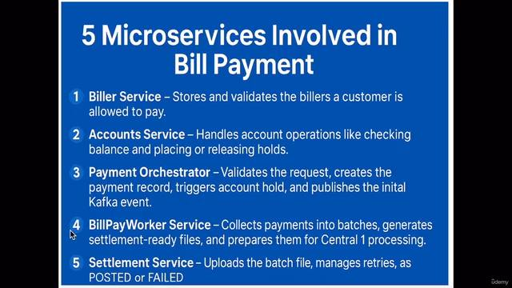

这五个服务分别是：Biller、Account、Payment Orchestrator、Bill Pay Worker、Settlement。讲师强调：**整个 Bill Payment 流程是一个 Saga，不存在一个横跨五个服务的单一大事务。** 每个服务拥有自己的数据，做本地决策，发出事件，下一步异步继续。

P47 没有新增实现，只是课程总结：客户、账户、交易、账单支付已经完成；内部转账和外部转账留给你自己设计。P48 则把“课程逐字稿”变成知识库，做一个课程 AI 助手。

---

## 2. 讲师原话（带「—— pNNN [MM:SS]」）

下面这些原话是本文复现时最重要的约束，后面所有设计都围绕它们展开。

> “the entire bill payment flow is implemented as a saga. There is no single transaction that spans these five services.”
>
> —— p046 [00:55]

> “All of this happens in the same database transaction. So either everything commits together or nothing goes.”
>
> —— p046 [07:46]

> “The Outbox table is just a staging area for events. A background job, Outbox publisher picks up every few seconds, picks up up to 200 rows with state is equal to pending and sends them to Kafka.”
>
> —— p046 [08:14]

> “Settlement reports facts. Orchestrator decides what to do next.”
>
> —— p046 [18:49]

> “Retries are event-driven. If the retry count is below the maximum, we publish a bill batch retry event to Kafka.”
>
> —— p046 [23:52]

> “We will use a tool called LISER. LISER lets us build an AI agent without writing a backend from scratch.”
>
> —— p048 [06:53]

> “We will use Replit to quickly build a simple chat UI and connect it to the Lyser API.”
>
> —— p048 [10:53]

> “we can use a tool called VAPI to create a voice assistant.”
>
> —— p048 [13:45]

注意：讲师在 P48 里口述的产品名有 LISER / Lyser、VAPI / WAPI 等拼写差异。本文统一写 Liser、VAPI，但实际产品名和下拉项请以你打开页面时为准。

---

## 3. 从零复现

### 3.1 先复现支付 Saga 的服务边界

先不要急着写代码。P46 的核心不是“某个类怎么写”，而是“一笔支付在哪个服务里停留、在哪个服务里跨边界”。你按下面这张表建服务，目录名可以自定，但职责不要混。

| 服务 | 职责 | 关键动作 |
|---|---|---|
| Biller Service | 保存和校验 biller / 客户是否允许支付 | 新增 biller、查询 biller、支付前检查 biller 是否 active |
| Account Service | 账户操作 | 查余额、place hold、release hold、debit |
| Payment Orchestrator | Saga 协调者 | 校验请求、创建 payment 记录、触发 account hold、发布初始 Kafka 事件、消费后续事件 |
| Bill Pay Worker | Saga 参与者 | 消费 `billpay.requested`，创建/打开 batch，写 batch line，发 `billpay.enqueued`，batch 达阈值后发 `bill batch ready` |
| Settlement Service | 与外部清算系统交互 | 生成 pain.001、上传 Central1、处理重试、消费 pain.002、发 `BillPayStatusEvent` |

讲师在 P46 里明确说，Payment Orchestrator 不自己做所有事，它的职责是“start the saga, track state transitions, and react to events coming back from other microservices”。这句话决定了你后面不能把 Account、Worker、Settlement 的逻辑全塞进 Orchestrator。

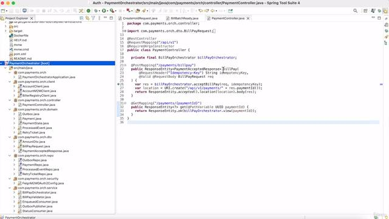

### 3.2 支付发起：POST 进来后先做幂等

P46 说，支付入口是一个 POST 请求，JSON body 加一个 idempotency key header。Controller 把请求交给 `BillPayOrchestrator` 的 `acceptBillPay` 方法；成功时返回 **202 Accepted**，并带 Location header。

复现顺序：

1. 客户端调用支付接口，必须带 `Idempotency-Key` header。
2. Orchestrator 先拿这个 key 查已有 payment 行。
3. 如果已存在，直接返回已有 payment，不创建重复支付。
4. 如果不存在，校验 execution date、amount 等业务规则。
5. 调用 Biller Service，确认 biller 存在且 active。
6. 构造 `CreateHoldRequest`。这个 DTO 在 P46 里被放进了 Commons DTO 模块，路径是 `com.account.dto`。
7. 通过 Feign 调用 Account Service，对 debtor 账户 place hold。
8. 拿到 hold ID，把它作为 payment ID 使用。
9. 在同一个数据库事务里：插入 payment 行，状态为 `FUNDS_HELD`；插入 outbox 行，内容是序列化后的 `billpay.requested` 事件。
10. 事务提交后，Outbox publisher 后台任务每隔几秒抓取最多 200 条 `state = pending` 的记录，发到 Kafka；成功标记 published，失败标记 failed。

这里的关键是：**钱被预留、payment 记录存在、事件在 outbox 里等待发送，这三件事在同一个数据库事务里。** 如果这一步失败，Saga 立即停止，不创建 payment，也不触发下游。

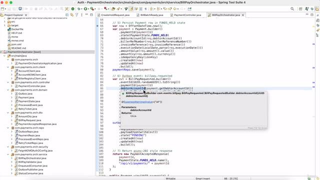

### 3.3 Worker 消费 `billpay.requested`

Bill Pay Worker 是 Saga 参与者。它不知道全貌，只做本地工作：消费事件、更新自己的状态、发下一个事件。

复现步骤：

1. Kafka listener 订阅 `billpay.requested`。
2. 反序列化成 `BillPayRequested`。
3. 调用 `BillPayWorkerService.handleRequested`。
4. 对每个支付请求，找到或创建一个 open batch。
5. 插入 batch line：batch ID、payment ID、line number。
6. 发出 `billpay.enqueued` 事件，让 Orchestrator 知道这笔支付已经进入某个 batch。

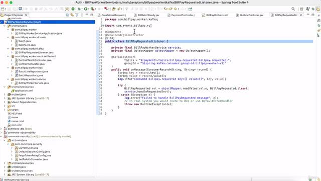

Orchestrator 里有一个 enqueued consumer 监听 `billpay.enqueued`。它收到消息后：

1. 把对应 payment 标记为 batched。
2. 把 batch ID 挂到 payment 上。
3. 在 processed event 表里记录一行，保证事件级幂等。
4. 如果同一个 event ID 因重试或 replay 再次到达，直接忽略。

当 batch 达到阈值，Worker 把 batch 翻成 ready，并发出 `bill batch ready` 事件。这个事件由 Settlement Service 的 listener 消费。

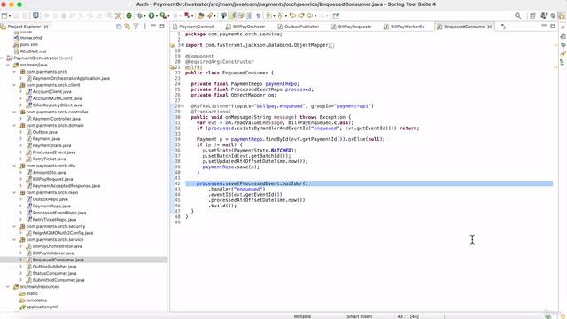

### 3.4 Settlement 处理新 batch

Settlement 是 Saga 里最接近外部系统的部分。外部系统会失败，所以这里必须靠重试、幂等和持久化状态。

复现 `processNewBatch`：

1. 用 batch ID 查 `bill_batch_settlement` 行。
2. 如果是第一次处理，创建 settlement 记录，状态 `READY`，初始化 retry count。
3. 如果 batch 已经 uploaded 或 submitted，例如重试或重复触发，直接 early exit，避免重复上传同一个文件或重复发 Kafka 事件。
4. 如果还没有生成文件，用 pain.001 builder 生成 settlement-ready 的 pain.001 文件。
5. 更新 settlement 记录：file name，状态移到 `FILE_BUILT`。
6. 用 Central1 client 上传文件。P46 说这个 client 是模拟发送给 Central1。
7. 上传成功后保存 Central1 reference number，状态更新为 uploaded。
8. 发布 `bill batch submitted` 事件到 Kafka。

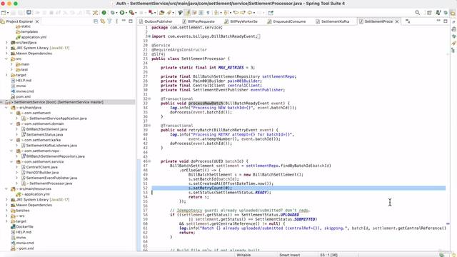

`bill batch submitted` 又回到 Orchestrator。Submitted consumer 监听这个 topic：

1. 先取 event ID；如果事件没给，就 fallback 用 batch ID。
2. 用 processed event 表做幂等检查。
3. 如果已处理，立即返回。
4. 对新事件，查出这个 batch 下所有 payment。
5. 标记为 submitted，更新时间戳，保存。
6. 最后把事件写入 processed events，保证 batch 只处理一次。

### 3.5 Mock Central1：在 Bill Pay Worker 里造 pain.002

P46 明确说，我们拿不到真实 Central1，所以讲师选择在 BillPayWorker 微服务里 mock。原因很简单：Worker 已经有 batch 数据，可以从 batch 反推 payment ID。

复现 mock：

1. 根据 batch ID 查 batch lines。
2. 每条 batch line 里取 payment ID。
3. 对每个 payment 创建一条 pain.002 message。
4. 每条 message 包含：payment ID、batch ID、end-to-end reference、status code（这里是 `ACTC`，表示 Accepted）、success flag、描述性 message、timestamp。
5. 把所有单条 message 包成一个 `pain002 file message`，代表 Central1 正常会返回的完整 pain.002 文件。
6. 序列化成 JSON。
7. 发到 Kafka 的 `central1.pain002` topic，message key 用 batch ID。
8. 暴露一个简单 REST endpoint 触发 simulator；调用后发消息并立即返回 accepted。

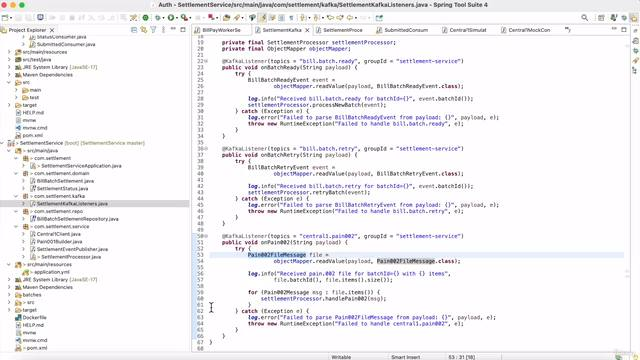

### 3.6 Settlement 消费 pain.002 并发出状态事件

Settlement 里的 Kafka listener 订阅 `central1.pain002`。收到消息后：

1. 反序列化成 pain.002 file message。
2. 日志打印 batch ID 和文件里有多少条 payment 记录。
3. 遍历每个 entry，逐条交给 settlement processor。
4. processor 判断该 payment 成功还是失败。
5. 映射成 `BillPayStatusEvent`，发到 Kafka。

这里讲师给了一句非常重要的原则：**Settlement 只报告事实，不更新 payment，不碰 account；由 Orchestrator 决定下一步。** 所以你不要在 Settlement 里直接改 payment 状态。

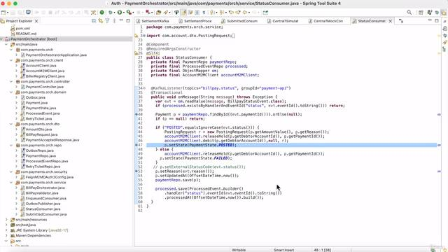

### 3.7 Status consumer 回到 Account Service

最后，status consumer 把外部世界接回 Account Service。对每个 `bill-pay status event`：

- 如果 status 是 posted：构造 posting request，调用 Account Service release hold，并做实际 debit；最后把 payment 标记为 posted。
- 如果 status 是 failed：调用 release hold，把 payment 标记为 failed。
- 无论哪种，都写 processed events 行，避免 replay 或 duplicate 导致 double post / double release。

### 3.8 M2M 鉴权：没有用户请求时怎么调 Account Service

P46 后段讲了一个真实问题：Kafka 事件触发时，没有 HTTP 请求、没有用户、没有 JWT。但 Account Service 是受保护的，Feign 调它需要有效 JWT。讲师用 Auth0 的 client credentials / M2M flow 解决。

复现步骤：

1. 在 Auth0 的 APIs → Bankstack API permissions 里新增 scope：`admin accounts`。
2. 在 Applications 里准备一个 Machine-to-Machine 应用。
3. 拿到 client ID 和 client secret。
4. 给这个 M2M 应用授予新增的 `admin accounts` scope。
5. 在 `application.yaml` 里注册 OAuth2 client，grant type 用 client credentials。
6. 加 Feign request interceptor，自动获取 token，并注入到每个出站请求的 `Authorization: Bearer ...`。
7. 这样 release hold、debit account 即使由 Kafka 异步触发，也能安全调用 Account Service。

讲师也承认这不是唯一方案：有的团队用 mutual TLS、token exchange、gateway-issued internal tokens，甚至纯 mTLS 不用 OAuth。P46 选择的是“最简单的生产级方案：machine-to-machine tokens”。

### 3.9 重试：事件驱动，不阻塞线程

Settlement 上传 Central1 可能失败。P46 的处理方式：

1. `bill batch ready` 到达后，生成 pain.001 并尝试上传。
2. 成功：发 `bill batch submitted`，Saga 正常继续。
3. 失败：不崩溃、不阻塞线程；把 batch 标记 failed，retry count 加一。
4. 如果 retry count 小于最大值，发 `bill batch retry` 到 Kafka，携带 batch ID、attempt number、failure reason。
5. Kafka listener 消费 retry 事件，重新进入同一套 settlement 逻辑。
6. 如果达到最大重试次数，停止重试，发 DLQ 风格事件，系统接受失败并继续。

讲师明确说：**当前重试是立即的，backoff 或 delayed retries 留作练习。** 所以你不要在文档里假装已经实现了退避。

### 3.10 AI Mentor 复现线：从逐字稿到语音助手

P48 是另一条线。目标：把 Bill Pay 课程的逐字稿变成只基于该内容回答的 AI Mentor。

第一步，拿逐字稿。P48 说在视频播放器右下角找 transcript 按钮，复制 transcript 文本，粘贴到简单文档里保存。

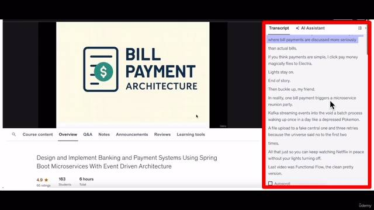

第二步，生成 system prompt。讲师用 Gemini 生成系统指令，指令大意是：你是课程导师，只根据 knowledge base 里的 transcript 回答；如果 transcript 没覆盖，就明确说没覆盖，并建议联系讲师；不要现在向我要 transcript；输出干净的 Markdown system prompt，放在 code block 里。

第三步，在 Gemini 里创建 Gem。P48 的操作是：Gems → 新建 Gem → 命名 `Bank Stack AI Mentor` → 把 Markdown prompt 粘到 instruction → 上传 transcript 文件到 knowledge base → 保存 → 测试问题：“Can you tell me the name of the event which is generated when a batch is ready?” 如果回答 `bill batch ready`，说明 mentor 工作。

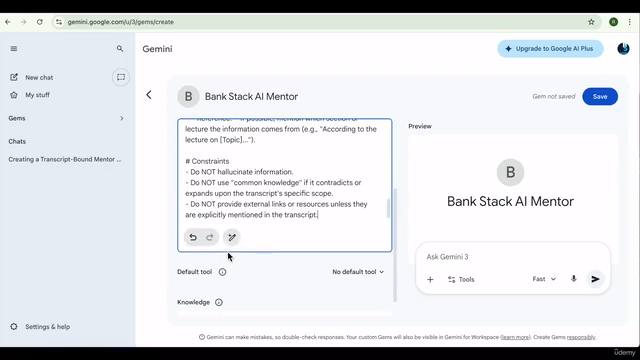

第四步，把 AI brain 搬到 Liser。P48 的操作是：Agent Studio → 创建 knowledge base（`bill pay knowledge base`）→ 上传 BillPay transcript → 创建 single agent（`AI mentor for Udemy course`）→ 选模型（口述为 Gemini 2.5 flashlight，实际下拉以产品为准）→ 填 agent role、agent goal、agent instructions → 选择 RAG knowledge base → chunks 设为 4 → retrieval type 选 basic → score threshold 约 3 → 保存 → 用同一个问题测试。

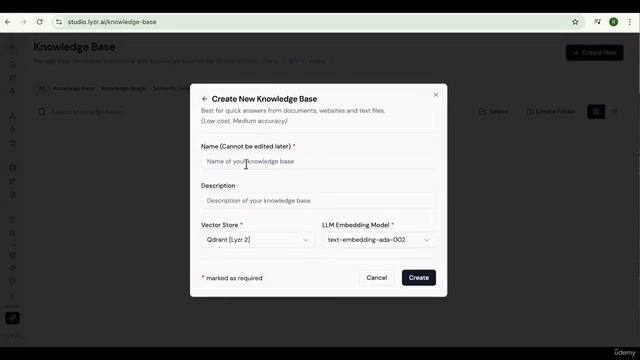

第五步，用 Replit 做聊天 UI。P48 给 Replit 的 prompt 大意是：为 Bankstack AI Mentor 做 UI，后端是 Liser agent，粘贴 inference API 代码，集成并设计前端。然后去 Liser 的 API agent → inference tab 复制 inference endpoint 代码，粘回 Replit。Replit 脚手架生成后，输入“explain the bill pay flow”测试。P48 说回答结构清晰，覆盖 customer initiation、batching、clearing、settlement、status report，并且保持在 transcript 范围内。

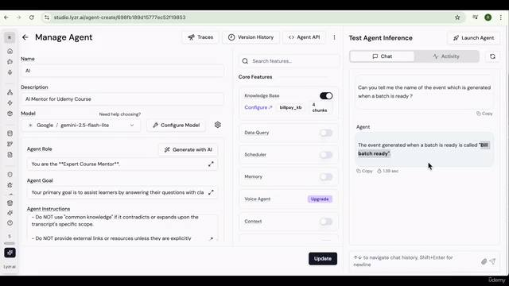

第六步，VAPI 语音助手。P48 的操作是：登录 VAPI → Assistants → 新建 assistant → 命名 `bankstack ai assistant` → 选 blank template → 配置模型：provider 选 OpenAI，模型口述为 CPT 5.2（实际名称以页面为准），first message 设为 `hello how can I help you`，system prompt 粘贴同一份 Markdown prompt，选择 transcript 文件，voice 选 Nico。测试问题是：“what is the role of bill pay worker in our bill pay flow?” 助手回答：Bill Pay Worker 消费事件并存储；对每个 bill line 分配 batch；cutoff 发生时发出 batch ready 事件。

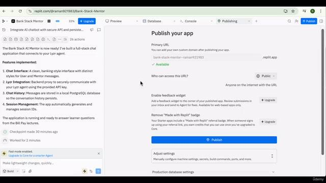

---

## 4. 完整代码

> 本节标题按模板保留。必须再次说明：P46 是架构讲解，P48 是工具操作，逐字稿没有出现可保存运行的 Java/JS 完整文件。因此下面不伪造 Spring 源码，而是给出复现所需的**完整设计产物、接口草案、事件表、数据表、AI Mentor 提示词和配置表**。如果你要写代码，请以仓库源码为准；本文只保证你按这些产物能把流程和工具链复现出来。

### 4.1 目录结构（示意，逐字稿未给目录名）

```text
banking-payment/
  biller-service/
  account-service/
  payment-orchestrator/
  bill-pay-worker/
  settlement-service/
  commons-dto/
    src/main/java/com/account/dto/CreateHoldRequest.java
    src/main/java/com/events/billpay/...
```

说明：`com.account.dto` 和 `com.events.billpay` 是 P46 明确提到的包路径；其他目录名是示意，不是讲师原话。

### 4.2 事件契约表

| 事件 / Topic | 生产者 | 消费者 | 关键字段 | 备注 |
|---|---|---|---|---|
| `billpay.requested` | Payment Orchestrator | Bill Pay Worker | 逐字稿未给完整字段 | Outbox 发出 |
| `billpay.enqueued` | Bill Pay Worker | Payment Orchestrator | batch ID、payment ID | 通知 payment 已入 batch |
| `bill batch ready` | Bill Pay Worker | Settlement Service | batch ID | batch 达阈值后发出 |
| `bill batch submitted` | Settlement Service | Payment Orchestrator | batch ID、event ID（可缺省） | 缺省时 fallback 用 batch ID |
| `central1.pain002` | Bill Pay Worker mock | Settlement Service | payment ID、batch ID、end-to-end reference、status code、success flag、message、timestamp | key 用 batch ID |
| `BillPayStatusEvent` | Settlement Service | Status Consumer | status（posted / failed） | Settlement 只报事实 |

### 4.3 数据模型草案

| 表 | 用途 | 关键字段 |
|---|---|---|
| payment | 支付记录 | id、idempotency key、状态（`FUNDS_HELD`、batched、submitted、posted、failed）、batch ID、时间戳 |
| outbox | 事件发件箱 | state（pending / published / failed）、序列化事件 |
| batch | 支付批次 | batch 状态（open / ready / emitted） |
| batch_line | 批次行 | batch ID、payment ID、line number |
| processed_event | 事件级幂等 | event ID（或 batch ID fallback） |
| bill_batch_settlement | 结算记录 | batch ID、status（READY、FILE_BUILT、uploaded、submitted）、retry count、file name、Central1 reference number |

字段名请以实际源码为准；逐字稿只给了业务含义，没有给完整 DDL。

### 4.4 API 契约草案

```http
POST /payments
Content-Type: application/json
Idempotency-Key: <client-generated-key>

{
  "executionDate": "2026-01-01",
  "amount": 100.00,
  "billerId": "biller-123",
  "debtorAccountId": "account-456"
}
```

成功响应：

```http
202 Accepted
Location: /payments/{paymentId}
```

说明：P46 只明确说 POST + JSON body + idempotency key header + 202 + Location；请求体字段名是示意，不是讲师原字段。

### 4.5 AI Mentor 系统提示词（根据 P48 指令整理，非逐字稿完整原文）

```markdown
# Role
You are an expert course mentor for the Bankstack Bill Payment module.

# Goal
Answer learner questions quickly and clearly, using only the transcript provided in the knowledge base.

# Instructions
- Answer clearly, with examples if needed.
- If something is not covered in the transcript, clearly say it was not covered and advise the learner to check with the instructor.
- Do not ask the learner for the transcript.
- Do not invent details outside the transcript.
- Keep answers structured and easy to scan.
- When naming events, services, statuses, or fields, use the exact names from the transcript.
```

### 4.6 Replit 聊天 UI 提示词模板（示意）

```text
I want you to build the UI for Bankstack AI Mentor, a chatbot designed to answer learner questions from the bill pay lectures.
Backend is a Liser agent. I will paste the inference API code below.
Integrate it and design the frontend.
```

### 4.7 VAPI 配置表

| 配置项 | 值 |
|---|---|
| Assistant 名称 | `bankstack ai assistant` |
| Template | blank template |
| Provider | OpenAI |
| Model | 逐字稿口述为 CPT 5.2，实际下拉以产品为准 |
| First message | `hello how can I help you` |
| System prompt | 粘贴 4.5 的 Markdown prompt |
| Knowledge / transcript | 上传 Bill Pay transcript 文件 |
| Voice | Nico |

### 4.8 容量与重试估算表

| 项 | 值 | 来源 |
|---|---|---|
| Outbox 每轮最多抓取 | 200 行 | p046 [08:14] |
| Outbox 轮询间隔 | every few seconds，未给具体秒数 | p046 [08:14] |
| 最大重试次数 | 逐字稿未给 | 课里没讲 |
| 退避 / delayed retry | 未实现，留作练习 | p046 [24:49] |
| DLQ 具体 topic 名 | 逐字稿只说 DLQ 风格事件，未给名字 | 课里没讲 |

---

## 5. 逐行解释

**为什么必须是 Saga，而不是一个分布式事务？**  
因为五个服务各有自己的数据库。P46 明确说没有单一大事务横跨五个服务。Saga 的做法是：每个服务做本地事务，发事件，下一个服务异步继续；失败时用补偿动作回滚业务结果。对前端/Node 背景的读者，可以把它理解成“用事件驱动的状态机 + 补偿”，不是 `BEGIN ... COMMIT` 包五个服务。

**为什么 payment 和 outbox 要同一个数据库事务？**  
如果先写 payment 再发 Kafka，发 Kafka 失败就会出现“钱扣了但下游不知道”；如果先发 Kafka 再写 payment，又可能出现“下游收到事件但本地没记录”。Outbox 模式把“业务写入”和“待发事件”放在同一个本地事务里，保证要么都成功，要么都失败。Node 里对应 Prisma `$transaction`、TypeORM `QueryRunner` 或 Knex transaction；关键不是语法，而是把业务写入和 outbox 插入放在同一个事务边界内。

**为什么 idempotency key 要最先查？**  
因为客户端重试、网络超时、网关重放都会让同一个请求到达多次。先查已有 payment，存在就返回，不会创建重复支付。Node 里通常给 `idempotency_key` 建唯一索引，插入冲突时捕获并返回已有记录。

**为什么 processed event 表是事件级幂等？**  
Kafka 可能重复投递。processed event 表记录“这个 event ID 处理过了”。Orchestrator 的 enqueued consumer、submitted consumer、status consumer 都靠它避免重复标记、重复 post、重复 release。Node 里就是 `processed_events(event_id unique)`，消费前查，消费后写，最好和业务更新同事务。

**为什么 Settlement 只发 `BillPayStatusEvent`，不直接改 payment？**  
P46 的原话是 “Settlement reports facts. Orchestrator decides what to do next.” Settlement 的职责是报告外部清算结果；payment 状态归 Orchestrator 管。这样职责清晰，Saga 的决策点集中，不会出现多个服务同时改 payment 的混乱。

**为什么 Central1 要 mock 在 Bill Pay Worker？**  
因为 Worker 已经有 batch 数据，能从 batch line 反推 payment ID。mock 生成 pain.002 后发到 `central1.pain002`，对系统来说和真实 Central1 回执没有区别。这样你不用等外部系统，也能把 Saga 跑完。

**为什么 M2M 用 client credentials？**  
Kafka 触发的调用没有用户、没有 JWT。Auth0 的 M2M 应用用 client ID / client secret 换短期 token，Feign interceptor 自动注入 `Authorization: Bearer`。Node 里对应 axios interceptor：每次出站前拿 token 并塞 header。讲师也说了，这不是唯一方案，mTLS、token exchange 都可以。

**为什么重试要事件驱动？**  
上传 Central1 失败时，如果直接 `Thread.sleep` 或阻塞消费线程，会拖垮整个 consumer。事件驱动重试是：失败后发 `bill batch retry`，listener 再进来跑同一套逻辑。这样不阻塞、可审计、对 Saga 友好。当前没有 backoff，这是讲师明确留的练习。

**AI Mentor 为什么要“只基于 transcript”？**  
P48 的目标不是做一个通用聊天机器人，而是做一个课程答疑助手。system prompt 里要求“如果 transcript 没覆盖，就明确说没覆盖”，是为了减少胡编。你把 transcript 上传到 Gemini Gems 或 Liser knowledge base，就是在给它唯一事实来源。

---

## 6. 复现检查清单

支付 Saga 部分：

- [ ] 五个服务边界清楚：Biller、Account、Payment Orchestrator、Bill Pay Worker、Settlement。
- [ ] `CreateHoldRequest` 放在 Commons DTO 的 `com.account.dto` 下，没有在多个服务里复制。
- [ ] Bill Pay 事件统一放在 `com.events.billpay` 下。
- [ ] 支付入口是 POST + `Idempotency-Key` header。
- [ ] 成功返回 202 Accepted + Location。
- [ ] `acceptBillPay` 先查 idempotency key，再校验，再调 Biller，再 place hold。
- [ ] payment 插入 `FUNDS_HELD` 与 outbox 插入在同一个数据库事务。
- [ ] Outbox publisher 每轮最多抓 200 条 pending。
- [ ] Worker 消费 `billpay.requested` 后创建/打开 batch，写 batch line，发 `billpay.enqueued`。
- [ ] Orchestrator 消费 `billpay.enqueued` 后标记 batched、挂 batch ID、写 processed event。
- [ ] batch 达阈值后发 `bill batch ready`。
- [ ] Settlement 的 `processNewBatch` 有 early exit，避免重复上传。
- [ ] pain.001 生成后更新 file name，状态到 `FILE_BUILT`。
- [ ] 上传成功保存 Central1 reference number，状态 uploaded，发 `bill batch submitted`。
- [ ] Orchestrator 的 submitted consumer 有 event ID fallback batch ID。
- [ ] Central1 mock 在 Bill Pay Worker 里，能按 batch ID 查 batch lines。
- [ ] pain.002 每条包含 payment ID、batch ID、end-to-end reference、`ACTC`、success flag、message、timestamp。
- [ ] pain.002 发到 `central1.pain002`，key 用 batch ID。
- [ ] Settlement 消费 pain.002 后只发 `BillPayStatusEvent`，不直接改 payment。
- [ ] status consumer 对 posted 做 release hold + debit + mark posted；对 failed 做 release hold + mark failed。
- [ ] 所有 consumer 都写 processed event，防重复。
- [ ] Auth0 有 `admin accounts` scope，M2M 应用拿到 client ID / client secret 并授权。
- [ ] `application.yaml` 配了 client credentials，Feign interceptor 注入 Bearer token。
- [ ] 上传失败会 mark failed、retry count +1、发 `bill batch retry`。
- [ ] 达到最大重试次数后发 DLQ 风格事件。
- [ ] 明确知道当前没有 backoff / delayed retry。

AI Mentor 部分：

- [ ] 从视频播放器复制了 Bill Pay transcript 并保存。
- [ ] Gemini 里创建了 Gem，命名 `Bank Stack AI Mentor`。
- [ ] 上传 transcript 到 knowledge base。
- [ ] 用“batch ready 时发什么事件”测试，回答 `bill batch ready`。
- [ ] Liser 里创建 `bill pay knowledge base` 并上传 transcript。
- [ ] 创建 single agent，填 role / goal / instructions。
- [ ] RAG 选 knowledge base，chunks 4，retrieval basic，score threshold 约 3。
- [ ] Replit 里用 prompt 生成聊天 UI，粘贴 Liser inference endpoint。
- [ ] 输入“explain the bill pay flow”能回答且不超出 transcript。
- [ ] VAPI 里创建 assistant，配置 OpenAI 模型、first message、system prompt、transcript、Nico voice。
- [ ] 用语音问 Bill Pay Worker 的职责，能回答 batch / cutoff / batch ready。

---

## 7. 课里没讲但你会撞上的

1. **完整 Spring 源码、Maven 依赖版本、启动命令没有在逐字稿里出现。** 你需要以仓库 `pom.xml`、`application.yaml`、README 为准。本文不能替你编造版本号。
2. **数据库 DDL 没有给全。** 本文只列了业务字段；真实表名、列名、索引、唯一约束请以源码为准。
3. **Kafka 的 broker 配置、topic 分区数、consumer group、序列化器没有讲。** 你本地跑的时候要自己补 `spring.kafka.*` 或对应配置。
4. **Auth0 的 tenant、API identifier、M2M 应用具体配置没有给。** 你只能按 P46 的步骤在 Auth0 后台点；client ID / client secret 不要提交到仓库。
5. **最大重试次数、DLQ topic 名、outbox 轮询秒数没有给。** 讲师只说“every few seconds”“up to 200 rows”“below the maximum”。这些要你在实现里定。
6. **没有实现 backoff / delayed retry。** P46 明确说当前是立即重试，退避留作练习。
7. **“锁”要区分清楚。** P46 里的 hold 是账户资金预留/冻结，不是数据库悲观锁，也不是 Redis 分布式锁。逐字稿没有讲 JPA 锁、乐观锁版本号、Redis 锁；不要把这些安到讲师头上。
8. **P47 没有新增代码。** 它只是课程收尾，内部转账和外部转账被留作练习。
9. **P48 的 AI 工具名称有口述拼写差异。** LISER / Lyser、VAPI / WAPI 请以实际产品页面为准；模型名“CPT 5.2”也请以下拉项为准。
10. **AI Mentor 的完整 system prompt 原文没有逐字出现在逐字稿里。** 本文 4.5 是根据 P48 的指令整理的可用版本，不是 Gemini 返回的完整原文。
11. **Replit 生成的 UI 代码没有在逐字稿里展开。** 你只能按 P48 的 prompt 和 inference endpoint 去接；具体前端框架、样式、路由以 Replit 生成结果为准。
12. **VAPI 的 API key、assistant ID、phone number 等没有讲。** 这些属于你账号下的配置，不能从逐字稿里抄。
13. ** transcript 的版权和隐私要注意。** 你把课程逐字稿上传到第三方 AI 工具前，确认你有权这样做；不要上传包含客户数据、密钥、账号的内容。
14. **AI Mentor 仍然可能胡编。** 即使有 RAG，也要在 prompt 里强调“只基于 transcript”；上线前准备一组“课里没讲”的问题做回归测试。