# Go Backend Masterclass P1–P7：从安装 Go 到跑通第一个程序

> 说明：P1–P7 还没有进入电商后端业务代码，内容是课程介绍、Go 安装、第一个 Go 程序、Go 工具链、Windows 额外工具安装和 GoLand 配置。因此本文复现的“项目”是一个可运行的 `hello.go`，以及一套可用的 Go 开发环境。不要拿这份文档当电商 REST API 的完整实现文档；那部分在后续章节。

## 1. 这一节做什么

这一节的目标不是写业务，而是把后面所有项目都依赖的“地基”搭好：

1. 在你的操作系统上安装 Go，最低版本要求是 **1.23**。课程录制时页面显示过 `1.24.3`，Windows 安装视频里又出现了 `1.24.7`；讲师本机是 `1.24.1`。你不需要和讲师完全同版本，但要满足最低版本。
2. 写第一个 Go 程序 `hello.go`，理解 `package main`、`func main()`、`fmt.Println` 这三件事。
3. 分清 `go run`、`go build`、`go fmt`、`go test`、`go install`、`go get` 这些命令分别做什么。
4. 在 Windows 上额外安装课程后面会用到的工具：linter、migrate、swag、gqlgen。讲师在 Windows 上明确说 `make` 他没有安装，所以 Windows 用户需要手动执行 Makefile 里对应的命令，或者自己另外解决 `make`。
5. 配置 GoLand，重点确认 **Go modules integration** 已勾选，否则代码提示和语法高亮会不正常。

P1 讲师把课程哲学总结为三个支柱：项目驱动、工程优先、生产可用；P2 说明源码在 GitHub，具体文件位置要看视频里出现的目录名；P3–P7 才开始真正动手。讲师还特别强调测试：“If you can't test it, don't write the code.”——p001 [03:18]。

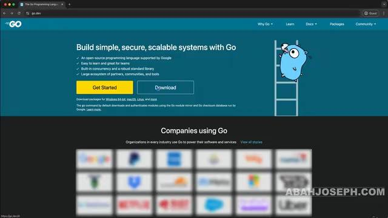

## 2. 讲师原话（带「—— pNNN [MM:SS]」）

> "课程理念基于三大支柱：项目驱动、工程优先、生产可用。"
> —— p001 [01:26]

> “If you can't test it, don't write the code.”  
> 如果你不能测试它，就不要写这段代码。  
> —— p001 [03:18]

> "预计实际耗时会比标称更长……很可能要花上这一小时的两倍时间。"
> —— p002 [04:13]

> "当前版本是 1.24.3……你的 Go 版本至少应为 1.23。"
> —— p003 [00:00]

> "每个 Go 可执行程序都属于 `main` 包，程序从 `main` 包中名为 `main` 的函数开始执行。"
> —— p004 [00:00]

> "`go run` 会编译程序，但编译到临时目录，然后执行该程序。"
> —— p005 [01:17]

> "`go build` 本身只编译程序，不运行它。"
> —— p005 [01:46]

> "有一个名为 `GOPATH` 的变量，这个非常重要。"
> —— p006 [01:52]

> "每次打开 IDE，都要确认“启用 Go 模块集成”已勾选。"
> —— p007 [04:08]

> "唯一无法运行的是 `make` 命令。"
> —— p006 [08:13]

## 3. 从零复现

### 3.1 先建一个固定工作目录

课程没有强制规定目录名。为了后面不混乱，本文使用：

```text
~/go-backend-masterclass/
└── hello.go
```

macOS / Linux：

```bash
mkdir -p ~/go-backend-masterclass
cd ~/go-backend-masterclass
```

Windows PowerShell：

```powershell
New-Item -ItemType Directory -Force -Path "$HOME\go-backend-masterclass"
Set-Location "$HOME\go-backend-masterclass"
```

> 课里没有规定必须用这个目录名；你可以换成任意路径。关键是后面所有命令都在这个目录里执行。

### 3.2 安装 Go

打开 Go 官方下载页 `https://go.dev`，点 Download，按你的操作系统选择安装包：

- macOS Apple Silicon（M1/M2/M3 等）：选 ARM 版本。
- macOS Intel：选 Intel 版本。
- Windows：选 Windows 安装包。
- Linux：选 Linux 安装包。
- 从源码安装是可选路径，讲师不推荐初学者走这条路。

Windows 安装过程就是一路 Next、同意协议、安装。默认会装到：

```text
C:\Program Files\Go
```

其中 `C:\Program Files\Go\bin` 是 Go 自带的命令目录。

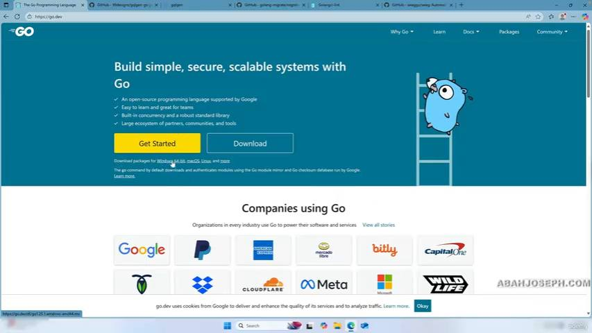

安装完成后，重新打开终端，执行：

```bash
go version
```

你应该看到类似：

```text
go version go1.24.x <你的系统>/<你的架构>
```

具体输出以你机器为准。课程只要求版本不低于 1.23。

Windows 安装向导执行安装的画面：

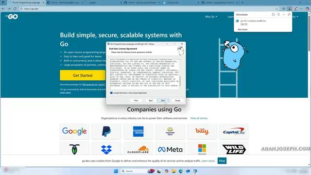

### 3.3 创建 `hello.go`

在 `~/go-backend-masterclass` 下新建文件 `hello.go`，内容用第 4 节的完整代码。不要先建 `go.mod`，P1–P7 没有讲 `go mod init`；单文件运行不需要它。

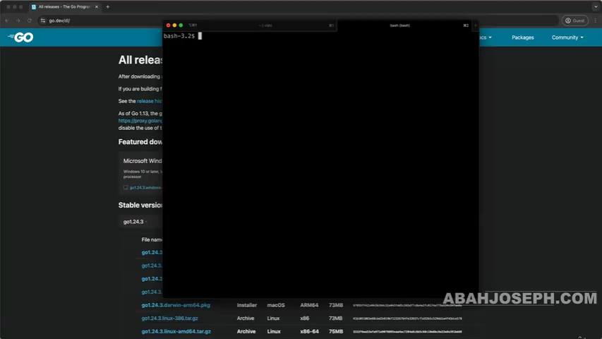

代码里你会看到：

```go
package main
```

这表示当前文件属于 `main` 包。Go 的可执行程序必须从 `main` 包开始。

### 3.4 用 `go run` 跑起来

在 `hello.go` 所在目录执行：

```bash
go run hello.go
```

你应该看到一行 `hello world` 类似输出，大小写和标点取决于你代码里写的字符串。

`go run` 的行为是：先编译，编译到临时目录，然后执行。它不会在你当前目录留下可执行文件。

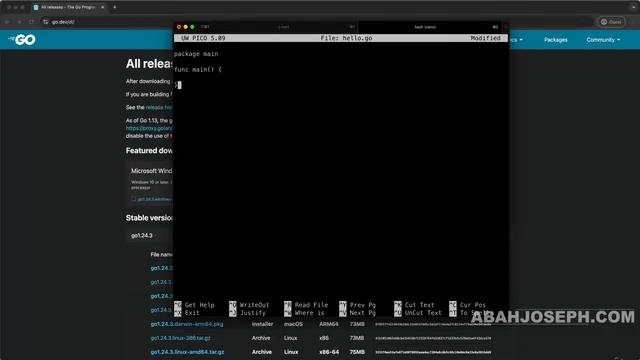

终端执行 `go run` 的画面：

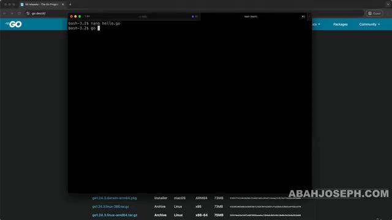

### 3.5 用 `go build` 编译，再手动执行

```bash
go build hello.go
```

这条命令只编译，不运行。编译成功后：

- macOS / Linux 当前目录会出现 `hello`。
- Windows 当前目录会出现 `hello.exe`。

直接执行：

macOS / Linux：

```bash
./hello
```

Windows PowerShell：

```powershell
.\hello.exe
```

同样会打印 `hello world`。

`go run` 和 `go build` 的区别是：`go run` 编译到临时目录并立即执行；`go build` 把可执行文件留在当前目录，但不会自动运行。

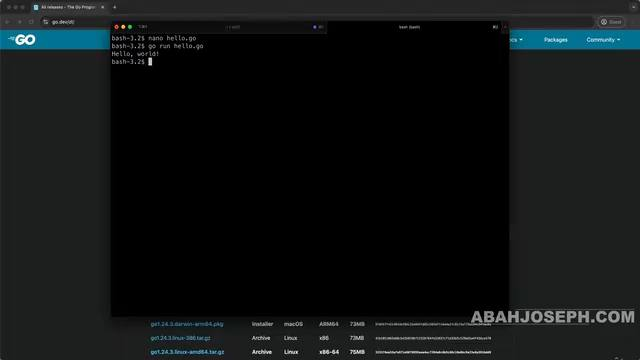

### 3.6 用 `go fmt` 格式化代码

故意把代码缩进或空格弄乱，然后执行：

```bash
go fmt hello.go
```

再打开 `hello.go`，格式会按 Go 的约定整理好。`go fmt` 是 Go 工具链自带的格式化工具，不需要额外安装。

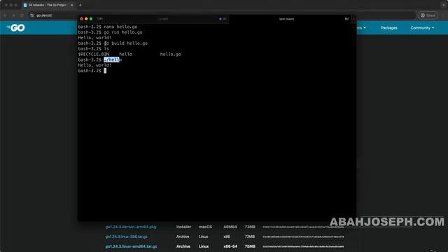

### 3.7 `go test` 现在为什么用不上

课程里执行 `go test` 时还没有任何测试文件，所以讲师说“currently we don't have any tests, so this is not going to work”。这一节不需要你写测试文件，只要知道后面测试章节会用 `go test` 即可。

> 注意：在较新的 Go 版本里，目录里没有测试文件时，`go test` 的具体输出可能和讲师当年演示不完全一样；以你终端实际输出为准。课里没有展开这一点。

### 3.8 Windows 额外工具安装

Windows 用户除了 Go 本体，还要安装课程后面会用到的工具。讲师在 P006 里逐个打开安装页，复制安装命令到 PowerShell 执行。

重要：**逐字稿没有记录这些命令的完整文本**。讲师是边看网页边复制，逐字稿只记录了“复制这个”“安装完成”等动作。因此下面给的是“定位方式 + 常见命令形式”，不是讲师在视频里逐字念出的原文。真正执行时，以你打开的官方安装页为准，尤其是版本号和参数。

#### 3.8.1 golangci-lint

讲师打开 linter 网站，进入 Get Started → Install，滚到页面底部，选择较慢但更稳的安装方式，复制到终端执行。安装完成后执行：

```powershell
golangci-lint
```

如果终端能打印用法或帮助信息，说明安装成功。它可能会输出“not an error”的用法提示，这不等于安装失败。

> 逐字稿里讲师发音类似 “go lang cilint”，对应工具名是 `golangci-lint`。具体版本课里没讲。

#### 3.8.2 migrate

讲师打开 migrate 的 GitHub 仓库，找到 CLI documentation，因为课程使用 PostgreSQL，所以复制带 `postgres` 标签的安装命令。安装完成后执行：

```powershell
migrate
```

能打印帮助信息即表示可用。

> 课里没有给出版本号；命令文本也没有出现在逐字稿里。

#### 3.8.3 swag

讲师打开 swag 的安装页，复制 Getting Started 里的安装命令，粘贴到 PowerShell 执行。安装完成后：

```powershell
swag
```

能打印帮助即可。

#### 3.8.4 gqlgen

讲师打开 `gqlgen.com`，复制安装命令，使用 `@latest` 安装。他特别说：如果 `latest` 有问题，就回看视频里他本机使用的版本号。安装完成后：

```powershell
gqlgen
```

由于此时没有 schema，它不会执行生成任务，但能识别命令即表示安装成功。

> 下面这段是“常见命令形式”的补充，**不是逐字稿原命令**。如果你的安装页给出的命令不同，以页面为准：
>
> ```powershell
> go install github.com/golangci/golangci-lint/cmd/golangci-lint@latest
> go install -tags 'postgres' github.com/golang-migrate/migrate/v4/cmd/migrate@latest
> go install github.com/swaggo/swag/cmd/swag@latest
> go install github.com/99designs/gqlgen@latest
> ```
>
> 版本号、模块路径可能随工具升级变化；课程没有固定这些版本。

### 3.9 检查 `GOPATH` 和 `PATH`

Windows 上 `go install` 安装的工具默认进入：

```text
C:\Users\<你的用户名>\go\bin
```

这个目录就是 `GOPATH` 下的 `bin`。它必须在 `PATH` 里，否则你在终端里输入 `golangci-lint`、`migrate`、`swag`、`gqlgen` 会提示找不到命令。

讲师在 P006 里做了两件事：

1. 打开 `C:\Users\<用户名>`，确认 `go` 目录是否出现。他说第一次可能还没初始化，运行 Go 命令或安装工具后会出现。
2. 打开系统环境变量，说明 `GOPATH` 相关路径已经加进 `PATH`；如果以后要加别的工具目录，也要在这里新增条目。

Go 本体安装目录：

```text
C:\Program Files\Go\bin
```

工具安装目录：

```text
C:\Users\<你的用户名>\go\bin
```

检查工具是否都在：

```powershell
Get-ChildItem "$HOME\go\bin"
```

你应该能看到 `golangci-lint.exe`、`migrate.exe`、`swag.exe`、`gqlgen.exe` 等文件。具体文件名以实际安装结果为准。

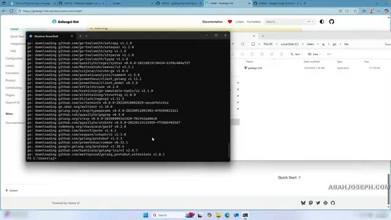

### 3.10 GoLand 配置

GoLand 不是必须的，你可以用 VS Code、Notepad++ 或任何编辑器。讲师用的是 JetBrains GoLand，可以下载试用版，试用期 30 天。

安装后新建项目，重点只有一个：打开 Settings → Go → Go modules，确认 **Enable Go modules integration** 已勾选。讲师原话是：“Anytime you open the IDE, make sure that this enable Go module is checked.”——p007 [04:08]。

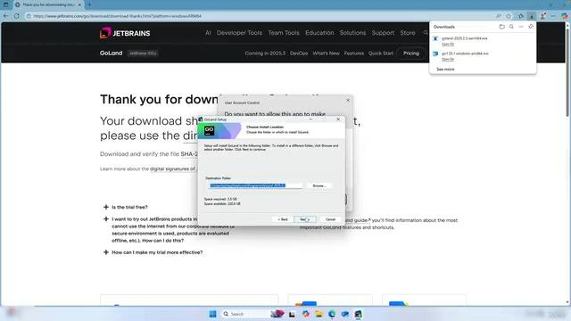

然后在 GoLand 里新建 `hello.go`，写入第 4 节代码，点击运行按钮。第一次运行会慢一点，之后会很快。

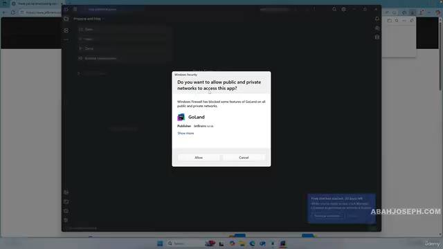

## 4. 完整代码

### 4.1 目录结构

```text
~/go-backend-masterclass/
└── hello.go
```

### 4.2 `hello.go` 完整文件

```go
package main

import "fmt"

func main() {
	fmt.Println("Hello, World!")
}
```

> 课程口述里打印的是 “hello world”。字符串内容不影响本步骤；你可以改成 `fmt.Println("hello world")`，只要 `go run` 能打印即可。

### 4.3 依赖与版本清单

| 组件 | 课程中的版本信息 | 说明 |
|---|---|---|
| Go | 最低 1.23；P003 页面显示 1.24.3；P006 Windows 页面显示 1.24.7；讲师本机 1.24.1 | 你安装 1.23 以上即可 |
| golangci-lint | 课里没讲版本 | 按安装页当时给出的方式安装 |
| migrate | 课里没讲版本 | 按 GitHub CLI 文档选择 PostgreSQL 对应命令 |
| swag | 课里没讲版本 | 按安装页复制 |
| gqlgen | 讲师演示用 `@latest`，并说失败就回看视频里的版本 | 课里没有固定版本号 |
| GoLand | 试用版 30 天 | 可选，不是运行 Go 的必需项 |

## 5. 逐行解释

### 5.1 `package main`

Go 文件第一行必须声明包名。`main` 是特殊包名：只有 `main` 包编译出来才是可执行程序。对比前端：Node 里你直接写 `console.log` 也行，但 Go 要求先声明这个文件属于哪个包。你可以把它理解成“这个文件是程序入口包”。

### 5.2 `import "fmt"`

`fmt` 是 Go 标准库里的格式化输入输出包。这里只用它来打印一行文字。前端里类似 `console.log`，但 Go 需要先导入对应包。`fmt` 不是第三方依赖，不需要 `npm install`，也不需要 `go get`。

### 5.3 `func main()`

`main` 函数是可执行程序的入口。Go 程序启动后，从 `main.main` 开始执行。没有 `main` 函数的 `main` 包不能作为可执行程序运行。

### 5.4 `fmt.Println("Hello, World!")`

打印一行文本并换行。`Println` 的 `ln` 表示 line。字符串用双引号。Go 的语句结尾不需要分号，编译器会自动处理。

### 5.5 `go run hello.go`

`go run` 做两件事：编译、执行。它把编译产物放到临时目录，所以当前目录不会多出 `hello` 或 `hello.exe`。适合日常快速验证。类似前端里 `node app.js`，但 Go 多了一步“先编译”。

### 5.6 `go build hello.go`

只编译，不运行。成功后在当前目录留下可执行文件。macOS/Linux 是 `hello`，Windows 是 `hello.exe`。这一步类似前端打包出 `dist` 产物，但 Go 产物是原生可执行文件。

### 5.7 `./hello` 或 `.\hello.exe`

直接运行编译产物。`./` 表示当前目录；Windows PowerShell 用 `.\`。如果提示找不到文件，先用 `ls` 或 `dir` 确认可执行文件是否生成。

### 5.8 `go fmt hello.go`

按 Go 官方格式规范整理文件。Go 社区非常重视统一格式，`go fmt` 是标准工具。它不会改变逻辑，只改空格、缩进、对齐等。

### 5.9 `go test`

运行当前包的测试。P1–P7 还没有测试文件，所以这一节不要求你跑通测试。后面测试章节会专门讲单元测试、集成测试和 mock。课里没有在 P1–P7 展开 `go test` 的输出细节。

### 5.10 `go install` 与 `go get`

讲师在 P005 说这两个都用于安装包，但区别后面再讲。P1–P7 不要自己下结论。对前端读者：可以粗略类比 `npm install -g` 和项目依赖安装，但 Go 的模块机制和 npm 不完全一样；课里明确说后面再解释。

### 5.11 `GOPATH` 与 `PATH`

`GOPATH` 是 Go 的工作区目录。Windows 默认是 `C:\Users\<用户名>\go`。用 `go install` 安装的命令行工具会进入 `GOPATH\bin`。这个 `bin` 必须在 `PATH` 里，终端才能直接找到命令。类似 npm 全局包目录必须进 `PATH`，否则你输入命令会提示 `command not found`。

### 5.12 Windows 的 `make` 问题

讲师在 Windows 上明确说他没有安装 `make`。如果后续课程提供 Makefile，Windows 用户不能直接 `make`，需要手动执行 Makefile 里的 `go run`、`go build`、`swag` 等命令，或者自己另外安装 `make`。课里没有讲 Windows 安装 `make` 的具体步骤。

## 6. 复现检查清单

- [ ] `go version` 能输出 `go1.23` 或更高版本。
- [ ] `hello.go` 已保存，第一行是 `package main`。
- [ ] `go run hello.go` 能打印 `hello world` 类似文本。
- [ ] `go build hello.go` 能生成 `hello`（macOS/Linux）或 `hello.exe`（Windows）。
- [ ] `./hello` 或 `.\hello.exe` 能再次打印同样文本。
- [ ] `go fmt hello.go` 执行后文件格式符合 Go 规范。
- [ ] 此时没有测试文件，`go test` 不要求通过；知道后面会讲即可。
- [ ] Windows 上 `C:\Program Files\Go\bin` 存在。
- [ ] Windows 上 `C:\Users\<你的用户名>\go\bin` 存在，并且已加入 `PATH`。
- [ ] `golangci-lint`、`migrate`、`swag`、`gqlgen` 至少能在终端里被识别；如果只打印用法，不算失败。
- [ ] GoLand 的 Settings → Go → Go modules 中，Go modules integration 已勾选。
- [ ] 如果使用 GoLand，运行按钮能跑通 `hello.go`。

## 7. 课里没讲但你会撞上的

1. **`go version` 版本号和视频不一致。** 课程里出现过 1.24.1、1.24.3、1.24.7。只要不低于 1.23，先继续；不要因为小版本不同卡住。
2. **安装完 Go 后终端仍然找不到 `go`。** 课里没有讲这种情况的排查步骤。通常是终端没重启，或者 Go 的 `bin` 没进 `PATH`。Windows 检查 `C:\Program Files\Go\bin`；macOS/Linux 检查安装器提示的路径。
3. **`go install` 下载失败。** 课里没有讲 Go 代理配置。如果你在公司网络或受限网络，`go install` 可能卡住或超时；需要按你所在网络配置代理。不要照抄视频里的网络环境。
4. **`GOPATH\bin` 不在 `PATH`。** 工具明明安装了，但输入 `golangci-lint` 提示找不到。把 `C:\Users\<用户名>\go\bin` 加进用户环境变量 `PATH`，然后重新打开终端。
5. **Windows 没有 `make`。** 讲师在 P006 明确说了这一点。后续如果遇到 Makefile，不要硬等 `make`；手动执行里面的命令，或者自己安装 `make`（课里没讲安装方法）。
6. **工具版本和 `@latest` 不兼容。** gqlgen 讲师用 `@latest` 成功，但他说如果失败就回看视频里的版本。linter、migrate、swag 的版本课里没有固定；你安装到的版本可能比录制时新。
7. **`go test` 的输出和讲师口述不同。** P1–P7 没有测试文件，讲师说“currently we don't have any tests”。不同 Go 版本对“无测试文件”的输出可能不同，以你终端为准。
8. **`go build` 不指定文件名时的行为。** 本文用的是 `go build hello.go`，这样最稳。如果你在还没有 `go.mod` 的目录里直接执行 `go build`，可能遇到模块相关提示。P1–P7 没讲 `go mod init`，先按单文件命令走。
9. **`go get` 和 `go install` 的区别。** 讲师明确说后面再讲，P1–P7 不要拿网上旧文章套。你要安装命令行工具时，优先按课程演示用 `go install`；具体差异等模块章节。
10. **GoLand 不是必需。** 课里演示 GoLand 是因为讲师喜欢，但 VS Code 也能写 Go。唯一要记住的是：如果你用 GoLand，Go modules integration 要勾选；如果你用别的编辑器，确保保存为 UTF-8，并且终端能执行 `go`。
11. **`hello.go` 打印内容大小写。** 讲师口述是 “hello world”，本文代码写的是 `Hello, World!`。这不影响你验证工具链；想完全贴合视频就改成小写。
12. **截图只对应视频里的操作瞬间。** 如果你照着截图找不到一模一样的按钮，以你安装的 Go、GoLand、工具官网当前页面为准；课程录制时的页面可能已经改版。