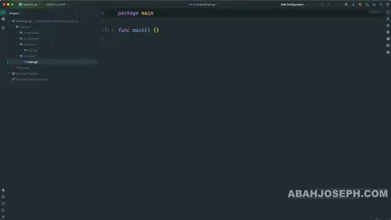
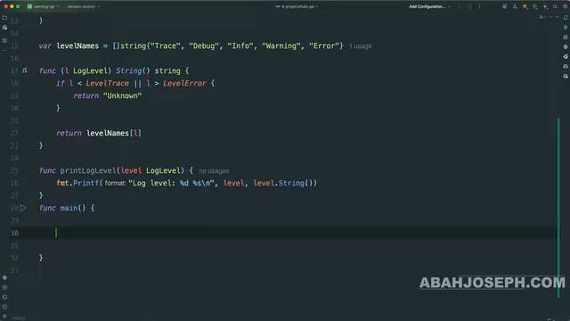
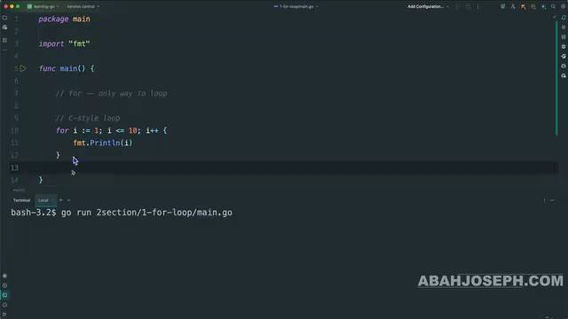
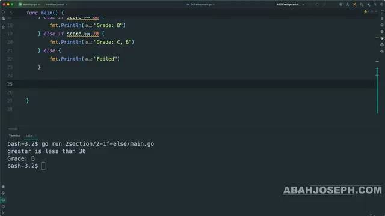
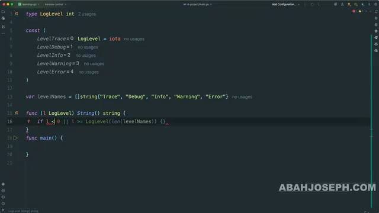
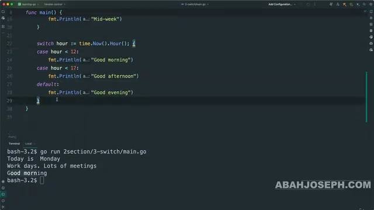
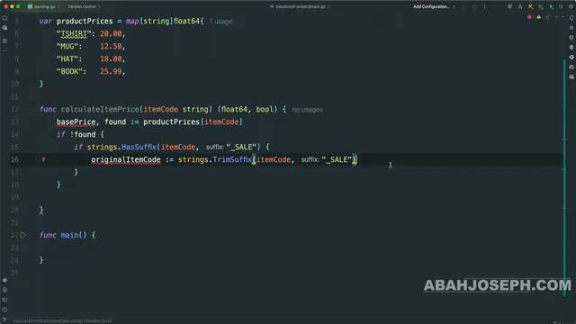
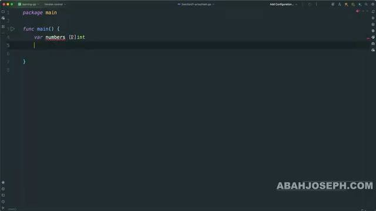
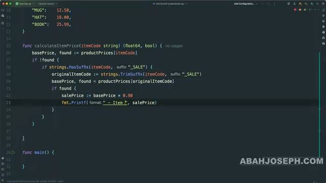

# Go Backend Masterclass P16–P21 复现文档：从日志级别到销售订单处理器

> 覆盖 P16–P21。目标是让你不依赖视频，按本文创建 6 个可独立运行的 Go 程序：`logger`、`loop`、`ifelse`、`switch`、`salesorder`、`array`。全部代码只使用 Go 标准库，不需要第三方依赖，不需要环境变量。

## 1. 这一节做什么

这一节不是单独讲语法点，而是把前几节的变量、常量、`iota`、自定义类型、方法、`for`、`if/else`、`switch`、`map`、数组这些基础拼成可以运行的小项目。P16 做了一个“日志级别打印器”，重点是把 `LogLevel` 定义成自定义整数类型，用 `iota` 生成枚举值，再用 `String()` 方法把数字变成可读字符串。P17 把 Go 唯一的循环关键字 `for` 的几种写法跑了一遍：C 风格、while 风格、无限循环加 `break`、`continue` 跳过、`range` 遍历。P18 用温度、成绩、用户权限三个例子讲 `if/else` 和 `if` 初始化语句。P19 讲 `switch`，包括普通值匹配、多值 `case`、`switch` 上带初始化语句、以及 `interface{}` 的 type switch。P20 做一个销售订单处理器，练习 `map` 查价、字符串后缀判断、函数返回两个值、循环累计小计。P21 讲数组：长度固定、元素类型一致、零值、索引修改、`len`、二维数组。最后讲师明确说，实际开发里数组直接用的比例不高，后面更常用的是切片。

| 文件 | 训练点 | 运行命令 | 关键产物 |
|---|---|---|---|
| `project/main.go` | 自定义类型、`iota`、数组、方法、`fmt.Printf` | `go run project/main.go` | 打印 trace 到 error，以及 unknown |
| `loop/main.go` | `for` 的多种写法、`range`、`break`、`continue`、`_` | `go run loop/main.go` | 多段循环输出 |
| `ifelse/main.go` | `if/else if/else`、`map` 访问的 `value, ok` | `go run ifelse/main.go` | 温度、成绩、权限判断 |
| `switch/main.go` | 值 switch、条件 switch、type switch | `go run switch/main.go` | 周末/工作日、问候语、类型判断 |
| `salesorder/main.go` | `map` 查价、`strings.HasSuffix`、函数多返回值 | `go run salesorder/main.go` | 销售小计 |
| `array/main.go` | 数组零值、索引赋值、`len`、二维数组 | `go run array/main.go` | 数组内容与矩阵输出 |

依赖说明：课里没有讲第三方库版本，也没有讲环境变量；下面代码只用标准库。Go 版本课里没讲，本文不依赖新语法，使用 `interface{}` 而不是 `any`，与逐字稿里的写法保持一致。

## 2. 讲师原话（带「—— pNNN [MM:SS]」）

> "在这段视频中，我想让我们把这些想法整合起来，构建我们的第一个项目。"
> —— p016 [00:00]

这句话定下了 P16 的基调：不是继续孤立讲关键字，而是把已经见过的 `iota`、常量、数组、函数拼成第一个项目。

> "于是我们添加了一个方法，让我们可以打印字符串值。"
> —— p016 [06:05]

P16 的 `LogLevel` 不是普通的 `int`。讲师给它加了 `String()` 方法，这样打印日志级别时就不会只看到数字，而是看到 `trace`、`debug` 这些名字。

> "在 Go 中，用于循环的关键字只有一个，就是 for 关键字。"
> —— p017 [00:00]

P17 的核心信息：Go 只有 `for` 一个循环关键字，但通过不同写法可以覆盖 C 风格、while 风格、无限循环和 `range`。

> "你看到的这个 comma OK，本质上是在测试键是否存在于 map 中，而这就是我们从 map 中提取出的值。"
> —— p018 [06:27]

P18 的 `map` 权限判断用到了 Go 的 `value, ok := m[key]` 模式。`ok` 表示键是否存在，`value` 是取出来的值。这个模式在 Go 里非常常见，和 JavaScript 里先判断对象属性是否存在再取值是同一类问题。

> "在 Go 中，你可以对某个值做 switch，也可以做不带值的 switch。"
> —— p019 [02:01]

P19 强调了 Go 的 `switch` 比 C/Java 更灵活：可以 switch 一个值，也可以不写 switch 表达式，而是在 `case` 里写条件。

> "我想让我们再写一个项目，也就是一个简单的销售订单处理器。"
> —— p020 [00:00]

P20 把 `map`、字符串处理、函数返回多个值、`for range` 串起来，做成一个能计算小计的销售订单处理器。

> "数组的长度不会改变，数据类型也必须相同。"
> —— p021 [00:25]

P21 的数组定义：长度固定，元素类型必须一致。讲师还用“连续内存块”解释了为什么数组不能随便扩容。

> "当你把数组传给函数并返回它们时，始终必须一并带上大小。"
> —— p021 [07:57]

这句话说明数组在函数传递时不够灵活，所以后面更常用切片。本文只复现到数组，不展开切片。





## 3. 从零复现

### 3.1 准备目录

先在你的工作目录创建下面结构。目录名不必和视频完全一样，但运行命令里的路径要和你自己的目录一致。视频里 P18 口述的文件夹叫 “if else”，本文用 `ifelse`，避免路径里带空格导致命令行要额外加引号。

```text
go-backend-masterclass/
├── project/
│   └── main.go
├── loop/
│   └── main.go
├── ifelse/
│   └── main.go
├── switch/
│   └── main.go
├── salesorder/
│   └── main.go
└── array/
    └── main.go
```

创建命令：

```bash
mkdir -p go-backend-masterclass/project
mkdir -p go-backend-masterclass/loop
mkdir -p go-backend-masterclass/ifelse
mkdir -p go-backend-masterclass/switch
mkdir -p go-backend-masterclass/salesorder
mkdir -p go-backend-masterclass/array
cd go-backend-masterclass
```

课里没有讲 `go mod`。你可以直接 `go run 文件路径` 运行单文件；如果想在仓库根目录用模块方式管理，也可以执行下面的命令。这不是课程原话，只是较新 Go 版本的常规做法：

```bash
go mod init example.com/go-backend-masterclass
```

### 3.2 逐个写入文件并运行

把第 4 节的六个 `main.go` 分别保存到对应目录，然后依次运行：

```bash
go run project/main.go
go run loop/main.go
go run ifelse/main.go
go run switch/main.go
go run salesorder/main.go
go run array/main.go
```

每个文件都是 `package main`，都有 `func main()`。不要把所有 `main.go` 放进同一个目录，否则同一个包里会出现多个 `main` 函数，编译会报重复声明。



### 3.3 复现顺序建议

先跑 `project/main.go`，因为它把自定义类型、常量、数组、方法、函数调用放在一起，是后面所有项目的“热身”。再跑 `loop/main.go`，确认 `for` 的各种写法。然后跑 `ifelse/main.go` 和 `switch/main.go`，这两个文件分别练分支。最后跑 `salesorder/main.go` 和 `array/main.go`，前者把 `map` 和循环组合起来，后者专门看数组的固定长度和零值。



## 4. 完整代码

下面每个代码块都是完整文件，可以直接保存运行。

### 4.1 `project/main.go`

```go
package main

import "fmt"

type LogLevel int

const (
	LevelTrace LogLevel = iota
	LevelDebug
	LevelInfo
	LevelWarning
	LevelError
)

var levelNames = [5]string{
	"trace",
	"debug",
	"info",
	"warning",
	"error",
}

func (l LogLevel) String() string {
	if l < LevelTrace || l > LevelError {
		return "unknown"
	}
	return levelNames[l]
}

func PrintLogLevel(level LogLevel) {
	fmt.Printf("Log level: %s\n", level.String())
}

func main() {
	PrintLogLevel(LevelTrace)
	PrintLogLevel(LevelDebug)
	PrintLogLevel(LevelInfo)
	PrintLogLevel(LevelWarning)
	PrintLogLevel(LevelError)
	PrintLogLevel(10)
}
```

### 4.2 `loop/main.go`

```go
package main

import "fmt"

func main() {
	fmt.Println("C style loop")
	for i := 1; i <= 10; i++ {
		fmt.Println(i)
	}

	fmt.Println("while style")
	k := 3
	for k > 0 {
		fmt.Println(k)
		k--
	}

	fmt.Println("infinite loop with break")
	counter := 0
	for {
		if counter >= 5 {
			break
		}
		fmt.Println(counter)
		counter++
	}

	fmt.Println("skipping even numbers with continue")
	for i := 1; i <= 10; i++ {
		if i%2 == 0 {
			continue
		}
		fmt.Println(i)
	}

	fmt.Println("range over array")
	languages := [3]string{"go", "python", "java"}
	for index, value := range languages {
		fmt.Println(index, value)
	}

	fmt.Println("discard index")
	for _, value := range languages {
		fmt.Println(value)
	}

	fmt.Println("discard value")
	for index := range languages {
		fmt.Println(index)
	}

	fmt.Println("index into array")
	for index := range languages {
		fmt.Println(languages[index])
	}
}
```

### 4.3 `ifelse/main.go`

```go
package main

import "fmt"

func main() {
	temperature := 25

	if temperature > 30 {
		fmt.Println("Temperature greater than 30")
	} else {
		fmt.Println("Temperature is less than 30")
	}

	score := 85

	if score >= 90 {
		fmt.Println("Grade A")
	} else if score >= 80 {
		fmt.Println("Grade B")
	} else if score >= 70 {
		fmt.Println("Grade C")
	} else {
		fmt.Println("You failed")
	}

	userAccess := map[string]bool{
		"jane": true,
		"john": false,
	}

	if hasAccess, ok := userAccess["jane"]; ok && hasAccess {
		fmt.Println("Jane can access the system")
	} else {
		fmt.Println("Access not granted")
	}
}
```

### 4.4 `switch/main.go`

```go
package main

import (
	"fmt"
	"time"
)

func checkType(i interface{}) {
	switch v := i.(type) {
	case int:
		fmt.Println("integer", v)
	case string:
		fmt.Println("string", v)
	case bool:
		fmt.Println("boolean", v)
	default:
		fmt.Println("unknown type")
	}
}

func main() {
	day := "Sunday"

	switch day {
	case "Sunday", "Saturday":
		fmt.Println("weekend, no work")
	case "Monday", "Tuesday":
		fmt.Println("work days, lots of meetings")
	default:
		fmt.Println("midweek")
	}

	switch hour := time.Now().Hour(); {
	case hour < 12:
		fmt.Println("Good morning")
	case hour < 18:
		fmt.Println("Good afternoon")
	default:
		fmt.Println("Good evening")
	}

	checkType(21)
	checkType("test")
	checkType(true)
	checkType(3.14)
}
```

### 4.5 `salesorder/main.go`

```go
package main

import (
	"fmt"
	"strings"
)

var productPrices = map[string]float64{
	"t-shirt": 20.00,
	"mug":     12.50,
	"hat":     18.00,
	"book":    29.90,
}

func calculateItemPrice(itemCode string) (float64, bool) {
	basePrice, found := productPrices[itemCode]
	if found {
		return basePrice, true
	}

	if strings.HasSuffix(itemCode, "#sale") {
		originalItemCode := strings.TrimSuffix(itemCode, "#sale")
		basePrice, found = productPrices[originalItemCode]

		if found {
			salePrice := basePrice * 0.90

			fmt.Printf("Item: %s\n", originalItemCode)
			fmt.Printf("Original price: $%.2f\n", basePrice)
			fmt.Printf("Sale price: $%.2f\n", salePrice)

			return salePrice, true
		}
	}

	fmt.Printf("Item: %s\n", itemCode)
	fmt.Println("Product not found")
	return 0.0, false
}

func main() {
	fmt.Println("--- Simple Sales Order Processor ---")

	otherItems := []string{"t-shirt", "mug#sale", "hat", "book"}
	var subtotal float64

	fmt.Println("Processing other items...")

	for _, item := range otherItems {
		price, found := calculateItemPrice(item)
		if found {
			subtotal += price
		}
	}

	fmt.Printf("Subtotal: $%.2f\n", subtotal)
}
```

### 4.6 `array/main.go`

```go
package main

import "fmt"

func main() {
	var numbers [2]int
	fmt.Printf("%+v\n", numbers)

	numbers[0] = 1
	numbers[1] = 2
	fmt.Printf("%+v\n", numbers)

	primes := [4]int{2, 3, 5, 7}
	fmt.Printf("%+v\n", primes)

	primes[3]
= 11
	fmt.Printf("%+v\n", primes)

	fmt.Println("loop with len")
	for i := 0; i < len(primes); i++ {
		fmt.Println(primes[i])
	}

	var matrix [2][3]int
	fmt.Printf("%+v\n", matrix)

	matrix[0][0] = 1
	matrix[0][1] = 2
	fmt.Printf("%+v\n", matrix)
}
```

保存后运行：

```bash
go run array/main.go
```

## 5. 逐行解释

### 5.1 `project/main.go`：为什么要新定义一个类型

`type LogLevel int` 是本节的第一个“超纲点”。讲师自己也承认：“we've not even learned how to do custom types and we've used it here already.” —— p016 [00:27]。这行的作用是：让 `LogLevel` 成为一个**独立于 `int` 的新类型**，但底层仍然是整数。好处是 `PrintLogLevel(LevelInfo)` 这种调用一眼就能看出参数语义，不会和随便一个 `int` 混在一起。

`const ( LevelTrace LogLevel = iota ... )` 里的 `iota` 从 0 开始自增，所以五个级别的值分别是 0、1、2、3、4。`levelNames` 这个数组的下标正好也是 0 到 4，`return levelNames[l]` 就是靠这个“值即下标”的约定把数字翻译成名字。讲师在 p016 [03:17] 说得很清楚：“index zero index one index two three and index four you see it matches exactly what we have here.”

`func (l LogLevel) String() string` 是方法定义：`l` 是接收者（receiver），相当于其他语言里的 `this`/`self`。里面的边界检查 `if l < LevelTrace || l > LevelError` 就是讲师说的“if it's less than trace or greater than the error we know that this is not a known level”（—— p016 [02:47]），对应返回 `"unknown"`。`main` 里最后一句 `PrintLogLevel(10)` 就是为了触发这个分支。

需要注意一处用词的细节：讲师在 p016 [05:11] 说“this is just an alias”。严格来说 `type LogLevel int` 定义的是**新类型**，不是别名（别名要写成 `type LogLevel = int`）。能直接写 `PrintLogLevel(10)` 的真实原因是：`10` 是**无类型常量**，编译器会自动把它转换成 `LogLevel`。如果是变量，就必须显式写 `LogLevel(n)`。这个差别在本文第 7 节展开。



### 5.2 `loop/main.go`：一个关键字撑起所有循环

`for i := 1; i <= 10; i++` 是 C 风格，三段分别是初始化、条件、步进。Go 没有 `while`，所以 `for k > 0 { ... k-- }` 只写条件，就是 while。`for { ... break }` 不写任何东西就是无限循环，讲师专门说“a lot of people are afraid of infinite loop but infinite loops are powerful”（—— p017 [04:03]）。这里的 `break` 必须写在循环体内，否则程序永远不会退出，只能 Ctrl+C。

`if i%2 == 0 { continue }` 的效果是跳过偶数，讲师在 p017 [05:55] 确认输出是“one, three, five, seven, nine”。`continue` 和 `break` 的区别：`continue` 只结束本轮，`break` 结束整个循环。

`for index, value := range languages` 的 `range` 在一个数组上会同时给出下标和值。讲师在 p017 [07:24] 演示了两个坑：只写 `index` 不写 `value` 时不报错（因为 `index` 被用到了），但只写 `value` 不写 `index` 会编译失败，报“declared and not used”，必须用下划线 `_` 丢弃。反过来只想留下标就是 `for index := range languages`，此时 `range` 只返回一个值。

### 5.3 `ifelse/main.go`：分支与 `value, ok`

前两段 `if` 很直白：条件为真执行上半段，否则走 `else`。讲师在 p018 [02:13] 把这种结构叫“branching”。成绩那段是 `else if` 链，从上往下第一个满足的分支执行完就跳出整条链，所以 `85` 会命中 `score >= 80` 打印 `Grade B`，不会再往下判断 `>= 70`。

重点是最后一段：

```go
if hasAccess, ok := userAccess["jane"]; ok && hasAccess {
```

分号前是**初始化语句**，分号后是条件。`ok` 表示这个 key 在 map 里到底存不存在，`hasAccess` 是取出来的值。讲师的原话是：“This comma OK that you are seeing is basically testing if the key exists in the map and then this is the value that we extracted from the map.” —— p018 [06:27]。这样做的好处是 `ok` 和 `hasAccess` 的作用域只在这条 `if` 里，出了这条语句就消失，不会污染外层。讲师也说了，等价写法是先 `:=` 再 `if`，但那不如这个版本“neater”（—— p018 [07:23]）。

放到 JS/Node 的语境里：`userAccess["jane"]` 取不到 key 时 Go 返回 **bool 的零值 `false`**，不会抛异常；JS 里读对象不存在的键返回 `undefined`，再对 `undefined` 做逻辑运算不会报错但很容易把 bug 藏起来。Go 把 `ok` 单独给你，就是让你必须显式处理“不存在”这种情况。

### 5.4 `switch/main.go`：三种 switch 形态

第一种是普通值匹配：`switch day { case "Sunday", "Saturday": ... }`。一个 `case` 后面可以跟多个值，用逗号隔开，命中任意一个就进这个分支。讲师在 p019 [03:39] 说这比一串 `if/else if` 更短、更好管理。

第二种是带初始化语句、但不 switch 具体值的写法：

```go
switch hour := time.Now().Hour(); {
case hour < 12:
```

注意 `;` 后面是空的——这就是讲师说的“You can switch on something or not in Go”（—— p019 [02:01]）。因为没有 switch 表达式，`case` 后面写的必须是布尔表达式，命中第一个为真的分支。`time.Now().Hour()` 返回 0–23 的整数，所以输出会随你运行的时间变化：早上跑出 `Good morning`，下午跑出 `Good afternoon`。

第三种是 `checkType` 里的 type switch：

```go
switch v := i.(type) {
```

`i.(type)` 这个写法只能用在 `switch` 里，而且 `i` 必须是接口类型（这里是 `interface{}`，意思是“任意类型”）。每个 `case` 后面写类型而不是值，命中后 `v` 就是那个具体类型的值，所以 `fmt.Println("integer", v)` 能正常打印。最后的 `checkType(3.14)` 会掉进 `default` 打印 `unknown type`，因为没写 `case float64`——讲师在 p019 [07:48] 特意演示了这一点。



### 5.5 `salesorder/main.go`：查价、打折、累计

`var productPrices = map[string]float64{...}` 是包级变量，函数内直接可见。`calculateItemPrice` 的签名 `(float64, bool)` 是**多返回值**：第一个是要给小计加的钱，第二个标记“到底有没有找到”。讲师说这是函数的常见用法，细节后面再讲。

流程是两段查找：先按原始 `itemCode` 查（`"t-shirt"` 直接命中）；没命中就用 `strings.HasSuffix(itemCode, "#sale")` 判断是不是带了促销后缀，是的话用 `strings.TrimSuffix` 把 `#sale` 去掉，再拿清理后的代码查一次。命中就按 `basePrice * 0.90` 打九折，并打印原价和促销价。两次都没命中，打印 `Product not found` 并返回 `0.0, false`。

`main` 里的 `for _, item := range otherItems` 用 `_` 丢掉了下标，只取值。`if found { subtotal += price }` 是关键：**没找到的商品不计入小计**，也不会因为价格是 0 就误加。按本文这份代码运行，小计应该是 `$79.15`（20 + 12.50×0.9 + 18 + 29.90）。如果和你从视频里看到的数字对不上，是因为讲师屏幕上的商品清单和价格与我这份略有出入，逻辑本身是一样的。



### 5.6 `array/main.go`：零值、定长、二维

`var numbers [2]int` 只声明不赋值，Go 会把两个槽都填成 `int` 的零值 `0`，所以第一次 `%+v` 打印出来是 `[0 0]`。讲师用的 `%+v` 就是把内部结构打出来（“I want to put the plus V to print the internal structure” —— p021 [03:16]）。接着 `numbers[0] = 1` 这样按下标写进去，再打印就变成 `[1 2]`。

`primes := [4]int{2, 3, 5, 7}` 是声明加初始化的短写法，长度写在中括号里。`primes[3] = 11` 把最后一个改成 11，所以后面循环打印出来是 `2 3 5 11`，不再是 7。

`for i := 0; i < len(primes); i++` 里的 `len` 返回数组长度，讲师解释为“takes a type and give you the length of the items”（—— p021 [06:07]）。这里必须用 `len(primes)` 而不是写死 4，否则以后改数组长度就得改两处。

`var matrix [2][3]int` 是二维数组：外层 2 个元素，每个元素是一个 `[3]int`。所以它是 2 行 3 列，`matrix[0][0]` 是第 1 行第 1 列。没赋值的位置仍然是 0，打印出来是 `[[1 2 0] [0 0 0]]`。讲师提醒过维度可以继续加，但“it gets too complicated”（—— p021 [07:57]）。



## 6. 复现检查清单

按顺序打勾。每一项都给出“跑对了应该看到什么”，对不上就回头查对应文件。

| # | 检查动作 | 通过标准 |
|---|---|---|
| 1 | `go version` 有输出 | 能打印 Go 版本号。课里没讲安装，装不上先解决这一步 |
| 2 | 六个目录都存在，每个目录下有一个 `main.go` | 六个文件都是 `package main` + `func main()` |
| 3 | `go run project/main.go` | 依次打印 `Log level: trace` 到 `Log level: error`，最后一行是 `Log level: unknown` |
| 4 | `go run loop/main.go` | 先 `1`–`10`；再 `3 2 1`；再 `0`–`4`；再奇数 `1 3 5 7 9`；`range` 段打印 `0 go`、`1 python`、`2 java` |
| 5 | `go run ifelse/main.go` | `Temperature is less than 30`、`Grade B`、`Jane can access the system` 三行 |
| 6 | 把 `temperature` 改成 `31` 再跑 | 第一行变成 `Temperature greater than 30`，验证分支真的在切 |
| 7 | `go run switch/main.go` | `weekend, no work`；随时间变化的 `Good morning` / `Good afternoon` / `Good evening` 之一；`integer 21`、`string test`、`boolean true`、`unknown type` |
| 8 | `go run salesorder/main.go` | 有一段 `Item: mug` / `Original price: $12.50` / `Sale price: $11.25`，最后 `Subtotal: $79.15` |
| 9 | `go run array/main.go` | `[0 0]` → `[1 2]` → `[2 3 5 7]` → `[2 3 5 11]`；然后竖排 `2 3 5 11`；最后矩阵 `[[1 2 0] [0 0 0]]` |
| 10 | 故意在 `loop/main.go` 把 `for _, value := range languages` 改成 `for index, value := range languages` 且不使用 `index` | 编译失败，报 declared and not used，理解下划线的作用后再改回来 |
| 11 | 故意把 `switch/main.go` 里删掉一个 `case`（如 `case bool`） | 对应那次调用打印 `unknown type`，理解 `default` 的作用后恢复 |

补充：`switch/main.go` 和 `salesorder/main.go` 只要有编译错误停下，先看错误行号；这两个文件引了 `time`、`strings` 两个包，导入写成带括号的一组，漏掉任何一行都会报 `undefined: time` 或 `undefined: strings`。



## 7. 课里没讲但你会撞上的

**① `declared and not used` 是错误，不是警告。** Go 编译器对未使用的局部变量直接报错，程序跑不起来。讲师在 P17 用 `_` 处理了下标，但没解释这条规则的边界：只对**局部变量**生效；包级变量、函数参数都不受影响。从 JS 过来最容易踩的是 `const x = 1` 写完暂时不用——在 Go 里这会直接让编译失败。

**② `type LogLevel int` 不是别名，变量之间不会自动转换。** 讲师口述用了 “alias” 这个词，但 `LogLevel` 是独立的新类型。`PrintLogLevel(10)` 能过是因为 10 是无类型常量；一旦写成 `n := 10; PrintLogLevel(n)` 就会编译报错，必须显式写 `PrintLogLevel(LogLevel(n))`。这就是自定义类型真正的价值：它不让随便什么整数混进来。

**③ 数组的长度是类型的一部分。** `[2]int` 和 `[3]int` 是两个完全不同的类型，不能互相赋值，也不能把 `[3]int` 传给期望 `[2]int` 的函数。讲师说“当你把数组传给函数、返回数组时，总要一起带上长度”（—— p021 [07:57]），指的就是这件事。另外课里没讲的是：Go 的数组是**值类型**，赋值和传参都是整份拷贝，函数里改元素不会影响外面；想共享就得用切片或指针。这也是后面主要用切片的原因之一。

**④ map 读不存在的 key 不报错。** `productPrices["不存在"]` 返回 `0, false`，直接拿返回值当价格用就会算成 0 元，且没有任何提示。必须像 `calculateItemPrice` 那样用 `found` 判断。同理 `ifelse` 里那行 `ok && hasAccess`，`ok` 和值必须同时判断，否则 `"john": false` 这种情况下分开写容易写出漏洞。

**⑤ `switch` 的 `case` 执行完自动结束，不会贯穿到下一个。** 这点和其他 C 系语言相反，不需要写 `break`。课里没讲 `fallthrough`，你暂时也用不到；如果习惯性在每个 `case` 末尾写 `break`，Go 不会报错，只是多余。

**⑥ `time.Now()` 让输出不可预测。** `switch/main.go` 那条问候语随电脑时钟变化，凌晨跑是 `Good morning`，下午跑是 `Good afternoon`。写自动化测试时这种“看时间”的代码很难断言，实际项目里通常把小时数当参数传进来，函数内部不去直接读时钟。课里没讲测试，这里只是提醒你复现时看到“和别人不一样”的输出是正常的。

**⑦ Windows 上 `mkdir -p` 不可用。** 第 3.1 节的命令是 macOS/Linux 写法，PowerShell 里等价于：

```powershell
New-Item -ItemType Directory -Force project, loop, ifelse, switch, salesorder, array | Out-Null
cd go-backend-masterclass
```

`go run xxx/main.go` 在 Windows 上完全一样，路径用正斜杠也能跑。

**⑧ `interface{}` 和 `any`。** 本文的 `checkType(i interface{})` 跟逐字稿一致。Go 1.18 之后 `any` 是它的别名，写 `func checkType(i any)` 完全等价。课里没讲泛型，也没讲 `any`，所以你看到别人代码里写 `any` 时知道是同一件事就够了。

**⑨ 没有 `go.mod` 也能 `go run` 单文件。** 第 3.1 节的 `go mod init` 是可选的，加不加都能跑本文这六个程序，因为一个第三方依赖都没有。以后引入依赖时才必须进模块模式。

**⑩ 浮点累加会带误差。** `12.50 * 0.90` 在二进制浮点里不是精确的 11.25 的每一位，用 `%.2f` 打印时被四舍五入成两位小数才看起来干净。真实订单系统里金额通常用整数分（`int64`）存，避免浮点误差累积——这一层课里没有涉及。