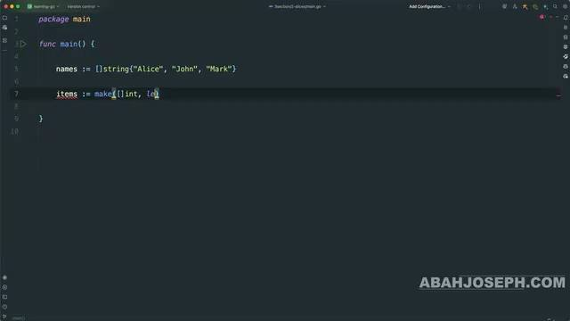
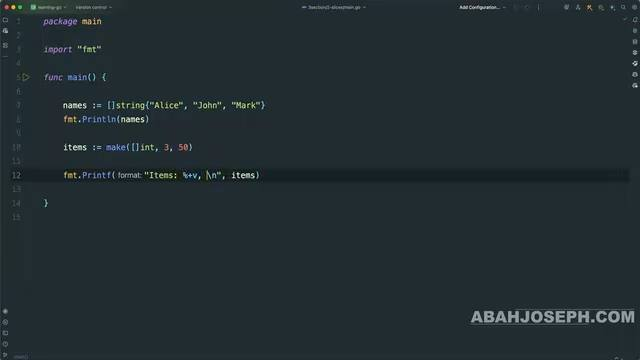
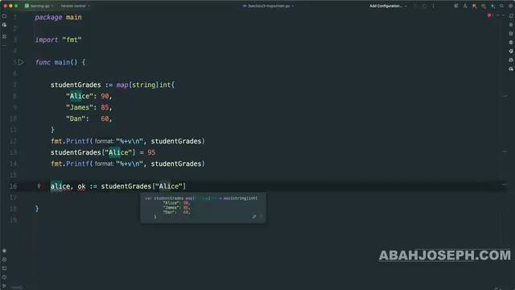
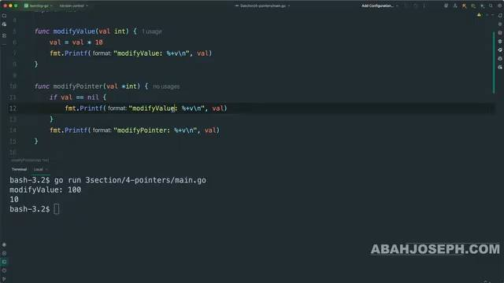
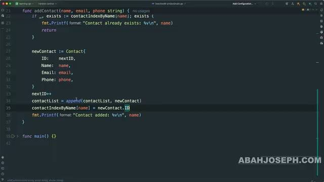
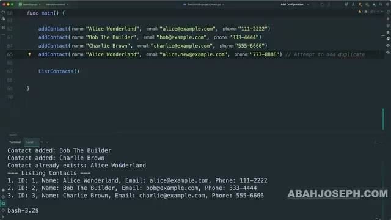
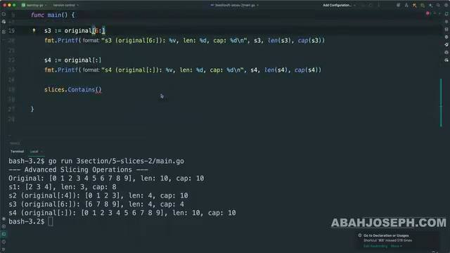

## 1. 这一节做什么

这一段课程围绕 Go 里最常用、也最容易在项目里踩坑的几组基础能力展开：`slice`、`map`、`pointer`，以及用它们拼出一个能运行的小项目——联系人管理系统。课程不是单纯罗列语法，而是按“先会存数据，再会查数据，再会改数据，最后做一个完整 CRUD 雏形”的路径推进。

学完并照着本文复现后，你应该得到 5 个可独立运行的 Go 单文件程序：

```text
go-backend-masterclass/
├── 02-slices/
│   └── main.go
├── 03-map/
│   └── main.go
├── 04-pointers/
│   └── main.go
├── 05-slices-two/
│   └── main.go
└── 06-contact-manager/
    └── main.go
```

其中最后一个 `06-contact-manager` 是本节的项目收尾：用 `struct` 定义联系人，用 `slice` 存联系人列表，用 `map[string]int` 做“姓名 → 列表下标”的索引，用 `init()` 初始化全局变量，用返回 `*Contact` 的函数处理“找不到联系人”的情况。课程里口述的字段是 `ID`、`name`、`email`、`phone number`；本文为了 Go 可读性和可运行性，把结构体字段写成 `ID`、`Name`、`Email`、`Phone`，字段名大小写这件事课里没有逐字展开，下面会标注。

本节只使用 Go 标准库，没有第三方依赖。课程没有给准确 Go 版本；P025 用到标准库 `slices` 包，讲师原话说“可能是 Go 1.22 左右”，所以复现 P025 时请用支持 `slices` 标准包的 Go 版本。其余文件用较新的 Go 1.x 即可。环境变量：课程没有使用环境变量。



## 2. 讲师原话（带「—— pNNN [MM:SS]」）

关于切片为什么重要：

> "切片是动态的。与数组不同，切片没有固定大小。这意味着你可以继续向其中添加或删除元素。"
> —— p022 [00:28]

> "如果你提前知道容量，就应该一次性为这个容量分配内存。"
> —— p022 [06:01]

> "一旦我们再添加一个元素，容量就会翻倍。那实际发生了什么？Go 只是创建了一段新的内存，并把我们的元素复制了过去。"
> —— p022 [09:09]

关于 map 的查询：

> "它只是一个映射到值的键。如果你知道键，就可以在常数时间内访问对应的值。"
> —— p023 [00:28]

> "这个正常性检查是这样做的：传入一个键，结果基本会是这样。如果这个结果为 true（它是一个布尔值），如果它为 true，就说明可以安全地使用这个值。"
> —— p023 [03:42]

> "它还没有被创建。我们还没有初始化它。这个条件始终为 true。对，因为它是 nil。"
> —— p023 [08:20]

关于指针：

> "指针也是一个变量。但它存储的不是值，而是另一个变量的地址。"
> —— p024 [01:42]

> "这就是一个副作用。这里函数内部发生的事情正在影响函数外部的变量。为什么？因为函数知道那个变量的地址。"
> —— p024 [08:35]

关于切片边界：

> "上界不包含在内……低索引对应的元素包含在内。"
> —— p025 [01:52]

> "Insert 会把值 v 插入到 s 中索引 i 的位置……如果 i 大于 s 的长度，Insert 会触发 panic。"
> —— p025 [07:00]

关于联系人项目：

> "我们给它一个 ID、一个姓名、一个邮箱，最后再给一个电话号码。"
> —— p026 [00:55]

> "还有一个在 main 之前运行的函数，叫 init。这里是初始化变量的好地方。"
> —— p026 [02:13]

> "我想确保这个姓名在联系人中还不存在，这样就不会出现重复的姓名。"
> —— p026 [03:10]

> "返回时，我们可以返回指向联系人的指针；我之所以想返回指针，是因为如果找不到联系人，我希望返回 nil。"
> —— p026 [05:27]

> "在 Go 中，出现异常时称为 panic。这里之所以触发 panic，是因为我试图在 nil 类型上调用 name。"
> —— p026 [10:05]

## 3. 从零复现

### 3.1 确认 Go 环境

在终端执行：

```bash
go version
```

课程没有给出具体版本号。P025 用到了标准库 `slices`，如果你的 Go 版本太旧，可能会出现类似“找不到 slices 包”的问题。课里没有讲如何升级 Go，也没有给出版本要求；你只需要保证 P022–P024、P026 能跑，P025 能导入 `slices` 即可。

### 3.2 创建目录结构

在任意工作目录执行：

```bash
mkdir -p go-backend-masterclass/02-slices
mkdir -p go-backend-masterclass/03-map
mkdir -p go-backend-masterclass/04-pointers
mkdir -p go-backend-masterclass/05-slices-two
mkdir -p go-backend-masterclass/06-contact-manager
cd go-backend-masterclass
```

课程里讲师创建目录时口述过 “two slices”“three map”“pointers”“five slices too”等名字；这里整理成带序号、便于排序的目录名。`06-contact-manager` 这个项目目录名课里没有明确给出，本文只是为了归档方便。

### 3.3 写入代码

把第 4 节的 5 个 `main.go` 分别保存到对应目录。每个文件都是完整的 `package main`，不依赖第三方库，不需要额外配置文件。

### 3.4 运行

从 `go-backend-masterclass` 根目录执行：

```bash
go run ./02-slices/main.go
go run ./03-map/main.go
go run ./04-pointers/main.go
go run ./05-slices-two/main.go
go run ./06-contact-manager/main.go
```

也可以进入某个目录后执行：

```bash
cd 02-slices
go run main.go
```

课程里讲师使用的是 `go run` 运行 `main.go`。本文的 5 个程序都是单文件 `main` 包，所以 `go run main.go` 足够；如果你以后拆成多个文件，改成在目录内执行 `go run .`，并建议先 `go mod init`。本课不需要环境变量。

### 3.5 复现顺序建议

1. 先跑 `02-slices`，观察 `len` 和 `cap`。
2. 再跑 `03-map`，观察 comma ok 检查和 `nil` map。
3. 跑 `04-pointers`，观察函数内修改外部变量。
4. 跑 `05-slices-two`，观察 `low/high` 边界和 `slices` 包。
5. 最后跑 `06-contact-manager`，把前面几块拼成一个小项目。



## 4. 完整代码

### 4.1 `02-slices/main.go`

```go
package main

import "fmt"

func main() {
	// 1. 切片字面量：不写长度就是 slice，写了长度就是 array。
	names := []string{"Alice", "John", "Mac"}
	fmt.Println("names:", names)

	// 2. make([]T, length, capacity)
	// 长度是当前可用的元素个数，容量是在不重新分配内存前最多能扩展到多少。
	items := make([]int, 3, 5)
	fmt.Printf("items=%v len=%d cap=%d\n", items, len(items), cap(items))

	// 3. append 两个元素，长度从 3 到 5，容量刚好用完。
	items = append(items, 2, 3)
	fmt.Printf("after append 2,3: items=%v len=%d cap=%d\n", items, len(items), cap(items))

	// 4. 再 append 一个元素，超过容量，Go 会分配新的底层数组并复制旧元素。
	items = append(items, 1)
	fmt.Printf("after append 1: items=%v len=%d cap=%d\n", items, len(items), cap(items))

	// 5. 切片表达式 low:high，low 包含，high 不包含。
	// 这里的 high 用到 7，能成立是因为底层容量为 10；
	// 若只想要已 append 出来的元素，用 items[3:6] 更直观。
	fmt.Println("items[3:7]:", items[3:7])
}
```

### 4.2 `03-map/main.go`

```go
package main

import "fmt"

func main() {
	// 1. map 字面量：key 是 string，value 是 int。
	studentGrades := map[string]int{
		"Alice": 90,
		"James": 85,
		"Dan":   60,
	}
	fmt.Println(studentGrades)

	// 2. 通过 key 直接更新 value。
	studentGrades["Alice"] = 95
	fmt.Println(studentGrades)

	// 3. comma ok 检查：ok 为 true 才说明 key 存在。
	if grade, ok := studentGrades["Alice"]; ok {
		fmt.Println("Alice", grade)
	}

	// 4. 不关心 value 时，用 _ 忽略它，只检查 key 是否存在。
	if _, ok := studentGrades["Bob"]; !ok {
		fmt.Println("Bob not found")
	}

	if grade, ok := studentGrades["Dan"]; ok {
		fmt.Println("Dan", grade)
	}

	// 5. delete 删除 key。
	delete(studentGrades, "Alice")
	fmt.Println(studentGrades)

	// 6. make 初始化 map。
	configs := make(map[string]string)
	fmt.Printf("configs=%v type=%T\n", configs, configs)

	if configs["name"] == "" {
		fmt.Println("name is empty")
	}

	// 7. 未初始化的 map 是 nil。读 nil map 得到零值，但写 nil map 会 panic。
	var nilConfigs map[string]string
	fmt.Println("nilConfigs == nil:", nilConfigs == nil)

	nilConfigs = make(map[string]string)
	fmt.Println("after make, nilConfigs == nil:", nilConfigs == nil)
}
```

### 4.3 `04-pointers/main.go`

```go
package main

import "fmt"

func modifyValue(value int) {
	value = value * 10
	fmt.Println("inside modifyValue:", value)
}

func modifyPointer(value *int) {
	if value == nil {
		fmt.Println("value is nil")
		return
	}

	// *value 是解引用：进入这个地址，修改地址里存的数据。
	*value = *value * 10
	fmt.Println("inside modifyPointer:", *value)
}

func main() {
	number := 10

	// 传值：函数内部改的是副本，外部 number 不变。
	modifyValue(number)
	fmt.Println("number after modifyValue:", number)

	// 传地址：函数内部可以通过地址修改外部变量，这是 side effect。
	modifyPointer(&number)
	fmt.Println("number after modifyPointer:", number)

	age := 10
	fmt.Println("age:", age)
	fmt.Printf("&age: %p\n", &age)

	agePtr := &age
	fmt.Printf("agePtr: %p\n", agePtr)
	fmt.Printf("&agePtr: %p\n", &agePtr)
	fmt.Println("*agePtr:", *agePtr)
}
```

### 4.4 `05-slices-two/main.go`

```go
package main

import (
	"fmt"
	"slices"
)

func main() {
	s1 := []int{0, 1, 2, 3, 4, 5, 6, 7, 8, 9}
	fmt.Printf("s1=%v len=%d cap=%d\n", s1, len(s1), cap(s1))

	// low 包含，high 不包含：s1[:5] 得到下标 0..4。
	s2 := s1[:5]
	fmt.Printf("s2=s1[:5] => %v len=%d cap=%d\n", s2, len(s2), cap(s2))

	// 从下标 2 到下标 5，但不包含 5。
	s3 := s1[2:5]
	fmt.Printf("s3=s1[2:5] => %v len=%d cap=%d\n", s3, len(s3), cap(s3))

	// high 省略：一直取到原切片末尾。
	s4 := s1[6:]
	fmt.Printf("s4=s1[6:] => %v len=%d cap=%d\n", s4, len(s4), cap(s4))

	// low 和 high 都省略：相当于完整切片。
	clone := s1[:]
	fmt.Printf("clone=s1[:] => %v len=%d cap=%d\n", clone, len(clone), cap(clone))

	// Go 标准库 slices 包提供 Contains 等函数。
	fmt.Println("slices.Contains(s4, 8):", slices.Contains(s4, 8))

	// slices.Insert 在指定下标插入元素；下标越界会 panic。
	// 课里文档原话提到：如果 i 大于 len(s) 会 panic。
	modified := slices.Insert(s4, 3, 1000)
	fmt.Println("after slices.Insert(s4, 3, 1000):", modified)
}
```

### 4.5 `06-contact-manager/main.go`

```go
package main

import "fmt"

// Contact 是自定义类型。课里口述字段为 ID、name、email、phone number；
// 这里用 Go 可读性更好的 ID/Name/Email/Phone。
type Contact struct {
	ID    int
	Name  string
	Email string
	Phone string
}

var (
	contacts       []Contact
	contactsByName map[string]int
	nextID         = 1
)

// init 在 main 之前运行，适合初始化全局变量。
// 课里也提醒过：不要过度使用 init，这里是为了演示。
func init() {
	contacts = make([]Contact, 0, 10)
	contactsByName = make(map[string]int, 10)
}

func addContact(name, email, phone string) string {
	// 先检查姓名是否已经存在，避免重复联系人。
	if _, exists := contactsByName[name]; exists {
		return fmt.Sprintf("contact %s already in the database", name)
	}

	contact := Contact{
		ID:    nextID,
		Name:  name,
		Email: email,
		Phone: phone,
	}
	nextID++

	// 先 append 到切片，再把“姓名 -> 切片下标”写入 map。
	contacts = append(contacts, contact)
	contactsByName[name] = len(contacts) - 1

	return fmt.Sprintf("contact %s added with ID %d", name, contact.ID)
}

// findContactByName 返回 *Contact：找到返回指针，找不到返回 nil。
// 课里强调过：返回指针是为了能表达“找不到”这个状态。
func findContactByName(name string) *Contact {
	index, exists := contactsByName[name]
	if exists {
		return &contacts[index]
	}
	return nil
}

func listContacts() {
	if len(contacts) == 0 {
		fmt.Println("No contacts found")
		return
	}

	for i, contact := range contacts {
		fmt.Printf(
			"%d. ID=%d Name=%s Email=%s Phone=%s\n",
			i+1,
			contact.ID,
			contact.Name,
			contact.Email,
			contact.Phone,
		)
	}
	fmt.Println()
}

func main() {
	fmt.Println(addContact("Alice Wonderland", "alice@example.com", "111-111-1111"))
	fmt.Println(addContact("Bob Builder", "bob@example.com", "222-222-2222"))
	fmt.Println(addContact("Dan Brown", "dan@example.com", "333-333-3333"))

	// 重复姓名：不会再次加入。
	fmt.Println(addContact("Alice Wonderland", "alice2@example.com", "999-999-9999"))

	fmt.Println(addContact("James Smith", "james@example.com", "444-444-4444"))

	listContacts()

	// 找到时返回非 nil 指针。
	if bob := findContactByName("Bob Builder"); bob != nil {
		fmt.Println("Bob contact found:", bob.Name)
	} else {
		fmt.Println("Bob contact not found")
	}

	// 找不到时返回 nil，必须先判断 nil，不能直接 bob.Name。
	if missing := findContactByName("Nobody"); missing != nil {
		fmt.Println("Nobody contact found:", missing.Name)
	} else {
		fmt.Println("Nobody contact not found")
	}
}
```



## 5. 逐行解释

### 5.1 `02-slices/main.go`：切片的长度与容量

`names := []string{"Alice", "John", "Mac"}` 里的 `[]string` 没有写长度，所以它是 slice；如果写成 `[3]string{...}`，它就是 array。讲师反复强调“不要写长度就是 slice”，这是 Go 里非常关键的一个语法区别。对前端来说，可以先把它理解成“比 JS 数组多了 `len` 和 `cap` 两个可观察属性”的序列。

`items := make([]int, 3, 5)` 创建了一个长度为 3、容量为 5 的切片。长度是当前能直接通过下标访问的元素个数；容量是底层数组还能容纳多少元素。此时 `fmt.Printf` 打印 `len=3 cap=5`。

`items = append(items, 2, 3)` 之后长度变成 5，容量仍是 5，因为刚好用完。`items = append(items, 1)` 之后长度变成 6，超过容量 5，Go 会创建新的底层数组、复制旧元素，并把容量扩大。讲师在 P022 里说“Go just created a new memory segment copied our items”，说的就是这一步。前端同学可以把它类比成 JS 数组扩容，但 Go 把这层扩容策略暴露成了 `cap`，所以在性能敏感场景要提前 `make` 好容量。

`items[3:7]` 是切片表达式：`low` 包含，`high` 不包含。这里 `items` 长度是 6、容量是 10，所以 `high=7` 能成立，是因为 Go 允许在容量范围内切片。课程里也演示了“high 不包含”的规则，P025 又专门复习了一遍。

### 5.2 `03-map/main.go`：键值查询和 comma ok

`map[string]int` 表示 key 是 `string`、value 是 `int`。`studentGrades["Alice"] = 95` 直接更新。`grade, ok := studentGrades["Alice"]` 是 Go 的 comma ok 检查：`ok` 为 `true` 时，`grade` 才是可靠的值；`ok` 为 `false` 时，`grade` 是 value 类型的零值。讲师在 P023 里特别强调“要使用 okay check”，因为 map 查不到 key 时不会像某些语言那样抛异常。

`delete(studentGrades, "Alice")` 删除 key。`make(map[string]string)` 初始化 map。`var nilConfigs map[string]string` 声明但未初始化时，`nilConfigs == nil` 为 `true`。课程里说“没有 make 的 map 是 nil，条件总是 true”，指的就是这种状态。注意：读 nil map 是安全的，会得到零值；写 nil map 会 panic。这一点课里没有逐字展开，但你在复现时很容易撞上，见第 7 节。

对前端来说，map 很像 JS 的 `Map` 或普通对象，但 Go 的 map 遍历顺序不保证稳定。课程原话是“the order of the items is always not the same”。所以不要写依赖 map 打印顺序的断言。

### 5.3 `04-pointers/main.go`：传值和传地址

`modifyValue(number)` 是传值。函数收到的是 `number` 的副本，函数里 `value = value * 10` 只改副本，外面的 `number` 仍然是 10。这就是为什么打印 `number after modifyValue: 10`。

`modifyPointer(&number)` 传的是地址。`&number` 取地址，函数参数 `value *int` 表示“value 是一个指向 int 的指针”。函数里 `*value = *value * 10` 是解引用：先进入地址，读出原值，乘 10，再写回同一个地址。所以外面的 `number` 变成 100。讲师把这种行为叫 side effect：函数通过地址修改了外部变量。

`agePtr := &age` 之后，`agePtr` 自己也是一个变量，所以它既有“指向 age 的地址”，也有“自己这个指针变量在内存里的地址”。`fmt.Printf("&agePtr: %p\n", &agePtr)` 打印的是指针变量自己的地址，和 `agePtr` 里存的 age 地址不是一回事。课程里用“银行账号”的比喻解释指针：账号是引用，拿到账号就可以对账户产生副作用。

Go 的指针不支持像 C/C++ 那样的指针算术，课程里明确说了不能 increment/decrement 指针。对 JS/Node 开发者来说，可以粗略把“传对象引用”理解为一种隐式引用传递，但 Go 的指针是显式的：你写 `&` 和 `*`，就能清楚看到哪里在取地址、哪里在解引用。



### 5.4 `05-slices-two/main.go`：low/high 边界和 slices 包

`s1[:5]` 等价于 `s1[0:5]`，取下标 0 到 4，不包含 5。`s1[2:5]` 取 2、3、4。`s1[6:]` 从 6 一直取到末尾。`s1[:]` 是完整切片。课程里反复强调的规则是：**low 包含，high 不包含**。面试里问“给定 low 和 high，输出是什么”，就按这个规则推。

`slices.Contains(s4, 8)` 是标准库 `slices` 包提供的函数，用来判断切片里是否包含某个值。`slices.Insert(s4, 3, 1000)` 在下标 3 插入 `1000`。课程里展示了 `slices.Insert` 的文档说明：它会把元素往后移，如果下标 `i` 大于 `len(s)` 会 panic。本文的示例用的是合法下标，所以能正常运行。

注意：P025 里讲师说 `slices` 包“可能是 Go 1.22 左右”引入的，课里没有给准确版本。你本地如果导入失败，先查 `go version`，不要怀疑代码逻辑。

### 5.5 `06-contact-manager/main.go`：项目主线

`type Contact struct` 定义了联系人。课程里说“先创建一个 custom type”，并口述字段是 ID、name、email、phone number。本文用 `ID`、`Name`、`Email`、`Phone` 四个字段。字段首字母大写是为了可读性和后续可导出；课里没有逐字讲字段大小写规则。

`contacts` 是 `[]Contact`，用来存所有联系人。`contactsByName` 是 `map[string]int`，用来存“姓名 → 在 contacts 切片里的下标”。为什么不是存 ID？课程里在 `findContactByName` 附近说“let me use LEN minus one”，也就是在 append 之后用 `len(contacts)-1` 记录下标，查找时直接 `&contacts
`index]` 就能直接拿到该联系人在切片中的指针。这样查找过程分成两步：先查 `contactsByName` 拿到下标，再用下标访问 `contacts`，两步都不是遍历，所以不需要扫描整个联系人列表。讲师在 P023 里说 map “if you know the key, you can assess a value in a constant time”，这里就是把这个特性用在了“姓名 → 下标”这一层上。代价是：切片和 map 必须同步维护。只要 `contacts` 中间的元素被删掉或顺序被打乱，map 里存的下标就会指向错误的人。本项目只做“追加”和“按名查找”，不删人，所以这个简化是成立的。课里没有实现删除功能，也没有讨论下标失效问题。

`init()` 是 Go 里一个特殊函数：不用手动调用，包被加载时自动执行。执行顺序是“包级变量初始化 → `init()` → `main()`”。讲师在 P026 [02:13] 说“there is another function that run before main called init. This is a good place to initialize your variables”，紧接着又补了一句“but don't overuse it”。所以这里把 `contacts` 和 `contactsByName` 的 `make` 放在 `init()` 里，是为了演示；真实项目里直接在 `main()` 开头初始化，或者用构造函数返回一个结构体，通常更好读、更好测。

`nextID = 1` 是包级变量。`addContact` 里先用当前 `nextID` 造出 `Contact`，再 `nextID++`，保证下一个联系人的 ID 不会重复。讲师在 P026 [04:04] 自己评价这套 ID 方案“not a great design but at least it's okay for this”，意思是单进程、单文件演示够用；多实例或重启后会从头开始，不适合真实系统。课里没有展开怎么改成数据库自增 ID 或 UUID。

`addContact(name, email, phone string) string` 里，三个参数都是 `string`。第一个动作是重复检查：

```go
if _, exists := contactsByName[name]; exists {
    return fmt.Sprintf("contact %s already in the database", name)
}
```

这里 `_` 忽略了 map 的 value（也就是下标），只关心 `exists` 这个布尔值。讲师说他是“intentionally”反复用 comma ok 检查，就是为了让这个模式形成肌肉记忆。注意：这条路直接 `return`，不会消耗 `nextID`，也不会 `append`，所以重复姓名不会在列表里留下任何痕迹。

没有重复时，构造结构体字面量，`append` 到切片，然后 `contactsByName[name] = len(contacts) - 1`。为什么是 `len(contacts) - 1` 而不是 `len(contacts)`？因为 `append` 已经把新元素放进去了，长度已经加 1，最后一个元素的下标就是“新长度减一”。讲师在 P026 [05:53] 附近说“let me use LEN minus one”，就是在处理这个细节。写错成 `len(contacts)` 的话，map 会指向一个越界下标，`findContactByName` 里 `&contacts[index]` 就会 panic。

`findContactByName(name string) *Contact` 的返回类型是“指向 Contact 的指针”，不是 `Contact`。原因是 Go 的 struct 值不能是 `nil`，而项目需要一个“没找到”的明确表示。返回指针时，找到就返回地址，找不到就返回 `nil`。讲师在 P026 [05:27] 的原话是“I want to return a pointer because if the contact is not found I want to return nil”。对前端来说，这相当于函数约定“找不到返回 `null`”，调用方必须先判空再取属性；差别在于 JS 里访问 `null.name` 会抛 TypeError，Go 里访问 `nil` 指针的字段会 panic，两者都属于“不检查就炸”。

`listContacts()` 先判断 `len(contacts) == 0`，为空就打印 `No contacts found` 并 `return`，避免打印一个空列表。否则用 `for i, contact := range contacts` 遍历。这里 `i` 是从 0 开始的下标，`contact` 是当前元素的副本。讲师说“the loop is the most important thing here”，因为这个循环同时用到了前面学的切片、结构体字段访问和格式化输出。注意：因为 `contact` 是副本，在循环里改 `contact.Name = "x"` 不会影响切片里的元素；要改原元素必须写 `contacts[i].Name = "x"`。课里没有讲这个区别，但它是 Go `range` 最常见的坑之一。

`main()` 里连续调用 `addContact` 五次，其中 `Alice Wonderland` 出现两次，第二次会被重复检查拦下。然后 `listContacts()` 打印四个人。接着用 `if bob := findContactByName("Bob Builder"); bob != nil` 做“找到”分支；再用 `findContactByName("Nobody")` 演示“找不到”分支。讲师在 P026 [09:37]–[10:34] 特意演示了“如果我不做 nil 检查，直接 `bob.Name` 会怎样”：程序 panic，因为对 `nil` 指针取字段等于访问一个无效内存地址。这个演示的意义是让你养成“指针返回值先判 nil”的习惯，而不是等线上崩了再补。



## 6. 复现检查清单

按顺序勾选，任何一项不通过就先停下来修，不要往下走。

**环境与目录**

- [ ] `go version` 能输出版本号，没有 `command not found`。
- [ ] 根目录 `go-backend-masterclass/` 存在，下面有 `02-slices`、`03-map`、`04-pointers`、`05-slices-two`、`06-contact-manager` 五个子目录。
- [ ] 每个子目录里都有且只有一个 `main.go`，文件第一行是 `package main`。
- [ ] 没有 `go.mod` 也能跑，因为五个程序都只用标准库、都是单文件 `main` 包；如果你自己加了 `go.mod`，也不影响。

**02-slices**

- [ ] `go run ./02-slices/main.go` 不报错。
- [ ] 输出里能看到 `items=[0 0 0] len=3 cap=5` 这一行（`make([]int, 3, 5)` 的前三个元素是零值）。
- [ ] `after append 2,3` 那一行的 `len` 是 5，`cap` 仍是 5。
- [ ] `after append 1` 那一行的 `len` 是 6，`cap` 明显变大。课里观察到的是“翻倍”，但不同 Go 版本对小切片的扩容策略可能不同，**具体容量数值以你实际输出为准**，只要比 5 大就说明发生了重新分配。
- [ ] `items[3:7]` 打印出的元素个数是 4 个。如果你把 `high` 写成超过容量，会看到越界 panic，这是正常现象，改回去即可。

**03-map**

- [ ] `go run ./03-map/main.go` 不报错。
- [ ] 第一次打印的 map 里能看到 `Alice:90`、`James:85`、`Dan:60` 三对键值。**打印顺序可能每次不同**，这是课里明确讲过的，不要以为是 bug。
- [ ] 更新后 `Alice` 的值变成 `95`。
- [ ] 输出里有 `Alice 95`、`Bob not found`、`Dan 60`。
- [ ] `delete` 之后打印的 map 里不再有 `Alice`。
- [ ] `configs` 那行打印出 `map[]`，`type` 是 `map[string]string`。
- [ ] `nilConfigs == nil: true`，`after make, nilConfigs == nil: false` 两行都出现。

**04-pointers**

- [ ] `go run ./04-pointers/main.go` 不报错。
- [ ] `inside modifyValue: 100` 出现，但紧接着 `number after modifyValue: 10`——说明传值没有改到外部变量。
- [ ] `inside modifyPointer: 100` 出现，紧接着 `number after modifyPointer: 100`——说明通过地址产生了副作用。
- [ ] `&age` 和 `agePtr` 两行打印的地址相同。
- [ ] `&agePtr` 打印的地址与上面两个不同——这是指针变量自己的地址。
- [ ] `*agePtr: 10` 打印出解引用后的值。

**05-slices-two**

- [ ] `go run ./05-slices-two/main.go` 不报错。如果报找不到 `slices` 包，是你的 Go 版本过低，先升版本，不要改代码逻辑。
- [ ] `s2=s1[:5] => [0 1 2 3 4]`，`len=5`。
- [ ] `s3=s1[2:5] => [2 3 4]`，`len=3`。
- [ ] `s4=s1[6:] => [6 7 8 9]`，`len=4`。
- [ ] `clone=s1[:]` 的元素是 0 到 9 全部十个。
- [ ] `slices.Contains(s4, 8): true`。
- [ ] `slices.Insert(s4, 3, 1000)` 之后的切片里，`1000` 出现在下标 3 的位置，原来的元素往后顺移。

**06-contact-manager**

- [ ] `go run ./06-contact-manager/main.go` 不报错。
- [ ] 前三条添加消息分别带 `ID 1`、`ID 2`、`ID 3`。
- [ ] 第二次添加 `Alice Wonderland` 时输出 `contact Alice Wonderland already in the database`，并且**没有**占用新的 ID。
- [ ] 添加 `James Smith` 时拿到的是 `ID 4`——证明重复请求没有消耗 ID。
- [ ] `listContacts()` 打印出 4 条记录，不是 5 条。
- [ ] 输出里有 `Bob contact found: Bob Builder`。
- [ ] 输出里有 `Nobody contact not found`，且程序正常结束，没有 panic。

**反例验证（可选但强烈建议做一次）**

- [ ] 把 `main()` 最后一段的 `if missing := ...; missing != nil` 改成直接 `fmt.Println(findContactByName("Nobody").Name)`，运行后应该看到 panic。看完立刻改回来。这一步就是讲师在 P026 [10:05] 演示的内容。



## 7. 课里没讲但你会撞上的

**1）往 `nil` map 里写会 panic。** 课里在 P023 [08:20] 讲了“没 `make` 的 map 是 `nil`，条件总是 true”，也强调“you must either do it like this or use make”，但没有逐字演示写 `nil` map 的后果。实际行为是：读 `nil` map 返回零值、不报错；写 `nil` map 直接 panic。所以 `var m map[string]int` 之后必须先 `make` 再赋值。本文 `03-map/main.go` 用的是先读后写的顺序，就是为了让你安全看到 `nil` 状态。

**2）`range` 拿到的是元素副本。** `for _, contact := range contacts` 里的 `contact` 是复制品，改它不会改到切片里。想改原元素必须写 `contacts[i].XXX`，或者把 `contacts` 定义成 `[]*Contact`。课里的 `listContacts` 只读不写，所以没暴露这个问题。

**3）`append` 可能让旧指针失效。** `findContactByName` 返回的是 `&contacts[index]`，指向底层数组里的某个位置。如果之后又 `append` 触发了扩容，Go 会分配新的底层数组并复制元素，旧指针仍然指向旧数组里那份数据。本项目是“先全部添加、再查找”，没有交叉操作，所以安全。真实项目里如果要把指针长期存起来，要么提前 `make` 足够容量，要么存下标而不是指针。课里没有讨论这一点。

**4）结构体字段名大小写有语义。** 课里口述的是小写的 `name`、`email`、`phone number`；本文写成 `Name`、`Email`、`Phone`。在 Go 里首字母大写表示“可导出”，小写只能在同一个包内访问。因为本项目所有代码都在 `main` 包里，两种写法都能跑；但一旦拆包，小写字段外部就访问不到。课里没有讲导出规则，属于“后续章节会遇到”的内容。

**5）`slices` 包的版本问题。** P025 里讲师对版本也不确定，原话是“I think maybe go one point 22 or something”。所以复现 P025 时如果 `import "slices"` 报错，先查 `go version`，不要怀疑逻辑。P022、P023、P024、P026 不依赖这个包。

**6）多文件运行时要用 `go run .`。** 五个示例都是单文件 `main.go`，`go run main.go` 够用。一旦你把 `Contact` 拆到 `contact.go`，就必须在目录内执行 `go run .`，或者先 `go mod init`。课里一直是单文件演示，没有讲模块和目录级运行方式。

**7）map 不是并发安全的。** 课里说 map 查找是常数时间，但没说多个 goroutine 同时读写同一个 map 会触发运行时检测并崩溃。对前端转过来的同学可以类比：JS 是单线程事件循环，普通对象不会被两个线程同时写；Go 默认是多 goroutine 并行，共享 map 必须加锁或换 `sync.Map`（课里没讲过这两个东西，这里只是提示你后面会遇到）。本项目的 `contactsByName` 只在 `main` 协程里被顺序读写，所以不需要锁。

**8）`init()` 的执行顺序容易造成隐式依赖。** 一个包里多个 `init()` 按文件名字典序执行，跨包按依赖顺序执行。本项目只有一个 `init()`，没有歧义；但讲师已经提醒“don't overuse it”。如果你把初始化逻辑分散到多个 `init()`，很容易出现“A 依赖 B，但 B 的 `init()` 后跑”的问题。这也是真实项目更倾向显式初始化函数的原因。

**9）`fmt.Println(map)` 的输出顺序不可依赖。** 课里明确说了 map 顺序不固定。写测试时不要断言整段 `map[...]` 字符串；要么逐 key 取值比较，要么排序后比较。本文的检查清单也只要求“能看到某几对键值”，没有要求顺序。



**10）ID 方案重启即归零。** `nextID` 是包级变量，进程重启后回到 1。课里评价这套设计“not a great design but at least it's okay for this”，没有给改进方案。如果要继续往下做，常见方向是把 `nextID` 换成“当前切片最大 ID + 1”，或者交给数据库生成。这些都不在本节范围内。