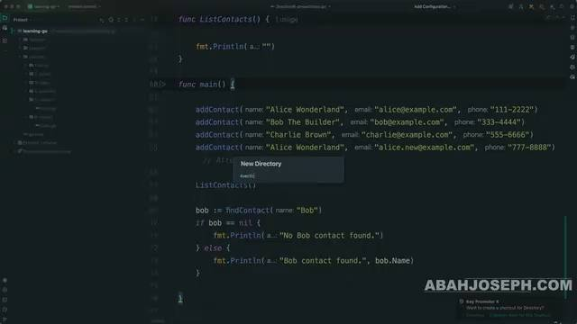
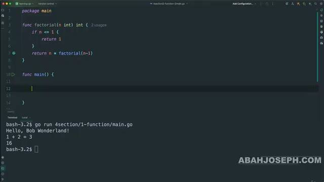
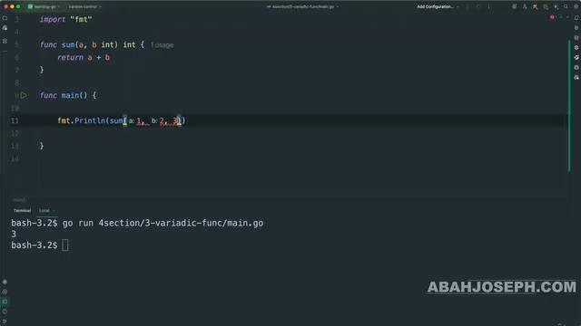
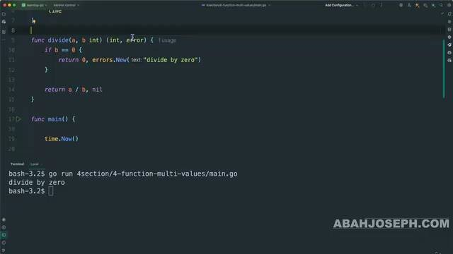
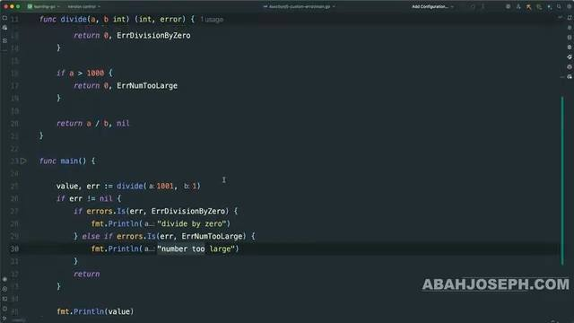
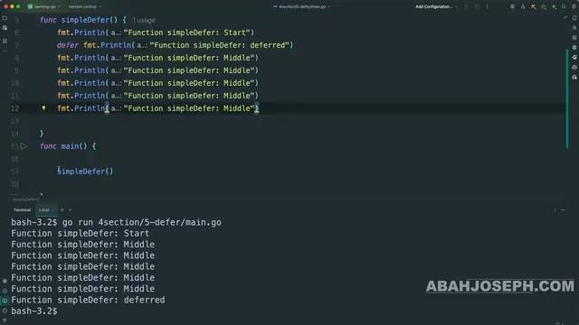
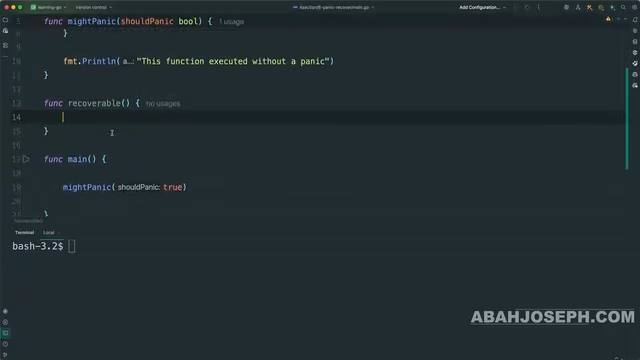
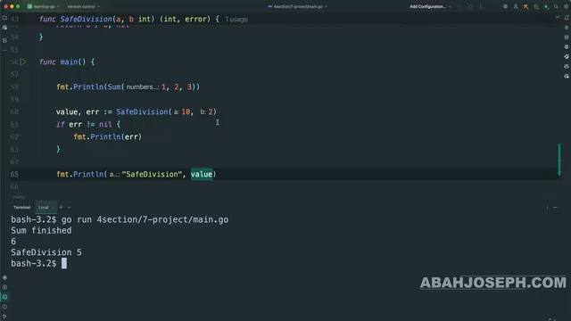

# Go Backend Masterclass P27–P34：函数、错误、defer、panic/recover 与 Safe Math 项目

> 覆盖 P27–P34。课里没有指定 Go 版本，也没有引入第三方依赖；下面的代码只使用标准库 `fmt`、`errors`、`strings`、`time`，按 Go 1.21+ 可直接运行。环境变量：课里没讲，本项目不需要。启动命令统一是 `go run ./目录/main.go`。

## 1. 这一节做什么

这一节的主线是：**把 Go 的函数从“会调用”推进到“能拿函数当值、能返回错误、能用 defer 清理资源、能在 panic 时兜底”，最后用一个 Safe Math 小项目把这些能力串起来**。

P27–P34 逐字稿里实际做了这些事：

1. 定义函数、调用函数，理解“函数签名”“参数”和“实参”的区别。
2. 函数可以有返回值，也可以返回多个值；Go 的惯例是 **error 放在最后一个返回值**。
3. 函数在 Go 里是一等公民：可以递归、可以返回函数（闭包）、可以赋值给变量再调用。
4. 变参函数：`func numbers(data ...int)`，用来接收任意个 `int`；课里还演示了用它做“可选参数/default 值”的技巧。
5. 自定义错误：先用 `errors.New` 定义包级错误变量，再定义带字段的自定义错误类型，并实现 `Error() string` 方法，让它满足 `error` 接口。
6. `defer`：函数返回前执行；多个 `defer` 是 LIFO（后进先出）；常用来关闭资源。
7. `panic` / `recover`：课里明确说 Go 没有异常处理，`panic` 不是拿来当 try/catch 用的；`recover` 要放在 `defer` 里。
8. 最后项目：Safe Math Library，把自定义错误、变参、多返回值、常量分组、`defer` 合到一个可运行的小程序里。

对前端转 AI 应用工程师的读者，可以先用 JS/Node 做心理映射：Go 的函数也像 JS 函数一样可以赋值、传参、返回；但 Go 的函数可以声明多个返回值，`error` 是普通值而不是 `throw`；`defer` 更像“函数级 finally”；`panic/recover` 像 `throw/catch`，但课里反复强调**不要拿它当异常处理机制**。Java 的语法只需要“知道即可”：Go 的返回类型写在参数后面，方法有“接收者”写法，和 Java 的类方法不是一个组织方式。

## 2. 讲师原话（带「—— pNNN [MM:SS]」）

下面这些原话基本决定了这一节的实现顺序和取舍：

> "最后，我们开始讨论函数……函数是 Go 中的基本构建块。"
> —— p027 [00:00]

> "如果没有基线条件，递归调用会不断占用栈空间，直到栈被耗尽，然后就会发生栈溢出。"
> —— p028 [01:51]

> "函数在 Go 中非常强大。你可以传递函数、返回函数，也可以对函数做任何需要做的操作。"
> —— p028 [04:44]

> "Go 的一个显著特点是函数可以返回多个值。"
> —— p030 [00:00]

> "按照约定，错误值始终作为最后一个返回值返回。"
> —— p030 [02:51]

> "你将不再依赖字符串值，而是依赖自定义错误类型。"
> —— p031 [04:37]

> "对函数使用 defer 时，被延迟的函数会在当前函数返回之前立即执行。"
> —— p032 [02:22]

> "它主要用于关闭资源。"
> —— p032 [07:15]

> "panic 和 recover 并不属于异常处理……Go 中没有异常处理，但我们有 panic。"
> —— p033 [00:55]  
> 注：逐字稿这里 “section handling” 应为 “exception handling” 的听写误差；下文按课里反复强调的意思写：Go 不用异常处理那套。

> "错误消息可以携带有用的上下文信息，帮助你进行调试。"
> —— p034 [09:46]

这些原话对应到工程上就是：**函数是组织代码的基本单位；多返回值让 error 成为常规返回通道；自定义错误让调用方不必依赖错误字符串；defer 负责清理；panic 只处理真正异常的情况；最后所有能力落到一个能跑的项目里。**

## 3. 从零复现

### 3.1 准备环境

课里没有指定 Go 版本，也没有讲 `go.mod`。但为了按目录组织 8 个实验，建议用模块方式。先确认本机有 Go：

```bash
go version
```

只要输出里有 `go version go1.x ...` 即可。本文代码不依赖第三方库，不需要 `go get`。

创建项目根目录和 8 个实验目录：

```bash
mkdir -p go-backend-masterclass-functions/{01-functions,02-function-values,03-variadic,04-multi-return,05-custom-error,06-defer,07-panic-recover,08-safe-math}
cd go-backend-masterclass-functions
go mod init example.com/functions
```

> `go mod init`
会创建 `go.mod`，把当前目录标记为模块根。后面所有 `go run` 命令都在这个模块根下执行。

### 3.2 目录结构

创建完成后目录应当是这样（每个实验一个独立 `main.go`，互不干扰）：

```text
go-backend-masterclass-functions/
├── go.mod
├── 01-functions/
│   └── main.go
├── 02-function-values/
│   └── main.go
├── 03-variadic/
│   └── main.go
├── 04-multi-return/
│   └── main.go
├── 05-custom-error/
│   └── main.go
├── 06-defer/
│   └── main.go
├── 07-panic-recover/
│   └── main.go
└── 08-safe-math/
    └── main.go
```

注意：不要在模块根目录直接写 `main.go`。课里是一个实验一个目录，最后项目也放在 `07 projects` 这样的目录里。我们用 `08-safe-math` 对应它。根目录没有 `package main`，所以在根目录执行 `go run .` 会报错；正确做法是指定文件：`go run ./01-functions/main.go`。

### 3.3 按顺序复现八个实验

**第一步：函数定义与调用。** 先写 `01-functions/main.go`，只做三件事：定义 `greet`、定义 `add`、定义带返回值的 `calculateArea`。课里在 p027 反复强调“声明（declaration/definition）”和“调用（invocation）”是两件事：写完 `func greet(...)` 只是定义，程序不会自动执行；必须在 `main` 里写 `greet(...)` 才会执行。



**第二步：函数作为值。** 写 `02-function-values/main.go`，包含递归 `factorial`、返回函数的 `sequence`、以及把函数赋给变量的 `logger`。这一段的重点不是算法，而是“函数类型”本身：`func() int` 是一个类型，`func(string)` 也是一个类型。p028 里讲师说函数可以传、可以返回，代码就体现为 `func sequence() func() int`。



**第三步：变参函数。** 写 `03-variadic/main.go`。先放一个普通双参数函数，再放 `func numbers(data ...int) int`。`...int` 在函数内部就是 `[]int`，所以可以直接 `for range`。课里还演示了用变参做“可选参数”：`config(values ...int)` 如果没传值就走默认值。



**第四步：多返回值。** 写 `04-multi-return/main.go`。`divide` 返回 `(int, error)`，`b == 0` 时返回 `0` 和一个错误，不崩溃；正常时返回商和 `nil`。再写 `splitName`，用命名返回值 `(firstName, lastName string)`，函数体里只赋值，最后写一个空的 `return`。p030 里讲师明确说：error 按惯例放最后一个返回值。



**第五步：自定义错误。** 写 `05-custom-error/main.go`。先定义两个包级错误变量 `ErrDivideByZero`、`ErrATooLarge`，调用方用 `err == ErrATooLarge` 判断，不再依赖错误字符串。然后再定义 `UpError` 结构体，带 `Code`、`Message`、`Time` 字段，并实现 `Error() string`。课里在 p031 说得很直白：只有实现了 `Error() string`，这个类型才能被当成 `error` 返回。



**第六步：defer。** 写 `06-defer/main.go`。先写 `simpleDefer`，观察 `defer fmt.Println("defer message")` 在函数返回前才执行；再写 `multipleDefers`，观察多个 defer 的输出顺序是“最后 defer 的最先执行”；最后在 `main` 里 defer 一个匿名函数，观察它在 `main` 返回前执行。



**第七步：panic 与 recover。** 写 `07-panic-recover/main.go`。`mightPanic(true)` 会触发 panic，`recoverable` 里先 `defer` 一个匿名函数，在匿名函数里调用 `recover()`，判断返回值不为 `nil` 就打印“recovered from panic”。课里强调：这层 `defer + recover` 只是兜底，不是让你把所有代码都包起来当异常处理。



**第八步：Safe Math 项目。** 写 `08-safe-math/main.go`。这个文件把前面几件事合起来：自定义 `MathError`、实现 `Error()`、变参 `sum`、返回 `(int, error)` 的 `safeDivision`、常量分组。运行后先看 `sum` 的结果，再看 `10 / 2 = 5`，最后看 `10 / 0` 打印出的带上下文错误。课里在 p034 末尾特意检查了错误信息里的 `A`、`B` 是否写对，说明错误文本里的上下文也是要调试的。



## 4. 完整代码

下面每个文件都是完整文件，直接保存到对应目录即可运行。

### 4.1 `01-functions/main.go`

```go
package main

import "fmt"

func greet(name string) {
	fmt.Println("Hello,", name)
}

func add(a, b int) int {
	return a + b
}

func calculateArea(weight, height float64) float64 {
	if weight < 0 || height < 0 {
		fmt.Println("error, weight and height must be positive")
		return 0
	}
	return weight * height
}

func main() {
	greet("Bob Wanderland, the brother of Alice")
	fmt.Println(add(1, 2))
	fmt.Println(calculateArea(4, 4))
}
```

### 4.2 `02-function-values/main.go`

```go
package main

import "fmt"

func factorial(n int) int {
	if n < 1 {
		return 1
	}
	return n * factorial(n-1)
}

func sequence() func() int {
	i := 0
	return func() int {
		i++
		return i
	}
}

func logger(message string) {
	fmt.Println(message)
}

func main() {
	fmt.Println(factorial(5))

	next := sequence()
	fmt.Println(next())
	fmt.Println(next())
	fmt.Println(next())
	fmt.Println(next())

	var log func(string) = logger
	log("Hello world")
	log("Hello world")
}
```

### 4.3 `03-variadic/main.go`

```go
package main

import "fmt"

func add(a, b int) int {
	return a + b
}

func numbers(data ...int) int {
	total := 0
	for _, n := range data {
		total += n
	}
	return total
}

func config(values ...int) {
	if len(values) > 0 {
		fmt.Println("config value:", values[0])
		return
	}
	fmt.Println("default")
}

func main() {
	fmt.Println(add(1, 2))
	fmt.Println(numbers(1, 2, 3))
	fmt.Println(numbers(1, 2, 3, 4))
	config()
	config(5)
}
```

### 4.4 `04-multi-return/main.go`

```go
package main

import (
	"errors"
	"fmt"
	"strings"
)

func divide(a, b int) (int, error) {
	if b == 0 {
		return 0, errors.New("divide by zero")
	}
	return a / b, nil
}

func splitName(fullName string) (firstName, lastName string) {
	parts := strings.Split(fullName, " ")
	firstName = parts[0]
	lastName = parts[1]
	return
}

func main() {
	value, err := divide(4, 2)
	if err != nil {
		fmt.Println(err)
		return
	}
	fmt.Println(value)

	value, err = divide(4, 0)
	if err != nil {
		fmt.Println(err)
		return
	}
	fmt.Println(value)

	firstName, lastName := splitName("Bob Wanderland")
	fmt.Println(firstName)
	fmt.Println(lastName)
}
```

### 4.5 `05-custom-error/main.go`

```go
package main

import (
	"errors"
	"fmt"
	"time"
)

var ErrDivideByZero = errors.New("divide by zero")
var ErrATooLarge = errors.New("a is too large")

type UpError struct {
	Code    int
	Message string
	Time    time.Time
}

func (e UpError) Error() string {
	return e.Message
}

func newUpError(code int, message string) UpError {
	return UpError{
		Code:    code,
		Message: message,
		Time:    time.Now(),
	}
}

func divide(a, b int) (int, error) {
	if b == 0 {
		return 0, ErrDivideByZero
	}
	if a > 1000 {
		return 0, ErrATooLarge
	}
	return a / b, nil
}

func doSomething() error {
	return newUpError(100, "do something failed")
}

func main() {
	value, err := divide(1001, 1)
	if err != nil {
		if err == ErrATooLarge {
			fmt.Println("do something else")
		} else {
			fmt.Println(err)
		}
		return
	}
	fmt.Println(value)

	fmt.Println(doSomething())
}
```

### 4.6 `06-defer/main.go`

```go
package main

import "fmt"

func simpleDefer() {
	fmt.Println("function start")
	defer fmt.Println("defer message")
	fmt.Println("function middle")
}

func multipleDefers() {
	fmt.Println("start")
	defer fmt.Println("first deferred")
	defer fmt.Println("last in first out")
	defer fmt.Println("middle")
}

func main() {
	simpleDefer()
	multipleDefers()

	defer func() {
		fmt.Println("deferred in main")
	}()

	fmt.Println("last in main")
}
```

### 4.7 `07-panic-recover/main.go`

```go
package main

import "fmt"

func mightPanic(shootPanic bool) {
	if shootPanic {
		panic("something went wrong in mightPanic")
	}
	fmt.Println("mightPanic executed without panic")
}

func recoverable() {
	defer func() {
		if r := recover(); r != nil {
			fmt.Println("recovered from panic:", r)
		}
	}()

	mightPanic(true)
}

func main() {
	mightPanic(false)
	recoverable()
	fmt.Println("program continues")
}
```

### 4.8 `08-safe-math/main.go`

```go
package main

import (
	"fmt"
	"strings"
)

const division = "division"

const divisionErrMessage = "division by zero is not allowed"

type MathError struct {
	Operation string
	InputA    int
	InputB    int
	Message   string
}

func (e MathError) Error() string {
	inputs := []string{}
	if e.Operation == division {
		inputs = append(inputs, fmt.Sprintf("input a: %d", e.InputA))
		inputs = append(inputs, fmt.Sprintf("input b: %d", e.InputB))
	}
	return fmt.Sprintf(
		"math error in %s %s: %s",
		e.Operation,
		strings.Join(inputs, ", "),
		e.Message,
	)
}

func sum(numbers ...int) int {
	total := 0
	for _, n := range numbers {
		total += n
	}
	fmt.Println("sum finished")
	return total
}

func safeDivision(a, b int) (int, error) {
	if b == 0 {
		return 0, MathError{
			Operation: division,
			InputA:    a,
			InputB:    b,
			Message:   divisionErrMessage,
		}
	}
	return a / b, nil
}

func main() {
	fmt.Println(sum(1, 2, 3))

	value, err := safeDivision(10, 2)
	if err != nil {
		fmt.Println(err)
		return
	}
	fmt.Println(value)

	value, err = safeDivision(10, 0)
	if err != nil {
		fmt.Println(err)
		return
	}
	fmt.Println(value)
}
```

## 5. 逐行解释

### 5.1 `01-functions/main.go`

`package main` 表示这是可执行程序，不是库。`import "fmt"` 只引入格式化输出包。

`func greet(name string)` 没有返回值。括号里的 `name string` 是**参数**；调用时传进去的 `"鲍勃·万德兰……"` 是**实参**。讲师在 p027 专门区分了 parameter 和 argument，写文档时也建议保持这个区分。

`func add(a, b int) int` 里 `a, b int` 是“同类型参数合并写法”：`a` 和 `b` 都是 `int`，返回类型是后面的 `int`。在 JS/TS 里等价于 `function add(a: number, b: number): number`，但 Go 把返回类型放在参数列表后面。

`calculateArea(weight, height float64) float64` 先做负数检查。课里的写法是打印错误信息并返回 `0`，而不是返回 `error`。这正好说明：**不是所有函数都必须返回 error**；这一段的目的是演示“函数可以有返回值”，错误处理留到 P30 之后再系统化。

`main()` 里三行分别对应“调用无返回值函数”“调用有返回值函数并打印”“调用带校验的函数”。如果去掉 `greet(...)` 这一行，`greet` 仍然被定义，但不会执行——这就是 declaration 和 invocation 的区别。

### 5.2 `02-function-values/main.go`

`factorial` 的 base case 是 `if n < 1 { return 1 }`。没有它，`n` 会一路减到负数，递归不会停，最终栈溢出。课里 p028 用“栈帧不断压栈”解释过这个现象。JS 里同样有递归栈溢出，但 Go 的栈初始较小、可增长，不代表可以无限递归。

`sequence() func() int` 的返回类型是一个函数类型：`func() int`。函数体里 `i := 0` 是闭包捕获的变量；每次调用返回的匿名函数，`i++` 都会修改同一个 `i`。所以 `next()` 连续调用会得到 1、2、3、4。JS 里闭包也是同样机制，但 Go 的闭包捕获是引用语义，不要把它当成“每次调用都重新初始化”。

`var log func(string) = logger` 把具名函数赋给一个函数类型变量，然后 `log("Hello world")` 调用。这说明函数在 Go 里和 `int`、`string` 一样是值，可以声明变量、可以传参、可以返回。课里 p028 的结论就是“functions are like every other type”。

### 5.3 `03-variadic/main.go`

`add(a, b int)` 是固定两个参数。`numbers(data ...int)` 的 `...int` 表示调用时可以传 0 个、1 个或多个 `int`；在函数体内部，`data` 的类型是 `[]int`，所以能 `range`。

`total := 0` 然后循环累加。这里必须显式 `return total`。课里 p029 演示过：如果声明了返回值却不返回，编译器直接报错，程序不会编译通过。这种编译期错误是好事，不要绕过。

`config(values ...int)` 用 `len(values) > 0` 判断是否传了值：传了就用 `values[0]`，没传就打印 `default`。课里说这是“用变参做可选值/default 值”的常见技巧。它不是语言级可选参数，只是调用方可以少传。

### 5.4 `04-multi-return/main.go`

`divide(a, b int) (int, error)` 是典型的多返回值签名：第一个是业务结果，第二个是错误。`b == 0` 时返回 `0, errors.New("divide by zero")`；正常时返回 `a/b, nil`。调用方先判断 `err != nil`，再使用 `value`。这个顺序不能反：错误时 `value` 是零值，直接用会得到误导性的结果。

`splitName(fullName string) (firstName, lastName string)` 用了**命名返回值**。函数体里写 `firstName = parts[0]`、`lastName = parts[1]`，最后写一个裸 `return`。裸 return 会返回当前命名变量的值。课里 p030 说这种写法在实际代码里能见到，但更常见的是显式 `return parts[0], parts[1]`。两种都可以，团队里选一种保持一致即可。

课里还强调：error 按惯例放最后一个返回值。这不是编译器强制，而是标准库和社区约定。你如果写成 `(error, int)` 也能编译，但调用方和 reviewer 都会困惑。

### 5.5 `05-custom-error/main.go`

`var ErrDivideByZero = errors.New("divide by zero")` 和 `var ErrATooLarge = errors.New("a is too large")` 是包级哨兵错误。调用方用 `err == ErrATooLarge` 判断，而不是比较字符串。课里 p031 演示了字符串比较的脆弱性：别人把错误消息从 “a is too large” 改成 “A must be less than 1000”，字符串判断就失效；哨兵错误变量不受文案影响。

`type UpError struct { Code int; Message string; Time time.Time }` 是带上下文的自定义错误。`func (e UpError) Error() string { return e.Message }` 是值接收者方法。只有实现了 `Error() string`，`UpError` 才满足 `error` 接口，才能被 `return` 成 `error`。课里 p031 的报错“type does not implement error”就是缺这个方法。

`newUpError` 是构造函数，填 `Code`、`Message`、`Time`。`doSomething()` 返回 `error`，实际返回的是 `UpError` 值；因为 `UpError` 实现了 `Error()`，所以能赋给 `error` 接口。调用方 `fmt.Println(doSomething())` 会调用 `Error()` 拿到消息。

`main` 里先测 `divide(1001, 1)`：`a > 1000` 命中 `ErrATooLarge`，打印 `do something else`。如果改成 `divide(4, 0)`，会命中 `ErrDivideByZero`，走 `else` 打印错误。课里还演示过“先打印 value 再 return”的写法；本文件选择命中错误就 `return`，避免打印零值。

### 5.6 `06-defer/main.go`

`simpleDefer` 的输出顺序是：`function start` → `function middle` → `defer message`。`defer` 不是“立刻执行”，而是把调用压到当前函数返回前执行。课里 p032 的原话是“immediately before this function returns”。

`multipleDefers` 里三个 defer 按 LIFO 执行：最后注册的 `middle` 最先打印，然后是 `last in first out`，最后是 `first deferred`。所以完整输出是 `start`、`middle`、`last in first out`、`first deferred`。面试里问“多个 defer 的顺序”，答案就是后进先出。

`main` 里 `defer func(){...}()` 是匿名函数立即注册、延迟执行。`fmt.Println("last in main")` 先打印，然后 `main` 返回前执行 deferred 函数，打印 `deferred in main`。课里用这个例子说明：**defer 的作用域是函数，不是代码块**；`main` 也是一个函数。

课里提到 defer 最常用的场景是关闭资源：打开文件后 `defer file.Close()`，保证函数返回前关闭。当前代码没有文件操作，所以只演示顺序。等你后面学文件 I/O 时，这个模式会反复出现。

### 5.7 `07-panic-recover/main.go`

`mightPanic(false)` 正常执行，打印 `mightPanic executed without panic`。`mightPanic(true)` 会执行 `panic("mightPanic 中出现了问题")`，程序开始展开调用栈。

`recoverable()` 里先 `defer func(){ ... }()`，再调用 `mightPanic(true)`。panic 发生后，defer 的匿名函数执行，`recover()` 捕获 panic 值，`r != nil` 成立，打印 `recovered from panic: something went wrong in mightPanic`。然后 `recoverable` 正常返回，`main` 继续打印 `program continues`。

关键点：`recover()` 必须直接在 defer 的函数里调用。如果你把它再包一层普通函数，`recover()` 返回 `nil`，捕获不到。课里没有展开这个细节，但这是实际会踩的坑。另一个关键点是：课里反复说 panic 不是异常处理，不要用 `defer + recover` 包住所有业务代码；能返回 `error` 的地方就用 `error`。

### 5.8 `08-safe-math/main.go`

`const division = "division"` 和 `const divisionErrMessage = "不允许除以零"` 是常量分组。课里 p034 把 “division” 这个操作名抽成常量，避免在 `MathError` 和 `safeDivision` 两处手写字符串写错；错误消息也抽成常量，改一处就全局生效。

`MathError` 有 `Operation`、`InputA`、`InputB`、`Message` 四个字段。`Error()` 里先判断 `e.Operation == division`，只有除法才追加 `input a`、`input b` 两段上下文；然后用 `strings.Join(inputs, ", ")` 拼起来，最后 `fmt.Sprintf("%s %s 中出现数学错误：%s", ...)`。这样输出会带操作名、两个输入值和原因，排查时不用猜。

`sum(numbers ...int)` 是变参函数，循环累加，打印 `sum finished` 后返回总数。`safeDivision(a, b int) (int, error)` 在 `b == 0` 时返回 `0` 和 `MathError` 值；否则返回商和 `nil`。

`main` 先打印 `sum(1,2,3)` 的结果 6；再算 `10/2` 得到 5；最后算 `10/0`，命中错误分支，打印类似 `math error in division input a: 10, input b: 0: division by zero is not allowed`。课里在终端发现 `input b` 写成了别的字段，修正后才得到正确输出，这说明错误消息里的字段名也要像代码一样检查。

## 6. 复现检查清单

按下面顺序逐项打勾，任何一项失败都先回到对应文件，不要跳步。

1. `go version` 能输出版本号；`go mod init example.com/functions` 成功生成 `go.mod`。
2. 八个目录都存在，每个目录下只有一个 `main.go`，且都是 `package main`。
3. `go run ./01-functions/main.go` 输出包含 `Hello, Bob Wanderland, the brother of Alice`、`3`、`16`。
4. `go run ./02-function-values/main.go` 输出 `120`、`1` 到 `4`、两行 `Hello world`。
5. `go run ./03-variadic/main.go` 输出 `3`、`6`、`10`、`default`、`config value: 5`。
6. `go run ./04-multi-return/main.go` 输出 `2`、`divide by zero`、`Bob`、`Wanderland`。
7. `go run ./05-custom-error/main.go` 输出 `do something else`、`do something failed`；把 `divide(1001,1)` 改成 `divide(4,0)` 后应输出 `divide by zero`。
8. `go run ./06-defer/main.go` 的输出顺序是：`function start`、`function middle`、`defer message`、`start`、`middle`、`last in first out`、`first deferred`、`last in main`、`deferred in main`。
9. `go run ./07-panic-recover/main.go` 输出 `mightPanic executed without panic`、`recovered from panic: something went wrong in mightPanic`、`program continues`，进程退出码为 0。
10. `go run ./08-safe-math/main.go` 输出 `sum finished`、`6`、`5`，最后一行是带 `input a: 10`、`input b: 0` 的错误消息。
11. 故意删掉 `05-custom-error` 里的 `Error()` 方法，确认编译器报“不能把 `UpError` 当作 `error` 使用”；确认后再恢复。
12. 故意删掉 `02-function-values` 里的 base case，确认递归会导致栈溢出；确认后恢复（不要在共享机器上长时间运行）。

## 7. 课里没讲但你会撞上的

**坑一：在模块根目录 `go run .` 会失败。** 课里一直是进入具体目录再 `go run main.go`。我们的结构根目录没有 `main` 包，所以必须写 `go run ./01-functions/main.go` 这种路径。想少打字可以 `cd 01-functions && go run main.go`。

**坑二：Go 对未使用的变量和 import 是编译错误，不是警告。** 你调试时注释掉一行 `fmt.Println`，可能 `fmt` 就变成未使用，程序直接不编译。课里 p029 的“missing return statement”也是同类：编译器先拦住你。遇到这类错误先看行号，不要以为是环境问题。

**坑三：命名返回值的裸 `return` 可读性有限。** `splitName` 里用命名返回值是为了演示课里的写法，但函数一长，裸 `return` 会让人不知道返回了什么。实际项目里建议显式 `return firstName, lastName`，或者干脆不用命名返回值。

**坑四：`defer` 在循环里的行为。** 课里只演示了函数级 defer，没有讲循环。实际写代码时，如果你在 `for` 循环里 `defer file.Close()`，这些 defer 会等到函数返回才一起执行，可能耗尽文件描述符。正确做法通常是把循环体抽成独立函数，让 defer 在每次调用结束时执行。这一点课里没讲，但做后端文件处理一定会遇到。

**坑五：`recover()` 的位置。** 课里演示的是 `defer func(){ if r := recover(); r != nil { ... } }()`。如果你写成 `defer recover()`，或者把 `recover()` 包在另一个普通函数里再 defer，捕获会失败。规则是：`recover()` 必须直接在 defer 注册的函数体内调用。

**坑六：panic 只应处理真正异常。** 课里 p033 说得很清楚：Go 没有异常处理，`error` 是值，业务错误应该返回 `error`。把 `panic/recover` 当 try/catch 用，会让调用栈和错误上下文变得难追踪。Safe Math 项目里所有可预期错误都走 `error`，没有用 panic，这就是正确示范。

**坑七：错误字符串不是 API。** 课里 p031 演示了改错误文案导致字符串比较失效。你自己写代码时，如果要让调用方判断错误类型，优先用哨兵错误变量或自定义错误类型；如果只是打印给用户看，才依赖字符串。课里没有展开 `errors.Is` / `errors.As`，这里也不额外引入，你先掌握“哨兵错误 + 自定义错误类型”这两条就够用。

**坑八：`time.Time` 字段会让结构体不可比较。** `UpError` 里有 `Time time.Time`，它包含不可比较的字段，所以 `UpError` 值之间不能用 `==` 比较。课里只用它来携带上下文，没有比较它。如果你后面想比较错误，别拿带 `time.Time` 的结构体直接比。

**坑九：没有环境变量和外部服务。** 这一节所有代码只依赖标准库，不需要数据库、不需要 API key、不需要 `.env`。如果你看到网上教程让你装第三方错误库，这一节不需要；先把标准库的 `errors`、`fmt`、`strings`、`time` 用熟。

**坑十：Go 版本。** 课里没指定版本，本文代码在 Go 1.21+ 可运行。`errors.New`、`fmt.Sprintf`、`strings.Join`、`time.Now` 都是长期存在的标准库 API，不存在版本兼容问题。唯一需要留意的是如果你用了更老的 Go，模块模式和 `go run ./path/main.go` 的写法仍然可用。