# Go Backend Masterclass P35–P39 复现文档：struct、方法、接口、Stringer 与泛型

这篇文档覆盖 P35–P39。课里没有数据库、没有 HTTP 服务，也没有 Web 框架；这五节是 Go 语言层的地基：用 `struct` 组织数据，用方法把操作绑到数据上，用接口做契约，用 `Stringer` 控制打印，用泛型复用算法。读完后你应该能在本地得到一个 `section05` 目录，里面五个独立 `main` 程序逐个跑通。

---

## 1. 这一节做什么

这一节要做出五个可以单独运行的小程序，目录名按讲师在视频里创建的来：

| 目录 | 主题 | 产出 |
|---|---|---|
| `section05/01struct` | 结构体 | 定义 `Employee`，创建 `Jane`、`Joe`，打印字段，用指针改字段 |
| `section05/02method` | 方法 | 给 `Employee` 加 `FullName`、`Deactivate`、`SetJoinAt`，观察值接收者和指针接收者的差异 |
| `section05/03interfaces` | 接口 | 定义 `Person` 接口，让 `Employee` 和 `BusinessPerson` 都满足它 |
| `section05/04stringer` | Stringer | 给 `BusinessPerson` 和自定义 `ID` 类型实现 `String() string` |
| `section05/05generics` | 泛型 | 把只能求 `int` 的 `Sum` 改写成支持 `int` 和 `float64` 的泛型函数 |

这五个程序都不依赖第三方库，只需要 Go 标准库里的 `fmt` 和 `time`。每个目录都是独立的 `package main`，所以可以放在同一个 module 里，用 `go run ./section05/01struct` 这样逐个运行。

课里讲的是「为什么这样写」；这份文档补的是「文件放哪、命令怎么敲、代码完整长什么样、跑出来应该看到什么」。

---

## 2. 讲师原话

下面按主题摘录，不按视频顺序流水账。英文是逐字稿原话，中文是解释。

**关于 struct 的定位**

> "在 Go 中，我们没有类，所以用 struct 作为结构体的简写。这样就能把相关字段组织在一起。"
> —— p035 [00:25]

讲师明确说 Go 没有类，`struct` 就是用来把相关字段打组的。后面他又说“It's like using classes in Java”，但只是类比，不是说 Go 有类。

**关于值接收者**

> "当你以这种方式给 struct 添加函数时，这叫作值接收者。"
> —— p036 [05:31]

讲师把 `func (e Employee) Deactivate()` 这种写法叫值接收者。值接收者拿到的是结构体的副本，改副本不会影响原值。

**关于什么时候必须用指针接收者**

> "如果你打算做修改，或者说要对原始数据产生某种影响，就需要使用指针接收者。"
> —— p036 [09:34]

这句话是 P36 的核心结论。只要方法要修改原结构体的字段，就用 `*Employee` 作为接收者。

**关于接口的隐式实现**

> "实现接口是隐式的。"
> —— p037 [04:30]

Go 里没有 `implements` 关键字。一个类型只要拥有接口要求的方法，就自动满足该接口。讲师在 p037 里反复强调这一点。

**关于 Stringer**

> "如果你的类型中定义了 String 方法，那么最终被调用的就是这个方法。"
> —— p038 [01:56]

当类型实现了 `String() string`，`fmt` 包在打印它时会优先调用这个方法。方法名首字母必须大写。

**关于泛型的版本**

> "泛型大约是在 Go 1.18 左右引入的。"
> —— p039 [00:00]

所以复现这一节至少需要 Go 1.18。低于这个版本，`05generics` 编译不过。

**关于类型约束要“讲得通”**

> "你总是希望所使用的类型能够彼此配合、在语义上说得通。"
> —— p039 [07:21]

讲师在演示把 `string` 加进 `Number` 约束后说，`Sum` 对字符串没有意义，因为字符串只能拼接不能求和。类型约束不是越宽越好，要选能一起做同一件事的类型。

---

## 3. 从零复现

### 3.1 环境准备

需要：

- Go 1.18 或更高版本。建议 1.21/1.22。
- 一个终端。
- 不需要 Docker，不需要数据库。

先确认版本：

```bash
go version
```

只要输出里的版本号大于等于 `go1.18` 就可以。如果低于 1.18，`05generics` 会报语法错误。

### 3.2 创建目录结构

在任意工作目录下执行：

```bash
mkdir -p go-backend-masterclass/section05/01struct
mkdir -p go-backend-masterclass/section05/02method
mkdir -p go-backend-masterclass/section05/03interfaces
mkdir -p go-backend-masterclass/section05/04stringer
mkdir -p go-backend-masterclass/section05/05generics
cd go-backend-masterclass
```

目录结构最终是：

```text
go-backend-masterclass/
├── go.mod
└── section05/
    ├── 01struct/
    │   └── main.go
    ├── 02method/
    │   └── main.go
    ├── 03interfaces/
    │   └── main.go
    ├── 04stringer/
    │   └── main.go
    └── 05generics/
        └── main.go
```

### 3.3 初始化 module

课里没有讲 `go mod init`，但要让 `go run ./section05/...` 在 module 模式下工作，需要先初始化：

```bash
go mod init example.com/go-backend-masterclass
```

生成的 `go.mod` 内容如下，直接保存即可：

```go
module example.com/go-backend-masterclass

go 1.21
```

如果你本机是 Go 1.22，把 `go 1.21` 改成 `go 1.22` 也可以。

### 3.4 逐个运行

每写完一个 `main.go`，就运行对应目录：

```bash
go run ./section05/01struct
go run ./section05/02method
go run ./section05/03interfaces
go run ./section05/04stringer
go run ./section05/05generics
```

注意：`go run` 后面跟的是目录，不是单个文件。因为每个目录里只有一个 `main.go`，也可以写 `go run ./section05/01struct/main.go`，但用目录更省事。

### 3.5 第一个程序：struct 的观察点

P35 里讲师先定义一个 `Employee` 结构体，字段包括 `ID`、`FirstName`、`LastName`、`Position`、`Salary`、`IsActive`，还有一个 `JoinAt time.Time`。然后创建 `Jane`，打印整个结构体，再单独打印字段。

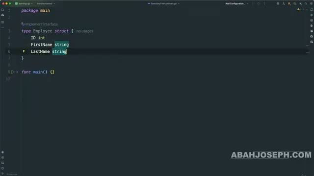

讲师在终端里运行后，用 `%v` 打印，发现字段都挤在一起；改成带 `+` 的格式后，字段名也打印出来了。这个细节在代码里就是 `fmt.Printf("%+v\n", jane)`。

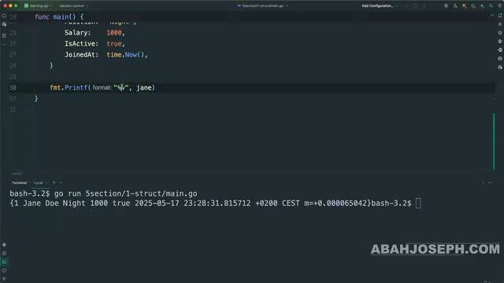

接着他写了一个 `NewEmployee` 函数，讲师原话是“more like a constructor function or a factory function”。这个函数把创建 `Employee` 的动作包起来。然后他用指针 `joePtr := &joe` 修改 `joe` 的字段，再打印 `joe`，看到原值确实变了。

### 3.6 第二个程序：方法的观察点

P36 把 P35 的 struct 代码复制过来，先写一个普通函数：

```go
func FullName() string {
    return "John Doe"
}
```

然后把它改造成方法：在 `func` 和函数名之间加接收者 `(e *Employee)`，把返回值改成 `e.FirstName + " " + e.LastName`。

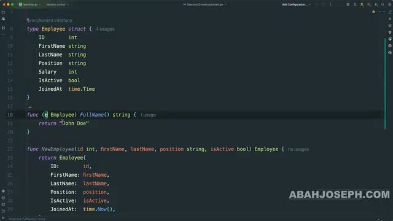

然后他加 `Deactivate` 方法，先写成值接收者 `(e Employee)`，调用后打印，发现 `IsActive` 还是 `true`。讲师解释：值接收者拿到的是副本，改副本不影响原值。

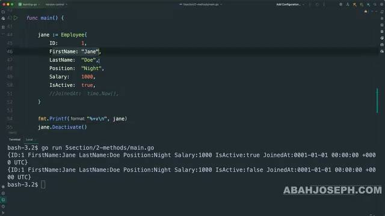

改成 `(e *Employee)` 后，再调用 `jane.Deactivate()`，`IsActive` 变成 `false`。最后他演示了 nil 指针调用方法会 panic，并说可以在方法里加 `if e == nil` 保护。

### 3.7 第三个程序：接口的观察点

P37 把 `Employee` 精简成只有 `ID` 和 `Name`，然后写 `DisplayPerson(p Employee)`，里面调用 `p.GetName()`。为了让 `BusinessPerson` 也能用同一个函数，讲师定义了接口：

```go
type Person interface {
    GetName() string
}
```

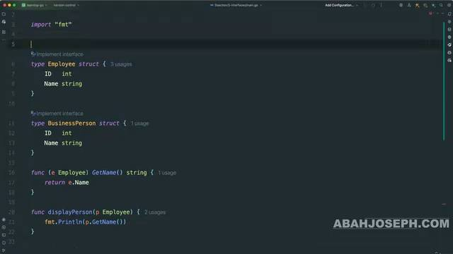

然后把 `DisplayPerson` 的参数从 `Employee` 改成 `Person`。`Employee` 和 `BusinessPerson` 都实现 `GetName()` 后，两个类型都能传进去。

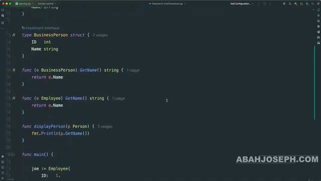

讲师还演示了：如果给 `Person` 接口再加一个 `GetID()`，而两个类型都没实现，那它们就不再满足接口。这个实验在代码里可以用注释保留。

### 3.8 第四个程序：Stringer 的观察点

P38 从 P37 复制代码，删掉不用的部分，保留 `Person` 接口和 `BusinessPerson`。然后给 `BusinessPerson` 加：

```go
func (b BusinessPerson) String() string {
    return fmt.Sprintf("BusinessPerson(ID=%d, Name=%s)", b.ID, b.Name)
}
```

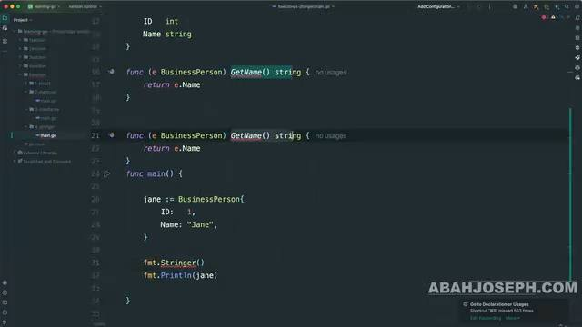

再定义一个自定义类型 `type ID int`，也给 `ID` 加 `String()` 方法。`fmt.Println` 打印 `ID(30)` 时会走这个方法。

### 3.9 第五个程序：泛型的观察点

P39 先写一个只能求 `int` 的 `Sum`：

```go
func Sum(numbers []int) int {
    total := 0
    for _, n := range numbers {
        total += n
    }
    return total
}
```

传 `[]float64` 会编译失败。讲师于是引入类型参数：

```go
func Sum[T int | float64](numbers []T) T {
    var total T
    for _, n := range numbers {
        total += n
    }
    return total
}
```

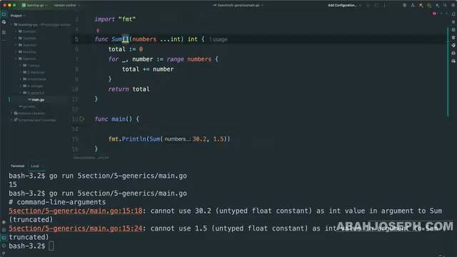

然后他又把 `int | float64` 抽成接口：

```go
type Number interface {
    int | float64
}
```

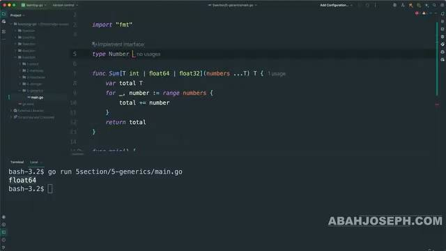

最后演示了显式指定类型 `Sum[float64](...)`，以及为什么不能把 `string` 加进约束：字符串不能求和。

---

## 4. 完整代码

下面五个文件全部是完整文件，可以直接保存运行。格式为 `路径` + 完整内容。

### 4.1 `section05/01struct/main.go`

```go
package main

import (
	"fmt"
	"time"
)

type Employee struct {
	ID        int
	FirstName string
	LastName  string
	Position  string
	Salary    int
	IsActive  bool
	JoinAt    time.Time
}

func NewEmployee(id int, firstName, lastName, position string, salary int, isActive bool, joinAt time.Time) Employee {
	return Employee{
		ID:        id,
		FirstName: firstName,
		LastName:  lastName,
		Position:  position,
		Salary:    salary,
		IsActive:  isActive,
		JoinAt:    joinAt,
	}
}

func main() {
	jane := Employee{
		ID:        1,
		FirstName: "Jane",
		LastName:  "Doe",
		Position:  "Engineer",
		Salary:    100,
		IsActive:  true,
		JoinAt:    time.Now(),
	}

	fmt.Printf("%+v\n", jane)
	fmt.Println(jane.ID)
	fmt.Println(jane.FirstName, jane.LastName)

	joe := NewEmployee(2, "Joe", "Doe", "Engineer", 100, true, time.Now())
	fmt.Printf("%+v\n", joe)

	joe.Salary = 1000000
	fmt.Println(joe.Salary)

	joePtr := &joe
	fmt.Println(joePtr)
	fmt.Println((*joePtr).FirstName)
	fmt.Println(joePtr.FirstName)

	joePtr.IsActive = true
	joePtr.LastName = "John"
	fmt.Println(joe.LastName)
}
```

### 4.2 `section05/02method/main.go`

```go
package main

import (
	"fmt"
	"time"
)

type Employee struct {
	ID        int
	FirstName string
	LastName  string
	Position  string
	Salary    int
	IsActive  bool
	JoinAt    time.Time
}

func NewEmployee(id int, firstName, lastName, position string, salary int, isActive bool, joinAt time.Time) *Employee {
	return &Employee{
		ID:        id,
		FirstName: firstName,
		LastName:  lastName,
		Position:  position,
		Salary:    salary,
		IsActive:  isActive,
		JoinAt:    joinAt,
	}
}

func (e *Employee) FullName() string {
	if e == nil {
		return ""
	}
	return e.FirstName + " " + e.LastName
}

func (e *Employee) Deactivate() {
	e.IsActive = false
}

func (e *Employee) SetJoinAt(t time.Time) {
	e.JoinAt = t
}

func main() {
	jane := NewEmployee(1, "Jane", "Doe", "Engineer", 100, true, time.Now())

	fmt.Printf("%+v\n", *jane)
	fmt.Println(jane.FullName())

	jane.Deactivate()
	fmt.Printf("%+v\n", *jane)

	jane.SetJoinAt(time.Now().Add(20 * time.Minute))
	fmt.Printf("%+v\n", *jane)

	// 复现 nil 指针 panic：先把 FullName 里的 if e == nil 检查删掉，
	// 再取消下面两行注释。
	// var nobody *Employee
	// fmt.Println(nobody.FullName())
}
```

### 4.3 `section05/03interfaces/main.go`

```go
package main

import "fmt"

type Person interface {
	GetName() string
}

type Employee struct {
	ID   int
	Name string
}

func (e Employee) GetName() string {
	return e.Name
}

type BusinessPerson struct {
	ID   int
	Name string
}

func (b BusinessPerson) GetName() string {
	return b.Name
}

func DisplayPerson(p Person) {
	fmt.Println(p.GetName())
}

func main() {
	joe := Employee{ID: 1, Name: "Joe"}
	jane := BusinessPerson{ID: 2, Name: "Jane"}

	DisplayPerson(joe)
	DisplayPerson(jane)
}
```

### 4.4 `section05/04stringer/main.go`

```go
package main

import "fmt"

type Person interface {
	GetName() string
}

type Employee struct {
	ID   int
	Name string
}

func (e Employee) GetName() string {
	return e.Name
}

type BusinessPerson struct {
	ID   int
	Name string
}

func (b BusinessPerson) GetName() string {
	return b.Name
}

func (b BusinessPerson) String() string {
	return fmt.Sprintf("BusinessPerson(ID=%d, Name=%s)", b.ID, b.Name)
}

func DisplayPerson(p Person) {
	fmt.Println(p.GetName())
}

type ID int

func (i ID) String() string {
	return fmt.Sprintf("ID(%d)", int(i))
}

func main() {
	jane := BusinessPerson{ID: 2, Name: "Jane"}
	fmt.Println(jane)

	myID := ID(30)
	fmt.Println(myID)

	var myID2 ID = 30
	fmt.Println(myID2)

	DisplayPerson(jane)
}
```

### 4.5 `section05/05generics/main.go`

```go
package main

import "fmt"

type Number interface {
	int | float64
}

func Sum[T Number](numbers []T) T {
	var total T
	for _, n := range numbers {
		total += n
	}
	return total
}

func main() {
	grades := []int{90, 85}
	people := []string{"gene", "gene", "gene", "mark"}

	fmt.Println(len(grades))
	fmt.Println(len(people))

	fmt.Println(Sum(grades))
	fmt.Println(Sum([]float64{30.2, 1.5}))
	fmt.Println(Sum([]float64{10, 20}))
	fmt.Printf("%T\n", Sum([]float64{10, 20}))
	fmt.Println(Sum[float64]([]float64{10, 20}))
}
```

---

## 5. 逐行解释

### 5.1 `01struct`：结构体是“带字段的值”

`type Employee struct { ... }` 定义了一个新类型。`ID int`、`FirstName string` 这些叫字段。字段名首字母大写，表示可以被其他包访问；小写则只能在当前包内访问。讲师在 p037 [01:21] 说“There is something I didn't talk about in the last video about struct, the capitalization. I will talk about it later when I talk about packages”，所以导出规则课里没展开，这里只需要知道大写是公开的。

`jane := Employee{ID: 1, FirstName: "Jane", ...}` 是结构体字面量。Go 里没有 `new Employee()` 这种类构造语法，`Employee{...}` 就是创建值。`jane` 是一个具体的值，不是“对象引用”。

`fmt.Printf("%+v\n", jane)` 里的 `%+v` 会在打印结构体时带上字段名。讲师在视频里先用了 `%v`，发现不够清楚，又加了 `+`。

`jane.ID` 是点号访问字段。Go 的点号访问和 Java 类似，但和 JS 不同的是：`jane` 是值，不是引用。把 `jane` 赋值给另一个变量，会复制整个结构体。

`NewEmployee` 是一个普通函数，返回 `Employee` 值。讲师说它可以返回指针，也可以返回值；这里返回的是值，和 P35 的演示一致。

`joePtr := &joe` 取 `joe` 的地址。`joePtr` 的类型是 `*Employee`。`fmt.Println(joePtr)` 不会打印一个裸内存地址，而是打印 `&{...}`，这是 `fmt` 对结构体指针的默认处理。讲师说“Go is doing some magic here”。

`(*joePtr).FirstName` 是显式解引用；`joePtr.FirstName` 是 Go 自动解引用。两种写法等价。

`joePtr.LastName = "John"` 通过指针改字段，`joe.LastName` 也会变，因为两者指向同一块内存。这是 P35 最后演示的“指针修改会影响原值”。

### 5.2 `02method`：值接收者复制，指针接收者共享

`func (e *Employee) FullName() string` 里的 `(e *Employee)` 是接收者。它把 `FullName` 绑定到 `*Employee` 上，调用方式是 `jane.FullName()`。

`if e == nil { return "" }` 是讲师在 P36 最后加的 nil 保护。指针接收者可以为 nil，nil 时访问 `e.FirstName` 会 panic。讲师说“We don't usually do this, but I'm telling you that it is possible”。

`Deactivate` 用指针接收者，因为要改 `e.IsActive`。如果写成 `func (e Employee) Deactivate()`，`e` 是副本，`e.IsActive = false` 只改副本，原结构体不变。讲师在视频里先演示了值接收者版本，打印结果还是 `true`，然后改成指针接收者才生效。

`SetJoinAt(t time.Time)` 也是指针接收者。方法可以带参数、可以有返回值，和普通函数一样；区别只是它多了一个接收者，因此归某个类型“所有”。

`jane := NewEmployee(...)` 这里 `NewEmployee` 返回 `*Employee`，所以 `jane` 本身已经是指针。`jane.FullName()` 可以直接调用，Go 会自动处理。`fmt.Printf("%+v\n", *jane)` 先解引用再打印值。

在 JS/Node 里，对象是按引用共享的，你改 `obj.a` 会影响所有持有该对象的地方。Go 的 struct 默认是值拷贝；想让方法产生“副作用”，必须显式用指针接收者。这是前端转 Go 最容易踩的直觉差异。

### 5.3 `03interfaces`：接口是方法集合

`type Person interface { GetName() string }` 定义了一个接口。接口里写的是方法签名，不写实现。

`func (e Employee) GetName() string` 和 `func (b BusinessPerson) GetName() string` 分别让两个类型拥有 `GetName` 方法。Go 不需要写 `implements Person`；只要方法签名匹配，就自动满足接口。讲师原话是“Implementing an interface is implicit”。

`func DisplayPerson(p Person)` 的参数是接口类型。调用 `DisplayPerson(joe)` 时，`joe` 被装进一个 `Person` 接口值；调用 `DisplayPerson(jane)` 时，`jane` 也被装进去。接口值内部保存“动态类型 + 值”，调用 `p.GetName()` 时再按动态类型分派。

如果给 `Person` 再加一个 `GetID() string`，而 `Employee` 和 `BusinessPerson` 都没有 `GetID`，那它们就不再满足 `Person`，`DisplayPerson(joe)` 会编译失败。讲师在 p037 [06:49] 演示了这个实验。

### 5.4 `04stringer`：`String() string` 控制打印

`func (b BusinessPerson) String() string` 的签名必须严格是 `String() string`，方法名首字母大写。`fmt` 包在打印时如果发现类型实现了 `String() string`，就会调用它，而不是用默认的字段打印。

`type ID int` 定义了一个新类型，底层是 `int`。`func (i ID) String() string` 给这个新类型加方法。`fmt.Println(myID)` 输出 `ID(30)`，而不是 `30`。

`myID := ID(30)` 是类型转换；`var myID2 ID = 30` 是变量声明加赋值。两种写法都可以，因为底层类型是 `int`。

注意：`String()` 的返回值格式是复现时自定的。课里只要求实现 `String() string`，讲师说“maybe something like this to make it a little bit fancy”，没有规定具体输出格式。上面的 `BusinessPerson(ID=%d, Name=%s)` 是本文档为了可读性选的格式。

### 5.5 `05generics`：类型参数和类型约束

`type Number interface { int | float64 }` 是一个类型约束。竖线 `|` 表示“或”：`T` 只能是 `int` 或 `float64`。

`func Sum[T Number](numbers []T) T` 里的 `[T Number]` 声明类型参数 `T`，并约束它满足 `Number`。参数是 `[]T`，返回值也是 `T`。

`var total T` 声明一个 `T` 类型的零值变量。`total += n` 能编译，是因为约束里的 `int` 和 `float64` 都支持 `+`。

`Sum(grades)` 中 `grades` 是 `[]int`，编译器推断 `T = int`。`Sum([]float64{30.2, 1.5})` 推断 `T = float64`。`Sum[float64]([]float64{10, 20})` 是显式指定类型参数，讲师在 p039 [05:06] 演示了这种写法。

`fmt.Printf("%T\n", Sum([]float64{10, 20}))` 输出 `float64`，证明返回类型跟着类型参数走。

`Sum([]float64{10, 20})` 里的 `10`、`20` 是整数字面量，但因为切片类型是 `[]float64`，它们被转换成 `float64`。讲师在 p039 [06:56] 试了带小数点的字面量，说 Go 会把整个切片推断成 `float64`。

不能把 `string` 加进 `Number`，因为 `total +=
n` 对字符串不成立——字符串只能拼接，求和没有意义。讲师在 p039 [07:21] 把 `string` 加进约束后立刻指出这一点，原话是“you want to always use the types and make sense together”。所以约束里放什么类型，取决于函数体对 `T` 做了哪些操作：这里用到了 `+`，就只能放支持 `+` 的数值类型。

顺带说一句 P39 开头那段：讲师用 `len(grades)` 和 `len(people)` 举例，说“learn is a generic function for sure”（字幕把 `len` 听成了 learn）。他的意思是 `len` 既能数 `[]int` 又能数 `[]string`，本身就是泛型思想在标准库里的体现。他在视频里也提到，去标准库里看 `len` 和 `max` 的实现会看到类型参数和约束的写法，但“you can't even find type because it's probably magic from the core of the compiler”——`len` 是编译器内建的，源码里翻不到普通定义。

---

## 6. 复现检查清单

按顺序打勾。每条都给出命令和预期输出；时间戳、内存地址这类每次运行都变的值用 `...` 代替，你不要逐字符比对。

### 6.1 环境检查

- [ ] `go version` 输出 ≥ `go1.18`。低于此版本，`05generics` 会直接编译失败。
- [ ] 项目根目录下有 `go.mod`，第一行是 `module example.com/go-backend-masterclass`，`go` 指令 ≥ `1.18`。
- [ ] `section05` 下五个子目录各有一个 `main.go`，每个文件第一行都是 `package main`。
- [ ] 同一个目录里只有一个 `main` 函数。如果你把两个示例的代码贴进同一个 `main.go`，会报 `main redeclared in this block`。

### 6.2 `01struct` 检查

```bash
go run ./section05/01struct
```

预期输出（`JoinAt` 的日期时间是你本机运行时刻，不等于示例）：

```text
{ID:1 FirstName:Jane LastName:Doe Position:Engineer Salary:100 IsActive:true JoinAt:2025-...}
1
Jane Doe
{ID:2 FirstName:Joe LastName:Doe Position:Engineer Salary:100 IsActive:true JoinAt:2025-...}
1000000
&{ID:2 FirstName:Joe LastName:Doe Position:Engineer Salary:100 IsActive:true JoinAt:2025-...}
Joe
Joe
John
```

- [ ] 第 1 行带字段名（`ID:`、`FirstName:`）。如果不带字段名，说明你用成了 `%v` 而不是 `%+v`。
- [ ] 第 5 行以 `&` 开头，后面直接是结构体内容而不是一串十六进制地址。这就是讲师说的“Go is doing some magic here”。
- [ ] 最后一行是 `John`，证明通过 `joePtr` 改 `LastName` 影响到了 `joe` 本体。

### 6.3 `02method` 检查

```bash
go run ./section05/02method
```

- [ ] 第一次打印里 `IsActive:true`，`jane.Deactivate()` 之后再打印是 `IsActive:false`。
- [ ] `jane.FullName()` 输出 `Jane Doe`。
- [ ] `SetJoinAt` 之后 `JoinAt` 变成大约 20 分钟之后的时间。

做两个实验确认你理解了接收者：

- [ ] 把 `Deactivate` 的接收者从 `(e *Employee)` 改成 `(e Employee)`，重新运行，`IsActive` 会一直是 `true`。这复现了讲师在 p036 [05:31] 的演示。
- [ ] 取消 `var nobody *Employee` 和 `fmt.Println(nobody.FullName())` 两行注释，重新运行：因为方法里有 `if e == nil` 保护，程序不会崩，只会多打印一个空行。再把 `if e == nil` 那段删掉，重新运行，程序会 panic 退出。

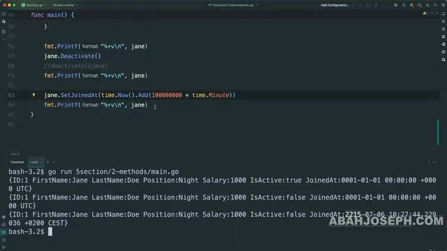

那段 panic 的具体输出文本请以你终端里实际打印的为准（讲师在视频里描述为“segmentation violation”）；Go 运行时会在首行给出原因，后面跟一长串调用栈和 goroutine 信息。这不是你的代码写错了，而是“nil 指针调方法 + 方法内部解引用”的必然结果。

### 6.4 `03interfaces` 检查

```bash
go run ./section05/03interfaces
```

- [ ] 输出两行：`Joe`、`Jane`。
- [ ] 然后是“反证实验”：给 `Person` 接口加一行 `GetID() string`，重新运行，应该编译失败，错误信息的大意是 `Employee does not implement Person (missing method GetID)` 以及 `BusinessPerson` 同样不满足。做完记得把这一行删掉。

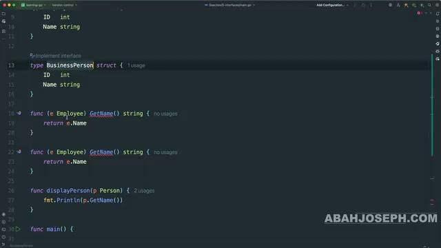

### 6.5 `04stringer` 检查

```bash
go run ./section05/04stringer
```

预期输出：

```text
BusinessPerson(ID=2, Name=Jane)
ID(30)
ID(30)
Jane
```

- [ ] 第 1 行不是 `{2 Jane}`。如果打出来是 `{2 Jane}`，说明 `String()` 方法名写成了小写 `string` 或签名不对。
- [ ] 第 2、3 行证明 `ID(30)` 和 `var myID2 ID = 30` 两种写法都走了同一个 `String()`。

反证：把 `func (b BusinessPerson) String() string` 里的方法名改成 `string`（小写），重新运行，第一行会退回默认的 `{2 Jane}`。因为小写方法不属于 `fmt` 认识的那个约定。

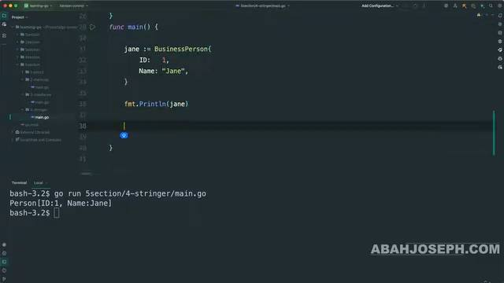

### 6.6 `05generics` 检查

```bash
go run ./section05/05generics
```

预期输出：

```text
2
4
175
31.7
30
float64
30
```

- [ ] `175` 是 `Sum(grades)` 的结果（90 + 85）。
- [ ] `31.7` 是浮点求和结果。如果打印出 `31.700000000000003` 这类长尾，是你本机浮点表现，不是代码错。
- [ ] `float64` 那一行证明返回类型跟着类型参数走。

反证与实验：

- [ ] 把 `type Number interface { int | float64 }` 改成 `{ int | float64 | string }`，然后保留 `Sum(grades)` 和 `Sum([]float64{...})` 两行，程序**仍然能编译运行**，因为 `int`、`float64` 两条路径合法。想看到“讲不通”的后果，得真的去 `Sum([]string{...})`，这时 `total += n` 在 `string` 实例化下报编译错误——这正是讲师在 p039 [07:50] 想表达的取舍。
- [ ] 把 `Sum[float64]([]float64{10, 20})` 里的 `float64` 改成 `int`，运行会编译失败，因为 `[]float64` 不满足 `[]int` 的参数类型。这一步用来确认显式类型参数是真的在“提前告诉编译器类型”。

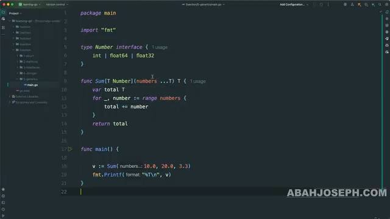

### 6.7 全局检查

- [ ] 五个程序全部跑过一遍，没有一处为了让它编译而注释掉业务代码（`02method` 里那两行 nil 实验除外，本身就是注释状态）。
- [ ] 终端里没有 `go: cannot find main module` 字样的报错。如果有，说明不在项目根目录，或者漏了 `go mod init`。
- [ ] 你能不看文档说出：什么情况下必须用指针接收者、什么情况下接口自动满足、`String()` 的大小写要求、泛型约束里的竖线是什么意思。

---

## 7. 课里没讲但你会撞上的

这一节全部是讲师在 P35–P39 里**没有展开或根本没提**、但你照着做一定会碰到的东西。已明确标注哪些是课里提过一句、哪些完全没提。

### 7.1 `go mod init` 这一步课里没有

五个视频都是从“新建文件夹 + main.go”直接开始的，没有一次敲 `go mod init`。在 Go 1.16 之后，默认开启 module 模式，没有 `go.mod` 时在项目根目录跑 `go run ./section05/01struct` 会报找不到 module。所以这份文档在 3.3 补了这一步。这是**课里没讲**的内容。

### 7.2 GoLand 的“squeaky line”不是报错

讲师在 p036 [08:43] 说 IDE 上出现一条“squeaky line”，抱怨他混用值接收者和指针接收者。那是 GoLand 的代码检查提示（inspection），不是编译错误——混用接收者类型，`go build` 照样过。讲师建议“be consistent”，是工程规范层面的建议，不是语言强制。

在 VS Code + gopls 里，你看到的对应提示通常是类似 `methods on Employee should have pointer receiver` 的诊断文本（具体措辞以你本机插件版本为准）。

### 7.3 你不能给别的包的类型加方法

课里给 `Employee`、`BusinessPerson`、`ID` 加方法都成功了，因为类型定义在同一个 `package main` 里。但如果你在 `04stringer` 里试图写：

```go
func (t time.Time) String() string { ... } // 编译失败
```

会报错，大意是 `cannot define new methods on non-local type`。规则：方法只能定义在“和自己同一个包”里定义的类型上。这是**课里没讲**的规则，但你一旦想“给标准库类型美化输出”就会立刻撞上。正确做法是用自己定义的类型包一层，就像课里 `type ID int` 那样。

### 7.4 未使用的变量和导入会直接编译失败

Go 里声明了变量不用、导入了包不用，都是编译错误，不是警告。你在跟做时如果先写 `import ("fmt"; "time")` 而暂时还没用到 `time`，程序就跑不起来。写代码时按需添加 import，或者用 `_` 占位。

### 7.5 字段首字母大写 = 导出，这件事只提了一句

p037 [01:21] 讲师明确说“I will talk about it later when I talk about packages”。也就是说**这节课里没有讲**导出规则。你现在只需要记住：大写可被其他包访问，小写只在本包内可见；五个示例都在同一个包里，所以全大写和小写都能跑通，看不出区别。等后面讲包的时候才会真正起作用。

### 7.6 nil 接口值和 nil 指针不是一回事

`02method` 演示了 nil 指针调用方法会 panic。但还有一种更隐蔽的情况：把一个 nil 指针赋给接口变量，接口本身**不是 nil**，调用方法时仍会进到方法体里。课里没有讲这个区别，你在写接口 + 指针接收者组合时会撞上。现阶段的规避办法就是讲师说的那句“We don't usually do this”——别把可能为 nil 的指针塞进接口。

在 JS/Node 里对应的是 `null` 和 `undefined` 在 `typeof` 判断下的差异：两种“空值”在检查时的表现不一样，接口的 nil 判断也一样容易误判。

### 7.7 `%+v` 只影响结构体，不影响普通值

`01struct` 里 `%+v` 打印出带字段名的结果，所以你会以为 `%+v` 是“更详细的打印”。但对 `int`、`string` 这类值，`%v` 和 `%+v` 输出一模一样。`%+v` 的“+”只对结构体（以及部分复合类型）有意义。这是**课里没讲**的细节，讲师只是演示了效果。

### 7.8 `time.Now()` 打印出来带时区和纳秒

`01struct`、`02method` 打印 `JoinAt` 时会看到一长串时间，且每次运行都不同，还可能带 `m=+0.000000001` 这样的单调时钟后缀。这不是 bug：`fmt` 打印 `time.Time` 时会带上单调时钟读数。讲师在 p035 [03:46] 说“you see the ID and everything they join at is quite long”，指的就是这个。想让输出干净，可以调用 `.Format(...)`，但**课里没有讲**格式化布局。

### 7.9 `Sum` 传空切片返回零值，不报错

`Sum([]int{})` 返回 `0`，`Sum([]float64{})` 返回 `0`。泛型版本里的 `var total T` 天然就是 `T` 的零值，所以空输入是安全的。课里没有专门测空切片，但你的复现代码会碰到。如果想要“空切片报错”的语义，得自己加判断并返回 `(T, error)`——**课里没讲**这种写法。

### 7.10 泛型不能替你解决“类型之间怎么转换”

`05generics` 里 `%T` 打印出 `float64` 看着很顺，但如果你想在泛型函数里把 `T` 转成 `int`，就需要额外的约束和转换语法，课里完全没有涉及。讲师自己也说“This is a very basic introduction to generics”，并且明确表示 Web 应用开发里“you won't see it too much. Most times you don't see it at all”。所以不必在这节追求泛型的完整用法。

### 7.11 接口方法集合加一个方法就会“断掉”所有实现

`03interfaces` 的反证实验说明：接口是**严格**契约，多加一个方法，所有不满足的类型立即失效，报的是编译错误而不是运行时错误。这是好事（问题在提交前暴露），但改接口时要有心理准备：接口越大，满足它的类型越少。讲师在 p037 [07:15] 演示时只加了一个 `GetID`，两个类型就同时不满足了。

### 7.12 这五节没有测试、没有并发、没有事务

P35–P39 全程只在 `main` 里 `fmt.Println`，**没有写过一个 `_test.go`**，没有 `go test`，没有 goroutine、channel、互斥锁，也没有数据库和事务。所以你在这一节不会遇到锁和并发问题，前面提到的“JS/Node 对应什么”也只需要关心值和引用这一个差异。这些主题在课程后续部分（不在本次覆盖范围内）。

### 7.13 目录编号和视频序号不是一一对应

讲师在 p035 [03:17] 自己也在猜“it is it eight or seven? let's see no it says section five”，最后确认是 `section five` 下的 `one struct`。他口播的目录名是 `one struct`、`two method`，而编辑器里的真实目录名可能带前导零或不同拼写。本文档统一用 `01struct`…`05generics` 这种带前导零的命名，既保证 `go run ./section05/01struct` 好敲，也和视频里的语义对得上。**如果你要严格对齐视频里的文件名，请以你自己屏幕上看到的名字为准**——仓库里不会有这两套命名的对照表。

---

## 附：本节的五条核心结论

把这一节压缩成五句话，方便复习：

1. Go 没有类，`struct` 负责把字段打组；`Employee{...}` 创建的是**值**，赋值会复制。
2. 方法 = 带接收者的函数。要改原值就用 `*T` 指针接收者，只读就用 `T` 值接收者；一旦用了指针接收者，同一个类型的所有方法保持一致。
3. 接口是方法集合，实现是**隐式**的：不写 `implements`，有方法就算满足。
4. `String() string`（大写 S）能让 `fmt` 按你的格式打印这个类型，任何自定义类型都能加。
5. 泛型用 `[T 约束]` 声明类型参数，约束里的类型必须支持函数体用到的操作；不能求和的类型别放进 `Number`。