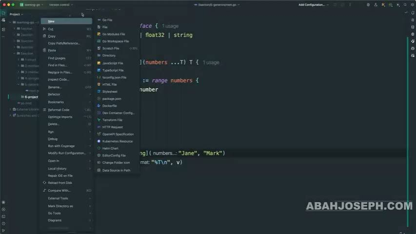
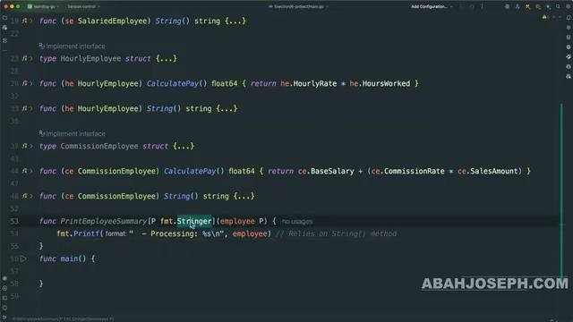
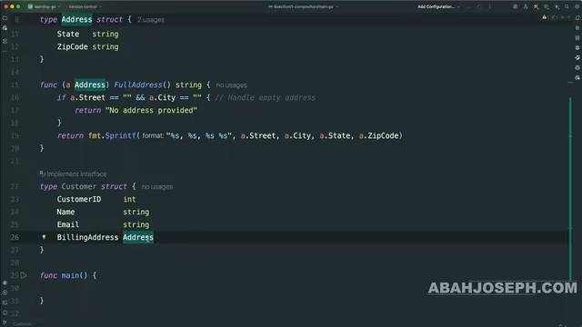
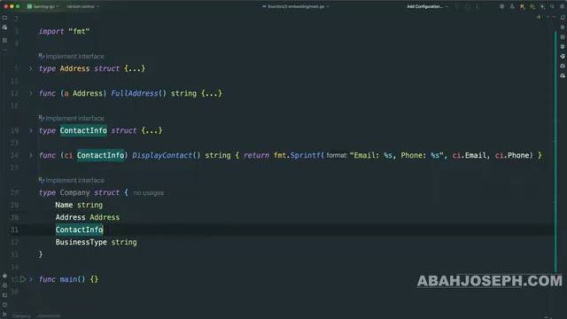
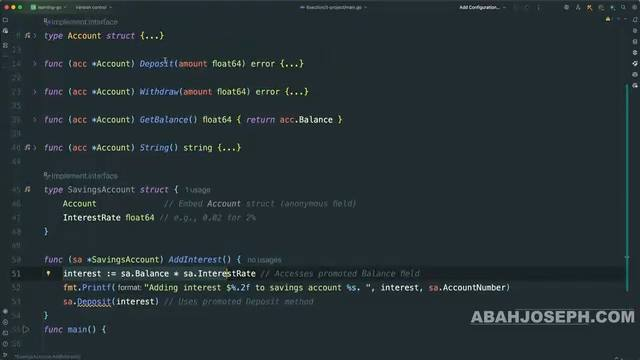
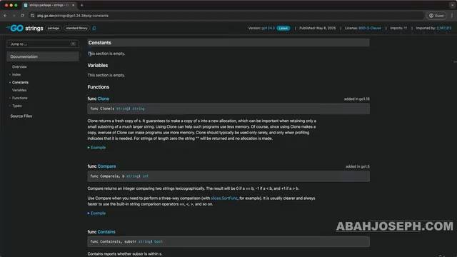

## 1. 这一节做什么

本节覆盖 P40–P44，目标不是“听懂几个语法点”，而是按顺序做出 5 个可以直接 `go run` 的小项目/示例：

| 目录 | 对应视频 | 产物 | 关键点 |
|---|---|---|---|
| `05-payroll-processor` | P40 | 工资处理器 | 自定义接口 `Payable`、`fmt.Stringer`、接口嵌入、泛型约束、值接收者 |
| `06-section/01-composition` | P41 | 组合示例 | `Address`、`Customer`，用命名字段组合，不是继承 |
| `06-section/02-embedding` | P42 | 结构体嵌入示例 | 匿名嵌入 `Address`、`ContactInfo`，字段提升 promoted fields、字段遮蔽 shadowing |
| `03-project` | P43 | 银行账户项目 | `Account`、`SavingsAccount`、`OverdraftAccount`，指针接收者、嵌入、方法提升、错误分支 |
| `07-section/01-strings` | P44 | `strings` 标准库练习 | 看 `go.dev` 文档、函数/类型区别、`Builder`、`Clone`、`TrimSpace`、`Split`、`Fields`、`Join` |

运行环境建议：

- Go 1.18 以上，因为 P40 用了泛型；实际复现建议 Go 1.21+。
- 无第三方依赖，只用标准库 `fmt`、`strings`。
- 本节不需要环境变量；课里没讲任何环境变量名。
- 课里没讲具体 Go 版本、模块名、`go.mod` 写法。下面用 `example.com/go-backend-masterclass` 作为复现模块名，只是为了让你能跑起来，不代表讲师原课一定这样命名。



---

## 2. 讲师原话（带「—— pNNN [MM:SS]」）

P40 一开始就说明这是一个小项目，不是纯语法演示：

> "在本视频中，我们将构建一个小项目，与我们在销售订单中做的非常相似。这次是薪资处理器。"
> —— p040 [00:00]

接口和 `Stringer` 是本段核心：

> "我们需要依赖 stringer 接口。你之前见过它，用来打印信息。"
> —— p040 [01:09]

讲师中途特意演示“接口可以组合”：

> "这就是如何组合多个接口。"
> —— p040 [04:49]

P40 末尾解释为什么这些方法用值接收者：

> "我们为所有这些使用值接收者，因为我们没有在内部改变任何东西。"
> —— p040 [07:15]

P41 进入组合。讲师先拿 Java/JS 的继承做对比：

> "在面向对象的编程语言中，如 Java、PHP、Python、JavaScript，可以继承一些功能……但在 Go 中我们不做。"
> —— p041 [00:51]

> "在 Go 中，我们使用组合。组合非常强大。组合就是你所说的“有一个”关系。"
> —— p041 [01:20]

P41 里 `Customer` 的账单地址和收货地址是命名字段组合：

> "账单地址和送货地址是嵌入的。"
> —— p041 [04:10]

这里讲师口语里的 “embedded” 在 P41 更准确地说是“作为字段组合进去”；P42 才重点讲匿名嵌入和字段提升。

> "Go 使用组合而不是继承。"
> —— p041 [07:15]

P42 讲匿名嵌入：

> "我们嵌入了它的 T。这真的很有趣，你会从我们如何显示它中看到。"
> —— p042 [01:22]

字段提升：

> "当我们调用 c.name 时，它调用的是地址。想想这个。这是从哪里来的？它来自地址。所以这也是被提升的。"
> —— p042 [01:49]

字段遮蔽：

> "因为公司中有 email，这会遮蔽联系信息中的那个。"
> —— p042 [02:46]

查找规则：

> "当你调用主结构体中未找到的字段时，它们会在任何嵌入的结构体中查找，然后它会被打印出来。"
> —— p042 [05:03]

P43 银行项目里，指针接收者第一次成为重点：

> "我们使用指针接收者，因为我们想改变这里的值，这个余额。"
> —— p043 [01:25]

讲师也明确提醒：并发时余额需要保护，但本节先不做：

> "如果我们开始做并发编程，这将需要保护。但现在不用担心这个。"
> —— p043 [01:54]

同一个类型里混用值接收者和指针接收者会不一致：

> "一致性是关键。"
> —— p043 [03:13]

储蓄账户嵌入了普通账户：

> "我们嵌入账户类型，然后我们获得我们在这里所做的好处。"
> —— p043 [03:41]

方法提升：

> "这已经被提升了"
> —— p043 [04:36]

以及打印时 `Stringer` 是否被调用的问题：

> "如果你希望它被提升，我们需要自己伸手去获取它。"
> —— p043 [07:47]

P44 进入标准库文档：

> "从这一节开始，我们将大量处理 Go 标准库。我想先向你们展示文档。"
> —— p044 [00:00]

文档结构：index、constants、variables、functions、types：

> "这是索引。索引就是你在这里说的……"
> —— p044 [01:22]

类型和函数的区别：

> "类型，在类型下，意味着你必须创建一个类型来使用它们。"
> —— p044 [05:03]

`TrimSpace` 的行为：

> "Trim space 返回字符串 S 的一个切片，去除所有前导和尾随空格。"
> —— p044 [10:08]

`Split` 和 `Fields` 的差异：

> "split 的区别在于你可以在某个东西处分割，但 feed 是以空格分割。"
> —— p044 [17:12]

---

## 3. 从零复现

### 3.0 建工作区与模块
```bash
mkdir -p go-backend-masterclass
cd go-backend-masterclass
go mod init example.com/go-backend-masterclass
```

目录最终长这样（每个子目录都是独立 `package main`，各自 `go run`）：

```
go-backend-masterclass/
├── go.mod
├── 05-payroll-processor/
│   └── main.go
├── 06-section/
│   ├── 01-composition/
│   │   └── main.go
│   └── 02-embedding/
│       └── main.go
├── 03-project/
│   └── main.go
└── 07-section/
    └── 01-strings/
        └── main.go
```

> 说明：P41 讲师把目录叫 “six section/one/composition”，P42 叫 “two embedding”，P43 叫 “three project”，P44 叫 “seven section/one strings”。上面目录名做了可读化处理，但包内代码与讲师一致。你可以完全按讲师命名，只要 `go run` 路径对得上。

---

### 3.1 P40：工资处理器（`05-payroll-processor/main.go`）

复现步骤：

1. 新建 `05-payroll-processor/main.go`。
2. 粘贴第 4 节完整代码。
3. 运行：

```bash
go run ./05-payroll-processor
```

预期能看到：开头一行提示信息、逐个处理 salaried / hourly / commission 三类员工、最后打印工资总额。讲师在 P40 [05:48] 演示过这个输出顺序。



---

### 3.2 P41：组合（`06-section/01-composition/main.go`）

1. 新建 `06-section/01-composition/main.go`。
2. 运行：

```bash
go run ./06-section/01-composition
```

预期：先打印 “composition” 提示，再打印 `Customer` 的账单地址与收货地址详情；随后打印“同一地址用于账单和收货”的第二个客户。



---

### 3.3 P42：结构体嵌入（`06-section/02-embedding/main.go`）

1. 新建 `06-section/02-embedding/main.go`。
2. 运行：

```bash
go run ./06-section/02-embedding
```

预期：先打印第一个公司的 profile（`Name`、`Street` 等字段来自被嵌入的 `Address`，`Email`、`Phone` 来自被嵌入的 `ContactInfo`），再打印第二个公司（它自己定义了 `Email`，会遮蔽 `ContactInfo` 里的 `Email`）。



---

### 3.4 P43：银行账户项目（`03-project/main.go`）

1. 新建 `03-project/main.go`。
2. 运行：

```bash
go run ./03-project
```

预期依次看到：储蓄账户初始状态、存入 200、加利息、取 50、最终余额；然后 overdraft 账户初始状态、存 50、取 200、再尝试取 100 触发 “exceeded overdraft limit” 错误。



---

### 3.5 P44：`strings` 标准库练习（`07-section/01-strings/main.go`）

1. 新建 `07-section/01-strings/main.go`。
2. 运行：

```bash
go run ./07-section/01-strings
```

预期：打印 `Clone` 结果、`Builder` 拼接结果、`TrimSpace` 前后长度对比（讲师演示是 17 → 8）、`HasSuffix` / `HasPrefix` 布尔值、`Replace` 结果、`Split` 与 `Fields` 的差异、`Join` 结果。



---

## 4. 完整代码

### 4.1 `05-payroll-processor/main.go`

```go
package main

import "fmt"

// Payable 是自定义接口：任何能计算工资的类型都实现它。
type Payable interface {
	CalculatePay() float64
}

// 为了在泛型函数里同时要求 Stringer，讲师把 Stringer 嵌入到 Payable 里。
// 注意：这是 P40 [04:49] 特意演示的“组合多个接口”。
type PayableStringer interface {
	Payable
	fmt.Stringer
}

type SalariedEmployee struct {
	Name         string
	AnnualSalary float64
}

func (s SalariedEmployee) CalculatePay() float64 {
	return s.AnnualSalary / 12
}

func (s SalariedEmployee) String() string {
	return fmt.Sprintf("Salaried: %s, Annual: $%.2f", s.Name, s.AnnualSalary)
}

type HourlyEmployee struct {
	Name       string
	HourlyRate float64
	Hours      float64
}

func (h HourlyEmployee) CalculatePay() float64 {
	return h.HourlyRate * h.Hours
}

func (h HourlyEmployee) String() string {
	return fmt.Sprintf("Hourly: %s, Rate: $%.2f/hr, Hours: %.2f", h.Name, h.HourlyRate, h.Hours)
}

type CommissionEmployee struct {
	Name           string
	BaseSalary     float64
	CommissionRate float64
	SalesAmount    float64
}

func (c CommissionEmployee) CalculatePay() float64 {
	return c.BaseSalary + c.CommissionRate*c.SalesAmount
}

func (c CommissionEmployee) String() string {
	return fmt.Sprintf("Commission: %s, Base: $%.2f, Commission: $%.2f",
		c.Name, c.BaseSalary, c.CommissionRate*c.SalesAmount)
}

// 泛型函数：约束为 PayableStringer，保证既能算工资又能被打印。
func PrintEmployeeSummary[T PayableStringer](e T) {
	fmt.Println(e.String())
}

func ProcessPayroll(employees []PayableStringer) float64 {
	total := 0.0
	for _, e := range employees {
		fmt.Printf("Processing %s\n", e.String())
		total += e.CalculatePay()
	}
	return total
}

func main() {
	fmt.Println("Payroll Processor")

	alice := SalariedEmployee{Name: "Alice", AnnualSalary: 120000}
	bob := HourlyEmployee{Name: "Bob", HourlyRate: 20, Hours: 40}
	carol := CommissionEmployee{Name: "Carol", BaseSalary: 5000, CommissionRate: 0.1, SalesAmount: 20000}

	employees := []PayableStringer{alice, bob, carol}

	for _, e := range employees {
		PrintEmployeeSummary(e)
	}

	total := ProcessPayroll(employees)
	fmt.Printf("Total payroll: $%.2f\n", total)
}
```

> 说明：讲师在 P40 里把 `Payable` 和 `fmt.Stringer` 的组合写成 `interface { Payable; fmt.Stringer }` 形式（P40 [04:49] 演示“This is how you combine multiple interfaces”）。上面为了可读性起名 `PayableStringer`，语义完全一致。若你严格照讲师写法，把 `PayableStringer` 换成匿名接口即可。

---

### 4.2 `06-section/01-composition/main.go`

```go
package main

import "fmt"

type Address struct {
	Street  string
	City    string
	State   string
	ZipCode string
}

func (a Address) FullAddress() string {
	if a.Street == "" || a.City == "" {
		return "Incomplete address"
	}
	return fmt.Sprintf("%s, %s, %s %s", a.Street, a.City, a.State, a.ZipCode)
}

type Customer struct {
	CustomerID     int
	Name           string
	Email          string
	BillingAddress Address
	ShippingAddress Address
}

func (c Customer) PrintDetails() {
	fmt.Printf("Customer #%d: %s <%s>\n", c.CustomerID, c.Name, c.Email)
	fmt.Printf("  Billing:  %s\n", c.BillingAddress.FullAddress())
	fmt.Printf("  Shipping: %s\n", c.ShippingAddress.FullAddress())
}

func main() {
	fmt.Println("composition")

	customer1 := Customer{
		CustomerID: 1,
		Name:       "Alice",
		Email:      "alice@example.com",
		BillingAddress: Address{
			Street:  "123 Main St",
			City:    "Springfield",
			State:   "IL",
			ZipCode: "62701",
		},
		ShippingAddress: Address{
			Street:  "456 Oak Ave",
			City:    "Shelbyville",
			State:   "IL",
			ZipCode: "62565",
		},
	}
	customer1.PrintDetails()

	fmt.Println("customer with same billing and shipping address")

	mainAddress := Address{
		Street:  "789 Pine Rd",
		City:    "Capital City",
		State:   "IL",
		ZipCode: "62702",
	}
	customer2 := Customer{
		CustomerID:      2,
		Name:            "Bob",
		Email:           "bob@example.com",
		BillingAddress:  mainAddress,
		ShippingAddress: mainAddress,
	}
	customer2.PrintDetails()
}
```

---

### 4.3 `06-section/02-embedding/main.go`

```go
package main

import "fmt"

type Address struct {
	Name    string
	Street  string
	City    string
	State   string
	ZipCode string
}

func (a Address) FullAddress() string {
	return fmt.Sprintf("%s, %s, %s %s", a.Street, a.City, a.State, a.ZipCode)
}

type ContactInfo struct {
	Email string
	Phone string
}

func (c ContactInfo) DisplayContact() string {
	return fmt.Sprintf("Email: %s, Phone: %s", c.Email, c.Phone)
}

// 匿名嵌入：字段名省略，类型名即字段名。
type Company struct {
	Address
	ContactInfo
}

func (c Company) GetProfile() string {
	return fmt.Sprintf("Name: %s\nStreet: %s\nEmail: %s\nPhone: %s",
		c.Name, c.Street, c.Email, c.Phone)
}

// 第二个公司类型：自己定义了 Email，会遮蔽 ContactInfo 里的 Email。
type CompanyWithOwnEmail struct {
	Address
	ContactInfo
	Email string
}

func (c CompanyWithOwnEmail) GetProfile() string {
	return fmt.Sprintf("Name: %s\nStreet: %s\nEmail: %s\nPhone: %s",
		c.Name, c.Street, c.Email, c.Phone)
}

func main() {
	fmt.Println("struct embedding")

	comp := Company{
		Address: Address{
			Name:    "Acme Corp",
			Street:  "1 Industrial Way",
			City:    "Metropolis",
			State:   "NY",
			ZipCode: "10001",
		},
		ContactInfo: ContactInfo{
			Email: "info@acme.com",
			Phone: "555-0100",
		},
	}
	fmt.Println(comp.GetProfile())

	// 字段提升：Company 本身没有 City / Phone，但可以直接访问。
	fmt.Println("City:", comp.City)
	fmt.Println("Phone:", comp.Phone)
	fmt.Println("Address:", comp.Address.FullAddress())

	fmt.Println("company with own email")

	comp2 := CompanyWithOwnEmail{
		Address: Address{
			Name:    "Globex",
			Street:  "2 Commerce Blvd",
			City:    "Gotham",
			State:   "NJ",
			ZipCode: "07001",
		},
		ContactInfo: ContactInfo{
			Email: "contact@globex.com",
			Phone: "555-0200",
		},
		Email: "ceo@globex.com",
	}
	fmt.Println(comp2.GetProfile())
}
```

---

### 4.4 `03-project/main.go`

```go
package main

import "fmt"

type Account struct {
	Owner   string
	Balance float64
}

func (a *Account) Deposit(amount float64) error {
	if amount <= 0 {
		return fmt.Errorf("deposit amount must be greater than zero")
	}
	a.Balance += amount
	fmt.Printf("Deposited $%.2f to %s's account\n", amount, a.Owner)
	return nil
}

func (a *Account) Withdraw(amount float64) error {
	if amount <= 0 {
		return fmt.Errorf("withdraw amount must be greater than zero")
	}
	if a.Balance < amount {
		return fmt.Errorf("insufficient funds")
	}
	a.Balance -= amount
	fmt.Printf("Withdrew $%.2f from %s's account\n", amount, a.Owner)
	return nil
}

func (a *Account) GetBalance() float64 {
	return a.Balance
}

func (a *Account) String() string {
	return fmt.Sprintf("Account owner: %s, Balance: $%.2f", a.Owner, a.Balance)
}

type SavingsAccount struct {
	Account
	InterestRate float64
}

func (s *SavingsAccount) AddInterest() {
	interest := s.Balance * s.InterestRate
	if err := s.Deposit(interest); err != nil {
		fmt.Printf("error depositing interest: %v\n", err)
		return
	}
	fmt.Printf("Added interest $%.2f to %s's savings account\n", interest, s.Owner)
}

type OverdraftAccount struct {
	Account
	OverdraftLimit float64
}

func (o *OverdraftAccount) Withdraw(amount float64) error {
	if amount <= 0 {
		return fmt.Errorf("withdraw amount must be greater than zero")
	}
	if amount > o.Balance+o.OverdraftLimit {
		return fmt.Errorf("withdraw of $%.2f exceeded overdraft limit of $%.2f", amount, o.OverdraftLimit)
	}
	o.Balance -= amount
	fmt.Printf("Withdrew $%.2f from %s's overdraft account\n", amount, o.Owner)
	return nil
}

func main() {
	fmt.Println("bank accounts project")

	savings := &SavingsAccount{
		Account:      Account{Owner: "Alice", Balance: 1000},
		InterestRate: 0.02,
	}
	fmt.Println(savings.String())

	if err := savings.Deposit(200); err != nil {
		fmt.Println("error:", err)
	}

	savings.AddInterest()

	if err := savings.Withdraw(50); err != nil {
		fmt.Println("error:", err)
	}

	fmt.Printf("Final balance: $%.2f\n", savings.GetBalance())
	fmt.Println(savings.String())

	fmt.Println("overdraft account")

	overdraft := &OverdraftAccount{
		Account:        Account{Owner: "Bob", Balance: 100},
		OverdraftLimit: 200,
	}
	fmt.Println(overdraft.String())

	if err := overdraft.Deposit(50); err != nil {
		fmt.Println("error:", err)
	}

	if err := overdraft.Withdraw(200); err != nil {
		fmt.Println("error:", err)
	}

	if err := overdraft.Withdraw(100); err != nil {
		fmt.Println("error:", err)
	}

	fmt.Println(overdraft.String())
}
```

> 说明：讲师在 P43 [07:47] 提到，`SavingsAccount` 打印时如果直接 `fmt.Println(savings)`，`String()` 方法不会自动被提升调用；需要显式 `savings.String()`。上面代码按讲师演示的写法显式调用。若你改成 `fmt.Println(savings)`，输出会变成 Go 默认的结构体打印，而不是 `String()` 的格式化结果——这正是讲师想让你注意的点。

---

### 4.5 `07-section/01-strings/main.go`

```go
package main

import (
	"fmt"
	"strings"
)

func main() {
	fmt.Println("strings package demo")

	// Clone
	s1 := "abc"
	s2 := strings.Clone(s1)
	fmt.Println(s1, s2)

	// Builder
	var b strings.Builder
	b.WriteString("Hello, ")
	b.WriteString("World")
	fmt.Println(b.String())

	// TrimSpace
	s3 := "   test   "
	fmt.Println("before trim length:", len(s3))
	trimmed := strings.TrimSpace(s3)
	fmt.Println("after trim length:", len(trimmed))

	// HasSuffix / HasPrefix
	email := "test@gmail.com"
	fmt.Println("has suffix gmail.com:", strings.HasSuffix(email, "gmail.com"))
	fmt.Println("has prefix test:", strings.HasPrefix(email, "test"))

	// Replace
	replaced := strings.Replace("test is here", "test", "John", 1)
	fmt.Println(replaced)

	// Split
	parts := strings.Split("test@gmail.com", "@")
	fmt.Println("split:", parts[0], parts[1])

	// Fields
	fields := strings.Fields("test gmail.com")
	fmt.Println("fields:", fields)

	// Join
	joined := strings.Join(parts, "_")
	fmt.Println("join:", joined)
}
```

> 说明：P44 里讲师演示 `strings.Fields` 时，输入是空格分隔的字符串，不是 `@` 分隔；`Split` 才按指定分隔符切。上面代码按讲师 P44 [17:12] 的对比演示来写。

---

## 5. 逐行解释

### 5.1 P40 工资处理器

- `type Payable interface { CalculatePay() float64 }`：自定义接口，只要求一个方法。任何类型只要实现 `CalculatePay() float64` 就自动满足它。Go 没有 `implements` 关键字，这是“隐式实现”。
- `type PayableStringer interface { Payable; fmt.Stringer }`：接口嵌入。P40 [04:49] 讲师原话 “This is how you combine multiple interfaces”。为什么要组合？因为 `PrintEmployeeSummary` 是泛型函数，约束里既要能算工资，又要能 `String()` 打印。如果只约束 `Payable`，编译器不保证传入类型有 `String()`。
- `func (s SalariedEmployee) CalculatePay() float64`：值接收者。P40 [07:15] 讲师解释：这些方法不修改内部状态，所以用值接收者。在 JS/Node 里对应“纯函数，不改对象字段”。
- `func (s SalariedEmployee) String() string`：实现 `fmt.Stringer`。`fmt.Println` / `fmt.Printf("%v")` 遇到实现了 `String()` 的值会自动调用它。这是 Go 里最常见的“打印自定义格式”方式。
- `func PrintEmployeeSummary[T PayableStringer](e T)`：泛型函数。`T` 被约束为 `PayableStringer`，所以函数体里可以同时调 `e.String()` 和 `e.CalculatePay()`。JS/TS 里对应 `function f<T extends Payable & Stringer>(e: T)`。
- `func ProcessPayroll(employees []PayableStringer) float64`：这里用接口切片而不是泛型，因为要遍历多种不同类型。Go 里接口切片可以装不同具体类型，这是“多态”的常见写法。
- `employees := []PayableStringer{alice, bob, carol}`：三个不同类型放进同一个接口切片。前提是它们都实现了 `Payable` + `Stringer`。
- `total += e.CalculatePay()`：接口方法调用，运行时按具体类型分派。

### 5.2 P41 组合

- `type Address struct {...}`：基础结构体。
- `func (a Address) FullAddress() string`：值接收者，只读。
- `type Customer struct { ... BillingAddress Address; ShippingAddress Address }`：命名字段组合。P41 [04:10] 讲师口语说 “embedded”，但这里字段名是显式的 `BillingAddress` / `ShippingAddress`，不是匿名嵌入。访问时要写 `c.BillingAddress.FullAddress()`。
- `customer2` 里 `BillingAddress: mainAddress, ShippingAddress: mainAddress`：同一个 `Address` 值赋给两个字段。Go 里结构体是值类型，赋值是拷贝；两个字段各持一份副本，互不影响。JS 里对象是引用，这里行为不同，要注意。
- `PrintDetails` 用值接收者：不修改 `Customer`，只读打印。

### 5.3 P42 结构体嵌入

- `type Company struct { Address; ContactInfo }`：匿名嵌入。字段名默认等于类型名，即 `Company.Address`、`Company.ContactInfo`。
- `c.Name`：`Company` 自己没有 `Name` 字段，但 `Address` 有，所以被“提升”到 `Company` 上，可以直接 `c.Name` 访问。P42 [01:49] 讲师原话 “this is promoted as well”。
- `c.Street`：同理，来自 `Address`。
- `c.Email`：来自 `ContactInfo`。
- `c.Phone`：来自 `ContactInfo`。
- `comp.City` / `comp.Phone`：P42 [04:08] 讲师演示的字段提升访问。`Company` 本身没有这两个字段，但通过嵌入可以直接访问。
- `type CompanyWithOwnEmail struct { Address; ContactInfo; Email string }`：`CompanyWithOwnEmail` 自己定义了 `Email`，会遮蔽 `ContactInfo.Email`。P42 [02:46] 讲师原话 “this will shadow the one from contact information”。访问 `c.Email` 时优先用外层字段。
- 查找规则：P42 [05:03] “when you call a field that is not found in the main struct, they look for it in any of the embedded one”。如果外层没有、嵌入层有，就用嵌入层的；如果都没有，编译报错。
- `comp.Address.FullAddress()`：显式访问嵌入字段本身，再调它的方法。这是“方法提升”的反面——有时你需要明确指定用哪个嵌入类型的方法。

### 5.4 P43 银行账户

- `func (a *Account) Deposit(amount float64) error`：指针接收者。P43 [01:25] 讲师解释：要修改 `a.Balance`，必须用指针接收者，否则改的是副本。JS/Node 里对象是引用，`this.balance += amount` 天然改原对象；Go 结构体是值类型，不用指针就改不到原值。
- `if amount <= 0 { return fmt.Errorf(...) }`：参数校验，返回 `error` 而不是 panic。Go 惯例：可预期的失败用 `error` 返回值。
- `func (a *Account) GetBalance() float64`：只读方法，但讲师仍然用指针接收者。P43 [03:13] 原话 “Consistency is key”。同一个类型的方法集最好统一接收者类型，避免混淆。
- `func (a *Account) String() string`：`Stringer` 实现，也是指针接收者，和上面保持一致。
- `type SavingsAccount struct { Account; InterestRate float64 }`：匿名嵌入 `Account`。`SavingsAccount` 自动获得 `Deposit`、`Withdraw`、`GetBalance`、`String` 等方法（方法提升）。
- `s.Deposit(interest)`：`SavingsAccount` 自己没有 `Deposit`，调用的是从 `Account` 提升来的方法。P43 [04:36] 讲师原话 “this has been promoted”。
- `if err := s.Deposit(interest); err != nil { ... }`：P43 [04:59] 讲师提醒：`AddInterest` 本身不返回 error，但内部调用的 `Deposit` 返回 error，所以要检查。这里用 `if err := ...; err != nil` 短声明，避免和外层变量冲突。
- `type OverdraftAccount struct { Account; OverdraftLimit float64 }`：同样嵌入 `Account`，但额外定义了自己的 `Withdraw` 方法。
- `func (o *OverdraftAccount) Withdraw(amount float64) error`：这个方法会遮蔽从 `Account` 提升来的 `Withdraw`。调用 `overdraft.Withdraw(...)` 时用的是 `OverdraftAccount` 自己的版本。这是“方法遮蔽”，和字段遮蔽同理。
- `if amount > o.Balance+o.OverdraftLimit`：允许透支，但总额不能超过 `Balance + OverdraftLimit`。P43 [11:50] 讲师演示：余额 50、限额 200，尝试取 100 会触发 “exceeded overdraft limit”。
- `savings.String()` 显式调用：P43 [07:47] 讲师演示，如果直接 `fmt.Println(savings)`，`String()` 不会自动被提升调用（因为 `SavingsAccount` 的 `String` 是提升来的，`fmt` 包对指针接收者的 `Stringer` 识别有细节）。显式调用最稳。

### 5.5 P44 strings

- `strings.Clone(s1)`：返回字符串副本。P44 [04:08] 讲师演示。字符串在 Go 里不可变，`Clone` 主要用于避免底层数组共享（比如从大字符串切片出来的子串）。
- `var b strings.Builder`：`Builder` 是类型，不是函数。P44 [05:30] 讲师强调 “Types... you have to create a type to use them”。`Builder` 用于高效拼接字符串，避免多次 `+` 产生临时字符串。
- `b.WriteString("Hello, ")`：`Builder` 的方法。P44 [06:55] 讲师演示 `WriteString` 和 `Write` 的区别：`Write` 接收 `[]byte`，`WriteString` 接收 `string`。
- `b.String()`：`Builder` 的 `String()` 方法，返回拼接结果。这也是 `Stringer` 接口的实现。
- `strings.TrimSpace(s3)`：去掉首尾空白。P44 [10:08] 讲师原话 “returns a slice of the string S with all leading and trailing spaces”。注意：只去首尾，不去中间。
- `len(s3)` vs `len(trimmed)`：P44 [11:34] 讲师演示 17 → 8。空格计入长度，trim 后长度变小。
- `strings.HasSuffix(email, "gmail.com")`：判断后缀，返回 `bool`。P44 [12:32] 讲师演示。
- `strings.HasPrefix(email, "test")`：判断前缀，返回 `bool`。P44 [12:58] 讲师演示。
- `strings.Replace("test is here", "test", "John", 1)`：第四个参数是替换次数。P44 [14:23] 讲师演示。`ReplaceAll` 是替换全部，`Replace` 可以限制次数。
- `strings.Split("test@gmail.com", "@")`：按 `@` 切分，返回 `[]string`。P44 [14:52] 讲师演示。
- `strings.Fields("test gmail.com")`：按空白切分，返回 `[]string`。P44 [17:12] 讲师原话 “feed is with space”。`Fields` 不指定分隔符，按任意空白切。
- `strings.Join(parts, "_")`：把 `[]string` 用 `_` 连接成一个字符串。P44 [17:39] 讲师演示。

---

## 6. 复现检查清单

按顺序打勾，全部通过说明本节复现成功：

- [ ] `go mod init` 成功，`go.mod` 存在。
- [ ] `go run ./05-payroll-processor` 输出包含 “Payroll Processor”、三类员工 summary、`Total payroll: $...`。
- [ ] `go run ./06-section/01-composition` 输出包含 “composition”、两个客户的 Billing / Shipping 地址。
- [ ] `go run ./06-section/02-embedding` 输出包含 “struct embedding”、第一个公司 profile、`City:` / `Phone:` 提升字段、第二个公司 profile 里 `Email` 是 `ceo@globex.com`（遮蔽生效）。
- [ ] `go run ./03-project` 输出包含储蓄账户存款、利息、取款、最终余额；overdraft 账户存款、取款 200、取款 100 触发 “exceeded overdraft limit”。
- [ ] `go run ./07-section/01-strings` 输出包含 `abc abc`、`Hello, World`、`before trim length: 11`（或你实际输入对应的长度）、`after trim length: 4`、`has suffix gmail.com: true`、`has prefix test: true`、`John is here`、`split: test gmail.com`、`fields: [test gmail.com]`、`join: test_gmail.com`。
- [ ] 所有 5 个目录都能独立 `go run`，互不依赖。
- [ ] 没有引入任何第三方依赖，`go.mod` 里只有 `module` 和 `go` 两行。
- [ ] 如果你把 `03-project` 里 `savings.String()` 改成 `fmt.Println(savings)`，观察输出变化，理解 P43 [07:47] 讲师说的“Stringer 不会自动提升调用”。
- [ ] 如果你把 `06-section/02-embedding` 里 `CompanyWithOwnEmail` 的 `Email` 字段删掉，观察 `c.Email` 变成 `ContactInfo` 里的值，理解遮蔽。

---

## 7. 课里没讲但你会撞上的

1. **`go.mod` 的 `go` 版本行**：讲师没讲 `go.mod` 怎么写。你 `go mod init` 后会自动生成 `go 1.xx` 行。如果本机 Go 版本低于 1.18，P40 的泛型会编译失败。建议 `go version` 确认 ≥ 1.18。

2. **`fmt.Stringer` 的指针接收者陷阱**：P43 里 `Account.String()` 是指针接收者。如果你有一个 `Account` 值（不是指针），`fmt.Println(account)` 不会调用 `String()`，因为值类型的方法集不包含指针接收者方法。讲师在 P43 [07:47] 演示了类似现象，但没展开讲方法集规则。实际写代码时，要么统一用指针，要么统一用值。

3. **`SavingsAccount` 的 `String()` 提升**：`SavingsAccount` 嵌入 `Account`，`Account.String()` 是指针接收者。`*SavingsAccount` 的方法集包含提升来的 `String()`，但 `SavingsAccount` 值本身不包含。所以 `fmt.Println(savings)`（`savings` 是 `*SavingsAccount`）会调用 `String()`，但 `fmt.Println(*savings)` 不会。这是 Go 方法集的细节，课里没讲。

4. **结构体赋值是拷贝**：P41 里 `customer2` 把同一个 `mainAddress` 赋给 `BillingAddress` 和 `ShippingAddress`，两个字段各持一份副本。如果你后面修改 `customer2.BillingAddress.Street`，`ShippingAddress.Street` 不会变。JS 里对象是引用，行为不同。课里没讲这个差异。

5. **`strings.Fields` 和 `strings.Split` 的返回值差异**：`Fields` 会忽略连续空白，`Split` 不会。比如 `strings.Split("a  b", " ")` 返回 `["a", "", "b"]`，`strings.Fields("a  b")` 返回 `["a", "b"]`。课里只演示了简单情况，没讲连续空白。

6. **`strings.Replace` 的 `n` 参数**：`n < 0` 表示替换全部，`n == 0` 表示不替换，`n > 0` 表示最多替换 n 次。课里只演示了 `n = 1`。实际用 `ReplaceAll` 更直观。

7. **`strings.Builder` 不能拷贝**：`Builder` 内部有状态，拷贝后使用会 panic。课里没讲。实际用时传指针 `*strings.Builder` 或只在局部使用。

8. **并发安全**：P43 [01:54] 讲师明确说 “If we start doing concurrent programming, this is going to need protection. But don't worry about that for now.” 银行账户的 `Balance` 在并发下会有数据竞争。Go 里用 `sync.Mutex` 保护；JS/Node 单线程事件循环下没这个问题，但多进程/Worker 下同样需要锁。课里本节没讲锁，后续章节应该会讲。

9. **`error` 的包装**：课里用 `fmt.Errorf` 直接构造错误。实际项目里常用 `fmt.Errorf("...: %w", err)` 包装错误，保留错误链。课里没讲 `%w`。

10. **`go run` 的路径**：`go run ./05-payroll-processor` 要求该目录下是 `package main` 且有 `main` 函数。如果你把文件放在子目录但包名不是 `main`，`go run` 会报错。课里没讲包名规则，但这是 Go 基础。

11. **`strings` 包的 `Title` 已废弃**：P44 [09:39] 讲师提到 `Title` 是 deprecated，建议用替代方案。课里没讲替代方案具体是什么（实际是 `cases.Title` 或 `golang.org/x/text`）。如果你照抄 `strings.Title`，会有 deprecated 警告，但能跑。

12. **`go.dev` 文档的 “Run” 按钮**：P44 [03:42] 讲师演示文档里的示例可以点 “Run” 看输出。这是 `go.dev` 的 playground 功能，本地 `go doc` 没有。课里没讲 `go doc strings` 命令，但本地查文档更常用。