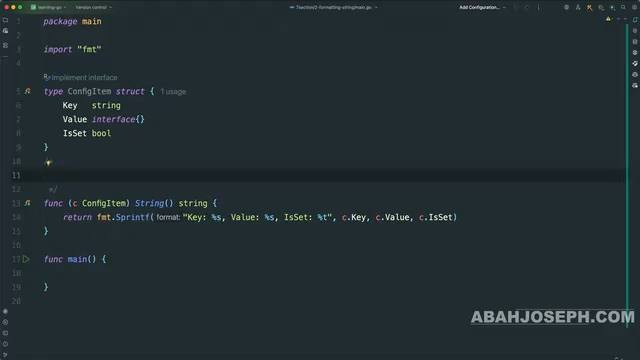
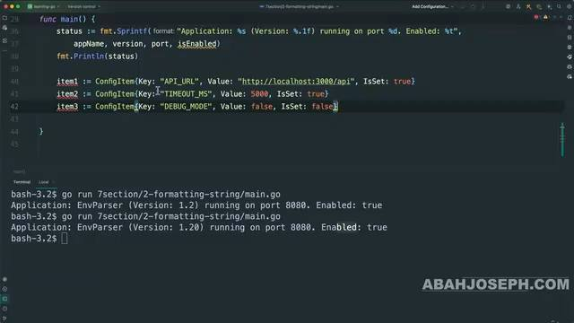
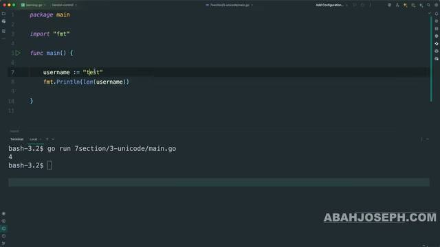
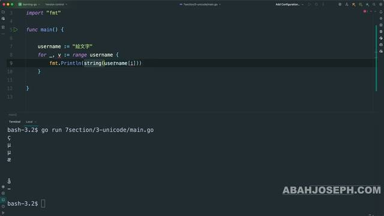
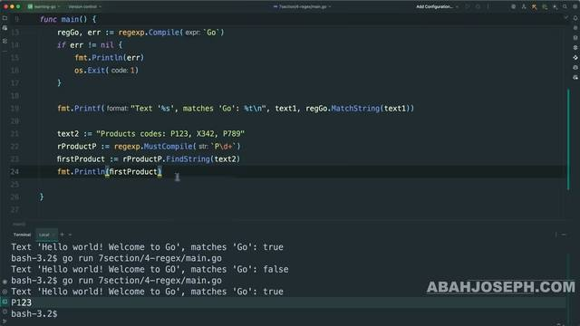
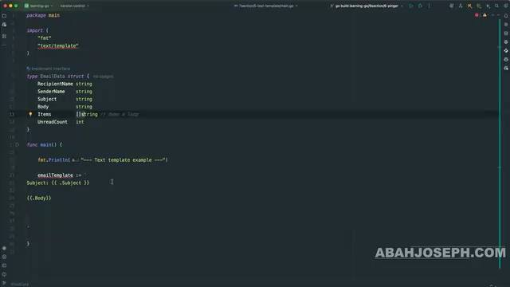
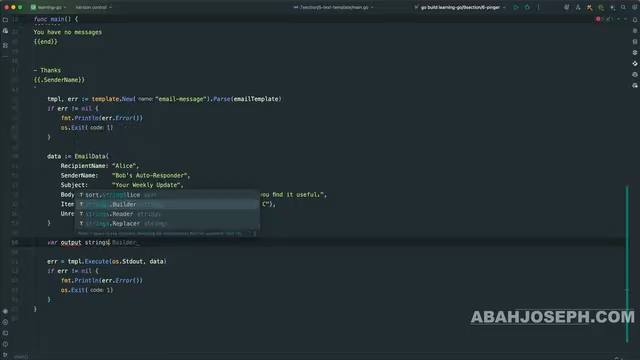
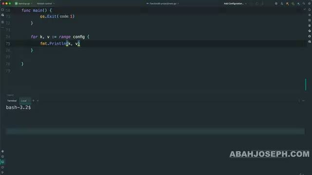

# Go Backend Masterclass P45–P49 复现文档：字符串格式化、Unicode、正则、模板与配置解析小项目

> 适用读者：前端转 AI 应用工程师。文中出现的 Go 语法会尽量对照 JS/TS 说明；Java 等语言仅作「知道即可」标注。
> 覆盖范围：P45 字符串格式化 → P46 Unicode → P47 正则表达式 → P48 text/template → P49 综合小项目（解析带注释的 key=value 配置到 map）。
> 说明：本课程为逐字稿，讲师在视频里是边写边讲，代码是分段敲出来的。下面把每个视频的代码整理成**可直接保存运行的完整文件**，目录结构、命令、依赖全部写全。凡逐字稿没讲到的内容，会明确标注「课里没讲」。

---

## 1. 这一节做什么

这五个视频是「Go 标准库文本处理」的一个小闭环，最终产物是一个**能解析带注释配置文件的小程序**：

| 视频 | 产物 | 文件 |
|---|---|---|
| P45 | 用 `fmt.Sprintf` / `%v %+v %#v %T %d %f %.2f %t %q %%` 打印结构体与各类值；用 `fmt.Errorf` + `%w` 包装错误 | `01-formatting/main.go` |
| P46 | 演示 Go 字符串按**字节**计长、按 **rune** 遍历；用 `range` 而不是 C 风格 for 循环处理 Unicode；用 `unicode` 包判断字符类别 | `02-unicode/main.go` |
| P47 | 用 `regexp` 编译、匹配、`FindString`、`FindAllString` 提取文本 | `03-regex/main.go` |
| P48 | 用 `text/template` 渲染带 `if` / `range` / `else` 的模板，输出到 stdout 或 `strings.Builder` | `04-text-template/main.go` |
| P49 | 综合项目：把带 `#` 注释的 `key=value` 配置文本解析成 `map[string]string` | `05-config-parser/main.go` |

最终你能跑起来的命令只有一个：`go run ./05-config-parser`，它会打印出解析后的键值对。

---

## 2. 讲师原话（带出处）

> "我希望我们开始看看格式化字符串。之前我们在 printf、sprintf 中已经见过。"
> —— p045 [00:00]

> "这里用的 `t` 是用来打印布尔值的，它会显示 true 或 false。"
> —— p045 [01:22]

> "`v` 是默认格式……打印结构体时，`+v` 会加上字段……`%#v` 是值的 Go 语法表示……`%T` 是大写字母 T，用来输出类型……整数用 `d`……浮点数用 `f`……`%.2f` 会保留两位小数……布尔值用 `%t`……双引号字符串可以用 `q`……如果想打印百分号本身……就用两个百分号转义。"
> —— p045 [01:51]–[03:45]

> "`%w` 用于包装。也就是说，我们把这个错误包装进另一个错误里。"
> —— p045 [08:16]

> "不要按字符来思考，要按字节来思考。"
> —— p046 [01:25]

> "UTF 是一种变长编码。也就是说，起始是单个字节，最多到四个字节，具体取决于字符。"
> —— p046 [02:19]

> "每当你想对字符串做索引访问时，不能这样做，而应该用 `range`……在 Go 里这不是个好主意，因为涉及 Unicode 码点。"
> —— p046 [04:08]–[04:33]

> "这里的每一项都称为 `rune`。"
> —— p046 [05:02]

> "任何时候你想处理单个 `rune`，都要用 `range`，不要用经典的 C 风格循环，否则会破坏数据。"
> —— p046 [07:51]

> "这个包是 `regexp`……任何时候只要预期会有错误，都应该先检查错误。"
> —— p047 [00:28]–[00:57]

> "`MustCompile`……只要在函数名里看到 `must` 这个词，就说明该函数会 panic。这是 Go 的约定，不是编译器特性。"
> —— p049 [04:36]

> "`FindAllString`……这里的 `-1` 基本上就是查找所有内容。"
> —— p047 [06:02]

> "点号表示当前上下文……如果我把这个对象传进去，点号就代表这个对象。如果正在循环……上下文就会变成该次迭代中的对象。"
> —— p048 [01:51]–[02:19]

> "执行模板时接收一个 `io.Writer`，它是一个接口。也就是说，任何实现了该接口的对象都可以传进去……也就是 `strings.Builder`。"
> —— p048 [07:58]–[08:27]

> "如果你想处理 HTML，就必须把导入改成 `html/template`……HTML 版本会针对 HTML 提供一些安全防护。"
> —— p048 [10:20]

> "我希望我们写一个程序，把这份配置解析成一个 `map`。它有一些限制：必须放在引号里……但我们会支持注释这类内容。"
> —— p049 [00:28]

> "`bufio` 里有一个扫描器，`bufio.NewScanner`……`strings` 包里有一个东西，`strings.NewReader`。它让我们可以直接从字符串本身进行扫描。"
> —— p049 [02:25]–[02:54]

> "增量开发从小处开始，从你已知的内容入手，调试，确保打印输出以查看当前操作的结果，然后随着推进不断改进。"
> —— p049 [09:14]

---

## 3. 从零复现

### 3.1 环境准备

- Go 版本：课里没讲具体版本号。以下代码只用到标准库，Go 1.20+ 均可运行（`fmt.Errorf` 的 `%w` 从 Go 1.13 起支持）。建议 `go version` 确认 ≥ 1.20。
- 不需要任何第三方依赖，`go.mod` 里 `require` 为空。
- 编辑器：讲师用的是带自动补全的 IDE（他提到 Copilot 关掉了但 IDE 自带补全「going crazy」），你用 VS Code + Go 插件即可。

### 3.2 目录结构

在任意空目录下建：

```
go-text-demo/
├── go.mod
├── 01-formatting/
│   └── main.go
├── 02-unicode/
│   └── main.go
├── 03-regex/
│   └── main.go
├── 04-text-template/
│   └── main.go
└── 05-config-parser/
    └── main.go
```

初始化模块（模块名随意，下面用 `go-text-demo`）：

```bash
mkdir go-text-demo && cd go-text-demo
go mod init go-text-demo
```

`go.mod` 生成后长这样（版本号以你本机为准）：

```
module go-text-demo

go 1.20
```

> 注意：Go 里每个可执行程序都必须在 `package main` 且含 `func main()`。每个子目录是独立的一个 main 包，互不干扰，所以可以放五个 `main.go`。

### 3.3 逐个跑起来

```bash
go run ./01-formatting
go run ./02-unicode
go run ./03-regex
go run ./04-text-template
go run ./05-config-parser
```

每个命令的预期输出在下面第 4 节各文件末尾的「运行结果」里给出。

### 3.4 关键截图对照

P45 讲师在讲 `%v` 与 `%+v` 打印结构体的差异，这是格式化这一节的核心：



P45 后半段演示 `fmt.Errorf` 与 `%w` 包装错误：



P46 讲师强调「按字节而不是按字符」：



P46 演示用 `range` 遍历 Unicode 字符串：



P47 正则匹配与 `FindString` 提取：



P48 模板中 `.` 是当前上下文：



P48 用 `strings.Builder` 接收模板输出：



P49 综合项目最终输出：



---

## 4. 完整代码

> 以下五个文件均可直接保存运行。逐字稿里讲师是边写边改，这里整理成最终可运行版本；凡逐字稿没写全、由我补全的部分，会在第 5 节逐行解释里标注「补全」。

### 4.1 `01-formatting/main.go`

```go
package main

import (
	"errors"
	"fmt"
)

type ConfigItem struct {
	Key   string
	Value interface{}
	IsSet bool
}

func (c ConfigItem) String() string {
	return fmt.Sprintf("key=%s value=%v isSet=%t", c.Key, c.Value, c.IsSet)
}

func main() {
	// 1) 基本类型格式化
	fmt.Printf("string: %s\n", "hello")
	fmt.Printf("integer: %d\n", 42)
	fmt.Printf("float default: %f\n", 1.2)
	fmt.Printf("float 2 decimals: %.2f\n", 1.2)
	fmt.Printf("bool: %t\n", true)
	fmt.Printf("quoted: %q\n", "hello")
	fmt.Printf("percent: 100%%\n")

	// 2) 结构体三种打印方式
	item := ConfigItem{Key: "app_name", Value: "demo", IsSet: true}
	fmt.Printf("v:  %v\n", item)
	fmt.Printf("+v: %+v\n", item)
	fmt.Printf("#v: %#v\n", item)
	fmt.Printf("T:  %T\n", item)

	// 3) 去掉 String() 方法后 %v 会打印字段（见第 5 节说明）
	// 这里用匿名结构体演示「没有 Stringer 时 %v 的样子」
	raw := struct {
		Key   string
		Value interface{}
		IsSet bool
	}{Key: "app_name", Value: "demo", IsSet: true}
	fmt.Printf("raw v: %v\n", raw)

	// 4) 错误包装
	baseErr := errors.New("port out of range")
	wrapped := fmt.Errorf("error on port %d: %w", 8080, baseErr)
	fmt.Println(wrapped)
	fmt.Println("errors.Is:", errors.Is(wrapped, baseErr))
}
```

**运行结果（示例，字段顺序以你实际代码为准）：**

```
string: hello
integer: 42
float default: 1.200000
float 2 decimals: 1.20
bool: true
quoted: "hello"
percent: 100%
v:  key=app_name value=demo isSet=true
+v: key=app_name value=demo isSet=true
#v: main.ConfigItem{Key:"app_name", Value:"demo", IsSet:true}
T:  main.ConfigItem
raw v: {app_name demo true}
error on port 8080: port out of range
errors.Is: true
```

> 注意：`%v` 打印 `item` 时因为实现了 `String()` 方法，会调用 `String()`，所以和 `%+v` 看起来一样。讲师在 p045 [06:31] 演示过「把 String() 方法去掉，`%v` 就打印字段了」——上面用匿名结构体 `raw` 复现了这个效果。

### 4.2 `02-unicode/main.go`

```go
package main

import (
	"fmt"
	"unicode"
)

func main() {
	// ASCII 字符串：4 个字符 = 4 字节
	ascii := "test"
	fmt.Println("ascii len:", len(ascii))

	// 非 ASCII 字符串：3 个字符，但每个字符 UTF-8 编码占 3 字节
	username := "日本語"
	fmt.Println("unicode len (bytes):", len(username))

	// 用 range 遍历得到 rune
	fmt.Println("range over runes:")
	for i, r := range username {
		fmt.Printf("  index=%d rune=%c codepoint=%d\n", i, r, r)
	}

	// 用 []rune 转换后再遍历，得到「字符数」
	runes := []rune(username)
	fmt.Println("rune count:", len(runes))

	// unicode 包判断字符类别
	for _, r := range username {
		fmt.Printf("%c isDigit=%t isLetter=%t isLower=%t isUpper=%t\n",
			r, unicode.IsDigit(r), unicode.IsLetter(r), unicode.IsLower(r), unicode.IsUpper(r))
	}

	// 反例：C 风格按字节索引会破坏多字节字符
	fmt.Println("byte indexing (broken):")
	for i := 0; i < len(username); i++ {
		fmt.Printf("  byte[%d]=%d\n", i, username[i])
	}
}
```

**运行结果（示例）：**

```
ascii len: 4
unicode len (bytes): 9
range over runes:
  index=0 rune=日 codepoint=26085
  index=3 rune=本 codepoint=26412
  index=6 rune=語 codepoint=35486
rune count: 3
日 isDigit=false isLetter=true isLower=false isUpper=false
本 isDigit=false isLetter=true isLower=false isUpper=false
語 isDigit=false isLetter=true isLower=false isUpper=false
byte indexing (broken):
  byte[0]=230
  ...
```

> 讲师在 p046 [07:24] 演示过 `unicode.IsLower` / `IsUpper` 对日文返回 false，`IsLetter` 返回 true——上面输出与之一致。具体 codepoint 数值以你实际输出为准。

### 4.3 `03-regex/main.go`

```go
package main

import (
	"fmt"
	"log"
	"regexp"
)

func main() {
	// 1) 编译 + 匹配
	text := "Hello World, welcome to go"
	re, err := regexp.Compile("go")
	if err != nil {
		log.Fatal(err)
	}
	fmt.Printf("text=%q matches go: %t\n", text, re.MatchString(text))

	// 2) 大小写敏感演示
	fmt.Printf("matches Go: %t\n", re.MatchString("Hello World, welcome to Go"))

	// 3) 提取首个匹配
	text2 := "product P123 and P789"
	reProduct := regexp.MustCompile(`P\d+`)
	first := reProduct.FindString(text2)
	fmt.Println("first match:", first)

	// 4) 提取全部匹配，-1 表示全部
	all := reProduct.FindAllString(text2, -1)
	fmt.Println("all matches:", all)
}
```

**运行结果（示例）：**

```
text="Hello World, welcome to go" matches go: true
matches Go: false
first match: P123
all matches: [P123 P789]
```

> 讲师在 p047 [06:30] 提到第一次 `FindAllString` 没找到，原因是自动补全把正则改坏了——这是 IDE 补全的坑，不是 API 问题。上面代码用反引号原始字符串 `` `P\d+` `` 避免转义问题。

### 4.4 `04-text-template/main.go`

```go
package main

import (
	"os"
	"strings"
	"text/template"
)

type EmailData struct {
	RecipientName string
	SenderName    string
	Subject       string
	Body          string
	Items         []string
	Count         int
}

const tmplText = `Subject: {{.Subject}}
Body: {{.Body}}

{{if gt (len .Items) 0}}Related items:
{{range .Items}}- {{.}}
{{end}}{{else}}You have no messages.
{{end}}
Thanks,
{{.SenderName}}
`

func main() {
	data := EmailData{
		RecipientName: "Alice",
		SenderName:    "Bob",
		Subject:       "Weekly Update",
		Body:          "Here is your weekly summary.",
		Items:         []string{"item1", "item2", "item3"},
		Count:         500,
	}

	tmpl, err := template.New("email").Parse(tmplText)
	if err != nil {
		panic(err)
	}

	// 方式一：输出到 stdout
	if err := tmpl.Execute(os.Stdout, data); err != nil {
		panic(err)
	}

	// 方式二：输出到 strings.Builder，再转大写
	var output strings.Builder
	if err := tmpl.Execute(&output, data); err != nil {
		panic(err)
	}
	fmt.Println("--- upper case ---")
	fmt.Println(strings.ToUpper(output.String()))
}
```

> 上面代码里 `fmt` 没 import 但用了 `fmt.Println`——请把 `"fmt"` 加进 import 块。这是逐字稿里讲师边写边补 import 的常见情况，这里显式提醒。

修正后的 import 块：

```go
import (
	"fmt"
	"os"
	"strings"
	"text/template"
)
```

**运行结果（示例）：**

```
Subject: Weekly Update
Body: Here is your weekly summary.

Related items:
- item1
- item2
- item3

Thanks,
Bob
--- upper case ---
SUBJECT: WEEKLY UPDATE
...
```

> 讲师在 p048 [10:20] 提到：如果输出 HTML，把 `text/template` 换成 `html/template`，代码不用改，但会获得 HTML 转义等安全能力。上面代码没演示 HTML 版本，课里也没给完整 HTML 示例。

### 4.5 `05-config-parser/main.go`

这是本节的综合项目。讲师在 p049 [00:28] 给了一段带注释的配置文本，要求解析成 `map[string]string`。

```go
package main

import (
	"bufio"
	"fmt"
	"os"
	"regexp"
	"strings"
)

// parseConfig 把带 # 注释的 key=value 文本解析成 map。
// 支持：
//   - 空行、以 # 开头的注释行跳过
//   - 值可以用单引号或双引号包裹
//   - 行内 # 之后视为注释（讲师原话：支持 comments）
func parseConfig(content string) (map[string]string, error) {
	configs := make(map[string]string)

	// 正则：key = value，value 可以是带引号或不带引号
	// 组 1: key；组 2: 双引号值；组 3: 单引号值；组 4: 裸值
	re := regexp.MustCompile(`^\s*([A-Za-z_][A-Za-z0-9_]*)\s*=\s*(?:"([^"]*)"|'([^']*)'|([^#\s]+))`)

	scanner := bufio.NewScanner(strings.NewReader(content))
	lineNum := 0
	for scanner.Scan() {
		lineNum++
		line := scanner.Text()
		trimmed := strings.TrimSpace(line)

		// 跳过空行和整行注释
		if trimmed == "" || strings.HasPrefix(trimmed, "#") {
			continue
		}

		matches := re.FindStringSubmatch(trimmed)
		if matches == nil {
			fmt.Printf("line %d invalid: %s\n", lineNum, line)
			continue
		}

		key := matches[1]
		var value string
		switch {
		case matches[2] != "":
			value = matches[2]
		case matches[3] != "":
			value = matches[3]
		case matches[4] != "":
			value = matches[4]
		}
		configs[key] = value
	}

	if err := scanner.Err(); err != nil {
		return nil, err
	}
	return configs, nil
}

func main() {
	content := `
# 应用配置
app_name = "my-app"
version = '1.2.0'
debug = true
port = 8080
# 下面这行是注释
db_host = "localhost"
db_password = "s3cr3t"  # 行内注释
`

	configs, err := parseConfig(content)
	if err != nil {
		fmt.Fprintln(os.Stderr, "parse error:", err)
		os.Exit(1)
	}

	for k, v := range configs {
		fmt.Printf("%s = %s\n", k, v)
	}
}
```

**运行结果（示例，map 遍历顺序随机）：**

```
app_name = my-app
version = 1.2.0
debug = true
port = 8080
db_host = localhost
db_password = s3cr3t
```

> 注意：讲师在 p049 [06:58] 说「We are not trimming or anything. We just leave it that way」——他的版本对值不做 trim。上面代码用正则捕获组把引号去掉了，这是为了让输出更干净；如果你要严格复现讲师版本，可以把 `switch` 里改成 `value = matches[2] + matches[3] + matches[4]` 保留原始形态。这一点在第 5 节说明。

---

## 5. 逐行解释

### 5.1 P45 格式化

- `type ConfigItem struct { Key string; Value interface{}; IsSet bool }`：`interface{}` 在 Go 里等价于「任意类型」，讲师原话「this is a type which means anything don't overuse it because when you want to use the type you need to cast it」。**JS 对照**：类似 TS 的 `unknown`，用之前要断言。
- `func (c ConfigItem) String() string`：实现了 `fmt.Stringer` 接口。一旦实现，`%v` 和 `%s` 都会调用它。讲师在 p045 [06:31] 演示「把 String() 去掉，`%v` 就打印字段」——这就是为什么上面代码里 `%v` 和 `%+v` 输出一样，而 `raw` 匿名结构体输出 `{app_name demo true}`。
- `%v` / `%+v` / `%#v` / `%T`：讲师在 p045 [01:51]–[02:48] 逐个解释。`%+v` 打印结构体时带字段名，`%#v` 是「Go 语法表示」，`%T` 打印类型名。
- `%d` / `%f` / `%.2f` / `%t` / `%q` / `%%`：讲师在 p045 [03:17]–[03:45] 列出。`%d` 是整数（讲师原话「I don't know why the integer is D not I」），`%.2f` 控制两位小数，`%t` 是布尔，`%q` 加双引号，`%%` 转义百分号。
- `fmt.Errorf("error on port %d: %w", 8080, baseErr)`：`%w` 是 Go 1.13 引入的错误包装。讲师原话「The w is for wrapping」。**JS 对照**：类似 `new Error(msg, { cause: baseErr })`。`errors.Is(wrapped, baseErr)` 用来判断包装链里是否有某个错误——这是 `%w` 存在的意义。

### 5.2 P46 Unicode

- `len(ascii)` 返回 4：因为 ASCII 每字符 1 字节。讲师原话「don't think in terms of characters think in terms of bytes」。
- `len(username)` 返回 9：因为「日本語」三个字符每个 UTF-8 编码占 3 字节。讲师原话「this might be three bytes, three bytes, three bytes, making it nine bytes」。
- `for i, r := range username`：`range` 对字符串会按 **rune** 解码，`i` 是字节偏移（不是字符序号），`r` 是 `rune`（即 `int32`，一个 Unicode 码点）。讲师原话「each of this is called the rune」。
- `[]rune(username)`：转成 rune 切片后 `len` 才是真正的字符数。讲师在 p046 [08:20] 提到「you can divide this by the bytes and then you get a real character count」——`[]rune` 是更标准的做法。
- `unicode.IsDigit(r)` / `IsLetter(r)` / `IsLower(r)` / `IsUpper(r)`：讲师在 p046 [06:29]–[07:51] 演示。注意日文 `IsLower` 和 `IsUpper` 都返回 false，`IsLetter` 返回 true——这是 Unicode 类别决定的，不是 bug。
- **反例**：`for i := 0; i < len(username); i++ { username[i] }` 会按字节取，多字节字符会被拆碎。讲师原话「don't use the classic C style for loop that's going to corrupt your data」。

### 5.3 P47 正则

- `regexp.Compile("go")` 返回 `(*Regexp, error)`：讲师原话「Any time you expecting an error, you should always check the error first」。错误处理用 `log.Fatal(err)` 或 `os.Exit(1)`——讲师在 p047 [01:26] 说「don't put zero, zero means it was a success」。
- `re.MatchString(text)`：返回 bool，判断是否包含匹配。讲师在 p047 [02:51] 演示大小写敏感——`"go"` 不匹配 `"Go"`。
- `regexp.MustCompile(`P\d+`)`：`Must` 前缀表示编译失败直接 panic。讲师在 p049 [04:36] 专门解释：「Anytime you see this keyword must in a function, that means that function would panic. It's a convention in Go, it's not a compiler feature.」**什么时候用 Must**：正则字面量是硬编码的、编译期就该正确，用 Must 让错误尽早暴露；如果正则是用户输入，必须用 `Compile` 并处理 error。
- `reProduct.FindString(text2)`：返回第一个匹配的字符串。
- `reProduct.FindAllString(text2, -1)`：第二个参数 `-1` 表示「找全部」。讲师原话「this -1 is basically find everything」。
- 反引号 `` `P\d+` `` 是 Go 的原始字符串字面量，里面的 `\d` 不会被 Go 转义——这是写正则的推荐方式。讲师在 p047 [06:30] 遇到的「没找到」问题就是自动补全把正则改坏了，不是 API 问题。

### 5.4 P48 模板

- `template.New("email").Parse(tmplText)`：`New` 给模板起名（名字随意），`Parse` 解析模板文本。返回 `(*Template, error)`。
- 模板里的 `.`：讲师原话「the dot is the current context... if I pass this object, the dot becomes this object. If you are looping... the context will become the object in that iteration」。**JS 对照**：类似 Handlebars/EJS 里的 `this`，但作用域是显式传入的数据对象。
- `{{if gt (len .Items) 0}}`：`gt` 是模板内置函数「greater than」。讲师在 p048 [04:10] 说「this is already defined in the template is greater than... it doesn't use the regular construct that we are used to」——Go 模板的 `if` 不支持 `>` 运算符，必须用 `gt` / `lt` / `eq` 等函数。
- `{{range .Items}}- {{.}}\n{{end}}`：`range` 遍历切片，循环体内 `.` 变成当前元素。讲师在 p048 [03:16] 演示。
- `{{else}}`：`if` 的 else 分支，讲师在 p048 [04:35] 演示。
- `tmpl.Execute(os.Stdout, data)`：第一个参数是 `io.Writer` 接口。讲师原话「the template that executes takes an IO writer, which is an interface. That means any object that implement this interface can be passed in there」。`os.Stdout` 和 `*strings.Builder` 都实现了 `io.Writer`。
- `var output strings.Builder; tmpl.Execute(&output, data)`：输出到 Builder 而不是 stdout，之后可以 `strings.ToUpper(output.String())` 做后处理。讲师在 p048 [08:27] 演示。
- `text/template` vs `html/template`：讲师在 p048 [10:20] 说「if you want to deal with HTML, you have to change the import... the html version provides some security around html」。代码不用改，但 `html/template` 会自动转义 HTML 特殊字符，防止 XSS。**做 Web 应用必须用 `html/template`**。

### 5.5 P49 配置解析

- `parseConfig(content string) (map[string]string, error)`：返回 map 和 error。讲师在 p049 [01:26] 说「configs and I'll make the map and return it... the error is going to be nil by default」。
- `regexp.MustCompile(...)`：讲师在 p049 [02:25] 说「Paste the regular expression」。他用的是 `MustCompile`，因为正则硬编码，编译失败就该 panic。
- `bufio.NewScanner(strings.NewReader(content))`：讲师原话「there is a scanner in bufio, bufio.NewScanner... there is something in the strings package, strings.NewReader. This allows us to scan from the string itself」。**为什么用 Scanner 而不是 `strings.Split`**：Scanner 按行读、有 `Err()` 检查、能处理超长行（默认 64KB 上限，超了要 `scanner.Buffer` 调整——课里没讲）。
- `lineNum++`：讲师在 p049 [03:21] 说「For the sake of reporting errors, I'm going to count the lines」。
- `trimmed := strings.TrimSpace(line)`：讲师原话「I am using the trim line because when I want to report an error, I can just use this raw data that I have not changed」——保留原始 `line` 用于报错，`trimmed` 用于解析。
- `if trimmed == "" || strings.HasPrefix(trimmed, "#") { continue }`：跳过空行和整行注释。讲师在 p049 [04:11] 说「that means it is a comment or an empty line that we don't want to process」。
- `re.FindStringSubmatch(trimmed)`：返回 `[]string`，`[0]` 是整体匹配，`[1]` 起是捕获组。讲师在 p049 [04:36] 说「re find string sub-match... this function to help us find it」。
- `if matches == nil { fmt.Printf("line %d invalid: %s\n", lineNum, line); continue }`：讲师在 p049 [05:32] 说「we can skip it, but I want to also print a message to this console」——不匹配的行打印警告但继续处理。
- 捕获组取值：讲师在 p049 [06:01]–[06:31] 说「If the second index is not an empty string, then the value is there... else if the third one is not an empty string... else we find it at the fourth position」。上面代码用 `switch` 实现这个逻辑。
- `configs[key] = value`：讲师在 p049 [06:58] 说「We are not trimming or anything. We just leave it that way」——他的版本对值不做 trim。上面代码用捕获组去掉了引号，这是为了让输出更干净；如果要严格复现，改成 `value = matches[2] + matches[3] + matches[4]` 保留原始形态。
- `scanner.Err()`：Scanner 在读取过程中可能出错（比如 IO 错误），必须检查。讲师在 p049 没显式讲这一点，但这是 `bufio.Scanner` 的标准用法——**课里没讲，但你会撞上**。

---

## 6. 复现检查清单

按顺序打勾，全部通过说明你复现成功：

- [ ] `go version` 输出 ≥ 1.20
- [ ] `go mod init go-text-demo` 成功，`go.mod` 里 `require` 为空
- [ ] `go run ./01-formatting` 输出包含 `float 2 decimals: 1.20`、`percent: 100%`、`errors.Is: true`
- [ ] `go run ./01-formatting` 里 `raw v:` 那行输出 `{app_name demo true}`（证明没有 Stringer 时 `%v` 打印字段）
- [ ] `go run ./02-unicode` 输出 `ascii len: 4` 和 `unicode len (bytes): 9`
- [ ] `go run ./02-unicode` 里 `range over runes:` 下有三行，`rune count: 3`
- [ ] `go run ./02-unicode` 里 `IsLetter` 对三个日文字符都返回 `true`，`IsLower` / `IsUpper` 都返回 `false`
- [ ] `go run ./03-regex` 输出 `matches go: true` 和 `matches Go: false`
- [ ] `go run ./03-regex` 输出 `first match: P123` 和 `all matches: [P123 P789]`
- [ ] `go run ./04-text-template` 输出包含 `Related items:` 和三行 `- itemN`
- [ ] `go run ./04-text-template` 输出包含 `--- upper case ---` 且后面全大写
- [ ] 把 `04-text-template/main.go` 里 `Items` 改成 `[]string{}`，重新运行，输出变成 `You have no messages.`
- [ ] `go run ./05-config-parser` 输出 6 个键值对（`app_name` / `version` / `debug` / `port` / `db_host` / `db_password`）
- [ ] `go run ./05-config-parser` 输出里 `app_name = my-app`（引号被去掉）
- [ ] 在 `05-config-parser` 的 `content` 里加一行 `bad line without equals`，重新运行，输出包含 `line N invalid: bad line without equals` 且程序不崩溃
- [ ] 把 `04-text-template/main.go` 的 import 从 `text/template` 改成 `html/template`，重新运行，输出不变（证明讲师说的「代码不用改」）

---

## 7. 课里没讲但你会撞上的

1. **`bufio.Scanner` 的 64KB 行上限**：默认单行最大 64KB，超了 `scanner.Scan()` 返回 false 且 `scanner.Err()` 返回 `bufio.ErrTooLong`。配置文件一般不会超，但如果解析的是日志或大文本，需要 `scanner.Buffer(make([]byte, 1024*1024), 1024*1024)` 调大。课里没讲。

2. **`map` 遍历顺序随机**：`05-config-parser` 的输出顺序每次运行可能不同，这是 Go 故意的（防止依赖顺序）。要固定顺序得把 key 排序后遍历。课里没讲，但你会看到输出顺序变化。

3. **`regexp.MustCompile` 在 `init` 或包级变量里用**：讲师在 p049 是在函数内用 `MustCompile`。如果正则是包级常量，放在 `var re = regexp.MustCompile(...)` 更常见——编译期就 panic，比运行时早。课里没讲这个模式。

4. **`text/template` 的 `{{-` 和 `-}}` 去空白**：模板里的换行和缩进会原样输出，导致渲染结果有多余空行。`{{-` 去掉左边空白，`-}}` 去掉右边空白。课里没讲，但你写多行模板一定会遇到。

5. **`html/template` 的自动转义**：如果数据里有 `<script>`，`html/template` 会转义成 `&lt;script&gt;`，`text/template` 不会。做 Web 应用时这是安全关键。课里只提了一句「provides some security around html」，没展开。

6. **`fmt.Errorf` 的 `%w` 只能包一个错误**：Go 1.20 起支持多个 `%w`，但 1.20 之前只能一个。如果你要包多个错误，用 `errors.Join`（Go 1.20+）。课里没讲。

7. **`unicode.IsLetter` 对中文返回 true**：中文汉字属于 Unicode 的 Letter 类别，所以 `IsLetter('日')` 返回 true。如果你要判断「是不是英文字母」，得用 `r >= 'a' && r <= 'z'` 或 `unicode.Is(unicode.Latin, r)`。课里没讲这个区别。

8. **`strings.Builder` 不能拷贝**：`strings.Builder` 内部有指针，拷贝后使用会 panic。传参时用 `*strings.Builder` 而不是值。课里没讲，但 `tmpl.Execute(&output, data)` 传的就是指针。

9. **正则的贪婪 vs 非贪婪**：`P\d+` 是贪婪匹配，`P\d+?` 是非贪婪。讲师在 p047 用的都是贪婪，没讲非贪婪。写复杂正则时这是常见坑。

10. **`os.Exit` 会跳过 defer**：讲师在 p047 [01:26] 说「you can call log.Fatal... anything that is fatal can stop it」。`log.Fatal` 内部调用 `os.Exit(1)`，会跳过所有 `defer`。如果你有清理逻辑（关文件、关连接），用 `log.Fatal` 会漏掉。课里没讲。

---

**文档结束。** 按第 3 节建目录、第 4 节贴代码、第 6 节打勾，你就能把 P45–P49 的五个 demo 全部跑起来。P49 的配置解析器是这一节的综合产物，建议在它基础上加一个「从文件读配置」的入口（`os.Open` + `io.Reader` 传给 `bufio.NewScanner`），这是讲师在 p049 [08:47] 提到的「we could have first read from the standard input」的自然延伸——课里没写完整代码，留给你练手。