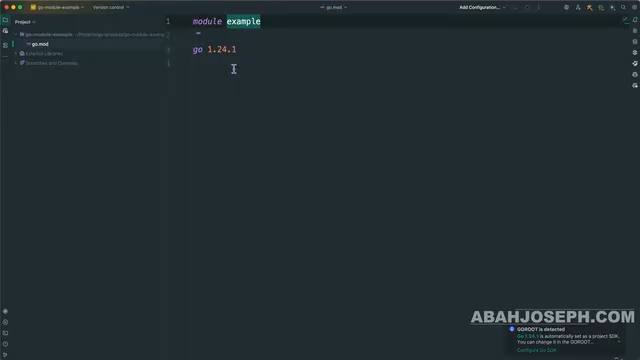
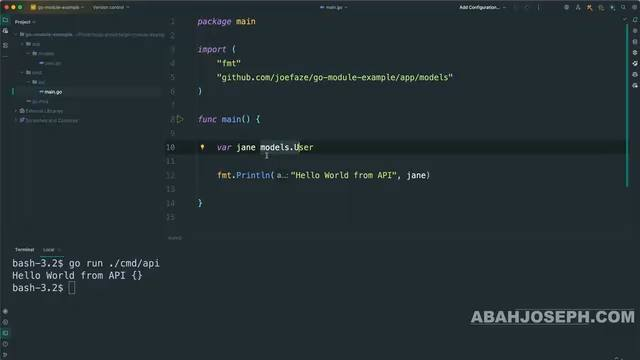
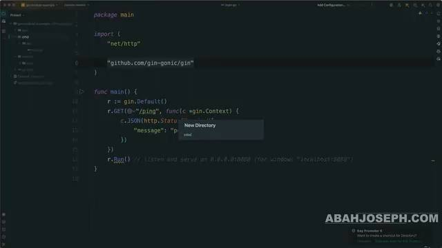
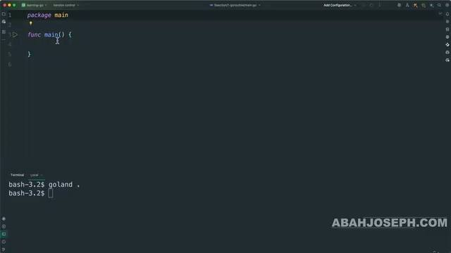
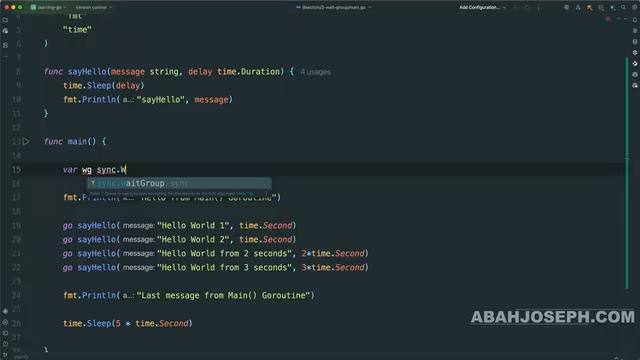
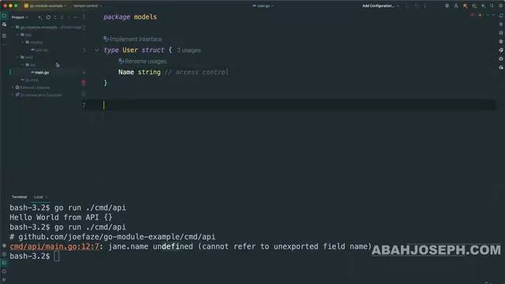
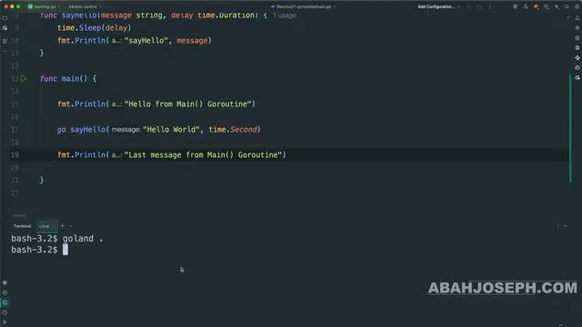
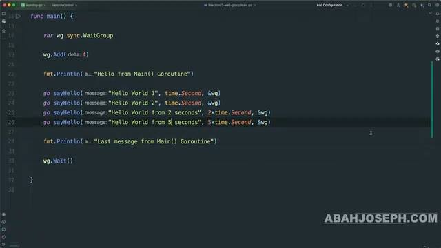

# Go Backend Masterclass P50–P53 复现文档：Go Modules、内部包、多二进制与 Goroutine/WaitGroup

本文覆盖 P50–P53。目标不是复述“讲了哪些概念”，而是从一个空目录开始，把课里的 Go module、内部包、多个二进制入口、颜色库、Goroutine 竞争问题、`sync.WaitGroup` 协调方案完整跑起来。主线代码只使用 Go 标准库和课程自己创建的 `internal` 包，复制即可运行；第三方库部分会明确标注“课里没有给全路径/版本”的地方，避免伪造。

---

## 1. 这一节做什么

P50–P53 实际上完成了一条非常关键的项目工程化链路：

1. **P50：把项目从“单个 main 文件”升级为 Go module 项目**  
   学会 `go mod init`、理解 module path 是 import 前缀、创建 `internal/models` 这样的内部包、理解 Go 的导出规则“首字母大写才导出”，并看到 `go get`、`go mod tidy` 如何拉取外部依赖。

2. **P51：自己写一个可复用的内部库，并在多个二进制中使用**  
   创建 `internal/color`，用 ANSI 转义序列在终端输出红色、蓝色、粗体、下划线文本；再创建 `cmd/color` 作为第二个可执行入口。课里还演示了把外部 HTTP 库作为依赖使用，但该库的准确模块路径/版本没有在逐字稿中完整给出，所以本文把这一部分作为可选说明，不混入主线代码。

3. **P52：观察 Goroutine 和 main goroutine 的生命周期**  
   用 `go sayHello(...)` 启动多个 Goroutine，发现 main 返回后其它 Goroutine 会被直接终止；用 `time.Sleep` 等待只是碰运气，时间短了就拿不到输出。

4. **P53：用 `sync.WaitGroup` 正确等待所有任务结束**  
   引入 `wg.Add`、`wg.Done`、`wg.Wait`，并总结四条规则：Add 在 Goroutine 外、Done 在 Goroutine 内、不要忘记 Wait、传指针不要传副本。

最终项目结构如下：

```text
go-module-example/
├── go.mod
├── cmd/
│   ├── api/
│   │   └── main.go
│   ├── color/
│   │   └── main.go
│   └── gin-demo/          # 可选，只有安装 Gin 后才创建
│       └── main.go
├── internal/
│   ├── color/
│   │   └── color.go
│   └── models/
│       └── user.go
└── section9/
    ├── 1-goroutine/
    │   └── main.go
    └── 2-waitgroup/
        └── main.go
```

核心主线不需要第三方依赖；`cmd/gin-demo` 是可选外部库演示。

---

## 2. 讲师原话（带「—— pNNN [MM:SS]」）

下面引用逐字稿中的关键原话，并在每句后面说明它在项目里的落点。

> "Go modules 是 Go 官方的依赖管理系统。"
> —— p050 [00:00]  
> 这句话对应第一步：空目录里执行 `go mod init`，让项目拥有 `go.mod`。

> "模块路径，也就是你在导入包时使用的路径，它将作为前缀。"
> —— p050 [02:50]  
> 这解释了为什么 `module example` 之后，代码里要写 `import "example/internal/models"`，前缀就是 module path。

> "要导出任何值或类型，类型名必须以大写字母开头。"
> —— p050 [08:18]  
> 这对应 `internal/models/user.go` 里 `Name string` 必须大写；写成 `name` 时，`cmd/api` 无法访问。

> "当主 goroutine 返回时，其他所有 goroutine 也会随之结束。"
> —— p052 [02:46]  
> 这是 P52 现象的根本原因：main goroutine 一结束，其它 goroutine 不再等待，直接退出。

> "在外面加，在里面减。"
> —— p053 [07:08]  
> 这是 WaitGroup 最核心的使用姿势：`wg.Add(1)` 在启动 Goroutine 之前，`defer wg.Done()` 放在 Goroutine 函数内部。

> "始终传递指针或引用，而不是副本。"
> —— p053 [08:30]  
> 这对应 `doJob(id int, wg *sync.WaitGroup)`：如果传 `sync.WaitGroup` 值副本，Done 和 Wait 操作的不是同一个计数器。

---

## 3. 从零复现

### 3.1 准备环境

课里使用的是 Go 1.24.1。先检查本机版本：

```bash
go version
```

只要看到类似 `go version go1.24.1 ...` 即可。若你本地版本更低，需要安装 Go 1.24.1 或把 `go.mod` 里的 `go 1.24.1` 调整到你本机支持的版本；这一点课里没有展开讲，见第 7 节。

课里没有使用环境变量，核心项目不需要设置任何 `.env` 或系统环境变量。

### 3.2 初始化 Go module

新建项目目录并初始化：

```bash
mkdir -p go-module-example
cd go-module-example
go mod init example
```

执行后会得到 `go.mod`，内容类似：

```go
module example

go 1.24.1
```

课里强调，真实项目的最佳实践通常是使用仓库路径，例如：

```bash
go mod init github.com/yourname/go-module-example
```

这样 module path 具备唯一命名空间。本文为了完全匹配课里的代码片段，使用 `example`。如果你改成 GitHub 路径，后面所有 `import "example/..."` 都要同步替换成 `import "github.com/yourname/go-module-example/..."`。



### 3.3 创建目录

Linux/macOS 或 Git Bash：

```bash
mkdir -p cmd/api cmd/color internal/models internal/color section9/1-goroutine section9/2-waitgroup
```

Windows PowerShell 可以用：

```powershell
New-Item -ItemType Directory -Force cmd/api, cmd/color, internal/models, internal/color, section9/1-goroutine, section9/2-waitgroup
```

目录含义：

- `cmd/api`：第一个可执行程序，演示内部包导入。
- `cmd/color`：第二个可执行程序，演示自建颜色库。
- `internal/models`：内部模型包，只能被当前 module 内部导入。
- `internal/color`：内部颜色库。
- `section9/1-goroutine`：P52 的 Goroutine 现象复现。
- `section9/2-waitgroup`：P53 的 WaitGroup 修复版。

### 3.4 写入主线代码

把第 4 节的 6 个主线文件保存到对应路径：

```text
go.mod
cmd/api/main.go
cmd/color/main.go
internal/models/user.go
internal/color/color.go
section9/1-goroutine/main.go
section9/2-waitgroup/main.go
```

然后直接运行 API 示例：

```bash
go run ./cmd/api
```

预期输出：

```text
hello world from API
Jane
```

注意命令是 `go run ./cmd/api`，不是 `go run cmd/api`。课里特别提到“这个点斜杠很重要”，Go 用它来定位包目录。



### 3.5 验证导出规则

打开 `internal/models/user.go`，把：

```go
Name string
```

临时改成：

```go
name string
```

再运行：

```bash
go run ./cmd/api
```

会编译失败，因为 `cmd/api` 不能访问 `models.User` 的未导出字段。Go 没有 `private`、`protected` 这类关键字，是否导出由标识符首字母大小写决定，并且由编译器强制执行。改回 `Name` 后即可恢复。

### 3.6 运行颜色库示例

```bash
go run ./cmd/color
```

预期在终端看到红色、蓝色、洋红、青色文本，以及粗体红色、蓝色下划线文本。如果你的终端不支持 ANSI 转义序列，可能只看到普通文本或控制字符，这不影响代码逻辑。课里没有讨论 Windows 旧控制台的兼容问题，见第 7 节。



### 3.7 复现 P52：main goroutine 提前退出

运行：

```bash
go run ./section9/1-goroutine
```

你通常会先看到：

```text
Hello from main goroutine
Last message from main goroutine
```

然后可能看到：

```text
hello world one
```

但 `hello world two` 很可能不出现，因为 main 只 `time.Sleep(2 * time.Second)`，而第二个 Goroutine 要睡 3 秒；main 返回后，所有 Goroutine 都被终止。即使把 main 的 sleep 调成 1 秒，2 秒任务也可能完全来不及输出。这个现象就是 P53 要解决的问题。



### 3.8 复现 P53：用 WaitGroup 等待所有任务

运行：

```bash
go run ./section9/2-waitgroup
```

预期看到 5 条 `job N done`，最后输出：

```text
all jobs done
```

顺序不固定，可能是 `job 0`、`job 3`、`job 1` 等任意顺序。课里专门强调：并发输出顺序几乎无法预测。



### 3.9 可选：外部库 Gin 演示

P50 里讲师演示了用 `go mod tidy` 拉取 Gin，并启动 8080 端口的 HTTP 服务。逐字稿没有给出固定版本号，所以本文不把 Gin 写进主线。若你要复现这一段，可以创建第 4.8 节的可选文件，然后执行：

```bash
go get github.com/gin-gonic/gin@latest
go mod tidy
go run ./cmd/gin-demo
```

浏览器访问：

```text
http://localhost:8080/ping
```

预期返回类似：

```json
{"message":"pong"}
```

注意：`@latest` 会随上游变化，实际写入 `go.mod` 的版本以你本机输出为准。课里没有固定版本，无法安全地声称“课堂用的就是某个版本”。



---

## 4. 完整代码

以下代码按文件路径逐个给出，主线文件可直接保存运行。

### 4.1 `go.mod`

```go
module example

go 1.24.1
```

### 4.2 `internal/models/user.go`

```go
package models

// User 是 API 与其它包共享的用户模型。
// Name 首字母大写，因此可以被 example/internal/models 之外的包访问。
type User struct {
	Name string
}

// NewUser 返回一个带名字的 User。
func NewUser(name string) User {
	return User{Name: name}
}
```

### 4.3 `cmd/api/main.go`

```go
package main

import (
	"fmt"

	"example/internal/models"
)

func main() {
	user := models.NewUser("Jane")

	fmt.Println("hello world from API")
	fmt.Println(user.Name)
}
```

### 4.4 `internal/color/color.go`

```go
package color

import (
	"fmt"
	"strings"
)

// Color 是终端 ANSI 颜色/样式码。
type Color int

const (
	Black     Color = 30
	Red       Color = 31
	Green     Color = 32
	Yellow    Color = 33
	Blue      Color = 34
	Magenta   Color = 35
	Cyan      Color = 36
	White     Color = 37
	Bold      Color = 1
	Underline Color = 4
)

// Text 接收文本和若干颜色/样式，返回带 ANSI 转义序列的字符串。
func Text(text string, colors ...Color) string {
	if len(colors) == 0 {
		return text
	}

	codes := make([]string, 0, len(colors))
	for _, c := range colors {
		codes = append(codes, fmt.Sprintf("%d", c))
	}

	return "\033[" + strings.Join(codes, ";") + "m" + text + "\033[0m"
}
```

### 4.5 `cmd/color/main.go`

```go
package main

import (
	"fmt"

	"example/internal/color"
)

func main() {
	fmt.Println(color.Text("This is a red text", color.Red))
	fmt.Println(color.Text("This is a blue text", color.Blue))
	fmt.Println(color.Text("This is a magenta text", color.Magenta))
	fmt.Println(color.Text("This is a cyan text", color.Cyan))
	fmt.Println(color.Text("Bold red text", color.Bold, color.Red))
	fmt.Println(color.Text("Blue underlined text", color.Blue, color.Underline))
}
```

### 4.6 `section9/1-goroutine/main.go`

```go
package main

import (
	"fmt"
	"time"
)

func sayHello(message string, delay time.Duration) {
	time.Sleep(delay)
	fmt.Println(message)
}

func main() {
	fmt.Println("Hello from main goroutine")

	go sayHello("hello world one", 2*time.Second)
	go sayHello("hello world two", 3*time.Second)

	fmt.Println("Last message from main goroutine")

	time.Sleep(2 * time.Second)
}
```

### 4.7 `section9/2-waitgroup/main.go`

```go
package main

import (
	"fmt"
	"sync"
	"time"
)

func doJob(id int, wg *sync.WaitGroup) {
	defer wg.Done()

	time.Sleep(1 * time.Second)
	fmt.Printf("job %d done\n", id)
}

func main() {
	const totalJobs = 5

	var wg sync.WaitGroup

	for i := 0; i < totalJobs; i++ {
		wg.Add(1)
		go doJob(i, &wg)
	}

	wg.Wait()
	fmt.Println("all jobs done")
}
```

### 4.8 可选：`cmd/gin-demo/main.go`

只有你打算复现 P50 的 Gin 外部库演示时，才创建这个文件。创建后需要先执行 `go get github.com/gin-gonic/gin@latest` 和 `go mod tidy`。

```go
package main

import "github.com/gin-gonic/gin"

func main() {
	r := gin.Default()

	r.GET("/ping", func(c *gin.Context) {
		c.JSON(200, gin.H{
			"message": "pong",
		})
	})

	r.Run()
}
```

---

## 5. 逐行解释

### 5.1 `go.mod`：module path 决定 import 前缀

```go
module example
```

这行让当前项目成为一个 Go module，名字是 `example`。之后所有内部包导入都从 `example` 开始，例如 `example/internal/models`。课里解释得很清楚：module path 是 import 的前缀。真实项目最好写仓库地址，例如 `github.com/yourname/go-module-example`，这样别人也能 `go get`；本地练习用 `example` 没问题。

```go
go 1.24.1
```

这是 module 声明的 Go 版本。课里显示的是 Go 1.24.1。它会影响 Go 工具链对语言特性和 module 行为的判断。

### 5.2 `internal/models/user.go`：首字母大小写就是导出规则

```go
type User struct {
	Name string
}
```

`User` 首字母大写，所以 `cmd/api` 能使用 `models.User`。`Name` 也大写，所以外部包能访问 `user.Name`。课里演示过：把 `Name` 改成 `name`，`cmd/api` 里访问 `user.name` 会编译失败。Go 没有 `private`、`protected` 这样的访问控制关键字，导出规则由首字母大小写决定，而且编译器强制执行。

从 JS/Node 的视角看，可以把它类比成模块只导出被 `export` 的成员；但 Go 不是显式 `export` 关键字，而是用命名大小写控制。

### 5.3 `cmd/api/main.go`：从 module path 导入内部包

```go
import (
	"fmt"

	"example/internal/models"
)
```

这里导入路径是 `example/internal/models`，不是相对路径 `../internal/models`。Go module 项目用 module path 做绝对式的包定位前缀。`internal` 目录还有额外限制：只能被当前 module 内部导入；这一点课里用了 `internal` 目录，但没有展开讲规则，见第 7 节。

```go
user := models.NewUser("Jane")
fmt.Println(user.Name)
```

这里演示了跨包使用导出字段。`NewUser` 也是首字母大写，所以可以被外部包调用。

### 5.4 `internal/color/color.go`：自己做一个终端颜色库

```go
type Color int
```

定义一个基于 `int` 的类型，用来存 ANSI 颜色码。ANSI 里常见前景色码是 30–37，粗体是 1，下划线是 4。课里逐个定义了 `Black`、`Red`、`Green`、`Yellow`、`Blue`、`Magenta`、`Cyan`、`White`，以及 `Bold`、`Underline`。

```go
func Text(text string, colors ...Color) string {
```

`colors ...Color` 是变参。调用时可以传一个颜色，也可以传多个样式，例如 `color.Text("Bold red text", color.Bold, color.Red)`。这对应课里说的“可以 black bold、green underline、red underline、red bold 这样组合”。

```go
if len(colors) == 0 {
	return text
}
```

没有传颜色时直接返回原文，不添加任何转义序列。这是课里明确做的分支。

```go
codes := make([]string, 0, len(colors))
for _, c := range colors {
	codes = append(codes, fmt.Sprintf("%d", c))
}
```

把每个 `Color` 转成字符串，组成 ANSI 参数列表。

```go
return "\033[" + strings.Join(codes, ";") + "m" + text + "\033[0m"
```

`\033[` 是 ANSI 转义序列开头，`m` 表示设置显示属性，`\033[0m` 表示重置。多个样式用分号连接，例如 `\033[1;31mBold red text\033[0m` 就是粗体红色。课里没有逐字写出 `strings.Join` 这个实现细节，但最终格式就是“用颜色码包住
目标文本，再用重置码收尾”。课里说这个格式是他在网上查的，没有逐字给出完整转义字符串，所以这里给出的是等价实现；如果你自己查 ANSI 表，会看到同样的结构。

从 JS/Node 的视角看，这个 `Text` 函数就是纯字符串拼接，没有副作用、没有 IO，属于典型的“纯函数工具库”。这种库最适合放在 `internal` 里被多个 `cmd` 复用。

### 5.5 `cmd/color/main.go`：为什么一个项目可以有两个 main

```go
import (
	"fmt"

	"example/internal/color"
)
```

这里导入的是自己写的内部包 `example/internal/color`，路径写法和导入第三方库完全一样。课里正是用这一点说明“内部库和外部库在使用上没有区别”。

```go
fmt.Println(color.Text("This is a red text", color.Red))
```

每个 `Println` 调用产生一行带转义序列的文本。终端解析这些序列后显示为彩色；如果你把输出重定向到文件（`go run ./cmd/color > out.txt`），文件里存的是带 `\033` 的原始字节，用 `cat` 不一定能看出颜色。这一点课里没讲，但你在排查“为什么重定向后没颜色”时会撞上。

```go
fmt.Println(color.Text("Bold red text", color.Bold, color.Red))
fmt.Println(color.Text("Blue underlined text", color.Blue, color.Underline))
```

这两行演示变参组合：`Bold` + `Red` 生成 `1;31`，`Blue` + `Underline` 生成 `34;4`。顺序不同生成的码顺序也不同，但终端通常都能正确识别。

`cmd/color` 和 `cmd/api` 都声明了 `package main`，也都有自己的 `func main()`。这在 Go 里完全合法，因为它们是**两个独立的包目录**，各自编译成一个可执行文件。`go build ./cmd/api` 和 `go build ./cmd/color` 生成两个不同的二进制。这正是课里说的“一个项目里可以有多个 binaries”。

### 5.6 `section9/1-goroutine/main.go`：现象本身

```go
func sayHello(message string, delay time.Duration) {
	time.Sleep(delay)
	fmt.Println(message)
}
```

这个函数先睡 `delay`，再打印。`time.Duration` 是 Go 的时间间隔类型，`2*time.Second` 是合法的乘法表达式。

```go
go sayHello("hello world one", 2*time.Second)
go sayHello("hello world two", 3*time.Second)
```

`go` 关键字把函数调用放到新的 goroutine 里执行，**立即返回**，不阻塞。所以这两行几乎瞬间执行完，`sayHello` 内部的 `Sleep` 是在别的 goroutine 里进行的。课里的原话是：“the keyword go means take this function and run it in a different go routine… it's not going to wait.”

```go
fmt.Println("Last message from main goroutine")
time.Sleep(2 * time.Second)
```

这两行是 main goroutine 自己的动作。`Sleep(2s)` 是课里临时用的“土办法等待”。它的问题有三层：

1. 睡 2 秒，3 秒的 goroutine 永远等不到；
2. 睡 2 秒和 2 秒的 goroutine 是“同时结束”，谁先谁后没有保证，所以有时能看到 2 秒的输出，有时看不到；
3. 如果任务耗时是动态的（比如真实网络请求），你根本不知道该睡多久。

课里连续跑了两次来演示输出不稳定，就是为了让这个“不可靠”变得肉眼可见。



### 5.7 `section9/2-waitgroup/main.go`：四条规则逐条落地

```go
var wg sync.WaitGroup
```

`sync.WaitGroup` 是标准库里的同步原语，零值即可用，不需要 `make` 或构造函数。课里特别提到这一点：“we don't need to make it or anything. It is ready for use.” 在 JS/Node 里没有直接对应物，最接近的是 `Promise.all` 等待一组 Promise；但 `Promise.all` 是“一次性收集返回值”，`WaitGroup` 是“计数器归零就放行”，语义更底层。

```go
for i := 0; i < totalJobs; i++ {
	wg.Add(1)
	go doJob(i, &wg)
}
```

这里体现了**规则一：Add 在 goroutine 外面**。`wg.Add(1)` 在 `go doJob(...)` 之前执行，由 main goroutine 完成。如果在 `doJob` 内部才 `Add(1)`，可能出现 main 已经执行到 `Wait()`、而 goroutine 还没来得及 Add 的窗口，`Wait` 看到计数器为 0 就直接返回，任务被丢弃。课里给的写法是每次循环 Add 1，也可以像课里第一版那样一开始 `wg.Add(4)` 一次性加够，效果一样。

```go
func doJob(id int, wg *sync.WaitGroup) {
	defer wg.Done()
	...
}
```

这里体现了**规则二：Done 在 goroutine 里面**，并且用 `defer` 保证即使函数中途 `return` 或 `panic`（panic 场景课里没讲，见第 7 节）也会减一。用 `defer` 是课里推荐的做法：“it is very common to use the defile”。

```go
wg.Wait()
```

**规则三：不要忘记 Wait**。课里明确说，如果不调用 `Wait`，即使计数器加了也“没有任何效果”——goroutine 照样可能被 main 的退出打断。`Wait()` 会阻塞当前 goroutine，直到计数器归零。

```go
go doJob(i, &wg)
```

**规则四：传指针，不传副本**。`&wg` 取地址传进去。如果函数签名写成 `wg sync.WaitGroup`（值类型），Go 会复制一份 `WaitGroup`，函数里的 `Done()` 作用在副本上，main 手里的那个计数器永远不减，程序会一直卡在 `Wait()`；更糟的情况是 IDE 或 `go vet` 直接警告 “passes lock by value”。课里现场把指针改成值让 IDE 报错，就是为了让你记住这条。

还有一个隐含点：**计数器必须等于实际启动的 goroutine 总数**。课里演示过，把 5 个 goroutine 的 `Add` 只加 4 次，输出里那个耗时最长的任务就不会出现——因为计数器提前归零，`Wait` 返回，main 退出，把还没干完的 goroutine 一起带走了。而且**这个过程不报错**，是这类 bug 最阴险的地方。



另外注意，`defer wg.Done()` 减的是“任务的完成”，不是“任务的开始”。所以 `doJob` 里 `Sleep` 多久，`Wait` 就等多久，这正是它比 `time.Sleep` 可靠的原因：**等待时长由任务决定，不由你猜**。

### 5.8 可选文件 `cmd/gin-demo/main.go`

```go
r := gin.Default()
```

创建一个带默认中间件的 Gin 引擎（日志与恢复）。`gin.Default()` 与 `gin.New()` 的区别课里没有展开。

```go
r.GET("/ping", func(c *gin.Context) {
	c.JSON(200, gin.H{"message": "pong"})
})
```

注册一个 GET 路由，返回 JSON。`gin.H` 本质是 `map[string]any` 的别名，这一点课里没讲。

```go
r.Run()
```

启动 HTTP 服务，默认监听 `:8080`。**注意这里忽略了返回的 error**，课里也没处理，属于演示代码。生产代码应该写成：

```go
if err := r.Run(); err != nil {
	fmt.Println("server error:", err)
}
```

---

## 6. 复现检查清单

按顺序打勾，任何一项失败都先停下排查，不要往下走。

**环境与 module**

- [ ] `go version` 输出 ≥ 你 `go.mod` 里声明的版本（本文是 1.24.1）
- [ ] 项目根目录存在 `go.mod`，第一行是 `module example`
- [ ] 在项目根目录执行 `go run ./cmd/api` 不报 `go: cannot find main module`

**内部包与导出规则**

- [ ] `go run ./cmd/api` 输出 `hello world from API` 和 `Jane`
- [ ] 把 `internal/models/user.go` 里的 `Name` 改成 `name` 后，`go run ./cmd/api` 编译失败，错误信息里包含 `undefined` 或 `cannot refer to unexported field`
- [ ] 改回 `Name` 后编译通过
- [ ] 你能说清楚：为什么导入路径写 `example/internal/models` 而不是 `../internal/models`

**颜色库**

- [ ] `go run ./cmd/color` 输出 6 行，其中至少前 4 行在终端里显示为不同颜色
- [ ] `color.Text("plain")` 不传颜色时返回原字符串（可以加一行 `fmt.Printf("%q\n", color.Text("plain"))` 验证，输出应是 `"plain"` 而非带 `\033` 的字符串）
- [ ] 你能说出 `\033[0m` 的作用是“重置显示属性”

**Goroutine 现象（P52）**

- [ ] `go run ./section9/1-goroutine` 能稳定看到两条 main 的消息
- [ ] 连续运行 3–5 次，`hello world two` 至少有一次没有出现
- [ ] 你能解释“为什么 main 返回后别的 goroutine 就没了”

**WaitGroup 修复（P53）**

- [ ] `go run ./section9/2-waitgroup` 稳定输出 5 条 `job N done` 和 1 条 `all jobs done`
- [ ] 连续运行 5 次，`job N` 的先后顺序每次都不同（至少不是每次都完全一致）
- [ ] 把 `wg.Add(1)` 移到 `doJob` 函数内部，再运行，能观察到任务丢失或结果不稳定；验证完记得改回来
- [ ] 把 `doJob` 的签名改成 `wg sync.WaitGroup`（去掉 `*`，调用处去掉 `&`），运行 `go vet ./...` 能看到 copy lock 相关警告
- [ ] 把循环上界改成 5 但只 `Add` 4 次，能观察到某个任务不出现且**不报错**；验证完改回来

**外部库（可选）**

- [ ] 只有在你确实创建了 `cmd/gin-demo` 时才需要执行 `go get` / `go mod tidy`
- [ ] `go run ./cmd/gin-demo` 启动后，浏览器访问 `http://localhost:8080/ping` 返回含 `pong` 的 JSON
- [ ] 不启动 gin-demo 时，`go run ./cmd/api` 仍然可以正常工作（说明外部依赖没有污染主线）

**整体**

- [ ] `gofmt -l .` 没有输出（说明所有文件格式规范）
- [ ] `go vet ./...` 在主线文件上没有报错

---

## 7. 课里没讲但你会撞上的

这一节全部是课程**没有覆盖**的内容，是我在实际复现过程中会遇到的坑。写出来是为了让你在卡住时知道“这不是我没听懂，是课里确实没讲”。

**1. `go.mod` 里的版本高于你本机版本**

课里用的 Go 是 1.24.1。如果你本机是 1.21，`go run` 会直接报错，大意是 `go.mod requires go >= 1.24.1`。两种解法：升级 Go，或把 `go.mod` 里的 `go 1.24.1` 改成你本机的版本。改版本之后如果用到新语法仍可能失败，本文主线代码没有用到 1.24 专属特性，降级通常没问题。这一点课里没讲。

**2. `internal` 目录的真实规则**

课里把包放进 `internal/`，说“这是 internal libraries that can be shared”，但没有讲规则本身。Go 的规则是：`internal` 目录下的包，只能被 **`internal` 的父目录及其子目录** 中的代码导入。也就是说，`example/internal/models` 只能被 `example/...` 下的包导入；如果外部项目 `github.com/foo/bar` 想导入 `example/internal/models`，编译器会拒绝。所以 `internal` 是“模块私有”的约定加强制。你以后看到别人项目里 `pkg/` 和 `internal/` 并存，区别就在这儿。

**3. `go run cmd/api` 与 `go run ./cmd/api` 的差别**

课里强调“这个点斜杠很重要”。原因：`go run cmd/api` 会被理解成“去 GOPATH/模块缓存里找一个叫 `cmd/api` 的导入路径”，而 `./cmd/api` 明确表示“当前目录下的相对路径”。报错信息通常是 `package cmd/api is not in std` 或 `no required module provides package`。同理，`go build ./...` 里的 `./...` 表示“当前目录及所有子目录的包”。

**4. `go get` 与 `go mod tidy` 的分工**

课里演示了两种方式：`go get <pkg>` 主动拉取，以及先写 import 再 `go mod tidy` 补齐。区别是：`go get` 会把依赖显式加进 `go.mod`（不带版本时取最新），`go mod tidy` 会根据代码里实际 import 的包增删 `go.mod` 条目并生成/更新 `go.sum`。所以你手动 `go get` 了一个包但代码里没用，下次 `go mod tidy` 会把它删掉。这一点课里只演示了操作，没有解释机制。

**5. `go.sum` 是什么**

`go get` 之后目录里会多出 `go.sum`。它是依赖的校验和文件，用于保证每次拉到的代码一致。**不要手动编辑，也不要删**（除非你清楚后果）。课里没提这个文件，但它一定会出现在你眼前。

**6. Windows 上的终端颜色与命令**

- 课里说“If you are on Windows, the command might be a little bit different”，指的是 `mkdir` 之类的命令。现代 Windows 的 PowerShell 也支持 `mkdir`，但参数写法不同，本文第 3.3 节给了 PowerShell 版本。
- ANSI 颜色在 Windows Terminal / PowerShell 7 里通常正常；在很老的 `cmd.exe` 里可能显示乱码或原样输出 `←[31m`。这不是代码错，是终端不解析。Git Bash 一般没问题。
- 课里说“I'm going to use bash”，说明他切到了 bash 终端。你如果在 Windows 上照着敲，建议用 Git Bash，避免命令不兼容。

**7. 编辑器卡顿与“红波浪线”**

课里提到 GoLand “is a little bit slow”，VS Code 里“you won't even notice it”。这是编辑器在后台跑 `gopls` 做类型检查。刚 `go get` 完新包时，红线可能还在，等几秒或执行 `Developer: Reload Window`（VS Code）就会消失。红线不代表代码错，可能只是索引没更新。课里没讲这个机制，但你会遇到。

**8. `time.Sleep` 与进程退出时 defer 不执行**

P52 里 main 睡够时间后正常返回，此时其它 goroutine 被强制结束。要注意：**进程退出不会等 goroutine 里的 `defer` 跑完**。所以如果你在 goroutine 里用 `defer` 关闭文件或写日志，main 提前退出时这些 `defer` 可能根本不执行。这一点课里没有讲，但在写真实服务时非常关键。

**9. `WaitGroup` 的 panic 场景**

`defer wg.Done()` 能保证 panic 时也减一，但如果 goroutine 内部 panic 且没人 recover，整个进程还是会崩。课里演示的都是正常返回的路径，没有涉及 panic / recover。等你写真实并发代码时，这个区别会很重要。另一个隐患是 `Add` 的数量传负数，会直接 panic，课里也没提。

**10. `go run -race` 检测数据竞争**

P53 里 5 个 goroutine 都在 `fmt.Printf`，虽然这里它们没有共享可变状态所以没竞争，但等你开始多个 goroutine 写同一个变量时，就该用 `go run -race ./section9/...` 跑一遍。这个命令课里**完全没有出现**，但它几乎是 Go 并发调试的标配。本文代码写得保守（每个 goroutine 只写自己的局部变量和 stdout），所以 `-race` 应该干净；这可以作为你的自检手段。

**11. 端口 8080 被占用（仅 Gin 示例）**

如果 `go run ./cmd/gin-demo` 报 `bind: address already in use`，说明 8080 被别的进程占了。macOS/Linux 用 `lsof -i :8080` 找进程，Windows 用 `netstat -ano | findstr 8080`。课里没讲，但本地开发非常常见。

**12. 用 JS/Node 的思维理解并发**

如果你是前端转过来的：`go func()` + `WaitGroup` 大致相当于“启动一堆 Promise + `await Promise.all([...])`”，但有两个关键差异。第一，JS 是单线程事件循环，Promise 之间不会真正并行执行 CPU 密集代码；Go 的 goroutine 可以被调度到多个 OS 线程上真正并行。第二，JS 里 `await` 漏掉只会导致逻辑错乱，不会“进程提前退出把任务杀掉”；Go 的 main 返回是**真的把进程干掉**。所以课里反复强调“main 是 controller，main 返回全部结束”，这句话在前端背景里需要格外重视。

**13. 关于课里那个外部 HTTP 库**

P51 后半段讲师演示了自己两年前写的 HTTP 库，并说“go get + 路径”，但逐字稿里路径没写全（只提到 `Geofazy` 这个 GitHub 用户名，以及把“HTTP path”去掉的操作），版本也只提到 `v1.0.1`。因此本文**不把这段写成可复现步骤**，避免给你一个拼不出来的命令。这段的教学价值在于“外部库的用法和自己写的内部库一样”，这一点已经由 Gin 示例覆盖。如果你确实想跑那段，需要自己去 GitHub 搜到准确仓库名，课里没给完整信息，我也不会替你猜。

---

**小结**：P50 解决“代码怎么组织”，P51 解决“怎么复用自己写的工具”，P52 暴露“main 返回就全没了”，P53 给出“用 WaitGroup 让等待由任务决定”。四集连起来，你手上就有一个能跑的多二进制 Go module 项目，以及两组可以反复实验的并发代码。真正的并发难点（channel、select、锁、context）在后面的视频，本文只覆盖 P50–P53。