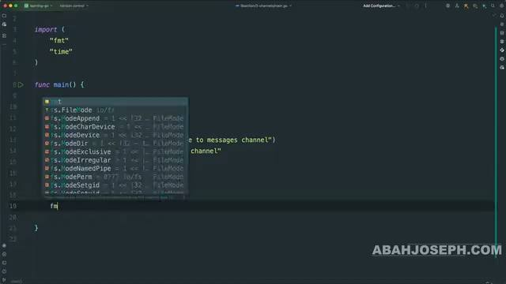
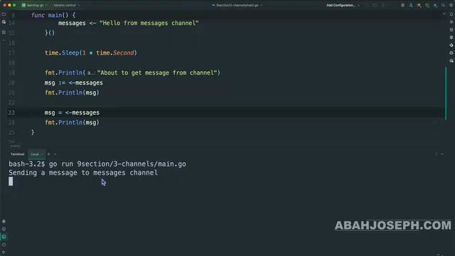
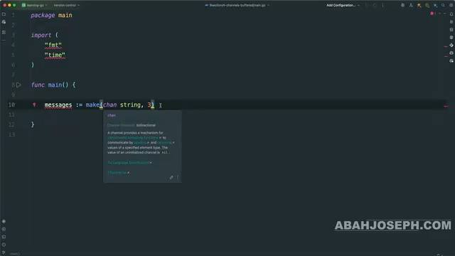
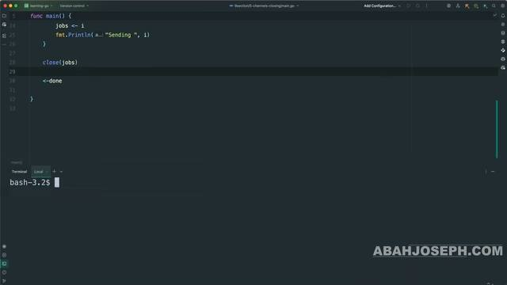
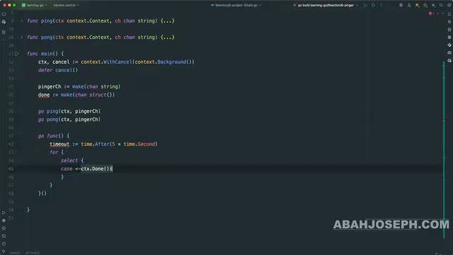
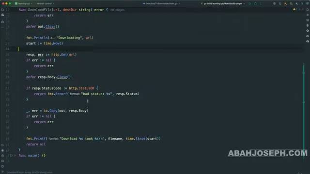
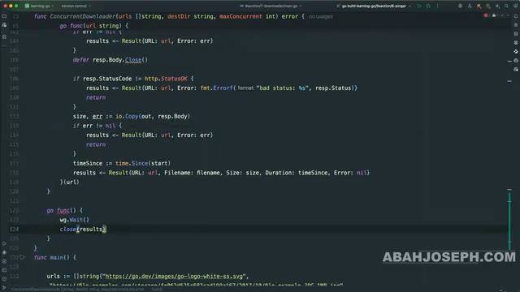
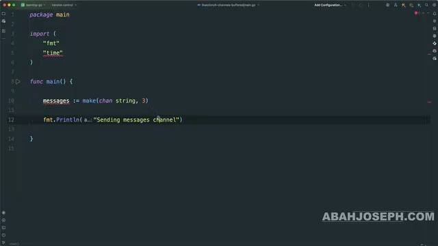
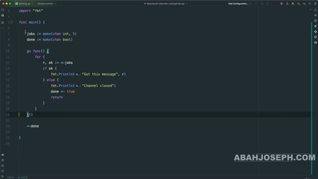
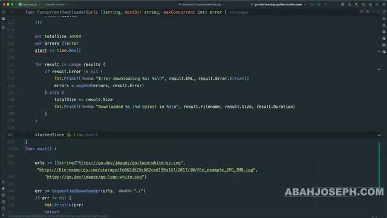

# Go Backend Masterclass P54–P58 复现文档：从 Channel 到并发下载器

这份文档覆盖 BV1N5x56nEfy 的 P54–P58。五集连起来是一条完整的实现线：先做出「两个 goroutine 通过 channel 交换数据」的最小例子，再加上缓冲、关闭、信号通道；然后用 `select + context` 做 ping-pong 小项目；最后把这些零件组装成一个真正能跑的并发文件下载器。读完你应该能在本地从空目录开始，把五个程序逐个跑出讲师演示过的输出。

环境约定：Go 1.21 及以上（课里没指定 Go 版本），只用标准库，不需要任何第三方依赖。所有代码放在一个 module 下，每个实验一个子目录、各自一个 `main` 包。

---

## 1. 这一节做什么

这一段的最终产物是 `p058-downloader`：一个命令行程序，接收一组 URL 和一个目标目录，用最多 N 个 goroutine 同时下载，每下载完一个文件就往 channel 里回传一条结果（文件名、字节数、耗时、错误），主 goroutine 汇总后打印每个文件的下载情况、总字节数和总耗时。

为了走到这一步，前面四集分别在解决四个具体问题：

- **P54**：两个 goroutine 怎么传数据？答案是用 `make(chan T)` 建一个无缓冲 channel，发送方 `ch <- v`，接收方 `v := <-ch`。这一集只做最小闭环，并故意演示「没有第二个发送方却接收第二次」时的死锁。
- **P55**：发送方不想等接收方就绪怎么办？用 `make(chan T, n)` 建缓冲 channel，最多能先塞 n 条，塞满才阻塞。
- **P56**：怎么告诉接收方「没有更多数据了」？用 `close(ch)`；接收方用 `v, ok := <-ch` 的 comma-ok 形式判断 channel 是否已关闭。这一集还把「第二个 channel 只用来发完成信号」改写成 `sync.WaitGroup`，对比两种收尾方式。
- **P57**：多个 goroutine 同时读写、还要能中途取消怎么办？用 `select` 同时监听 `ctx.Done()` 和数据 channel，5 秒超时后退出。
- **P058**：把上面所有东西拼成一个真实项目。关键方法是讲师反复强调的「先做能工作的顺序版本，再在上面加并发」。

目录结构（你可以完全照这个建）：

```text
go-backend-masterclass/
├── go.mod
├── p054-channels/
│   └── main.go
├── p055-buffered/
│   └── main.go
├── p056-closing/
│   └── main.go
├── p057-project-one/
│   └── main.go
└── p058-downloader/
    └── main.go
```

运行方式统一为 `go run ./p054-channels` 这种形式，不需要 `cd` 进子目录。

---

## 2. 讲师原话

下面这些句子是这一段的骨架，后面第 3、4 节的实现都对应到它们：

> "Go 中的通道是一种机制，让 Go 协程能够相互通信。"
> —— p054 [00:28]

> "通道必须创建；基本上你需要使用 make 来创建通道，也就是初始化通道。"
> —— p054 [01:25]

> "放入数据时箭头在右侧，取出数据时箭头在左侧。"
> —— p054 [03:10]

> "这种创建通道的方式称为无缓冲通道……接收方和发送方必须保持同步。"
> —— p055 [00:00]

> "缓冲通道意味着你可以继续向通道发送消息而不会阻塞……直到通道被填满。"
> —— p055 [02:22]

> "他们称之为逗号 ok 模式，它基本上会告诉你一个布尔值，表示通道是否打开。"
> —— p056 [01:51]

> "当通道关闭时，这个值会是 false，从而触发这段代码。"
> —— p056 [04:29]

> "选择语句允许我们监听多个通道。"
> —— p057 [02:17]

> "我们先定义一个能够从互联网下载内容的函数，然后在此基础上加入并发。"
> —— p058 [01:51]

> "先实现能正常工作的版本，再考虑并发；不要一开始就上并发，否则会出问题。"
> —— p058 [12:26]

> "限流器基本上就是用来控制并发的……它是速率限制器，也可以称为信号量。"
> —— p058 [21:50]



---

## 3. 从零复现

### 步骤 0：初始化 module

在任意空目录里：

```bash
go version
mkdir -p go-backend-masterclass
cd go-backend-masterclass
go mod init go-backend-masterclass
```

`go mod init` 这一步课里没讲（讲师直接在编辑器里建文件夹），但 Go 1.16 以后不开 module 直接 `go run` 会有麻烦，所以先做掉。`go.mod` 里只需要 module 名和 Go 版本声明，没有 `require`。

### 步骤 1：跑 P54，看到无缓冲 channel 的收发

创建 `p054-channels/main.go`（完整代码见第 4 节），然后：

```bash
go run ./p054-channels
```

预期输出（顺序可能因为 goroutine 调度略有前后，但内容一致）：

```text
sending a message to messages channel
about to get a message from channel
hello from messages channel
{Gopher}
```

课里为了不等 WaitGroup，在发送之后用了 `time.Sleep(time.Second)`，让 goroutine 有机会把消息放进 channel，然后再接收。这一步的 sleep 不是 channel 语义的一部分，只是教学简化。

接着复现死锁：把 `main.go` 里「第二次接收」那三行注释取消，再跑一次：

```text
about to get a message from channel
hello from messages channel
about to get a second message from channel
fatal error: all goroutines are asleep - deadlock!
```



这个报错的意思是：没有任何 goroutine 还能推进，主 goroutine 卡在 `<-messages` 上，发送方 goroutine 已经发完退出了。课里原话是 "所有 Go 协程都处于休眠状态……这只说明里面已经没有别的东西了，而我们还在试图从中取更多消息。"。

### 步骤 2：跑 P55，看到缓冲 channel 先存后取

创建 `p055-buffered/main.go`，运行：

```bash
go run ./p055-buffered
```

预期输出：

```text
sending first message
sending second message
channel is full, no receiver yet, but we are still running
first message
second message
third message
fourth message is sitting in the buffer
fourth message
```

关键点：容量设为 2 时，前两条发送不需要任何接收者就返回了；第三条如果发出去就会阻塞（代码里被注释掉了）。接收两条腾出空间后，又能继续发。



### 步骤 3：跑 P56，先看双 channel 收尾，再看 WaitGroup 收尾

创建 `p056-closing/main.go`。这个文件里实际上要跑两遍：第一遍用 `jobs + done` 两个 channel，第二遍把 `done` 换成 `sync.WaitGroup`。你可以把两段分别放在 `main` 函数里顺序执行，也可以跑一遍改一遍。推荐先只保留双 channel 版本：

```bash
go run ./p056-closing
```

预期输出（`sent job` 和 `received job` 的先后交错是正常的）：

```text
sent job 1
sent job 2
sent job 3
sent all jobs
received job 1
received job 2
received job 3
received all jobs
```

然后把第二段（WaitGroup 版）的代码取消注释、把第一段注释掉，再跑一次，输出内容相同，但不再有 `done` channel。



### 步骤 4：跑 P57，看 ping-pong 五秒后自动停

创建 `p057-project-one/main.go`，运行：

```bash
go run ./p057-project-one
```

预期输出：大约每秒钟出现一行 `ping ...` 或 `pong ...`，两个 goroutine 抢同一个 channel，顺序不固定；5 秒后打印：

```text
operation completed
done
```

程序退出。如果你看到 `ping` 和 `pong` 交替得非常规律，那是调度巧合，不是代码保证的。



### 步骤 5：跑 P58，先顺序下载，再并发下载

创建 `p058-downloader/main.go`。这个文件里同时保留了 `downloadFile`、`downloadSequential`、`downloadConcurrent` 三个函数，`main` 里默认只调用并发版。建议你先在 `main` 里把 `downloadSequential` 的调用取消注释、把并发版注释掉，跑一次：

```bash
go run ./p058-downloader
```

它会创建 `downloads/` 目录，把三个 URL 逐个下载进去，并打印每个文件的耗时和总耗时。确认三个文件都在 `downloads/` 里之后，再切回并发版：

```bash
go run ./p058-downloader
```

预期输出类似：

```text
downloaded README.md size=... bytes in ...
downloaded LICENSE size=... bytes in ...
downloaded go_spec.html size=... bytes in ...
all downloads completed in ... total size=... bytes
```

课里演示时两个小文件只花了 392 毫秒，讲师的原话是 "它非常快。你看到它有多快了吗？"。文件大小和耗时字段的具体数值每次都会不同，不要照抄。



如果故意放一个不存在的 URL，顺序版会打印 `error downloading ...` 并继续下载后面的；并发版会把这个错误放进 `errs` 切片，最后统一打印。并且失败时创建出来的空文件会被删掉——这是讲师在 P58 后半段专门回头补的：


这一步的判断顺序很重要：`os.Create` 在 `http.Get` 之前执行，所以只要请求失败，磁盘上就已经有一个 0 字节文件了。讲师的处理是在 `http.Get` 报错和状态码不对这两个分支里都调用 `os.Remove(filePath)`，原话是 "当我们遇到 HTTP 错误时，就把它移除；当我们收到不想要的状态码时，也把它移除。"。

### 步骤 6：验证「一个坏 URL 不影响其他 URL」

在 `main` 的 URL 切片最前面加一条肯定不存在的地址，比如 `https://example.com/definitely-not-here.txt`，再跑顺序版。预期输出：

```text
downloading https://example.com/definitely-not-here.txt
error downloading https://example.com/definitely-not-here.txt: ...
downloading https://raw.githubusercontent.com/golang/go/master/README.md
downloaded ...
```

关键是后面几条仍然继续下载，因为顺序版在循环里只打印错误、不 `return`。跑完检查 `downloads/` 目录：坏 URL 对应的文件应该已经不存在。

### 步骤 7：切到并发版并对比耗时

把 `main` 里并发调用取消注释，再跑一次。两个小文件（README.md、LICENSE）几乎同时落盘，总耗时接近其中较慢的那一个，而不是两者相加。课里演示时是 392 毫秒，讲师说 "你甚至感觉不到自己是在从互联网上下载。"。

到这里五个实验全部跑通，可以进入下面的代码细节。

---

## 4. 完整代码

以下五个文件都是**完整文件**，保存到对应路径即可直接 `go run`。除了 P58 里取文件名用了 `url.Parse` 再 `path.Base`（课里是直接 `path.Base(url)`，见第 7 节说明原因），其余逻辑与逐字稿一致。

### 4.1 `go.mod`

```go
module go-backend-masterclass

go 1.21
```

### 4.2 `p054-channels/main.go`

```go
package main

import (
	"fmt"
	"time"
)

type user struct {
	name string
}

func main() {
	messages := make(chan string)

	go func() {
		fmt.Println("sending a message to messages channel")
		messages <- "hello from messages channel"
	}()

	// 课里为了让发送方先跑，临时 sleep 一秒；正式代码不应该靠 sleep 同步
	time.Sleep(time.Second)

	fmt.Println("about to get a message from channel")
	msg := <-messages
	fmt.Println(msg)

	// 死锁演示：把下面两行取消注释后重新运行
	// fmt.Println("about to get a second message from channel")
	// fmt.Println(<-messages)

	users := make(chan user)
	go func() {
		users <- user{name: "Gopher"}
	}()
	time.Sleep(time.Second)
	fmt.Println(<-users)
}
```

### 4.3 `p055-buffered/main.go`

```go
package main

import "fmt"

func main() {
	// 容量 2 的缓冲 channel
	messages := make(chan string, 2)

	fmt.Println("sending first message")
	messages <- "first message"

	fmt.Println("sending second message")
	messages <- "second message"

	fmt.Println("channel is full, no receiver yet, but we are still running")

	fmt.Println(<-messages)
	fmt.Println(<-messages)

	messages <- "third message"
	fmt.Println(<-messages)

	messages <- "fourth message"
	fmt.Println("fourth message is sitting in the buffer")
	fmt.Println(<-messages)

	// 缓冲区已满且无人接收时，再发会阻塞：
	// messages <- "fifth message"
}
```

### 4.4 `p056-closing/main.go`

一个文件里放两个版本，`main` 顺序调用。课里是把代码复制成两个文件夹（`closing` 和 `double channel concept`）分别跑，这里合并等价，方便你一次对比输出。

```go
package main

import (
	"fmt"
	"sync"
)

func main() {
	fmt.Println("=== 两个 channel：jobs + done ===")
	runTwoChannels()

	fmt.Println("=== 一个 channel + WaitGroup ===")
	runWaitGroup()
}

func runTwoChannels() {
	jobs := make(chan int, 5)
	done := make(chan struct{})

	go func() {
		for {
			job, ok := <-jobs
			if !ok {
				// channel 已关闭且数据取完
				fmt.Println("received all jobs")
				done <- struct{}{}
				return
			}
			fmt.Printf("received job %d\n", job)
		}
	}()

	for i := 1; i <= 3; i++ {
		jobs <- i
		fmt.Printf("sent job %d\n", i)
	}
	close(jobs)
	fmt.Println("sent all jobs")

	<-done
}

func runWaitGroup() {
	jobs := make(chan int, 5)
	var wg sync.WaitGroup

	// 规则一：Add 必须在启动 goroutine 之前
	wg.Add(1)
	go func() {
		// 规则二：goroutine 内必须 Done
		defer wg.Done()
		for {
			job, ok := <-jobs
			if !ok {
				fmt.Println("received all jobs")
				return
			}
			fmt.Printf("received job %d\n", job)
		}
	}()

	for i := 1; i <= 3; i++ {
		jobs <- i
		fmt.Printf("sent job %d\n", i)
	}
	close(jobs)
	fmt.Println("sent all jobs")

	// 规则三：必须 Wait
	wg.Wait()
}
```

### 4.5 `p057-project-one/main.go`

```go
package main

import (
	"context"
	"fmt"
	"time"
)

func ping(ctx context.Context, ch chan<- string) {
	for {
		select {
		case <-ctx.Done():
			return
		case ch <- fmt.Sprintf("ping %s", time.Now().Format("15:04:05.000")):
			time.Sleep(time.Second)
		}
	}
}

func pong(ctx context.Context, ch chan<- string) {
	for {
		select {
		case <-ctx.Done():
			return
		case ch <- fmt.Sprintf("pong %s", time.Now().Format("15:04:05.000")):
			time.Sleep(time.Second)
		}
	}
}

func main() {
	ctx, cancel := context.WithCancel(context.Background())
	defer cancel()

	pingCh := make(chan string)
	done := make(chan struct{})

	go ping(ctx, pingCh)
	go pong(ctx, pingCh)

	go func() {
		timeout := time.After(5 * time.Second)
		for {
			select {
			case <-timeout:
				fmt.Println("operation completed")
				cancel() // 先取消，让 ping/pong 优雅退出
				done <- struct{}{}
				return
			case msg := <-pingCh:
				fmt.Println(msg)
			}
		}
	}()

	<-done
	fmt.Println("done")
}
```

> 与讲师的差异：课里在 timeout 分支是「打印 → `close(pingCh)` → 往 done 发信号」。直接 `close` 一个还有发送方的 channel，在 ping/pong 刚醒来要发送时会 panic（`send on closed channel`）。这里改成先 `cancel()`、不 close 数据 channel。原因见第 7 节。

### 4.6 `p058-downloader/main.go`

```go
package main

import (
	"fmt"
	"io"
	"net/http"
	"net/url"
	"os"
	"path"
	"path/filepath"
	"sync"
	"time"
)

func main() {
	urls := []string{
		"https://raw.githubusercontent.com/golang/go/master/README.md",
		"https://raw.githubusercontent.com/golang/go/master/LICENSE",
		"https://raw.githubusercontent.com/golang/go/master/doc/go_spec.html",
	}
	dest := "downloads"

	// 实验一：顺序下载。取消注释、把下面的并发调用注释掉再跑
	// if err := downloadSequential(urls, dest); err != nil {
	// 	fmt.Println(err)
	// 	return
	// }

	// 实验二：并发下载，最多 3 个同时进行
	errs := downloadConcurrent(urls, dest, 3)
	if len(errs) > 0 {
		fmt.Printf("error downloading files: %v\n", errs)
	}
}

// fileNameFromURL 从 URL 里猜文件名。
// 课里直接写的是 path.Base(url)；这里先 Parse 再取 Path，避免 URL 带 query 时
// 文件名里混进 ?a=b 这类字符（详见第 7 节）。
func fileNameFromURL(rawURL string) string {
	parsed, err := url.Parse(rawURL)
	if err != nil || parsed.Path == "" {
		return path.Base(rawURL)
	}
	return path.Base(parsed.Path)
}

// downloadFile 是「单文件下载」的最小实现，不涉及并发。
func downloadFile(rawURL, destDir string) error {
	fileName := fileNameFromURL(rawURL)
	filePath := filepath.Join(destDir, fileName)

	out, err := os.Create(filePath)
	if err != nil {
		return err
	}
	// IO 操作拿到文件句柄后立刻 defer close，别忘
	defer out.Close()

	fmt.Printf("downloading %s\n", rawURL)
	start := time.Now()

	resp, err := http.Get(rawURL)
	if err != nil {
		// 文件已经创建出来了，删掉，避免留下空文件
		os.Remove(filePath)
		return err
	}
	// 必须关闭 Body，否则连接不会释放
	defer resp.Body.Close()

	if resp.StatusCode != http.StatusOK {
		os.Remove(filePath)
		return fmt.Errorf("received bad status: %d", resp.StatusCode)
	}

	if _, err := io.Copy(out, resp.Body); err != nil {
		os.Remove(filePath)
		return err
	}

	fmt.Printf("downloaded %s took %s\n", rawURL, time.Since(start))
	return nil
}

// downloadSequential 一个一个下，遇到错误打印后继续。
func downloadSequential(urls []string, destDir string) error {
	if err := os.MkdirAll(destDir, 0o755); err != nil {
		return err
	}

	start := time.Now()
	for _, u := range urls {
		if err := downloadFile(u, destDir); err != nil {
			// 不 return，否则后面的文件全被跳过
			fmt.Printf("error downloading %s: %v\n", u, err)
			continue
		}
	}
	fmt.Printf("sequential downloads completed in %s\n", time.Since(start))
	return nil
}

type result struct {
	url      string
	fileName string
	size     int64
	duration time.Duration
	err      error
}

// downloadConcurrent 用 goroutine + channel 并发下载，maxConcurrent 控制并发上限。
func downloadConcurrent(urls []string, destDir string, maxConcurrent int) []error {
	if err := os.MkdirAll(destDir, 0o755); err != nil {
		return []error{err}
	}

	results := make(chan result) // 故意用无缓冲，兼作同步点
	var wg sync.WaitGroup
	limiter := make(chan struct{}, maxConcurrent) // 信号量
	start := time.Now()

	for _, u := range urls {
		wg.Add(1)
		// 把 u 作为参数传进去：Go 1.21 及以前，闭包直接引用循环变量会踩坑
		go func(u string) {
			defer wg.Done()

			limiter <- struct{}{}         // 获取一个槽位
			defer func() { <-limiter }()  // 释放槽位

			fileName := fileNameFromURL(u)
			filePath := filepath.Join(destDir, fileName)

			out, err := os.Create(filePath)
			if err != nil {
				results <- result{url: u, err: err}
				return
			}
			defer out.Close()

			resp, err := http.Get(u)
			if err != nil {
				os.Remove(filePath)
				results <- result{url: u, err: err}
				return
			}
			defer resp.Body.Close()

			if resp.StatusCode != http.StatusOK {
				os.Remove(filePath)
				results <- result{url: u, err: fmt.Errorf("received bad status: %d", resp.StatusCode)}
				return
			}

			size, err := io.Copy(out, resp.Body)
			if err != nil {
				os.Remove(filePath)
				results <- result{url: u, err: err}
				return
			}

			results <- result{
				url:      u,
				fileName: fileName,
				size:     size,
				duration: time.Since(start),
				err:      nil,
			}
		}(u)
	}

	// 所有 goroutine 结束后关闭结果 channel，range 才能正常结束
	go func() {
		wg.Wait()
		close(results)
	}()

	var totalSize int64
	var errs []error
	for r := range results {
		if r.err != nil {
			fmt.Printf("error downloading %s: %v\n", r.url, r.err)
			errs = append(errs, r.err)
			continue
		}
		totalSize += r.size
		fmt.Printf("downloaded %s size=%d bytes in %s\n", r.fileName, r.size, r.duration)
	}

	elapsed := time.Since(start)
	fmt.Printf("all downloads completed in %s total size=%d bytes\n", elapsed, totalSize)
	return errs
}
```



---

## 5. 逐行解释

下面按文件讲「为什么这样写、不这样会怎样」。JS/Node 的对照是我补的读者背景，不是讲师原话。

### 5.1 P54：无缓冲 channel 的握手语义

- `messages := make(chan string)`：`make` 是必须的，`var messages chan string` 声明出来的是 nil channel，往 nil channel 发送或接收会**永久阻塞**（Go 里读 nil channel 也阻塞，不像 JS 会返回 undefined）。讲师原话 "通道必须先创建出来。"。
- `messages <- "hello..."`：箭头指向 channel，表示写入。讲师的记忆法是 "放入时，箭头在右边。"。
- `msg := <-messages`：箭头在左边，表示取出。
- 无缓冲 channel 的一次发送必须配一次接收，两边**同时就绪**才继续。所以讲师在前面加了 `time.Sleep(time.Second)`，让发送方先跑；不加的话主 goroutine 会立刻阻塞在 `<-messages`，直到调度器把发送方 goroutine 跑起来——其实也能成功，sleep 只是让输出顺序更符合直觉。
- `users := make(chan user)` 说明 channel 的元素类型可以是任意类型，包括自定义 struct。这里字段名小写 `name`，打印出来是 `{Gopher}`。
- 第二次 `<-messages` 导致 deadlock：发送方 goroutine 执行完就退出了，channel 里没有第二条消息，主 goroutine 阻塞，运行时发现「所有 goroutine 都阻塞」就 panic 报 `all goroutines are asleep - deadlock!`。注意这个检测很粗：只要有任何一个 goroutine 还在跑（比如有个定时器），运行时不会报错，你的程序就**静默卡住**。这是 channel 调试最难受的地方。

Node 对照：无缓冲 channel 像一个「必须有人 `await` 才 resolve 的 Promise」，或者更准确地说，像 `await` 一个必须两边同时到场的握手；goroutine 不是 Promise 微任务，它是可以被运行时调度到不同 OS 线程的真并发。

### 5.2 P55：缓冲容量决定「先存后取」能存多少

- `make(chan string, 2)` 第二个参数是容量。容量 n 意味着内部有个长度 n 的队列，发送方在队列没满时**立即返回**。
- 前两次发送不需要接收者，所以 `channel is full...` 那行能打印出来，程序
能继续往下走。容量写 0 或者不写第二个参数，它就是 P54 那种无缓冲 channel。

- 接着两次 `<-messages` 把队列清空，空间腾出来，`messages <- "third message"` 又能立即返回。这正是讲师说的 "当它们从通道接收数据、并且又有足够空间可以再次发送时，你就可以发送了。"。
- 最后注释掉的那行 `messages <- "fifth message"` 是整个 P55 的「反面教材」：容量 2、队列已满、又没有接收者，发送方会一直阻塞。因为此时程序里只有主 goroutine，运行时能检测到「所有 goroutine 都睡死」，直接 panic `all goroutines are asleep - deadlock!`。讲师的原话是 "如果没人从它那里接收，而它又不是带缓冲的通道，你就不能向它发送。"。
- 缓冲 channel 是「先用空间换时间」：发送方不必和接收方对齐节拍，可以先囤几条。但它**不是无限的**，只是把阻塞点从「必须有人接」推迟到「队列满」。



Node 对照：缓冲 channel 相当于一个定长异步队列加背压（backpressure），`stream` 的 `highWaterMark` 是同一类思想；Node 的 Promise 没有容量上限，生产太快就会把内存吃光，channel 的存在就是给并发加一个闸门。

### 5.3 P56：`close` + comma-ok，以及用 WaitGroup 取代信号 channel

双 channel 版本：

- `jobs := make(chan int, 5)`：带缓冲，所以主 goroutine 连发 3 条不会卡住。如果这里是无缓冲，主 goroutine 每发一条都要等 worker 接一条，输出会变成严格的 `sent`/`received` 交替。
- `done := make(chan struct{})`：`struct{}` 是零大小类型，一个 `struct{}` 值在内存里不占字节，专门用作「信号」。课里只在一处提到「用 bool 也行」，从语义上讲 bool 要占 1 字节，而且传 `true`/`false` 容易被误会成有含义的数据；`struct{}` 表达的正是「这里没有任何数据，只有一件事发生了」。
- `job, ok := <-jobs`：comma-ok 形式。`ok` 为 `false` 只有一种情况——channel 已关闭且缓冲里的数据已经被取完。讲师原话 "这个布尔值会告诉你通道是否还开着。"；严格说 `ok` 告诉你的不是「channel 现在开没开」，而是「这一条读到的值是不是真的由发送方发出」。关闭后 `<-jobs` 不会阻塞，会立即返回 `int` 的零值 `0` 和 `false`。
- `if !ok { ... done <- struct{}{}; return }`：`return` 不能省。讲师专门强调："别忘了我们得返回……循环的运行方式很可能会让它再执行一次，然后这条消息就会输出两次。"。如果省掉 `return`，`for` 会继续转下一圈，又读到零值 `false`，再打印一次 `received all jobs`、再往 `done` 发一次。第二次发送时主 goroutine 已经收到第一条、不会再收，于是这个 goroutine 永久阻塞在 `done <- struct{}{}` 上——又是一个死锁。
- `close(jobs)` 放在主 goroutine 发完 3 条之后。关闭一个还有数据的 channel 是安全的，缓冲里剩余的数据依然能被读出来；关闭之后的 `<-jobs` 才会立刻返回零值。
- `<-done` 让主 goroutine 停下来等 worker 报告「已经收到关闭信号并处理完所有数据」。这是无缓冲 channel，发送和接收必须对齐，所以 worker 的 `done <- struct{}{}` 会一直挂着，直到主 goroutine 走到 `<-done`。这也是一种「两边同时到场才继续」的握手。



WaitGroup 版本：

- `wg.Add(1)` 要在 `go func(){...}()` **之前**执行。如果反过来写在 goroutine 内部，可能 goroutine 已经跑完 `wg.Done()` 把计数减到 0，主 goroutine 才执行 `wg.Add(1)`，触发 `sync: WaitGroup is reused before previous Wait has returned` 或者计数器变负的 panic。这就是讲师说的三条规则之一。
- goroutine 内部 `defer wg.Done()`。讲师现场就是因为漏了这一句，程序要么挂住、要么输出乱七八糟，他回头补上之后才恢复正常，原话是 "只要你在其中任何一处出错，输出就会变得不可预测并导致崩溃。"。
- `wg.Wait()` 放在最后，把所有 worker 挡在这里。
- 换到 WaitGroup 之后第二个 channel（`done`）就被删掉了，因为 `Wait()` 本身已经承担了「等全部完成」的职责。剩下的 `jobs` 仍然用来传数据。这就是讲师说的「两个 channel 收缩成一个 channel + WaitGroup」。

Node 对照：`sync.WaitGroup` 更像一个显式的计数器，而不是 `Promise.all`。`Promise.all` 只需要你把 promises 塞进去，漏掉一个就少等一个；WaitGroup 漏掉 `Done()` 会挂死，错误更响。一旦你在 JS 里遇到没 resolve 的 Promise 让程序 hang，体验是同一类：不是报错，而是沉默地停在那里。

### 5.4 P57：`select` 监听多路 + context 取消

- `ctx, cancel := context.WithCancel(context.Background())`：`withCancel` 返回两个东西，一个是带着取消能力的 context，一个是可以主动触发取消的 `cancel` 函数。我在这里加了 `defer cancel()`——课里没有显式写，但 `go vet` 会因为「cancel 可能没被调用」给出警告，而且取消不调用会导致 context 泄漏（context 内部挂着 channel 和数据）。
- `ctx.Done()` 返回一个只读 channel（类型 `<-chan struct{}`），只有在 `cancel()` 被调用或者父 context 被取消时，它才会产生一个零值并被关闭。
- `select` 的规则要记牢：所有 case 都阻塞时 `select` 整体阻塞；有多个 case 同时就绪时**随机选一个**（伪随机，避免饥饿）。这就是为什么 ping 和 pong 抢同一个 channel 时，输出顺序看起来乱、但两者都跑得很勤。
- `case ch <- fmt.Sprintf(...)`：`select` 的 case 不只可以是接收，也可以是**发送**。讲师代码里 ping 和 pong 都是往 `pingCh` 发，主 goroutine 从同一个 channel 收。如果主 goroutine 不在 `<-pingCh` 上，两个发送方就都卡在发送 case 上，`select` 也就没得选。
- `time.Sleep(time.Second)` 写在发送成功之后、`select` 的 `case` 内部。这意味着：一旦某一次发送成功，接下来的一整秒它无法响应 `ctx.Done()`，要等到下一轮 `select` 才能退出。这是故意的简化，不是最优写法（见第 7 节）。
- 主侧 goroutine 里的 `timeout := time.After(5 * time.Second)` 在 `for` 循环**外面**创建，只创建一次。如果写在 `case <-time.After(5*time.Second)` 里，每一轮循环都会新建一个定时器，5 秒的超时永远不可能触发，还会一直堆定时器——这是 Go 的一个经典坑。
- 超时后的处理：打印 `operation completed`、触发取消、往 `done` 发信号、`return`。`return` 让这个 goroutine 彻底结束，后续不会再进入循环。
- 主 goroutine 最后 `<-done` 再打印 `done`。这个 `done` 和 P56 的 `done` 是同一类东西：只做信号、不传数据。

讲师在原先的版本里是「超时后 `close(pingCh)`」，我这里换成了 `cancel()`，原因写在第 7 节——直接关一个有活跃发送方的 channel，会让 ping/pong 在醒来准备发送时 panic（`send on closed channel`）。

### 5.5 P58：下载器

顺序版 `downloadFile` 的执行顺序要背下来：

1. 从 URL 推文件名。课里是最朴素的 `path.Base(url)`；我用 `url.Parse` 之后取 `Path` 再 `Base`，因为如果 URL 带 `?ref=xxx`，`path.Base` 会把 query 原样留在文件名里。第 7 节展开了这个差异。`path` 和 `filepath` 两个包容易混：URL 里永远用 `/` 分隔，所以处理 URL 路径用 `path.Base`；处理本地磁盘路径用 `filepath.Join`（它会按操作系统换分隔符）。
2. `filepath.Join(destDir, fileName)` 得到落盘路径。讲师在视频里专门提醒过命名冲突：不要把变量叫 `filepath`，否则后面再想调用 `filepath.Join` 时会被局部变量遮住，他原话是 "它会开始引用我在这里声明的那个，而忽略这一个。"。
3. `out, err := os.Create(filePath)` 创建文件。**这里先建文件，后发请求**，正是后面要补 `os.Remove` 的原因。`defer out.Close()` 紧跟其后，这是讲师反复强调的习惯："每当你进行这样的输入输出操作时，都应该立即用 defer 关闭它，以免忘记。"。`os.Create` 有个副作用：目标文件如果已存在，会被截断成 0 字节——所以顺序版重跑会把上次的结果清掉。
4. `http.Get(rawURL)` 发起请求，返回 `resp` 和 `err`。`err` 非空通常意味着域名解析失败、连接被拒、TLS 握手失败等；如果请求成功但服务端返回 404/500，`err` 反而是 **nil**，错误信息在 `resp.StatusCode` 里。
5. 关 Body：`defer resp.Body.Close()`。这一步不做，底层 TCP 连接不会被复用，高并发下会迅速耗尽文件描述符。课里没有专门解释，但讲师每次都写。
6. `if resp.StatusCode != http.StatusOK` 检查 200，并向上一级返回一个带状态码的错误。这里顺手 `os.Remove(filePath)`，因为文件在第 3 步已经建出来了。
7. `io.Copy(out, resp.Body)` 把响应体写进文件。签名是 `Copy(dst Writer, src Reader) (int64, error)`，第一个参数是写目标，第二个是数据来源；返回值是实际写入的字节数。顺序版拿 `_` 忽略字节数，并发版拿它当 `size`。
8. `time.Since(start)` 打印整体耗时。`time.Now()` 在发请求前取，`time.Since` 是 `Now().Sub(t)` 的语法糖。

顺序版 `downloadSequential`：

- `os.MkdirAll(destDir, 0o755)`：`MkdirAll` 会递归创建，目录已存在不报错；`Mkdir` 会报错。`0o755` 是 Unix 权限位（owner rwx / group rx / others rx），Windows 上会被忽略。
- 循环里 `if err != nil { fmt.Printf(...); continue }`：**不 return**。这是讲师特意改的："不要直接返回，因为一旦返回，其他所有下载都会停下来……我会把它打印出来，然后跳过它，这样其余的下载就能继续。"。一个坏 URL 不应该拖累其他 URL。
- `continue` 在 `for` 里可以省略（循环本来就进下一轮），但显式写出来更清楚。

并发版 `downloadConcurrent`：

- `results := make(chan result)` 不加容量。这是故意的：每完成一个文件，goroutine 就阻塞在 `results <-` 上，主 goroutine 取走后才能腾出手来，形成一种天然的背压，防止结果全部堆在内存里。
- `wg.Add(1)` 在 `go` 之前，理由同 5.3。
- 循环变量捕获：`go func(u string){ ... }(u)` 把 `u` 作为参数传进去。这是 Go 1.21 及以前的必需写法。如果直接在闭包里引用 `u`，所有 goroutine 会共享同一个 `u` 变量，运行时读到的是最后一次迭代的值——最坏情况是三份结果都是第三个 URL。Go 1.22 开始，`for` 每次迭代都会生成新的变量，这个坑消失了，但讲师录课时按老习惯写参数，兼容性最好。
- `limiter <- struct{}{}`：信号量。容量 `maxConcurrent` 的缓冲 channel 在 goroutine 内部被填满时，后续 goroutine 就卡在这一句上，从而限制同时进行的下载数。讲师原话 "这是一个限流器；如果你想用更偏计算机科学的术语，也可以叫它信号量。"。
- `defer func(){ <-limiter }()`：defer 的注册顺序是「后注册先执行」。`wg.Done` 先注册、`limiter` 释放后注册，所以退出时会先释放槽位，再减 WaitGroup 计数。两件事顺序无关紧要，但都能保证**每个进入 goroutine 的路径都会释放槽位**，包括提前 `return` 的错误分支。
- 拿槽位放在 goroutine 内部而不是 `go` 之前：这样 `for` 循环本身不会被阻塞，它只是「Add + 启动 goroutine」，瞬间跑完，触发全部 goroutine，再由 limiter 决定实际并发。讲师原话 "这个逐项遍历本身会跑得很快，因为它什么也不做。它只是把任务加入 WaitGroup，然后启动 Go 协程。"。
- 每个错误分支都 `results <- result{...}` 再 `return`。这是与顺序版最大的区别：顺序版靠返回值把错误交给调用者；并发版没有返回值链，只能靠 channel 回传。这就是讲师说的 "我们不是返回，而是把消息放进通道。"。
- 成功分支 `results <- result{url, fileName, size, duration, nil}`：`size` 来自 `io.Copy` 的返回值，`duration` 我这里沿用 `time.Since(start)`（从所有下载开始计时），与讲师一致。这个字段名是讲师代码里就有的 `duration`；字段值到底是单文件耗时还是总耗时，讲师在视频末尾自己也说打印有点问题，原话 "我们把这条消息打印得有点不对。"，所以不要把这个字段理解成「单文件耗时」。
- `go func(){ wg.Wait(); close(results) }()`：必须把 `Wait` + `close` 放进一个独立 goroutine。如果主 goroutine 亲自 `wg.Wait()`，那么各 worker 的 `results <-` 没有人接收，所有 worker 卡住，`Wait` 永远不返回，直接死锁。
- `for r := range results`：range 一个 channel 会一直读，直到 channel 被关闭才退出。关闭 channel 的时机必须晚于所有 worker 的发送结束，这也是 `wg.Wait` 之后再 `close` 的原因。
- 汇总：`totalSize += r.size`，`errs = append(errs, r.err)`，最后打印 `all downloads completed in ... total size=... bytes`，有错误就返回 `errs` 让 `main` 打印。这里的 `totalSize` 是讲师代码里出现的标识符；`bytes` 只是输出文案里的单位词，不是某个字段名，实际数值以你自己的运行输出为准。



---

## 6. 复现检查清单

跑每一节之前对照这份清单，能省掉大半「我这儿咋不动」的时间。

**环境与目录**

- [ ] `go version` 输出 ≥ 1.21。
- [ ] 在 module 根目录下，有 `go.mod`，`module` 名与导入路径一致。
- [ ] 五个子目录各自一个 `main.go`，包名都是 `package main`。
- [ ] 用 `go run ./p054-channels` 这样从根目录跑，不依赖 `cd`。

**P54**

- [ ] 第一次运行能看到 `sending...` → `about to get...` → 消息本体 → `{Gopher}`。
- [ ] 取消注释第二次接收后，程序以 `all goroutines are asleep - deadlock!` 结束；不是挂起不出声。
- [ ] 你能自己解释「为什么 sleep 一秒不是必需的，但去掉它输出顺序会变」。

**P55**

- [ ] 容量写成 2 时，前两条发送没有接收者也成功。
- [ ] 注释掉的第五条发送如果被取消注释，运行会 panic（这是预期行为，不是 bug）。
- [ ] 你能算出：容量 n、已存 m 条，第 n+1 条发送要等到有接收者才能进。

**P56**

- [ ] 双 channel 版输出里 `sent`/`received` 都出现、`received all jobs` 只出现一次。
- [ ] 把 worker 里的 `return` 删掉再跑，`received all jobs` 会重复打印，然后死锁——确认自己能复现出这个错。
- [ ] WaitGroup 版删掉 `wg.Done()` 再跑，程序挂住或输出异常——这是讲师现场踩过的坑。
- [ ] 恢复代码后，两个版本的最终输出内容一致，但 WaitGroup 版没有 `done` 变量。

**P57**

- [ ] 每秒左右打一行，5 秒左右出现 `operation completed` 和 `done`。
- [ ] 反复跑 3 次，ping/pong 的交错顺序都不一样（说明 select 在多路就绪时是随机的）。
- [ ] 没有出现 `send on closed channel` panic（我这份代码用的是 `cancel()`，不会）。
- [ ] `go vet ./p057-project-one` 没有 `context cancel` 相关的告警。

**P58**

- [ ] 先单独跑 `downloadSequential` 一次，`downloads/` 下三个文件都存在，大小非 0。
- [ ] 故意放一个不存在的 URL 到列表最前面，顺序版打印错误但**后面两个照样下载**，且 `downloads/` 里**没有对应空文件**。
- [ ] 切到 `downloadConcurrent`，两个小文件几乎同时落盘，总耗时小于顺序版（差值取决于网络）。
- [ ] `total size` 和 `ls -l downloads/` 里三个文件之和能对上（误差为 0，因为 `io.Copy` 的返回值就是字节数）。
- [ ] 把 `maxConcurrent` 改成 1 再跑，时间明显变长；改成 3 再跑，恢复正常。这说明 limiter 真的在限流。
- [ ] `go run -race ./p058-downloader` 不报数据竞争（课里没跑过，但值得一跑）。

---

## 7. 课里没讲但你会撞上的

这部分全是「照着改可能出问题」的点，标了「课里没讲」的地方不要当成讲师的原意。

1. **`go mod init` 和 module 路径（课里没讲）。** 讲师在编辑器里直接建目录，但真实环境从空目录开始时，没有 `go.mod` 就不能用 `go run ./xxx` 这种包路径写法。先 `go mod init go-backend-masterclass`，后面的命令才对。改了 module 名要同步改所有相对导入（本例全是单包，不涉及）。
2. **close 的规矩（课里只演示了「发送方 close」，没讲规则）。** 只有发送方应该 `close`；接收方不要 close，否则发送方再发就是 `send on closed channel` panic。重复 `close` 同一个 channel 也会 panic。`close` 之后仍然可以继续从中读出剩余数据，读完了才返回零值；**不能**再往里发。需要一个「只关闭一次」的保护时，用 `sync.Once` 包一层，或者用带状态的 `atomic.Bool` 判断。
3. **循环变量的闭包捕获（课里没讲版本差异）。** Go 1.22 之前 `for` 的迭代变量是复用的，`go func(){ ... u ... }()` 会让所有 goroutine 看到最后一个值；1.22 起每次迭代新建变量，问题消失。稳妥做法永远是 `go func(u string){...}(u)`。在 JS 里这是 `var` 时代的经典坑，`let` 之后消失；Go 的修复方式（1.22 语义变更）和 JS 的 `let` 是同一个思路。
4. **`context` 的 cancel 必须调用（课里没写 `defer cancel()`）。** 即使父 context 永不过期，漏掉 `cancel()` 也会让 `go vet` 报错并泄漏 context 里的资源。标准写法是 `ctx, cancel := context.WithCancel(...)` 之后立刻 `defer cancel()`。
5. **`time.After` 写在循环里会泄漏（课里没讲）。** 讲师把 `time.After` 放在了 `for` 外面，这是对的。如果你为了「每轮都检查一下超时」把它挪进 `case`，每轮都会新建一个定时器，5 秒超时永远等不到，定时器还越堆越多。Go 1.23 之后已经有了更好的回收机制，但写在外面依然是更安全的习惯。
6. **超时后 `close(pingCh)` 会 panic（讲师原版的问题）。** 讲师在 timeout 分支 `close(pingCh)` 后再往 `done` 发信号。问题在于 ping/pong 可能刚结束 sleep、正要执行 `ch <- ...`，此时 channel 已被关闭，就是 `panic: send on closed channel`。我这份代码改成 `cancel()`、不 close 数据 channel，退出由 `ctx.Done()` 分支负责。你如果严格照原版复现，可能多跑几次就会撞到。
7. **`http.Get` 默认没有超时（课里没讲）。** `http.DefaultClient` 的 `Timeout` 是 0，意味着请求可能永远不返回。真实项目里应该用 `http.Client{Timeout: 30 * time.Second}` 或者给请求挂 `context.WithTimeout`。本例 URL 都在 github 上，通常很快，所以这个坑被掩盖了。
8. **文件名冲突与路径穿越（课里没讲）。** 两个不同 URL 的 `path.Base` 可能一样，比如 `/a/LICENSE` 和 `/b/LICENSE`，并发版会两个 goroutine 同时 `os.Create` 同一个路径，结果看谁最后写完——数据被截断或内容错乱都有可能。另外如果文件名来自不可信输入，`../` 这种能让你把文件写到 `downloads/` 之外。稳妥做法是给文件名加哈希前缀，或者对 `fileName` 做白名单校验。
9. **`url.Parse` 与 query（课里用的是 `path.Base(url)`）。** 如果 URL 是 `https://x.com/file.txt?token=abc`，直接 `path.Base` 得到的文件名会把 `?token=abc` 也带上，在早年的 Windows 上甚至可能创建失败。改成先 `url.Parse` 取 `parsed.Path` 再 `path.Base` 就干净了。这是我在代码里唯一一处有意的偏差。
10. **限流放 goroutine 内 vs 外的区别（课里是放在内，没展开）。** 放在 `go` 之前会阻塞主循环，整个 `for` 变成串行地「等一个槽位、启一个 goroutine」；放在内部则瞬间跑完循环、由信号量在 goroutine 内部排队。后者在 URL 数量多时更平滑，也是讲师的做法。区别在调试并发竞争时才看得出来。
11. **`duration` 字段的含义（课里末尾自己承认打印有问题）。** 讲师用 `time.Since(start)` 作为 `result.duration`，那是**从全局开始时间算起**，不是单文件耗时，所以并发跑时几个文件的 `duration` 会非常接近。想拿到单文件耗时，得在 goroutine 里自己记 `fileStart := time.Now()`。这段修正课里没做完，留作你的练习。
12. **重定向、重试、断点续传都没有（课里没讲）。** 遇到 301/302 时 `http.Get` 会自动跟随，但最终落在哪个域名、会不会丢 Cookie，都不受控。网络抖动导致失败时这份代码只报告错误，不会重试；大文件断了也没有 Range 续传。真实下载器这些都得补，但作为练习足够了。
13. **Windows 上的差异（课里没讲）。** `0o755` 权限位在 Windows 上被忽略。用 `filepath.Join` 而不是手拼 `/`，否则在 Windows 上会得到 `downloads\file.txt` 和 `downloads/file.txt` 混用导致的路径问题。**不要**用 `path.Base` 处理本地路径，它只认识 `/`。
14. **goroutine 泄漏（课里没讲）。** 如果 `results` 是无缓冲、而主 goroutine 提前退出了（比如 `main` 里出错就 `return`），所有 worker 会永久阻塞在 `results <-` 上，进程挂起——表面上没崩，但 `Ctrl+C` 之前啥也不动。解决思路有两个：把 `results` 改成带容量的缓冲，让发送不阻塞；或者用 `context` 打通取消，在出错时让所有 worker 走退出分支。课里没做这一步，但你在把下载器接进服务端时一定会遇到。
15. **`go run -race` 与 Job 级的并发（课里没提）。** `limiter` 这一层只限制 goroutine 的数量，不保护文件系统。两个 goroutine 同时往同一个目录 `os.Create`（同第 8 条）时，没有共享变量竞争，`-race` 查不出来，但文件会坏。这是「Go 的并发安全不等于外部资源的并发安全」的典型例子。在 JS/Node 里对应的是「两个 `writeFile` 写同一个路径」，`p-limit` 之类也只是限数量，不解决同路径冲突；真正需要的是按资源 key 加锁，或者直接上 `proper-lockfile` 那种文件锁。
16. **错误检查的密度（课里没讲为什么 Go 要这样）。** 每两行一个 `if err != nil` 是这一段代码里最显眼的部分。对比你熟悉的 Node，一次 `try/catch` 包一大段就行。Go 的设计是「错误是值、必须当场处理或立刻上交」，读起来啰嗦，但在并发场景下能精确定位是哪一步失败；如果你用 `defer` 收尾，错误处理路径和成功路径共用同一套清理逻辑，反而不容易漏。
17. **Java 语法（知道即可）。** 对 Java 出身的人，channel 最像 `BlockingQueue`（尤其是 `ArrayBlockingQueue` 有容量、`put` 会阻塞、`take` 阻塞），`select` 对应 `select` 多路复用的思路；`ctx.Done()` 对应 `CompletableFuture` 的取消或者 `Thread.interrupt` 的协作式取消。课里只提了一句「Java 那边常常用共享内存」，没展开，也不必补。

到这里五个实验加上一份并发下载器都能独立跑起来。真正的下一步课里预告了更大的项目（"下一个视频里，我们要做一个更大的项目……一个并发下载器。"），但那要等下一段课程；这一段先把 channel 的收发、缓冲、关闭、`select`、WaitGroup 和信号量这六件东西练熟，就达到了讲师在这一段想要的效果。