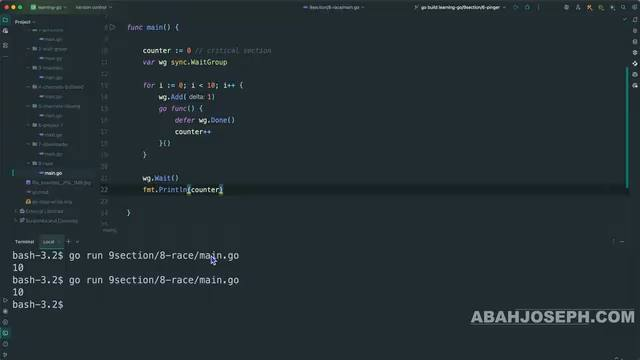
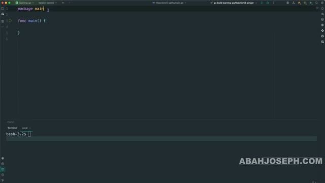
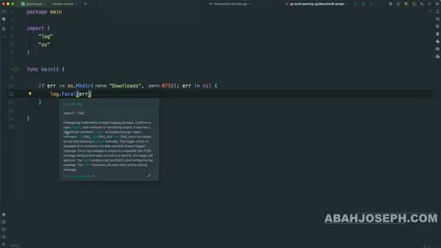
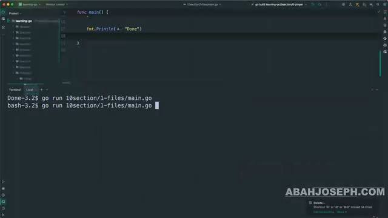
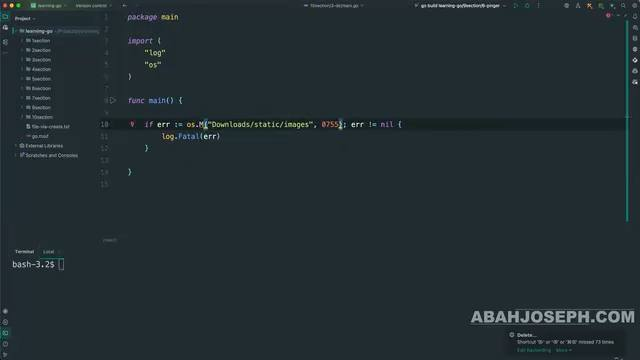
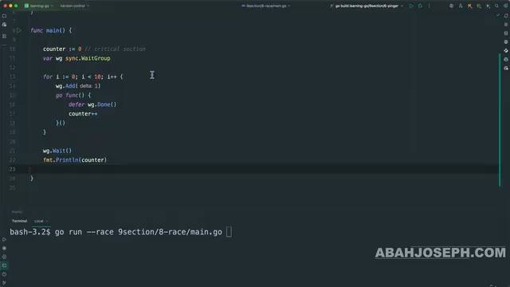
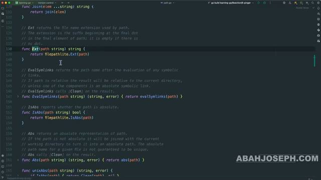

# Go Backend Masterclass P59–P62 复现文档：Mutex 并发控制与文件/目录操作

> 适用读者：前端转 AI 应用工程师。文中涉及 Go 语法会标注「知道即可」，涉及并发/锁会补一句「在 JS/Node 里对应什么」。
> 覆盖课程：P59（Race Condition 与 sync.Mutex）、P60（文件读写/追加）、P61（filepath 包）、P62（目录操作）。
> 环境约定：Go 1.21+（课里没指定版本，`os.ReadFile` 自 Go 1.16 起可用，`io/ioutil` 已被弃用，见 P60 [05:34]）。所有代码块都是**完整文件**，可直接保存运行。

---

## 1. 这一节做什么

这四节课把 Go 后端里两件「天天用、但新手最容易踩坑」的事讲透：

1. **并发写共享内存**：多个 goroutine 同时改一个计数器，结果不稳定（有时 9 有时 10），编译器不报错、程序照跑，这就是 race condition。P59 用 `sync.Mutex` 把它修好，并落成一个可运行的「银行账户」小项目（存款、取款、查余额，全部并发安全）。
2. **文件与目录**：P60 讲 `os.WriteFile` / `os.ReadFile` / `os.Create` / `os.Open` / `bufio.Scanner` / `os.OpenFile` 追加写；P61 讲 `path/filepath` 的 `Join` / `Base` / `Ext` / `IsAbs` / `Clean`（重点是 `Clean` 防路径穿越）；P62 讲 `os.Mkdir` vs `os.MkdirAll`、`os.Remove` vs `os.RemoveAll`。

学完你应该能：写出一个并发安全的账户结构体；能读写/追加文本文件；能安全地拼接用户传来的文件路径。

从学习路径上看，P59 解决的是「程序看起来能跑，但结果不可靠」的问题；P60–P62 解决的是「程序要和操作系统打交道，路径、权限、工作目录都会影响结果」的问题。前端工程师平时更多接触浏览器 API 或 Node 的 `fs`、`path` 模块，很多概念可以类比，但 Go 把这些能力放在标准库里，错误处理也更显式：几乎每个文件操作都返回 `error`，必须自己判断，不能像浏览器里那样默认成功。复现时建议每写完一个文件就 `go run` 一次，不要四个例子混在一起跑；每换一个例子先确认当前终端所在目录，因为 P60 的文件会落在程序的工作目录，而不是源码文件所在目录。常见误区是「代码里写相对路径 `text.txt`，就以为文件一定在源码旁边」；实际是相对于启动进程时的当前工作目录。排查时先执行 `pwd`（Windows PowerShell 可用 `Get-Location`），再看文件到底生成在哪里。另一个常见误区是把 `go run --race main.go` 当成语法检查；它只检测运行时真实发生的竞争，没跑到的分支不会报。前端对照：Node 默认单线程事件循环，普通对象自增一般不会出现多线程竞争；但如果使用 `worker_threads` 并共享 `SharedArrayBuffer`，就需要 `Atomics` 或自己实现同步，思路和 `sync.Mutex` 类似。文件操作在 Node 里对应 `fs.promises.writeFile`、`readFile`、`appendFile`，路径拼接对应 `path.join`、`path.basename`、`path.extname`、`path.isAbsolute`、`path.normalize`；目录创建对应 `fs.mkdir(..., { recursive: true })`，递归删除对应 `fs.rm(..., { recursive: true, force: true })`。这些对照只用于帮助理解，不代表课程讲过 Node 细节。

---

## 2. 讲师原话（带出处）

> "遇到竞态条件时，不仅难以调试，在生产环境中还极难复现。"
> —— p059 [00:00]

这句话点出了 race condition 最麻烦的地方：它往往不是每次必现，而是依赖调度时机。复现时不要只跑一次就下结论，至少连续运行多次；如果本机很快仍然稳定输出 10，可以临时在 goroutine 里加一点等待或循环更多次来放大窗口。排查时优先用 `--race`，而不是靠肉眼猜。

> "互斥锁是“互斥”的简写。它是一种保护代码临界区的同步原语。"
> —— p059 [00:56]

这里的 critical section 指「同一时刻只允许一个 goroutine 进入」的代码段。在银行账户例子里，余额判断、扣款、打印余额都应该放在同一个临界区里，否则判断和修改之间可能被插队。前端对照：可以把 Mutex 想成一把只有拿到钥匙才能进入的小房间，`Lock` 是拿钥匙，`Unlock` 是还钥匙；Node 的 `Atomics.wait` / `Atomics.notify` 更底层，但目的类似。

> "这不会阻止程序编译，而这正是竞态条件最残酷的地方。编译器不会阻止程序编译。代码照样能编译，照样能运行，但输出不可预测。"
> —— p059 [04:44]

所以不能把「编译通过」当成「并发正确」。常见错误是看到 `go build` 成功就认为没问题；正确做法是运行 `go run --race main.go`，并在 CI 里考虑 `go test -race ./...`（课程没讲测试，但这是实际项目常用做法）。排查时如果 `--race` 报出 `DATA RACE`，按它给出的文件行号回到对应读写位置，通常就是某处忘了加锁，或锁的粒度不一致。

> "当你有一个像银行账户这样的数据集合时，控制它的互斥锁也会作为字段之一嵌入其中。这是一种设计模式。"
> —— p059 [07:59]

把 `sync.Mutex` 放进 `BankAccount` 结构体，是为了让「锁」和「被保护的数据」绑定在一起。常见错误是把锁定义成全局变量，结果所有账户共用一把锁，虽然不会 race，但并发度变差；更危险的是锁和数据分散在不同结构里，容易漏锁。前端对照：类似把状态和更新该状态的方法封装在同一个对象/模块里，而不是到处直接改状态。

> "即使我们没有做加法或减法，只是在读取，这里也仍然需要使用互斥锁。"
> —— p059 [16:49]

读操作也可能和写操作并发，所以 `Balance()` 也要加锁。常见错误是只给 `Deposit`、`Withdraw` 加锁，忘了 `Balance`；用 `--race` 并发读余额时可能报竞争。验证方式：在并发存取款的同时多次调用 `Balance()`，再跑 `--race` 看是否还有警告。

> "尽管我当前在第 10 节，但文件是在这里写出的。它之所以写在这里，是因为这里是我们程序的根目录；这就是 Go 所认为的入口点。"
> —— p060 [03:10]

这里强调的是「程序的工作目录」。常见错误是 `cd` 到源码目录运行和在项目根运行，生成文件的位置不同，然后误以为代码写错了。排查方式：运行前执行 `pwd`，运行后到该目录下 `ls` 查看文件；如果找不到文件，用 `find . -name text.txt`（Windows 可用 `Get-ChildItem -Recurse -Filter text.txt`）定位。

> "这个 io/ioutil 是一个已弃用的包……自 Go 1.16 起已弃用。"
> —— p060 [05:34]

`io/ioutil` 已弃用，新代码用 `os.ReadFile`、`os.WriteFile` 等。常见错误是 IDE 自动补全仍然给出 `ioutil.ReadFile`，复制旧教程代码后编译能过但不符合新写法。验证方式：在文件里搜索 `ioutil`，应为 0 处。

> "如果到达文件末尾，它也可能返回错误，所以也许我们只需要判断错误是否不为 io.EOF。"
> —— p060 [12:59]

讲师这里提醒读文件到末尾时可能返回 EOF 相关错误，所以检查 `scanner.Err()` 时要排除 `io.EOF`。实际使用 `bufio.Scanner` 正常读完时 `Err()` 通常为 `nil`，但按防御性写法处理没有坏处。常见错误是把 EOF 当成致命错误直接 `log.Fatal`，导致正常读完也退出。

> "使用 open 时，只是以读写方式打开，仅此而已……open 不接受这些标志，但 OpenFile 接受。"
> —— p060 [18:46]

`os.Open` 只能只读打开，不能传 flags；要追加、创建、只写等组合必须用 `os.OpenFile`。常见错误是写 `os.Open(path, os.O_APPEND)`，编译直接报参数数量不对。排查时看函数签名：`os.Open(name string)` 只有一个参数，`os.OpenFile(name string, flag int, perm FileMode)` 才有 flags。

> "在 Go 中开发时，理想情况下应当构建平台无关的应用程序，因为 Go 是跨平台的。"
> —— p061 [00:00]

路径拼接不要手写 `/` 或 `\`，用 `filepath.Join`。常见错误是在 Windows 上测试用 `+ "/"` 也能跑，部署到 Linux 或反过来就出问题。验证方式：观察 `filepath.Join("C:", "users", "documents")` 在当前平台输出的分隔符，再对照手写拼接的结果。

> "每次处理文件上传时，我都会在把传入文件名写入本机之前用它来清理文件名，这一点非常非常关键。"
> —— p061 [06:03]

`filepath.Clean` 是文件上传场景的关键一步，但它只是规范化路径，不等于完整的安全校验。常见错误是以为 `Clean` 之后就不会路径穿越；实际还需要检查清理后的路径是否仍在目标目录内。课程没展开这一步，见第 7 节表格。

> "创建 images 时提示没有这个文件，所以这一步会失败。"
> —— p062 [01:47]

`os.Mkdir` 创建嵌套目录时，如果父目录不存在就失败，报 `no such file or directory`。验证方式：先确保 `downloads` 不存在，再运行 `os.Mkdir("downloads/static/images", 0755)`，观察错误信息。

> "RemoveAll 会删除该文件夹及其所有子项。"
> —— p062 [06:18]

`os.RemoveAll` 递归删除整棵子树；`os.Remove` 只删一层。常见错误是用 `os.Remove` 删非空目录，会报目录不为空。验证方式：先用 `os.MkdirAll` 建三层，再用 `os.Remove("downloads/static/images")`，观察只删了最内层，父目录还在。

---

## 3. 从零复现

### 3.1 目录结构

按课程里的命名（`10` 是 section 10，`01`/`02`/`03` 是子节），在项目根下建：

```
go-backend-masterclass/
├── go.mod
└── 10/
    ├── 01/
    │   ├── race/
    │   │   └── main.go        # P59 银行账户
    │   └── files/
    │       └── main.go        # P60 文件读写
    ├── 02/
    │   └── findname/
    │       └── main.go        # P61 filepath
    └── 03/
        └── main.go            # P62 目录操作
```

初始化模块（课里没讲 go.mod，但 `go run` 在模块外也能跑；为了规范建议建一个）：

```bash
mkdir go-backend-masterclass && cd go-backend-masterclass
go mod init example.com/gobackend
```

> 注意：P60 里讲师强调「文件写在程序的工作目录（root directory）」，所以**运行命令时你在哪个目录，文件就落在哪个目录**。下面每个例子都会明确 `cd` 到哪。

这里的 `go mod init` 会生成 `go.mod`，声明模块路径。模块路径不一定要真实可访问，示例用 `example.com/gobackend` 只是占位；它的作用是让 `go run`、`go build` 在当前模块内解析包。常见错误是目录已经存在 `go.mod` 还重复执行 `go mod init`，会提示模块已初始化；排查时先 `ls` 看有没有 `go.mod`。前端对照：`go.mod` 类似 `package.json` 的依赖与模块声明，但 Go 标准库不需要安装，文件/并发例子不引入第三方依赖，所以这一步主要是让项目结构规范。命令解释：`mkdir -p` 在 Linux/macOS 可一次建多层，Windows PowerShell 用 `New-Item -ItemType Directory`；`cd` 后执行 `go mod init`，模块名会写入 `go.mod`。如果 `go run` 报 `go.mod file not found`，说明你在模块外或目录层级不对，回到项目根再试。

### 3.2 P59：先复现 race condition，再修好

**第一步，制造 bug。** 建 `10/01/race/main.go`，写一个计数器 + 10 个 goroutine 各加 1：

```go
package main

import (
	"fmt"
	"sync"
)

func main() {
	counter := 0
	var wg sync.WaitGroup

	for i := 0; i < 10; i++ {
		wg.Add(1)
		go func() {
			defer wg.Done()
			counter++
		}()
	}

	wg.Wait()
	fmt.Println(counter)
}
```

运行：

```bash
cd 10/01/race
go run main.go
```

多跑几次，你会看到有时 `10`、有时 `9`（讲师在 p059 [03:48] 亲口说「It's 10. We are lucky... You can't type 9 suddenly」）。

命令解释：`cd 10/01/race` 切到该例子目录；`go run main.go` 编译并运行当前文件。`go run` 不是只运行不编译，它会在临时目录编译后执行，所以语法错误会在这里暴露。常见错误：在项目根直接 `go run main.go` 会找不到文件，因为根目录没有 `main.go`；应写成 `go run 10/01/race/main.go`，但这样工作目录仍是项目根。排查 race 时不要只跑一次，建议连续执行多次，例如在 shell 里循环；如果本机调度太快没复现，可以临时把循环次数改大，或加一点 `time.Sleep` 放大窗口。前端对照：Node 单线程下 `counter++` 连续执行不会出现这种交错；但 `worker_threads` 共享内存时，读-改-写不是原子操作，同样需要同步原语。`sync.WaitGroup` 的作用类似前端 `Promise.all` 等待一组任务结束：`Add(1)` 增加计数，`Done()` 减少，`Wait()` 阻塞到归零；区别是 `Add` 必须在启动 goroutine 之前调用，否则可能 Wait 先返回。

**第二步，用 race detector 抓现行。** 讲师在 p059 [04:15] 演示：

```bash
go run --race main.go
```

输出会包含 `WARNING: DATA RACE`，并指出 `main.main` 里第 17 行附近是冲突点（具体行号以你实际文件为准）。**关键点：程序照样编译、照样跑完，只是结果不可预测**——这正是讲师说的「most brutal part」。



命令解释：`--race` 是传给 `go run` 的构建/运行参数，启用竞态检测器；它会记录内存访问并报告没有同步保护的并发读写。常见错误：写成 `go run main.go --race`，参数位置不对，可能被当成程序参数；正确是 `go run --race main.go`。另一个常见错误是只看到程序输出 10 就以为没有 race；race detector 只在真实发生冲突时报告，所以要多跑几次、让冲突窗口出现。排查时按报告里的 `Read at` / `Previous write at` 两处代码对照，通常一处是读、一处是写，补上同一把锁即可。前端对照：Node 没有内置同等的 race detector；`worker_threads` 共享内存问题更隐蔽，通常要靠代码审查和 `Atomics` 设计来避免。

**第三步，加 Mutex 修好。** 把 `counter++` 包进 `Lock/Unlock`：

```go
package main

import (
	"fmt"
	"sync"
)

func main() {
	counter := 0
	var mu sync.Mutex
	var wg sync.WaitGroup

	for i := 0; i < 10; i++ {
		wg.Add(1)
		go func() {
			defer wg.Done()
			mu.Lock()
			counter++
			mu.Unlock()
		}()
	}

	wg.Wait()
	fmt.Println(counter)
}
```

再跑 `go run --race main.go`，警告消失，输出稳定为 `10`（p059 [06:08]）。

这里要注意：`Lock` 和 `Unlock` 之间的代码越短越好，只包住真正共享的读写；不要把 `time.Sleep`、打印大量日志等慢操作放进锁里，否则并发度下降。常见错误是 `Lock` 后忘记 `Unlock`，程序会死锁；用 `defer mu.Unlock()` 可以降低风险，但在循环或函数返回频繁时要确认 defer 的执行时机。另一个错误是复制了包含 Mutex 的结构体：`sync.Mutex` 不应按值复制，复制后锁状态也复制，保护就失效了；应传指针。验证方式：`go run --race main.go` 无警告，并且连续运行多次都输出 10。前端对照：这相当于给共享状态加一个「进入许可」，Node 里如果用 `Atomics.compareExchange` 做自旋锁，也要确保释放路径一定执行。

**第四步，升级成银行账户项目。** 见第 4 节完整代码。运行：

```bash
cd 10/01/race
go run --race main.go
```

预期输出（讲师在 p059 [11:42] 演示过）：账户初始 100，并发存入 1+2+…+10=55，最终余额 155；再并发取款时，余额不足的取款会被拒绝。

常见错误与排查：如果最终余额不是 155，先检查是否所有对 `balance` 的读写都在锁内；如果程序卡住，检查是否有 `Lock` 后未 `Unlock`，或 `WaitGroup` 的 `Add`/`Done` 不成对；如果取款日志顺序混乱，这是正常的，因为 goroutine 调度顺序不固定，但最终余额应可预测。命令解释：`go run --race main.go` 同时启用竞态检测；如果只想编译检查，可用 `go vet ./...`，它能发现一些明显的锁复制、格式化等问题，但不能替代 race detector。前端对照：账户的 `Deposit`/`Withdraw` 类似前端 store 的 action，所有修改都走同一个入口，避免组件里直接改 state；不同点是 Go 这里用锁保证并发安全，前端通常靠单线程事件循环。

### 3.3 P60：文件读写与追加

建 `10/01/files/main.go`（完整代码见第 4 节）。运行：

```bash
cd 10/01/files
go run main.go
```

**注意工作目录陷阱**（p060 [03:10]）：如果你在 `10/01/files` 里 `go run main.go`，文件会生成在 `10/01/files/` 下；如果你在项目根 `go run 10/01/files/main.go`，文件会生成在**项目根**。讲师原话：「this is the root directory of our program... the running, working directory of the program」。

常见错误与排查：运行后找不到 `text.txt`，先在终端执行 `pwd` 看当前目录，再 `ls`；如果文件出现在项目根，说明你是在根目录运行的。`os.WriteFile` 会覆盖同名文件，第二次运行不会追加；如果发现内容没变，可能是你看的是旧文件或运行目录不同。`os.Create` 会截断已有文件，`os.OpenFile` 用 `O_APPEND` 才是追加。验证追加是否成功，可以连续运行两次，再 `cat file-created.txt` 看是否出现重复的三行；如果重复了，说明追加生效。前端对照：Node 的 `fs.writeFile` 默认覆盖，`fs.appendFile` 追加；Go 里追加需要显式 `os.OpenFile` 带 `O_APPEND`，更啰嗦但意图更清楚。命令解释：`go run main.go` 会执行 `main()` 里所有步骤，包括写、读、创建、逐行打印、追加、再打印；如果某一步 `log.Fatal`，后面的步骤不会执行，所以排查时看第一条错误日志。

### 3.4 P61：filepath 包

建 `10/02/findname/main.go`，运行：

```bash
cd 10/02/findname
go run main.go
```

你会看到 `filepath.Join("C:", "users", "documents")` 在 Linux/macOS 上输出 `C:/users/documents`，在 Windows 上输出 `C:\users\documents`——这就是讲师说的「platform specific file format」（p061 [01:21]）。



常见错误与排查：手写 `path + "/" + name` 在 Windows 上可能得到混合分隔符；用 `filepath.Join` 后仍要注意，`Join` 会清理多余分隔符，但不负责防止 `..` 逃逸。`filepath.Base("config/app.yaml")` 返回 `app.yaml`，如果传入空字符串会返回 `.`，传入以分隔符结尾的路径会返回最后一段目录名，这些边界在真实上传场景要单独处理。`filepath.Ext` 只取最后一个点后的扩展名，`archive.tar.gz` 返回 `.gz`，不是 `.tar.gz`。`filepath.IsAbs("C:")` 在非 Windows 平台不一定为 true，跨平台判断要小心。前端对照：Node 的 `path.join` 类似 `filepath.Join`，`path.basename` 类似 `Base`，`path.extname` 类似 `Ext`，`path.isAbsolute` 类似 `IsAbs`，`path.normalize` 类似 `Clean`；但 Node 的 `path` 也分 `path.posix` 和 `path.win32`，Go 的 `filepath` 按运行平台选择分隔符。验证方式：分别在当前平台运行，检查 `Join` 输出分隔符；把 `dirty` 改成不同层级的 `..`，观察 `Clean` 只是规范化，不会自动限制在某个根目录内。

### 3.5 P62：目录操作

建 `10/03/main.go`，运行：

```bash
cd 10/03
go run main.go
```

先跑「创建嵌套目录」版本，再跑「删除」版本（代码里用注释切换，见第 4 节）。



常见错误与排查：如果 `os.MkdirAll` 报 `permission denied`，检查当前用户对父目录有没有写权限；如果 `os.RemoveAll("downloads")` 没删掉，检查是否传了错误路径、当前工作目录是否在 `10/03`。代码里先用 `filepath.Clean` 再 `MkdirAll`，是为了规范化路径；但 `Clean` 不会把路径限制在某个目录内。验证方式：运行前 `ls` 确认 `downloads` 不存在；运行创建版本后 `ls -R downloads` 应看到三层；运行删除版本后 `ls downloads` 应报不存在。前端对照：Node 的 `fs.mkdir(path, { recursive: true })` 类似 `MkdirAll`，`fs.rm(path, { recursive: true, force: true })` 类似 `RemoveAll`；但 Go 的 `os.Remove` 对非空目录会失败，Node 的 `fs.rmdir` 旧行为也类似，递归删除要用专门 API。

---

## 4. 完整代码

### 4.1 `10/01/race/main.go`（P59 银行账户，最终版）

```go
package main

import (
	"fmt"
	"sync"
	"time"
)

// BankAccount 把 mutex 嵌在结构体里，控制 balance 的并发访问。
// 这是讲师强调的设计模式：mutex 是数据的一部分，不是外挂。
type BankAccount struct {
	mu      sync.Mutex
	balance int
}

func (a *BankAccount) Deposit(amount int) {
	a.mu.Lock()
	defer a.mu.Unlock()
	a.balance += amount
	fmt.Printf("Deposited %d, balance is now %d\n", amount, a.balance)
}

func (a *BankAccount) Withdraw(amount int) {
	a.mu.Lock()
	defer a.mu.Unlock()
	if a.balance < amount {
		fmt.Printf("Cannot withdraw %d, balance is only %d\n", amount, a.balance)
		return
	}
	a.balance -= amount
	fmt.Printf("Withdrew %d, balance is now %d\n", amount, a.balance)
}

// Balance 只读也要加锁：读的同时别的 goroutine 可能在写。
func (a *BankAccount) Balance() int {
	a.mu.Lock()
	defer a.mu.Unlock()
	return a.balance
}

func main() {
	account := &BankAccount{balance: 100}
	var wg sync.WaitGroup

	// 并发存款：i+1 元，i 越大存得越多、等得越久
	for i := 0; i < 10; i++ {
		wg.Add(1)
		go func(amount int) {
			defer wg.Done()
			time.Sleep(time.Duration(amount) * time.Millisecond)
			account.Deposit(amount)
		}(i + 1)
	}

	wg.Wait()
	fmt.Println("Final balance after deposits:", account.Balance())

	// 并发取款：每次取 (i+1)*10 元
	for i := 0; i < 5; i++ {
		wg.Add(1)
		go func(amount int) {
			defer wg.Done()
			time.Sleep(time.Duration(amount) * time.Millisecond)
			account.Withdraw(amount)
		}((i + 1) * 10)
	}

	wg.Wait()
	fmt.Println("Final balance after withdrawals:", account.Balance())
}
```

> 说明：讲师在 p059 [10:46] 用的是 `for i := 0; i <= 10` 并把 `i+1` 传进 goroutine；这里用 `i < 10` 等价。`time.Sleep` 的毫秒数讲师在 [11:13] 说「depending on the amount you want to deposit if you want to deposit large amount you wait more」，这里照做。

运行这个文件时，`time.Sleep` 只是放大并发窗口，不是并发安全的一部分；去掉它代码仍然正确，只是 goroutine 交错顺序不那么明显。常见错误是把 `account := &BankAccount{balance: 100}` 写成值类型再到处传值，导致锁被复制；应保持指针传递。`go run --race` 下如果看到 `DATA RACE`，优先检查 `Balance()` 是否加锁、`Deposit`/`Withdraw` 是否都用了同一把 `a.mu`。前端对照：这类似把所有余额变更封装在 store 的 mutation/action 里，外部只调用方法；不同点是 Go 需要显式加锁，Node 主线程通常不需要。

### 4.2 `10/01/files/main.go`（P60 文件读写/追加）

```go
package main

import (
	"bufio"
	"fmt"
	"io"
	"log"
	"os"
)

// writeFile 演示 os.WriteFile：一次性写入（会覆盖）
func writeFile() {
	data := []byte("Welcome to the Go programming language.\nLots of love for Go.\n")
	err := os.WriteFile("text.txt", data, 0644)
	if err != nil {
		log.Fatal(err)
	}
	fmt.Println("done writing text.txt")
}

// readFile 演示 os.ReadFile：一次性读出
func readFile() {
	content, err := os.ReadFile("text.txt")
	if err != nil {
		log.Fatal(err)
	}
	fmt.Println("content:", string(content))
}

// createAndWrite 演示 os.Create + WriteString + defer Close
func createAndWrite() {
	f, err := os.Create("file-created.txt")
	if err != nil {
		log.Fatal(err)
	}
	defer f.Close()

	msg := "Welcome all Java and Python and JavaScript and PHP and Ruby developers.\n"
	if _, err := f.WriteString(msg); err != nil {
		log.Fatal(err)
	}
	fmt.Println("done writing file-created.txt")
}

// printContent 用 bufio.Scanner 逐行读，并打印行号
func printContent(filePath string) {
	f, err := os.Open(filePath)
	if err != nil {
		log.Fatal(err)
	}
	defer f.Close()

	scanner := bufio.NewScanner(f)
	lineNo := 1
	for scanner.Scan() {
		fmt.Printf("%d: %s\n", lineNo, scanner.Text())
		lineNo++
	}
	// 注意：EOF 也会让 Scan 返回 false，所以这里要排除 io.EOF
	if err := scanner.Err(); err != nil && err != io.EOF {
		log.Fatal(err)
	}
}

// appendToFile 演示 os.OpenFile + O_APPEND：追加写
func appendToFile(filePath string) {
	f, err := os.OpenFile(filePath, os.O_APPEND|os.O_CREATE|os.O_WRONLY, 0644)
	if err != nil {
		log.Fatal(err)
	}
	defer f.Close()

	lines := []string{"- Rust", "- Fortran", "- Ada"}
	for _, line := range lines {
		if _, err := f.WriteString(line + "\n"); err != nil {
			log.Fatal(err)
		}
	}
	fmt.Println("done appending")
}

func main() {
	writeFile()
	readFile()
	createAndWrite()
	printContent("file-created.txt")
	appendToFile("file-created.txt")
	printContent("file-created.txt")
}
```

> 文件权限 `0644`：讲师在 p060 [01:48] 说「file mode... they are just numbers」，没展开讲具体位含义，这里用最常见的 `0644`（owner 读写、其他人只读）。

运行这个完整文件时，`main()` 按顺序执行六个步骤。常见错误与排查：如果 `readFile` 报 `no such file or directory`，说明当前工作目录里没有上一步生成的 `text.txt`，先确认 `pwd`；如果 `printContent` 只打印了一行，检查文件内容是否真的有换行；如果追加后第二次 `printContent` 没看到新行，检查 `appendToFile` 是否用了 `O_APPEND`，以及 `f.Close()` 是否被 defer 正确执行。`log.Fatal` 会直接退出，排查时看终端最后一条日志。前端对照：Node 的 `fs.readFile`/`writeFile` 默认异步，Go 这里同步调用更直观；Node 的 `fs.createReadStream` + `readline` 类似 `bufio.Scanner` 逐行读，但 Go 的 Scanner 有默认单行长度上限。

### 4.3 `10/02/findname/main.go`（P61 filepath）

```go
package main

import (
	"fmt"
	"path/filepath"
)

func main() {
	// 1. Join：跨平台拼接路径
	p1 := filepath.Join("C:", "users", "documents")
	fmt.Println("join:", p1)

	p2 := filepath.Join("config", "app.yaml")
	fmt.Println("join2:", p2)

	// 2. Base：取文件名（讲师举例：从 URL 里抠文件名）
	fmt.Println("base:", filepath.Base(p2))

	// 3. Ext：取扩展名
	fmt.Println("ext:", filepath.Ext(p2))

	// 4. IsAbs：判断绝对路径
	fmt.Println("isAbs(p1):", filepath.IsAbs(p1))
	fmt.Println("isAbs(p2):", filepath.IsAbs(p2))

	// 5. Clean：清理路径，防路径穿越（讲师重点强调）
	dirty := "../../etc/passwd"
	fmt.Println("dirty:", dirty)
	fmt.Println("clean:", filepath.Clean(dirty))

	dirty2 := "uploads/../../../etc/shadow"
	fmt.Println("dirty2:", dirty2)
	fmt.Println("clean2:", filepath.Clean(dirty2))
}
```

运行后逐行对照输出，重点看 `clean` 和 `clean2` 是否仍然保留 `..`。常见错误是以为 `Clean` 会把 `..` 全部吃掉；实际它只做规范化，`../../etc/passwd` 仍然是相对路径，可能逃出目标目录。前端对照：Node 的 `path.normalize` 行为类似，也不能单独承担上传安全校验；还需要判断结果是否以目标目录开头，或用 `path.relative` 检查是否逃逸。

### 4.4 `10/03/main.go`（P62 目录操作）

```go
package main

import (
	"log"
	"os"
	"path/filepath"
)

func main() {
	// ===== 场景 A：创建嵌套目录 =====
	// os.Mkdir 只能建一层，父目录不存在就报错
	// err := os.Mkdir("downloads/static/images", 0755)
	// if err != nil {
	// 	log.Fatal(err) // 输出类似：mkdir downloads/static/images: no such file or directory
	// }

	// os.MkdirAll 会把中间层一起建出来
	dir := filepath.Clean("downloads/static/images")
	if err := os.MkdirAll(dir, 0755); err != nil {
		log.Fatal(err)
	}
	log.Println("created:", dir)

	// ===== 场景 B：删除 =====
	// os.Remove 只删一层（空目录或单文件）
	// if err := os.Remove("downloads/static/images"); err != nil {
	// 	log.Fatal(err)
	// }

	// os.RemoveAll 递归删除整棵子树
	if err := os.RemoveAll("downloads"); err != nil {
		log.Fatal(err)
	}
	log.Println("removed: downloads")
}
```

> 讲师在 p062 [03:33] 提醒：从外部拿到的路径要先 `filepath.Clean` 再传给 `MkdirAll`，避免安全问题。上面代码照做。

运行前先注释掉删除部分，只跑创建，观察 `downloads/static/images` 三层是否出现；再切换注释跑删除，观察整棵 `downloads` 是否消失。常见错误是同时保留创建和删除且顺序不对，导致刚建完就被删，看起来像没生效；按代码里的场景分开跑更容易排查。`os.Remove` 删非空目录会失败，这不是 bug，而是设计；要递归删除用 `os.RemoveAll`。前端对照：Node 的 `fs.mkdir` 需要 `{ recursive: true }` 才递归创建，`fs.rm` 需要 `{ recursive: true }` 才递归删除；Go 用不同函数区分单层和递归，意图更明确。

---

## 5. 逐行解释

### 5.1 P59 银行账户

- `type BankAccount struct { mu sync.Mutex; balance int }`：把 `mu` 嵌进结构体。讲师在 p059 [07:59] 说这是「design pattern... encapsulation... object-oriented design」。**为什么嵌进去而不是放外面**：锁和数据绑定，谁拿到账户谁就拿到锁，不会出现「锁在 A 处、数据在 B 处」的错配。常见错误是复制包含 `sync.Mutex` 的结构体值，复制后锁也复制，保护失效；应使用指针。前端对照：类似把状态和更新方法封装在同一个模块里。
- `a.mu.Lock(); defer a.mu.Unlock()`：`defer` 保证即使中间 `return` 或 panic 也会解锁。**在 JS/Node 里对应什么**：Node 是单线程事件循环，普通变量自增不会 race；但一旦你用 `worker_threads` 或访问共享的 `SharedArrayBuffer`，就需要 `Atomics` 或自己实现锁——概念和 Mutex 一样。常见错误是 `Lock` 后忘记解锁导致死锁；排查时看程序是否卡住，并检查所有分支是否都能执行到 `Unlock`。
- `if a.balance < amount { ... return }`：余额不足直接返回，**在锁内判断**。如果先判断再 Lock，判断和扣款之间可能被别的 goroutine 插队（TOCTOU 问题）。前端对照：类似前端做表单校验和提交必须在同一个 action 里完成，不能校验后隔很久再提交。
- `Balance()` 里也加锁：讲师在 p059 [16:49] 特意强调「even though we are not adding or subtracting, we are reading and you want to also use a mutex here」。原因：读的同时另一个 goroutine 在写，读到的可能是「半个值」（对 int 在 64 位机上通常不会撕裂，但对结构体/多字段就会）。讲师还提到「this mutex that we are using is a little bit too expensive for it. There are different variations of mutex that you can use just for reading」——指的是 `sync.RWMutex`，但**课里没展开讲 RWMutex 的用法**，这里不编造。常见错误是只给写加锁，读不加锁；用 `--race` 并发读写可以暴露。
- `go func(amount int) { ... }(i + 1)`：把 `i+1` 作为参数传进去，而不是在闭包里直接用 `i`。Go 1.22 之前闭包捕获循环变量会出经典 bug；传参是最稳的写法。前端对照：类似 `for` 循环里 `setTimeout` 捕获变量，老版本 JS 用 `var` 也会共享变量，后来用 `let` 或传参解决。
- `wg.Add(1)` 必须在 `go` 之前调用：如果在 goroutine 内部 `Add`，可能 `Wait` 先执行完导致提前返回。常见错误是 `Add` 和 `Done` 数量不匹配，程序永久阻塞或 panic；排查时数一遍 `Add` 次数和 `Done` 次数。

### 5.2 P60 文件操作

- `os.WriteFile("text.txt", data, 0644)`：签名是 `(name string, data []byte, perm FileMode) error`。讲师在 p060 [01:22] 说「it takes the file name, the data you want to write in bytes... and then the file mode」。**会覆盖**已有文件（p060 [04:39] 演示过）。常见错误是以为它会追加；追加要用 `os.OpenFile` 的 `O_APPEND`。前端对照：类似 `fs.writeFile` 默认覆盖。
- `os.ReadFile` 而不是 `ioutil.ReadFile`：讲师在 p060 [05:34] 明确说 `ioutil` 「deprecated as of Go 1.16」。IDE 自动补全可能还提示 `ioutil`，别选。常见错误是旧教程代码直接复制，编译能过但风格过时；搜索 `ioutil` 可排查。
- `os.Create` 返回 `*os.File`，**必须 Close**。讲师在 p060 [07:22] 说「each time you are dealing with file operation you should always close them」，并演示了 `defer f.Close()`。常见错误是忘记 Close，短时间内看不出问题，但文件句柄可能泄漏；在服务器上长期运行会出问题。前端对照：Node 的 `fs.open` 也返回 fd，需要 `close`；Promise API 的 `writeFile` 帮你处理了打开关闭。
- `f.WriteString(msg)` 返回 `(int, error)`：第一个是写入字节数，讲师在 p060 [09:38] 说「it return an error and the total bytes that it has written」，示例里用 `_` 忽略字节数。常见错误是只检查 `err` 不检查写入字节数；多数场景够用，但要确保完整写入时可比较字节数。
- `bufio.NewScanner(f)` + `scanner.Scan()`：逐行读。讲师在 p060 [12:02] 说「we've seen the scanner before... it's going to give us a better way to read from the file」。常见错误是把 `scanner.Text()` 在 `Scan()` 循环外调用；必须在循环内使用。前端对照：类似 Node `readline` 逐行读。
- `if err := scanner.Err(); err != nil && err != io.EOF`：讲师在 p060 [12:59] 特意提醒「if it reach an end of file it can return an error as well」，所以要排除 `io.EOF`。实际上 `bufio.Scanner` 正常读完 EOF 时 `Err()` 返回 `nil`，但讲师按防御性写法处理，照做无害。常见错误是把 EOF 当致命错误，正常读完也 `log.Fatal`。
- `os.OpenFile(path, os.O_APPEND|os.O_CREATE|os.O_WRONLY, 0644)`：追加写的关键。讲师在 p060 [15:48] 说「we are going to start with os.Oappend... I also want to be able to create」，并在 [18:46] 强调「open doesn't accept these flags but open file does」——`os.Open` 只能只读打开，要 flags 必须用 `os.OpenFile`。常见错误是把 flags 写成字符串或漏掉 `O_WRONLY`；位或组合要写对。前端对照：Node 的 `fs.appendFile` 封装了追加，Go 需要显式组合 flags。

### 5.3 P61 filepath

- `filepath.Join("C:", "users", "documents")`：讲师在 p061 [00:51] 演示。**为什么不用字符串拼 `+ "/"`**：Windows 用 `\`，Linux/macOS 用 `/`，`Join` 自动选对分隔符。常见错误是 `Join` 后自己再拼分隔符，产生重复分隔符；`Join` 会清理一部分，但不要混用。
- `filepath.Base(p2)`：取最后一段。讲师在 p061 [03:16] 举例「if you are downloading something from the internet and you want to find the file name from the URL」。常见错误是对以 `/` 结尾的路径取 Base，得到的是最后一段目录名；上传场景要额外处理。
- `filepath.Ext(p2)`：取扩展名（含点），讲师在 p061 [03:43] 演示得到 `.yaml`。常见错误是以为能取多重扩展名；`archive.tar.gz` 只返回 `.gz`。前端对照：Node `path.extname` 行为类似。
- `filepath.IsAbs(p1)`：判断绝对路径，讲师在 p061 [04:11] 提到「check if it's an absolute path or if it is a relative path」。常见错误是跨平台判断带盘符路径；在 Linux 上 `C:` 不是绝对路径。验证时分别在目标平台运行。
- `filepath.Clean(dirty)`：**最重要的一行**。讲师在 p061 [06:03] 说「Each time I'm working on file upload, I use this to clean the incoming file name before I write it to my computer is very, very key」。`../../etc/passwd` 经 `Clean` 后变成 `../../etc/passwd`（Clean 只做规范化，不阻止 `..` 本身），但 `uploads/../../../etc/shadow` 会变成 `../../etc/shadow`——**注意：Clean 不会把 `..` 消掉到根之外，它只是把路径规范化**。真正防穿越还需要在 Clean 之后检查结果是否还在目标目录内（**课里没讲这一步，属于「你会撞上的坑」**，见第 7 节）。常见错误是 Clean 后直接拼接文件系统路径；应再做目录边界校验。前端对照：Node `path.normalize` 类似，也不能单独保证安全。

### 5.4 P62 目录

- `os.Mkdir("downloads/static/images", 0755)`：只建最后一层，父目录不存在就报 `no such file or directory`。讲师在 p062 [01:47] 现场演示了这个错误。常见错误是路径层级多时忘记用 `MkdirAll`；排查看错误信息里的 `no such file or directory`。
- `os.MkdirAll(dir, 0755)`：递归建所有中间层。讲师在 p062 [03:06] 说「in go there is a make, da, mk, da, r... this time around we are going to have all the internal folders created as well」。常见错误是权限不足；检查父目录写权限。前端对照：Node `fs.mkdir` 的 `recursive: true`。
- `os.Remove("downloads/static/images")`：只删一层。讲师在 p062 [04:29] 演示「it deleted the image. So let's see how we can delete everything」——删了子目录，父目录还在。常见错误是拿它删非空目录，会报错；要递归用 `RemoveAll`。
- `os.RemoveAll("downloads")`：递归删整棵子树。讲师在 p062 [05:27] 读包文档「remove path and any children it contains」，并在 [06:18] 总结「remove all removes the folder and all its children」。常见错误是路径写错导致删错目录；生产代码里删除前要先校验路径，不要直接拼接用户输入。
- `filepath.Clean(dir)` 再传给 `MkdirAll`：讲师在 p062 [03:33] 提醒「if you are taking this from outside remember to always clean it」。常见错误是以为 Clean 等于安全校验；它只是规范化，仍需边界检查。

---

## 6. 复现检查清单

跑完每个例子后对照打勾：

**P59 并发**
- [ ] 不加锁版本 `go run main.go` 多跑几次，能看到 `9` 和 `10` 交替出现。验证方式：连续运行 10 次以上，或临时把循环次数改大；如果一直 10，可加一点 `time.Sleep` 放大窗口，再观察是否出现 9。
- [ ] `go run --race main.go` 输出 `WARNING: DATA RACE`。验证方式：确认参数顺序是 `go run --race main.go`，终端出现 `WARNING: DATA RACE` 和读写位置；若没出现，多跑几次。
- [ ] 加 `sync.Mutex` 后 `--race` 无警告，输出稳定 `10`。验证方式：连续运行多次，且 `go run --race main.go` 不再输出 DATA RACE。
- [ ] 银行账户最终余额 = 100 + 55 = 155。验证方式：看 `Final balance after deposits:` 后面的数字；若不对，检查所有余额读写是否都在锁内。
- [ ] 并发取款时能看到「Cannot withdraw」日志（余额不足被拒）。验证方式：观察取款阶段日志，至少有一次余额不足；若没有，检查取款金额和初始余额。
- [ ] `go vet ./...` 无报错。验证方式：在项目根执行，确认没有输出错误；它不能替代 `--race`，但能发现一些明显问题。

**P60 文件**
- [ ] `text.txt` 生成在**你执行 `go run` 的目录**（不是源码目录，除非你 cd 进去了）。验证方式：运行前 `pwd`，运行后在该目录 `ls`；如果不在，回到运行目录查找。
- [ ] 第二次运行 `writeFile` 会覆盖 `text.txt`，内容不叠加。验证方式：连续运行两次，`cat text.txt` 应仍然只有两行，不是四行。
- [ ] `file-created.txt` 逐行打印带行号 1..N。验证方式：看输出行号是否从 1 开始递增；如果只打印一行，检查文件换行。
- [ ] 追加后重新 `printContent`，能看到新增的 `- Rust` / `- Fortran` / `- Ada`。验证方式：第二次逐行打印应包含这三行；如果重复出现，说明你运行了多次追加。
- [ ] 代码里没有 `ioutil` 字样。验证方式：搜索 `ioutil`，结果应为 0。

**P61 filepath**
- [ ] `Join` 输出在当前平台用对分隔符。验证方式：在 Windows 看是否为 `\`，在 Linux/macOS 看是否为 `/`；不要手写拼接。
- [ ] `Base("config/app.yaml")` 返回 `app.yaml`。验证方式：看 `base:` 行输出。
- [ ] `Ext("config/app.yaml")` 返回 `.yaml`。验证方式：看 `ext:` 行输出；注意包含点。
- [ ] `Clean("uploads/../../../etc/shadow")` 返回 `../../etc/shadow`。验证方式：看 `clean2:` 行；确认 `..` 仍然存在，理解它不等于安全校验。

**P62 目录**
- [ ] `os.Mkdir("downloads/static/images")` 报 `no such file or directory`。验证方式：先确保 `downloads` 不存在，再只运行 `Mkdir` 版本，观察错误信息。
- [ ] `os.MkdirAll` 成功建出三层。验证方式：运行创建版本后 `ls -R downloads`，应看到 `static/images`。
- [ ] `os.Remove("downloads/static/images")` 后 `downloads/static` 还在。验证方式：只运行 Remove 版本，再 `ls downloads/static`，应仍存在。
- [ ] `os.RemoveAll("downloads")` 后整棵 `downloads` 消失。验证方式：运行删除版本后 `ls downloads`，应报不存在。

---

## 7. 课里没讲但你会撞上的

| 现象 | 原因 | 怎么办 |
|---|---|---|
| `filepath.Clean` 之后路径仍然包含 `..`，上传文件可能逃出目标目录 | 讲师说「clean all the tricky part」，但 `Clean("../../etc/passwd")` 结果还是 `../../etc/passwd`——`..` 没被消掉。`Clean` 只做规范化，不做目录边界限制 | 真正做文件上传时，Clean 之后还要 `strings.HasPrefix(cleaned, uploadDir)` 检查，或用 `filepath.Rel` 判断是否逃出目标目录；生产环境必须做。验证方式：构造 `../` 路径，观察 Clean 输出，再写边界检查测试 |
| 只听说过 `sync.RWMutex`，不知道读多写少场景怎么优化 | 讲师在 p059 [16:49] 说「there are different variations of mutex that you can use just for reading」，但没演示 `RWMutex` 的 `RLock/RUnlock` | 读多写少场景可以查 `sync` 包文档，用 `RWMutex`；课程没给代码，不要照搬未验证的写法。验证方式：先保证普通 Mutex 正确，再考虑优化 |
| `os.WriteFile` 的 `0644` 在 Windows 上看起来不生效 | `0644` 在 Windows 上会被忽略（Windows 用 ACL 不用 Unix mode） | 跨平台项目别依赖权限位做安全控制；需要安全控制时用平台对应的 ACL 或应用层校验。验证方式：在 Windows 和 Linux 分别观察文件权限表现 |
| `bufio.Scanner` 读超长行时报 `token too long` | `bufio.Scanner` 有单行长度上限（默认 64KB），超长行会报错 | 需要调 `scanner.Buffer()` 增大缓冲区；课程没讲，读大 JSON 行时尤其注意。验证方式：构造超过 64KB 的单行文件，观察 `scanner.Err()` |
| 不理解 `os.OpenFile` 的 flags 为什么用 `|` | 讲师在 p060 [18:16] 说「I think they are using some kind of bit mapping or something here」——确实是位或（`|`） | 常用组合：只读 `os.O_RDONLY`；追加 `os.O_APPEND|os.O_CREATE|os.O_WRONLY`；截断重写 `os.O_TRUNC|os.O_CREATE|os.O_WRONLY`。验证方式：分别运行追加和截断组合，观察文件内容 |
| goroutine 卡住，程序挂起不退出 | P59 的例子里所有 goroutine 都会结束，但真实项目里如果 `wg.Wait()` 前某个 goroutine 卡在 channel 上，程序会挂住 | 课程没讲 context 取消，但这是 Go 并发的下一步必修课；先检查 `WaitGroup` 的 Add/Done 是否成对，再引入超时/取消。验证方式：给 goroutine 加日志，看哪个没有结束 |
| `go run --race` 没报错，但线上仍可能出现竞争 | `go run --race` 只检测运行时实际发生的竞争，没跑到的分支即使有 race 也检测不出来 | CI 里建议加 `go test -race ./...`，但课程没讲测试；至少多构造并发路径和边界输入。验证方式：增加并发次数和不同分支覆盖，再跑 `--race` |
| 本地能读写文件，部署后找不到文件 | 讲师在 p060 [03:10] 强调「working directory of the program」，本地 `go run` 时是你在的目录，但编译成二进制后用 systemd/docker 启动，工作目录可能是 `/` | 生产环境建议用绝对路径或显式 `os.Chdir`；课程没讲部署场景。验证方式：编译二进制后从不同目录启动，观察文件落点 |

---







