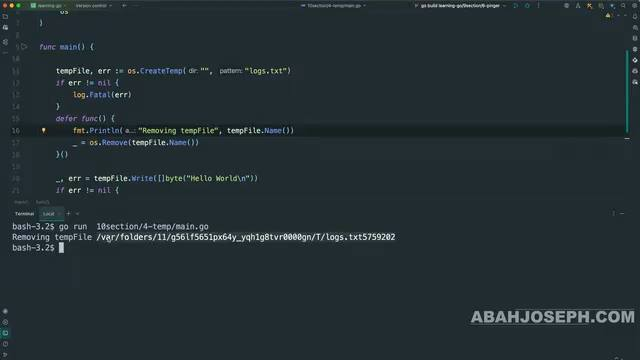
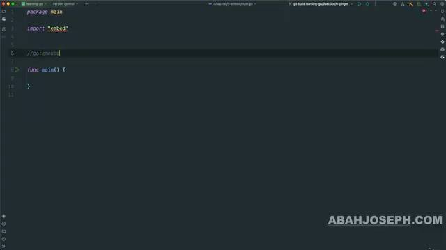
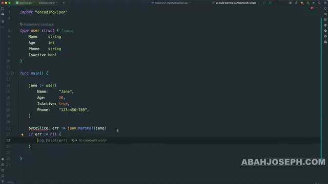
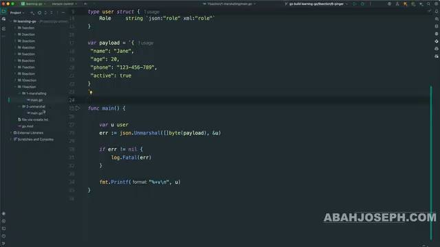
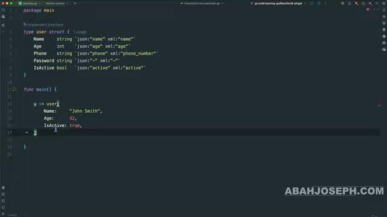
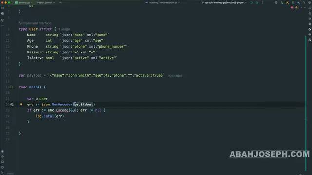
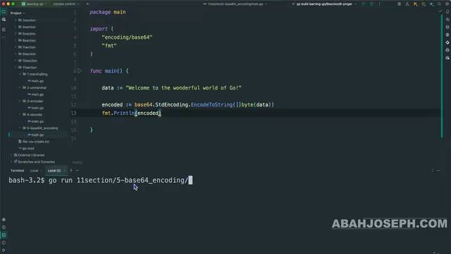

# Go Backend Masterclass P63–P69 复现文档：临时文件、静态资源嵌入、JSON 编解码与 Base64

> 适用读者：前端转 AI 应用工程师。本文所有代码均可在 Go 1.21+ 下直接保存运行。涉及并发/锁的地方会补一句「在 JS/Node 里对应什么」。Java 语法只做「知道即可」标注。
>
> 覆盖课程：BV1N5x56nEfy 的 P63–P69。这七集是「标准库工具箱」小节：临时文件/目录、`embed` 静态资源打包、`encoding/json` 的 Marshal/Unmarshal、Encoder/Decoder 流式版本、Base64 编解码。它们是后面写 API、处理上传文件、打包前端产物、做 JWT/URL 参数的基础。

---

## 1. 这一节做什么

这七集围绕一个目标：**让你的 Go 程序能自己「造临时文件」「把前端静态资源塞进二进制」「在 struct 和 JSON 之间来回转换」「处理二进制/URL 安全的字符串」**。具体拆成五块能力：

| 能力 | 对应集数 | 你会得到什么 |
|---|---|---|
| 临时文件与临时目录 | P63 | `os.CreateTemp` / `os.MkdirTemp` + `defer os.Remove` 的固定套路 |
| 把静态文件/目录编译进二进制 | P64 | `//go:embed` 指令 + `embed.FS`，单文件分发 |
| struct → JSON（Marshal） | P65 | `json.Marshal` / `json.MarshalIndent` + struct tag |
| JSON → struct（Unmarshal） | P66 | `json.Unmarshal` + `json:"-"` 隐藏字段 + 嵌套 struct |
| 流式编解码（Encoder/Decoder） | P67–P68 | `json.NewEncoder(w).Encode(v)` / `json.NewDecoder(r).Decode(&v)` |
| Base64 编解码 | P69 | `base64.StdEncoding.EncodeToString` / `DecodeString` |

最终你会得到一个可运行的目录 `go-masterclass/`，里面 6 个独立 `main.go`，每个都能 `go run` 出预期输出。这就是后面写 HTTP API 的「零件库」。

从学习路径上看，这一节不是让你背 API，而是建立一套以后写服务端代码时的固定动作：需要临时落盘时知道用系统临时目录并清理；需要打包前端产物时知道用 `embed` 把资源放进二进制；需要和前端交换数据时知道 JSON 的编码、解码、流式读写三种入口；需要处理 URL、JWT、上传内容时知道 Base64 的边界。下面每一节都会在原有复现步骤上补充命令解释、常见报错、排查方式和前端对照，方便你真正跑通，而不是只看懂。

---

## 2. 讲师原话（带出处）

> "有时应用在执行过程中需要临时存储数据，而不需要让这些数据长期持久化，也不想让它们把系统弄得杂乱，这就是我们需要临时文件和目录的原因。"
> —— p063 [00:00]

> "有一个叫 embed 的包……这一点非常重要：这不是注释，嵌入语法就是这样，我写的是 //go:embed。"
> —— p064 [00:54]–[01:24]

> "在 Go 中构建 API 时，你需要一种方式来编码或解码 JSON、XML、YML 等数据……在 Go 里，把数据转换成 JSON，或者把 JSON 转换成结构体，其实非常简单。"
> —— p065 [00:00]

> "这里的 Unmarshal 接收的是字节切片，而不是字符串。所以我们在这里把它这样包一层，把它转成字节切片……当然，这里必须传入你要使用的对象的地址。"
> —— p066 [01:25]–[01:53]

> "这里的区别在于：这里我会用 enc 来表示 json.NewEncoder……我们传入 os.Stdout，它是一个写入器；这里接收的是一个接口。"
> —— p067 [01:04]–[01:24]

> "你会注意到，它接收的是一个读取器，你需要从某个来源读取数据。这个来源可以是缓冲区，也可以是任何东西。但记住，strings 包为我们提供了 NewReader。"
> —— p068 [00:49]–[01:04]

> "开发应用时，Base64 编码非常重要……这个 base64.StdEncoding.EncodeToString 接收一个字节切片。"
> —— p069 [00:00]–[01:20]

这些原话分别对应本节的关键动作：P63 解释临时文件的存在意义，P64 强调 `//go:embed` 不是普通注释，P65 说明 API 场景下 JSON 编解码的重要性，P66 强调 `Unmarshal` 接收的是 `[]byte` 和指针，P67/P68 对比 Encoder 写 writer、Decoder 读 reader，P69 说明 Base64 接收的是字节切片。复现时建议把每句原话和对应代码块对照着看，这样不容易把 API 的参数类型记混。

---

## 3. 从零复现

### 3.1 环境准备

```bash
# 确认 Go 版本（课程未指定具体版本，embed 需要 1.16+，本文用 1.21+）
go version

# 建工作目录
mkdir -p go-masterclass && cd go-masterclass
go mod init go-masterclass
```

目录结构（最终形态）：

```
go-masterclass/
├── go.mod
├── tempfile/
│   └── main.go
├── embed/
│   ├── main.go
│   ├── hello.txt
│   └── public/
│       ├── data.txt
│       ├── python.txt
│       ├── go.txt
│       ├── java.txt
│       └── php.txt
├── marshal/
│   └── main.go
├── unmarshal/
│   └── main.go
├── encoder/
│   └── main.go
├── decoder/
│   └── main.go
└── base64/
    └── main.go
```

这一步的完整解释：`go version` 用来确认本机 Go 工具链可用，并且版本要满足 `embed` 的最低要求；如果命令不存在，说明 Go 没装好或 `PATH` 没配置。`mkdir -p` 会递归创建目录，已存在也不会报错；`cd` 进入工作目录后，`go mod init go-masterclass` 会生成 `go.mod`，它相当于前端项目里的 `package.json`，只是 Go 的模块文件更轻量。常见错误是重复执行 `go mod init`，如果当前目录已有 `go.mod`，Go 会提示模块已存在；这时不需要重复初始化，直接继续建子目录即可。另一个常见问题是模块名随便写成中文或带空格，后续 import 会不方便，建议用全小写、连字符或下划线风格。前端对照：`go.mod` 类似 `package.json`，`go run ./tempfile` 类似在某个子包里执行脚本，但它不需要先安装依赖，因为本节只使用标准库。

### 3.2 步骤一：临时文件与临时目录（P63）

1. 新建 `tempfile/main.go`，写入第 4 节代码块 1。
2. `go run ./tempfile`。
3. 观察终端：会先打印临时文件路径，再打印 `Removing temp file: <路径>`，程序退出后该路径不存在。
4. 把 `defer os.Remove(...)` 那行注释掉再跑一次，用 `ls` 去 `/tmp`（Windows 是 `%TEMP%`）下确认文件还在——这就是「不清理会残留」的直观证据。

讲师在 p063 [03:27] 演示的正是这个对比：带 `defer os.Remove` 时路径「cut 一下就没了」，去掉后文件留在系统临时目录里。



补充解释：`go run ./tempfile` 里的 `./tempfile` 是包路径，不是单个文件名；只要该目录下有一个 `package main` 且包含 `func main()`，Go 就会编译并运行它。运行后你会看到两个路径，一个是文件路径，一个是目录路径。验证删除是否成功时，Linux/macOS 可以直接复制终端打印的路径执行 `ls <路径>`，如果提示 `No such file or directory` 就说明删掉了；Windows 可以在资源管理器地址栏粘贴 `%TEMP%` 后查找 `logs-` 开头的文件。常见错误一：把 `defer os.Remove(f.Name())` 写在 `f.Close()` 之前也没问题，但 Windows 上删除打开中的文件可能失败，所以更稳妥的是先关闭再删除。常见错误二：清理目录时误用 `os.Remove`，它只能删空目录，遇到目录里有文件会报错，应该用 `os.RemoveAll`。前端对照：Node 里常用 `fs.mkdtemp` 配合 `os.tmpdir()` 创建临时目录，用 `fs.rm(..., { recursive: true, force: true })` 清理；思路和 Go 完全一致，只是 Go 把创建文件和创建目录拆成 `CreateTemp` 与 `MkdirTemp` 两个函数。

### 3.3 步骤二：embed 静态资源（P64）

1. 在 `embed/` 下创建 `hello.txt`，内容一行：`hello world from the embedded file`。
2. 创建 `embed/public/` 目录，放 5 个 txt 文件（内容随意，比如 `data.txt` 里写 `this is data`）。
3. 写 `embed/main.go`（第 4 节代码块 2）。
4. `go run ./embed`，应看到 `hello.txt` 的内容和 `public/data.txt` 的内容。
5. **关键验证**：`go build -o embed_app ./embed`，然后把 `embed/` 整个目录临时改名（或删掉），只留 `embed_app` 二进制，运行它——输出不变。这就是「静态资源已打进二进制」。



讲师在 p064 [08:12] 踩过一个坑：读 `public` 目录下的文件时，路径必须带 `public/` 前缀（`public/data.txt`），不能只写 `data.txt`。这一点在代码块 2 里已经修正。

补充解释：`go build -o embed_app ./embed` 中 `-o` 指定输出文件名，`./embed` 是要编译的包路径；编译成功后当前目录会出现 `embed_app` 可执行文件。验证「资源已嵌入」时，不要只移动 `hello.txt`，最好把整个 `embed` 源码目录改名，然后从别的目录运行 `./embed_app`，这样才能排除程序仍然读取磁盘文件的可能。常见错误一：把 `//go:embed` 写成 `// go:embed`，中间多一个空格，编译器会把它当普通注释，变量没有内容，运行输出为空。常见错误二：`//go:embed public` 写成 `//go:embed public/`，目录结尾斜杠容易导致匹配失败或行为不符合预期，建议不写尾斜杠。常见错误三：只 import 了 `embed` 却没有任何 `embed.FS` 变量，编译会提示导入未使用；反过来，如果变量类型是 `embed.FS`，就必须 import `embed`。前端对照：Vite/Webpack 的 `public` 目录是运行时从服务器拿文件，而 `//go:embed` 是编译时把文件塞进二进制；部署时前者要带静态资源目录，后者只需要一个可执行文件。

### 3.4 步骤三：Marshal（P65）

1. 写 `marshal/main.go`（第 4 节代码块 3）。
2. `go run ./marshal`，输出一行紧凑 JSON。
3. 把 `json.Marshal` 换成 `json.MarshalIndent(u, "", "  ")` 再跑，输出变成带缩进的多行 JSON。



补充解释：`go run ./marshal` 只编译运行 `marshal` 包，不会运行其他目录，所以每个代码块都可以独立验证。输出紧凑 JSON 时字段顺序通常按 struct 定义顺序出现，但 JSON 规范本身不保证对象字段顺序，前端不要依赖字段顺序做逻辑。常见错误一：struct 字段首字母小写，`json.Marshal` 不会导出该字段，输出里直接没有它；Go 的反射只能访问导出字段。常见错误二：struct tag 用了双引号或中文引号，例如 `json:"name"` 外面的反引号写成普通引号，编译会报错或 tag 不生效。常见错误三：把 `json.Marshal` 的返回值直接当字符串打印，忘了 `string(b)`，会看到一串数字字节。前端对照：`json.Marshal` 很像 `JSON.stringify(obj)`，`MarshalIndent` 像 `JSON.stringify(obj, null, 2)`；区别是 Go 需要先定义 struct 或 map，而 JS 对象是动态的。

### 3.5 步骤四：Unmarshal（P66）

1. 写 `unmarshal/main.go`（第 4 节代码块 4）。
2. `go run ./unmarshal`，应看到 struct 字段被 JSON 值填充，且 `Password` 字段为空（因为 tag 是 `json:"-"`）。
3. 把 payload 里 `"phone"` 改成 `"phoneNumber"` 再跑，`Phone` 字段会变空——验证 tag 名必须和 JSON key 完全一致。



补充解释：`json.Unmarshal` 的第一个参数必须是 `[]byte`，所以代码里用了 `[]byte(payload)` 做转换；第二个参数必须传地址 `&u`，否则函数拿到的是副本，改不到原来的 `u`。常见错误一：传了 `u` 而不是 `&u`，编译能过但运行报 `json: Unmarshal(non-pointer main.User)`。常见错误二：JSON 里的类型和 struct 字段类型不匹配，例如 `"age": "30"` 解到 `int`，会报 `cannot unmarshal string into Go struct field`。常见错误三：字段名没导出，首字母小写，Unmarshal 会静默跳过，字段保持零值且不一定报错，排查时容易误以为 JSON 没传。前端对照：`json.Unmarshal` 类似 `JSON.parse`，但 Go 需要提前声明目标类型；TypeScript 里可以先用 `interface` 描述形状，再用 `JSON.parse` 得到 `any` 后断言，Go 则是在解码时直接按 struct 校验类型。

### 3.6 步骤五：Encoder / Decoder（P67–P68）

1. 写 `encoder/main.go`（第 4 节代码块 5），`go run ./encoder`，JSON 直接打到 stdout。
2. 写 `decoder/main.go`（第 4 节代码块 6），`go run ./decoder`，从字符串 reader 解码出 struct 并打印。





补充解释：`json.NewEncoder(os.Stdout)` 里的 `os.Stdout` 是标准输出，实现了 `io.Writer`；`Encode` 会把 JSON 直接写进去，并在末尾自动补一个换行。`json.NewDecoder(strings.NewReader(payload))` 里的 `strings.NewReader` 把字符串包装成 `io.Reader`，`Decode` 从 reader 中读取一个完整 JSON 值。常见错误一：连续 `Encode` 多个对象时误以为输出是一个 JSON 数组，实际上它是多行 JSON，每行一个对象；如果需要数组，要先用切片包起来再 Encode。常见错误二：`Decode` 传入非指针，报错信息与 Unmarshal 类似。常见错误三：从 HTTP 请求体解码后忘记关闭 `r.Body`，虽然课程示例没有涉及 HTTP，但实际项目里要 `defer r.Body.Close()`。前端对照：`json.NewEncoder(w).Encode(v)` 类似服务端 `res.json(v)`；`json.NewDecoder(r.Body).Decode(&v)` 类似前端 `await res.json()` 的逆过程，只是 Go 端从请求流里读。

### 3.7 步骤六：Base64（P69）

1. 写 `base64/main.go`（第 4 节代码块 7）。
2. `go run ./base64`，应看到编码串、解码后原文、以及「round-trip 一致」的确认输出。



补充解释：`go run ./base64` 会依次打印标准 Base64 编码、解码后的原文、round-trip 校验结果和原始字节编码。验证时可以手动把 `Encoded:` 后面的字符串拿去在线 Base64 工具解码，应该得到 `Welcome to the wonderful`。常见错误一：在 URL 参数里直接使用 `StdEncoding`，其中 `+` 和 `/` 可能被 URL 解析器处理掉，应该改用 `base64.URLEncoding`。常见错误二：解码时传入了带换行或空格的字符串，`DecodeString` 可能报 `illegal base64 data`，实际项目里要先去空白或使用合适编码。常见错误三：把二进制解码结果直接当文本打印，看到乱码是正常的，因为原始字节不一定可打印。前端对照：浏览器里 `btoa`/`atob` 处理字符串，Node 里 `Buffer.from(str).toString("base64")` 和 `Buffer.from(b64, "base64").toString()` 更接近 Go 的字节切片思路。

---

## 4. 完整代码

### 代码块 1：`tempfile/main.go`

```go
package main

import (
	"fmt"
	"log"
	"os"
)

func main() {
	// 1) 创建临时文件。第一个参数是目录，空字符串表示系统默认临时目录。
	f, err := os.CreateTemp("", "logs-*.txt")
	if err != nil {
		log.Fatal(err)
	}

	// 2) 注册清理：main 返回前删除文件。注意此时 f 仍可用。
	defer func() {
		fmt.Println("Removing temp file:", f.Name())
		_ = os.Remove(f.Name()) // 故意忽略错误，课程里也这么干
	}()

	// 3) 写入内容
	if _, err := f.WriteString("hello world"); err != nil {
		log.Fatal(err)
	}

	// 4) 关闭文件
	if err := f.Close(); err != nil {
		log.Fatal(err)
	}

	fmt.Println("Temp file created at:", f.Name())

	// 5) 创建临时目录
	dir, err := os.MkdirTemp("", "myapp-logs-*")
	if err != nil {
		log.Fatal(err)
	}
	fmt.Println("Temp dir created at:", dir)

	// 6) 目录也要清理，用 RemoveAll
	defer func() {
		fmt.Println("Removing temp dir:", dir)
		_ = os.RemoveAll(dir)
	}()
}
```

### 代码块 2：`embed/main.go`

```go
package main

import (
	"embed"
	"fmt"
	"log"
)

//go:embed hello.txt
var helloData string

//go:embed public
var publicFS embed.FS

func main() {
	// 方式一：直接读成 string
	fmt.Println("=== hello.txt ===")
	fmt.Println(helloData)

	// 方式二：通过 embed.FS 读目录下的文件
	fmt.Println("=== public/data.txt ===")
	data, err := publicFS.ReadFile("public/data.txt")
	if err != nil {
		log.Fatal(err)
	}
	fmt.Println(string(data))

	// 方式三：用 fs.ReadFile（需要 import "io/fs"）
	// 课程里提到两种方式等价，这里保留 FS 自带方法即可。
}
```

配套文件：

`embed/hello.txt`：
```
hello world from the embedded file
```

`embed/public/data.txt`：
```
this is data
```

其余 `python.txt` / `go.txt` / `java.txt` / `php.txt` 内容随意，各写一行即可。

### 代码块 3：`marshal/main.go`

```go
package main

import (
	"encoding/json"
	"fmt"
	"log"
)

type User struct {
	Name   string `json:"name"`
	Age    int    `json:"age"`
	Phone  string `json:"phone"`
	Active bool   `json:"active"`
}

func main() {
	u := User{
		Name:   "John",
		Age:    30,
		Phone:  "1234567890",
		Active: true,
	}

	// 紧凑版
	b, err := json.Marshal(u)
	if err != nil {
		log.Fatal(err)
	}
	fmt.Println("Marshal:", string(b))

	// 带缩进版（更贵，仅调试/展示用）
	pretty, err := json.MarshalIndent(u, "", "  ")
	if err != nil {
		log.Fatal(err)
	}
	fmt.Println("MarshalIndent:")
	fmt.Println(string(pretty))
}
```

### 代码块 4：`unmarshal/main.go`

```go
package main

import (
	"encoding/json"
	"fmt"
	"log"
)

type Profile struct {
	URL string `json:"url"`
}

type User struct {
	Name     string  `json:"name"`
	Age      int     `json:"age"`
	Phone    string  `json:"phone"`
	Active   bool    `json:"active"`
	Role     string  `json:"role"`
	Password string  `json:"-"`
	Profile  Profile `json:"profile"`
}

func main() {
	payload := `{
		"name": "John",
		"age": 30,
		"phone": "1234567890",
		"active": true,
		"role": "admin",
		"password": "should-not-appear",
		"profile": { "url": "https://example.com" }
	}`

	var u User
	// Unmarshal 接收 []byte 和指针
	if err := json.Unmarshal([]byte(payload), &u); err != nil {
		log.Fatal(err)
	}

	fmt.Printf("Name=%s Age=%d Phone=%s Active=%v Role=%s Password=%q Profile.URL=%s\n",
		u.Name, u.Age, u.Phone, u.Active, u.Role, u.Password, u.Profile.URL)

	// 再 Marshal 回去，验证 Password 不会出现在输出里
	out, err := json.Marshal(u)
	if err != nil {
		log.Fatal(err)
	}
	fmt.Println("Re-marshal:", string(out))
}
```

### 代码块 5：`encoder/main.go`

```go
package main

import (
	"encoding/json"
	"log"
	"os"
)

type User struct {
	Name   string `json:"name"`
	Age    int    `json:"age"`
	Active bool   `json:"active"`
}

func main() {
	u := User{Name: "John", Age: 30, Active: true}

	enc := json.NewEncoder(os.Stdout)
	if err := enc.Encode(u); err != nil {
		log.Fatal(err)
	}
	// 不需要额外打印，Encode 已经把 JSON 写进 stdout
}
```

### 代码块 6：`decoder/main.go`

```go
package main

import (
	"encoding/json"
	"fmt"
	"log"
	"strings"
)

type User struct {
	Name   string `json:"name"`
	Age    int    `json:"age"`
	Active bool   `json:"active"`
}

func main() {
	payload := `{"name":"John","age":30,"active":true}`

	var u User
	dec := json.NewDecoder(strings.NewReader(payload))
	if err := dec.Decode(&u); err != nil {
		log.Fatal(err)
	}

	fmt.Printf("Decoded: Name=%s Age=%d Active=%v\n", u.Name, u.Age, u.Active)
}
```

### 代码块 7：`base64/main.go`

```go
package main

import (
	"encoding/base64"
	"fmt"
	"log"
)

func main() {
	original := "Welcome to the wonderful"

	// 编码：[]byte -> string
	encoded := base64.StdEncoding.EncodeToString([]byte(original))
	fmt.Println("Encoded:", encoded)

	// 解码：string -> []byte
	decoded, err := base64.StdEncoding.DecodeString(encoded)
	if err != nil {
		log.Fatal(err)
	}
	fmt.Println("Decoded:", string(decoded))

	// round-trip 校验
	if string(decoded) != original {
		fmt.Println("encoding failed: decoded string does not match encoded data")
	} else {
		fmt.Println("round-trip OK")
	}

	// 直接构造字节（课程里演示的 raw data 用法）
	raw := []byte{0xde, 0xad, 0xbe, 0xef}
	rawEncoded := base64.StdEncoding.EncodeToString(raw)
	fmt.Println("Raw encoded:", rawEncoded)
}
```

---

## 5. 逐行解释

### 代码块 1（临时文件）

- `os.CreateTemp("", "logs-*.txt")`：第一个参数是目录，空串 = 系统临时目录（Linux `/tmp`，macOS `/var/folders/...`，Windows `%TEMP%`）。第二个参数里的 `*` 会被替换成随机串，所以文件名不会冲突。**在 Node 里对应 `fs.mkdtemp` + `path.join(os.tmpdir(), ...)`**。
- `defer func(){ ... }()`：Go 的 `defer` 在函数返回前执行，**后进先出**。这里用匿名函数是为了在删除前先打印路径——如果直接 `defer os.Remove(f.Name())`，`f.Name()` 会在 defer 注册时求值，效果一样但没法加打印。
- `_ = os.Remove(...)`：下划线丢弃返回值。讲师在 p063 [02:05] 特意说「please careful with this because if there is an error you should know」，但临时文件清理失败通常不影响主流程，所以这里忽略。
- `f.Close()` 必须在 `os.Remove` 之前或之后都行（Linux 允许删除已打开文件），但**先 Close 再 Remove 更可移植**（Windows 上打开中的文件删不掉）。
- `os.MkdirTemp` 返回的是目录路径字符串，不是 `*os.File`。清理用 `os.RemoveAll`，不是 `os.Remove`——`os.Remove` 只能删空目录。

补充排查：如果你在 macOS 上找不到 `/tmp` 下的文件，先看终端打印的完整路径，因为 macOS 的临时目录可能在 `/var/folders/...` 下；Windows 则看 `%TEMP%`。如果删除失败，先确认文件是否仍被其他程序占用，再确认 `RemoveAll` 的路径是否正确。临时文件适合存放一次性的中间结果，不适合当数据库或长期缓存；程序退出后是否残留取决于你是否写了清理逻辑。

### 代码块 2（embed）

- `//go:embed hello.txt`：**这不是注释**，是编译器指令。`//` 和 `go:embed` 之间**不能有空格**，否则失效。讲师在 p064 [01:24] 反复强调这一点。
- `var helloData string`：被 embed 的文件内容直接赋给 string 变量。文件必须存在，否则编译报错（讲师在 p064 [01:51] 演示了「file does not exist」的报错）。
- `//go:embed public`：嵌入整个目录，变量类型必须是 `embed.FS`（或 `fs.FS`）。**目录路径不带尾部斜杠**。
- `publicFS.ReadFile("public/data.txt")`：路径必须带 `public/` 前缀。讲师在 p064 [08:12] 第一次写成 `data.txt` 失败，改成 `public/data.txt` 才成功。
- 为什么 `embed` 包要 import 但代码里没直接用 `embed.`？因为 `embed.FS` 类型出现在变量声明里，编译器需要这个 import。如果只 embed 单个文件到 string，可以不 import `embed`——但为了统一，这里保留。
- **打包后二进制变大**：讲师在 p064 [00:00] 说「that would make the application a little bit bigger. But it is easier and more convenient to send a single file」。这是取舍：体积换部署简单。

补充排查：如果 `ReadFile` 报 `file does not exist`，先检查嵌入路径和读取路径是否都带 `public/`；如果编译报 `pattern ...: no matching files found`，检查文件名大小写、目录是否为空、是否把文件放错了包目录。`embed` 的文件是只读的，运行期不能通过 `embed.FS` 写回；需要修改时先复制到临时文件，再对临时文件操作。

### 代码块 3（Marshal）

- `json.Marshal(u)` 返回 `[]byte`，不是 string。要打印得 `string(b)`。
- struct tag `` `json:"name"` `` 用**反引号**包裹，不是双引号。里面 `json` 是 tag key，`"name"` 是 tag value。
- `MarshalIndent(u, "", "  ")`：第二个参数是每行前缀（通常空），第三个是缩进字符串。讲师在 p065 [05:27] 演示了前缀 `-` 的效果，但实际项目里几乎不用前缀。
- 讲师在 p065 [05:56] 明确说：「If you don't need it to be readable, please always use the Marshall one. It's cheaper from a computational standpoint」。**生产环境 API 响应用 `Marshal`，日志/调试用 `MarshalIndent`**。

补充排查：如果输出字段名不是你想要的，检查 tag 是否拼错；如果字段完全没出现，检查首字母是否大写。`json.Marshal` 遇到 `chan`、`func` 这类不支持的类型会返回错误，遇到循环引用也可能出错；本节示例都是简单值类型，所以不会触发。前端对照：生产接口通常返回紧凑 JSON，调试面板才格式化，这和 `Marshal` 与 `MarshalIndent` 的取舍一致。

### 代码块 4（Unmarshal）

- `json.Unmarshal([]byte(payload), &u)`：第一个参数是 `[]byte`（所以要把 string 包一层），第二个是**指针**。讲师在 p066 [01:25] 强调「you must pass the address」——因为 Unmarshal 要修改原对象，值传递改不了。
- `json:"-"`：**完全忽略**该字段，Marshal 不输出、Unmarshal 不读取。讲师在 p066 [04:42] 用 password 举例：「you never want to send out the password in any condition」。这是 API 安全的基本操作。
- `json:"role"` 但 payload 里没有 `role` 字段：不报错，`Role` 保持零值 `""`。讲师在 p066 [03:46] 说「even though we have some feeds that are here that are not in the JSON, it doesn't really affect it」。
- 嵌套 struct `Profile`：JSON 里 `"profile": {"url": "..."}` 会自动映射到 `Profile.URL`。字段名必须**导出**（首字母大写），否则 Unmarshal 改不了——这是 Go 反射的限制，讲师在 p066 [05:41] 说「I need to make this one exportable」。
- **在 JS/Node 里对应什么**：`JSON.parse` / `JSON.stringify`。区别是 Go 需要预先定义 struct 类型，JS 是动态的。TypeScript 里 `interface` + `JSON.parse` 最接近。

补充排查：如果某个字段一直为空，按顺序检查四件事：JSON key 是否和 tag 完全一致、字段是否导出、类型是否匹配、是否被 `json:"-"` 忽略。`json.Unmarshal` 默认忽略 JSON 里多出来的字段，所以前端多传字段不会报错；如果你希望严格拒绝未知字段，需要使用 `Decoder.DisallowUnknownFields`，但课程示例没有使用。

### 代码块 5（Encoder）

- `json.NewEncoder(os.Stdout)`：`os.Stdout` 实现了 `io.Writer` 接口。Encoder 把 JSON **直接写进去**，不经过中间 `[]byte`。
- `enc.Encode(u)`：注意 Encode 会在末尾**自动加换行**，所以连续 Encode 多个对象会一行一个（这是 JSON Lines 格式的基础）。
- 讲师在 p067 [01:24] 说「This takes an interface. That means you can specify where you want your data to be written to」——可以传 `http.ResponseWriter`、`bytes.Buffer`、文件等。**这是和 Marshal 最大的区别：Marshal 返回 bytes，Encoder 直接写目的地**。

补充排查：如果终端输出看起来多了一个空行，那不是错误，是 `Encode` 自动加的换行。如果你把 Encoder 写到 `bytes.Buffer`，之后要取内容用 `buf.String()` 或 `buf.Bytes()`。实际写 HTTP 响应时，通常先设置 `Content-Type: application/json`，再调用 `Encode`；如果 Encode 失败，响应可能已经写了一部分，错误处理要结合具体框架。

### 代码块 6（Decoder）

- `json.NewDecoder(strings.NewReader(payload))`：`strings.NewReader` 把 string 包成 `io.Reader`。Decoder 从 reader **流式读取**，不需要一次性拿到完整 `[]byte`。
- `dec.Decode(&u)`：同样要传指针。
- 讲师在 p068 [01:46] 说「what you can read from multiple sources doesn't have to be coming from payload here. It can be in a different stream. It can be network connection anywhere」——实际项目里 `json.NewDecoder(r.Body).Decode(&req)` 是处理 HTTP 请求体的标准写法。
- **什么时候用 Marshal vs Encoder**：讲师在 p068 [02:16] 给了经验法则——「most times you are going to use Marshal and on Marsha when you are working with web services. When you need flexibility, you then go to encode and decode」。简单说：小对象、要拿到 bytes 做签名/缓存 → Marshal；直接写 HTTP 响应/读请求体 → Encoder/Decoder。

补充排查：如果 `Decode` 报 `EOF`，通常表示 reader 里没有数据或已经读完；如果报 `unexpected end of JSON input`，表示 JSON 不完整。流式 Decoder 可以连续解码多个 JSON 值，但每个值必须完整；从网络读取时要注意请求体大小限制，避免一次性读入过大内容。

### 代码块 7（Base64）

- `base64.StdEncoding.EncodeToString([]byte(s))`：标准 Base64 字母表（含 `+` `/`）。URL 场景要用 `base64.URLEncoding`（把 `+` `/` 换成 `-` `_`），讲师在 p069 [07:47] 提到「We are going to use it a lot with when we are working with URL」。
- `DecodeString` 返回 `([]byte, error)`，要 `string(decoded)` 才能打印。
- `[]byte{0xde, 0xad, 0xbe, 0xef}`：直接构造字节切片。讲师在 p069 [04:03] 演示了这种「raw data」用法，说「The number here doesn't have to be in hex. It can be in regular decimal」——`[]byte{222, 173, 190, 239}` 等价。
- 二进制数据解码后打印是乱码，这是正常的。讲师在 p069 [06:28] 说「it's the binary data that is not really printable」。

补充排查：如果 `DecodeString` 报错，先检查输入是否只包含 Base64 字符、长度是否能被 4 整除、是否混入了 URL 安全字符。标准编码和 URL 编码不能混用；`RawStdEncoding` 和 `StdEncoding` 的区别在于是否补 `=`，实际对接第三方时要确认对方用的是哪一种。

---

## 6. 复现检查清单

跑完下面每一条都打勾，说明这一节完全复现成功。每条后面都补了「怎么验证」，建议按顺序执行，不要跳步：

- [ ] `go version` 输出 ≥ 1.21  
  验证方法：看输出里的 `go1.21` 或更高版本号；如果低于 1.16，`embed` 相关代码无法按本文编译。
- [ ] `go mod init go-masterclass` 成功，`go.mod` 存在  
  验证方法：执行 `ls` 或 `dir` 确认当前目录有 `go.mod`，打开后能看到 `module go-masterclass`。
- [ ] `go run ./tempfile` 输出包含 `Temp file created at:` 和 `Removing temp file:`，且退出后该路径不存在  
  验证方法：复制打印出的文件路径，程序退出后执行 `ls <路径>`，应提示不存在；Windows 到 `%TEMP%` 下按文件名查找也应找不到。
- [ ] 注释掉 `defer os.Remove` 后重跑，`/tmp`（或 `%TEMP%`）下能看到残留文件  
  验证方法：只注释文件删除那一段，不要注释目录清理；重跑后按打印路径查找文件，确认它还在，然后再手动删掉。
- [ ] `go run ./embed` 输出 `hello world from the embedded file` 和 `this is data`  
  验证方法：终端应出现两个小标题和两段内容；如果第二段报错，重点检查 `public/data.txt` 路径前缀。
- [ ] `go build -o embed_app ./embed` 后删掉 `embed/` 目录，`./embed_app` 仍能输出上述内容  
  验证方法：先编译，再把整个 `embed` 源码目录改名，最后运行 `./embed_app`；输出不变才说明资源真的进了二进制。
- [ ] `go run ./marshal` 输出 `{"name":"John","age":30,"phone":"1234567890","active":true}`  
  验证方法：看字段名是否为小写 tag 名，字段顺序是否与 struct 一致；如果少了字段，检查首字母是否大写。
- [ ] 把 `Marshal` 换成 `MarshalIndent` 后输出变成多行缩进  
  验证方法：观察输出是否每个字段单独一行，并且前面有两个空格缩进；改回 `Marshal` 应恢复一行。
- [ ] `go run ./unmarshal` 输出中 `Password=""`（空），`Profile.URL=https://example.com`  
  验证方法：看 `Password=%q` 是否打印 `""`；如果打印了明文，检查 tag 是否是 `json:"-"`。
- [ ] Re-marshal 输出中**没有** `password` 字段  
  验证方法：在 `Re-marshal:` 那一行搜索 `password`，应完全搜不到；同时确认 `profile.url` 仍在。
- [ ] `go run ./encoder` 输出一行 JSON 到 stdout  
  验证方法：终端应出现 `{"name":"John","age":30,"active":true}`，末尾可能带一个换行，这是正常的。
- [ ] `go run ./decoder` 输出 `Decoded: Name=John Age=30 Active=true`  
  验证方法：逐字段核对大小写和值；如果 `Name` 为空，检查 JSON key 和 tag 是否一致。
- [ ] `go run ./base64` 输出 `round-trip OK`  
  验证方法：同时看 `Decoded:` 是否等于原文 `Welcome to the wonderful`；不相等会进入失败分支。
- [ ] `Raw encoded:` 后面是 `3q2+7w==`  
  验证方法：核对字符是否包含 `+` 和 `==`；如果换成了 URLEncoding，结果会不同。

---

## 7. 课里没讲但你会撞上的

| 现象 | 原因 | 怎么办 |
|---|---|---|
| `//go:embed` 编译报 `no matching files found` | 嵌入的目录为空，或路径/文件名写错，或目录被 `.gitignore` 之类规则影响 | 至少放一个文件；核对相对当前包目录的路径；目录路径不要带尾部斜杠；确认文件名大小写一致 |
| 以 `.` 或 `_` 开头的文件/目录没有被嵌入 | `//go:embed` 默认忽略以 `.` 或 `_` 开头的文件/目录，避免把 `.git`、`node_modules` 等一起打包 | 如果确实要嵌入，使用 `all:` 前缀等规则；前端产物尽量放在普通目录如 `dist/`，避免把编辑器临时目录打进去 |
| 运行期想修改 embed 出来的文件，发现没有写方法 | `embed.FS` 是只读文件系统，没有 `WriteFile` | 先 `os.CreateTemp` 复制出来，再修改临时文件；这正是 P63 与 P64 放在一起的实际用途 |
| `json.Unmarshal` 报类型不匹配 | JSON 值类型和 struct 字段类型不一致，例如字符串解到 `int` | 统一前后端字段类型；必要时用 `json.Number` 或自定义 `UnmarshalJSON`；先打印原始 JSON 排查 |
| `json:"-"` 和 `json:"-,"` 行为不同 | 前者完全忽略字段，后者字段名就是 `-` | 隐藏敏感字段用 `json:"-"`；不要多写逗号；用 Re-marshal 验证敏感字段是否真的没输出 |
| `Encoder.Encode` 输出末尾多一个换行 | `Encode` 会自动追加换行，方便连续写多个 JSON 值 | 大多数客户端能接受；如果做签名或严格字节比对，改用 `Marshal` 或手动处理换行 |
| Base64 字符串放进 URL 后解码失败或参数被截断 | `StdEncoding` 含 `+` `/`，在 URL/query 里有特殊含义 | URL 场景改用 `base64.URLEncoding`；对接第三方时确认是否需要去掉 `=` 的 Raw 变体 |
| 临时文件在容器重启后消失 | Docker 容器 `/tmp` 默认在容器可写层，容器重启后不保留 | 临时数据就接受丢失；需要跨重启保留时挂 volume 或改用持久化存储 |
| 临时文件其他进程读不了 | `os.CreateTemp` 创建的文件权限通常是 `0600`，仅 owner 可读写 | 确认是否真的需要跨用户共享；必要时 `os.Chmod`，但要注意敏感数据泄露风险 |
| 多个 goroutine 往同一个 `Encoder` 写出现交错 JSON | `json.Marshal`/`Unmarshal` 本身无共享状态，但共享 writer 的并发写需要同步 | 给共享 writer 加 `sync.Mutex`，或每个 goroutine 写自己的 buffer 后再汇总；Node 单线程事件循环天然少这类问题，Go 的 goroutine 是真并行，必须显式保护 |

---

**下一步**：这七集的零件在 P70 之后会立刻用上——HTTP handler 里 `json.NewDecoder(r.Body).Decode(&req)` 读请求、`json.NewEncoder(w).Encode(resp)` 写响应、`//go:embed dist` 打包前端、`base64.URLEncoding` 处理 URL 参数。建议先把本文 7 个代码块跑通再往下看。