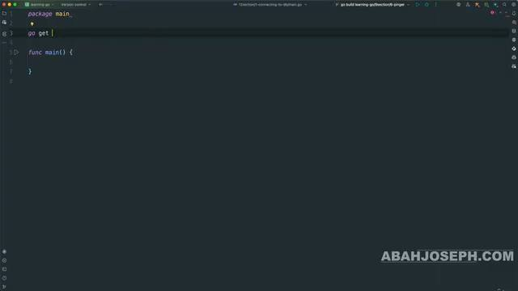
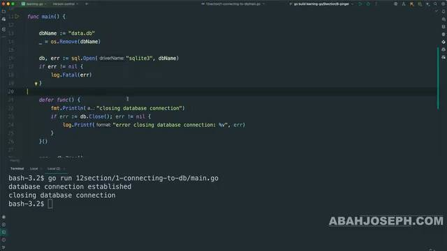
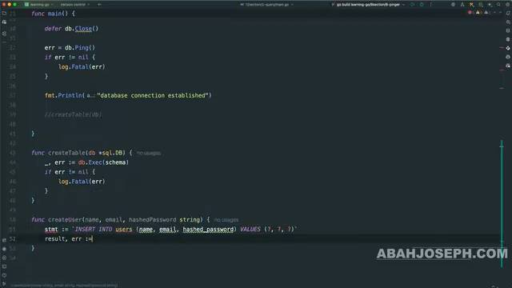
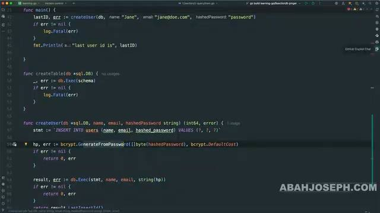
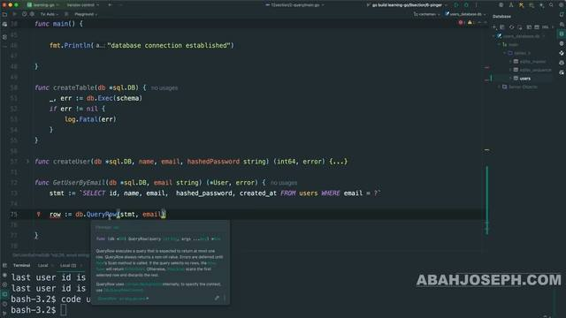
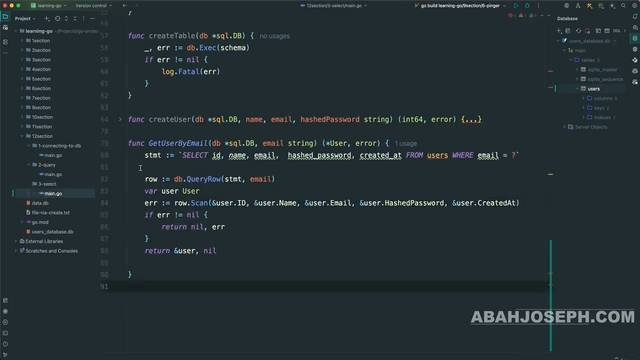
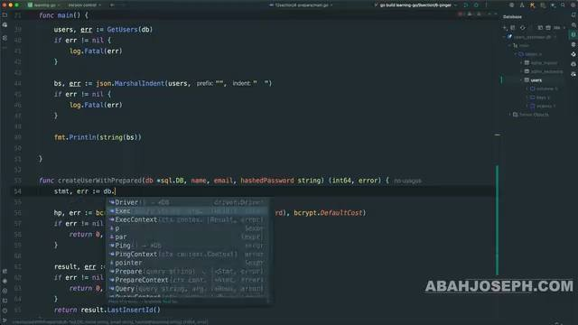
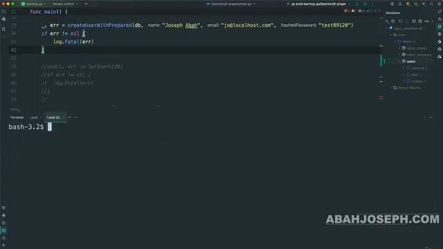

# Go Backend Masterclass P70–P73：用 database/sql 操作数据库（SQLite 版）

> 本节覆盖 P70–P73 四集：连接数据库并建表 → 在 VS Code 里可视化表 → 插入数据（含 bcrypt 密码哈希）→ 查询单行/多行 → 预编译语句（Prepared Statement）与 context。
> 所有代码基于 Go 标准库 `database/sql` + `mattn/go-sqlite3` 驱动，换成 Postgres/MySQL 只需换驱动和占位符写法（课里明确讲了这一点）。

---

## 1. 这一节做什么

这一节把「Go 后端怎么跟关系型数据库打交道」从零跑通。具体产出：

1. 一个能连上 SQLite、建表、插入用户、按邮箱查单个用户、查全部用户的 Go 程序；
2. 密码用 bcrypt 哈希后入库，查询结果转 JSON 时自动隐藏密码字段；
3. 把「直接拼 SQL 执行」升级成「预编译语句 + context」的写法；
4. 在 VS Code 里装一个 SQLite 插件，直接可视化看表和数据。

这四件事对应四集视频的推进顺序：P70 打通「连上」和「建表」，P71 把数据写进去并用 bcrypt 保护密码，P72 把数据读出来并转成 JSON，P73 把写法升级成生产环境可用的预编译语句和 context。每一步都能独立运行，前一步的产物（`data.db` / `users.db`）下一步直接复用。所以如果中间某一步卡住，可以先回上一步确认数据库文件是否生成、表是否存在、数据是否真的写进去了，再往前走——不要四步一次性抄完再跑，否则出错了很难定位是哪一层的错。

讲师反复强调的一点：**用 SQLite 学到的所有东西，换成 MySQL / Postgres 几乎不用重学**，因为 `database/sql` 是统一接口，驱动只是插进去的插件。这句话在 P70 里至少出现了两次（一次讲 SQL 语法通用性，一次讲接口统一性），说明它不是随口一说，而是这一节的核心设计意图：先在 SQLite 上把 `database/sql` 的套路练熟，换库时你只需要换驱动 import、换占位符、换 DSN，业务代码几乎一字不动。

对前端转 AI 应用工程师的人来说，这一节相当于「Node 里用 `pg` / `better-sqlite3` 那套东西的 Go 版本」，概念完全对得上：`sql.Open` 对应 `new Pool({ connectionString })`，`db.Ping` 对应 `pool.query('SELECT 1')`，`QueryRow` / `Query` 对应 `pool.query` 的单行 / 多行版本，`rows.Scan` 对应把结果对象映射到结构体，`bcrypt.GenerateFromPassword` 对应 `bcryptjs.hash`，`json:"-"` 对应序列化时手动 `delete obj.password`。唯一需要重新适应的是 Go 的 `?` 占位符、`rows.Err()` 这类显式错误检查，以及 `context` 一路往下传的习惯——Go 不替你隐式兜底，所有错误必须显式处理。

---

## 2. 讲师原话（带出处）

> "你用 SQLite 学到的内容同样适用于 Postgres 和 MySQL，不需要再学习一套新语法。"
> —— p070 [01:21]

> "这是我使用的通用接口，也正因如此，你用 SQLite 学到的内容同样适用于 Postgres 和 MySQL。"
> —— p070 [01:21]

> "我们将使用一种叫作空白导入的方式……因为我们自己不会直接使用这个包里的任何内容。"
> —— p070 [04:41]

> "打开连接时，从技术上说它还没有连接到数据库。要真正建立连接，你需要尝试 ping 数据库。"
> —— p070 [07:52]

> "这样可以防止 SQL 注入，这一点非常重要；不要用 Sprintf 自己把数据拼进去，千万别这么做。"
> —— p071 [06:14]

> "对密码做哈希其实相当简单，我们可以使用 bcrypt。"
> —— p071 [07:09]

> "当数据不存在时……你会遇到一个错误……有时这个错误会是所谓的 sql.ErrNoRows。"
> —— p072 [05:05]

> "你需要把数据扫描回这个结构体中。"
> —— p072 [04:39]

> "预编译语句是预先编译好的 SQL 语句，可以用不同参数多次执行。"
> —— p073 [00:00]

> "预编译语句有助于防范 SQL 注入，因为参数是与 SQL 分开发送到数据库的。"
> —— p073 [01:23]

> "在 Go 中，你应当始终传递 context。"
> —— p073 [07:27]

这十句原话按集数分布很有规律：p070 三句分别讲跨数据库通用性、空白导入、Ping 的必要性，正好对应「连接 + 建表」这一集的三个技术要点；p071 两句讲占位符防注入和 bcrypt 哈希，对应「插入数据」这一集的两大安全要点；p072 三句讲单行没数据时的错误、Scan 回结构体，对应「查询」这一集的两个易错点；p073 三句讲预编译语句的定义、防注入原理、context 的传递习惯，对应「预编译 + context」这一集的全部核心概念。读的时候可以一边对照第 5 段的逐行解释，一边回看这些原话——你会发现每一句原话都能精确对应到某一行代码或某一个 API 设计意图上。

---

## 3. 从零复现

### 3.1 环境与目录

- Go 1.x（课里没指定具体小版本，用当前稳定版即可）
- 一个已 `go mod init` 的模块（课里说「Since we have a go.mod file here」——p070 [02:44]）

目录结构（课里按集数分文件夹，我们照抄这个习惯）：

```
go-backend/
├── go.mod
├── go.sum
├── 12-database/
│   └── 01-connect/
│       └── main.go          # P70：连接 + 建表
├── 02-query/
│   └── main.go              # P71：插入用户（bcrypt）
├── 03-select/
│   └── main.go              # P72：查单行 + 查多行
└── 04-prepare/
    └── main.go              # P73：预编译语句 + context
```

> 课里 P72 讲师一开始把代码放错文件夹，后来改成 `03-select`（p072 [07:22]「instead of query should have been insert so here I can say three select」）。我们直接按最终结构来。

这一步的常见错误与排查：

- **没有 `go.mod`**：如果在 `go-backend/` 下直接 `go get`，会报 `go: go.mod file not found in current directory or any parent directory`。解决：先 `go mod init go-backend` 生成 `go.mod`。
- **模块名写成 `main`**：`go mod init main` 能跑，但和包的 `package main` 容易混淆，建议用 `go-backend` 这种有意义的模块名。
- **目录没建全**：`go run ./12-database/01-connect` 如果目录不存在，会报 `no Go files in ...` 或 `stat ...: no such file or directory`。先 `mkdir -p` 建好目录，再把 `main.go` 放进去。

前端对照：Node 项目有 `package.json` 描述依赖和模块边界，Go 项目有 `go.mod`，作用完全一样；`go.mod` 里的 `require` 块相当于 `dependencies`，`go.sum` 相当于 `package-lock.json` 的哈希校验部分。

### 3.2 安装依赖

```bash
# SQLite 驱动（课里用的就是这个）
go get github.com/mattn/go-sqlite3

# bcrypt（P71 用到）
go get golang.org/x/crypto/bcrypt
```

> 课里 P71 [08:57] 讲师直接跑 `go mod tidy` 让 Go 自动拉 bcrypt，效果一样。

命令的完整解释：

- `go get` 会做三件事：解析版本 → 下载到模块缓存（`$GOPATH/pkg/mod`）→ 更新 `go.mod` 和 `go.sum`。成功时终端只回显一行下载日志，没有额外输出；失败时会在 `go.sql` 里留半条记录，需要手动删或跑 `go mod tidy` 修。
- `go mod tidy` 会重新扫描项目里所有 `import`，补齐缺的依赖、删掉没用到的依赖。P71 讲师用它自动拉 bcrypt，正是利用了「代码里 import 了 `golang.org/x/crypto/bcrypt`，tidy 就会去下载对应模块」这个行为。
- 如果 `go.sum` 没更新，`go build` / `go run` 会报 `missing go.sum entry for module ...`，此时跑一次 `go mod tidy` 即可修复。

常见错误与排查：

- **网络问题**：`go get` 报 `dial tcp ... i/o timeout`，说明模块代理不通。国内常见做法是设 `GOPROXY=https://goproxy.cn,direct`。
- **版本冲突**：老项目里别处已经指定了 `github.com/mattn/go-sqlite3` 的旧版本，`go get` 可能被 `go.mod` 的 `require` 钉住。用 `go get github.com/mattn/go-sqlite3@latest` 显式指定版本。
- **CGO 未启用**：下一小节的连接代码还不会暴露这个问题，但一旦驱动真正被调用，会报 `Binary was compiled with 'CGO_ENABLED=0'` 或 `gcc: command not found`。见第 7 段第 1 条的完整排查。

前端对照：`go get` ≈ `npm install`，`go mod tidy` ≈ `npm prune && npm install` 组合（补齐缺失 + 剪掉多余）。

### 3.3 第一步：连接数据库 + 建表（P70）

1. 新建 `12-database/01-connect/main.go`；
2. 用**空白导入** `_ "github.com/mattn/go-sqlite3"` 注册驱动；
3. `sql.Open("sqlite3", "data.db")` 打开连接；
4. `defer db.Close()`；
5. **必须 `db.Ping()`** 才算真正连上（讲师原话 p070 [07:52]）；
6. `db.Exec(建表 SQL)` 建 `users` 表；
7. `go run ./12-database/01-connect`。

预期输出（课里 p070 [08:44] 的实际输出）：

```
Connection established
Closing database
```

同时目录下出现 `data.db` 文件。

每步的完整解释：

- **第 2 步空白导入**：`_` 表示「我只要这个包执行 `init()`，不引用它的任何符号」。SQLite 驱动在 `init()` 里会调用 `sql.Register("sqlite3", &SQLiteDriver{})` 把自己注册到 `database/sql` 的全局注册表。少了这行，编译能过（因为确实没用到它的符号），但运行时 `sql.Open("sqlite3", ...)` 会报 `sql: unknown driver "sqlite3" (forgotten import?)`。
- **第 3 步 `sql.Open`**：只校验 DSN 格式、准备一个连接池对象，**不会真的建立连接**。所以 `sql.Open` 的返回值 error 基本只在 DSN 语法层面出现。
- **第 4 步 `defer db.Close()`**：保证 `main` 退出前关闭连接池。课里把它写成匿名函数是为了能打印日志，见 5.3。
- **第 5 步 `db.Ping`**：真正建连。如果 DSN 路径写错、目录不存在、驱动没注册，错误都在这里才浮现。所以 Ping 不是可选项。
- **第 6 步 `db.Exec`**：执行没有结果集的 SQL（DDL、INSERT、UPDATE、DELETE）。返回值是 `sql.Result`，包含 `LastInsertId()` 和 `RowsAffected()`。

常见错误与排查：

- **`unknown driver "sqlite3"`**：忘了空白导入，或驱动名拼错（写成 `"sqlite"`、`"sqlite3 "` 等）。
- **`unable to open database file`**：DSN 指向的目录不存在。SQLite 会在「当前目录」创建文件，但不会递归创建父目录。解决：`mkdir -p` 建好目录，或把 DSN 改到已存在的目录。
- **`database is locked`**：另一个进程（比如 VS Code SQLite Viewer）正开着这个文件。关掉插件面板再跑。
- **`not an error`**：某些 SQLite 版本在 `Ping` 上会有这种怪返回，一般无害，可以忽略。

前端对照：`sql.Open` 类似 `new Pool({ connectionString })`（只创建池，不建连）；`db.Ping` 类似 `await pool.query('SELECT 1')`；`db.Exec` 类似 `await pool.query('CREATE TABLE ...')`。





### 3.4 第二步：在 VS Code 里看表（P71 前半）

课里讲师用的是 GoLand 内置数据库工具，然后专门花一分钟讲 VS Code 怎么做（p071 [00:00]）：

1. VS Code → View → Extensions；
2. 搜 `sqlite`；
3. 装 **SQLite Viewer**（作者 Florent Clamfa，课里说约 200 万下载）或 **SQLite**（约 350 万下载），二选一；
4. 右键 `data.db` → Open With → SQLite Viewer。

常见错误与排查：

- **右键没有 Open With**：文件关联没设。在 VS Code 设置里搜 `workbench.editorAssociations`，给 `*.db` 指定默认编辑器为 SQLite Viewer。
- **插件打开是乱码**：说明文件不是 SQLite 格式。用 `file data.db` 确认——真 SQLite 会输出 `SQLite 3.x database`，不是的话可能你把 `data.db` 当普通文本写进了别的内容。
- **表看不见**：P70 建表语句没执行成功，或你打开的 `data.db` 和程序写的不是同一个文件（相对路径 vs 绝对路径）。用 `pwd` 和 `find . -name "*.db"` 对一下位置。

前端对照：相当于 Node 项目里用 TablePlus / DBeaver / DB Browser for SQLite 看 `.sqlite` 文件，只是把工具搬进了 VS Code 侧边栏。


### 3.5 第三步：插入用户 + bcrypt 哈希（P71）

1. 新建 `02-query/main.go`；
2. 复制 P70 的连接代码，但**去掉 `os.Remove`**（课里 p071 [02:12]「for this one, I don't want to remove the database all the time」）；
3. 数据库文件名改成 `users.db`（课里 p071 [04:25]）；
4. 写 `CreateUser(db *sql.DB, name, email, password string) (int64, error)`：
   - `bcrypt.GenerateFromPassword([]byte(password), bcrypt.DefaultCost)` 哈希密码；
   - `INSERT INTO users (name, email, hashed_password) VALUES (?, ?, ?)`；
   - `db.Exec(stmt, name, email, string(hash))`；
   - 返回 `result.LastInsertId()`。
5. 建表语句跑一次后**注释掉**（课里 p071 [04:49]「now that the table is we've created a table I need to comment that out」）；
6. `go run ./02-query`，输出 `Last ID is 1`。

> 课里 p071 [13:33] 讲师重复插入时撞到 `UNIQUE constraint failed`，因为 email 有唯一约束——这是预期行为，不是 bug。

常见错误与排查：

- **`UNIQUE constraint failed: users.email`**：重复插入同一个 email。要么换 email，要么先用 `DELETE FROM users WHERE email = '...'` 清掉，要么把 email 改成自增的（如 `jane+1@example.com`）。
- **`no such table: users`**：建表语句被注释了，但这是第一次跑。取消注释跑一次，再注释掉。
- **`UNIQUE constraint failed` 但你没觉得重复**：检查 `users.db` 是不是残留了上一次的记录。P71 故意不删库，所以多次运行会累积。
- **bcrypt 很慢**：cost 是 10，每次 `GenerateFromPassword` 大约 50–100ms，这是设计目标（防暴力破解）。如果你在循环里插 1000 个用户，会很慢——这是正常的，不是 bug。

前端对照：`db.Exec` 类似 `await pool.query('INSERT INTO users (...) VALUES ($1,$2,$3)', [name, email, hash])`；bcrypt 类似 `await bcryptjs.hash(password, 10)`。





### 3.6 第四步：查询单行 + 多行（P72）

1. 新建 `03-select/main.go`；
2. 定义 `User` 结构体，字段与表列一一对应，`HashedPassword` 加 `json:"-"`；
3. `GetUserByEmail(db, email) (*User, error)`：
   - `SELECT id, name, email, hashed_password, created_at FROM users WHERE email = ?`；
   - `db.QueryRow(...).Scan(&u.ID, &u.Name, &u.Email, &u.HashedPassword, &u.CreatedAt)`；
   - 判断 `errors.Is(err, sql.ErrNoRows)` 区分「没找到」和「真错误」。
4. `GetUsers(db) ([]User, error)`：
   - `db.Query("SELECT ...")`；
   - `defer rows.Close()`；
   - `for rows.Next() { rows.Scan(...); append }`；
   - **循环后必须 `rows.Err()`**（课里 p072 [10:50] 专门强调）。
5. `go run ./03-select`，输出 JSON。

常见错误与排查：

- **`sql: expected 5 destination arguments in Scan, not 4`**：SELECT 的列数和 `Scan` 的参数个数不一致。数一遍 SELECT 里逗号分隔了几列。
- **`unsupported Scan, storing driver.Value type string into type *time.Time`**：`created_at` 在 SQLite 里存的是字符串，`time.Time` 扫不进去。改用 `sql.NullTime` 或自定义 `Scan` 方法，或把 `time.Time` 字段改成 `string`。课里能跑通是因为建表用了 `TIMESTAMP DEFAULT CURRENT_TIMESTAMP`，驱动识别为时间类型。
- **`user not found: sql: no rows in result set`**：你查的 email 不存在，`errors.Is(err, sql.ErrNoRows)` 命中，走了「没找到」分支。这是正确行为，不是 bug。
- **多行查询输出空数组 `[]`**：正常的——表里没数据，或者 `rows.Err()` 掩盖了真实错误。

前端对照：`db.QueryRow` ≈ `pool.query({ text, values })[0]`；`rows.Scan` ≈ 手动把 `row` 映射成对象；`rows.Err()` ≈ 检查 `for await` 循环里的 error（Node 里不常见，因为流式处理通常会自动抛）。





### 3.7 第五步：预编译语句 + context（P73）

1. 新建 `04-prepare/main.go`；
2. 把 `CreateUser` 改成 `CreateUserWithPrepared`：
   - `stmt, err := db.Prepare("INSERT INTO users (name, email, hashed_password) VALUES (?, ?, ?)")`；
   - `defer stmt.Close()`；
   - `stmt.Exec(name, email, string(hash))`——**不再传 SQL 字符串**。
3. 再加一个 `CreateUserWithContext(ctx context.Context, ...)`：
   - `stmt.ExecContext(ctx, ...)`；
   - 调用方用 `context.Background()` 传进去。
4. `go run ./04-prepare`，去数据库里看新记录。

常见错误与排查：

- **`near "$1": syntax error`**：用了 Postgres 的 `$1` 占位符，SQLite 只认 `?`。换回 `?`。
- **`sql: statement is closed`**：`stmt.Close()` 之后又调用 `stmt.Exec` 了。检查 `defer` 的位置——只能 defer 一次，且不能提前手动 `Close` 后再用。
- **连接泄漏**：连续插入大量用户后 `too many open connections`（SQLite 场景下更常见的是 `database is locked`）。确认 `defer stmt.Close()`、`defer rows.Close()`、`defer db.Close()` 都在。
- **`context deadline exceeded`**：`ctx` 带了超时，而操作没在超时前完成。要么放宽超时，要么把 `ExecContext` 换成 `Exec`（不推荐）。

前端对照：`db.Prepare` ≈ Node `pg` 里的 `client.query({ text, values })` 预编译版本，或 `better-sqlite3` 的 `db.prepare(sql).run(args)`；`ExecContext` ≈ `AbortController.signal` 传给数据库驱动，请求取消时数据库操作会一起中止。





---

## 4. 完整代码

> 注意：下面四份代码是从四集视频里还原的可运行版本，保留课里的结构、命名和注释；每份代码都可以单独 `go run`，依赖前一步生成的数据库文件。

### 4.1 `12-database/01-connect/main.go`（P70）

```go
package main

import (
	"database/sql"
	"fmt"
	"log"
	"os"

	_ "github.com/mattn/go-sqlite3"
)

const createTableSQL = `
CREATE TABLE IF NOT EXISTS users (
    id              INTEGER PRIMARY KEY AUTOINCREMENT,
    name            TEXT    NOT NULL,
    email           TEXT    NOT NULL UNIQUE,
    hashed_password TEXT    NOT NULL,
    created_at      TIMESTAMP DEFAULT CURRENT_TIMESTAMP
);
`

func main() {
	dbName := "data.db"

	// 每次运行都从干净的数据库开始（仅学习用，生产环境绝对不要这么做）
	if err := os.Remove(dbName); err != nil && !os.IsNotExist(err) {
		log.Printf("remove old db: %v", err)
	}

	db, err := sql.Open("sqlite3", dbName)
	if err != nil {
		log.Fatalf("open db: %v", err)
	}
	defer func() {
		if err := db.Close(); err != nil {
			log.Printf("close db: %v", err)
		} else {
			fmt.Println("Closing database")
		}
	}()

	// 打开连接不等于真正连上，必须 Ping
	if err := db.Ping(); err != nil {
		log.Fatalf("ping db: %v", err)
	}
	fmt.Println("Connection established")

	if _, err := db.Exec(createTableSQL); err != nil {
		log.Fatalf("create table: %v", err)
	}
	fmt.Println("Table was created")
}
```

这份代码的关键点：**空白导入**注册驱动、`sql.Open` 不建连、`db.Ping` 才建连、`defer` 里检查 Close 的 error、`os.Remove` 只在学习时删库。跑完应该看到 `Connection established`、`Table was created`、`Closing database` 三行，并且当前目录多出 `data.db`。

### 4.2 `02-query/main.go`（P71）

```go
package main

import (
	"database/sql"
	"fmt"
	"log"

	_ "github.com/mattn/go-sqlite3"
	"golang.org/x/crypto/bcrypt"
)

const createTableSQL = `
CREATE TABLE IF NOT EXISTS users (
    id              INTEGER PRIMARY KEY AUTOINCREMENT,
    name            TEXT    NOT NULL,
    email           TEXT    NOT NULL UNIQUE,
    hashed_password TEXT    NOT NULL,
    created_at      TIMESTAMP DEFAULT CURRENT_TIMESTAMP
);
`

func CreateUser(db *sql.DB, name, email, password string) (int64, error) {
	hash, err := bcrypt.GenerateFromPassword([]byte(password), bcrypt.DefaultCost)
	if err != nil {
		return 0, fmt.Errorf("hash password: %w", err)
	}

	stmt := `INSERT INTO users (name, email, hashed_password) VALUES (?, ?, ?)`
	result, err := db.Exec(stmt, name, email, string(hash))
	if err != nil {
		return 0, fmt.Errorf("insert user: %w", err)
	}

	lastID, err := result.LastInsertId()
	if err != nil {
		return 0, fmt.Errorf("last insert id: %w", err)
	}
	return lastID, nil
}

func main() {
	db, err := sql.Open("sqlite3", "users.db")
	if err != nil {
		log.Fatalf("open db: %v", err)
	}
	defer db.Close()

	if err := db.Ping(); err != nil {
		log.Fatalf("ping db: %v", err)
	}

	// 第一次运行建表，之后注释掉
	if _, err := db.Exec(createTableSQL); err != nil {
		log.Fatalf("create table: %v", err)
	}

	lastID, err := CreateUser(db, "Jane Doe", "jane@example.com", "password")
	if err != nil {
		log.Fatalf("create user: %v", err)
	}
	fmt.Printf("Last ID is %d\n", lastID)
}
```

这份代码的关键点：**去掉 `os.Remove`**（数据要保留）、数据库换名 `users.db`、建表语句第一次跑完后注释、bcrypt 的 cost 用 `DefaultCost`、`db.Exec` 的三个参数走占位符。跑完应该输出 `Last ID is 1`，`users.db` 里有一条 `jane@example.com` 的记录，`hashed_password` 是 `$2a$10$...` 开头。

### 4.3 `03-select/main.go`（P72）

```go
package main

import (
	"database/sql"
	"encoding/json"
	"errors"
	"fmt"
	"log"
	"time"

	_ "github.com/mattn/go-sqlite3"
)

type User struct {
	ID             int64     `json:"id"`
	Name           string    `json:"name"`
	Email          string    `json:"email"`
	HashedPassword string    `json:"-"`
	CreatedAt      time.Time `json:"created_at"`
}

func GetUserByEmail(db *sql.DB, email string) (*User, error) {
	stmt := `SELECT id, name, email, hashed_password, created_at FROM users WHERE email = ?`

	var u User
	err := db.QueryRow(stmt, email).Scan(
		&u.ID, &u.Name, &u.Email, &u.HashedPassword, &u.CreatedAt,
	)
	if err != nil {
		if errors.Is(err, sql.ErrNoRows) {
			return nil, fmt.Errorf("user not found: %w", err)
		}
		return nil, fmt.Errorf("query user: %w", err)
	}
	return &u, nil
}

func GetUsers(db *sql.DB) ([]User, error) {
	stmt := `SELECT id, name, email, hashed_password, created_at FROM users`

	rows, err := db.Query(stmt)
	if err != nil {
		return nil, fmt.Errorf("query users: %w", err)
	}
	defer rows.Close()

	users := []User{}
	for rows.Next() {
		var u User
		if err := rows.Scan(&u.ID, &u.Name, &u.Email, &u.HashedPassword, &u.CreatedAt); err != nil {
			return nil, fmt.Errorf("scan user: %w", err)
		}
		users = append(users, u)
	}
	// 循环结束后必须检查 rows.Err()
	if err := rows.Err(); err != nil {
		return nil, fmt.Errorf("rows iteration: %w", err)
	}
	return users, nil
}

func main() {
	db, err := sql.Open("sqlite3", "users.db")
	if err != nil {
		log.Fatalf("open db: %v", err)
	}
	defer db.Close()

	if err := db.Ping(); err != nil {
		log.Fatalf("ping db: %v", err)
	}

	// 单行查询
	u, err := GetUserByEmail(db, "jane@example.com")
	if err != nil {
		log.Fatalf("get user: %v", err)
	}
	b, _ := json.MarshalIndent(u, "", "  ")
	fmt.Println(string(b))

	// 多行查询
	users, err := GetUsers(db)
	if err != nil {
		log.Fatalf("get users: %v", err)
	}
	b, _ = json.MarshalIndent(users, "", "  ")
	fmt.Println(string(b))
}
```

这份代码的关键点：`User` 结构体字段和表列一一对应、`HashedPassword` 加 `json:"-"` 隐藏、`QueryRow().Scan` 单行、`Query` + `rows.Next()` 多行、`rows.Err()` 兜底、`errors.Is(err, sql.ErrNoRows)` 区分「没找到」和「真错误」。跑完应该看到两段 JSON：第一段是单个用户对象（无 `hashed_password` 字段），第二段是用户数组。

### 4.4 `04-prepare/main.go`（P73）

```go
package main

import (
	"context"
	"database/sql"
	"fmt"
	"log"

	_ "github.com/mattn/go-sqlite3"
	"golang.org/x/crypto/bcrypt"
)

func CreateUserWithPrepared(db *sql.DB, name, email, password string) error {
	stmt, err := db.Prepare(`INSERT INTO users (name, email, hashed_password) VALUES (?, ?, ?)`)
	if err != nil {
		return fmt.Errorf("prepare: %w", err)
	}
	defer stmt.Close()

	hash, err := bcrypt.GenerateFromPassword([]byte(password), bcrypt.DefaultCost)
	if err != nil {
		return fmt.Errorf("hash: %w", err)
	}

	if _, err := stmt.Exec(name, email, string(hash)); err != nil {
		return fmt.Errorf("exec: %w", err)
	}
	return nil
}

func CreateUserWithContext(ctx context.Context, db *sql.DB, name, email, password string) error {
	stmt, err := db.PrepareContext(ctx, `INSERT INTO users (name, email, hashed_password) VALUES (?, ?, ?)`)
	if err != nil {
		return fmt.Errorf("prepare: %w", err)
	}
	defer stmt.Close()

	hash, err := bcrypt.GenerateFromPassword([]byte(password), bcrypt.DefaultCost)
	if err != nil {
		return fmt.Errorf("hash: %w", err)
	}

	if _, err := stmt.ExecContext(ctx, name, email, string(hash)); err != nil {
		return fmt.Errorf("exec: %w", err)
	}
	return nil
}

func main() {
	db, err := sql.Open("sqlite3", "users.db")
	if err != nil {
		log.Fatalf("open db: %v", err)
	}
	defer db.Close()

	if err := db.Ping(); err != nil {
		log.Fatalf("ping db: %v", err)
	}

	if err := CreateUserWithPrepared(db, "Server User", "server@localhost", "test-password"); err != nil {
		log.Fatalf("create user (prepared): %v", err)
	}

	ctx := context.Background()
	if err := CreateUserWithContext(ctx, db, "Context User", "ctx@localhost", "test-password"); err != nil {
		log.Fatalf("create user (context): %v", err)
	}

	fmt.Println("done")
}
```

这份代码的关键点：`db.Prepare` 一次编译多次执行、`defer stmt.Close()` 释放语句句柄、`stmt.Exec` 不再传 SQL 字符串、`db.PrepareContext` + `stmt.ExecContext` 把 ctx 一路传下去。跑完应该输出 `done`，`users.db` 里多两条 `server@localhost` 和 `ctx@localhost` 的记录。

---

## 5. 逐行解释

### 5.1 空白导入 `_ "github.com/mattn/go-sqlite3"`

Go 的 `database/sql` 本身**不认识任何数据库**，它只是一套接口。驱动在 `init()` 里把自己注册进 `sql.Register("sqlite3", ...)`。空白导入的作用就是「执行这个包的 `init`，但我不直接引用它的任何符号」。讲师 p070 [04:41] 专门演示了：删掉这行代码，编译不报错，但运行时 `sql.Open("sqlite3", ...)` 会失败——因为驱动没注册。

这里有个容易忽略的细节：`database/sql` 的注册表是一个全局 map，`sql.Open` 只从这个 map 里按名字找驱动。所以「编译能过但运行报错」是这种设计下的典型现象——它不是 Go bug，而是 Go 故意的「解耦」：标准库不需要知道任何具体数据库的存在。

> 在 JS/Node 里对应什么？类似 `require('pg')` 之后 `pg` 自己往某个全局注册表里塞了驱动，只不过 Node 生态里通常你直接 `new Pool()` 就行，没有 Go 这种「接口 + 驱动分离」的显式注册。

### 5.2 `sql.Open` vs `db.Ping`

`sql.Open` **不建立真实连接**，它只是校验参数、准备一个连接池。真正的 TCP/文件连接是在第一次使用时（Ping / Query / Exec）才建立。讲师 p070 [07:52] 原话：「When you open the connection, it hasn't technically connected the database」。所以**必须 Ping**，否则你根本不知道数据库地址对不对。

为什么这个设计重要？因为连接池是懒加载的：`sql.Open` 之后你可以并发地发多个请求，池会自动在后台建连、复用、回收。如果 `sql.Open` 就强制建连，那「连不上数据库」这件事会阻塞启动；放到 `Ping` 里，就可以在启动时显式选一个时机检查，而不是在第一个请求进来时才炸。

前端对照：类似 Node `pg` 的 `new Pool({ ... })` 不会建连，`await pool.query('SELECT 1')` 才建连。两者把「创建对象」和「真正使用」分得很清楚。

### 5.3 `defer db.Close()` 里为什么要检查 error

`Close` 返回 error，虽然大多数时候是 nil，但连接池里可能有未提交的事务、未刷盘的写入。讲师 p070 [07:02] 说「I want to make sure you are using best practices so you can check for error as well」。写成匿名函数是为了在 Close 之后还能打印日志——如果直接 `defer db.Close()`，返回值被丢弃。

反过来看：如果你直接 `defer db.Close()`，编译器不会报错，代码也能跑，但你就永远不知道 Close 有没有失败。Go 的 error 设计哲学是「error 显式返回、显式检查」，`defer db.Close()` 丢弃返回值是一种反模式，只是它太常见、太短，很多人不注意。

### 5.4 `os.Remove(dbName)` 为什么只在学习时用

讲师 p070 [09:11] 原话：「if you are on a production environment, you definitely don't want to delete your data」。这里删库是为了每次跑都是干净状态，方便对照输出。生产环境删库 = 事故。

具体来说，P70 的代码如果被误部署到线上，每次启动都会把用户的 `users` 表清空——这是灾难级 bug。所以课里也说了「only for learning」。如果你想把这段代码改成可运行的模板，建议把 `os.Remove` 换成一个显式的 `--reset` 命令行参数，默认不删。

### 5.5 占位符 `?` 与 SQL 注入

`INSERT INTO users (name, email, hashed_password) VALUES (?, ?, ?)` 里的 `?` 是**参数占位符**。`db.Exec(stmt, name, email, hash)` 把三个值作为**独立参数**传给驱动，驱动再走数据库的二进制协议传过去。SQL 文本和值在协议层是分开的，所以 `name` 里就算写 `'; DROP TABLE users; --` 也只会被当成一个字符串值。

讲师 p071 [06:14] 原话：「do not use a sprint f to pass in the data by yourself no please don't do that」——`fmt.Sprintf` 拼 SQL 是经典注入漏洞。

> Postgres 的占位符是 `$1, $2, $3`，MySQL 和 SQLite 是 `?`。讲师 p072 [13:13] 明确说了这个差异。

前端对照：`pool.query('SELECT * FROM users WHERE email = $1', [email])` 而不是 `` pool.query(`SELECT * FROM users WHERE email = '${email}'`) ``，后者是同样经典的注入漏洞。

### 5.6 bcrypt 的 cost

`bcrypt.GenerateFromPassword([]byte(password), bcrypt.DefaultCost)` 第二个参数是计算强度。讲师 p071 [10:18] 说「I was telling you that this is the default cost. You can check it. It's 10 actually」——`bcrypt.DefaultCost` 的值是 10。cost 每 +1，计算时间翻倍。10 是 2024 年前后的合理默认值。

`GenerateFromPassword` 返回的 `[]byte` 里已经包含了 salt 和 cost，直接存库即可，验证时用 `bcrypt.CompareHashAndPassword`（课里没演示验证，但这是配套 API）。

为什么不能「自己 sha256 一下」？因为 sha256 是快速哈希，攻击者可以用 GPU 每秒跑几十亿次；bcrypt 是慢哈希，每次计算 50–100ms，暴力破解成本高几个数量级。salt 内嵌在输出里，也省得你自己生成、存储、比对。

### 5.7 `json:"-"` 隐藏密码

`HashedPassword string \`json:"-"\`` 让 `json.Marshal` 跳过这个字段。讲师 p072 [08:38] 原话：「The password is not there because we put that dash. It's very important. It's a security trick that we should always do」。即使哈希过的密码也不该出现在 API 响应里——攻击者拿到哈希可以离线爆破。

为什么哈希也不行？因为 bcrypt 也有被离线爆破的可能：如果用户密码很弱（比如 `123456`），攻击者拿到哈希后本地跑字典攻击，几分钟就能还原。所以「密码字段永不出 JSON」是一条底线。

前端对照：序列化时手动 `const { hashed_password, ...safe } = user`，或 ORM 的 `select` 白名单。

### 5.8 `QueryRow` vs `Query`

- `QueryRow` 用于**确定最多一行**的查询（比如按唯一键查）。它返回 `*sql.Row`，`.Scan()` 时如果没数据会返回 `sql.ErrNoRows`。
- `Query` 用于**多行**，返回 `*sql.Rows`，必须 `defer rows.Close()`，必须 `for rows.Next()` 循环，循环后必须 `rows.Err()`。

讲师 p072 [04:15] 原话：「we queried for a single role... query row so we are querying for a single row」。

用错会怎样？用 `Query` 查单行，你会拿到一个 `*sql.Rows`，还得自己 `for rows.Next()` 再 `Scan`，多写一堆代码；用 `QueryRow` 查多行，只会拿第一行，其余静默丢弃——这是危险的静默失败。

### 5.9 `sql.ErrNoRows` 为什么要单独判断

`QueryRow().Scan()` 在「没找到」和「SQL 写错」两种情况下都返回 error，但语义完全不同。前者是业务正常分支（用户不存在），后者是 bug。用 `errors.Is(err, sql.ErrNoRows)` 区分，才能决定是返回 404 还是 500。

如果直接 `if err != nil { return err }`，用户不存在也会被当成 500 内部错误，前端拿到的错误信息毫无意义。区分开之后，你可以让「没找到」返回一个业务错误码，「真错误」返回 500。

前端对照：类似 Express 里 `if (!user) return res.status(404).json({ error: 'not found' })`，而不是把 `undefined` 一路传下去。

### 5.10 `rows.Err()` 为什么不能省

`rows.Next()` 返回 false 有两种原因：正常遍历完，或者中途出错（网络断、驱动报错）。`rows.Err()` 就是用来区分这两种的。讲师 p072 [10:50] 原话：「it can have an error, sometimes it returns an error. So you need to check for it here」。

不写的后果：数据查到一半断开，你的代码静默拿到一个「不完整的数组」，前端以为这就是全部数据，显示逻辑全错。这种 bug 极难排查，因为错误被吞了。

### 5.11 `db.Prepare` 到底省了什么

讲师 p073 [00:28] 解释：SQL 执行要经过 parse → compile → optimize 几个阶段。`Prepare` 把这些阶段做一次，得到一个「已编译的语句句柄」，之后每次 `stmt.Exec(args)` 只传参数，跳过前面的阶段。

两个收益：
1. **性能**：循环里执行同一条 SQL N 次，省 N-1 次编译；
2. **安全**：参数和 SQL 在协议层分离，天然防注入（和 `?` 占位符是同一套机制，但 Prepare 把它显式化了）。

`defer stmt.Close()` 必须写——语句句柄在数据库端占资源。不关掉的话，语句句柄越积越多，最终可能触发数据库的连接/句柄上限。

什么时候不该用 Prepare？执行一次就扔的 SQL（比如临时排查用的查询）用 `db.Exec` 更省事，因为 Prepare 本身有一次网络往返开销。循环里、高频路径上，才值得 Prepare。

### 5.12 `ExecContext` 与 context

`context.Context` 是 Go 的「请求作用域 + 取消信号 + 超时」载体。讲师 p073 [07:27] 原话：「If you are in a web environment, the context would come from the request. But this is very good, good practice. You want to always pass around the context in Go」。

在 HTTP handler 里，客户端断开连接时 request 的 context 会被 cancel，`ExecContext` 会立刻中止数据库操作，避免白白占用连接。课里只演示了 `context.Background()`，实际项目里应该传 `r.Context()`。

`context.Background()` 是「永不 cancel、无 deadline」的根 context，只在 `main` 函数、测试、示例代码里用。生产 handler 一律 `r.Context()`。

> 在 JS/Node 里对应什么？类似 `AbortController` 的 signal 一路传下去，fetch 支持 signal，很多数据库驱动也支持。

---

## 6. 复现检查清单

按顺序打勾，任何一步失败先停下排查。每条后面附「怎么验证」：

- [ ] `go.mod` 存在，`go get github.com/mattn/go-sqlite3` 成功
  - **验证**：`cat go.mod` 能看到 `require github.com/mattn/go-sqlite3 v...`；`go list -m all | grep sqlite3` 能列出模块路径。
- [ ] `go get golang.org/x/crypto/bcrypt` 成功
  - **验证**：`go list -m all | grep golang.org/x/crypto` 能列出模块；或者跑 `go doc golang.org/x/crypto/bcrypt.GenerateFromPassword` 能打印文档。
- [ ] P70 跑完输出 `Connection established` + `Closing database`，目录下出现 `data.db`
  - **验证**：`ls -lh data.db` 文件存在且非空（几 KB 以上）；`sqlite3 data.db ".tables"` 能看到 `users` 表。
- [ ] 删掉 `_ "github.com/mattn/go-sqlite3"` 后编译通过但运行报错（验证空白导入的作用）
  - **验证**：`go build` 没有报错，但 `go run` 输出 `sql: unknown driver "sqlite3" (forgotten import?)`；把 import 加回去再跑，输出恢复正常。
- [ ] VS Code 装了 SQLite Viewer，能打开 `data.db` 看到 `users` 表
  - **验证**：右键 `data.db` → Open With 能看到 SQLite Viewer 选项；打开后左栏显示 `users` 表，点开能看到 `id/name/email/hashed_password/created_at` 五列。
- [ ] P71 跑完输出 `Last ID is 1`，`users.db` 里有一条记录，`hashed_password` 是 `$2a$10$...` 开头的长串
  - **验证**：`sqlite3 users.db "SELECT id, email, substr(hashed_password,1,7) FROM users;"` 输出 `1|jane@example.com|$2a$10$`；`hashed_password` 长度应该是 60 个字符。
- [ ] 重复跑 P71 会报 `UNIQUE constraint failed`（预期，因为 email 唯一）
  - **验证**：再跑一次 `go run ./02-query`，终端输出 `create user: insert user: UNIQUE constraint failed: users.email`；这不影响已存在的数据。
- [ ] P72 单行查询输出 JSON，**没有** `hashed_password` 字段
  - **验证**：把输出贴到 `jq` 里跑 `jq 'has("hashed_password")'`，输出 `false`。
- [ ] P72 多行查询输出数组，每条都有 `id/name/email/created_at`
  - **验证**：`jq '.[0] | keys'` 输出 `["created_at","email","id","name"]`；不带 `hashed_password`。
- [ ] 把 P72 的 email 改成一个不存在的值，确认走的是 `sql.ErrNoRows` 分支
  - **验证**：把 `"jane@example.com"` 改成 `"nobody@example.com"`，程序输出 `get user: user not found: sql: no rows in result set`，然后退出——这就是 `sql.ErrNoRows` 分支。
- [ ] P73 跑完输出 `done`，数据库里多两条记录
  - **验证**：`sqlite3 users.db "SELECT email FROM users WHERE email IN ('server@localhost','ctx@localhost');"` 输出两行。
- [ ] 把 P73 的 `?` 改成 `$1, $2, $3` 会报错（验证 SQLite 用 `?`）
  - **验证**：改完后 `go run ./04-prepare` 输出 `create user (prepared): prepare: near "$1": syntax error`；改回 `?` 后恢复。

---

## 7. 课里没讲但你会撞上的

| 现象 | 原因 | 怎么办 |
| --- | --- | --- |
| `go build` 报 `gcc: command not found` 或运行时报 `Binary was compiled with 'CGO_ENABLED=0'` | `mattn/go-sqlite3` 是 CGO 驱动，需要本地 C 编译器；课里讲师环境已配好，但你的机器可能没装 | Windows 装 MinGW-w64，macOS 装 Xcode Command Line Tools（`xcode-select --install`），Linux 装 `gcc`（`apt install build-essential`）；或者换成纯 Go 的 `modernc.org/sqlite` 驱动（课里没用但 API 兼容） |
| `sql.Open("sqlite3", "data/sub/app.db")` 报 `unable to open database file` | `sql.Open` 的第二个参数是 DSN，SQLite 的 DSN 是文件路径；父目录不存在时 SQLite 不会递归创建 | 先 `mkdir -p data/sub` 再跑；或把 DSN 改到已存在的目录；或程序里加 `os.MkdirAll` |
| 并发插入时报 `database is locked` 或程序越来越慢 | `database/sql` 默认 `MaxOpenConns = 0`（无限制），SQLite 并发写会锁库；多连接同时写就互相等 | 单文件 SQLite 场景设 `db.SetMaxOpenConns(1)`；或者改用 WAL 模式（`PRAGMA journal_mode=WAL`） |
| `time.Time` 字段扫出来时区不对，比本地时间早 8 小时 | SQLite 的 `CURRENT_TIMESTAMP` 返回 UTC，`time.Time` 扫进来时带的就是 UTC | 前端要本地时间就自己转；或在 SQL 里用 `datetime('now','localtime')`（课里没讲，慎用，会改变存储语义） |
| 密码超过 72 字节时 `bcrypt.GenerateFromPassword` 返回 `ErrPasswordTooLong` | bcrypt 算法本身只处理 72 字节，Go 的 `x/crypto/bcrypt` 直接报错 | 先 `sha256` 一次再交给 bcrypt（注意这改变了哈希语义），或在前端限制密码长度 ≤72 字节 |
| `Query`（多行）查不到数据时返回空