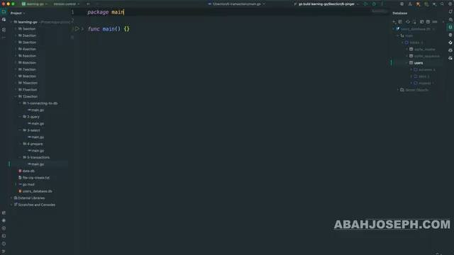
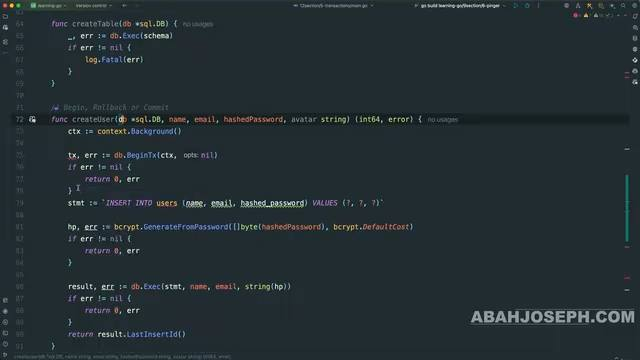
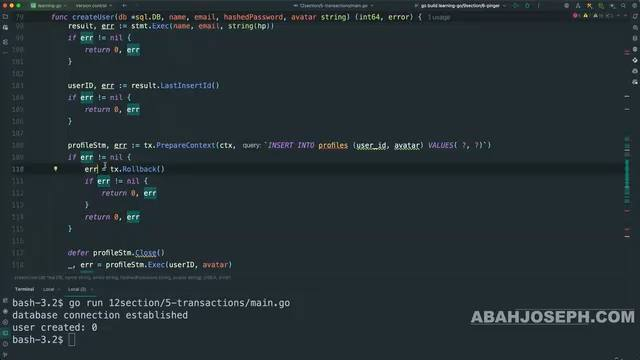
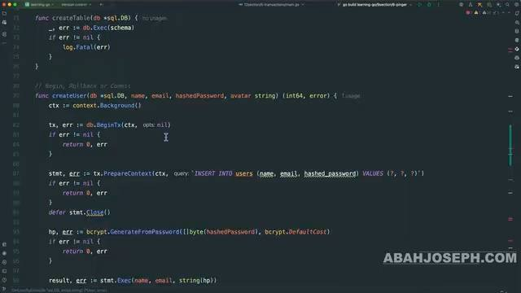
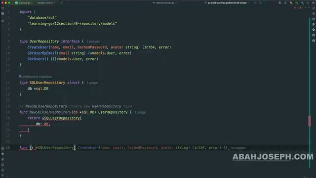
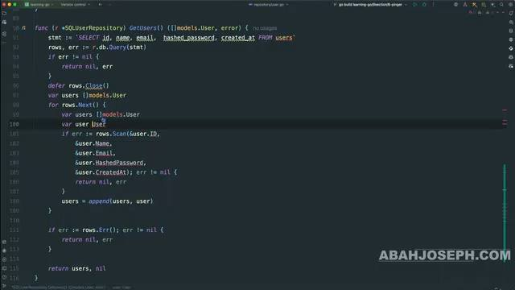
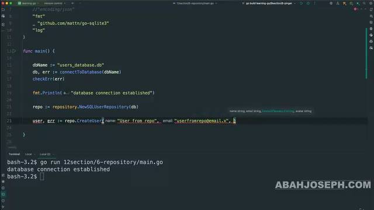
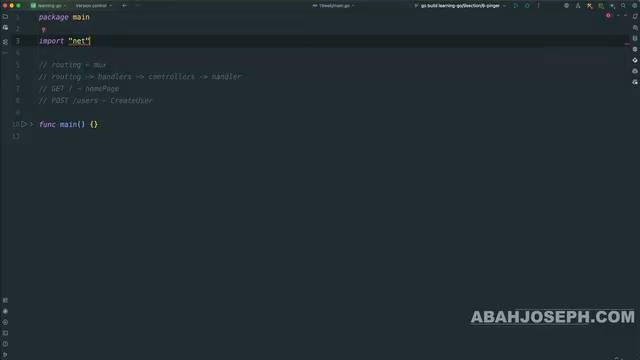
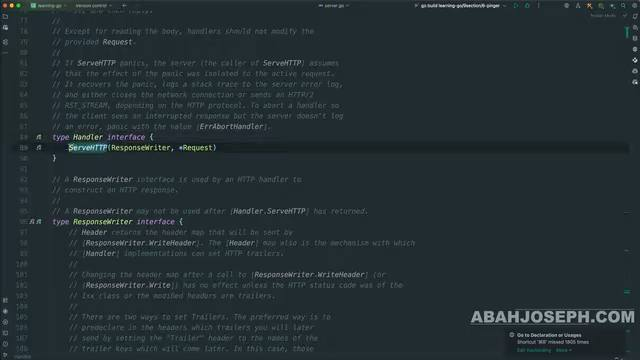

# Go Backend Masterclass P074–P076 复现文档：数据库事务 → Repository 分层 → net/http 第一个 Web 服务

> 覆盖 P074 / P075 / P076。三节连起来是一条完整的线：先把「多个写操作绑成一个单元」做对，再把代码从一个大 `main.go` 拆成可替换、可测试的分层结构，最后用标准库把 HTTP 服务跑起来。
> 读者定位：前端转 AI 应用工程师。文中所有涉及 SQL、事务、接口的地方，都会补一句「在 JS/Node 里对应什么」。

---

## 1. 这一节做什么

这三节课的产物不是「知识点清单」，而是一个能跑的小后端。做完之后你会得到：

| 课次 | 你实际会做出来的东西 | 验收方式 |
|---|---|---|
| P074 | 一个 `createUserWithProfile` 函数，把「建用户 + 建 profile」变成一个原子操作；失败时用户不会残留 | 故意写错表名，跑一次，数据库里两张表都是空的 |
| P075 | 把 P074 的散装代码拆成 `models` / `repository` 两层，`main.go` 只负责接线 | `main.go` 里出现 `repo.CreateUser(...)`，且 `printUsers` 的参数类型是接口 |
| P076 | 一个监听 `:8080` 的 HTTP 服务器，`/` 返回 HTML，`/api/v1/users` 返回 JSON | 浏览器打开 `localhost:8080` 能看到 `Welcome to your website`，打开 `/api/v1/users` 能看到 JSON |

**为什么要按这个顺序做。** P074 的核心是「事务的边界在哪里」。讲师用一个钱包业务的例子说明：创建账户、创建钱包、充值、写流水，这四步是一个 unit of work，只要最后一步挂了，前面三步都必须撤销。数据库事务就是干这个的。

P075 的核心是「事务代码不该长在 `main.go` 里」。P074 结束时那个文件已经几百行，业务逻辑、SQL、加密、连接全挤在一起。讲师原话是「I'm not very proud of it because it's a little bit everywhere」——他自己都嫌弃。所以 P075 做的是纯重构，一行新功能都没加。

P076 切换到 Web 层。讲师先花了几分钟讲「所有 Web 框架的第一性原理都是 routing → handler 的映射」，然后直接用 `net/http` 从零搭一个，并且刻意先「不路由」，让你亲眼看到 mux 不加路由是什么行为。

**在 JS/Node 里的对应关系（先建立直觉）：**

- Go 的 `database/sql` 事务 → Node 里 `pg` 的 `client.query('BEGIN')` / `'COMMIT'` / `'ROLLBACK'`，或者 Prisma 的 `prisma.$transaction([...])`
- Go 的 `defer tx.Rollback()` → 相当于把 `try/catch/finally` 里的 `finally { await tx.rollback() }` 写在更靠前的位置，靠 defer 保证一定执行
- Repository 接口 → TypeScript 的 `interface UserRepository`，主程序只依赖接口，不依赖具体实现
- `http.NewServeMux()` → Express 的 `app`，`mux.HandleFunc("/", home)` → `app.get('/', home)`
- `func(w http.ResponseWriter, r *http.Request)` → `(req, res) => {}`，只是参数顺序反过来，且 Go 的 handler 不返回值，所有「返回」都是往 `w` 里写

---

## 2. 讲师原话（带出处）

**关于事务是什么、为什么必须存在：**

> "假设你成功创建了用户账户，也成功创建了钱包。接着假设你成功给用户账户充值，但就在你准备创建事务日志时出了问题，没能创建成功。这时你会怎么做？"
> —— p074 [02:22]

> "这是一个工作单元。当你把这四个操作打包成一个工作单元时，它们要么全部完成，要么全部不完成。"
> —— p074 [02:48]

> "无论 NoSQL 的理念如何，它们都无法取代关系型数据库管理系统，因为银行——也就是事务这个概念——银行的准确性依赖它。"
> —— p074 [03:44]

**关于 defer rollback 这个技巧（这是 P074 最值钱的一段）：**

> "与其总是回滚，在我于此开启事务之后、完成错误检查之后，我会这样做：用 defer 延迟执行 TX rollback。"
> —— p074 [25:45]

> "代码开始执行时，它会把这一项放入队列，让 defer 在 create user 执行之前运行。……你最后放入的，会最先发生。"
> —— p074 [26:15]

> "如果一切正常，代码执行到这里，就会调用提交；但同时，在函数退出之前，也会调用回滚。不过由于我们已经提交了操作，回滚不会改变它。一旦提交了操作，就无法再回滚。"
> —— p074 [27:10]

> "你看，它不在这里，是因为已经被回滚了。这是一个技巧，非常巧妙的技巧，可以用来避免多次调用回滚。"
> —— p074 [28:53]

**关于 P075 为什么要重构：**

> "如果你看看我们写的代码，我并不太满意，因为代码有点东一块西一块。在真实应用中，你希望组织得更有条理一些。"
> —— p075 [00:00]

> "想想看，这有多漂亮。假设你有一个应用——你的应用现在可以访问这个仓储。它是该接口的一个实现。"
> —— p075 [13:30]

> "想想看。我们这个函数依赖一个接口。看，它是一个接口。妙处就在这里：你可以实现这个接口来连接 Postgres、MySQL，甚至 MongoDB，并得到相同的结果。"
> —— p075 [14:29]

> "同时，我们在这里做的是依赖注入，因为我们能够利用——这有点类似构造函数——来注入这个依赖。"
> —— p075 [14:58]

**关于 P076 的第一性原理：**

> "每个网页应用都依赖路由。在 Go 里，人们把它叫作 Mux 或多路复用器，其实是一回事。然后这些路由会以某种方式映射到某种处理器。在 Java 里，它们被称为控制器；Express 也把它们称为处理器。所以不同技术用的是不同叫法，但意思相同。"
> —— p076 [01:27]

> "这个函数必须接收一个响应写入器，以及一个指向 HTTP.request 的指针。我想再说一遍：它不返回任何东西，但它的第一个参数是 HTTP.ResponseWriter，第二个参数是指向 HTTP.request 的指针。"
> —— p076 [07:02]

> "我们创建了 mux，并把路由添加到其中，但我们还没有以任何方式告诉服务器使用这个 mux。"
> —— p076 [07:59]

> "你看，这里写的是 handler，而不是 mux。它写的是一个 handler。但在最上面，你会看到这个 handler 通常是 nil，在这种情况下会使用默认的服务器 mux。这是因为 handler 只是一个接口。"
> —— p076 [10:21]



---

## 3. 从零复现

### 3.1 环境与依赖

```bash
# 1) 确认 Go 版本（本文按 1.21+ 写，用到了 map[string]any）
go version

# 2) 建项目目录
mkdir go-backend-masterclass
cd go-backend-masterclass

# 3) 初始化模块
#    讲师在终端里说过 "six right repository name"，这里就用 six 作为模块名。
#    如果你换成别的名字，下面所有 import 路径同步替换。
go mod init six

# 4) 拉依赖
go get github.com/mattn/go-sqlite3      # SQLite 驱动
go get golang.org/x/crypto/bcrypt       # 密码哈希
```

> 说明：逐字稿里只出现了「SQLite」这个词和「要去 import driver」这个动作（p074 [06:01] 他说 "我们没有导入驱动程序……还记得我们讨论过这个空白导入吗？"），**具体 import 路径课里没念**。上面用的是 `github.com/mattn/go-sqlite3`，如果你换别的 SQLite 驱动，`sql.Open("sqlite3", ...)` 里的驱动名字符串要一起改。
>
> `go-sqlite3` 依赖 CGO，Windows 上要装 gcc（推荐 TDM-GCC 或 MSYS2），macOS 装完 Xcode CLT 即可，Linux 装 `build-essential`。这一条**课里没讲**。

### 3.2 目录结构（最终形态）

```
go-backend-masterclass/
├── go.mod
├── go.sum
├── app.db                        # 运行时自动生成，不用手建
├── schema.sql                    # 建表 SQL（见 4.0）
├── 5-tx/
│   └── main.go                   # P074 的产物
├── 6-repository/
│   ├── main.go                   # P075 的产物：只负责接线
│   ├── models/
│   │   └── user.go
│   └── repository/
│       └── user.go
└── 13-web/
    └── main.go                   # P076 的产物
```

> 目录名对应讲师口述的 `5TX` / `six` / `13 web`。我为了可读性改成 `5-tx` / `6-repository` / `13-web`，**文件夹叫什么不影响结果**，但 `go.mod` 的 module 名和 import 路径必须一致。

### 3.3 建表（P074 里是先写 Go 代码再建表，这里抽成 schema.sql 方便重复执行）

```bash
# 如果你有 sqlite3 命令行
sqlite3 app.db < schema.sql

# 没有也可以：P074 的 main.go 里会自己执行建表语句（见 4.2）
```

### 3.4 运行顺序

```bash
# 第一步：跑 P074，观察事务行为
go run ./5-tx

# 第二步：跑 P075，观察分层之后的结果
go run ./6-repository

# 第三步：跑 P076，然后浏览器访问
go run ./13-web
# 打开 http://localhost:8080/
# 打开 http://localhost:8080/api/v1/users
```

> **注意工作目录**：`sql.Open("sqlite3", "app.db")` 里的 `app.db` 是相对路径，相对于**你执行 `go run` 时所在的目录**，不是相对于 `.go` 文件。所以三个程序要么都在项目根目录跑（共用同一个 `app.db`），要么各自 `cd` 进去跑（会得到各自的 `app.db`）。**课里没讲这一点**，但这是新手最常撞的墙。

---

## 4. 完整代码

### 4.0 `schema.sql`

```sql
-- users：账号本体
CREATE TABLE IF NOT EXISTS users (
    id         INTEGER PRIMARY KEY AUTOINCREMENT,
    name       TEXT,
    email      TEXT    NOT NULL UNIQUE,
    password   TEXT    NOT NULL,
    created_at TIMESTAMP NOT NULL DEFAULT CURRENT_TIMESTAMP
);

-- profile：和 users 一对一。user_id 既是主键又是外键，所以一个用户最多一条 profile
CREATE TABLE IF NOT EXISTS profile (
    user_id    INTEGER PRIMARY KEY REFERENCES users(id),
    avatar     TEXT NOT NULL,
    created_at TIMESTAMP NOT NULL DEFAULT CURRENT_TIMESTAMP
);
```

> 逐字稿里讲师给 profile 的描述是：「We really don't need an ID for the profile. We can say user ID, not auto increment... this one would, we are going to reference user. It's the primary key.」（p074 [04:35]），以及「we have user ID, we have avatar」（p074 [05:05]）。`created_at` 列是我按后面 Go struct 里的 `CreatedAt` 字段补的，讲师口述里没有逐字念这一列。

### 4.1 `go.mod`（初始形态，版本以 `go get` 实际解析为准）

```go
module six

go 1.21
```

### 4.2 `5-tx/main.go`（P074 完整可运行版）

```go
package main

import (
	"context"
	"database/sql"
	"encoding/json"
	"fmt"
	"log"
	"time"

	_ "github.com/mattn/go-sqlite3"
	"golang.org/x/crypto/bcrypt"
)

// User 对应 users 表一行。
// Profile 用值类型内嵌，这样 JSON 序列化出来是嵌套对象（讲师 p074 [24:20] 演示的形态）。
type User struct {
	ID        int64     `json:"id"`
	Name      string    `json:"name"`
	Email     string    `json:"email"`
	Password  string    `json:"-"` // 绝不出网
	Profile   Profile   `json:"profile"`
	CreatedAt time.Time `json:"created_at"`
}

// Profile 对应 profile 表一行，和 User 是一对一。
type Profile struct {
	UserID    int64     `json:"user_id"`
	Avatar    string    `json:"avatar"`
	CreatedAt time.Time `json:"created_at"`
}

const createUsersTable = `
CREATE TABLE IF NOT EXISTS users (
    id         INTEGER PRIMARY KEY AUTOINCREMENT,
    name       TEXT,
    email      TEXT    NOT NULL UNIQUE,
    password   TEXT    NOT NULL,
    created_at TIMESTAMP NOT NULL DEFAULT CURRENT_TIMESTAMP
);`

const createProfileTable = `
CREATE TABLE IF NOT EXISTS profile (
    user_id    INTEGER PRIMARY KEY REFERENCES users(id),
    avatar     TEXT NOT NULL,
    created_at TIMESTAMP NOT NULL DEFAULT CURRENT_TIMESTAMP
);`

// createUserWithProfile 是 P074 的主角：
// 「建用户 + 建 profile」必须作为一个 unit of work 完成，任一失败则整体回滚。
func createUserWithProfile(ctx context.Context, db *sql.DB, name, email, password, avatar string) (int64, error) {
	// 1) 开启事务。默认隔离级别传 nil。
	tx, err := db.BeginTx(ctx, nil)
	if err != nil {
		return 0, err
	}

	// 2) 立刻把 Rollback 排进 defer 队列。
	//    成功路径下 Commit 之后再 Rollback 是无效操作（返回 ErrTxDone），不会撤销已提交的数据。
	defer tx.Rollback()

	// 3) 建用户的预编译语句。注意这里用的是 tx，不是 db。
	userStmt, err := tx.PrepareContext(ctx, `
		INSERT INTO users (name, email, password)
		VALUES (?, ?, ?)`)
	if err != nil {
		return 0, err
	}
	defer userStmt.Close()

	// 4) 密码哈希 —— 这一步跟数据库无关，失败直接返回，defer 会回滚。
	hashed, err := bcrypt.GenerateFromPassword([]byte(password), bcrypt.DefaultCost)
	if err != nil {
		return 0, err
	}

	res, err := userStmt.ExecContext(ctx, name, email, string(hashed))
	if err != nil {
		return 0, err
	}

	userID, err := res.LastInsertId()
	if err != nil {
		return 0, err
	}

	// 5) 同一事务里建 profile。这里故意写成 profiles（复数），
	//    是为了复现讲师 p074 [17:26] 演示的 "no such table: profiles" 场景。
	//    跑通之后把表名改成 profile 即可。
	profileStmt, err := tx.PrepareContext(ctx, `
		INSERT INTO profile (user_id, avatar)
		VALUES (?, ?)`)
	if err != nil {
		return 0, err
	}
	defer profileStmt.Close()

	if _, err = profileStmt.ExecContext(ctx, userID, avatar); err != nil {
		// 走到这里说明用户已插入但 profile 没插入。
		// 啥也不用干 —— defer 里的 Rollback 会把 user 一起撤掉。
		return 0, err
	}

	// 6) 全部成功才提交。提交之后的 Rollback 调用不会产生任何效果。
	if err = tx.Commit(); err != nil {
		return 0, err
	}

	return userID, nil
}

// getUserByEmail 用 JOIN 把 user 和 profile 一次捞出来。
func getUserByEmail(ctx context.Context, db *sql.DB, email string) (*User, error) {
	const query = `
		SELECT u.id, u.name, u.email, u.created_at, p.avatar, p.created_at
		FROM users u
		JOIN profile p ON u.id = p.user_id
		WHERE u.email = ?`

	var u User
	err := db.QueryRowContext(ctx, query, email).Scan(
		&u.ID,
		&u.Name,
		&u.Email,
		&u.CreatedAt,
		&u.Profile.Avatar,
		&u.Profile.CreatedAt,
	)
	if err != nil {
		return nil, err
	}
	u.Profile.UserID = u.ID
	return &u, nil
}

func main() {
	db, err := sql.Open("sqlite3", "app.db")
	if err != nil {
		log.Fatal(err)
	}
	defer db.Close()

	if _, err = db.Exec(createUsersTable); err != nil {
		log.Fatal(err)
	}
	if _, err = db.Exec(createProfileTable); err != nil {
		log.Fatal(err)
	}

	ctx := context.Background()

	// --- 复现实验一：故意让 profile 插入失败，验证 user 也没留下 ---
	userID, err := createUserWithProfile(ctx, db, "Alice", "alice@example.com", "secret", "avatar.png")
	if err != nil {
		fmt.Println("create user failed (expected):", err)
	} else {
		fmt.Println("user id:", userID)
	}

	// --- 复现实验二：把 4.2 里 INSERT INTO profile 改成正确表名后重跑，
	//     这里就能打印出带 profile 的完整 JSON ---
	u, err := getUserByEmail(ctx, db, "alice@example.com")
	if err != nil {
		fmt.Println("get user failed:", err)
		return
	}

	data, err := json.MarshalIndent(u, "", "  ")
	if err != nil {
		log.Fatal(err)
	}
	fmt.Println(string(data))
}
```



**跑第一次（表名故意写错）你会看到：**

```
create user failed (expected): no such table: profiles
get user failed: sql: no rows in result set
```

然后去数据库里查：

```bash
sqlite3 app.db "select * from users;"   # 空
sqlite3 app.db "select * from profile;" # 空
```

**这说明事务真的生效了**：users 的 INSERT 已经执行过，但因为 profile 失败，整个事务被 `defer tx.Rollback()` 撤销了。讲师在 p074 [28:53] 原话是：「You see, it's not here because it was rolled back.」



**把表名改对之后重跑，你应该看到：**

```json
{
  "id": 1,
  "name": "Alice",
  "email": "alice@example.com",
  "profile": {
    "user_id": 1,
    "avatar": "avatar.png",
    "created_at": "2024-05-01T10:00:00Z"
  },
  "created_at": "2024-05-01T10:00:00Z"
}
```

![p074 22:55 讲师把带 profile 的 User


**注意 `getUserByEmail` 用的是 `JOIN` 而不是 `LEFT JOIN`。** 这意味着只要某条 user 没有对应 profile，它就查不出来——这恰好是我们想要的行为：事务保证了这个状态不可能出现。反过来说，如果你在数据库里手动插了一条没有 profile 的 user，这个查询会返回 `sql: no rows in result set`，别当成 bug。

---

### 4.3 `6-repository/models/user.go`（P075 第一步：把结构体搬走）

```go
// Package models 存放数据库表的 Go 表示。
// 这一层不依赖 database/sql，也不依赖任何具体存储。
package models

import "time"

// User represents a customer in the database with a backing table of users
// in the database.
type User struct {
	ID        int64     `json:"id"`
	Name      string    `json:"name"`
	Email     string    `json:"email"`
	Password  string    `json:"-"`
	Profile   Profile   `json:"profile"`
	CreatedAt time.Time `json:"created_at"`
}

// Profile belongs to a user. This is a one-to-one relationship:
// one user has exactly one profile, one profile belongs to exactly one user.
type Profile struct {
	UserID    int64     `json:"user_id"`
	Avatar    string    `json:"avatar"`
	CreatedAt time.Time `json:"created_at"`
}
```

> 讲师在 p075 [01:23] 特意强调了一件事：「when you have a type that is exported you want to document them, the comment must start with the name of the type」。上面 `// User represents ...` 和 `// Profile belongs to ...` 就是照他的要求写的——注释首词必须是类型名，否则 `go vet` 和 golint 会告警。这是 Go 的文档约定，跟 Java 的 Javadoc 不是一回事：Go 没有 `@param` 那一套，文档就是普通注释，但首词必须对。

---

### 4.4 `6-repository/repository/user.go`（P075 第二步：接口 + 实现）

```go
// Package repository 定义数据访问契约（interface）和它的 SQL 实现。
package repository

import (
	"context"
	"database/sql"

	"six/6-repository/models"

	"golang.org/x/crypto/bcrypt"
)

// UserRepository 是数据访问层的契约。
// 上层（如 main.go 里的 printUsers）只依赖这个接口，
// 因此可以替换成 Postgres / MySQL / MongoDB 实现而不改动上层代码。
type UserRepository interface {
	CreateUser(name, email, password, avatar string) (int64, error)
	GetUserByEmail(email string) (*models.User, error)
	GetAllUsers() ([]models.User, error)
}

// SQLUserRepository 是 UserRepository 的 SQL 实现。
// db 是小写字段 ——  外部拿不到，只能通过 NewSQLUserRepository 构造。
type SQLUserRepository struct {
	db *sql.DB
}

// NewSQLUserRepository 是构造函数，用于把 *sql.DB 这个依赖注入进来。
func NewSQLUserRepository(db *sql.DB) *SQLUserRepository {
	return &SQLUserRepository{db: db}
}

// 编译期断言：如果 SQLUserRepository 没有实现 UserRepository 的全部方法，
// 这一行会直接编译失败，比跑到运行时报错早得多。
var _ UserRepository = (*SQLUserRepository)(nil)

// CreateUser 在同一个事务里创建 user 和它的 profile。
// 任一失败则整体回滚，不会留下没有 profile 的 user。
func (r *SQLUserRepository) CreateUser(name, email, password, avatar string) (int64, error) {
	ctx := context.Background()

	tx, err := r.db.BeginTx(ctx, nil)
	if err != nil {
		return 0, err
	}
	// 关键技巧：进来就 defer Rollback。
	// 成功路径上 Commit 之后再 Rollback 是空操作，不会撤销已提交数据。
	defer tx.Rollback()

	userStmt, err := tx.PrepareContext(ctx, `
		INSERT INTO users (name, email, password)
		VALUES (?, ?, ?)`)
	if err != nil {
		return 0, err
	}
	defer userStmt.Close()

	hashed, err := bcrypt.GenerateFromPassword([]byte(password), bcrypt.DefaultCost)
	if err != nil {
		return 0, err
	}

	res, err := userStmt.ExecContext(ctx, name, email, string(hashed))
	if err != nil {
		return 0, err
	}

	userID, err := res.LastInsertId()
	if err != nil {
		return 0, err
	}

	profileStmt, err := tx.PrepareContext(ctx, `
		INSERT INTO profile (user_id, avatar)
		VALUES (?, ?)`)
	if err != nil {
		return 0, err
	}
	defer profileStmt.Close()

	if _, err = profileStmt.ExecContext(ctx, userID, avatar); err != nil {
		return 0, err
	}

	if err = tx.Commit(); err != nil {
		return 0, err
	}

	return userID, nil
}

// GetUserByEmail 用 JOIN 一次取出 user + profile。
func (r *SQLUserRepository) GetUserByEmail(email string) (*models.User, error) {
	const query = `
		SELECT u.id, u.name, u.email, u.created_at, p.avatar, p.created_at
		FROM users u
		JOIN profile p ON u.id = p.user_id
		WHERE u.email = ?`

	var u models.User
	err := r.db.QueryRow(query, email).Scan(
		&u.ID,
		&u.Name,
		&u.Email,
		&u.CreatedAt,
		&u.Profile.Avatar,
		&u.Profile.CreatedAt,
	)
	if err != nil {
		return nil, err
	}
	u.Profile.UserID = u.ID
	return &u, nil
}

// GetAllUsers 返回全部用户（不带 profile）。
func (r *SQLUserRepository) GetAllUsers() ([]models.User, error) {
	const query = `SELECT id, name, email, created_at FROM users`

	rows, err := r.db.Query(query)
	if err != nil {
		return nil, err
	}
	defer rows.Close()

	var users []models.User
	for rows.Next() {
		var u models.User
		if err := rows.Scan(&u.ID, &u.Name, &u.Email, &u.CreatedAt); err != nil {
			return nil, err
		}
		users = append(users, u)
	}
	// rows.Err() 必须检查：遍历中途的错误（比如连接断了）只有在这里才拿得到。
	if err := rows.Err(); err != nil {
		return nil, err
	}
	return users, nil
}
```



> **这里最能体现重构的本质**：讲师在 p075 [07:27] 连着说了三遍「Nothing needs to change here」。因为事务代码本身是对的，重构只是把它从 `main.go` 移到一个有 receiver 的方法里，把 `db` 换成 `r.db`，把 `User` 换成 `models.User`。**重构不是重写。** 如果你在做这类迁移时发现逻辑要改，那说明原来的逻辑就有问题。

---

### 4.5 `6-repository/main.go`（P075 第三步：只负责接线）

```go
package main

import (
	"database/sql"
	"fmt"
	"log"

	_ "github.com/mattn/go-sqlite3"

	"six/6-repository/models"
	"six/6-repository/repository"
)

const createUsersTable = `
CREATE TABLE IF NOT EXISTS users (
    id         INTEGER PRIMARY KEY AUTOINCREMENT,
    name       TEXT,
    email      TEXT    NOT NULL UNIQUE,
    password   TEXT    NOT NULL,
    created_at TIMESTAMP NOT NULL DEFAULT CURRENT_TIMESTAMP
);`

const createProfileTable = `
CREATE TABLE IF NOT EXISTS profile (
    user_id    INTEGER PRIMARY KEY REFERENCES users(id),
    avatar     TEXT NOT NULL,
    created_at TIMESTAMP NOT NULL DEFAULT CURRENT_TIMESTAMP
);`

// connectDB 负责建立连接并 ping 一次，确保连接真的可用。
func connectDB(name string) (*sql.DB, error) {
	db, err := sql.Open("sqlite3", name)
	if err != nil {
		return nil, err
	}
	if err := db.Ping(); err != nil {
		db.Close()
		return nil, err
	}
	return db, nil
}

// checkErr 只给 main 用。业务代码里不要 panic，要返回 error。
func checkErr(err error) {
	if err != nil {
		log.Panic(err)
	}
}

// printUsers 的参数类型是接口，不是具体实现 —— 这就是依赖注入的落点。
func printUsers(repo repository.UserRepository) {
	users, err := repo.GetAllUsers()
	checkErr(err)
	for _, u := range users {
		fmt.Printf("id=%d name=%s email=%s\n", u.ID, u.Name, u.Email)
	}
}

func main() {
	db, err := connectDB("app.db")
	checkErr(err)
	defer db.Close()

	_, err = db.Exec(createUsersTable)
	checkErr(err)
	_, err = db.Exec(createProfileTable)
	checkErr(err)

	// 构造具体实现，注入 *sql.DB
	var repo repository.UserRepository = repository.NewSQLUserRepository(db)

	// 通过接口创建用户
	userID, err := repo.CreateUser("Bob", "bob@example.com", "secret", "bob.png")
	if err != nil {
		fmt.Println("create user failed:", err)
	} else {
		fmt.Println("created user id:", userID)
	}

	// 通过接口查询单个用户
	u, err := repo.GetUserByEmail("bob@example.com")
	if err != nil {
		fmt.Println("get user failed:", err)
	} else {
		fmt.Printf("got user: id=%d name=%s avatar=%s\n", u.ID, u.Name, u.Profile.Avatar)
	}

	// 通过接口打印全部用户
	printUsers(repo)

	// 这一行只是为了让编译器不抱怨 models 未使用；
	// 如果你的 main 里真的用到了 models 类型，删掉它。
	var _ models.User
}
```



> 上面 `var _ models.User` 那一行是我为了让代码能编译加的；如果你的 `main.go` 里真的引用了 `models` 包的类型，可以删掉。**课里讲师没有写这一行**，因为他 main 里确实用到了 models。

**运行：**

```bash
go run ./6-repository
```

期望输出（第二次跑会因为 email 唯一约束失败，这是正常的）：

```
created user id: 1
got user: id=1 name=Bob avatar=bob.png
id=1 name=Bob email=bob@example.com
```

P075 讲师演示时踩了一个坑，值得一提：他在 p075 [12:39] 说「we didn't restore the table name last time when we did the test testing」——上一节做 defer 实验时把表名故意改成了 `profiles`，忘了改回来，所以一跑就报 `no such table`。改回来就好了。



---

### 4.6 `13-web/main.go`（P076 完整可运行版）

```go
package main

import (
	"encoding/json"
	"fmt"
	"log"
	"net/http"
)

// home 是首页 handler。
// 签名是固定的：第一个参数是 http.ResponseWriter（往哪写），
// 第二个参数是 *http.Request（请求是什么），没有返回值。
func home(w http.ResponseWriter, r *http.Request) {
	w.Header().Set("Content-Type", "text/html; charset=utf-8")
	fmt.Fprint(w, "<h1>Welcome to your website</h1>")
}

// usersHandler 返回 JSON。
func usersHandler(w http.ResponseWriter, r *http.Request) {
	// map[string]any 就是 JS 里的普通对象 {}，键是 string，值可以是任意类型。
	u := map[string]any{
		"name":     "John Doe",
		"age":      40,
		"height":   76,
		"location": "Berlin",
	}

	data, err := json.Marshal(u)
	if err != nil {
		// handler 里不要 panic，会把这个连接连同 goroutine 一起崩掉。
		http.Error(w, "failed to encode response", http.StatusInternalServerError)
		return
	}

	w.Header().Set("Content-Type", "application/json")
	// data 已经是 []byte，直接写即可，不需要再包一层。
	w.Write(data)
}

// notFound 演示「手动实现 http.Handler 接口」的写法。
// http.Handler 接口只有一个方法：ServeHTTP(ResponseWriter, *Request)。
type notFound struct{}

func (notFound) ServeHTTP(w http.ResponseWriter, r *http.Request) {
	w.WriteHeader(http.StatusNotFound)
	fmt.Fprint(w, "nothing here")
}

func main() {
	// 1) 建一个独立的 mux（多路复用器），即路由表。
	mux := http.NewServeMux()

	// 2) 注册路由。注意 "/" 是前缀匹配，会兜住所有未注册的路径。
	mux.HandleFunc("/", home)
	mux.HandleFunc("/api/v1/users", usersHandler)

	// 3) 启动服务器，把 mux 作为第二个参数传进去。
	//    如果传 nil，就会使用全局的 http.DefaultServeMux。
	log.Println("listening on :8080")
	if err := http.ListenAndServe(":8080", mux); err != nil {
		log.Fatal(err)
	}
}
```

**如果只想复现讲师「不加路由，看它把所有路径都当成首页」那一步**，把 `main` 改成这样：

```go
func main() {
	mux := http.NewServeMux()
	mux.HandleFunc("/", home) // 只有一个 handler
	log.Println("listening on :8080")
	log.Fatal(http.ListenAndServe(":8080", mux))
}
```

此时访问 `/`、`/about`、`/whatever` 全都是 `Welcome to your website`——因为 `"/"` 是前缀匹配，没有更具体的路由时它会接住一切。讲师在 p076 [14:12] 说：「If you go here and I say slash about, it's the same page. If I say slash whatever is the same, there is no routing going on.」



**再复现「忘了把 mux 传给 server」那个经典错误：**

```go
// 错误示范
mux := http.NewServeMux()
mux.HandleFunc("/", home)
http.ListenAndServe(":8080", nil) // ← 传了 nil，mux 白建了
```

这时访问 `localhost:8080` 得到的是 `404 page not found`。讲师在 p076 [07:59] 说的就是这个：「We created the mux and added the routers to it, but there is no way that we have told the server to use this mux.」传 `nil` 意味着用 `http.DefaultServeMux`（一个全局默认 mux，你从没往里面注册过任何东西），所以什么路由都匹配不上。



> 上面这张图对应的源码注释是：`handler is typically nil, in which case the DefaultServeMux is used`。讲师由此展开说明「handler 只是个接口，所以我可以自己实现一个」，这就是 `defaultHandler`/`notFound` 那个类型存在的原因。

**运行：**

```bash
go run ./13-web
```

然后：

- `http://localhost:8080/` → `<h1>Welcome to your website</h1>`，浏览器渲染成标题
- `http://localhost:8080/api/v1/users` → `{"age":40,"height":76,"location":"Berlin","name":"John Doe"}`
- `http://localhost:8080/about` → 走 `"/"` 这个前缀路由，返回首页内容

停服务：终端里 `Ctrl+C`。


---

## 5. 逐行解释

### 5.1 事务四行代码，每行都不能少

```go
tx, err := db.BeginTx(ctx, nil)
if err != nil {
    return 0, err
}
defer tx.Rollback()
```

- **`BeginTx` 而不是 `Begin`**：`Begin` 是 `BeginTx(context.Background(), nil)` 的简写。用 `BeginTx` 是为了让调用方的 ctx 能传导进来——如果 ctx 被取消（比如前端断开连接），这次事务会被中断。**课里讲师说「context is not super important, you can do without the context for sure」**（p074 [13:18]），确实可以省，但既然已经拿到了 ctx，带上成本为零。
- **`nil` 是隔离级别**：不传就用数据库默认值（SQLite 是串行化的）。**在 Node 里对应什么**：`pg` 的 `client.query('BEGIN ISOLATION LEVEL SERIALIZABLE')`，或者干脆不写，用默认的 READ COMMITTED。这一块课里没展开讲隔离级别。
- **`if err != nil { return }` 必须在 `defer` 之前**：`BeginTx` 失败时 `tx` 是 `nil`，这时候 `defer tx.Rollback()` 会 panic（nil 指针）。这个顺序课里没明确强调，但讲师的代码就是这个顺序。
- **`defer tx.Rollback()` 放在最前面**：这就是 P074 最核心的技巧。讲师在 p074 [25:45] 明确说了「somehow it's a little bit tacky, like I don't really like it」，指的是他前面写的「每个错误分支都手写一次 rollback」的版本。那个版本：

  ```go
  // 旧版本（讲师自己嫌弃的写法）
  if err != nil {
      tx.Rollback()
      return 0, err
  }
  // ... 后面还要再写两次
  ```

  问题不只是啰嗦，而是**漏一个分支就泄漏事务**。事务不关闭会占着数据库连接不还，连接池耗尽后整个服务卡死。这跟 Node 里 `client` 从池子里借出来不 `release()` 是一模一样的后果。

### 5.2 为什么「Commit 之后再 Rollback」是安全的

这是 P074 里最容易让人犯嘀咕的一点。讲师的原话（p074 [27:10]）：

> 「If nothing go wrong and the code gets here, commit would be called, but at the same time, before the function is executed, rollback would be called too. But because we have committed the operation, rolling back would not change it.」

机制上：`sql.Tx` 内部有个状态位，`Commit()` 成功后这个 tx 就被标记为「已完成」；后续的 `Rollback()` 检查到这个状态，直接返回 `sql.ErrTxDone`，什么都不做。所以**你不需要在 commit 之后手动取消 defer**。

如果你希望严谨一点（也为了通过 `errcheck` 这类 linter），可以写成：

```go
defer func() {
    if err := tx.Rollback(); err != nil && err != sql.ErrTxDone {
        log.Printf("rollback failed: %v", err)
    }
}()
```

**在 JS 里对应什么**：`try { ... } finally { await tx.rollback() }` 在成功路径上也会走到 `finally`，而 pg 的 `rollback()` 在已 commit 的连接上同样是无害的。逻辑同构。

### 5.3 为什么建表和业务逻辑要分开两次 `Exec`

`createUsersTable` 和 `createProfileTable` 是两条独立的 `db.Exec`，不在同一个事务里。这**不是**疏忽——DDL（建表）和 DML（业务写）在事务语义上属于不同关注点。如果 profile 建表失败，users 表已经建好了也无所谓，下次跑 `CREATE TABLE IF NOT EXISTS` 会跳过。

注意所有建表语句都用了 `IF NOT EXISTS`，所以 `go run` 可以反复执行，不会报「table already exists」。这一条课里没提，但他是这么写的。

### 5.4 `INSERT INTO profile` 里为什么没有 `id`

因为 profile 的主键就是 `user_id`：

```sql
user_id INTEGER PRIMARY KEY REFERENCES users(id)
```

`PRIMARY KEY` 隐含 `NOT NULL` + `UNIQUE`，加上 `REFERENCES` 就同时是主键和外键。一个 user 最多一条 profile，这个约束在数据库层就被强制住了——**不用在 Go 代码里写「先查有没有 profile 再插」的逻辑**。

**在 JS 里对应什么**：如果你用 Prisma，这对应 `@id @relation(fields: [userId], references: [id])`，Prisma 会帮你生成同样的约束。

### 5.5 SQL 里 `?` 占位符 vs 字符串拼接

```go
tx.PrepareContext(ctx, `INSERT INTO users (name, email, password) VALUES (?, ?, ?)`)
```

用 `?` 占位符有两个作用：驱动层会做转义（防 SQL 注入），以及预编译语句可以被复用。讲师在 P075 里提到一次（p075 [08:26]）：「This also protect us from my square injection」——他嘴瓢说成了「my square injection」，实际是 MySQL injection / SQL injection。

**注意不同数据库的占位符不一样**：SQLite / MySQL 用 `?`，Postgres 用 `$1, $2, $3`。这也是 P075 引入接口的意义——换数据库时只改 repository 实现里的 SQL，上层不用动。

### 5.6 为什么要 `var _ UserRepository = (*SQLUserRepository)(nil)`

这一行在运行时什么都不做，纯粹是编译期断言。如果哪天你给接口加了第四个方法，但忘了在 `SQLUserRepository` 上实现，`go build` 会立刻报错，而不是等到运行时 `main` 里第一次调用才 panic。

**在 TS 里对应什么**：`const _check: UserRepository = new SQLUserRepository(db)` 也能达到类似效果，只是要多执行一次构造。Go 这里用 `nil` 指针转型，零成本。

### 5.7 `connectDB` 里为什么要 `Ping()`

```go
db, err := sql.Open("sqlite3", name)  // 这一步几乎不会失败
if err := db.Ping(); err != nil { ... } // 这一步才会真正去连
```

`sql.Open` **只校验参数格式，不建立连接**。它返回的 `*sql.DB` 是一个连接池的句柄，真正的连接是懒加载的，第一次执行查询时才建立。所以如果在 `Open` 之后、第一次查询之前数据库文件路径就是错的，你会在业务代码里才看到错误，很难定位。

`db.Ping()` 强制走一次真实连接，把错误提前到启动阶段。这条**课里没讲**，讲师的 `connectDB` 里也没有 `Ping`。我加上它是为了让你启动时就能发现问题。

### 5.8 handler 签名为什么不能改

```go
func home(w http.ResponseWriter, r *http.Request)
```

这两件事必须同时满足，缺一不可，否则编译不过：

1. 参数是 `(http.ResponseWriter, *http.Request)`，顺序不能反
2. 没有返回值

**在 Express 里对应什么**：`app.get('/', (req, res) => {})`。区别是 Express 的参数顺序是 `(req, res)`，Go 是 `(w, r)`——**正好反过来**，这是从 JS 转过来最容易写错的地方。另外 Go 的 handler 没有 `res.send()` 这种终结方法，`fmt.Fprint(w, ...)` 只是往 `w` 里 append 字节，你想调几次都行。

### 5.9 `w.Header().Set` 必须在 `w.Write` 之前

```go
w.Header().Set("Content-Type", "application/json")
w.Write(data)
```

`w.Write` 第一次被调用时，Go 会「快照」当前的 header 并开始发响应体，之后再改 `w.Header()` 就不生效了。这一条**课里没讲**，但踩过的都知道有多难查——你会看到响应头里是 `text/plain` 而 JSON 照常返回，前端 `fetch().json()` 一切正常，直到某天遇到别的客户端才炸。

### 5.10 `/` 为什么能接住一切

Go 的 `ServeMux` 匹配规则：静态路径优先精确匹配，`"/"` 是最短的前缀，所以兜底。`/api/v1/users` 注册了精确路径，所以赢过 `"/"`。如果想真正实现「未匹配就 404」，需要在 `"/"` 的 handler 里检查 `r.URL.Path != "/"` 并手动返回 404。**课里没讲**这个细节，讲师的做法是接受「一切路径都返回首页」这个行为，说「for now, let's just log what is being assessed as a path」（p076 [14:41]）。

---

## 6. 复现检查清单

按顺序过一遍，每一项都能对上，说明三节课的产物都跑通了。

**环境层**

- [ ] `go version` 输出 ≥ 1.21
- [ ] `go mod init six` 执行过，`go.mod` 里 `module six`
- [ ] `go get github.com/mattn/go-sqlite3` 和 `golang.org/x/crypto/bcrypt` 都成功
- [ ] Windows 上装好了 gcc（`gcc --version` 有输出），否则 `go-sqlite3` 编译失败
- [ ] `go build ./...` 无报错

**P074 事务层**

- [ ] `go run ./5-tx` 第一次跑，输出 `create user failed (expected): no such table: profiles`
- [ ] 查库：`sqlite3 app.db "select count(*) from users;"` 返回 `0`（证明回滚生效了）
- [ ] 把 `INSERT INTO profile` 表名改对（或把整句改成 `profile`），再跑，输出 `user id: 1`
- [ ] 再跑一次 `select count(*) from users;` 返回 `1`，`select count(*) from profile;` 返回 `1`
- [ ] 打印出来的 JSON 里 `profile` 是嵌套对象，不是扁平字段
- [ ] 用同一个 email 再跑一次，报 `UNIQUE constraint failed: users.email`（说明 `UNIQUE` 也生效了）

**P075 分层层**

- [ ] `6-repository/models/user.go` 里 `User` 和 `Profile` 的注释首词分别是 `User` 和 `Profile`（`go vet ./6-repository/...` 不报 comment 警告）
- [ ] `6-repository/repository/user.go` 里有 `type UserRepository interface`，方法数是 3 个
- [ ] `var _ UserRepository = (*SQLUserRepository)(nil)` 存在，且编译通过
- [ ] `6-repository/main.go` 里 `printUsers` 的参数类型写的是 `repository.UserRepository`，不是 `*repository.SQLUserRepository`
- [ ] `go run ./6-repository` 输出至少一行 `created user id: N`
- [ ] 再跑一次会报 email 重复——这是预期的，换个 email 再试

**P076 Web 层**

- [ ] `go run ./13-web` 启动后终端打印 `listening on :8080`
- [ ] `curl localhost:8080/` 返回 `<h1>Welcome to your website</h1>`
- [ ] `curl -i localhost:8080/api/v1/users` 的响应头里有 `Content-Type: application/json`
- [ ] `curl localhost:8080/api/v1/users` 返回合法 JSON（能 `| jq .` 解析成功）
- [ ] 故意把 `http.ListenAndServe(":8080", nil)` 里的 `mux` 改成 `nil`，重跑，访问首页得到 `404 page not found`——**这一项一定要做**，它是你理解 `Handler` 接口的唯一途径
- [ ] 改回 `mux` 后重启，首页恢复正常

**结构层**

- [ ] 目录树与 3.2 节一致（`5-tx` / `6-repository` / `13-web` 三个平级目录）
- [ ] 所有跨包 import 都以 `six/` 开头

---

## 7. 课里没讲但你会撞上的

**1. `app.db` 的路径是相对「当前工作目录」，不是相对 `.go` 文件**

`go run ./5-tx` 在项目根目录执行时，`app.db` 会建在根目录；`cd 5-tx && go run .` 时会建在 `5-tx/` 里。两个位置都有 `app.db` 的话，你会对着一个空数据库调试半天。建议：要么统一在根目录跑，要么把路径改成绝对路径或可配置的。

**2. `sql.Open` 不连接数据库**

见 5.7。SQLite 尤其诡异：文件不存在时会**自动创建**一个空库，所以你连路径写错都不一定报错，只是查不到数据。加上 `Ping()` 能防一部分，但 SQLite 空文件照样能 ping 通。**真正靠谱的做法是启动时检查关键表是否存在。**

**3. `LastInsertId()` 不是所有数据库都支持**

SQLite 和 MySQL 支持。**Postgres 要改用 `INSERT ... RETURNING id` + `QueryRow().Scan(&id)`**，因为 pg 的驱动返回 error。这也是为什么 P075 的接口设计很重要：如果你在接口里暴露了「用自增 ID」这个假设，换 Postgres 时上层也要改。课里只用了 SQLite，没涉及这个差异。

**4. `defer tx.Rollback()` 会让 `errcheck` 报错**

如果你装 `golangci-lint`，它会说 `Error return value of tx.Rollback is not checked`。解决方式见 5.2 里那段包装版本。这**不是 bug**，是 lint 规则要求你显式声明「我知道这里可能返回 ErrTxDone」。

**5. SQLite 的并发写锁**

SQLite 同一时刻只允许一个写事务。如果你按 P076 的做法把 repository 接到 HTTP handler 上，并发请求一多就会遇到 `database is locked`。解决办法：`sql.Open("sqlite3", "app.db?_busy_timeout=5000")`，或者把 `db.SetMaxOpenConns(1)`。**课里没讲**，因为 P076 还没把数据库接进 Web 层。

**6. `bcrypt` 有 72 字节上限**

`bcrypt.GenerateFromPassword` 传入超过 72 字节的密码会返回 `bcrypt: password length exceeds 72 bytes`。中文密码尤其容易超（一个汉字 3 字节，24 个汉字就到头了）。课里用的都是短密码，没暴露这个问题。补救方法：先用 SHA-256 摘要再交给 bcrypt，或者换 `argon2`。

**7. `log.Fatal` 和 `log.Panic` 的区别**

讲师在 P076 的 `main` 里用 `log.Fatal`，在 P075 的 `checkErr` 里用 `log.Panic`。区别：`Fatal` 调 `os.Exit(1)`，**会跳过所有 `defer`**（包括 `db.Close()`）；`Panic` 会执行 defer 再崩。所以 `defer db.Close()` 后面紧跟 `log.Fatal` 的话，Close 是执行不到的。课里没讲这个区别，但你在写「优雅退出」的时候一定会撞上。

**8. 端口占用**

`http.ListenAndServe(":8080", mux)` 返回的错误里如果出现 `bind: address already in use`，说明 8080 被占了。macOS 上可能是 AirPlay Receiver。改端口或者关掉占用进程（`lsof -i :8080`）。

**9. 每次改代码都要重启**

P076 里讲师反复说「Each time you do that you have to restart the server」（p076 [07:59] 附近）。`go run` 不会热重载。开发时可以用 `air` 或 `reflex`：`go install github.com/air-verse/air@latest`，然后在项目里跑 `air`。**课里没装任何热重载工具**，这是纯补充。

**10. `models` 包和 `repository` 包之间的循环依赖**

当前设计里 `repository` import `models`，`models` 不 import 任何东西——这是正确的方向。如果你哪天想给 `models.User` 加一个 `Save()` 方法，`models` 就得 import `repository`，立刻循环依赖，编译失败。**规则：models 是纯数据结构，不带行为。** 这条课里没明说，但讲师把 `User` / `Profile` 单独拆出去，隐含的就是这个约束。

**11. 关于 `ctx` 在 P075 里被丢掉**

`SQLUserRepository.CreateUser` 里写的是 `ctx := context.Background()`，而不是从调用方传进来。讲师在 p075 [06:58] 自己也说了：「Ideally, we should accept the context, but I'm going to keep it the way it is for now.」后果是：如果 HTTP 请求被取消，这次事务不会被中断，会一直跑到结束。等你把 repository 接进 handler 时，记得把 `r.Context()` 一路传下来：
```go
func (r *SQLUserRepository) CreateUser(ctx context.Context, name string, ...) (int64, error)
```
这会改动接口签名，所有实现和调用方都要跟着改——所以接口设计要趁早。

**12. Node 里对应「事务 + defer」的完整写法**

作为对照，Node 里等价的骨架长这样（`pg` 驱动）：

```js
async function createUserWithProfile(db, name, email, password, avatar) {
  const client = await db.connect()
  try {
    await client.query('BEGIN')
    const { rows } = await client.query(
      'INSERT INTO users (name, email, password) VALUES ($1,$2,$3) RETURNING id',
      [name, email, password]
    )
    const userId = rows[0].id
    await client.query(
      'INSERT INTO profile (user_id, avatar) VALUES ($1,$2)',
      [userId, avatar]
    )
    await client.query('COMMIT')
    return userId
  } catch (err) {
    await client.query('ROLLBACK')
    throw err
  } finally {
    client.release() // ← 对应 Go 的 defer stmt.Close() + 连接归还
  }
}
```

对比一下就能看出 Go 版本的价值：`finally { release() }` 和 `defer tx.Rollback()` 是同一个思路，但 Go 的 defer 是**函数退出即执行，不需要 try/catch 结构**，所以少了一层缩进，也更容易保证不遗漏。