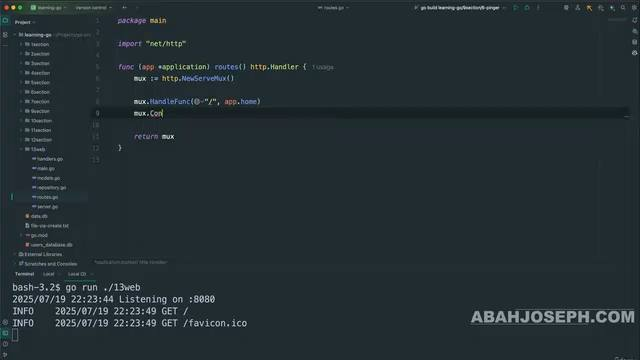
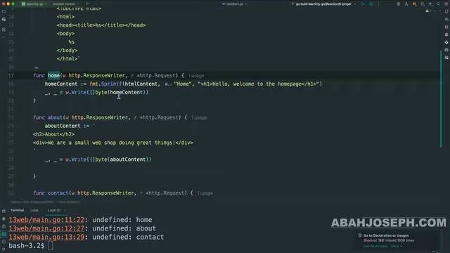
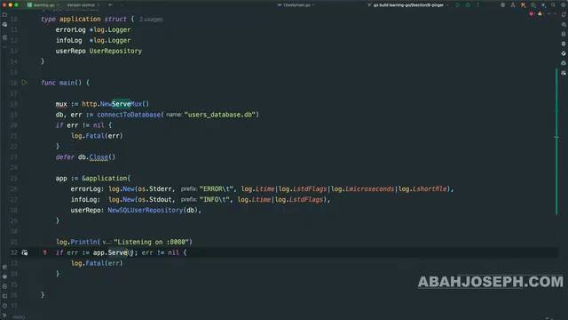
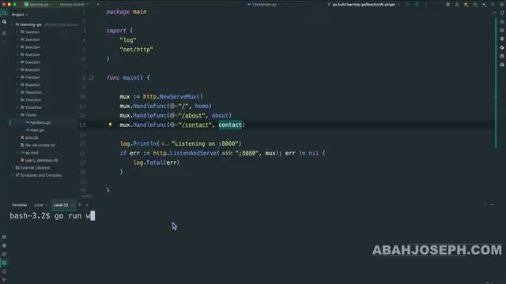
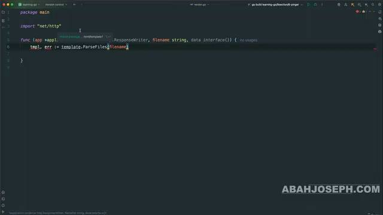
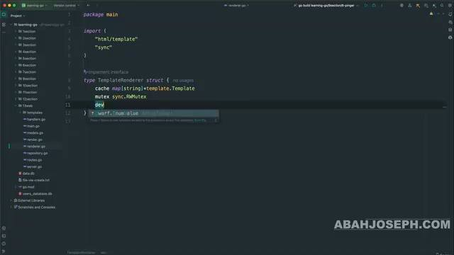
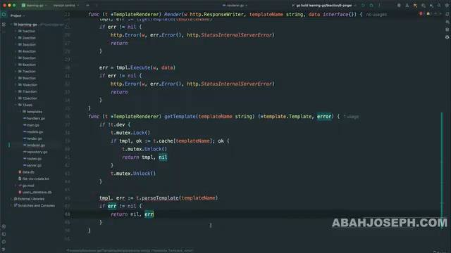
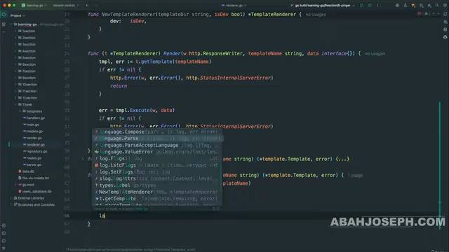

## 1. 这一节做什么

P77–P81 这五段，核心不是再讲一遍 `net/http` 的语法，而是把最开始那个「所有东西都写在 `main()` 里」的 Go Web 程序，逐步重构成一个可以继续加页面、加模板、加缓存的骨架。

最终你会得到一个可运行的 `13_web` 项目：

- 使用 Go 标准库 `net/http`，不引入 Web 框架；
- 用 `http.ServeMux` 注册 `/`、`/about`、`/contact`；
- 用 `Application` 结构体集中保存 `errorLog`、`infoLog`、模板目录、模板渲染器；
- 把路由从 `main.go` 抽到 `routes.go`；
- 用 `html/template` 渲染 HTML；
- 最后实现一个带 `map` 缓存、`sync.RWMutex` 保护、`dev` 开关的模板渲染器：开发模式每次重新读模板，生产模式缓存模板。

这一节结束时，读者应该能：

```bash
cd 13_web
go run .
```

然后浏览器访问：

- `http://localhost:8080/`
- `http://localhost:8080/about`
- `http://localhost:8080/contact`

都能看到对应 HTML 页面。



注意：P78 讲师口头提到过数据库连接、`repository`、`user` model 的搬移，但逐字稿没有给出完整字段、SQL、DSN、驱动包名。为了让你照着本文能直接跑起来，下面的完整代码先做一个「不接数据库的 Web 骨架」，页面渲染不依赖数据库。数据库部分我会在第 7 节明确标出「课里没讲」，不替你编造。

---

## 2. 讲师原话

P77 一开始，讲师把上一节的 custom handler 删掉，回到标准库默认 mux：

> "我们使用默认路由的 HTTP 默认服务器 mux。然后把这个 mux 传进去。"
> —— p077 [00:29]

这里说的是用 `http.NewServeMux()` 或默认 mux 来挂路由。后面他又强调，默认 mux 不是框架，方法要自己判断：

> "你不能像 GET 或 POST 那样直接映射……处理逻辑得你自己来做。"
> —— p077 [08:02]

P77 还出现了一个很典型的 Go 运行错误：只运行 `main.go`，同包其他文件里的 handler 就找不到：

> "我现在只运行 main，所以……其实我们可以运行整个包。"
> —— p077 [05:12]

所以后面启动命令必须是 `go run .` 或运行整个包，而不是 `go run main.go`。



P78 开始重构。讲师明确说 Go 不会规定你怎么组织应用，要自己设计：

> "Go 并不会真正告诉你该怎么做。你得想清楚自己打算如何组织应用结构。"
> —— p078 [00:00]

然后是依赖注入的雏形：把 logger、repository、数据库连接、模板目录等放到 `Application` 里：

> "我们创建了一个新结构，你可以把它看作你的依赖……你的应用依赖这里的所有内容。"
> —— p078 [09:16]

P79 做了一次简化：不要强迫调用方先 `app.mount(mux)` 再 `serve()`，而是让 `serve()` 内部自己拿到路由：

> "我不想这么做。我希望我们只需调用 serve，所有东西就都配置好了。"
> —— p079 [00:00]

P80 开始用模板。讲师特别强调导入的是 `html/template`，不是 `text/template`：

> "你要确保导入的是 html/template……出于安全原因，这一点非常重要。"
> —— p080 [01:21]

同时他指出每请求都解析模板在生产环境有问题：

> "在生产环境中，你不会希望每次都执行这个渲染过程……理想情况下，我们希望把它解析一次，存到缓存里，然后从缓存中执行。"
> —— p080 [05:32]

P81 就是在做这个缓存：

> "当我们解析一个模板一次之后，就不想再解析它了。我们可以继续执行同一个模板。"
> —— p081 [00:26]



---

## 3. 从零复现

### 3.1 环境与目录

课里没有讲具体 Go 版本。本文用 Go 1.22 为例；只要你的 Go 支持 `any` 和标准库 `http.Server`，代码就能编译。

创建目录：

```bash
mkdir -p 13_web/templates
cd 13_web
```

最终目录结构如下：

```text
13_web/
├── go.mod
├── main.go
├── application.go
├── server.go
├── routes.go
├── handlers.go
├── render.go
├── renderer.go
└── templates/
    ├── index.html
    ├── about.html
    └── contact.html
```

初始化模块：

```bash
go mod init example.com/go-backend-masterclass/13_web
```

本项目的依赖只有标准库，因此不需要额外 `go get`。如果你把 `go.mod` 直接照第 4 节写好，也可以跳过 `go mod init`。

### 3.2 写入文件并启动

把第 4 节的 8 个 Go 文件和 3 个 HTML 文件分别保存到上面的路径。

启动命令：

```bash
cd 13_web
go run .
```

注意：不要用：

```bash
go run main.go
```

P77 讲师遇到的 `undefined: home` / `undefined: about` 就是因为只编译了 `main.go`。Go 同一个包里的多个 `.go` 文件要一起编译，`go run .` 会编译当前目录整个包。



### 3.3 验证页面

另开一个终端：

```bash
curl -i http://localhost:8080/
curl -i http://localhost:8080/about
curl -i http://localhost:8080/contact
curl -i http://localhost:8080/nope
```

前三个应返回 `200 OK` 和 HTML；`/nope` 应返回 `404 Not Found`，因为我们在 `home` 里判断了 `r.URL.Path != "/"`，并且 `ServeMux` 的 `/` 是兜底路由。

### 3.4 验证模板开发模式

当前 `main.go` 里：

```go
app.tp = NewTemplateRenderer(app.templateDir, true)
```

`true` 表示开发模式：不缓存。你修改 `templates/index.html` 后刷新浏览器，应该立即看到变化。

### 3.5 验证模板缓存

把 `main.go` 里的 `true` 改成 `false`：

```go
app.tp = NewTemplateRenderer(app.templateDir, false)
```

重启服务器：

```bash
go run .
```

然后再次修改 `templates/index.html`，刷新浏览器。你会发现页面没有变化，因为模板已经被缓存到 `TemplateRenderer.cache` 里了。这正是 P81 讲师演示的效果：`dev=false` 时缓存生效。



---

## 4. 完整代码

### 4.1 `go.mod`

```go
module example.com/go-backend-masterclass/13_web

go 1.22
```

### 4.2 `main.go`

```go
package main

import (
	"log"
	"os"
)

func main() {
	app := NewApplication(
		log.New(os.Stdout, "ERROR\t", log.Ldate|log.Ltime|log.Lshortfile),
		log.New(os.Stdout, "INFO\t", log.Ldate|log.Ltime),
		"templates",
	)

	// P81：这里用 app.templateDir 初始化模板渲染器。
	// 讲师解释过：不在 NewApplication 里直接 new，是因为那时 app 还没初始化完，
	// 需要复用 app.templateDir。
	app.tp = NewTemplateRenderer(app.templateDir, true)

	if err := app.Serve(); err != nil {
		app.errorLog.Fatal(err)
	}
}
```

### 4.3 `application.go`

```go
package main

import "log"

// Application 是整个应用的依赖容器。
// P78 讲师把 errorLog、infoLog、repository 等依赖集中到这里。
// 当前可运行最小版本不接数据库，因此没有放 userRepo 字段。
type Application struct {
	errorLog    *log.Logger
	infoLog     *log.Logger
	templateDir string
	tp          *TemplateRenderer
}

func NewApplication(errorLog, infoLog *log.Logger, templateDir string) *Application {
	return &Application{
		errorLog:    errorLog,
		infoLog:     infoLog,
		templateDir: templateDir,
	}
}
```

### 4.4 `server.go`

```go
package main

import "net/http"

// Serve 创建 http.Server，并启动监听。
// P79 之后不再要求调用方先 mount mux，routes() 内部自己创建 mux。
func (app *Application) Serve() error {
	srv := &http.Server{
		Addr:    ":8080",
		Handler: app.routes(),
	}

	app.infoLog.Printf("starting server on %s", srv.Addr)
	return srv.ListenAndServe()
}
```

### 4.5 `routes.go`

```go
package main

import "net/http"

// routes 集中管理路由。
// P79 讲师把 routes 从 server.go 抽到独立文件，方便后续继续加页面。
func (app *Application) routes() http.Handler {
	mux := http.NewServeMux()

	mux.HandleFunc("/", app.home)
	mux.HandleFunc("/about", app.about)
	mux.HandleFunc("/contact", app.contact)

	return mux
}
```

### 4.6 `handlers.go`

```go
package main

import "net/http"

func (app *Application) home(w http.ResponseWriter, r *http.Request) {
	// 因为 "/" 是 ServeMux 的兜底路由，未知路径也会进来。
	// 所以这里显式判断路径，不是 "/" 就返回 404。
	if r.URL.Path != "/" {
		http.NotFound(w, r)
		return
	}

	app.infoLog.Println("home handler called")

	data := map[string]any{
		"Title": "Home",
		"Body":  "Welcome to the homepage.",
	}

	if err := app.render(w, "index.html", data); err != nil {
		app.errorLog.Println(err)
		http.Error(w, "Internal Server Error", http.StatusInternalServerError)
	}
}

func (app *Application) about(w http.ResponseWriter, r *http.Request) {
	app.infoLog.Println("about handler called")

	data := map[string]any{
		"Title": "About",
		"Body":  "We are a small web shop dream.",
	}

	if err := app.render(w, "about.html", data); err != nil {
		app.errorLog.Println(err)
		http.Error(w, "Internal Server Error", http.StatusInternalServerError)
	}
}

func (app *Application) contact(w http.ResponseWriter, r *http.Request) {
	app.infoLog.Println("contact handler called")

	data := map[string]any{
		"Title": "Contact",
		"Body":  "Send us an email on sample@test.com.",
	}

	if err := app.render(w, "contact.html", data); err != nil {
		app.errorLog.Println(err)
		http.Error(w, "Internal Server Error", http.StatusInternalServerError)
	}
}
```

### 4.7 `render.go`

```go
package main

import (
	"errors"
	"net/http"
)

// render 是 handler 层使用的入口。
// P81 之后它把具体渲染委托给 app.tp。
func (app *Application) render(w http.ResponseWriter, name string, data any) error {
	if app.tp == nil {
		return errors.New("template rendering engine is not set")
	}

	return app.tp.Render(w, name, data)
}
```

### 4.8 `renderer.go`

```go
package main

import (
	"html/template"
	"net/http"
	"path/filepath"
	"sync"
)

// TemplateRenderer 是 P81 的模板缓存核心。
// dev=true：每次重新解析模板，方便开发时刷新即生效。
// dev=false：第一次解析后放入 cache，后续直接执行缓存。
type TemplateRenderer struct {
	cache       map[string]*template.Template
	mu          sync.RWMutex
	dev         bool
	templateDir string
}

func NewTemplateRenderer(templateDir string, dev bool) *TemplateRenderer {
	return &TemplateRenderer{
		cache:       make(map[string]*template.Template),
		dev:         dev,
		templateDir: templateDir,
	}
}

func (t *TemplateRenderer) Render(w http.ResponseWriter, name string, data any) error {
	tmpl, err := t.getTemplate(name)
	if err != nil {
		return err
	}

	return tmpl.Execute(w, data)
}

func (t *TemplateRenderer) getTemplate(name string) (*template.Template, error) {
	if !t.dev {
		t.mu.RLock()
		tmpl, ok := t.cache[name]
		t.mu.RUnlock()
		if ok {
			return tmpl, nil
		}
	}

	tmpl, err := t.parseTemplate(name)
	if err != nil {
		return nil, err
	}

	if !t.dev {
		t.mu.Lock()
		t.cache[name] = tmpl
		t.mu.Unlock()
	}

	return tmpl, nil
}

func (t *TemplateRenderer) parseTemplate(name string) (*template.Template, error) {
	pagePath := filepath.Join(t.templateDir, name)
	files := []string{pagePath}

	// layouts 和 partials 是可选的。
	// 课里说没有 layout 时不应该直接报错，所以这里 glob 不到就跳过。
	layouts, err := filepath.Glob(filepath.Join(t.templateDir, "layouts", "*.html"))
	if err == nil {
		files = append(files, layouts...)
	}

	partials, err := filepath.Glob(filepath.Join(t.templateDir, "partials", "*.html"))
	if err == nil {
		files = append(files, partials...)
	}

	return template.ParseFiles(files...)
}
```

### 4.9 `templates/index.html`

```html
<!doctype html>
<html lang="en">
<head>
    <meta charset="utf-8">
    <title>{{.Title}}</title>
</head>
<body>
    <h1>Home page from templates</h1>
    <p>{{.Body}}</p>

    <nav>
        <a href="/">Home</a> |
        <a href="/about">About</a> |
        <a href="/contact">Contact</a>
    </nav>
</body>
</html>
```

### 4.10 `templates/about.html`

```html
<!doctype html>
<html lang="en">
<head>
    <meta charset="utf-8">
    <title>{{.Title}}</title>
</head>
<body>
    <h1>About us</h1>
    <p>{{.Body}}</p>

    <nav>
        <a href="/">Home</a> |
        <a href="/about">About</a> |
        <a href="/contact">Contact</a>
    </nav>
</body>
</html>
```

### 4.11 `templates/contact.html`

```html
<!doctype html>
<html lang="en">
<head>
    <meta charset="utf-8">
    <title>{{.Title}}</title>
</head>
<body>
    <h1>Contact</h1>
    <p>{{.Body}}</p>

    <nav>
        <a href="/">Home</a> |
        <a href="/about">About</a> |
        <a href="/contact">Contact</a>
    </nav>
</body>
</html>
```

---

## 5. 逐行解释

### 5.1 为什么 `go run .` 而不是 `go run main.go`

P77 讲师运行 `go run main.go` 时出现 `undefined`，因为 `home`、`about`、`contact` 写在同包的其他文件中。Go 的编译单位是包，不是单个文件。`go run .` 会把当前目录下所有 `package main` 的文件一起编译。

你在 Node 里习惯 `node index.js` 只跑入口文件，但 Go 这里不是「入口文件」概念，而是「入口包」。这是前端转 Go 最容易踩的第一个坑。


如果你还想要更贴近课里的原始状态，可以在 `main.go` 里自己加一行 `log.Println("正在监听 :8080")`，这样启动时就能看到讲师 P77 说的那句「we are listening on this port」。

### 5.2 `Application` 结构体：为什么要有它

P78 讲师的思路是「所有依赖都挂在同一个结构体上」，然后所有方法都变成它的方法：

```go
type Application struct {
	errorLog    *log.Logger
	infoLog     *log.Logger
	templateDir string
	tp          *TemplateRenderer
}
```

逐条看：

- `errorLog` / `infoLog`：两个 `*log.Logger`，都来自标准库 `log`，不需要第三方库。P78 讲师演示过给 logger 加前缀和 `log.Ldate|log.Ltime` 这种 flag，所以这里直接用 `log.New(os.Stdout, "ERROR\t", ...)` 的方式构造。
- `templateDir`：模板根目录。P80 讲师踩过一个坑——程序的工作目录是项目根目录，所以直接把 `"index.html"` 传进去会找不到文件。他的解法是把 `13_web/templates` 这种相对项目根的路径存到一个字段里，渲染时再拼接。这里的 `templateDir` 就是那个字段。注意本文把启动目录定在 `13_web` 内部，所以取 `"templates"` 就够了；如果你在仓库根目录执行 `go run ./13_web`，就要改成 `"13_web/templates"`。这一点在第 7 节还会再提醒一次。
- `tp`：模板渲染器。P81 讲师明确说这里必须是**指针**——他在代码里遇到一次报错后说「the problem is that we need to make this a pointer」。原因很直接：`Render` 方法内部会读写 `cache` 这个 map，如果 `tp` 是值类型，方法收到的是结构体副本，副本里的 map 虽然指向同一底层数组，但 `dev`、`templateDir` 这些字段的修改不会回传，而且把 `sync.RWMutex` 复制来复制去是典型的 Go 错误用法。用指针最省心。

对前端同学：这就是 `class App { constructor(deps) { this.errorLog = deps.errorLog ... } }`，只不过 Go 用组合和首字母大小写来控制可见性。`tp`、`dev`、`cache` 全是小写开头，意思是「包内私有」，等价于 JS 里的 `#private` 或至少是「不 export」。

### 5.3 `server.go`：显式构造 `http.Server`

P79 讲师把原来的 `http.ListenAndServe(":8080", mux)` 换成了自己构造 `http.Server`：

```go
srv := &http.Server{
	Addr:    ":8080",
	Handler: app.routes(),
}
return srv.ListenAndServe()
```

讲师的原话是这样做「more flexible」，因为 `http.Server` 上还能设 `ReadTimeout`、`TLSConfig` 等等，视频里他逐项点开看过。本文只留了 `Addr` 和 `Handler` 两个字段，因为课里也只实际设置了这两个；其余字段名以你自己的 Go 版本文档为准。

关于 `Addr: ":8080"`，P77 结尾讲师专门解释过那个冒号：

> "这里的第一部分其实是一个 IP 地址……如果你想限制只监听某个特定的 IP 地址，就可以用它。"
> —— p077 [09:07]

也就是说：

- `":8080"` → 监听所有网卡的所有地址，端口 8080（冒号前面留空表示「任意 IP」）；
- `"127.0.0.1:8080"` → 只监听本机回环，局域网其他机器访问不到；
- `"example.com:8080"` → 绑定到解析到的那块网卡。

本地开发用 `":8080"` 最省事，部署到服务器时再考虑要不要收紧。

还有一个细节：`Serve()` 的返回值是 `error`，`main.go` 里检查后调用 `app.errorLog.Fatal(err)`。正常停止服务时 `ListenAndServe()` 会返回 `http.ErrServerClosed`，本文没有做优雅关闭，所以这个分支你暂时看不到；第 7 节会说明。

### 5.4 `routes.go`：`ServeMux` 到底是怎样匹配的

```go
mux := http.NewServeMux()
mux.HandleFunc("/", app.home)
mux.HandleFunc("/about", app.about)
mux.HandleFunc("/contact", app.contact)
return mux
```

P79 讲师把路由单独抽成文件时说，这样「we have a single place to manage all our routes」。这句是本节重构的核心动机——路由是唯一需要在「加页面」时改动的地方，把它和「服务怎么启动」分开，改路由不会误伤启动逻辑。

`http.ServeMux` 的匹配规则有两条必须记住：

1. **最长前缀优先**：`/about` 比 `/` 更具体，所以访问 `/about` 走 `app.about`，不会走 `app.home`。
2. **`/` 是兜底**：任何没有更具体匹配的路径，都会落到注册在 `/` 上的 handler。所以访问 `/nope` 也会进 `app.home`。这就是 `handlers.go` 里那句 `if r.URL.Path != "/"` 存在的原因。

讲师在 P77 还特别强调过，默认 mux 不是框架，方法得自己判断：

> "你不能像 GET 或 POST 那样直接映射……处理逻辑得你自己来做。"
> —— p077 [08:02]

他的示例写法是在 handler 内部判断：

```go
if r.Method == http.MethodPost {
    // 处理表单
}
```

本文的 `handlers.go` 没有加这段，因为三个页面都是纯 GET 展示。你如果要练手，最自然的改法就是在 `contact` 里加一个 POST 分支：GET 渲页面，POST 读表单再渲一次。这只是练习，课里没写完这一步。

### 5.5 `handlers.go`：三个 handler 几乎同构，这正是要重构的信号

三个 handler 的骨架完全一样：

1. 打一行 info 日志；
2. 组装一个 `data`；
3. 调 `app.render`，出错就 `http.Error` + 写 error 日志。

先看 `home` 里的路径守卫：

```go
if r.URL.Path != "/" {
	http.NotFound(w, r)
	return
}
```

这段是配合 5.4 说的 `/` 兜底行为。少了它，访问 `/nope` 会返回 `200 OK` 加首页内容——对搜索引擎和调试都很坑。`http.NotFound(w, r)` 是标准库提供的 404 辅助函数，它会写入状态码并输出一段纯文本 body。

然后是日志：

```go
app.infoLog.Println("home handler called")
```

这就是 P78 结尾讲师现场演示的效果：他在 handler 里调 `app.info` 打日志，刷新页面，控制台就出现了一行。讲师当时的评价是「this is why dependency injection is very powerful」。换成前端视角，等价于把 `logger` 通过 context / props 传进组件，而不是在组件里 `import logger from './logger'` 直接引用全局单例。好处是测试时可以塞一个假的 logger 进去。

最后是渲染与错误处理：

```go
if err := app.render(w, "index.html", data); err != nil {
	app.errorLog.Println(err)
	http.Error(w, "Internal Server Error", http.StatusInternalServerError)
}
```

这里有个顺序问题值得说清楚：`tmpl.Execute(w, data)` 是**边执行边往 `w` 写**的。如果模板执行到一半出错，响应头和一部分内容可能已经发出去了，这时再调 `http.Error` 会追加一段错误文本到页面尾部，而状态码改不了。本文的做法是「先写日志、再尽力写 500」，够用但不完美。想更严谨的做法是先把模板执行到一个 `bytes.Buffer`，成功后再一次性 `w.Write`——**课里没讲这个**，你自己知道有这个方向就行。

`data` 用的是 `map[string]any`：

```go
data := map[string]any{
	"Title": "Home",
	"Body":  "Welcome to the homepage.",
}
```

P80/P81 讲师是用字符串替换演示「模板 + 数据」这个概念的，本文换成 `map[string]any` 是为了让三个页面共用同一套 HTML 结构。注意 key 首字母大写——模板里写 `{{.Title}}`，如果 key 是 `"title"` 就会渲染出空字符串，而且**不报错**。这是 Go 模板最常见的静默失败。

### 5.6 `render.go`：为什么还要留一层 `render`

`render.go` 只做一件事：

```go
if app.tp == nil {
	return errors.New("template rendering engine is not set")
}
return app.tp.Render(w, name, data)
```

这层薄封装是 P81 讲师加的。他在 handler 里改成调 `app.tp.Render(...)` 之后，发现直接调用会让 handler 承担「渲染器可能没初始化」这个风险，于是加了一个 `nil` 检查，错误信息就是那句「template rendering engine is not set」。

结构上它还有第二个好处：以后你想给所有页面统一注入数据（比如当前用户、站点名），只需要改 `render` 一处，三个 handler 不用动。这在 Node/Express 里对应的是 `res.locals` + 统一渲染中间件。

### 5.7 `renderer.go`：本节真正的重点

这是 P81 的全部产出。逐个字段看：

```go
cache       map[string]*template.Template
mu          sync.RWMutex
dev         bool
templateDir string
```

**`cache` 的 key 是什么**：本文用的是模板文件名，比如 `"index.html"`。所以 `getTemplate("index.html")` 命中缓存时直接返回已解析的 `*template.Template`，不再读磁盘。讲师课里没有特别强调 key 的设计，你可以换成完整路径，只要 get 和 set 用同一套规则。

**为什么必须 `make`**：P81 讲师专门停下来讲了这个：

> "每次有这样 map 时，你都必须 make 它。map 的零值是 nil。所以如果你没有 make 它，却试图往里面设置内容，就会触发 panic。"
> —— p081 [02:40]

也就是说 `var m map[string]int` 的零值是 `nil`，**往里写**会 panic（读不会，读会返回零值）。构造函数里那句 `cache: make(map[string]*template.Template)` 就是防这个。

**`sync.RWMutex` 在保护什么**：Go 的 HTTP 服务器是每个请求一个 goroutine，天然并发。P81 讲师说这里用 RWMutex 控制「the logs」（口误，实际是控制 cache）。读的时候 `RLock`，允许多个请求同时读；写的时候 `Lock`，独占。这就是「读多写少」缓存的标准做法。

对前端同学：Node 是单线程事件循环，你的 `Map` 缓存天然没有并发写问题，所以你会觉得这把锁多余。但 Go 不是——**同一个 map 被多个 goroutine 同时读写会直接让进程崩溃**（运行时检测到会抛 fatal error，不是普通 error，recover 兜不住）。这一条课里没讲，但你会撞上，第 7 节展开。

**`dev` 开关的价值**：这是本节设计上最值得学的一点。缓存和热更新在开发期是互斥需求：

- `dev = true`：每次请求都重新 `ParseFiles`，改 HTML 刷新即生效，但每个请求都要读盘 + 解析；
- `dev = false`：第一次解析后进 cache，之后只执行，性能好，但改 HTML 必须重启进程。

P81 讲师现场演示了这个对比：`dev=true` 时改模板立刻生效；把 `dev` 改成 `false` 重启后，再改模板、刷新页面，什么都没有变。他的结论是缓存版本适合生产，热更新版本适合开发。

看 `getTemplate` 的分支顺序：

```go
if !t.dev {
	t.mu.RLock()
	tmpl, ok := t.cache[name]
	t.mu.RUnlock()
	if ok {
		return tmpl, nil
	}
}
```

注意 `RUnlock` 在 `if ok` 之前就调用了，不在分支里解锁——这是避免「提前 return 忘了解锁」导致死锁的标准写法，Go 里更地道的写法是 `defer t.mu.RUnlock()`，但 defer 有微小开销，热路径上有人会手写。**这里选择手写，是因为课里的写法就是先解锁再判断**。

后面写缓存时又加了一次锁：

```go
if !t.dev {
	t.mu.Lock()
	t.cache[name] = tmpl
	t.mu.Unlock()
}
```

先 `RLock` 查、查不到再 `Lock` 写，这叫「双重检查」。它有个小小的理论缺陷：两个请求同时未命中，会各自解析一遍模板，后写的覆盖先写的。功能上无害（解析结果一样），只是白做一次 IO。想彻底避免要用 `singleflight` 之类的工具——**课里没讲**，你知道有这回事即可。

**`parseTemplate` 里的路径拼接**：

```go
pagePath := filepath.Join(t.templateDir, name)
```

P81 讲师特别解释了为什么不能用字符串拼 `/`：

> "这里 path.Join 之所以重要，是因为操作系统兼容性。你不会想手动拼接路径，因为 Windows 上不一样，Mac 上不一样，Linux 上也不一样。"
> —— p081 [08:34]

`filepath.Join`（不是 `path.Join`）会用当前系统的分隔符，Windows 上是 `\`，其他是 `/`。

接着是可选的 layouts 和 partials：

```go
layouts, err := filepath.Glob(filepath.Join(t.templateDir, "layouts", "*.html"))
if err == nil {
	files = append(files, layouts...)
}
```

P81 讲师解释了为什么这里只判 `err == nil` 而不在 `err != nil` 时直接 return：

> "如果他们没有把 layout 传给你，你就不会渲染页面，这就不太妙。这个是可选的。"
> —— p081 [10:23]

也就是说 `layouts/` 和 `partials/` 目录是可选的：有就参与解析，没有就只用页面模板本身。这个宽容度很重要——本文的可运行版本根本没建这两个目录，`filepath.Glob` 匹配不到会返回空切片加 `nil` error，所以 `files` 里只有页面本身，`ParseFiles` 正常成功。如果你按字面意思在 `err != nil` 时 return，第一次跑就会直接失败。

注意 `filepath.Glob` 的语义：**没有匹配到文件时返回 `nil, nil`，不返回 error**。真正的 error 只会来自「pattern 格式不合法」。所以在当前设计下，`err == nil` 这个条件实际上几乎总是成立，写在这里的意义是把「未来可能出现的 path 错误」降级为「忽略 layout」而不是「整个页面挂掉」。

最后：

```go
return template.ParseFiles(files...)
```

`ParseFiles` 接受多个文件，返回的第一个模板以**第一个文件**命名，也就是页面文件。执行时 `tmpl.Execute(w, data)` 会执行这个根模板。如果后面要看 layout，通常得改成 `Lookup` 指定模板名——**课里没讲到这一步**，P81 结尾只说下一节会做 layouts。

### 5.8 `main.go`：初始化顺序为什么必须是这样

```go
app := NewApplication(errorLog, infoLog, "templates")
app.tp = NewTemplateRenderer(app.templateDir, true)
```

P81 讲师在最后 recap 里专门解释了为什么不在 `NewApplication` 内部直接 `new` 渲染器：

> "我之所以没有这样做，是因为我在这里没法使用 app.this……此时 app 还没有初始化，所以我需要使用 app 的模板目录，而不是再复制一份。"
> —— p081 [19:11]

翻译成人话：如果在构造函数里写 `tp: NewTemplateRenderer(templateDir, false)`，你就得在字面量里再写一遍目录字符串，和 `templateDir` 字段重复。而在外面先建 `app`、再读 `app.templateDir` 去建 `tp`，就只用维护一处。这是典型的「构造函数负责字段赋值，装配在调用处完成」。

对前端同学：这就是 `const app = new App(deps); app.renderer = new Renderer(app.config.templateDir);` 的顺序，和 React 里 `useMemo` 依赖前一个 hook 的返回值一个道理——顺序不能反。



---

## 6. 复现检查清单

按顺序打勾，任何一项失败就停在那里查。

**环境与文件**

- [ ] `go version` 输出 ≥ 1.22（低版本也大概率能跑，本文只用到 `any`）
- [ ] 目录名是 `13_web`，里面有 8 个 `.go` 文件和 `templates/` 目录
- [ ] `templates/` 下有 `index.html`、`about.html`、`contact.html` 三个文件
- [ ] 所有 `.go` 文件的包名都是 `package main`
- [ ] `go.mod` 的 module 路径和你写的不冲突（改名后记得同步 import，本文没有跨包 import，所以无所谓）

**编译**

- [ ] 在 `13_web` 目录内执行 `go build ./...`，无输出
- [ ] 没有 `undefined: home` 之类的报错（有的话说明你在用 `go run main.go`）

**启动**

- [ ] `go run .` 打印出 `INFO starting server on :8080`
- [ ] 没有 `panic: assignment to entry in nil map`（有的话检查构造函数里的 `make`）
- [ ] 没有 `open templates/index.html: no such file or directory`（有的话看第 7 节第一条）

**页面**

- [ ] `curl -I http://localhost:8080/` 返回 `200`
- [ ] `curl -I http://localhost:8080/` 的 body 里有 `Home page from templates`
- [ ] `/about` 返回 `200` 且 body 里有 `About us`
- [ ] `/contact` 返回 `200` 且 body 里有 `sample@test.com`
- [ ] `/nope` 返回 `404`（不是 200）
- [ ] 终端里每次请求都出现对应的 `handler called` 日志

**模板开发模式（`dev = true`）**

- [ ] 改 `templates/index.html` 加一行文字，刷新浏览器能看到
- [ ] 不重启进程

**模板缓存模式（`dev = false`）**

- [ ] 把 `main.go` 里的 `true` 改成 `false`，重启
- [ ] 第一次访问首页正常
- [ ] 再改 `templates/index.html`，刷新浏览器**看不到**变化
- [ ] 再重启进程，变化出现

**重构结果**

- [ ] `main.go` 里没有 `mux.HandleFunc`（路由已全部在 `routes.go`）
- [ ] `main.go` 里没有 `http.ListenAndServe`（启动已封装进 `Serve`）
- [ ] 想加新页面时只需要改 `routes.go` + `handlers.go` + 新建一个 HTML



---

## 7. 课里没讲但你会撞上的

这一节全部是课里没有的内容，用来补「照着跑会卡住」的坑。凡是我拿不准讲师原意的，都明确标注了。

**1) 工作目录 ≠ 项目根目录，模板路径会漂**

P80 讲师踩过一次 `open index.html: no such file or directory`，原因是进程的工作目录和模板所在目录不一致。`go run .` 的工作目录是你执行命令时所在的目录，不是 `go.mod` 所在目录。`go build` 出来的二进制也一样——它在哪个目录被启动，相对路径就以哪里为基准。

所以：如果你在仓库根目录执行 `go run ./13_web`，`templateDir` 必须写成 `"13_web/templates"`。最稳的办法是用绝对路径或 `os.Executable()` 推导，**课里没讲**，需要的话自己加。

**2) 并发读写 map 会让进程直接崩，不是返回 error**

Go 运行时检测到同一个 map 被并发读写的典型输出是 `fatal error: concurrent map read and map write`，这是一个 **fatal error**，`defer recover()` 抓不住，进程直接退出。本文的 `renderer.go` 用 `sync.RWMutex` 把 cache 的所有读写都包住了，所以不会触发。如果你「优化」掉那把锁，在 `dev=false` 且并发压测时就会撞上。

Node 里你不用担心这个——单线程，`Map` 随便用。这是转 Go 最容易忽略的一类差异。

**3) `http.Server` 的优雅关闭**

本文的 `Serve()` 直接返回 `ListenAndServe()` 的 error。按 `Ctrl+C` 时进程被信号杀掉，正在处理的请求会被切断。要优雅关闭需要：`signal.Notify` 监听 `SIGINT`/`SIGTERM`，然后 `srv.Shutdown(ctx)`。讲师在 P78 提过「define the closing of the database」这类收尾工作的重要性，但**没有演示 HTTP 服务的关闭流程**，`srv.Shutdown` 这个名字在逐字稿里也从未出现。这部分请查标准库文档。

**4) 数据库那一整块，课里没给能跑的代码**

P78 讲师确实搬了 `repository`、把 `user` 改名为 `models`，也提到要连数据库、要 `userRepo` 字段、要 `blank import` 驱动（他说「I always forget it」）。但逐字稿里：

- 没有出现 DSN 连接串；
- 没有出现具体的驱动导入路径；
- 没有出现任何 SQL；
- repository 的构造函数名字他念得含糊（「I think is there a new function for it」）。

所以我不能替你写这段——写出来就是编的。本文的完整代码因此**不包含数据库**，`Application` 里也没有 `userRepo` 字段，页面渲染完全不依赖数据库。等课程后续片段给出具体实现时，把它加到 `Application` 上、在 `main.go` 里连库、在 `Serve` 之前赋值即可，接线方式和 `app.tp` 一模一样。

顺带说一句 `blank import` 是什么：`import _ "github.com/xxx/driver"`，下划线表示「不直接用这个包的标识符，只要它的 `init()` 副作用」——数据库驱动就是靠 `init()` 把自己注册到 `database/sql` 里。这在 Node 里没有直接对应物，最接近的是 `require('pg')` 只为触发注册。

**5) 模板字段名大小写错，不报错，只是空白**

`{{.Title}}` 对应 `map[string]any{"Title": ...}`。写成 `{"title": ...}` 会渲染成空，`Execute` 返回 `nil` error。如果你看到页面结构对但内容全空，先查这里。这是 Go 模板的静默失败，跟 JS 里 `obj.name` 拿不到值出 `undefined` 但至少你会在 devtools 里看到字面量 `undefined` 不一样。

**6) `html/template` 和 `text/template` 不要搞混**

P80 讲师强调过要 `import "html/template"`。区别是 `html/template` 会对插值做上下文相关的转义：放进 HTML 文本节点、属性、`<script>`、URL 里的转义规则都不同。用 `text/template` 渲染用户输入就是 XSS 直通车。本文所有 HTML 文件都走 `html/template`，`renderer.go` 里也只 import 了这一个。

如果你真的需要插入一段可信 HTML，用 `template.HTML` 类型包一下——**课里没讲**，但这是唯一正确的口子，不要用 `printf` 拼字符串绕过。

**7) `layouts/` 和 `partials/` 目录不存在是正常的**

本文的 `parseTemplate` 用 `filepath.Glob` 找这两个目录，找不到就跳过。所以你现在跑起来，`templates/` 下只有三个 HTML 文件，完全没问题。等你真的建了 `templates/layouts/base.html`，它会被自动 `ParseFiles` 进去，但**不会被自动使用**——`Execute` 执行的仍然是以页面文件命名的那棵模板树。要真正用上 layout，得像 Laravel/Express 的「block + extend」那样组织，Go 模板的对应机制是 `{{template "name" .}}` 和 `{{define "name"}}`。P81 结尾讲师说下一节做 layout，具体写法**这节课里没讲**。

**8) 端口被占用**

`ListenAndServe` 返回 `listen tcp :8080: bind: address already in use` 时，说明上次的进程没退干净。用 `lsof -i :8080` 找 PID 再 `kill`；或者干脆把 `Addr` 改成 `":8081"`。本文没有把端口做成环境变量，**课里也没讲**做配置化，讲师只说「if you want, we can also configure this port as well」但没实现。

**9) 关于 `/` 兜底路由与 Go 1.22 的方法匹配**

讲师在 P77 说的是「默认 mux 不能 map get/post，得自己在 handler 里判断」。注意 Go 1.22 起 `ServeMux` 已经支持 `"GET /about"` 这种带方法的路由模式，**但课里完全没有提到这一点**，讲师描述的是 1.22 之前的行为。本文按课里的写法，只用路径注册，方法判断留给 handler。要不要升级到新写法由你决定——两条路都能跑，别混着用同一个路径就行。

**10) 每次请求都解析模板到底有多贵**

`dev=true` 时，每次请求都要 `open` + 读取 + 解析三个 HTML（还有可能存在的 layouts/partials）。单机压测时这一步会明显拖低 QPS，而且会累积大量临时对象给 GC。P81 讲师的原话是这会「overwhelm your server」，这也就是缓存的动机。想量化的话，用 `wrk` 或 `hey` 对 `dev=true` 和 `dev=false` 各打一遍，看 `Requests/sec` 差多少——这是判断「缓存到底值不值」最直接的方法，比任何口头论证都硬。

**11) 缓存的失效问题**

`dev=false` 时，模板进 cache 就再也不出来。你改 HTML 必须重启进程，这就是讲师演示的现象。真实生产环境里模板一般随二进制一起发布（用 `embed` 打进二进制或者镜像构建时 COPY 进去），进程重启顺便带上新模板，所以「永不失效」并不算问题。但如果你要做「不发版换模板」，就得加手动失效接口或者监听文件变化——**课里没讲**，属于后续话题。



---

到这一步，你已经有了一个能跑、能加页面、能在开发/生产两种模式间切换的 Go Web 骨架。它没有框架、没有数据库、没有 layout，但每个后续要加的东西都有一个明确的挂载点：新页面加进 `routes.go` 和 `handlers.go`，新依赖加进 `Application`，新渲染能力加进 `TemplateRenderer`。这就是 P77–P81 这五段真正在教的事——不是某个 API 怎么调，而是**当项目从 3 个 handler 长到 30 个的时候，代码该往哪里放**。