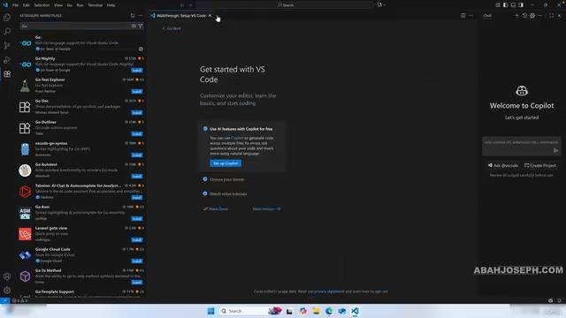
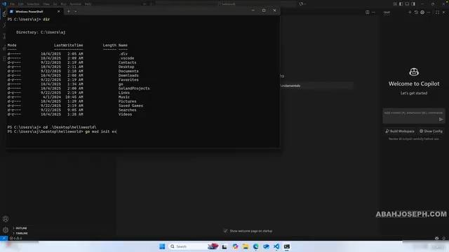
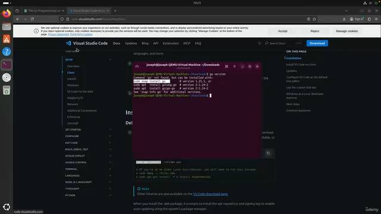
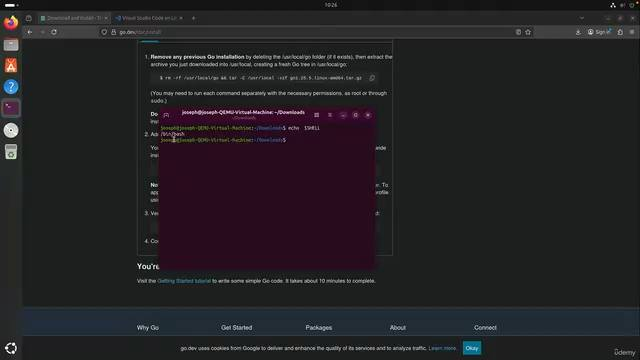
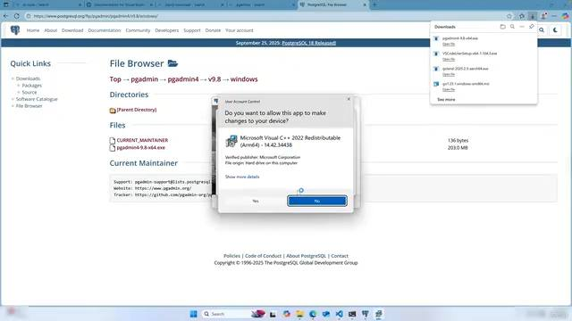
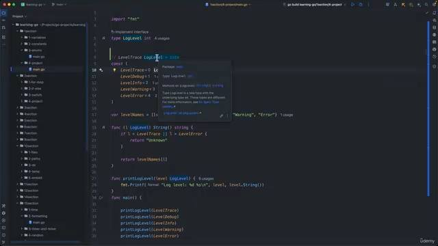
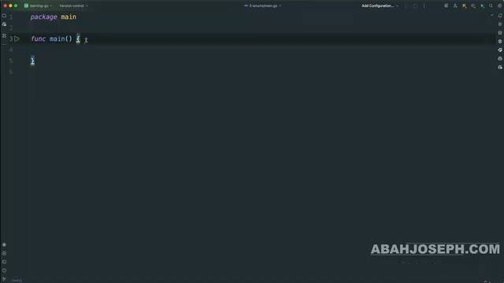

# Go Backend Masterclass P8–P15 复现文档：环境安装、值与变量、常量、枚举

> 范围说明：P8–P15 仍然是 Go 语言基础与开发环境阶段，不是完整 HTTP 后端项目。你最终会得到一组可以直接 `go run` 的 Go 程序：hello world、基础值、变量、常量、基础枚举、带越界保护的 log level 枚举。P9 安装的 PGAdmin 是可选数据库工具，本节没有数据库连接代码。  
> 本文把讲师演示时临时使用的目录名统一整理为 `go-backend-masterclass`；如果你照视频保留 `learning Go`、`one-section` 等名字，只需在运行命令里换成自己的路径即可。

## 1. 这一节做什么

这一节的目标不是“听懂几个概念”，而是把 P8–P15 里出现的东西真正跑起来：

1. 在 Windows 上用 VS Code 安装 Go 扩展，创建 hello world 程序并运行。
2. 在 Linux 上安装 VS Code、从 go.dev 下载 Go 二进制包、解压到 `/usr/local`、把 `/usr/local/go/bin` 加进 `PATH`，再用 `go version` 验证。
3. 可选安装 PGAdmin。讲师只演示了安装和“注册服务器”界面，没有安装 PostgreSQL 服务端，也没有连接真实数据库。
4. 建立一组按目录分开的 Go 小程序，分别演示 strings、numbers、booleans、slice、nil interface、float、变量声明、短变量声明、常量、`iota` 枚举、log level 枚举与越界保护。
5. 处理 P14 专门澄清的 IDE “灰色提示”问题：你在 GoLand 里看到的 `= 0`、`= 1` 可能只是 Inlay Hints，不是代码本身。照着本文的
步骤走，就能避开 P14 里那个“IDE 看起来帮你改了代码”的坑。

## 2. 讲师原话（带「—— pNNN [MM:SS]」）

下面这些原话用于定位本节的真实范围，避免把“安装工具”误写成“已经写了后端服务”。

> "我想把它做成一个 Go 模式……但 Go 这个术语并不存在，这真的很奇怪。"
> —— p008 [03:12]

> "现在你不需要做任何事，只需安装它。我们将学习如何使用它们。"
> —— p009 [01:44]

> "现在我们已经安装了 Go，但它还不能正常工作。"
> —— p010 [05:33]

> "所以如果我输入 GoVersion，我们仍然会看到找不到 Go 的错误信息。没问题。这是因为 Go 目前不在我们的执行路径中。"
> —— p010 [05:33]

> "在 Go 中，这是一个字符串。我们这里有的是常规字符串，当然你可以将它们拼接起来。"
> —— p011 [02:21]

> "当你声明一个变量且它尚未初始化时，这意味着内存还没有为它分配。……在 Go 中，对于未初始化的变量，会赋予一个称为零值的东西。"
> —— p012 [01:23]

> "这是一个常量，如果我们试图让 host 等于其他值，它是不能被改变的。"
> —— p013 [02:19]

> "那实际上不是代码，是 IDE 在跟我们开玩笑……是 IDE 刚刚插入了那个。"
> —— p014 [00:29] / [02:17]

> "你看打印日志级别，我们在这里放了 10。我们并没有多达 10 个日志级别。……该值的输出将是未知的。"
> —— p014 [04:02]

> "Go 不像 Java、C# 或 C++ 等其他语言那样有 enum 关键字。然而，它提供了一种机制，使用 iota 标识符轻松创建枚举常量。"
> —— p015 [00:27]

从这些原话可以确认：P8–P15 是开发环境与语言原子值阶段；P9 的 PGAdmin 只是安装和界面说明；P14 是对枚举代码里 IDE 提示的专门澄清；P15 才是基础枚举与更实际的 log level 枚举演示。

## 3. 从零复现

### 3.1 你需要准备什么

- Windows 侧：VS Code。版本课里没讲，安装当前稳定版即可。
- Go：P14 [03:39] 讲师明确说自己用的是 Go 1.26，并说当时是最新版本。本文示例按 Go 1.26 写；如果你从 go.dev 下载到的是别的稳定版，把 `go.mod` 里的版本改成你本机 `go version` 显示的版本即可。
- Linux 侧：Ubuntu。P10 讲师用的是 Apple M1 上的 Ubuntu 虚拟机，所以下载的是 ARM 版 Go；如果你是 Intel/AMD，下载 AMD64 版。
- 可选：PGAdmin。P9 只说去 `pgadmin.org` 下载安装，没有安装 PostgreSQL 服务端，也没有连接数据库。
- 本节不需要任何第三方 Go 依赖，只用标准库 `fmt`。

### 3.2 建立统一目录

在任意工作目录打开终端：

```bash
mkdir go-backend-masterclass
cd go-backend-masterclass
go mod init go-backend-masterclass
```

目录结构如下。你可以先全部建出来，后面每个文件都按这个路径保存：

```text
go-backend-masterclass/
├── go.mod
├── 00-hello-world/
│   └── main.go
├── section-01-values/
│   └── main.go
├── section-02-variables/
│   └── main.go
├── section-02-constants/
│   └── main.go
├── section-03-enums/
│   └── main.go
└── section-04-log-level/
    └── main.go
```

P8 里讲师是在 hello world 文件夹里执行 `go mod init example`。本文用根模块统一管理所有示例，效果一样；如果你愿意保留 P8 的独立模块，也可以只对 `00-hello-world` 单独执行 `go mod init example`。

### 3.3 Windows：VS Code 与 Go 扩展

1. 打开 `https://code.visualstudio.com/`，下载 Windows 安装包。
2. 安装时勾选“添加到 PATH”一类选项。讲师在 P8 [00:25] 特别提到要接受这个路径选项，目的是以后能在终端里直接输入 `code` 打开文件或目录。
3. 安装完成后打开 VS Code。
4. 点击左侧扩展图标，搜索 `go`。讲师在 P8 [02:13] 演示了搜索 `go` 后选择 Go Team at Google 发布的那个扩展并安装。



5. 用 VS Code 打开 `go-backend-masterclass` 文件夹。
6. 新建 `00-hello-world/main.go`，内容见第 4 节。
7. 打开 VS Code 集成终端，执行：

```bash
go run ./00-hello-world
```

P8 里讲师的终端一开始提示 `go` 不存在，后来又正常了。 transcript 里他自己也说“probably was loading”。所以你在 Windows 上如果刚安装完 Go，先关掉所有终端和 VS Code，再重新打开；仍然不行就检查系统环境变量 `Path` 里是否包含 Go 的安装目录。



### 3.4 Linux：安装 VS Code、Go，并修正 PATH

以下命令按 P10 的顺序整理。不要一次性盲目复制全部；先确认自己是 AMD64 还是 ARM64。

#### 第一步：安装 VS Code

从 VS Code 官网下载 Linux 的 `.deb` 包，进入下载目录执行：

```bash
sudo apt install ./code_*.deb
```

安装完成后，讲师执行了删除安装包以保持系统干净：

```bash
rm -f code_*.deb
```

然后在应用列表里能看到 VS Code。P10 里还提到用 `code .` 打开当前目录，这要求安装时已经把 `code` 命令加入 PATH。

#### 第二步：从 go.dev 下载 Go

打开 `https://go.dev/dl/`。P10 [03:20] 讲师强调：Intel/AMD 机器下载 AMD64，Apple M1 虚拟机里的 Ubuntu 下载 ARM64。



假设下载到 Downloads 目录，文件名类似：

```text
go1.26.linux-amd64.tar.gz
```

或：

```text
go1.26.linux-arm64.tar.gz
```

#### 第三步：解压到 /usr/local

讲师在 P10 [04:14] 把官网的长命令拆开解释：先删除旧 Go，再解压。对应命令：

```bash
cd ~/Downloads
sudo rm -rf /usr/local/go
sudo tar -C /usr/local -xzf go1.26.linux-amd64.tar.gz
rm -f go1.26.linux-amd64.tar.gz
```

如果你是 ARM64，把文件名换成 `go1.26.linux-arm64.tar.gz`。

注意：`tar` 这里必须加 `sudo`，因为目标是 `/usr/local`。讲师在 P10 [04:43] 专门说官网那条命令“没有写 sudo，但我知道必须加”。

#### 第四步：把 Go 的 bin 目录加入 PATH

先看当前 shell：

```bash
echo $SHELL
```

如果是 `/bin/bash`，编辑：

```bash
code ~/.bashrc
```

如果是 `/bin/zsh`，编辑：

```bash
code ~/.zshrc
```

在文件末尾加一行：

```bash
export PATH=$PATH:/usr/local/go/bin
```

保存后关闭终端，重新打开一个新终端。也可以执行：

```bash
source ~/.bashrc
```

如果你用的是 zsh，就执行 `source ~/.zshrc`。



验证：

```bash
go version
```

你应该看到类似 `go version go1.26...` 的输出。具体行以你本机安装版本为准。

#### 第五步：写一个 Linux 侧的 hello world

```bash
cd ~/Desktop
mkdir -p example
cd example
code .
```

新建 `main.go`：

```go
package main

import "fmt"

func main() {
	fmt.Println("hello world")
}
```

运行：

```bash
go run main.go
```

输出：

```text
hello world
```

#### 第六步：给 VS Code 装 Go 扩展

P10 [09:40] 讲师在 Linux 的 VS Code 里同样搜索 `go`，安装 Go 扩展。安装后才有更好的语法高亮、调试和跳转能力。

### 3.5 可选：安装 PGAdmin

P9 是可选步骤。打开 `https://www.pgadmin.org/`，下载对应系统安装包并安装。讲师在 P9 [01:44] 说安装后先不用做任何配置。



如果你以后要连接数据库，界面里的路径是：右键 `Servers` → `Register` → `Server`。在 General 里填一个名字，在 Connection 里填 Host、Database、Username、Password。P9 里没有真实数据库服务端，所以这一步现在不会成功，也不需要现在做。

### 3.6 运行本节全部示例

在 `go-backend-masterclass` 根目录依次执行：

```bash
go run ./00-hello-world
go run ./section-01-values
go run ./section-02-variables
go run ./section-02-constants
go run ./section-03-enums
go run ./section-04-log-level
```

每个命令都应退出码 0。输出内容见第 6 节检查清单。

## 4. 完整代码

以下文件都是完整文件，可以直接保存运行。逐字稿没有逐字展示所有代码，尤其是 P11、P12、P13 的具体变量名和打印语句；下面的文件是按讲师描述的行为重建的可运行版本，变量名和打印格式可能与视频屏幕不完全逐字一致，但语义与运行结果对应。

### 4.1 go.mod

文件路径：`go-backend-masterclass/go.mod`

```go
module go-backend-masterclass

go 1.26.0
```

如果你本机不是 Go 1.26，把最后一行改成 `go version` 输出的版本，例如 `go 1.22.0`。

### 4.2 00-hello-world/main.go

文件路径：`go-backend-masterclass/00-hello-world/main.go`

```go
package main

import "fmt"

func main() {
	fmt.Println("hello world")
}
```

### 4.3 section-01-values/main.go

文件路径：`go-backend-masterclass/section-01-values/main.go`

```go
package main

import "fmt"

func main() {
	fmt.Println("Hello" + " " + "World")
	fmt.Println("Hello\nWorld")

	fmt.Println(1 + 1)
	fmt.Println(true)
	fmt.Println(false)

	numbers := []int{1, 2, 3}
	fmt.Printf("numbers = %v\n", numbers)

	var anything interface{}
	fmt.Println(anything)

	fmt.Println(3.14)
}
```

### 4.4 section-02-variables/main.go

文件路径：`go-backend-masterclass/section-02-variables/main.go`

```go
package main

import "fmt"

func main() {
	var greeting string
	greeting = "Hello world"
	fmt.Println(greeting)

	var count int = 10
	fmt.Println(count)

	var isRunning bool = true
	fmt.Println(isRunning)

	var firstName, lastName string
	firstName = "John"
	lastName = "Doe"
	fmt.Println(firstName, lastName)

	email := "test@test.com"
	fmt.Println(email)

	age := 24
	fmt.Println(age)

	var year int = 2025
	fmt.Println(year)
}
```

### 4.5 section-02-constants/main.go

文件路径：`go-backend-masterclass/section-02-constants/main.go`

```go
package main

import "fmt"

const host string = "localhost"
const appName = "go"
const pi float64 = 3.14159
const rate float32 = 5.1

func main() {
	fmt.Println(host)
	fmt.Println(appName)
	fmt.Println(pi)
	fmt.Println(rate)

	// 下面这行如果取消注释，编译会失败：
	// cannot assign to host (neither addressable nor a map index expression)
	// host = "example.com"
}
```

### 4.6 section-03-enums/main.go

文件路径：`go-backend-masterclass/section-03-enums/main.go`

```go
package main

import "fmt"

const (
	Sunday = iota
	Monday
	Tuesday
	Wednesday
	Thursday
	Friday
	Saturday
)

const (
	SundayOne = iota + 1
	MondayOne
	TuesdayOne
	WednesdayOne
	ThursdayOne
	FridayOne
	SaturdayOne
)

type logLevel int

const (
	logError logLevel = iota
	logInfo
	logDebug
	logTheta
)

func main() {
	fmt.Println(Sunday, Monday, Tuesday, Wednesday, Thursday, Friday, Saturday)
	fmt.Println(SundayOne, MondayOne, TuesdayOne, WednesdayOne, ThursdayOne, FridayOne, SaturdayOne)
	fmt.Println(logError, logInfo, logDebug, logTheta)
}
```

### 4.7 section-04-log-level/main.go

文件路径：`go-backend-masterclass/section-04-log-level/main.go`

```go
package main

import "fmt"

type logLevel int

const (
	levelTrace logLevel = iota
	levelDebug
	levelInfo
	levelWarning
	levelError
)

var logLevelNames = []string{
	"TRACE",
	"DEBUG",
	"INFO",
	"WARNING",
	"ERROR",
}

func (l logLevel) String() string {
	if int(l) < 0 || int(l) >= len(logLevelNames) {
		return "UNKNOWN"
	}
	return logLevelNames[l]
}

func main() {
	fmt.Println(levelTrace)
	fmt.Println(levelDebug)
	fmt.Println(levelInfo)
	fmt.Println(levelWarning)
	fmt.Println(levelError)

	fmt.Println(logLevel(10))
}
```

P14 里讲师说的“guard”就是 `String()` 里的 `if`。把这段 `if` 删掉后，`fmt.Println(logLevel(10))` 会触发 `index out of range`。保留它时，越界值输出 `UNKNOWN`。



## 5. 逐行解释

### 5.1 hello world：最小可运行单元

```go
package main
```

Go 的可执行程序必须属于 `main` 包。你在 Node 里写 `node app.js` 时没有这个“包声明”概念，但 Go 编译器需要它来判断入口。

```go
import "fmt"
```

导入标准库 `fmt`，用于格式化输出。Go 有一条硬规则：导入的包必须使用；否则编译报错。P11 [01:23] 讲师提到的“黄色波浪线”就是这个原因。

```go
func main() {
	fmt.Println("hello world")
}
```

`main` 函数是可执行程序入口。`fmt.Println` 输出后自动换行。

### 5.2 values：字符串、数字、布尔、slice、nil、float

```go
fmt.Println("Hello" + " " + "World")
```

字符串用双引号，`+` 做拼接。P11 [02:21] 明确演示了字符串拼接。

```go
fmt.Println("Hello\nWorld")
```

`\n` 是换行符。P11 里讲师说“put this new line character to print it”，对应的就是这个效果。

```go
fmt.Println(1 + 1)
```

整数相加。输出 `2`。Go 的 `int` 是整数类型之一。

```go
fmt.Println(true)
fmt.Println(false)
```

布尔值只有 `true` 和 `false`，不需要引号。

```go
numbers := []int{1, 2, 3}
fmt.Printf("numbers = %v\n", numbers)
```

`[]int{1, 2, 3}` 是切片，P11 [03:47] 讲师称它为“fancy array / extendable array”。`%v` 是 `fmt.Printf` 的默认格式占位符。

```go
var anything interface{}
fmt.Println(anything)
```

`interface{}` 是空接口，零值是 `nil`。输出为 `<nil>`。P11 [04:13] 用“nothing / nil”描述它。

```go
fmt.Println(3.14)
```

浮点数字面量。P11 后面补了 float 示例，这里用最直观的 `3.14`。

### 5.3 variables：声明、初始化、零值、短声明

```go
var greeting string
```

只声明，不赋值。Go 会给字符串零值：空字符串 `""`。P12 [01:23] 专门解释“zero value”。这一点和 JavaScript 不同：JS 的 `let greeting;` 是 `undefined`，Go 是 `""`。

```go
greeting = "Hello world"
```

初始化/赋值。P12 把“声明”和“初始化”分开讲，是为了说明零值的存在。

```go
var count int = 10
```

声明并初始化。这里显式写了 `int`。P12 [05:28] 演示过：当右侧已经能推断类型时，IDE 可能提示 `int` 是冗余的。但写上不会导致编译错误，只是风格问题。

```go
var firstName, lastName string
firstName = "John"
lastName = "Doe"
```

一行声明多个同类型变量，再分别赋值。P12 [03:42] 演示了这种写法。

```go
email := "test@test.com"
```

短变量声明。`:=` 同时完成声明和初始化，类型由右侧推断为 `string`。P12 [04:09] 说这是“preferred option”，前提是你在函数内部。

```go
age := 24
```

同理，`age` 被推断为 `int`。

```go
var year int = 2025
```

显式类型写法。P12 末尾用它演示“类型可被推断时，IDE 会提示冗余”。在 JS/Node 里没有这种编译期类型推断提示；你可以把它理解成 TypeScript 的类型标注，但 Go 是编译期强类型。

### 5.4 constants：编译期不可变

```go
const host string = "localhost"
```

`const` 定义常量。P13 [02:19] 演示了尝试重新赋值会编译失败，错误信息里出现 “cannot assign to host”。注意：Go 的 `const` 是编译期常量，不只是“变量绑定不能改”。JavaScript 的 `const` 只阻止重新绑定，对象内容仍可变；Go 的常量更严格。

```go
const appName = "go"
```

省略类型，由右侧推断。

```go
const pi float64 = 3.14159
const rate float32 = 5.1
```

分别演示 `float64` 和 `float32`。P13 [03:15] 提到 `pi` 用 `float64`、`rate` 用 `float32`。实际业务里优先 `float64`，因为 Go 的默认浮点类型是 `float64`。

```go
// host = "example.com"
```

这行故意注释掉。取消注释会编译失败，正好复现 P13 的错误演示。

### 5.5 enums：Go 没有 enum 关键字，用 const + iota

```go
const (
	Sunday = iota
	Monday
	Tuesday
	...
)
```

P15 [00:27] 明确说 Go 没有 Java/C#/C++ 那种 `enum` 关键字，而是用 `iota` 生成枚举常量。`iota` 在每个 `const` 组内从 0 开始，每行递增 1。所以 `Sunday` 是 0，`Monday` 是 1，依此类推。

```go
const (
	SundayOne = iota + 1
	MondayOne
	...
)
```

P15 [02:13] 演示“从 1 开始”的办法：第一项写 `iota + 1`，后续项继续按行递增。于是 `SundayOne` 是 1，`MondayOne` 是 2。

```go
type logLevel int
```

定义一个命名类型，底层是 `int`。P15 [02:39] 说这是“peek ahead”，为后面更实际的枚举做铺垫。

```go
const (
	logError logLevel = iota
	logInfo
	logDebug
	logTheta
)
```

给枚举值指定类型 `logLevel`。这样后面可以写接受 `logLevel` 的函数，避免随便传一个 `int`。P15 只演示到定义和打印，没有展开校验逻辑；校验逻辑在 P14 的 log level 示例里更完整。

### 5.6 log level 与越界保护

```go
type logLevel int
```

命名类型。这样 `logLevel(10)` 是合法转换，但普通 `int` 不能直接当 `logLevel` 用，除非显式转换。

```go
const (
	levelTrace logLevel = iota
	levelDebug
	levelInfo
	levelWarning
	levelError
)
```

枚举值依次是 0 到 4。

```go
var logLevelNames = []string{
	"TRACE",
	"DEBUG",
	"INFO",
	"WARNING",
	"ERROR",
}
```

名字切片。索引 0 对应 `TRACE`，索引 4 对应 `ERROR`。P14 [04:59] 说“如果你要加新值，这里也要加，并且更新检查”。因为这里用 `len(logLevelNames)` 做检查，新增名字后检查会自动适应长度；但新增枚举常量时仍要记得同步加名字。

```go
func (l logLevel) String() string {
```

给 `logLevel` 定义 `String()` 方法。`fmt.Println` 打印实现了 `String()` 的值时会调用它。这一点课里没有逐字解释方法机制，但代码行为就是如此。

```go
	if int(l) < 0 || int(l) >= len(logLevelNames) {
		return "UNKNOWN"
	}
```

这就是 P14 说的“guard”。如果值小于 0 或大于等于名字数量，返回 `UNKNOWN`，避免数组越界。P14 [04:02] 用 `logLevel(10)` 演示：没有 10 个 log level，所以输出 `UNKNOWN`。

```go
	return logLevelNames[l]
```

合法范围内直接取名字。如果删掉上面的 `if`，这行在 `l=10` 时会 panic，错误就是 `index out of range`，与 P14 的描述一致。

```go
fmt.Println(logLevel(10))
```

故意传越界值。保留 guard 时输出 `UNKNOWN`；删掉 guard 时程序崩溃。这就是 P14 让读者亲手验证的点。



## 6. 复现检查清单

### 6.1 环境检查

- [ ] 在终端执行 `go version` 能输出版本号。
- [ ] 在 Linux 上执行 `echo $SHELL`，确认自己改的是 `~/.bashrc` 还是 `~/.zshrc`。
- [ ] VS Code 扩展面板里能看到 Go 扩展已安装。
- [ ] 在 VS Code 集成终端里执行 `go env GOPATH` 不报 “go: command not found”。
- [ ] 如果 `go` 一开始找不到，关闭并重开终端/VS Code 后再试，排除 P8 里那种“终端还在加载”的情况。

### 6.2 文件检查

- [ ] `go.mod` 存在，`module` 名为 `go-backend-masterclass`。
- [ ] 六个 `main.go` 分别在六个子目录中，没有把多个 `package main` 放进同一个目录。
- [ ] `section-02-constants/main.go` 里的 `host = "example.com"` 仍然处于注释状态，否则编译失败。
- [ ] `section-04-log-level/main.go` 里保留了 `String()` 方法中的 `if` 守卫。

### 6.3 运行结果检查

执行：

```bash
go run ./00-hello-world
```

期望输出：

```text
hello world
```

执行：

```bash
go run ./section-01-values
```

期望输出包含：

```text
Hello World
Hello
World
2
true
false
numbers = [1 2 3]
<nil>
3.14
```

具体换行位置以实际输出为准。

执行：

```bash
go run ./section-02-variables
```

期望输出包含：

```text
Hello world
10
true
John Doe
test@test.com
24
2025
```

执行：

```bash
go run ./section-02-constants
```

期望输出包含：

```text
localhost
go
3.14159
5.1
```

执行：

```bash
go run ./section-03-enums
```

期望输出包含三行：

```text
0 1 2 3 4 5 6
1 2 3 4 5 6 7
0 1 2 3
```

执行：

```bash
go run ./section-04-log-level
```

期望输出：

```text
TRACE
DEBUG
INFO
WARNING
ERROR
UNKNOWN
```

### 6.4 故意制造错误检查

- [ ] 把 `section-02-constants/main.go` 的 `// host = "example.com"` 取消注释，执行 `go run ./section-02-constants`，应看到 “cannot assign to host” 一类错误。看完后改回注释。
- [ ] 把 `section-04-log-level/main.go` 的 `if int(l) < 0 || int(l) >= len(logLevelNames)` 整段删掉，执行 `go run ./section-04-log-level`，应看到 `index out of range` panic。看完后恢复代码。
- [ ] 在 GoLand 里打开枚举文件，观察是否出现灰色 `= 0`、`= 1` 提示。按 P14 的路径关闭：Settings → Editor → Inlay Hints → Code Vision / Values，把相关提示关掉。VS Code 的提示位置和名称以你
实际显示为准；如果找不到 “Code Vision”，直接在设置搜索框输入 “inlay hints” 逐个关闭即可。VS Code 不同版本里这类提示由 Go 扩展提供，名称和位置可能变化，找不到就忽略，它只影响观感，不影响编译结果。

## 7. 课里没讲但你会撞上的

这一节全部是课程逐字稿里没有展开、但按上面的步骤操作时大概率会遇到的问题。每条按“症状 → 原因 → 处理”写，方便你直接对照排查。

### 7.1 `go.mod` 里的 `go 1.26.0` 让老版本 Go 拒绝编译

症状：执行 `go run ./00-hello-world` 报错，提示 `go.mod requires go >= 1.26.0 (running go 1.22.x)` 一类信息。

原因：`go.mod` 中 `go` 指令声明的是“本模块要求的最低 Go 版本”。我从 P14 [03:39] 讲师自述的 1.26 填了进去，但你从 go.dev 下载到的很可能是别的版本。

处理：把 `go.mod` 最后一行改成你 `go version` 输出的版本号。例如输出 `go version go1.22.5 linux/amd64`，就写 `go 1.22.5`（或只写 `go 1.22`）。改完保存，重新 `go run`。反过来，如果你的 Go 比 1.26 新，通常不用改，向后兼容。

### 7.2 Windows 上装完 Go，终端仍然提示 `go` 不是内部或外部命令

症状：PowerShell 或 CMD 里输入 `go version`，提示“不是内部或外部命令，也不是可运行的程序”。

原因：P8 [03:12] 讲师也撞上过这个问题，他当时的解释是终端还在加载。但真正常见的原因是安装程序没有把 Go 的 `bin` 目录写进系统 `Path`，或者你用的终端进程是安装之前启动的，环境变量没有刷新。

处理顺序：先关掉所有 VS Code 窗口和终端，重新打开一个**新的** PowerShell，再试。仍然不行，检查系统环境变量：按 Win 键搜索“环境变量”，打开“编辑系统环境变量”→“环境变量”，在“用户变量”或“系统变量”的 `Path` 里找有没有类似 `C:\Program Files\Go\bin` 或 `C:\Users\你的用户名\go\bin` 的条目。没有就手动加，加完必须重开终端才生效。安装路径以你实际安装位置为准，不要照抄路径。

### 7.3 Linux 上 `tar` 不加 `sudo` 会失败

症状：`tar -C /usr/local -xzf go1.26.linux-amd64.tar.gz` 报 `Permission denied`。

原因：`/usr/local` 属于 root，普通用户没有写权限。讲师在 P10 [04:43] 特意提醒官网那条命令没写 `sudo`。

处理：前面加 `sudo`。如果连 `sudo` 都没有（比如容器里的 rootless 用户），就换一个你有写权限的目录解压，然后把该目录下的 `bin` 加进 `PATH`，思路与 P10 完全一致，只是路径不同。注意：换目录后 `go env GOROOT` 指向的会是新位置，属正常现象。

### 7.4 改完 `~/.bashrc` 后 `go version` 仍然找不到

症状：`export PATH=$PATH:/usr/local/go/bin` 明明写进去了，新开终端还是找不到。

原因有三种：一是你改错了文件（zsh 用户改的是 `~/.zshrc`，P10 [06:30] 讲师专门说了这点）；二是没有重新打开终端，`PATH` 只在 shell 启动时读取；三是你在 `~/.bashrc` 里把 `export PATH=...` 写在了某个提前 `return` 的分支之后，导致没被执行到。

处理：先 `echo $PATH` 看有没有 `/usr/local/go/bin`。没有就确认 shell 类型再改对应文件。确认文件末尾确实追加了那一行，且没有被 `if [ -z "$PS1" ]; then return; fi` 这类早退逻辑挡在上面。改完执行 `source ~/.bashrc`（或 `exec bash`）验证，最后再开新终端。

### 7.5 `:=` 只能写在函数里

症状：在文件顶层写 `email := "test@test.com"`，报 `non-declaration statement outside function body`。

原因：P12 里讲师是在 `main` 函数内部演示短变量声明的，没有说明它只适用于函数作用域。`:=` 是“短变量声明语句”，Go 语法规定语句不能出现在包级别。

处理：包级别只能写 `var email = "test@test.com"`（可以省略类型）或带完整类型的 `var`。常量则用 `const`。在 Node 里没有对应概念——ESM 模块顶层可以直接 `const email = ...`，Go 的包级声明在语法层面更严格。

### 7.6 声明了变量却没用，编译直接失败

症状：`declared and not used: greeting`。

原因：Go 把“未使用的局部变量”当编译错误，而不是警告。这和 JavaScript 完全不同：JS 里多声明一个变量、未使用的 `import` 都只是 linter 抱怨。

处理：要么真的用上（打印、参与计算），要么删掉。想临时保留调试代码，就给它加个别名 `_ = greeting`，或者干脆注释掉。注意这条规则只针对**局部变量**，包级别的 `var` 和 `const` 未使用不会报错，P13 里那些常量能直接放着不打印就是这个道理。同理，`import` 了的包没用到也会是编译错误，P11 [01:23] 的黄色波浪线就是这个原因。

### 7.7 两个 `const` 块里的 `iota` 各自从 0 开始

症状：你写了两组 `const`，第二组的第一个值不是接着第一组继续，而是又从 0 开始。

原因：`iota` 的作用域是**单个 `const` 声明块**，每进入一个新的 `const (...)` 组就重置为 0。P15 里讲师分别演示了从 0 开始和 `iota + 1` 从 1 开始的两个块，但没有明说“跨块不延续”。

处理：需要连续编号时，把所有枚举值放进同一个 `const` 块。需要多套独立编号（比如一套星期、一套日志级别）时，分成多个块反而正是你想要的效果——本文的 `section-03-enums/main.go` 就是故意分了两块。

### 7.8 `logLevel` 和 `int` 不能随便混用

症状：把普通 `int` 变量直接传进需要 `logLevel` 的地方，报类型不匹配；或者两个不同的命名类型之间比较，报 `mismatched types`。

原因：`type logLevel int` 定义的是**命名类型**，它和 `int` 底层表示相同，但不是同一个类型。P15 [03:36] 只说了“定义这个类型便于比较”，没有讲转换规则。

处理：需要时显式转换，例如 `logLevel(10)`——P14 [04:02] 里讲师正是这么传越界值的。反过来，取数值也要 `int(l)`，本文 `String()` 方法里的 `if int(l) < 0` 就是这个用法。语言的对应关系：这在 TypeScript 里类似“品牌类型（branded type）”，只是 Go 的转换是编译期强制、无运行时开销。

### 7.9 Go 扩展装完会弹“安装工具”，不装就没有跳转和补全

症状：扩展装好了，但代码里 `fmt` 上没有补全、按住 Ctrl 点不动、保存时也没有自动导入。

原因：VS Code 的 Go 扩展本身只是外壳，真正的语言服务需要额外二进制。P8 和 P10 里都只演示到“点击安装扩展”就结束了，没有继续这一步。

处理：按 VS Code 右下角提示操作，或者按 `Ctrl+Shift+P` 打开命令面板，输入并执行 `Go: Install/Update Tools`，全选后确认，等待安装完成，然后重启 VS Code 窗口（`Developer: Reload Window`）。安装过程中如果卡在下载，多半是网络问题，翻代理或改用国内镜像源，具体源地址以你所用 Go 版本的官方文档为准，我这里不写死。安装完成后用 `gopls version` 验证（该命令存在与否取决于你的安装方式，以实际输出为准）。这一步失败不影响 `go run`，只是编辑器体验差。

### 7.10 保存时代码被自动改格式，看起来像“代码变了”

症状：你按视频敲的代码，保存后缩进、对齐、空行全变了，或者 `import` 被自动加上又被删掉，让你怀疑自己抄错。

原因：Go 扩展默认在保存时执行格式化（基于 gofmt），并且会自动整理 import。这是 Go 生态的既定风格，gofmt 是官方工具，不存在“要不要用”的问题——所有 Go 代码都长一个样。

处理：不要抵抗，接受格式化结果。想手动格式化整个项目，在根目录执行 `gofmt -l .` 列出需要格式化的文件，`gofmt -w .` 直接改写。想检查除了格式以外的可疑写法，执行 `go vet ./...`。这两条命令课里都没讲，但项目一旦变大就会发现离不了。另外，P14 那一整节讲的 Inlay Hints 是**灰色的、不可编辑**的虚拟提示，和 gofmt 改出来的真实文本不是一回事——前者点进去选不中，后者是真的写进了文件。判断方法：把光标放到那个 `= 0` 上，选中不了就是提示，能选中并删除就是真代码。

### 7.11 PGAdmin 装好了却连不上任何东西

症状：照着 P9 打开 PGAdmin，右键 `Servers` → `Register` → `Server`，填了 `localhost` 之后点保存，报连接超时或拒绝连接。

原因：P9 只装了**客户端管理工具**，没有装 PostgreSQL 服务端。客户端没有可连的目标，自然失败。讲师在 P9 [02:12] 说得很清楚：“for now, we don't have the server ready”。

处理：这一节可以完全跳过，不影响任何 Go 代码的运行。等你后续课程开始做真实项目、需要数据库时再装 PostgreSQL 服务端，然后把 Host 填 `localhost`、Database 填你创建的库名、Username 和 Password 填你初始化服务端时设置的账号，端口按你实际服务端配置填（不要照抄别人的）。P9 里提到的 tunnel 等高级选项同理，课程没有展开，现在也用不到。

### 7.12 多个 `package main` 想放同一个目录

症状：你图省事，把 values、variables、constants 三个演示都放进同一个目录，结果编译报 `main redeclared in this block` 或重复定义。

原因：同一个目录在 Go 里属于同一个包，同一包内函数名不能重复，而每个演示都需要一个 `func main`。

处理：这就是本文用“一个演示一个子目录”的原因。如果你确实想在单文件里跑多个演示，就把每个逻辑拆成独立函数（`demoValues()`、`demoVariables()`），在唯一的 `main` 里依次调用，不要写多个 `main`。

### 7.13 交叉编译与跨平台运行

症状：你在 Windows 上写好的代码，拷到 Linux 虚拟机上直接 `go run`，报路径或可执行格式问题。

原因：`go run` 会先编译成本机可执行文件再运行，跨平台不是拷 `.go` 文件的问题——源文件本身跨平台没问题，问题通常出在硬编码的路径分隔符（`\` 与 `/`）和工作目录假设上。

处理：P10 讲师之所以在 Linux 上重新走了一遍安装流程，就是为了让你两边都能独立开发。本文所有示例都不涉及文件路径，照抄即可跨平台。想生成可执行文件给别人跑，用 `go build -o app ./section-04-log-level`，然后在目标系统上执行 `./app`；跨操作系统构建需要设置 `GOOS` / `GOARCH` 环境变量，这部分课程没有涉及，用到时按官方文档操作。

---

以上七个章节构成了 P8–P15 的完整闭环：第 1 节给出目标与边界，第 2 节用讲师原话锁定范围，第 3 节按 Windows 与 Linux 两条路径把环境搭起来，第 4 节提供六个可直接保存运行的完整文件，第 5 节逐行解释每个写法的来历与 JS/TS 对照，第 6 节用可勾选清单和“故意制造错误”验证你真的跑通了，第 7 节把课程没有覆盖但实际会撞上的坑提前摊开。按顺序做完 6.1 到 6.4，再扫一遍第 7 节，你就可以放心进入下一阶段的真实项目部分。