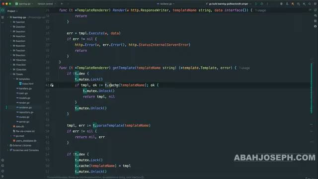
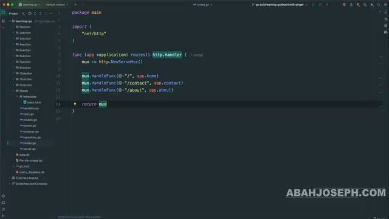
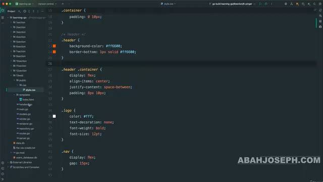
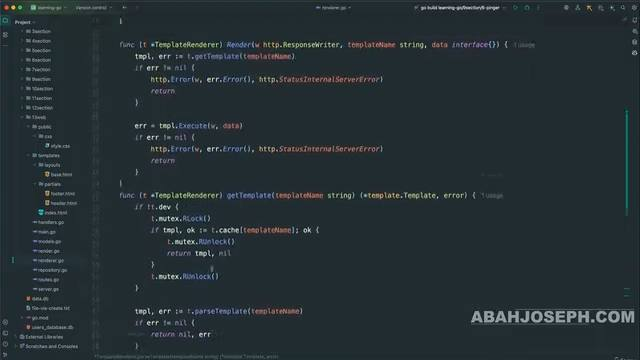
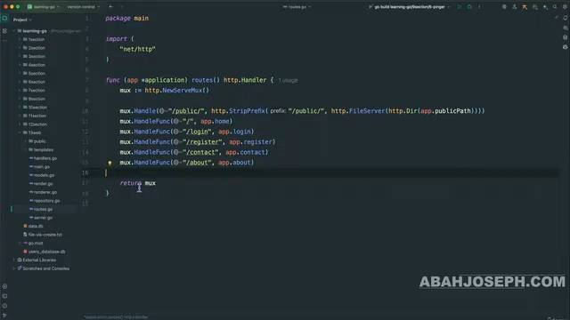
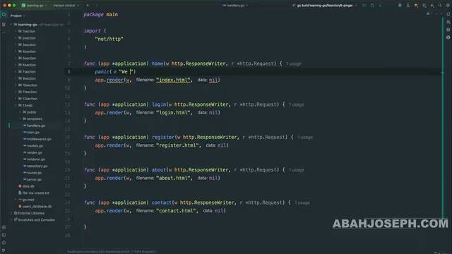
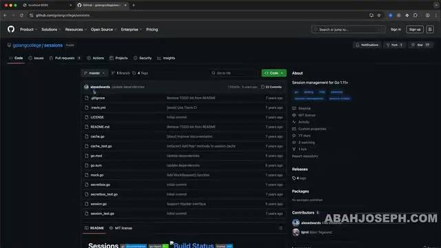
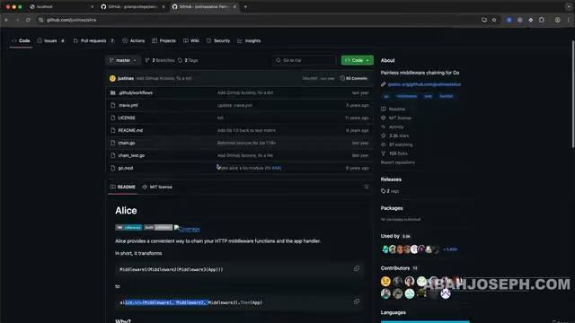
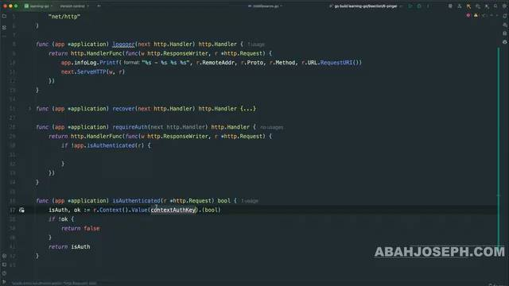

# Go Backend Masterclass P82–P86 复现文档：模板布局、静态资源、中间件与 Session

> 适用读者：前端转 AI 应用工程师。本段课程把项目从「能渲染单页」推进到「有布局、有静态资源、有中间件链、有 Session、有登录保护」的可运行 Web 骨架。所有代码按文件给出，可直接保存运行。
>
> 课程语言：Go（标准库 net/http + html/template）。Java 等语言语法只需「知道即可」，本文不展开。阅读时建议把重点放在「请求进来以后经过哪些层、每一层负责什么、出错时先看哪一层」，而不是死记语法；这与前端里从路由、布局、静态资源到中间件、Cookie/Session 的心智模型是对应的。

---

## 1. 这一节做什么

P82–P86 这五集，讲师在已有项目上连续做了五件事，最终得到一个「带布局模板 + 静态资源 + 日志/恢复中间件 + Session + 登录保护」的 Web 应用骨架：

1. **P82**：把 `renderer.go` 里读模板的锁从 `Lock` 改成 `RLock`（只读场景更省）；在 `routes.go` 注册 `/public/` 静态资源路由，并把路径抽成 `app.PublicPath` 配置；新建 `templates/layouts/base.html` 与 `templates/partials/`（header/footer），把 `index.html` 的内容包进 `{{define "content"}}...{{end}}`；最后把 `renderer` 的 `Execute` 改成 `ExecuteTemplate(..., "base", ...)`，让页面真正套上布局。这里的关键不是单独改一行锁，而是把「模板加载、布局组合、静态资源访问、渲染入口」四件事串成一条可验证的链路：模板缓存能被并发安全地读、布局文件能被正确解析、CSS 能通过 URL 访问、页面执行时明确指定 `base`。前端可以对照 React/Vue 里的 layout + outlet/slot：`base.html` 是外壳，`content` 是每个页面填入的插槽；静态资源则类似前端项目里的 `public/` 目录。常见错误是只改了 `Render` 却没有把页面包进 `{{define "content"}}`，结果页面空白或报模板未定义；也可能是静态资源 404，因为 `StripPrefix` 与 `PublicPath` 前缀没有对齐。

2. **P83**：新增 login / register / about / contact 四个页面与对应 handler，页面 HTML 全部用 `{{define "content"}}` 包裹。这一集的重点是「页面数量增加后，模板组织仍然统一」：每个页面只提供 `content`，公共的 header/footer 由 `base.html` 统一引入。前端对照是多个路由页面复用同一个 AppLayout；常见错误是某个页面忘了 `{{define "content"}}`，导致 `ExecuteTemplate("base")` 找不到 content；或者 handler 名字与路由注册不一致，访问时 404。排查时先看 `templates/*.html` 是否被 `filepath.Glob` 匹配到，再看 `Render` 传入的文件名是否与模板文件名完全一致。

3. **P84**：写两个中间件——`Logger`（打印请求信息）和 `Recover`（捕获 panic，返回 500 并打印堆栈）；在 `routes.go` 里用 `app.Logger(app.Recover(mux))` 串起来。中间件的价值是把「每个请求都要做的横切逻辑」从业务 handler 里抽出来。前端对照是 Express/Koa 的 middleware、Next.js 的 middleware；区别是 Go 标准库中间件签名固定为「接收 `http.Handler`，返回 `http.Handler`」。常见错误是忘记在中间件里调用 `next.ServeHTTP(w, r)`，请求会卡住不继续；或者 `recover()` 没有写在 `defer` 里，panic 仍然会冒出去。排查时看控制台是否先出现日志、页面是否返回 500、堆栈是否打印。

4. **P85**：引入 `github.com/alexedwards/scs/v2`（讲师口述为「go lang college slash sessions」，实际是 Alex Edwards 的 scs 库，版本 1.2.0），在 `main.go` 初始化 SessionManager，注册 `session.Enable` 中间件，用 `Put`/`GetString` 验证 Session 生效。这里的重点是理解 Session 不是全局变量，而是通过中间件挂到 `r.Context()` 上，handler 再从 context 里读写。前端对照是服务端 session + Cookie：浏览器保存 session id，服务端根据 id 找回数据；与 localStorage 不同，敏感状态不放前端。常见错误是路由没有经过 `session.Enable` 就读写 session，或者本地 http 下把 `Cookie.Secure` 设为 true 导致 Cookie 不回传。排查时先看响应头有没有 Set-Cookie，再看后续请求有没有带 Cookie，最后看 handler 是否在 session 中间件之后执行。

5. **P86**：引入 `github.com/justinas/alice` 把中间件链拆成「默认链」和「安全链」；新增 `RequireAuth` 中间件与 `IsAuthenticated` 辅助方法；用自定义 `contextKey` 类型存认证状态；给 `/submit` 路由挂上 `RequireAuth`，未登录访问会被 302 重定向到 `/login?redirect=/submit`。这一集把「所有路由都要的中间件」和「只有部分路由才需要的中间件」分开，避免在每个 handler 里手工包来包去。前端对照是路由守卫：公开页直接放行，需要登录的页面先检查登录态，再决定渲染还是跳转登录页。常见错误是中间件顺序写反，`RequireAuth` 在 `session.Enable` 之前执行，读不到 session；或者 `redirect` 参数拼接多了斜杠导致跳转地址异常。排查时看重定向 Location 头、看中间件链顺序、看 `IsAuthenticated` 读的 key 是否有写入。

最终效果：访问 `/` 能看到套了布局的首页；访问 `/login`、`/register`、`/about`、`/contact` 都能正常渲染；控制台能看到每个请求的日志；访问 `/submit` 未登录会被弹回登录页。需要说明的是，P86 结束时认证状态还是半成品：`IsAuthenticated` 读取的 context key 在本文代码中没有被真正写入，所以 `RequireAuth` 目前主要表现为「未登录就重定向」的骨架行为；真正登录成功后的认证写入属于后续内容。复现时不要把「骨架能跑」误解为「完整登录系统已经完成」。

---

## 2. 讲师原话（带出处）

> "打开 renderer.go 后，这个方法，就是这个 getTemplate 方法，因为这里只进行读取，所以可以使用 RLock 和 RUnlock。它比完整加锁开销更小。"
> —— p082 [00:00]

> "现在转到 routes，我想加一种渲染静态资源的方式。假设进入 static 目录……我们会把当前目录，也就是这个目录，和 public 拼接起来……然后调用 mux.Handle，比如传入 public。"
> —— p082 [00:58]

> "与其在这里硬编码，我们大概可以改用 app.StaticPath 或 PublicPath……这样更好，因为它是可配置的。"
> —— p082 [03:43]

> "我们需要进入 renderer。在 render 里……与其调用 Execute，不如调用 ExecuteTemplate……它接收一个 io.Writer，还接收模板名称，也就是我们现在真正想要执行的基础模板。"
> —— p082 [09:25]

> "中间件可以理解为一个函数……你可以在请求前或请求后运行它……在 Go 中，如果使用标准 HTTP 库，它必须接收一个 HTTP 处理器并返回一个 HTTP 处理器。"
> —— p084 [00:57]

> "当出现这种 panic 时，你无法控制那个 goroutine 已经崩溃……我们需要引入一种从 panic 中恢复的方法来解决这个问题，这同样可以用中间件来实现。"
> —— p084 [05:56]

> "我想引入会话库……这个，golangcollege/sessions……我们已经添加了 1.2.0 版本。"
> —— p085 [00:00]

> "我想引入这个叫 Alice 的库，它是一个简单库，可以用来分离中间件。"
> —— p086 [00:00]

> "一定要为 Context Key 创建自己的类型。非常非常重要……这样即使其他库也在使用 context，你的键也不会和它们的键冲突。"
> —— p086 [06:04]

这些原话分别对应复现时的关键动作：`RLock` 对应模板缓存的并发读；静态资源路由对应 `mux.Handle`、`StripPrefix` 和 `PublicPath`；`ExecuteTemplate` 对应布局真正生效；中间件签名对应「接收 handler、返回 handler」；`recover` 对应 panic 兜底；scs 对应 Session 中间件；alice 对应中间件链拆分；自定义 `contextKey` 对应避免 context key 冲突。引用本身保留原文，不把整理者的解释混入讲师原话。

---

## 3. 从零复现

### 3.1 环境与依赖

- Go 1.21+（讲师未指定具体版本，按你本地稳定版即可）
- 依赖（`go.mod` 关键行）：
  - `github.com/alexedwards/scs/v2 v1.2.0`（P85 明确说装了 1.2.0）
  - `github.com/justinas/alice`（P86 安装，讲师未口述版本号，用 `go get` 拉最新即可）

初始化命令：

```bash
mkdir go-backend && cd go-backend
go mod init github.com/yourname/go-backend
go get github.com/alexedwards/scs/v2@v1.2.0
go get github.com/justinas/alice
```

命令解释与排查：`mkdir go-backend && cd go-backend` 创建并进入项目目录，后续所有相对路径都以此目录为基准；`go mod init ...` 初始化模块，生成 `go.mod`，模块名可以理解为 Go 项目的包路径标识，类似前端 `package.json` 里的 name，但 Go 的 import path 更依赖它；`go get ...@v1.2.0` 明确锁定 scs 版本，避免拉到不兼容的新版本；`go get github.com/justinas/alice` 没有写版本，按当时最新版本拉取并写入 `go.mod`/`go.sum`。常见错误：在错误目录执行导致模板路径找不到；公司网络导致 `go get` 超时，需要检查 `GOPROXY`；`go.mod` 已存在时重复 `go mod init` 会报错，此时不要重复初始化，直接 `go get` 即可。前端对照：这一步类似 `npm init` 加 `npm install`，但 Go 没有 `node_modules` 默认目录，依赖版本记录在 `go.mod` 和 `go.sum`。

### 3.2 目录结构（复现完成后应长这样）

```
go-backend/
├── go.mod
├── go.sum
├── main.go
├── routes.go
├── renderer.go
├── middleware.go
├── helpers.go
├── handlers.go
├── public/
│   └── css/
│       └── style.css
└── templates/
    ├── layouts/
    │   └── base.html
    ├── partials/
    │   ├── header.html
    │   └── footer.html
    ├── index.html
    ├── login.html
    ├── register.html
    ├── about.html
    ├── contact.html
    └── submit.html
```

目录职责要分清：`main.go` 负责组装依赖与启动服务；`routes.go` 负责路由和中间件链；`renderer.go` 负责模板缓存与渲染；`middleware.go` 放 Logger、Recover、RequireAuth；`helpers.go` 放 context key 与认证判断；`handlers.go` 放页面 handler；`public/` 放静态资源；`templates/` 放页面、布局和局部模板。前端对照：`public/` 类似 Vite/Next 的 public 目录，`templates/layouts` 类似 layout 组件，`templates/partials` 类似 header/footer 组件。常见错误：把 `base.html` 放到 `templates/` 根目录导致 `filepath.Glob("./templates/*.html")` 把它也当成页面加载；或者 CSS 文件没放在 `public/css/style.css`，但模板里写死了这个路径。

### 3.3 复现步骤（按顺序做，每步都能跑）

**Step 1（P82）**：改 `renderer.go` 的 `getTemplate` 用 `RLock/RUnlock`；在 `routes.go` 注册 `/public/` 静态路由；把路径抽到 `app.PublicPath`。此时访问 `/public/css/style.css` 应能拿到 CSS。验证方式：浏览器直接打开该 URL，或在终端用 `curl -i http://localhost:8080/public/css/style.css` 看状态码和内容。常见错误是 404：先确认文件真在 `./public/css/style.css`，再确认 `http.StripPrefix("/public/", ...)` 的前缀和访问 URL 一致；如果看到的是目录列表而不是 CSS，说明请求路径没有落到具体文件。

**Step 2（P82）**：建 `templates/layouts/base.html`、`templates/partials/header.html`、`templates/partials/footer.html`；把 `index.html` 内容包进 `{{define "content"}}`；`renderer.go` 的 `Render` 改用 `ExecuteTemplate(w, "base", data)`。此时访问 `/` 应看到套了布局的首页。验证方式：查看页面源码，应同时出现 header、content、footer 的结构；若只看到空白，先看控制台模板执行错误，再检查 `index.html` 是否定义了 `content`，以及 `loadTemplates` 是否把 `base.html`、header、footer 和页面一起 `ParseFiles`。

**Step 3（P83）**：加 login/register/about/contact 的 handler 和模板。访问 `/login` 等应正常渲染。验证方式：逐个访问四个 URL，确认都套了同一个 header/footer；如果某个页面 404，检查路由是否注册；如果 500，检查对应模板文件是否存在且包含 `{{define "content"}}`。前端对照：这相当于给每个路由页面套同一个 AppLayout，页面组件只负责自己的内容区。

**Step 4（P84）**：写 `Logger` 和 `Recover` 两个中间件；`routes.go` 里用 `app.Logger(app.Recover(mux))` 包住 mux。刷新页面，控制台应出现请求日志；在某个 handler 里 `panic("test")`，页面应显示 500 且控制台打印堆栈。验证方式：先看正常请求日志格式是否包含远端地址、协议、方法、URI；再临时 panic，确认浏览器没有连接直接断开，而是收到 500。常见错误：中间件没有调用 `next.ServeHTTP`，页面无响应；`recover` 写在普通函数而不是 defer 中，panic 没被捕获。

**Step 5（P85）**：`main.go` 里初始化 `scs.SessionManager`，注册 `session.Enable` 中间件；在 `/login` handler 里 `Put` 一个 `userID`，在 `/` handler 里 `GetString` 打印。访问 `/login` 再访问 `/`，控制台应打印出 session 值。验证方式：打开浏览器开发者工具的 Application/Storage 看 Cookie 是否出现；看 `/login` 响应是否有 `Set-Cookie`；再访问 `/` 看请求是否带 Cookie。排查重点：读写 session 的 handler 是否在 `session.Enable` 之后执行；本地 http 下 `Cookie.Secure` 是否为 false；如果按 4.2 代码把 `/` 只挂在 defaultMiddlewares 上，而 defaultMiddlewares 不包含 `session.Enable`，读取 session 可能拿不到值，需要把该路由也纳入安全链或在更外层统一启用 session 中间件。

**Step 6（P86）**：引入 `alice`，把中间件拆成 `defaultMiddlewares`（recover + logger）和 `secureMiddlewares`（session.Enable）；新增 `RequireAuth` 中间件和 `IsAuthenticated` 辅助方法；给 `/submit` 挂 `RequireAuth`。未登录访问 `/submit` 应被 302 到 `/login?redirect=/submit`。验证方式：浏览器访问 `/submit`，看地址栏是否跳到登录页并带 `redirect` 查询参数；用开发者工具 Network 看状态码是否为 303/302，Location 是否正确。常见错误：中间件顺序导致 `RequireAuth` 在 session 之前执行；`fmt.Sprintf` 拼接重定向地址时多写斜杠；`IsAuthenticated` 读的 key 没有写入，导致永远判定未登录。

### 3.4 启动命令

```bash
go run .
# 或
go build -o app . && ./app
```

默认监听 `:8080`（讲师未口述端口，按你 `main.go` 里 `http.ListenAndServe` 的地址为准）。`go run .` 会编译并直接运行当前包，适合开发调试；`go build -o app .` 会产出二进制 `app`，再 `./app` 运行，适合验证构建产物。常见错误：端口被占用时启动失败，需要换端口或结束占用进程；在错误目录执行 `go run .` 会报找不到包；修改模板后如果服务没有重启，看到的可能还是旧缓存，因为模板是在启动时加载进缓存的。前端对照：`go run .` 类似 `npm run dev`，但它默认没有热重载，改代码后需要手动重启。

---

## 4. 完整代码

> 以下每个文件都是完整可保存版本。讲师在视频里对 HTML/CSS 是「复制粘贴」处理的，本文给出等价的最小可用版本，保证能跑起来。保存后建议先执行 `gofmt`，再启动服务；如果编译报依赖缺失，回到 3.1 检查 `go get` 是否成功。

### 4.1 `main.go`

```go
package main

import (
	"log"
	"net/http"
	"time"

	"github.com/alexedwards/scs/v2"
)

// App 持有全局共享的依赖：模板渲染器、Session 管理器、配置路径。
type App struct {
	Renderer   *Renderer
	Session    *scs.SessionManager
	PublicPath string
}

func main() {
	app := &App{
		Renderer:   NewRenderer(),
		PublicPath: "./public",
	}

	// P85：初始化 SessionManager
	session := scs.New()
	session.Lifetime = 24 * time.Hour
	session.Cookie.Persist = true
	session.Cookie.SameSite = http.SameSiteLaxMode
	session.Cookie.Secure = false // 本地 http 调试用 false
	app.Session = session

	srv := &http.Server{
		Addr:    ":8080",
		Handler: app.Routes(),
	}

	log.Println("Starting server on :8080")
	if err := srv.ListenAndServe(); err != nil {
		log.Fatal(err)
	}
}
```

这里的要点是 `App` 结构体把渲染器、Session 管理器、静态资源路径集中持有，后续 handler 通过 `app.XXX` 访问，避免到处传参。`session.Lifetime`、`Cookie.Persist`、`SameSite`、`Secure` 都是 Session/Cookie 行为的关键配置；本地调试用 http 时 `Secure=false`，生产环境应改为 true。常见错误是忘记给 `app.Session` 赋值，运行到 handler 时 nil panic；或者端口写死但被占用。

### 4.2 `routes.go`

```go
package main

import (
	"net/http"
	"path/filepath"

	"github.com/justinas/alice"
)

func (app *App) Routes() http.Handler {
	mux := http.NewServeMux()

	// P82：静态资源路由，路径来自 app.PublicPath，不硬编码
	publicPath := filepath.Join(".", app.PublicPath)
	mux.Handle("/public/", http.StripPrefix("/public/", http.FileServer(http.Dir(publicPath))))

	// P86：默认中间件链（recover + logger）
	defaultMiddlewares := alice.New(app.Recover, app.Logger)

	// P86：安全中间件链（session.Enable）
	secureMiddlewares := alice.New(app.Session.Enable)

	// 公开页面：只走默认链
	mux.Handle("GET /{$}", defaultMiddlewares.ThenFunc(app.Home))
	mux.Handle("GET /about", defaultMiddlewares.ThenFunc(app.About))
	mux.Handle("GET /contact", defaultMiddlewares.ThenFunc(app.Contact))

	// 需要 session 的页面：默认链 + 安全链
	mux.Handle("GET /login", defaultMiddlewares.Then(secureMiddlewares.ThenFunc(app.Login)))
	mux.Handle("GET /register", defaultMiddlewares.Then(secureMiddlewares.ThenFunc(app.Register)))

	// 需要登录的页面：默认链 + 安全链 + RequireAuth
	mux.Handle("GET /submit", defaultMiddlewares.Then(
		secureMiddlewares.Then(app.RequireAuth(http.HandlerFunc(app.Submit))),
	))

	return mux
}
```

> 注意：P86 讲师演示时用的是 `mux.HandleFunc` + 手动 `app.RequireAuth(...)` 包裹，本文用 `alice.Then` 组合，行为等价。若你照讲师原样写，把 `secureMiddlewares.Then(app.RequireAuth(...))` 换成 `app.RequireAuth(app.Session.Enable(http.HandlerFunc(app.Submit)))` 即可。

阅读这段代码时重点看「路由分组」：公开页只走默认链，需要 session 的页面再套安全链，需要登录的页面再套 `RequireAuth`。中间件顺序会直接影响执行顺序，排错时先画清楚链的执行顺序，再判断 handler 能不能读到 session/context。常见错误是 `GET /{$}` 这类语法要求较新的 Go 版本；如果版本低会 panic，需要改用兼容写法。

### 4.3 `renderer.go`

```go
package main

import (
	"html/template"
	"log"
	"net/http"
	"path/filepath"
	"sync"
)

type Renderer struct {
	templateCache map[string]*template.Template
	mu            sync.RWMutex
}

func NewRenderer() *Renderer {
	r := &Renderer{
		templateCache: make(map[string]*template.Template),
	}
	r.loadTemplates()
	return r
}

func (r *Renderer) loadTemplates() {
	pages, err := filepath.Glob("./templates/*.html")
	if err != nil {
		log.Fatal(err)
	}

	for _, page := range pages {
		name := filepath.Base(page)

		// 每个页面都带上 layouts 和 partials
		files := []string{
			"./templates/layouts/base.html",
			"./templates/partials/header.html",
			"./templates/partials/footer.html",
			page,
		}

		ts, err := template.ParseFiles(files...)
		if err != nil {
			log.Fatal(err)
		}
		r.templateCache[name] = ts
	}
}

// P82：只读场景用 RLock，比 Lock 更省
func (r *Renderer) getTemplate(name string) (*template.Template, bool) {
	r.mu.RLock()
	defer r.mu.RUnlock()
	t, ok := r.templateCache[name]
	return t, ok
}

// P82：从 Execute 改为 ExecuteTemplate，指定执行 "base"
func (r *Renderer) Render(w http.ResponseWriter, name string, data any) {
	t, ok := r.getTemplate(name)
	if !ok {
		http.Error(w, "template not found", http.StatusInternalServerError)
		return
	}
	if err := t.ExecuteTemplate(w, "base", data); err != nil {
		log.Println("template execute error:", err)
		http.Error(w, "internal server error", http.StatusInternalServerError)
	}
}
```

这段代码的核心是「启动时把每个页面和布局、局部模板一起解析成独立的模板集合，缓存到 map；请求时按页面文件名取模板，再执行名为 `base` 的模板」。`RLock` 只保护 map 的并发读，`loadTemplates` 在启动阶段完成，不会和请求并发写。常见错误：`filepath.Glob` 只匹配一层，`layouts/` 和 `partials/` 不会自动递归；页面文件没有 `{{define "content"}}` 会导致执行时找不到 content；`Render` 传入的 name 必须和 `filepath.Base(page)` 一致。

### 4.4 `middleware.go`

```go
package main

import (
	"fmt"
	"net/http"
	"runtime/debug"
)

// P84：Logger 中间件
func (app *App) Logger(next http.Handler) http.Handler {
	return http.HandlerFunc(func(w http.ResponseWriter, r *http.Request) {
		app.Session.GetString(r.Context(), "userID") // 仅为演示 session 可用，可删
		fmt.Printf("%s %s %s %s\n", r.RemoteAddr, r.Proto, r.Method, r.URL.RequestURI())
		next.ServeHTTP(w, r)
	})
}

// P84：Recover 中间件
func (app *App) Recover(next http.Handler) http.Handler {
	return http.HandlerFunc(func(w http.ResponseWriter, r *http.Request) {
		defer func() {
			if err := recover(); err != nil {
				w.Header().Set("Connection", "close")
				trace := fmt.Sprintf("\n%s\n%s", err, debug.Stack())
				fmt.Println(trace)
				http.Error(w, "Internal Server Error", http.StatusInternalServerError)
			}
		}()
		next.ServeHTTP(w, r)
	})
}

// P86：RequireAuth 中间件
func (app *App) RequireAuth(next http.Handler) http.Handler {
	return http.HandlerFunc(func(w http.ResponseWriter, r *http.Request) {
		if !app.IsAuthenticated(r) {
			// 未登录：重定向到 /login?redirect=<原路径>
			http.Redirect(w, r, fmt.Sprintf("/login?redirect=%s", r.URL.Path), http.StatusSeeOther)
			return
		}
		w.Header().Set("Cache-Control", "no-store")
		next.ServeHTTP(w, r)
	})
}
```

`Logger` 先打印请求信息再交给下一个 handler；`Recover` 用 defer + recover 包住后续调用，防止 panic 杀掉请求 goroutine；`RequireAuth` 先判断认证，未通过就重定向并直接 return，通过后设置 `Cache-Control: no-store` 再继续。常见错误：Logger 里读 session 但该路由没经过 `session.Enable`；Recover 里已经返回 500 后仍继续写响应；RequireAuth 忘记 return，导致未登录也执行了后续 handler。

### 4.5 `helpers.go`

```go
package main

import "net/http"

// P86：自定义 context key 类型，避免与其他库冲突
type contextKey string

const authKey contextKey = "auth"

// P86：检查 context 中是否有认证标记
func (app *App) IsAuthenticated(r *http.Request) bool {
	val := r.Context().Value(authKey)
	if val == nil {
		return false
	}
	b, ok := val.(bool)
	return ok && b
}
```

这里的重点是自定义 `contextKey` 类型。`context.WithValue` 的 key 是 `any`，如果直接用字符串，可能和其他库的 key 撞车；自定义类型后，即使字符串值相同，类型也不同。常见错误：读的 key 和写的 key 类型/值不一致；只定义了 key 但没有任何地方写入 true，导致 `IsAuthenticated` 永远 false。

### 4.6 `handlers.go`

```go
package main

import (
	"fmt"
	"net/http"
)

func (app *App) Home(w http.ResponseWriter, r *http.Request) {
	// P85：从 session 读 userID 并打印，验证 session 生效
	userID := app.Session.GetString(r.Context(), "userID")
	fmt.Println("session data:", userID)

	app.Renderer.Render(w, "index.html", nil)
}

func (app *App) Login(w http.ResponseWriter, r *http.Request) {
	// P85：往 session 写 userID
	app.Session.Put(r.Context(), "userID", "joseph")
	app.Renderer.Render(w, "login.html", nil)
}

func (app *App) Register(w http.ResponseWriter, r *http.Request) {
	app.Renderer.Render(w, "register.html", nil)
}

func (app *App) About(w http.ResponseWriter, r *http.Request) {
	app.Renderer.Render(w, "about.html", nil)
}

func (app *App) Contact(w http.ResponseWriter, r *http.Request) {
	app.Renderer.Render(w, "contact.html", nil)
}

func (app *App) Submit(w http.ResponseWriter, r *http.Request) {
	app.Renderer.Render(w, "submit.html", nil)
}
```

handler 的职责很薄：读写 session、调用渲染器。`Home` 里读 session 是为了验证 P85 的链路；`Login` 里写 session 也是演示性质，不是真实登录校验。常见错误：handler 里 `Render` 的文件名拼错；在 GET `/login` 里写 session 后以为已经完成登录逻辑；`Submit` 没被 `RequireAuth` 包住导致未登录也能访问。

### 4.7 `templates/layouts/base.html`

```html
{{define "base"}}
<!DOCTYPE html>
<html lang="en">
<head>
    <meta charset="UTF-8">
    <title>Hacker News Clone</title>
    <link rel="stylesheet" href="/public/css/style.css">
</head>
<body>
    {{template "header" .}}
    <main>
        {{template "content" .}}
    </main>
    {{template "footer" .}}
</body>
</html>
{{end}}
```

`base.html` 是外壳，`{{template "header" .}}`、`{{template "content" .}}`、`{{template "footer" .}}` 分别引入局部模板和页面内容。常见错误：`link` 的路径与静态路由不一致；`content` 名字拼错；没有 `{{define "base"}}` 导致 `ExecuteTemplate("base")` 找不到。

### 4.8 `templates/partials/header.html`

```html
{{define "header"}}
<header>
    <nav>
        <a href="/">Home</a>
        <a href="/about">About</a>
        <a href="/contact">Contact</a>
        <a href="/login">Login</a>
        <a href="/register">Register</a>
    </nav>
</header>
{{end}}
```

header 是所有页面共用的导航。常见错误：`{{define "header"}}` 名字和 base 里引用的名字不一致；链接路径写错导致 404。

### 4.9 `templates/partials/footer.html`

```html
{{define "footer"}}
<footer>
    <p>&copy; 2024 Hacker News Clone</p>
</footer>
{{end}}
```

footer 是公共页脚。常见错误与 header 类似，主要检查 define 名字。

### 4.10 `templates/index.html`

```html
{{define "content"}}
<h1>Home</h1>
{{range $i := (slice 1 2 3 4 5)}}
<div class="post">
    <p>Sample post #{{$i}}</p>
</div>
{{end}}
{{end}}
```

页面只提供 `content`。常见错误：忘记 `{{define "content"}}`；`slice` 等模板函数不可用时执行报错，需要按本地 Go 模板能力调整。

### 4.11 `templates/login.html`

```html
{{define "content"}}
<h1>Login</h1>
<form method="POST" action="/login">
    <input type="text" name="username" placeholder="Username" autocomplete="off">
    <input type="password" name="password" placeholder="Password" autocomplete="off">
    <button type="submit">Login</button>
</form>
<p>No account? <a href="/register">Register</a></p>
{{end}}
```

登录表单目前是页面骨架，真实 POST 校验不在本段。常见错误：表单 action 写错；以为 GET `/login` 写 session 就等于登录成功。

### 4.12 `templates/register.html`

```html
{{define "content"}}
<h1>Register</h1>
<form method="POST" action="/register">
    <input type="text" name="username" placeholder="Username" autocomplete="off">
    <input type="email" name="email" placeholder="Email" autocomplete="off">
    <input type="password" name="password" placeholder="Password" autocomplete="off">
    <input type="password" name="confirm" placeholder="Confirm Password" autocomplete="off">
    <button type="submit">Register</button>
</form>
{{end}}
```

注册页同样只是骨架。常见错误：字段名与后续 POST 处理不一致；模板未定义 content 导致 500。

### 4.13 `templates/about.html`

```html
{{define "content"}}
<h1>About</h1>
<p>This is a Hacker News clone built with Go.</p>
{{end}}
```

静态页面也要有 content。常见错误：直接写 HTML 没有 define，导致 base 找不到 content。

### 4.14 `templates/contact.html`

```html
{{define "content"}}
<h1>Contact</h1>
<form method="POST" action="/contact">
    <input type="text" name="name" placeholder="Name">
    <input type="email" name="email" placeholder="Email">
    <textarea name="message" placeholder="Message"></textarea>
    <button type="submit">Send</button>
</form>
{{end}}
```

联系页表单的 POST 处理不在本段。常见错误：只注册了 GET 路由，却以为 POST 也能访问。

### 4.15 `templates/submit.html`

```html
{{define "content"}}
<h1>Submit</h1>
<form method="POST" action="/submit">
    <input type="text" name="title" placeholder="Title">
    <input type="url" name="url" placeholder="URL">
    <button type="submit">Submit</button>
</form>
{{end}}
```

submit 页面目前由 `RequireAuth` 保护 GET 访问；POST 处理不在本段。常见错误：未登录访问被重定向后误以为页面坏掉；登录状态写入逻辑尚未完成。

### 4.16 `public/css/style.css`

```css
body {
    font-family: -apple-system, BlinkMacSystemFont, "Segoe UI", sans-serif;
    margin: 0;
    padding: 0;
    background: #f6f6ef;
}
header {
    background: #ff6600;
    padding: 8px 16px;
}
header nav a {
    color: #fff;
    margin-right: 12px;
    text-decoration: none;
}
main {
    padding: 16px;
}
footer {
    padding: 16px;
    text-align: center;
    color: #666;
}
```

CSS 用于验证静态资源链路。常见错误：文件路径与模板 link 不一致；浏览器缓存导致改了 CSS 看不到变化，可强制刷新。

---

## 5. 逐行解释

### 5.1 `renderer.go` 的 RLock 改动

```go
r.mu.RLock()
defer r.mu.RUnlock()
```

`sync.RWMutex` 允许多个读同时进行，写独占。`getTemplate` 只读 map，用 `RLock` 比 `Lock` 并发度更高。在 JS/Node 里没有直接对应物（Node 单线程），但概念上类似「读操作不加互斥、写操作加锁」的思路。这里要注意：`templateCache` 只在启动时写入，运行期只读，所以读锁足够；如果以后支持热更新模板，写入时必须用 `Lock`，读也仍可用 `RLock`，但不能在持有读锁时写 map。排查并发问题时，如果出现 `concurrent map read and map write`，说明有地方绕过了锁。

### 5.2 `Execute` → `ExecuteTemplate`

```go
t.ExecuteTemplate(w, "base", data)
```

`Execute` 执行的是「第一个模板」，而 `ParseFiles` 后第一个模板是 `base.html` 里 `{{define "base"}}` 定义的那个。`ExecuteTemplate` 显式指定名字 `"base"`，语义更清晰，也避免文件顺序变化导致执行错模板。这是 P82 让布局真正生效的关键一行。常见错误：`base.html` 里没有 `{{define "base"}}`，或者名字拼成 `Base`；页面里没有 `{{define "content"}}`，执行到 `{{template "content" .}}` 时报错。前端对照：这类似明确指定渲染 Layout 组件，而不是依赖文件顺序。

### 5.3 静态资源路由

```go
mux.Handle("/public/", http.StripPrefix("/public/", http.FileServer(http.Dir(publicPath))))
```

`http.FileServer` 把目录当静态服务器；`StripPrefix` 去掉 URL 前缀 `/public/`，否则会去找 `./public/public/css/style.css`。`publicPath` 来自 `app.PublicPath`，P82 讲师特意强调「不硬编码，可配置」。排查 404 的顺序：先确认磁盘文件存在，再确认访问 URL 是 `/public/...`，再确认 `StripPrefix` 的前缀一致，最后看 `publicPath` 是否相对于启动目录。前端对照：类似 Express 的 `app.use('/public', express.static('public'))`。

### 5.4 中间件签名

```go
func (app *App) Logger(next http.Handler) http.Handler
```

Go 标准库中间件的固定形态：接收一个 `http.Handler`，返回一个 `http.Handler`。返回的 handler 内部先做自己的事，再 `next.ServeHTTP(w, r)` 把请求传下去。P84 讲师原话：「it has to take a HTTP handler and return the HTTP handler」。常见错误：把中间件写成 `func(w, r)` 的普通 handler；忘记调用 next；在中间件里提前写响应后还继续调用 next。前端对照：类似 Koa 的 `await next()`，但 Go 里是显式调用下一个 handler。

### 5.5 Recover 中间件

```go
defer func() {
    if err := recover(); err != nil {
        w.Header().Set("Connection", "close")
        trace := fmt.Sprintf("\n%s\n%s", err, debug.Stack())
        fmt.Println(trace)
        http.Error(w, "Internal Server Error", http.StatusInternalServerError)
    }
}()
```

`recover()` 只能在 `defer` 里生效。每个 HTTP 请求在独立 goroutine 里跑，panic 会杀掉那个 goroutine，客户端拿不到任何响应。这个中间件把 panic 拦下来，返回 500 并打印堆栈。`debug.Stack()` 是标准库 `runtime/debug` 提供的。排查时看控制台堆栈定位 panic 行；如果页面仍然直接断开，检查 Recover 是否真的包在最外层，以及是否在 panic 前已经写了响应。前端对照：类似全局错误边界，但服务端 panic 不应把连接直接打崩。

### 5.6 Session 初始化

```go
session := scs.New()
session.Lifetime = 24 * time.Hour
session.Cookie.Persist = true
session.Cookie.SameSite = http.SameSiteLaxMode
session.Cookie.Secure = false
```

`scs.New()` 返回 `*scs.SessionManager`。`Lifetime` 是 session 有效期（讲师把默认 3 小时改成 24 小时）。`Cookie.Secure = false` 是因为本地 http 调试，生产环境必须 `true`。`SameSite` 防 CSRF，`Lax` 是常用默认。常见错误：本地 http 下设为 true，浏览器不回传 Cookie；生产忘了改 true；没有持久化 store，重启后 session 丢失。前端对照：Cookie 是浏览器自动携带的凭证，和 localStorage 手动读取不同。

### 5.7 `session.Enable` 中间件

```go
secureMiddlewares := alice.New(app.Session.Enable)
```

`scs` 自带一个中间件 `Enable`，它把 session 加载进 `r.Context()`，后续 handler 才能 `Put`/`GetString`。P85 讲师原话：「there is a middleware here called session enabled that they have, so let's go and inject that middleware」。排查 session 读写为空时，第一件事就是确认该路由是否经过 `Enable`；如果 `RequireAuth` 在 `Enable` 之前执行，它读不到 session。前端对照：类似在请求进入路由前先解析 Cookie 并挂到 `req.session`。

### 5.8 `Put` / `GetString`

```go
app.Session.Put(r.Context(), "userID", "joseph")
userID := app.Session.GetString(r.Context(), "userID")
```

`Put` 写、`GetString` 读，都基于 `r.Context()`。这是 scs 的设计：session 数据挂在请求上下文上，不污染全局。常见错误：在同一个请求里先 `Put` 再 `GetString` 通常没问题，但跨请求读取必须依赖 Cookie 回传；如果浏览器没保存 Cookie，下一次请求读不到。前端对照：类似服务端 session 写入后，通过 Set-Cookie 让浏览器保存 session id。

### 5.9 Alice 中间件链

```go
defaultMiddlewares := alice.New(app.Recover, app.Logger)
mux.Handle("GET /{$}", defaultMiddlewares.ThenFunc(app.Home))
```

`alice.New(...)` 按顺序组合中间件，`Then`/`ThenFunc` 把最终 handler 包进去。执行顺序是「先 Recover 后 Logger」，即 Recover 在最外层，能捕获 Logger 和 handler 里的 panic。P86 讲师原话：「You create a new Alice and then you just add your middleware and then you call the handler」。常见错误：把 `Recover` 放在内层，外层 panic 捕获不到；把 `session.Enable` 放在 `RequireAuth` 后面，认证读不到 session。前端对照：类似按顺序注册的中间件栈，先注册的先执行。

### 5.10 自定义 context key

```go
type contextKey string
const authKey contextKey = "auth"
```

P86 讲师强调「Always create your own type for Context Key」。原因是 `context.WithValue` 的 key 是 `any` 类型，如果两个库都用字符串 `"user"` 当 key 会冲突。自定义类型保证类型不同、不会撞。常见错误：写入用 `"auth"` 字符串，读取用 `authKey` 类型，导致读不到；或者多个包各自定义同名同类型 key，仍可能冲突，需要统一出口。前端对照：类似事件/状态 key 使用 Symbol 或唯一常量，避免命名冲突。

### 5.11 RequireAuth 重定向

```go
http.Redirect(w, r, fmt.Sprintf("/login?redirect=%s", r.URL.Path), http.StatusSeeOther)
```

`StatusSeeOther`（303）是 POST 后重定向的标准状态码。`redirect` 参数记录原路径，登录成功后可以跳回去。P86 讲师演示时发现 `/login?redirect=/submit` 里多了一个斜杠导致问题，把 `fmt.Sprintf` 里的 `/` 去掉后正常——本文代码已按修正后写法。常见错误：重定向地址拼成 `//submit`；没有对原路径做 URL 编码，带查询参数时被截断；未登录判断永远为 true，导致登录后也一直跳登录页。排查时看 Network 里的 Location 头。

---

## 6. 复现检查清单

按顺序勾，每项都能独立验证：

- [ ] `go run .` 启动无报错，控制台打印 `Starting server on :8080`。验证：在项目根目录执行，观察终端是否停在监听状态；若报 `no required module provides package`，检查 `go.mod` 和 3.1 的 `go get`；若报端口占用，换端口或释放端口。
- [ ] 浏览器访问 `http://localhost:8080/public/css/style.css` 能拿到 CSS 内容。验证：页面应显示 CSS 源码或浏览器下载文件；404 时检查 `public/css/style.css` 是否存在、`StripPrefix` 前缀是否一致；前端对照：这就是静态资源服务器是否挂对。
- [ ] 访问 `/` 能看到套了 header/footer 的首页，5 条 sample post。验证：查看页面源码是否同时有 header、main、footer；只有 content 没有 header/footer 时检查 `ExecuteTemplate("base")` 和 `base.html` 的 include。
- [ ] 访问 `/login`、`/register`、`/about`、`/contact` 都能正常渲染。验证：逐个打开，确认都套同一布局；某个 500 时看终端模板错误，优先检查该页面是否定义了 `content`。
- [ ] 控制台能看到形如 `127.0.0.1:xxxxx HTTP/1.1 GET /` 的日志。验证：刷新页面观察终端新增行；没有日志时检查 Logger 是否在中间件链中、是否调用了 `next`。
- [ ] 在 `Home` handler 里临时加 `panic("test")`，页面显示 `Internal Server Error`，控制台打印堆栈（验证完记得删掉）。验证：加 panic 后刷新，浏览器应收到 500 而不是连接重置；若连接重置，检查 Recover 是否包在最外层。
- [ ] 访问 `/login` 后再访问 `/`，控制台打印 `session data: joseph`。验证：先打开开发者工具看 `/login` 响应是否 `Set-Cookie`，再访问 `/` 看请求是否带 Cookie；若打印为空，检查读 session 的 handler 是否经过 `session.Enable`，以及 `Cookie.Secure` 是否误设为 true。
- [ ] 未登录直接访问 `/submit`，浏览器地址栏变成 `/login?redirect=/submit`。验证：看 Network 状态码是否为 303/302，Location 是否为 `/login?redirect=/submit`；若变成 `//submit`，检查 `fmt.Sprintf` 拼接。
- [ ] 访问不存在的路径（如 `/favicon.ico`）会落到首页——这是 P85 讲师提到的标准库 `ServeMux` 已知行为，不是 bug。验证：访问任意未注册路径，观察是否返回首页内容；若你使用了更严格的路由匹配，行为可能不同，以实际路由注册为准。

---

## 7. 课里没讲但你会撞上的

下表把复现时常见但课程未展开的问题按「现象 / 原因 / 怎么办」整理。表中内容不改变课程事实，只补充排查方向；具体版本和行为以你本地 `go.mod`、Go 版本和浏览器结果为准。

| 现象 | 原因 | 怎么办 |
|---|---|---|
| `go get` 后版本漂移，编译报 API 不匹配 | P85 明确说 scs 装的是 `v1.2.0`，但 `alice` 讲师没口述版本；如果你 `go get github.com/justinas/alice` 拉到新版本，API 可能变化 | 看 `go.mod`/`go.sum` 锁定版本，按当时版本回退；不要盲目升级；改完依赖后重新构建。课里没讲 alice 的版本号。 |
| 重启服务后 session 全丢 | `scs.New()` 默认用内存 store，进程退出数据就没了 | 开发阶段可接受；生产要换持久化 store（如 `scs/memstore` 之外的数据库 store）。课里没讲 store 替换。 |
| 本地 http 下 Cookie 不回传，session 读不到 | `Cookie.Secure = true` 时浏览器只会在 https 下发送 Cookie | 本地调试用 `false`，生产必须 `true`；同时检查 `SameSite` 是否影响跨站请求。课里没讲这个切换时机。 |
| `mux.Handle("GET /{$}", ...)` 启动 panic 或行为异常 | `GET /{$}` 这类带方法 pattern 和精确匹配语法要求较新的 Go 版本 | 升级 Go 到支持该语法的版本，或改成兼容写法。课里没讲 Go 版本要求，但讲师代码里用了这个语法。 |
| 新增 `templates/subdir/xxx.html` 后页面没被加载 | `filepath.Glob("./templates/*.html")` 不会递归，只匹配 `templates/` 下一层 | 新增子目录页面时改 `loadTemplates`，显式把子目录文件加入 `files` 列表；或改成递归遍历。课里没讲这个限制。 |
| 给 POST `/submit` 挂 `RequireAuth` 后，重定向回来原 POST body 丢了 | 重定向后浏览器通常会发起新的 GET 请求，原 POST body 不会自动保留 | 对 POST 场景要设计「未登录时保存意图」或让登录后回到可重新提交的页面；不要假设重定向能保留 body。课里没讲 POST 场景。 |
| 以为访问 GET `/login` 就算登录成功 | P85 讲师是为了演示 session 生效才在 GET `/login` 里 `Put`；真实登录逻辑应该是 POST 校验密码后再 `Put` | 把 `Put` 移到登录校验成功之后；GET `/login` 只负责渲染表单。课里没讲真实登录流程（P86 结尾说「next video 继续」）。 |
| `RequireAuth` 永远判定未登录，登录后也跳登录页 | 中间件顺序写反，`RequireAuth` 在 `session.Enable` 之前执行，读不到 session；或者 `IsAuthenticated` 读的 key 没有写入 | 保证 `session.Enable` 在 `RequireAuth` 之前；检查 `IsAuthenticated` 读的 key 与写入 key 是否一致。课里没讲顺序依赖。 |
| `/submit` 无论是否登录都重定向 | 本文 `IsAuthenticated` 读 `authKey`，但没有任何地方 `context.WithValue(ctx, authKey, true)`；这是 P86 讲师的半成品状态 | 要真正生效，需要在登录成功后写 context 或改 `IsAuthenticated` 读 session；当前先把它当骨架验证重定向行为。课里没讲这一步，属于下一集内容。 |
| 日志格式与讲师不同，或看不到 `infoLog` | 讲师 P84 用的是 `app.infoLog.Printf`（项目里自定义 logger），本文简化为 `fmt.Printf`/`fmt.Println` | 如果你项目里有 `infoLog`/`errorLog`，按项目封装替换；没有就先保留 `fmt` 验证链路。课里没讲 logger 的具体实现。 |

---

**参考截图**（按文中出现顺序）：

















