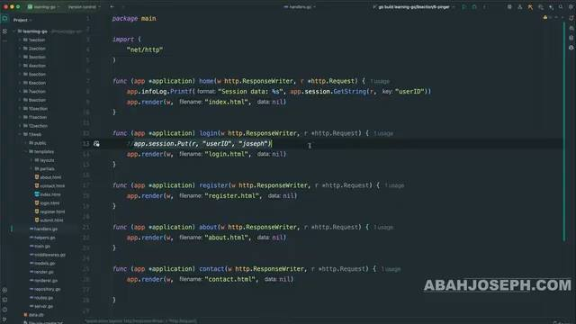
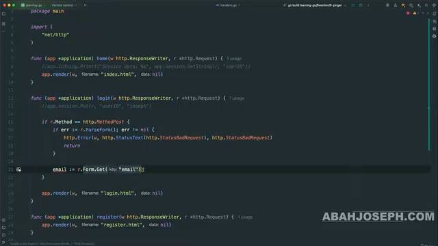
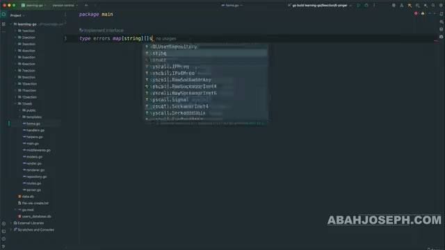
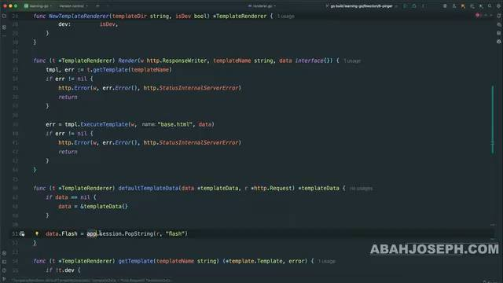
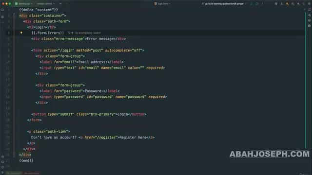
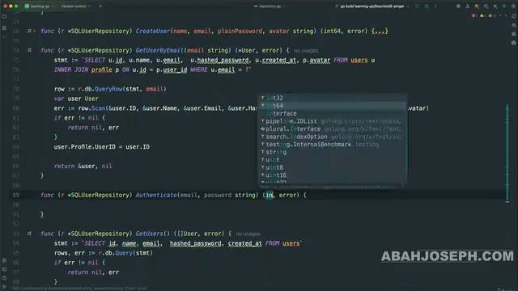
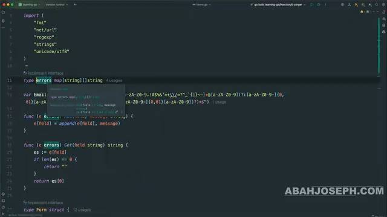
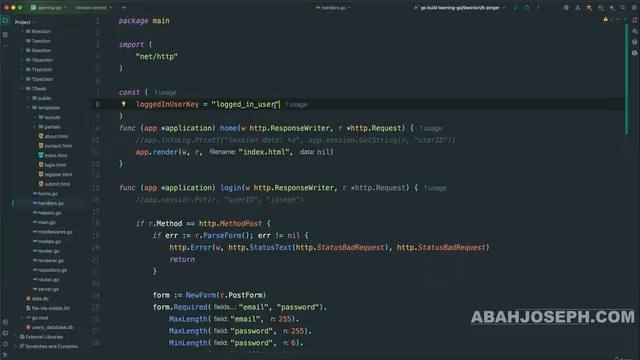
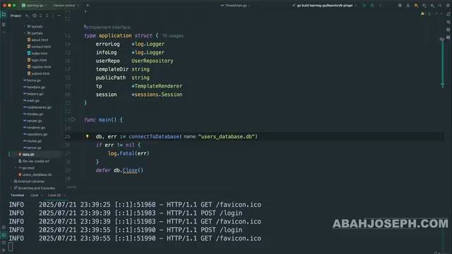

## 1 这一节做什么

这一节覆盖 P87–P92：把登录页从「只有一个 HTML 表单」推进到「能解析表单、能校验、能回填、能显示错误、能查用户、能用 bcrypt 校验密码、能写 session 并跳转」的一条完整链路。

课里的推进顺序是：

1. 先把登录表单的字段从 `username` 改成 `email`，密码字段保持 `password`，提交到 `/login`。  
2. 在 login handler 里判断 `POST`，调用 `r.ParseForm()`，再用 `r.PostForm` 读取字段。  
3. 不满足于手写 `r.FormValue("email")`，讲师写了一个很小的表单库：`FormErrors`、`Form`、`Required`、`MinLength`、`MaxLength`、`Matches`、`Valid`。  
4. 用方法链把校验串起来，例如 `form.Required("email", "password").MaxLength(...).MinLength(...).Matches(...)`。  
5. 发现校验错误只能打印到控制台，于是引入模板数据 `TemplateData`，把 `*Form` 传给模板。  
6. 在模板里用 `{{with .Form}}` 简化访问，显示通用错误、字段错误，并把用户刚提交的邮箱回填到 input 的 `value`。  
7. 在 repository 里加 `Authenticate`：按 email 查用户，用 `bcrypt.CompareHashAndPassword` 比较明文密码和数据库里的哈希；成功后把 user ID 放进 session，再重定向。  
8. 讲师在调试时发现一个关键坑：SQL 里用了 `JOIN profiles`，如果用户没有 profile 行，就会查出 `no rows`，登录看起来像“用户不存在”，但其实是 join 假设了 profile 必须存在。

这一节最终要交付的是一个可运行的最小 Go Web 项目：`/login` 可以 GET 显示表单、POST 校验并登录；校验失败会保留邮箱并显示错误；登录成功写 cookie 后跳到首页。下面的完整代码是根据逐字稿中的改动补全的可运行版本。逐字稿没有展示的脚手架，比如 `main.go`、renderer、session、SQL schema、模板文件，我做了最小实现补全；讲师明确讲过的表单库、校验链、模板数据、bcrypt 校验、join 坑，按原话保留。

从学习目标看，这一节不是单纯的“写一个登录接口”，而是把 Web 请求的生命周期串起来：浏览器发出 POST，服务端解析 `application/x-www-form-urlencoded`，把字段装进 `url.Values`，再用自定义表单库做字段级校验；校验失败时不能只打印日志，而要把错误和用户输入带回模板；校验通过后才进入数据访问层，按 email 查用户，用 bcrypt 比较密码；最后通过 session 记录登录状态，并用重定向完成 Post/Redirect/Get。每一段都可以和前端经验对照：`ParseForm` 类似 Express 里的 `express.urlencoded()` 中间件，`r.PostForm` 类似 `req.body`，`TemplateData` 类似模板渲染上下文，`http.Redirect(..., StatusSeeOther)` 类似前端提交成功后 `location.assign("/")`，但服务端要显式写状态码和 session。

这一节还没有实现完整的鉴权中间件，也没有讲注册页、退出登录、CSRF、生产级 session 存储。复现时要把范围控制住：只要登录链路能跑通、错误能显示、邮箱能回填、成功能跳转，就达到了本节的交付标准。后面的章节才继续扩展这些能力。

---

## 2 讲师原话（带「—— pNNN [MM:SS]」）

> "最重要的一步是确保始终调用 `r.ParseForm`，也就是请求对象上的 `ParseForm`。必须先调用 `ParseForm`，然后才能开始从表单对象中提取数据。"
> —— p088 [00:00]

> "`Errors` 会只是一个映射，用来存放我们希望显示的错误消息……例如电子邮件这样的单个字段也可能有多个错误……所以可以把它做成字符串切片。"
> —— p088 [00:28]

> "我们一直返回 `F` 的唯一原因，就是为了能够进行方法链式调用。"
> —— p088 [09:40]

> "我们把标准库里的 `PostForm` 传进去，并把它转换成我们的表单。所以我们实际做的是一个包装器。"
> —— p089 [00:29]

> "当我们带着表单错误进行渲染时，需要一种把错误传给模板的方式，而目前还没有这种方式。"
> —— p089 [01:49]

> "我们还需要保留消息，也就是已提交的表单数据。我们需要把它保留下来。"
> —— p089 [03:41]

> "我们需要一种保持状态的方式。"
> —— p090 [00:00]

> "我们使用 `bcrypt` 包中的 `CompareHashAndPassword`。这是一个非常简单但同样强大的函数。"
> —— p092 [01:45]

> "问题出在连接上。我们使用了连接，这意味着我们假设所有用户都应该有个人资料。"
> —— p092 [12:46]

这些原话分别对应实现里的关键决策：先解析再取值；错误容器用 `map[string][]string`；校验方法返回 `*Form` 以支持链式调用；把 `r.PostForm` 包成自己的 `Form`；把 `*Form` 放进 `TemplateData`；保留用户提交的数据用于回填；用 session 维持登录状态；用 `bcrypt.CompareHashAndPassword` 比较密码；排查登录失败时先怀疑 SQL join 的假设。复现时如果某个点实现得“看起来能跑”，但和这些原话冲突，例如用 `r.FormValue` 绕过错误处理、把错误直接 `fmt.Println`、校验方法返回 `bool` 导致不能链式调用，就应该回头对照原话修正。

---

## 3 从零复现

### 3.1 环境与目录

需要：

- Go 1.22 或更高版本。
- 能访问 Go module proxy，或者你本地已有依赖缓存。
- 不需要 Node、不需要前端构建工具。

目录结构如下，文件名必须一致：

```text
go-backend-masterclass-forms/
├── go.mod
├── main.go
├── forms.go
├── handlers.go
├── repository.go
├── renderer.go
├── session.go
└── templates/
    ├── home.html
    └── login.html
```

在项目根目录执行：

```bash
mkdir -p go-backend-masterclass-forms/templates
cd go-backend-masterclass-forms
go mod init gobackendmasterclass/forms
```

然后保存第 4 节的 `go.mod` 和所有 `.go`、`.html` 文件。

依赖版本：

```text
golang.org/x/crypto v0.24.0
modernc.org/sqlite v1.29.10
```

安装并整理依赖：

```bash
go mod tidy
```

如果你不想手写 `go.mod`，也可以先 `go mod init`，然后：

```bash
go get golang.org/x/crypto@v0.24.0
go get modernc.org/sqlite@v1.29.10
go mod tidy
```

运行：

```bash
go run .
```

默认地址：

```text
http://localhost:8080/login
```

本复现使用两个环境变量，课里没有规定这两个变量名，这里是为了让项目可配置：

```text
PORT=8080
DATABASE_PATH=users_database.db
```

不设置时分别使用默认值 `8080` 和 `users_database.db`。

命令解释与排查：`mkdir -p` 会递归创建目录，如果 `templates` 已存在不会报错；`go mod init` 的模块名是 `gobackendmasterclass/forms`，它只影响 import 路径，不要求与 GitHub 地址一致；`go mod tidy` 会扫描代码里的 import，补全 `require` 并删除未使用依赖。如果 `go mod tidy` 卡住，先检查 `GOPROXY`，可在终端执行 `go env GOPROXY` 查看；如果提示缺少 `golang.org/x/crypto`，确认第 4 节 `go.mod` 已保存并且网络能下载模块。运行时报 `listen tcp :8080: bind: address already in use`，说明 8080 被占用，可以临时用 `PORT=8081 go run .` 换端口。运行后如果 `/login` 404，检查 `main.go` 里是否注册了 `mux.HandleFunc("/login", app.login)`，以及是否真的在项目根目录执行 `go run .`。与前端项目对照，这里的 `templates/` 类似前端项目里存放页面模板的目录，`go.mod` 类似 `package.json` 加锁文件，但 Go 的依赖整理由工具自动完成。

### 3.2 第一步：改造登录表单

登录页的字段要改成邮箱和密码。讲师在 p087 中把原来的 username 改成 email，并把表单提交到登录处理逻辑。对应帧：



表单最终需要满足：

- `method="POST"`，提交到 `/login`。
- 邮箱字段 `name="email"`，类型可以用 `type="email"`。
- 密码字段 `name="password"`，类型 `type="password"`。
- 登录失败时，邮箱要回填，密码不回填。

这里最容易犯的错误是只改页面显示文字，却没有改 `name` 属性。服务端读的是 `r.PostForm.Get("email")` 和 `r.PostForm.Get("password")`，如果模板里仍写 `name="username"`，服务端拿到的 email 就是空字符串，最后表现为“明明填了邮箱，却提示 required”。另一个常见错误是把 `method` 写成默认的 GET，或者把 `action` 写成 `/login/`，前者会让密码出现在 URL query 里，后者可能匹配不到注册的路由。与前端表单对照，`name` 相当于提交对象的 key，`action` 相当于 `fetch` 的 URL，`method` 相当于请求方法；`type="email"` 只是浏览器侧提示，服务端仍然必须用 `EmailRX` 校验。

### 3.3 第二步：handler 里先 ParseForm，再读字段

p087 的关键动作是：进入 POST 分支后，第一件事不是 `FormValue`，而是解析表单。讲师强调必须先 `ParseForm`。对应帧：



在 Go 里可以写成：

```go
if err := r.ParseForm(); err != nil {
    http.Error(w, http.StatusText(http.StatusBadRequest), http.StatusBadRequest)
    return
}
email := r.PostForm.Get("email")
password := r.PostForm.Get("password")
```

这里的重点是顺序：先 `ParseForm`，再读 `r.PostForm`。`r.FormValue("email")` 内部也会帮你调用解析，但它会把 URL query 和 POST body 合并，且忽略解析错误。讲师在 p087 里两种写法都提了，最后选择更短的写法；复现版为了把「解析失败」显式处理掉，采用 `r.ParseForm()` + `r.PostForm.Get()`。

`r.PostForm` 的类型是 `url.Values`，本质是 `map[string][]string`。在 JS/Node 里，这相当于 `express.urlencoded({ extended: false })` 之后得到的 `req.body`，但 Go 需要你显式调用解析函数，不会自动挂到 request 上。

排查时先看请求头 `Content-Type`。普通 HTML 表单默认提交的是 `application/x-www-form-urlencoded`，`ParseForm` 能解析；如果表单改成 `multipart/form-data`，例如为了上传文件，就要用 `ParseMultipartForm`，否则 `r.PostForm` 里读不到字段。另一个常见现象是 `r.PostForm` 为空：可能忘了调用 `ParseForm`，也可能在调用前就读取了 `r.Body`，导致 body 已被消费。与前端对照，Express 里如果忘了挂 `urlencoded` 中间件，`req.body` 也会是空对象；Go 的错误更隐蔽，因为 `Get` 不会报错，只会返回空串。因此第 5 段解释代码时，要特别关注 `ParseForm` 的错误处理分支。

### 3.4 第三步：写一个小表单库

p088 整节都在写这个库。讲师先定义错误容器，再定义 `Form`，然后把校验方法串成链。对应帧：



这个库的设计目标只有两个：

1. 一个字段可以挂多条错误，所以错误值是 `[]string`，不是 `string`。
2. 每个校验方法都返回 `*Form`，这样就能 `.Required(...).MinLength(...).Matches(...)` 连着写。

讲师在 p088 [09:40] 说得很直接：“The only reason we keep returning the F is so that we can do method chaining.” 这句话决定了所有校验方法的返回值。

`Matches` 接收的是 `*regexp.Regexp`，不是字符串。这样做的好处是正则在启动时编译一次，后续请求复用；如果你在每次请求里 `regexp.MustCompile`，会有不必要的重复编译开销。

实现这个库时，常见错误有三种。第一，把错误类型命名成 `Errors`，与标准库 `errors` 包重名，后面在 `repository.go` 里写 `errors.Is` 时会冲突；课里后来改成了 `FormErrors`。第二，把方法接收者写成值类型 `func (f Form) Required(...)`，这样每次调用都复制一份 `Form`，错误可能加不到原对象上，链式调用也会失效。第三，`MaxLength` 和 `MinLength` 用 `len(v)` 统计字节数，遇到中文或 emoji 会误判，所以复现版用 `utf8.RuneCountInString`。与前端校验对照，`Required` 类似 `value.trim() !== ""`，`Matches` 类似 `regex.test(value)`；但前端校验只是体验优化，服务端仍要完整执行一遍。

### 3.5 第四步：把 `*Form` 塞进模板数据

p089 把表单库接到 handler 里，p090 发现错误只能打印到控制台，于是开始改 renderer。对应帧：



讲师在 p090 里做了几件事，顺序很重要：

- 新建 `TemplateData` 结构体，把 `*Form` 放进去。注意是**指针**，因为表单校验方法返回的都是 `*Form`；如果这里用值类型，`{{with .Form}}` 之后在模板里就没法调到 `Errors.Get`。
- `render` 方法的签名从「w, name, data」变成「w, r, name, *TemplateData」。r 现在没用满，但后面要做 flash、要做 authenticated 判断，都需要拿 request。
- 新增 `defaultTemplateData(r)` 方法，把「每次渲染都需要的默认数据」集中到一起，包括空表单和 flash。
- 所有旧调用点在签名改变后都要加上 `r`（p090 [08:26] 讲师原话：“The signature changed so we have to do it everywhere”）。

关于 p090 [09:00] 的报错 `can't evaluate field error in type`：原因是模板里写了 `{{.Errors.Get "generic"}}`，但这是在一个还没赋值的空接口上做的字段访问。修复办法有两种：要么模板加判空，要么 renderer 里保证 `data.Form` 至少是 `NewForm(nil)`。复现版选择了第二种，因为更不容易出错。

这里的排查重点是：模板里访问的字段必须是导出字段，Go 的 `html/template` 只能访问首字母大写的字段；如果 `TemplateData` 里写成 `form *Form`，模板会报找不到字段。另一个常见错误是 `data.Form` 为 nil 时直接 `{{.Form.Get "email"}}`，会触发模板执行错误；复现版在 `render` 里统一补了 `if data.Form == nil { data.Form = NewForm(nil) }`。与前端对照，`TemplateData` 类似 React 的 props 或模板引擎的 render context，但 Go 模板对 nil、字段导出、作用域的检查更严格，报错也往往发生在运行时而不是编译时。

### 3.6 第五步：模板里回填 email 并显示错误

p091 是真正把 `TemplateData` 用起来的一节。对应帧：



模板里有两个 Go `html/template` 特有的「坑点」需要提前说明：

1. `{{with .Form}}` 是一段作用域。进入后，`. `（点）指向 `.Form`，所以可以直接写 `.Errors.Get "email"`，不用再写 `.Form.Errors.Get "email"`。每个 `{{with}}` 都必须有 `{{end}}` 闭合，漏一个就 panic。讲师在 p091 [03:22] 特意提了这一点。
2. `value="{{.Get "email"}}"` 里出现了**嵌套双引号**。这在 Go template 里是合法的，因为 template 引号语法允许内层用双引号；但如果你把这段写在 JSX 或 React 里，就会炸。写成 `value={{.Get "email"}}`（不加外层引号）也可以，但更推荐外层单引号配内层双引号，`html/template` 都能正确处理，并且会根据上下文自动转义。

回填只对 email 做，不对 password 做。这是 p091 [04:12] 讲师的口头说明，也是安全底线：不要回显密码。

这一段的常见错误包括：`{{with .Errors.Get "generic"}}` 外层少了 `with .Form`，导致作用域不对；模板里把 `Errors` 写成小写 `errors`，Go 模板找不到方法；`{{end}}` 数量不匹配，服务启动时 `template.Must` 直接 panic；邮箱回填写成 `value="{{.Form.Get "email"}}"`，但当前已经在 `with .Form` 作用域里，应该用 `.Get`。与前端的受控表单对照，回填 email 相当于把提交失败后的 state 重新塞回 input 的 `value`；密码不回填则是安全约束，不是“漏做”。验证时可以在浏览器开发者工具里查看提交失败后的 HTML，确认 email input 有 `value`，password input 没有 `value`。

### 3.7 第六步：repository 加 `Authenticate`

p092 的第一个动作是修正 `CreateUser` 里参数名 `hashPassword` 的问题——因为进函数的时候密码还是明文，叫 hashed 是不对的。然后才加 `Authenticate`。对应帧：



`Authenticate` 的签名是 `(email, password string) (int, error)`，失败时返回 `0, err`，成功时返回 `userID, nil`。用 `bcrypt.CompareHashAndPassword` 比较数据库里的哈希和明文密码：这个函数把明文密码用相同的 cost、相同的 salt 重新哈希一遍再比，所以哈希不用解，也不能解。

一个细节：讲师在 p092 [02:43] 定义了一个 `ErrInvalidCredentials` 变量，随后发现它和自己写的 `Errors` 类型重名，直接把类型改成了 `FormErrors`。这一处改名会波及 forms.go、handlers.go、模板里的 `.Errors` 字段名，但 `.Errors` 字段名**不用改**——Go 允许字段名和导入包名相同，冲突只发生在同一个包里把所有类型和包名都叫 `errors` 的情况。

实现 `Authenticate` 时，容易把 `CompareHashAndPassword` 的参数顺序写反。它的签名是 `CompareHashAndPassword(hashedPassword, password []byte)`，第一个参数必须是数据库里的哈希，第二个才是用户提交的明文。写反后即使密码正确也会返回 `bcrypt: hashedPassword is not the hash of the given password`。另一个常见错误是把 `sql.ErrNoRows` 当成普通错误直接返回 500，导致“用户不存在”时页面显示“服务器错误”，而不是统一的“Email or password is incorrect”。与前端对照，这里的 repository 类似前端项目里的 API service 层，handler 不应该知道 SQL 细节，只拿到 `userID` 或 `ErrInvalidCredentials`。

### 3.8 第七步：handler 里调 Authenticate、写 session、跳转

登录成功后的动作顺序是：

1. `app.session.Put(w, r, sessionKeyUserID, strconv.Itoa(userID))` 写 session。
2. 写一条 flash message。
3. `http.Redirect(w, r, "/", http.StatusSeeOther)`。

这里用 `303 See Other`（而不是 302）是更语义化的做法：告诉浏览器「原来的 POST 已经处理完，请改用 GET 去 `/`」。这样刷新首页不会重复提交 POST，也就是常见的 Post/Redirect/Get 模式。课里讲师说的是“redirect to the home page”，没有精确指定状态码；`http.Redirect(w, r, "/", http.StatusSeeOther)` 需要显式给出状态码。

排查登录成功但没有跳转时，先看 `Authenticate` 是否返回了 nil error；再看是否在 `Redirect` 之后忘记 `return`，导致又执行了后面的渲染逻辑；还要看浏览器是否真的收到了 `Set-Cookie: session_id=...`。如果首页没有 flash，检查 `session.Put` 使用的 key 是否和 `GetString` 读取的 key 一致，以及 cookie 是否因为 `Path`、`SameSite` 或浏览器策略没有带回。与前端对照，303 类似提交表单成功后 `router.push("/")`，但服务端必须写完整响应头和状态码，不能只 return 一个对象。

### 3.9 第八步：讲师踩到的 JOIN 坑

这一节最有价值的十分钟，其实是 p092 后半段——登录一直失败、`no rows in result set`。讲师先怀疑是数据库连接串选错库（p092 [09:54]），又逐行查 `SELECT * FROM users` 确认数据确实存在（p092 [10:21]），一切看起来都正常。然后才想起来开 debugger。对应帧：



断点打在 `Authenticate` 里，再打进 `getUserByEmail`，走到 `Scan` 那一行报 `no rows`。接着讲师在 debug console 里跑了一遍 SQL，发现：

> 建表用的 `GetUserByEmail` 里带了 `JOIN profiles ON profiles.user_id = users.id`，而并非所有 user 都有 profile 行，于是 `JOIN` 把没有 profile 的用户整条过滤掉了。

讲师的原话（p092 [12:46]）：“The problem is in the join. We’re using the join. That means we are assuming that all the users should have profiles.”（p092 [12:46]）还有一张截图能佐证这段排查的位置：



修复思路有三条，任选其一：

1. `INNER JOIN` 改成 `LEFT JOIN`——保底方案，profile 不存在时 profile 列是 NULL。
2. 把查用户和查 profile 拆成两条 SQL——更清晰，本复现采用这条。
3. 在建用户时保证同时建一行 profile（也就是「不变量」思路）——代价是注册逻辑变复杂。

本复现的 `repository.go` 用的是第 2 条，登录只查 users 表。

这个坑的排查顺序值得记住：先用 SQL 客户端或 `sqlite3` 确认 users 表里确实有目标 email；再用同一条 SQL 在数据库里手动执行，看是否返回行；如果 `SELECT * FROM users WHERE email = ?` 有行而业务查询没有，就重点检查 join、where 条件、软删除标记、事务隔离等。与前端对照，这类似接口返回 404，但真正原因不是资源不存在，而是查询里把关联表当成了必填关系。复现版故意不 join，是为了让登录只依赖 users 表；以后要展示 profile 时，再单独查询或使用 LEFT JOIN。

---

## 4 完整代码

以下所有文件按第 3.1 节目的录结构放好，可以直接 `go run .`。全部代码都是**完整文件**，不是片段。

### 4.1 `go.mod`

```text
module gobackendmasterclass/forms

go 1.22

require (
	golang.org/x/crypto v0.24.0
	modernc.org/sqlite v1.29.10
)
```

### 4.2 `forms.go`

表单库本体。

```go
package main

import (
	"fmt"
	"net/url"
	"regexp"
	"strings"
	"unicode/utf8"
)

// FormErrors 是「字段名 -> 该字段的所有错误消息」。
// 注意：不能把这类型命名成 Errors，否则和标准库 errors 撞名。
type FormErrors map[string][]string

// Add 给某个字段追加一条错误消息。
func (e FormErrors) Add(field string, message string) {
	e[field] = append(e[field], message)
}

// Get 取某个字段的第一条错误消息，没有就返回空串。
func (e FormErrors) Get(field string) string {
	msgs := e[field]
	if len(msgs) == 0 {
		return ""
	}
	return msgs[0]
}

// Form 把标准库的 url.Values 内嵌进来，额外挂一个 Errors。
type Form struct {
	url.Values
	Errors FormErrors
}

// NewForm 把一个已有的 url.Values 包成 *Form；传 nil 用于渲染空表单。
func NewForm(data url.Values) *Form {
	if data == nil {
		data = url.Values{}
	}
	return &Form{
		Values: data,
		Errors: FormErrors{},
	}
}

// Required 逐个字段检查非空（去掉首尾空白后）。
func (f *Form) Required(fields ...string) *Form {
	for _, field := range fields {
		if strings.TrimSpace(f.Get(field)) == "" {
			f.Errors.Add(field, "This field is required")
		}
	}
	return f
}

// MaxLength 字段值超过 n 个字符报错。用 RuneCountInString 而不是 len()。
func (f *Form) MaxLength(field string, n int) *Form {
	v := f.Get(field)
	if v == "" {
		return f
	}
	if utf8.RuneCountInString(v) > n {
		f.Errors.Add(field, fmt.Sprintf("This field is too long, maximum of %d characters", n))
	}
	return f
}

// MinLength 字段值少于 n 个字符报错。
func (f *Form) MinLength(field string, n int) *Form {
	v := f.Get(field)
	if v == "" {
		return f
	}
	if utf8.RuneCountInString(v) < n {
		f.Errors.Add(field, fmt.Sprintf("This field is too short, minimum of %d characters", n))
	}
	return f
}

// Matches 用正则校验字段值。
func (f *Form) Matches(field string, pattern *regexp.Regexp) *Form {
	v := f.Get(field)
	if v == "" {
		return f
	}
	if !pattern.MatchString(v) {
		f.Errors.Add(field, "This field is invalid")
	}
	return f
}

// Valid 只要没有任何字段有任何错误，就认为通过。
func (f *Form) Valid() bool {
	return len(f.Errors) == 0
}

// EmailRX 是邮件验证正则。讲师在课里贴的是一份更完整的 HTML5 邮件正则，
// 这里用简化版，能过基本用例；需要更严格请换回 HTML5 版。
var EmailRX = regexp.MustCompile(`^[^\s@]+@[^\s@]+\.[^\s@]+$`)
```

### 4.3 `session.go`

最小可用 session：服务端内存 Map + 一个随机 sid cookie。课里没讲生产环境的 session 后端，这里是为了让项目跑起来。

```go
package main

import (
	"crypto/rand"
	"encoding/base64"
	"net/http"
	"sync"
)

type Session struct {
	mu   sync.Mutex
	data map[string]map[string]string
}

func NewSession() *Session {
	return &Session{data: make(map[string]map[string]string)}
}

// sessionID 读现有 cookie；没有就生成一个新的写回去。
func (s *Session) sessionID(w http.ResponseWriter, r *http.Request) string {
	if c, err := r.Cookie("session_id"); err == nil && c.Value != "" {
		return c.Value
	}
	b := make([]byte, 16)
	if _, err := rand.Read(b); err != nil {
		return ""
	}
	id := base64.RawURLEncoding.EncodeToString(b)
	http.SetCookie(w, &http.Cookie{
		Name:     "session_id",
		Value:    id,
		Path:     "/",
		HttpOnly: true,
		SameSite: http.SameSiteLaxMode,
	})
	return id
}

func (s *Session) Put(w http.ResponseWriter, r *http.Request, key, value string) {
	id := s.sessionID(w, r)
	if id == "" {
		return
	}
	s.mu.Lock()
	defer s.mu.Unlock()
	if s.data[id] == nil {
		s.data[id] = map[string]string{}
	}
	s.data[id][key] = value
}

func (s *Session) GetString(r *http.Request, key string) string {
	c, err := r.Cookie("session_id")
	if err != nil || c.Value == "" {
		return ""
	}
	s.mu.Lock()
	defer s.mu.Unlock()
	return s.data[c.Value][key]
}

func (s *Session) Remove(w http.ResponseWriter, r *http.Request, key string) {
	c, err := r.Cookie("session_id")
	if err != nil || c.Value == "" {
		return
	}
	s.mu.Lock()
	defer s.mu.Unlock()
	delete(s.data[c.Value], key)
}
```

### 4.4 `repository.go`

数据访问层。这里刻意**不用** JOIN。

```go
package main

import (
	"database/sql"
	"errors"

	"golang.org/x/crypto/bcrypt"
)

// ErrInvalidCredentials 表示邮箱不存在或密码错误。故意不区分两者，避免泄露账号是否存在。
var ErrInvalidCredentials = errors.New("invalid credentials")

type UserRepository interface {
	CreateUser(email, password string) (int, error)
	Authenticate(email, password string) (int, error)
}

type SQLUserRepository struct {
	db *sql.DB
}

func NewSQLUserRepository(db *sql.DB) *SQLUserRepository {
	return &SQLUserRepository{db: db}
}

// CreateUser 入参是明文密码；函数内部才会 bcrypt 生成哈希入库。
// 讲师在 p092 开篇特别提过参数名不能叫 hashPassword，因为进函数时还是明文。
func (r *SQLUserRepository) CreateUser(email, password string) (int, error) {
	hash, err := bcrypt.GenerateFromPassword([]byte(password), bcrypt.DefaultCost)
	if err != nil {
		return 0, err
	}
	res, err := r.db.Exec(
		`INSERT INTO users (email, hashed_password) VALUES (?, ?)`,
		email, string(hash),
	)
	if err != nil {
		return 0, err
	}
	id, err := res.LastInsertId()
	if err != nil {
		return 0, err
	}
	return int(id), nil
}

// Authenticate 只查 users 表：不做 JOIN，避免「没有 profile 就登录不了」。
// 失败时返回 0 和 ErrInvalidCredentials。
func (r *SQLUserRepository) Authenticate(email, password string) (int, error) {
	var id int
	var hashed string
	err := r.db.QueryRow(
		`SELECT id, hashed_password FROM users WHERE email = ?`,
		email,
	).Scan(&id, &hashed)
	if err != nil {
		if errors.Is(err, sql.ErrNoRows) {
			return 0, ErrInvalidCredentials
		}
		return 0, err
	}
	if err := bcrypt.CompareHashAndPassword([]byte(hashed), []byte(password)); err != nil {
		return 0, ErrInvalidCredentials
	}
	return id, nil
}
```

### 4.5 `renderer.go`

模板存储 + `TemplateData`。

```go
package main

import (
	"fmt"
	"html/template"
	"log"
	"net/http"
	"path/filepath"
)

// TemplateData 是渲染模板时唯一的上下文数据结构。
// 以后要加 Authenticated、Flash 之类的，都在这里扩。
type TemplateData struct {
	Form  *Form
	Flash string
}

type Renderer struct {
	templates map[string]*template.Template
	errorLog  *log.Logger
}

func NewRenderer(errorLog *log.Logger) *Renderer {
	r := &Renderer{
		templates: make(map[string]*template.Template),
		errorLog:  errorLog,
	}
	r.templates["home.html"] = template.Must(
		template.ParseFiles(filepath.Join("templates", "home.html")),
	)
	r.templates["login.html"] = template.Must(
		template.ParseFiles(filepath.Join("templates", "login.html")),
	)
	return r
}

func (r *Renderer) Render(w http.ResponseWriter, name string, data *TemplateData) error {
	t, ok := r.templates[name]
	if !ok {
		return fmt.Errorf("template %q not registered", name)
	}
	w.Header().Set("Content-Type", "text/html; charset=utf-8")
	return t.Execute(w, data)
}
```

### 4.6 `handlers.go`

HTTP 处理器。

```go
package main

import (
	"errors"
	"net/http"
	"strconv"
)

const (
	sessionKeyUserID = "userID"
	sessionKeyFlash  = "flash"
)

func (app *Application) home(w http.ResponseWriter, r *http.Request) {
	app.render(w, r, "home.html", nil)
}

func (app *Application) login(w http.ResponseWriter, r *http.Request) {
	switch r.Method {
	case http.MethodGet:
		app.render(w, r, "login.html", &TemplateData{
			Form: NewForm(nil),
		})
		return

	case http.MethodPost:
		if err := r.ParseForm(); err != nil {
			http.Error(w, http.StatusText(http.StatusBadRequest), http.StatusBadRequest)
			return
		}

		form := NewForm(r.PostForm)
		form.Required("email", "password").
			MaxLength("email", 255).
			MaxLength("password", 255).
			MinLength("email", 3).
			MinLength("password", 6).
			Matches("email", EmailRX)

		if !form.Valid() {
			form.Errors.Add("generic", "The data you submitted was not valid")
			app.render(w, r, "login.html", &TemplateData{Form: form})
			return
		}

		email := form.Get("email")
		password := form.Get("password")

		userID, err := app.repository.Authenticate(email, password)
		if err != nil {
			if errors.Is(err, ErrInvalidCredentials) {
				form.Errors.Add("generic", "Email or password is incorrect")
			} else {
				app.errorLog.Println(err)
				form.Errors.Add("generic", "Something went wrong, please try again")
			}
			app.render(w, r, "login.html", &TemplateData{Form: form})
			return
		}

		app.session.Put(w, r, sessionKeyUserID, strconv.Itoa(userID))
		app.session.Put(w, r, sessionKeyFlash, "Logged in with "+email)
		http.Redirect(w, r, "/", http.StatusSeeOther)
		return

	default:
		http.Error(w, http.StatusText(http.StatusMethodNotAllowed), http.StatusMethodNotAllowed)
	}
}
```

### 4.7 `main.go`

组装所有组件。

```go
package main

import (
	"database/sql"
	"log"
	"net/http"
	"os"

	_ "modernc.org/sqlite"
)

type Application struct {
	errorLog   *log.Logger
	session    *Session
	repository UserRepository
	renderer   *Renderer
}

func main() {
	port := os.Getenv("PORT")
	if port == "" {
		port = "8080"
	}
	dbPath := os.Getenv("DATABASE_PATH")
	if dbPath == "" {
		dbPath = "users_database.db"
	}

	db, err := sql.Open("sqlite", dbPath)
	if err != nil {
		log.Fatal(err)
	}
	defer db.Close()
	if err := initSchema(db); err != nil {
		log.Fatal(err)
	}

	errorLog := log.New(os.Stderr, "ERROR\t", log.Ldate|log.Ltime|log.Lshortfile)
	app := &Application{
		errorLog:   errorLog,
		session:    NewSession(),
		repository: NewSQLUserRepository(db),
		renderer:   NewRenderer(errorLog),
	}

	mux := http.NewServeMux()
	mux.HandleFunc("/", app.home)
	mux.HandleFunc("/login", app.login)

	log.Printf("listening on http://localhost:%s", port)
	if err := http.ListenAndServe(":"+port, mux); err != nil {
		log.Fatal(err)
	}
}

func initSchema(db *sql.DB) error {
	_, err := db.Exec(`CREATE TABLE IF NOT EXISTS users (
		id INTEGER PRIMARY KEY AUTOINCREMENT,
		email TEXT NOT NULL UNIQUE,
		hashed_password TEXT NOT NULL
	)`)
	return err
}

// defaultTemplateData 把所有「每次渲染都需要有」的默认数据集中到一处。
// 课里这段最初写在 renderer 里，讲师后来在 p090 把它移到了 Application 上。
func (app *Application) defaultTemplateData(r *http.Request) *TemplateData {
	data := &TemplateData{
		Form: NewForm(nil),
	}
	if flash := app.session.GetString(r, sessionKeyFlash); flash != "" {
		data.Flash = flash
		app.session.Remove(nil, r, sessionKeyFlash)
	}
	return data
}

// render 是所有 handler 的统一渲染入口：先 merge 默认数据，再交给 renderer 执行。
func (app *Application) render(w http.ResponseWriter, r *http.Request, name string, data *TemplateData) {
	if data == nil {
		data = app.defaultTemplateData(r)
	} else {
		if data.Form == nil {
			data.Form = NewForm(nil)
		}
		if data.Flash == "" {
			data.Flash = app.defaultTemplateData(r).Flash
		}
	}
	if err := app.renderer.Render(w, name, data); err != nil {
		app.errorLog.Println(err)
		http.Error(w, http.StatusText(http.StatusInternalServerError), http.StatusInternalServerError)
	}
}
```

### 4.8 `templates/login.html`

```html
<!doctype html>
<html lang="en">
<head>
  <meta charset="utf-8">
  <title>Login</title>
</head>
<body>
  <h1>Login</h1>

  {{with .Form}}
    {{with .Errors.Get "generic"}}
      <p class="error">{{.}}</p>
    {{end}}

    <form method="POST" action="/login">
      <div>
        <label for="email">Email address</label>
        <input type="email" id="email" name="email" value='{{.Get "email"}}'>
        {{with .Errors.Get "email"}}
          <span class="error">{{.}}</span>
        {{end}}
      </div>

      <div>
        <label for="password">Password</label>
        <input type="password" id="password" name="password">
        {{with .Errors.Get "password"}}
          <span class="error">{{.}}</span>
        {{end}}
      </div>

      <button type="submit">Login</button>
    </form>
  {{end}}
</body>
</html>
```

### 4.9 `templates/home.html`

```html
<!doctype html>
<html lang="en">
<head>
  <meta charset="utf-8">
  <title>Home</title>
</head>
<body>
  <h1>Home</h1>
  {{if .Flash}}
    <p class="flash">{{.Flash}}</p>
  {{end}}
  <p>这一节只做到「登录成功并跳转」，还没加鉴权中间件。</p>
</body>
</html>
```

### 4.10 手动造一条测试数据

第一次跑之前 users 表是空的，可以临时写一个 seed 程序，或者在项目根目录跑：

```bash
cat > seed_test.go <<'EOF'
package main

import (
	"database/sql"
	"log"
	"testing"

	_ "modernc.org/sqlite"
)

func TestSeed(t *testing.T) {
	db, err := sql.Open("sqlite", "users_database.db")
	if err != nil { t.Fatal(err) }
	defer db.Close()
	if err := initSchema(db); err != nil { t.Fatal(err) }
	repo := NewSQLUserRepository(db)
	id, err := repo.CreateUser("demo@localhost.com", "secret123")
	if err != nil { t.Fatal(err) }
	log.Println("seeded user id =", id)
}
EOF
go test -run TestSeed -v
rm seed_test.go
```

跑完后 `users_database.db` 里就有一条 `demo@localhost.com / secret123`。

### 4.11 运行

```bash
go mod tidy
go run .
```

浏览器打开 `http://localhost:8080/login`，尝试：

- 直接点 Login → 三条错误（email/password 都必填 + generic）。
- 输入 `test` / `123` → 邮件格式错误 + password 太短。
- 输入 `demo@localhost.com` / `secret123` → 跳转 `/`，看到 flash 消息。

### 4.12 验证结果一览



---

## 5 逐行解释

**`forms.go`：把表单值、错误和校验链装在一起。** `FormErrors` 的底层类型是 `map[string][]string`，因此 `Add` 会 append 到同一个 key 的切片里，`Get` 只取第一条。这里不取全部错误，是因为模板里每个字段目前只显示第一条；如果要显示多条，模板里可以遍历切片。`Form` 内嵌 `url.Values`，所以 `f.Get("email")` 实际调用的是 `url.Values.Get`，它返回第一个值，没有就返回空串。`NewForm(nil)` 把 `data` 替换成空 map，避免后续 `f.Get` 对 nil map 取值时虽然不 panic 但语义不清晰；同时初始化 `Errors`，避免模板访问 nil map。`Required` 用 `strings.TrimSpace` 后判断，防止用户只输入空格绕过必填。`MaxLength`、`MinLength` 在值为空时直接返回，是为了让“必填错误”单独显示，不额外叠加“太短”错误。`Matches` 同样跳过空值，避免空字符串触发格式错误。`Valid` 判断 `len(f.Errors) == 0`，因此只要任何一个字段有任何错误，整个表单就不通过。`EmailRX` 在包初始化时编译一次，所有请求复用。

**`session.go`：用一个随机 cookie 找到服务端内存里的 session。** `sessionID` 先读 `session_id` cookie；没有就生成 16 字节随机数，用 `base64.RawURLEncoding` 编码，写回 `HttpOnly`、`SameSite=Lax` 的 cookie。`Put` 先拿 session ID，再加锁写 `data[id][key]`；`GetString` 读 cookie 后加锁读；`Remove` 删除指定 key。这里的 `sync.Mutex` 是因为 Go 的 HTTP 处理器默认并发执行，内存 map 并发读写会 panic。与前端对照，cookie 类似浏览器自动携带的凭证，内存 map 类似一个简化版的 session store；生产环境要换成数据库或 Redis，否则进程重启 session 会丢失。

**`repository.go`：只做数据访问，不把 HTTP 细节混进来。** `ErrInvalidCredentials` 用 `errors.New` 定义，handler 用 `errors.Is` 判断。`CreateUser` 先 `bcrypt.GenerateFromPassword` 生成哈希，再 `INSERT`，最后 `LastInsertId` 返回用户 ID。参数名用 `password` 而不是 `hashPassword`，因为函数入参还是明文。`Authenticate` 的 SQL 只查 `users` 表：`SELECT id, hashed_password FROM users WHERE email = ?`，`QueryRow(...).Scan(&id, &hashed)`。如果 `Scan` 返回 `sql.ErrNoRows`，转换成 `ErrInvalidCredentials`；其他数据库错误原样返回，由 handler 记录日志并显示通用错误。密码比较用 `bcrypt.CompareHashAndPassword([]byte(hashed), []byte(password))`，第一个参数是数据库哈希，第二个是明文密码。

**`renderer.go`：把模板加载和执行集中起来。** `TemplateData` 目前只有 `Form` 和 `Flash`，以后可以加 `Authenticated`。`NewRenderer` 用 `template.ParseFiles` 读取 `templates/home.html` 和 `templates/login.html`，用 `template.Must` 让模板语法错误在启动时直接 panic，而不是等到请求时才报错。`Render` 先检查模板名是否注册，再设置 `Content-Type`，最后 `Execute`。如果模板执行失败，错误返回给上层，由 `Application.render` 记录日志并返回 500。

**`handlers.go`：GET 显示表单，POST 校验并登录。** `home` 直接渲染首页。`login` 用 `switch r.Method` 区分 GET 和 POST。GET 时传 `&TemplateData{Form: NewForm(nil)}`，保证模板里的 `.Form` 不为 nil。POST 时先 `r.ParseForm()`，解析失败返回 400；然后 `NewForm(r.PostForm)` 包一层，接着用方法链执行 `Required`、`MaxLength`、`MinLength`、`Matches`。`!form.Valid()` 时加一条 `generic` 错误并重新渲染登录页，`form` 里保留了用户提交的 email 和 password，但模板只回填 email。校验通过后从 form 取 email/password，调用 `app.repository.Authenticate`。如果错误是 `ErrInvalidCredentials`，加通用错误；否则记录日志并加“Something went wrong”。成功后 `session.Put` 写 userID 和 flash，再用 `http.Redirect(w, r, "/", http.StatusSeeOther)` 跳转。默认方法返回 405。

**`main.go`：组装依赖并启动服务器。** 先读 `PORT` 和 `DATABASE_PATH` 环境变量，给默认值。`sql.Open("sqlite", dbPath)` 打开 SQLite，`initSchema` 创建 users 表。`Application` 持有 logger、session、repository、renderer。`mux` 注册 `/` 和 `/login`。`defaultTemplateData` 创建空表单并读取 flash，读取后 `Remove`，保证 flash 只显示一次。`render` 统一补 nil Form 和 flash，再调用 renderer。`ListenAndServe` 启动 HTTP 服务。

**模板：用 `with` 缩小作用域并只回填 email。** `login.html` 外层 `{{with .Form}}` 后，点指向 `*Form`，所以可以直接 `.Get "email"`、`.Errors.Get "email"`。通用错误放在表单上方。email input 的 `value` 用单引号包住模板表达式，避免嵌套双引号阅读困难；password input 没有 `value`，保证不回显密码。`home.html` 用 `{{if .Flash}}` 显示登录成功消息。

---

## 6 复现检查清单

1. **目录和文件齐全。** 验证：在项目根目录执行 `ls`，应看到 `go.mod`、`main.go`、`forms.go`、`handlers.go`、`repository.go`、`renderer.go`、`session.go`、`templates/home.html`、`templates/login.html`。
2. **依赖能整理。** 验证：执行 `go mod tidy`，没有报错；`go.mod` 中出现 `golang.org/x/crypto` 和 `modernc.org/sqlite`。
3. **项目能启动。** 验证：执行 `go run .`，终端输出 `listening on http://localhost:8080`；浏览器访问 `/login` 返回 200。
4. **GET 表单字段正确。** 验证：查看页面源码，表单是 `method="POST" action="/login"`，email input 有 `name="email"`，password input 有 `name="password"`。
5. **空提交显示 required 和 generic。** 验证：不填任何字段点 Login，页面应出现 email/password 的 required 错误，以及 `The data you submitted was not valid`。
6. **格式错误能显示。** 验证：email 填 `test`、password 填 `123`，页面应显示 email invalid、password too short。
7. **校验失败保留 email、不回填 password。** 验证：提交失败后查看源码，email input 的 `value` 是刚才输入的值，password input 没有 `value`。
8. **不存在用户显示统一错误。** 验证：输入合法格式但数据库不存在的 email 和密码，页面显示 `Email or password is incorrect`，不泄露“用户不存在”。
9. **seed 用户能登录。** 验证：按 4.10 造 `demo@localhost.com / secret123`，提交后浏览器跳转 `/`，Network 里 POST `/login` 返回 303。
10. **session cookie 已写入。** 验证：登录响应头有 `Set-Cookie: session_id=...`，浏览器 Application/Storage 里能看到该 cookie，且为 HttpOnly。
11. **首页显示 flash。** 验证：登录成功跳到 `/` 后，页面出现 `Logged in with demo@localhost.com`。
12. **没有 profile 的用户也能登录。** 验证：数据库 users 表有用户、profiles 表没有对应行，登录仍成功；因为 `Authenticate` 没有 JOIN。
13. **错误 SQL 不会误报用户不存在。** 验证：临时把 SQL 改成带 INNER JOIN 的查询，用无 profile 用户登录，会看到 `no rows`；改回复现版 SQL 后恢复。
14. **模板语法错误能在启动时暴露。** 验证：临时删掉 login.html 一个 `{{end}}`，执行 `go run .` 应在启动时 panic；恢复后正常。
15. **端口冲突可排查。** 验证：已有服务占用 8080 时启动会报 `address already in use`，用 `PORT=8081 go run .` 可换端口。

---

## 7 课里没讲但你会撞上的（表格：现象 / 原因 / 怎么办）

| 现象 | 原因 | 怎么办 |
|---|---|---|
| 登录一直失败，数据库查日志是 `no rows in result set` | 查询里用了 `JOIN profiles`，没有 profile 的用户被过滤掉 | 改成 `LEFT JOIN`，或把查用户和查 profile 拆成两条 SQL，或保证每个用户都有 profile |
| `r.PostForm` 读出来全是空字符串 | 没有先调用 `r.ParseForm()`，或表单 `Content-Type` 不是 `application/x-www-form-urlencoded` | POST 分支先 `ParseForm` 并处理错误；确认表单没有误用 `multipart/form-data` |
| 页面提示 `can't evaluate field error in type` | 模板访问了 nil 的 `Form`，或访问了未导出字段 | renderer 里保证 `data.Form` 至少是 `NewForm(nil)`；检查 `TemplateData` 字段首字母大写 |
| 启动时报 `template: login.html: unexpected EOF` | `{{with}}` 或 `{{if}}` 少写 `{{end}}` | 成对检查 `with/if/range` 与 `end`，删掉一个 `end` 做反向验证 |
| 编译报 `errors redeclared` 或包名冲突