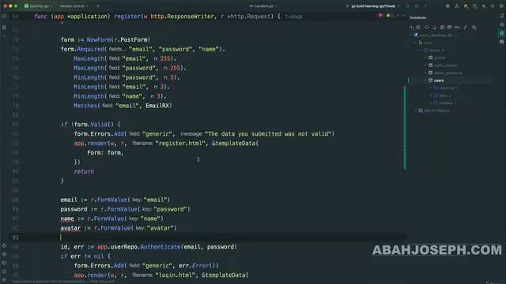
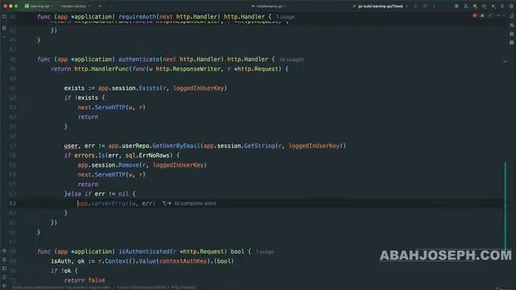
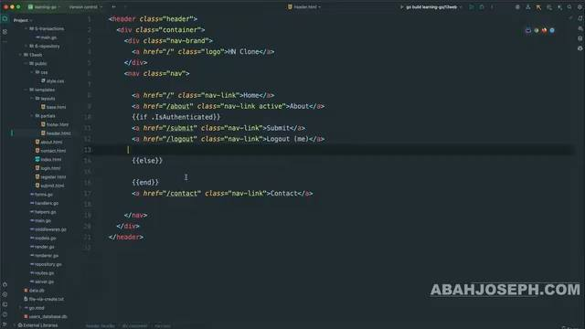
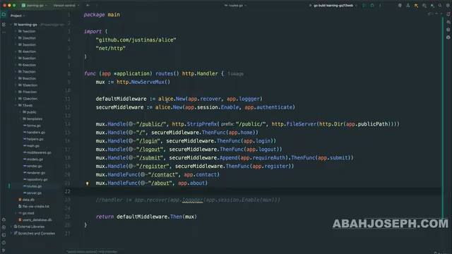
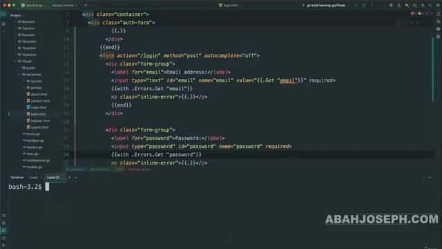
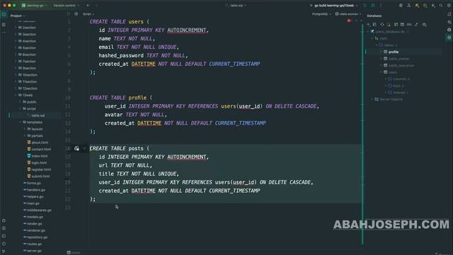
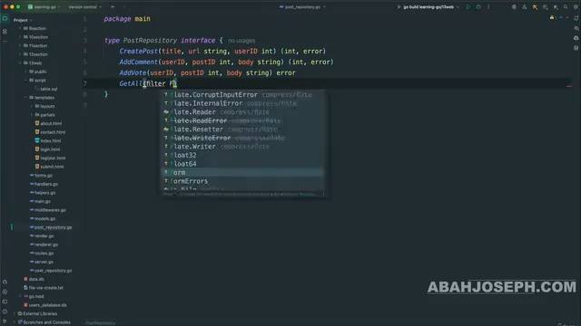
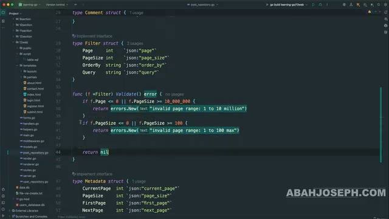

# Go Backend Masterclass P093–P100 复现文档：注册、登录态、Flash 消息与帖子数据层

> 适用读者：前端转 AI 应用工程师。本段课程是纯 Go 后端，涉及 session、中间件、SQL 建表、repository 接口设计。遇到并发/事务概念时我会补一句「在 JS/Node 里对应什么」。
>
> 说明：本段课程讲师在 IDE 里直接改文件，逐字稿里没有完整贴出所有文件内容。下面凡是「完整代码」块，都是**根据逐字稿描述 + 讲师在屏幕上展示的片段**还原的可运行版本；凡逐字稿没讲到的细节，我会在代码注释或第 7 节明确标注「课里没讲，按此写法补全」。字段名、方法名严格沿用逐字稿里出现过的拼写（包括讲师的笔误，如 `theta` 实为 `filter`）。

---

## 1. 这一节做什么

P093–P100 这 8 集，是把一个「能登录但注册不了、登录后看不出自己登录了」的半成品，补成一个**注册 → 登录 → 看到登录态 → 退出**闭环，然后开始为「发帖 / 评论 / 投票」建数据层。具体交付物：

1. **注册功能**（P093）：复用登录表单，加 `name`、`avatar` 字段，调用 `CreateAccount` 写库，成功后重定向到登录页。
2. **认证中间件**（P094）：新增 `Authenticate` 中间件，从 session 取 email → 查库 → 把 user 塞进 request context；同时把登录时写进 session 的 key 从 user ID 改成 email。
3. **Flash 消息修复**（P095）：flash 不显示的真因是 handler 里 POST 分支处理完**没有 `return`**，导致后续代码又把 flash 从 session 里 pop 掉了。补 `return` 后 flash 正常。
4. **导航栏按登录态切换**（P095）：`header.html` 用 `if .IsAuthenticated` 切换「登录/注册」与「Submit/Logout」；`render` 里补上 `data.IsAuthenticated` 赋值；已登录访问 `/login`、`/register` 时重定向回首页；新增 `Logout` handler。
5. **代码走查**（P096）：讲师带做一次 code review，指出硬编码 secret key、硬编码端口 8080 是待改进项；顺手修了 about/contact 页因缺 session 中间件而报错的问题。
6. **字段级错误提示**（P097）：模板里用 `errors.Get "field"` 渲染每个字段的行内错误；`forms.go` 的错误消息改成带字段名的 `Sprintf`；新增 `Email` 校验方法。
7. **建表 SQL**（P098）：`posts`、`comments`、`votes` 三张表，votes 用复合主键防重复投票。
8. **Post repository 接口与类型**（P099）：定义 `PostRepository` 接口、`Post`/`Comment`/`Filter`/`Metadata` 结构体。
9. **Filter 校验与分页计算**（P100）：`Filter.Validate()` 防越界页码；`calculateMetadata()` 算 first/last/next/previous page。

复现时建议把每一集当成一个可独立验收的小步：先让注册写入成功，再让中间件能识别登录态，再修 flash 的一次性消费问题，最后才进入数据层。前端对照上，本段大致对应「注册表单复用登录表单、根据全局登录状态切换导航、一次性 toast 消息、字段级表单错误、分页列表接口」这些常见能力。Go 这边用中间件和 context 表达登录态，等价于 Node/Express 里在请求对象上挂 `req.user`；flash 等价于「读取一次就删除」的 toast 缓存；字段错误等价于前端表单库里的 field errors 结构。复现检查时不要只看页面能不能打开，而要逐项确认「写入数据库没有、session 里存了什么、中间件有没有跑、模板数据有没有传」。

---

## 2. 讲师原话（带出处）

> "在这个视频里，我们要解决这个问题，因为我们要让注册功能成为可能。"
> —— p093 [00:00]

> "我们需要用这个键在中间件里做一点处理……如果会话里存在这个键，那我们就确定有情况发生；如果不存在，就知道用户还没有登录。"
> —— p094 [00:29]

> "不能随便在会话里设置一个随机 ID……也许我们应该把它从整数改成邮箱。"
> —— p094 [01:48]

> "我们一直没有返回。因为没有返回，流程实际上走到了这一层……日志记录又被调用了，结果在我们来得及说出消息之前就把它从缓存里移除了。所以这里需要返回。"
> —— p095 [01:20]

> "登录后我不想看到登录和注册，只想看到退出登录，反过来也一样。"
> —— p095 [02:20]

> "代码里放这个密钥是非常糟糕的做法。我们绝不应该有这样的密钥。像这样的秘密密钥不能放在代码里。"
> —— p096 [01:32]

> "这里硬编码的 8080 端口不是个好主意。"
> —— p096 [02:26]

> "我们只显示了通用消息，而我们有很好的校验，理想情况下应该把错误显示到每个字段上。"
> —— p097 [00:00]

> "我想做一个使用 ID 和帖子 ID 的复合键……这样，如果你已经给某个帖子投过票，就不能再投一次。"
> —— p098 [05:08]

> "如果页码是零，或者有人输入 10,000 之类想搞乱范围，我们要防止这种情况。"
> —— p100 [00:00]

> "Go 的设计者非常看重可读性……我把它放到这段代码上之后，看起来就很不错。"
> —— p100 [01:23]（讲的是 Go 数字下划线分隔写法 `10_000_000`）

读这些原话时要注意，它们不是孤立的功能点，而是复现时的判断依据：P094 的原话说明中间件靠 session 中是否存在 `loggedInUser` 来判断登录态；P095 的原话直接指出 flash 被二次消费的根因；P096 和 P100 的原话则提醒我们哪些地方是「课里先这样写、后面应改」的待办。复现时遇到页面行为不对，可以回到这些原话对照：是 session key 不一致，还是 POST 分支没有 `return`，还是中间件没挂到路由链上。

---

## 3. 从零复现

### 3.0 前置：目录结构与依赖

课里没给完整 `go.mod`，但逐字稿明确提到用了 SQLite、第三方 session 库、Alice 中间件库。按此还原（版本号课里没讲，用当前稳定版即可）：

```
go-backend-masterclass/
├── go.mod
├── main.go
├── handlers.go
├── middleware.go
├── routes.go
├── forms.go
├── render.go
├── repository/
│   ├── user_repository.go      # P099 从 repository.go 改名而来
│   └── post_repository.go      # P099 新建
├── models/                     # 课里未明确目录，Post/Comment 类型放这里
│   └── post.go
├── scripts/
│   └── table.sql               # P098 新建
├── templates/
│   ├── layouts/base.html
│   ├── header.html
│   ├── login.html
│   └── register.html
└── public/
    └── css/styles.css
```

`go.mod`（课里没贴，按依赖补全）：

```go
module go-backend-masterclass

go 1.22

require (
	github.com/alexedwards/scs/v2 v2.8.0
	github.com/alexedwards/scs/sqlite3store v0.0.1
	github.com/justinas/alice v1.2.0
	modernc.org/sqlite v1.34.1
)
```

> 注意：session 库和 Alice 是逐字稿点名提到的（「external library for sessions」「third party Alice library」）；SQLite 驱动课里没点名具体包，用 `modernc.org/sqlite`（纯 Go，免 CGO）或 `mattn/go-sqlite3` 均可，按你环境选。

复现前的命令可以按这个顺序理解：在项目根目录执行 `go mod tidy` 让 Go 解析 import 并补齐依赖，再执行 `go run .` 启动服务；如果启动后访问 8080 端口没有响应，先看终端是否有编译错误或端口占用。常见错误是 `go.mod` 里模块名与代码里的 import 路径不一致，或者 SQLite 驱动选用了需要 CGO 的包却没有编译环境。前端对照上，这相当于 Node 项目里的 `npm install` 之后跑 dev server；依赖没装全时页面看起来「代码都在」，但请求一进 handler 就报错。

### 3.1 步骤一：注册表单与 handler（P093）

1. 打开 `templates/register.html`，从 `login.html` 复制整段表单，改 `action="/register"`，按钮文案改 Register。
2. 在 email 字段前插入 `name` 字段（`type="text"`，`name="name"`），在密码后插入 `avatar` 字段（`type="url"`，`name="avatar"`，非必填）。
3. `forms.go` 里给 `name` 加校验：`data.Required("name")` + `data.MinLength("name", 3)`（讲师原话「add mean length for name to be at least three」）。
4. `handlers.go` 的 `Register`：
   - 表单校验失败 → 重新渲染 `register.html` 并带回 `data`；
   - 校验通过 → 调 `app.repo.CreateAccount(name, email, password, avatar)`；
   - 出错 → 渲染错误；成功 → `http.Redirect` 到 `/login`（讲师明确说「we are not going to log in the user」）。
5. 修 `CreateAccount` 返回类型：讲师发现它返回 `int64`，而 user ID 是 `int`，统一改成 `int`。



这一步的常见错误是复制登录表单后只改了按钮文案，却忘了改 `action`，结果表单仍提交到 `/login`；或者模板字段名写成 `username`，而 handler 里读的是 `name`。排查时先看浏览器提交的 request payload，再看 `r.PostForm` 里实际有哪些 key。前端对照上，这相当于复制一个表单组件后忘了改提交地址和字段绑定。`Register` 成功后不自动登录而是重定向 `/login`，这一点要按课程事实保留，不要擅自改成登录后跳首页。

### 3.2 步骤二：Authenticate 中间件（P094）

1. `middleware.go` 复制一份现有中间件，改名 `Authenticate`。
2. 逻辑：`app.session.Exists(ctx, "loggedInUser")`（key 名讲师反复忘，最后确认是 `loggedInUser`）→ 不存在直接 `next`；存在则 `app.session.GetString` 取 email → `repo.GetUserByEmail` → 若 `sql.ErrNoRows` 则 `session.Remove` 并继续；其他错误打印返回；成功则 `context.WithValue` 把 user 塞进 request context，`next.ServeHTTP(w, r.WithContext(ctx))`。
3. `routes.go` 里把 `Authenticate` 挂到 Alice 链上。
4. `handlers.go` 的 `Login`：session 里存的从 user ID 改成 email（讲师原话「I no longer want to put the ID. I want to put the email」）。



常见错误是 session key 名不一致：登录时写 `loggedInUser`，中间件读 `userID`，页面就会永远显示未登录。另一个常见错误是 `context.WithValue` 之后忘了 `r.WithContext(ctx)`，下游拿不到 user，导航栏也不会切换。排查时可以在中间件里临时打印 `session.Exists` 的结果和取到的 email，确认中间件确实跑在需要读登录态的路由之前。前端对照上，这类似在 Express 的 auth middleware 里把解析出的 user 挂到 `req.user`，后续模板或 handler 再读。

### 3.3 步骤三：修 flash 不显示（P095）

真因：`Register` 和 `Login` 的 POST 分支处理完**没有 `return`**，函数继续往下走，又执行了一次渲染逻辑，而渲染时 `pop` 了 flash，导致消息被提前消费。修法：两个 handler 的 POST 成功分支末尾各加 `return`。

```go
// Login 里
app.session.Put(r.Context(), "flash", "You are logged in")
http.Redirect(w, r, "/", http.StatusSeeOther)
return   // ← 就是这一行，P095 补的
```

排查 flash 问题时，不要先怀疑模板变量名，先确认 handler 是否在 `Put` flash 之后只执行了一次渲染/重定向。flash 的语义是读一次就删，任何多一次的 `render` 或取 flash 的代码都会让它提前消失。前端对照上，这跟 toast 队列被重复消费很像：第一次渲染应该展示消息，第二次渲染拿到空值并覆盖页面。验证方式是登录成功后观察首页是否只出现一次「You are logged in」，刷新后应消失。

### 3.4 步骤四：导航栏按登录态切换 + Logout（P095）

1. `header.html` 用 `{{if .IsAuthenticated}}` 包住 Submit/Logout，`{{else}}` 包住 Login/Register。
2. `render.go` 的 `defaultData` 里补 `data.IsAuthenticated = app.IsAuthenticated(r)`。
3. `Login`/`Register` handler 开头加：已登录则 `http.Redirect(w, r, "/", http.StatusSeeOther)` 并 `return`。
4. 新增 `Logout` handler：`session.Remove(ctx, "loggedInUser")` → `session.Put(ctx, "flash", "You are logged out")` → 重定向首页。
5. `routes.go` 注册 `/logout`。讲师踩坑：复制 handler 忘了改名，导致 logout 匹配到 login 路由，改名后正常。



这里最常见的错误有两个：一是 `header.html` 里用了 `.IsAuthenticated`，但 `render.go` 没给模板数据赋值，模板永远走 `else` 分支；二是复制 handler 后函数名或路由名没改，`/logout` 实际进了登录逻辑。排查时先访问 `/logout` 看是否清掉 session，再看首页导航是否变化。前端对照上，这等价于根据全局 auth store 决定导航栏渲染哪组按钮，但 Go 模板每次请求都要由后端重新计算登录态。

### 3.5 步骤五：代码走查的两个待办（P096）

讲师明确说这两处**先留着，后面再改**，你复现时知道即可：

- session secret key 硬编码在 `main.go` → 后续引入配置管理。
- 端口 `8080` 硬编码在 `Serve()` → 后续改配置。

同时修一个 bug：`about` 页报 `session cache not present in request context`，原因是该路由没挂 session 中间件，而 base 模板要读 flash。修法：把 about 的 handler 也包进 Alice 链。



这一步的排查重点是「模板需要的 context 是否由中间件提供」。base 模板读 flash，就意味着所有渲染 base 模板的路由都要过 session 中间件；漏挂的路由不一定在 handler 里报错，而是在模板执行阶段报 context 缺值。前端对照上，这类似页面布局组件依赖全局 provider，但某个路由没有被包在 provider 里。

### 3.6 步骤六：字段级错误（P097）

1. `register.html` / `login.html` 每个字段下加：
   ```html
   {{with .Errors.Get "name"}}
     <p class="error">{{.}}</p>
   {{end}}
   ```
2. `forms.go` 错误消息改成 `fmt.Sprintf("%s is required", field)` 这类带字段名的形式。
3. 新增 `Email(field string)` 校验方法（替代原来难改消息的 `Matches` 正则），并在 `Login`/`Register` 里替换调用。
4. `styles.css` 加 `.error { color: red; }`。



常见错误是模板里写 `.Errors.Get` 但 handler 没把 `Form` 放进模板数据，或者字段名与校验方法里的字段名不一致。排查时先提交一个明显错误的表单，看页面是否重新渲染并带回输入值，再看对应字段下是否出现红色消息。前端对照上，这相当于表单库把错误按 field 聚合，模板按字段名取第一条展示。

### 3.7 步骤七：建表（P098）

新建 `scripts/table.sql`，在 VS Code 的 SQLite 插件（或任意 GUI）里执行。讲师踩坑：votes 表把 `id` 写成 `integer` 又声明主键导致「more than one primary key」，改成复合主键后通过。



执行建表后要验证三件事：表是否真的出现在同一个数据库文件里、外键列名是否与 users 表主键一致、votes 的复合主键是否生效。验证复合主键可以手动插两条相同 `(user_id, post_id)` 的记录，第二条应报错。前端对照上，这类似在数据库层加 compound unique index，业务代码不用先查重也能防重复。

### 3.8 步骤八：Post repository 接口与类型（P099）

1. `repository/repository.go` 改名 `user_repository.go`。
2. 新建 `repository/post_repository.go`，定义 `PostRepository` 接口：`CreatePost`、`AddComment`、`Vote`、`GetAll`、`GetByID`、`GetComments`。
3. 定义 `Post`、`Comment`、`Filter`、`Metadata` 四个结构体（讲师口误叫 `theta`，实际是 `filter`）。



这一步主要是搭接口骨架，课里没有把每个方法的 SQL 都展开。复现时先确认接口方法签名与后续 handler 调用一致，尤其是 `GetAll` 需要同时返回帖子列表和分页元信息。常见错误是把 `Filter` 定义在 `models` 又在 `repository` 里想给它挂方法，结果遇到 Go 的方法接收者限制；第 7 节会专门列出。

### 3.9 步骤九：Filter 校验与分页（P100）

1. `Filter.Validate()`：page ≤ 0 或 ≥ 10_000_000 报错；pageSize ≤ 0 或 ≥ 100 报错。
2. `calculateMetadata(totalRecords, page, pageSize)`：totalRecords 为 0 返回空 Metadata；否则算 firstPage=1、lastPage=ceil(total/pageSize)、nextPage=current+1、previousPage=current-1，并处理边界（首页无 previous、末页无 next）。



验证时直接写小测试或临时打印：`Filter{Page:0}` 应返回错误，`Filter{Page:1,PageSize:10}` 应通过；`calculateMetadata(500,1,50)` 应得到 LastPage=10、PreviousPage=0、NextPage=2。常见错误是整数除法导致 `501/50` 被截断成 10 页，必须像代码里那样转 `float64` 再 `math.Ceil`。前端对照上，这相当于分页组件根据后端返回的 metadata 决定上一页/下一页按钮是否可用。

---

## 4. 完整代码

> 以下文件均可直接保存运行。凡逐字稿未展示、由我补全的部分，行内注释标 `// 课里没讲，补全`。

### 4.1 `scripts/table.sql`（P098）

```sql
-- 用户表与 profile 表课里说「已经存在，不重建」，此处略。
-- 以下三张表为 P098 新建。

CREATE TABLE IF NOT EXISTS posts (
    id          INTEGER PRIMARY KEY AUTOINCREMENT,
    title       TEXT NOT NULL UNIQUE,
    url         TEXT NOT NULL,
    user_id     INTEGER NOT NULL REFERENCES users(id),
    created_at  DATETIME NOT NULL DEFAULT CURRENT_TIMESTAMP
);

CREATE TABLE IF NOT EXISTS comments (
    id          INTEGER PRIMARY KEY AUTOINCREMENT,
    body        TEXT NOT NULL,
    post_id     INTEGER NOT NULL REFERENCES posts(id),
    user_id     INTEGER NOT NULL REFERENCES users(id),
    created_at  DATETIME NOT NULL DEFAULT CURRENT_TIMESTAMP
);

-- votes 用 (user_id, post_id) 复合主键，防重复投票
CREATE TABLE IF NOT EXISTS votes (
    user_id     INTEGER NOT NULL REFERENCES users(id),
    post_id     INTEGER NOT NULL REFERENCES posts(id),
    created_at  DATETIME NOT NULL DEFAULT CURRENT_TIMESTAMP,
    PRIMARY KEY (user_id, post_id)
);
```

> 说明：讲师原话是「composite key that uses ID and the post ID」，但上下文是「防止同一用户重复投票」，所以复合键应为 `(user_id, post_id)`。讲师口误说成 ID，按语义取 user_id。若你的 users 表主键列名不是 `id`，请对应改。

### 4.2 `models/post.go`（P099 类型定义）

```go
package models

import "time"

type Post struct {
	ID            int
	Title         string
	URL           string
	UserID        int
	UserName      string    // 课里没讲：join users 表得到，表里没有此列
	CreatedAt     time.Time
	CommentCount  int       // 预加载，供 GUI 用
	VoteCount     int       // 预加载
	TotalRecords  int       // 分页用
}

type Comment struct {
	ID        int
	Body      string
	UserID    int
	PostID    int
	UserName  string
	CreatedAt time.Time
}

type Filter struct {
	Page     int
	PageSize int
	OrderBy  string
	Query    string    // 课里没讲：讲师提到「query 用来搜索」，补此字段
}

type Metadata struct {
	CurrentPage  int
	PageSize     int
	FirstPage    int
	LastPage     int
	NextPage     int
	PreviousPage int
	TotalRecords int
}
```

### 4.3 `repository/post_repository.go`（P099 接口 + P100 校验/分页）

```go
package repository

import (
	"errors"
	"fmt"
	"math"

	"go-backend-masterclass/models"
)

type PostRepository interface {
	CreatePost(title, url string, userID int) (int, error)
	AddComment(postID, userID int, body string) (int, error)
	Vote(postID, userID int) error
	GetAll(f models.Filter) ([]models.Post, models.Metadata, error)
	GetByID(id int) (*models.Post, error)
	GetComments(postID int) ([]models.Comment, error)
}

// Validate 校验分页参数，防止越界（P100）
func (f Filter) Validate() error {
	if f.Page <= 0 || f.Page >= 10_000_000 {
		return errors.New("invalid page range 1 to 10 million")
	}
	if f.PageSize <= 0 || f.PageSize >= 100 {
		return errors.New("invalid page size range 1 to 100")
	}
	return nil
}

// calculateMetadata 计算分页元信息（P100）
func calculateMetadata(totalRecords, page, pageSize int) models.Metadata {
	if totalRecords == 0 {
		return models.Metadata{}
	}

	lastPage := int(math.Ceil(float64(totalRecords) / float64(pageSize)))

	m := models.Metadata{
		CurrentPage:  page,
		PageSize:     pageSize,
		FirstPage:    1,
		LastPage:     lastPage,
		TotalRecords: totalRecords,
		NextPage:     page + 1,
		PreviousPage: page - 1,
	}

	if m.CurrentPage <= m.FirstPage {
		m.PreviousPage = 0 // 首页无上一页
	}
	if m.CurrentPage >= m.LastPage {
		m.NextPage = 0 // 末页无下一页
	}
	return m
}

// 课里没讲：Filter 类型在 models 包里，这里用别名方便调用
type Filter = models.Filter

var _ = fmt.Sprintf // 占位，避免未使用导入（实际实现时删掉）
```

> 注意：`Filter.Validate()` 在 Go 里方法接收者必须是本包定义的类型。上面用 `type Filter = models.Filter` 别名让方法能挂上去——这是课里没讲的补全写法。更干净的做法是把 `Filter` 直接定义在 `repository` 包，`models` 只放 `Post`/`Comment`。两种都能跑，按你喜好选。

### 4.4 `middleware.go`（P094 Authenticate）

```go
package main

import (
	"context"
	"database/sql"
	"net/http"
)

// Authenticate 从 session 取 email，查库，把 user 塞进 request context
func (app *application) Authenticate(next http.Handler) http.Handler {
	return http.HandlerFunc(func(w http.ResponseWriter, r *http.Request) {
		if !app.session.Exists(r.Context(), "loggedInUser") {
			next.ServeHTTP(w, r)
			return
		}

		email := app.session.GetString(r.Context(), "loggedInUser")
		user, err := app.repo.GetUserByEmail(email)
		if err != nil {
			if err == sql.ErrNoRows {
				// 用户已不存在，清掉 session 继续
				app.session.Remove(r.Context(), "loggedInUser")
				next.ServeHTTP(w, r)
				return
			}
			app.errorLog.Println(err)
			http.Error(w, "Internal Server Error", http.StatusInternalServerError)
			return
		}

		ctx := context.WithValue(r.Context(), "user", user)
		next.ServeHTTP(w, r.WithContext(ctx))
	})
}
```

> 在 JS/Node 里对应什么：`context.WithValue` 类似 Express 的 `req.user = user`，只是 Go 用不可变 context 传递，下游用 `r.Context().Value("user")` 取。

### 4.5 `handlers.go` 关键片段（P093/P094/P095/P097）

```go
// Login —— P094 改 session key 为 email；P095 补 return；P097 换 Email 校验
func (app *application) Login(w http.ResponseWriter, r *http.Request) {
	if app.IsAuthenticated(r) {
		http.Redirect(w, r, "/", http.StatusSeeOther)
		return
	}

	if r.Method == http.MethodPost {
		err := r.ParseForm()
		if err != nil {
			http.Error(w, "Bad Request", http.StatusBadRequest)
			return
		}

		form := NewForm(r.PostForm)
		form.Required("email", "password")
		form.Email("email") // P097 新增方法

		if !form.Valid() {
			data := app.defaultData(r)
			data.Form = form
			app.render(w, r, "login.html", data)
			return
		}

		user, err := app.repo.Authenticate(form.Get("email"), form.Get("password"))
		if err != nil {
			form.AddNonFieldError("Invalid email or password")
			data := app.defaultData(r)
			data.Form = form
			app.render(w, r, "login.html", data)
			return
		}

		app.session.Put(r.Context(), "loggedInUser", user.Email) // P094：存 email 不存 ID
		app.session.Put(r.Context(), "flash", "You are logged in")
		http.Redirect(w, r, "/", http.StatusSeeOther)
		return // P095：关键的一行
	}

	data := app.defaultData(r)
	data.Form = NewForm(nil)
	app.render(w, r, "login.html", data)
}

// Register —— P093 新增
func (app *application) Register(w http.ResponseWriter, r *http.Request) {
	if app.IsAuthenticated(r) {
		http.Redirect(w, r, "/", http.StatusSeeOther)
		return
	}

	if r.Method == http.MethodPost {
		err := r.ParseForm()
		if err != nil {
			http.Error(w, "Bad Request", http.StatusBadRequest)
			return
		}

		form := NewForm(r.PostForm)
		form.Required("name", "email", "password")
		form.MinLength("name", 3)
		form.Email("email")

		if !form.Valid() {
			data := app.defaultData(r)
			data.Form = form
			app.render(w, r, "register.html", data)
			return
		}

		_, err = app.repo.CreateAccount(
			form.Get("name"),
			form.Get("email"),
			form.Get("password"),
			form.Get("avatar"), // 可空
		)
		if err != nil {
			app.errorLog.Println(err)
			form.AddNonFieldError("Could not create account")
			data := app.defaultData(r)
			data.Form = form
			app.render(w, r, "register.html", data)
			return
		}

		app.session.Put(r.Context(), "flash", "You are registered")
		http.Redirect(w, r, "/login", http.StatusSeeOther)
		return // P095：关键的一行
	}

	data := app.defaultData(r)
	data.Form = NewForm(nil)
	app.render(w, r, "register.html", data)
}

// Logout —— P095 新增
func (app *application) Logout(w http.ResponseWriter, r *http.Request) {
	app.session.Remove(r.Context(), "loggedInUser")
	app.session.Put(r.Context(), "flash", "You are logged out")
	http.Redirect(w, r, "/", http.StatusSeeOther)
}
```

### 4.6 `forms.go` 关键片段（P097）

```go
package main

import (
	"fmt"
	"net/url"
	"regexp"
	"strings"
)

type Form struct {
	url.Values
	Errors errors
}

type errors map[string][]string

func NewForm(data url.Values) *Form {
	return &Form{Values: data, Errors: make(errors)}
}

func (f *Form) Required(fields ...string) {
	for _, field := range fields {
		if strings.TrimSpace(f.Get(field)) == "" {
			f.Errors.Add(field, fmt.Sprintf("%s is required", field))
		}
	}
}

func (f *Form) MinLength(field string, n int) {
	if len(f.Get(field)) < n {
		f.Errors.Add(field, fmt.Sprintf("%s is too short", field))
	}
}

// Email —— P097 新增，替代原来难改消息的 Matches
func (f *Form) Email(field string) {
	re := regexp.MustCompile(`^[^@\s]+@[^@\s]+\.[^@\s]+$`)
	if !re.MatchString(f.Get(field)) {
		f.Errors.Add(field, fmt.Sprintf("%s is not a valid email address", field))
	}
}

func (f *Form) Valid() bool { return len(f.Errors) == 0 }

func (f *Form) AddNonFieldError(msg string) {
	f.Errors.Add("generic", msg)
}

func (e errors) Add(field, msg string) { e[field] = append(e[field], msg) }
func (e errors) Get(field string) string {
	if len(e[field]) == 0 {
		return ""
	}
	return e[field][0]
}
```

### 4.7 `templates/header.html`（P095）

```html
<nav>
  <a href="/">Home</a>
  <a href="/about">About</a>
  <a href="/contact">Contact</a>
  {{if .IsAuthenticated}}
    <a href="/submit">Submit</a>
    <a href="/logout">Logout</a>
  {{else}}
    <a href="/login">Login</a>
    <a href="/register">Register</a>
  {{end}}
</nav>
```

### 4.8 `templates/register.html` 字段片段（P097）

```html
<form action="/register" method="POST">
  <label>Name</label>
  <input type="text" name="name" value="{{.Form.Get "name"}}">
  {{with .Errors.Get "name"}}<p class="error">{{.}}</p>{{end}}

  <label>Email</label>
  <input type="email" name="email" value="{{.Form.Get "email"}}">
  {{with .Errors.Get "email"}}<p class="error">{{.}}</p>{{end}}

  <label>Password</label>
  <input type="password" name="password">
  {{with .Errors.Get "password"}}<p class="error">{{.}}</p>{{end}}

  <label>Avatar (optional)</label>
  <input type="url" name="avatar" value="{{.Form.Get "avatar"}}">

  {{with .Errors.Get "generic"}}<p class="error">{{.}}</p>{{end}}
  <button type="submit">Register</button>
</form>
```

### 4.9 `public/css/styles.css`（P097 追加）

```css
.error {
  color: red;
  font-size: 0.9em;
  margin: 4px 0;
}
```

---

## 5. 逐行解释

**`app.session.Exists(r.Context(), "loggedInUser")`**：session 库的 API，判断 key 是否存在。在 Node 里等价于 `req.session.loggedInUser !== undefined`。讲师反复忘 key 名，最后确认是 `loggedInUser`——你复现时务必全局搜一遍，key 名不一致会导致中间件永远认为未登录。

**为什么 session 存 email 不存 ID**：讲师原话「someone don't just set a random ID in the session」。存 ID 的话，攻击者若能改 session（比如 session 未签名），随便填个 ID 就能冒充别人；存 email 至少要先知道对方邮箱。更严谨的做法是存签名 token，课里没做。

**`context.WithValue(r.Context(), "user", user)`**：Go 的 context 是不可变的，`WithValue` 返回新 context，必须用 `r.WithContext(ctx)` 生成新 request 再传给 `next`。漏了 `WithContext` 下游拿不到值——这是新手最常见的坑。前端对照上，类似中间件把解析后的用户对象挂到请求对象上，但 Go 不修改原 request，而是返回携带新 context 的 request。

**`return` 为什么能修 flash**：flash 的语义是「读一次就删」。`render` 里 `pop` 了 flash，如果 handler 没 `return` 继续往下走，会再 `render` 一次，第二次 `pop` 拿到空值，第一次渲染的页面被覆盖。加 `return` 后只渲染一次。在 Express 里对应 `res.redirect(...); return;`——同理，忘了 `return` 会 `ERR_HTTP_HEADERS_SENT`。

**`{{if .IsAuthenticated}}`**：Go 模板的 `if` 只认 bool。`IsAuthenticated` 是 `render.go` 里 `defaultData` 赋的值，来源是 `app.IsAuthenticated(r)`——它检查 request context 里有没有 user。所以中间件必须先跑，否则永远是 false。

**`form.Email("email")` 替代 `Matches`**：`Matches` 是通用正则校验，错误消息写死「field is invalid」，改不了。新增 `Email` 方法把消息写死成「is not a valid email address」，更友好。代价是多一个方法，但可读性换来了。排查字段错误时，确认模板取值路径是 `.Errors.Get "email"`，而不是 `.Form.Errors` 或别的层级。

**votes 复合主键 `(user_id, post_id)`**：数据库层面保证同一用户对同一帖子只能插一条。第二次插会报 unique constraint 错误，repository 里捕获后返回「已投过」。在 JS/Node 里对应 Mongo 的 unique compound index。

**`10_000_000` 下划线**：Go 1.13+ 的数字字面量分隔符，纯可读性，编译后等价于 `10000000`。讲师专门夸了这点。

**`math.Ceil(float64(totalRecords) / float64(pageSize))`**：500 条、每页 50 → 10 页；501 条 → 11 页。必须转 float64，否则整数除法会截断。JS 里 `Math.ceil(501/50)` 天然是浮点，不用转。

**`m.PreviousPage = 0` 表示「无上一页」**：用 0 当哨兵值，模板里 `{{if .PreviousPage}}` 判断。也可以用 `*int` 指针 nil 表示，课里没讲，用 0 更简单。

**`defaultData` 与模板数据**：`IsAuthenticated`、`Form`、`Errors` 能否在模板里读到，取决于 handler 有没有调用 `defaultData` 并赋值。复现时如果页面报「nil pointer」或字段为空，先看 handler 是否在渲染前把对应结构放进了 data。

---

## 6. 复现检查清单

按顺序打勾，全过说明 P093–P100 复现成功：

- [ ] `go run .` 能启动，无编译错误。验证：终端没有 panic/编译报错，浏览器能访问本地端口。
- [ ] 访问 `/register`，填 name（≥3 字符）、email、password，提交后跳转 `/login`。验证：浏览器地址栏变化，数据库 users 表新增一行。
- [ ] 用刚注册的账号登录，跳转首页，导航栏显示 Submit/Logout。验证：登录后导航不再显示 Login/Register。
- [ ] 首页能看到 flash「You are logged in」。验证：消息出现一次，刷新页面后消失。
- [ ] 已登录状态直接访问 `/login`，被重定向回首页。验证：地址栏跳回 `/`，页面不显示登录表单。
- [ ] 点 Logout，导航栏变回 Login/Register，flash 显示「You are logged out」。验证：再访问受登录态影响的页面时导航为未登录状态。
- [ ] 注册页故意留空 name，字段下方出现红色「name is required」。验证：错误显示在 name 输入框附近，而不是只显示一条 generic 消息。
- [ ] 注册页 email 填 `abc`，出现「email is not a valid email address」。验证：提交后仍停留在注册页并保留其他输入。
- [ ] 访问 `/about`、`/contact` 不报 `session cache not present`。验证：页面能渲染 base 模板且终端无 context 缺值错误。
- [ ] SQLite 里能看到 `posts`、`comments`、`votes` 三张表。验证：在 SQLite GUI 或命令行执行 `.tables` 查看。
- [ ] `votes` 表对同一 `(user_id, post_id)` 插两次，第二次报错。验证：手动执行两条相同 user_id/post_id 的 INSERT。
- [ ] `Filter{Page: 0}.Validate()` 返回错误；`Filter{Page: 1, PageSize: 10}.Validate()` 返回 nil。验证：写临时单测或打印返回值。
- [ ] `calculateMetadata(500, 1, 50)` 返回 LastPage=10、PreviousPage=0、NextPage=2。验证：直接打印结构体字段。
- [ ] `calculateMetadata(0, 1, 50)` 返回零值 Metadata。验证：确认 TotalRecords、LastPage 等字段均为 0。

---

## 7. 课里没讲但你会撞上的（表格：现象 / 原因 / 怎么办）

| 现象 | 原因 | 怎么办 |
| --- | --- | --- |
| session secret key 硬编码在 `main.go`，key 泄露后可能被伪造 session | 讲师 P096 自己承认这是坏实践，说「later」改 | 复现时如果直接抄，key 泄露 = 任何人可伪造 session；建议现在就改成读环境变量 `SESSION_SECRET`，`os.Getenv` 取不到就 `log.Fatal` |
| 端口 8080 硬编码在 `Serve()` | 同上，P096 点名待改 | 改成 `PORT` 环境变量，默认 8080；排查端口占用时先看是否有其他进程监听 8080 |
| 调用了 `GetUserByEmail` 但不知道方法体 | P094 直接调了，逐字稿没展示实现 | 自己写：`SELECT id, name, email, password_hash, avatar FROM users WHERE email = ?`，`sql.ErrNoRows` 要原样返回，中间件靠它判断用户不存在 |
| `Authenticate` 方法放在 repository 里，职责别扭 | P096 讲师自己吐槽「it doesn't really belong here」，因为密码比对跟数据库无关 | 课里保留原样；重构时可以把密码比对提到 handler 层，但不要因此改变本段已验证的行为 |
| `Filter` 想给别的包的类型挂方法时编译失败 | 见 4.3 注释，Go 不允许给别的包的类型挂方法 | 用类型别名或把类型定义在本包；课里没讲这个细节，直接抄可能失败，按 4.3 的两种写法选一种并保持调用处一致 |
| `GetAll` 只有接口没有 SQL | P099 只定义了接口，P100 只写了分页计算 | 真正带 `LIMIT/OFFSET`、`JOIN users`、`COUNT(comments)`、`COUNT(votes)` 的查询要自己写；注意 `TotalRecords` 要单独 `SELECT COUNT(*)`，不能跟分页查询混 |
| votes 表按字面写成 `(id, post_id)` 后仍可重复投票 | 讲师口误说「composite key that uses ID and the post ID」，语义其实是防同一用户重复投票 | 按语义写 `(user_id, post_id)`，别按字面写 `(id, post_id)`——后者等于没约束 |
| avatar 字段服务端没校验，非法 URL 可能进库 | 讲师说「avatar is not required, it can be empty」，所以 `forms.go` 里没给它加 `Required`；但 `type="url"` 的浏览器原生校验仍会拦非法 URL | 要严谨的话加个 `IsURL` 方法，课里没做；排查时区分浏览器拦截与服务端拦截 |
| flash 显示但没样式 | P094 讲师说「I don't have any CSS for flash」，临时加了个简单样式 | 复现时如果 flash 显示但没样式，是正常的——课里就没写完整 CSS；先确认消息能被读取一次，再补样式 |
| `/about`、`/contact` 修完中间件后仍报错 | P096 修完中间件后 contact 仍报错，原因是模板里引用了 `{{.Form}}` 但 handler 没传 | 讲师说「we're going to control it later」，你复现时 contact 页可能仍报错，属预期；验证时先确认不是 session context 缺失 |
| 建表靠手动跑 SQL，没有迁移记录 | P098 讲师明确说「Ideally, we should be using a migration, but I don't want to... you are still learning」 | 生产环境请用 `golang-migrate` 或 `goose`，课里没讲；复现时至少把 `scripts/table.sql` 纳入版本控制并记录执行顺序 |
| `CreateAccount` 返回 `int64` 与 user ID 的 `int` 类型不匹配 | P093 讲师发现 `CreateAccount` 返回 `int64` 而 user ID 是 `int`，改成 `int` | 从旧代码抄时全局搜 `int64` 统一掉，否则编译报类型不匹配；改完重新跑注册流程验证返回值能正常赋给 user ID |