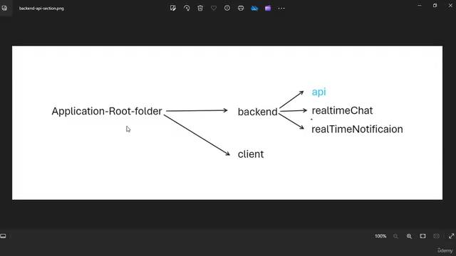
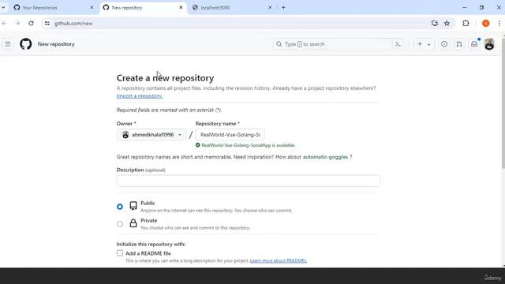
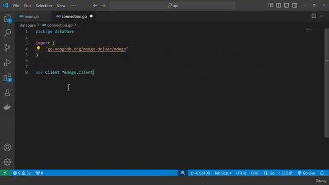
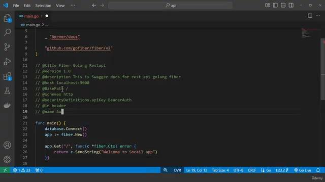
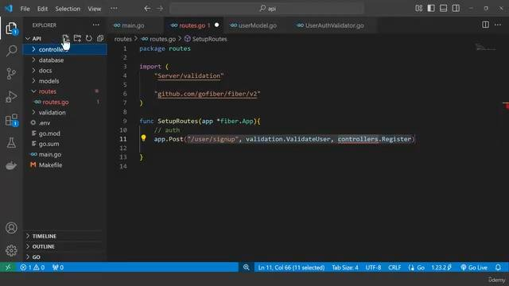
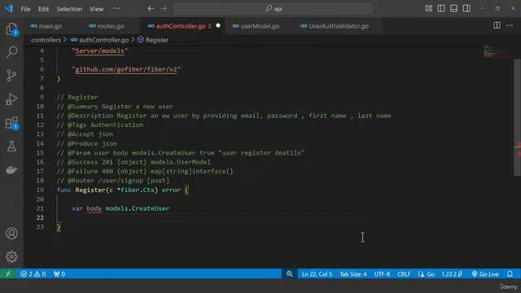

# Master Golang REST/gRPC（含 Redis）— P1–P8 复现文档

> 课程：BV1e5jg6hEUR ｜ 覆盖 P1–P8
> 目标读者：前端转 AI 应用工程师。本文档按「装环境 → 建仓库 → 起服务 → 连 Mongo → 接 Swagger → 写第一个注册接口」的顺序，把 P1–P8 的内容重组成一条可照着敲的流水线。
> 说明：P1 是课程介绍，P2–P3 装工具，P4 起项目骨架，P5 装依赖，P6 连数据库，P7 接 Swagger，P8 写注册接口。P8 结束时**还没有**签发 JWT（讲师明确说放到下一讲），本文档如实标注。

---

## 1. 这一节做什么

P1–P8 这八讲，本质上是**把一个 Go 后端项目的「地基」打完**，具体产出四样东西：

1. **一台装好工具链的机器**：Git、Windows Terminal、VS Code、Postman、MongoDB（含 Compass）、Docker Desktop、Go。
2. **一个能跑起来的 Fiber 服务**：`GET /` 返回一句字符串，监听 5000 端口。
3. **一条到 MongoDB 的连接**：程序启动时连上本地 `mongodb://localhost:27017`，并选中名为 `social` 的库。
4. **一个带 Swagger UI 的注册接口**：`POST /user/signup`，接收 email/password/firstName/lastName，校验必填、查重、bcrypt 哈希密码、写入 `users` 集合，返回插入的 ID。

到 P8 结束，你能在浏览器打开 `http://localhost:5000/swagger/index.html`，点 Try it out，填表提交，然后在 MongoDB Compass 里看到 `social.users` 里多了一条记录。**这就是本文档的验收标准。**

如果你之前主要写前端，可以把这八讲理解成「后端项目的初始化 + 第一张表 + 第一个写接口」。它对应的前端经验大致是：`npm init` 建 `package.json`、`npm install express mongoose` 装依赖、`app.listen(5000)` 起服务、`mongoose.connect(...)` 连数据库、`swagger-ui-express` 接接口文档、最后写一个 `POST /user/signup` 路由。区别在于 Go 这边用 `go mod init` 建 `go.mod`，用 `go get` 装依赖，用 Fiber 的 `app.Listen(":5000")` 起服务，用 Mongo Driver 的 `mongo.Connect` 连库。本文档会把这种对照写在关键命令旁边，方便你迁移已有概念。

需要特别强调：P1–P8 的目标不是做出完整登录系统，而是先让「服务能启动、数据库能连上、接口能被 Swagger 调通、数据能落库」这四件事成立。只要其中一环没通，后面加 JWT、登录、鉴权、Redis 都会反复卡住。所以第 6 节的检查清单要按顺序打勾，不要跳步。

课里没讲的东西（比如 JWT 签发、登录、中间件鉴权）本文档不会替讲师补，只在第 7 节提醒你「接下来会撞上什么」。

---

## 2. 讲师原话

按项目推进的关键节点摘录（不是逐讲流水账，是按「为什么这么做」挑的）：

> "在开始开发应用之前，我们实际上需要先确认一些必要工具已经在本机运行或安装好。"
> —— p002 [00:00]

> "我们应该有应用根目录。里面应该有客户端目录和后端目录……在这个后端目录里，我们应该有三个应用或服务：首先是实时聊天、实时通知，以及本节课程的主要目标——REST API。"
> —— p004 [00:00]

> "我们需要先初始化模块文件，可以直接运行 `go mod init`……我更希望方便起见，改用其他简单名称，比如 `server`。"
> —— p004 [01:47]

> "由于整个课程都会使用 Fiber 框架，所以我们先安装它：`go get github.com/gofiber/fiber/v2`。"
> —— p004 [02:09]

> "我们需要初始化 Mongo Client 和 MongoDB 数据库……调用 `mongo.Connect`……传入应为字符串的 Mongo 连接字符串……`mongodb://localhost:27017`。"
> —— p006 [02:52]–[03:49]

> "正确的做法是创建它，或者把它存到环境变量中。"
> —— p008 [00:24]（讲 JWT secret 该放哪）

> "我们会创建一个新用户并保存到数据库，同时还会使用 JWT 创建访问令牌或身份认证令牌……"
> —— p008 [00:00]（注意：这一讲只完成了「存用户」，token 部分留到下一讲）

> "我们实际上需要开始设置路由……调用 `app.post("/user/signup", ...)`……调用控制器处理函数……`controllers.Register`。"
> —— p008 [02:47]–[03:46]

> "我们想使用请求体解析器……调用 `c.BodyParser(&body)`……如果返回的错误不等于 nil……就返回 `fiber.StatusBadRequest`。"
> —— p008 [12:05]–[12:34]

> "我们想对密码做哈希……使用 `bcrypt.GenerateFromPassword`……哈希成本参数就设为 10。"
> —— p008 [19:59]–[20:26]

这些原话对应到操作上，就是本文档第 3 节的顺序：先确认工具齐了，再建 `client/` 与 `backend/api/` 两层目录，然后在 `backend/api/` 里 `go mod init server`，装 Fiber，写 `main.go` 起服务，接着写 `database/connection.go` 连 Mongo，再写 Swagger 注释和路由，最后写 `models/user.go`、`controllers/authController.go`、`routes/routes.go`。引用保留原话，是为了让你在卡住时能回到课程语境里核对：讲师当时说的 URL 是 `mongodb://localhost:27017`，module 名是 `server`，注册路由是 `/user/signup`，密码哈希 cost 是 10。

---

## 3. 从零复现

下面每一步都对应课里的一个动作，命令按顺序敲即可。**Windows 为主**（讲师是 Windows 用户），Mac/Linux 差异单独标注。

### 3.1 装工具（P2–P3）

| 工具 | 用途 | 课里怎么装的 |
|---|---|---|
| Git | 版本控制 | 官网下载安装包，一路 Next，默认分支名保持默认 |
| Windows Terminal | 终端 | Microsoft Store 搜 "Windows 10 终端" 安装 |
| VS Code | 编辑器 | 官网下载安装 |
| Postman | 测接口 | 官网下载安装 |
| MongoDB Community Server | 数据库 | 官网下载，勾选 "将 Mongo 安装为服务" 和 "安装 MongoDB Compass" |
| Docker Desktop | DevOps 用 | 官网下载，安装时勾选 "使用 WSL 2 而不是 Hyper-V" |
| Go | 语言运行时 | go.dev 下载安装包，装完 `go version` 验证 |

验证 Go 装好（p003 [00:55]）：

```bash
go version
# 课里输出：go version go1.20.x windows/amd64（具体小版本以你机器为准）
```

这一步的验证方法很直接：在任意目录打开终端，输入 `go version`。只要有 `go version go1...` 输出就说明 Go 的二进制在 PATH 里。如果提示 `'go' 不是内部或外部命令`，先关掉终端重新开，让安装程序写入的 PATH 生效；仍然不行就去 Windows 的「环境变量」里确认 Go 的 `bin` 目录已加入 PATH。前端同学可以把它类比成 `node -v`：命令找不到，就是运行时没装好或 PATH 没配好。

MongoDB 装完后，Compass 打开点 Connect，能看到 `admin / config / local` 三个系统库就说明服务起来了（p002 [08:46]）。**别动这三个库。** 如果你在 Compass 里连不上 `localhost:27017`，先检查 Windows 服务里 MongoDB 是否在运行；Compass 能连上但 Go 程序连不上时，优先核对程序里的 URI 是否仍是 `mongodb://localhost:27017`，不要多写库名或端口。

Docker 装完后任务栏有绿色圆点即引擎运行中（p002 [11:59]）。P1–P8 阶段其实还没用到 Docker，装它是为后面的 DevOps 部分。也就是说，这一阶段 Docker 没启动不会阻塞注册接口验收，但既然课里要求装，就先把环境准备好，后面不用再回头补。

### 3.2 建仓库与目录骨架（P4）

讲师在 GitHub 上新建仓库，名字和本地根目录一致（p004 [00:55]）。本地根目录叫 `GoLang-SocialApp`（逐字稿里读作 "ReLordView、Golang、SocialApp"，以你实际建的为准）。

```bash
# 在根目录打开 Git Bash
git init
git remote add origin <你的仓库地址>
```

目录结构按 p004 [00:00] 的图来：

```
GoLang-SocialApp/
├── client/                 # 前端（本阶段不写）
└── backend/
    └── api/                # REST API 服务（本阶段主战场）
        ├── main.go
        ├── go.mod
        ├── go.sum
        ├── .env
        ├── Makefile
        ├── database/
        │   └── connection.go
        ├── models/
        │   └── user.go
        ├── controllers/
        │   └── authController.go
        ├── routes/
        │   └── routes.go
        └── docs/           # swag init 生成，勿手改
```



这里的目录结构不要随意改名。`go mod init server` 之后，import 路径会写成 `server/database`、`server/routes`、`server/controllers`、`server/models`，这些路径对应的是 `backend/api/` 下的目录名。如果你把 `controllers` 改成 `controller`，那么 `routes/routes.go` 里的 import 也要同步改，否则编译会报找不到包。前端同学可以把它理解成 TypeScript 的路径别名：目录名和 import 路径必须对得上。

### 3.3 初始化 Go module 并装 Fiber（P4）

```bash
cd backend/api
go mod init server
go get github.com/gofiber/fiber/v2
```

讲师特意把 module 名取成 `server` 而不是 GitHub 路径，理由是「much easier」（p004 [01:47]）。这直接影响后面所有 import 写成 `server/database`、`server/controllers` 这种短路径。

`go mod init server` 等价于前端的 `npm init -y`，它会生成 `go.mod`，第一行就是 `module server`。`go get github.com/gofiber/fiber/v2` 等价于 `npm install express`，它会往 `go.mod` 里加依赖，并把具体版本和校验信息写进 `go.sum`。常见错误是站在仓库根目录执行 `go mod init server`，这样 `go.mod` 会生成在根目录，后面 `cd backend/api` 再跑代码就会找不到 module。正确位置是 `backend/api/`，也就是 `main.go` 所在目录。

### 3.4 装其余依赖（P5）

课里一次性预装了这些（p005）：

```bash
go get github.com/gofiber/fiber/v2/middleware/cors
go get github.com/gofiber/swagger
go get go.mongodb.org/mongo-driver/mongo
go get go.mongodb.org/mongo-driver/mongo/options
go get github.com/dgrijalva/jwt-go
go get github.com/swaggo/swag/cmd/swag
```

> 注意：`go.mongodb.org/mongo-driver/mongo/options` 是 `mongo` 包内的子包，讲师在 p005 [02:48] 试装时报 "不包含该包"，随后确认「this is inside the same package so we didn't need to install it」。所以这一行可以跳过，`go mod tidy` 会自动带上。
>
> `github.com/dgrijalva/jwt-go` 是课里用的 JWT 库。P8 阶段还没真正用到它，装它是为下一讲铺路。

装完跑一次：

```bash
go mod tidy
```

`go mod tidy` 的作用是「按代码实际 import 补齐依赖、删掉没用到的依赖」。前端可以类比成删掉 `node_modules` 后重新 `npm install`，但它改的是 `go.mod` 和 `go.sum`。如果你在 P8 阶段还没 import `jwt-go`，`go mod tidy` 可能不会把它保留为直接依赖；这不影响 P8，因为 P8 的注册接口只用到 Fiber、Mongo Driver 和 bcrypt。bcrypt 包课里没显式装，`go mod tidy` 会从 `golang.org/x/crypto` 拉取。若报找不到，再执行 `go get golang.org/x/crypto/bcrypt`。

### 3.5 写 main.go 起服务（P4）

见第 4 节完整代码。跑起来：

```bash
go run main.go
```

浏览器访问 `http://localhost:5000`，应看到 `Welcome to Social App`（p004 [04:31]）。



`go run main.go` 是编译并运行当前文件，等价于前端的 `node main.js`，但它会先编译成临时二进制再执行。常见错误是 5000 端口被占用，终端会提示 `bind: Only one usage of each socket address...`。Windows 下可以用 `netstat -ano | findstr :5000` 找到占用进程，再决定是否结束；Mac/Linux 可以用 `lsof -i :5000`。另一个常见错误是 `go run` 时当前目录不在 `backend/api/`，导致 import `server/database` 找不到包。先确认终端路径，再跑命令。

### 3.6 连 MongoDB（P6）

新建 `database/connection.go`，在 `main.go` 里 `app := fiber.New()` 之前调用 `database.Connect()`。跑起来终端应打印 `Connected to DB`（p006 [08:38]）。



这里的顺序很重要：`database.Connect()` 放在 `fiber.New()` 之前，是为了让后续请求进来时 `database.DB` 已经有值。如果先起服务再连库，理论上也能跑，但第一个请求可能正好落在连接初始化之前，排查起来会多一层不确定性。常见错误是 Mongo 服务没启动，代码会打印 `Error connect to db: ...`；也可能是 URI 写错，比如多写了一个库名或端口不是 27017。课里明确用的 URI 是 `mongodb://localhost:27017`，库名 `social` 在 `client.Database("social")` 里指定。

### 3.7 接 Swagger（P7）

1. 在 `main.go` 顶部（`package main` 之上）写 Swagger 注释块。
2. 在 `main.go` 里注册 `app.Get("/swagger/*", swagger.HandlerDefault)`。
3. 生成文档：

```bash
swag init
# 若提示 swag 命令不存在：
go install github.com/swaggo/swag/cmd/swag@latest
```

4. 访问 `http://localhost:5000/swagger/index.html`，应看到标题 "Fiber GoLang REST API"（p007 [09:23]）。



Swagger 这一段最容易卡在 `swag` 命令找不到。Go 1.17+ 之后，`go get` 不再负责把命令装到 `$GOPATH/bin`，所以课里 p007 [08:54] 也给了补救命令 `go install github.com/swaggo/swag/cmd/swag@latest`。装完后如果终端仍提示找不到 `swag`，检查 `$GOPATH/bin` 是否在 PATH 里。另一个常见错误是 `main.go` 里漏了下划线导入 `_ "server/docs"`，这样 Swagger UI 能打开但文档是空白；因为 `docs` 包的 `init()` 没有被触发。

### 3.8 写注册接口（P8）

1. 建 `.env`，写入 `JWT_SECRET=<openssl 生成的串>`。
2. 建 `models/user.go`：`CreateUser`（入参）和 `User`（入库结构）。
3. 建 `controllers/authController.go`：`Register` 函数。
4. 建 `routes/routes.go`：`SetupRoutes(app)`。
5. `main.go` 里调用 `routes.SetupRoutes(app)`。
6. `swag init` 重新生成文档，`go run main.go`。
7. Swagger UI 里 Try it out，填 email/password/firstName/lastName，Execute。
8. 打开 MongoDB Compass，刷新，`social` 库 → `users` 集合 → 看到新记录（p008 [25:11]）。



这一段执行时，Swagger UI 里请求体字段名要和 `models.CreateUser` 的 `json` tag 对上：`email`、`password`、`firstName`、`lastName`。如果提交后返回 400，先看响应里的 `error` 和 `details`；如果是 `Invalid request body`，通常是 JSON 字段拼错或请求体不是合法 JSON。如果返回 `already exists`，说明查重生效，换一个 email 再试。插入成功后，Compass 里要刷新集合才能看到新记录；看不到时先确认你选的是 `social` 库和 `users` 集合，再确认终端没有报插入错误。

---

## 4. 完整代码

以下每个文件都是**完整可保存**的。路径相对 `backend/api/`。

### 4.1 `backend/api/main.go`

```go
package main

import (
	"server/database"
	"server/routes"

	"github.com/gofiber/fiber/v2"
	"github.com/gofiber/fiber/v2/middleware/cors"
	"github.com/gofiber/swagger"

	_ "server/docs"
)

// @title Fiber GoLang REST API
// @version 1.0
// @description This is swagger docs for rest api go fiber
// @host localhost:5000
// @BasePath /
// @schemes http
// @securityDefinitions.apikey ApiKeyAuth
// @in header
// @name Authorization
// @description Type "Bearer" followed by a space and the token.
func main() {
	database.Connect()

	app := fiber.New()

	app.Use(cors.New(cors.Config{
		AllowCredentials: true,
		AllowOrigins:     "*",
	}))

	routes.SetupRoutes(app)

	app.Get("/swagger/*", swagger.HandlerDefault)

	app.Listen(":5000")
}
```

> 说明：课里 `AllowOrigins` 用的是 `func(origin string) bool { return true }` 这种回调写法（p007 [05:33]）。Fiber v2 的 `cors.Config.AllowOrigins` 字段类型是 `string`，回调写法在部分版本会编译不过。上面用 `"*"` 是等价效果且能编译的写法。**如果你照课里写回调报类型错误，就换成 `"*"`。**

这个文件把「连库、建 Fiber 实例、挂 CORS、注册路由、挂 Swagger、监听端口」按顺序串起来。不要小看顺序：`database.Connect()` 在前，`routes.SetupRoutes(app)` 在后，`app.Listen` 最后，这是最小可运行骨架。前端对照：`const app = express(); app.use(cors()); app.use(routes); app.listen(5000)`。Go 里没有 `require`，所有依赖通过 import 引入，路由通过函数注册。

### 4.2 `backend/api/database/connection.go`

```go
package database

import (
	"context"
	"fmt"
	"time"

	"go.mongodb.org/mongo-driver/mongo"
	"go.mongodb.org/mongo-driver/mongo/options"
)

var Client *mongo.Client
var DB *mongo.Database

func Connect() {
	ctx, cancel := context.WithTimeout(context.Background(), 13*time.Second)
	defer cancel()

	client, err := mongo.Connect(ctx, options.Client().ApplyURI("mongodb://localhost:27017"))
	if err != nil {
		fmt.Printf("Error connect to db: %s\n", err.Error())
		return
	}

	Client = client
	DB = client.Database("social")

	fmt.Println("Connected to DB")
}
```

> 课里 `mongo.Connect` 的第一个参数是 `ctx`，第二个是 `options.Client().ApplyURI(...)`。讲师在 p006 [03:19] 明确说 URI 是 `mongodb://localhost:27017`。库名 `social` 在 p006 [06:40] 指定。

这个文件导出 `Client` 和 `DB` 两个包级变量，后续 controller 通过 `database.DB.Collection("users")` 拿集合。前端对照：`mongoose.connect(...)` 后，模型里直接用 `User.find()`。Go 这边没有全局模型，只有集合句柄，所以每次操作前从 `database.DB` 拿 `Collection`。注意 `mongo.Connect` 不会真的建立网络连接，真正连接在第一次数据库操作时惰性建立；因此终端打印 `Connected to DB` 只代表 client 初始化成功，不代表 Mongo 已经完成一次读写。

### 4.3 `backend/api/models/user.go`

```go
package models

import "go.mongodb.org/mongo-driver/bson/primitive"

type CreateUser struct {
	Email     string `json:"email" validate:"required,email"`
	Password  string `json:"password" validate:"required,min=6"`
	FirstName string `json:"firstName" validate:"required"`
	LastName  string `json:"lastName" validate:"required"`
}

type User struct {
	ID        primitive.ObjectID   `bson:"_id,omitempty" json:"_id"`
	Name      string               `bson:"name" json:"name"`
	Email     string               `bson:"email" json:"email"`
	Password  string               `bson:"password" json:"password"`
	Followers []primitive.ObjectID `bson:"followers" json:"followers"`
	Following []primitive.ObjectID `bson:"following" json:"following"`
}
```

> 课里 `CreateUser` 的字段顺序是 email / password / firstName / lastName（p008 [06:31]–[07:00]）。`User` 里 `Name` 是 firstName + " " + lastName 拼出来的（p008 [20:54]）。`Followers` / `Following` 用 `make([]primitive.ObjectID, 0)` 初始化成空数组（p008 [21:51]），这样 Compass 里看到的是 `[]` 而不是 `null`。

`CreateUser` 只接收前端该传的四个字段，`User` 才是入库结构。这个拆分很重要：如果直接用 `User` 接请求体，前端就能伪造 `followers`、`following` 甚至 `_id`。前端对照：DTO 和 Entity 分开，接请求用 DTO，存库用 Entity。`bson` tag 决定 Mongo 里的字段名，`json` tag 决定返回 JSON 的字段名；`omitempty` 让空 `_id` 不写入，由 Mongo 生成。

### 4.4 `backend/api/controllers/authController.go`

```go
package controllers

import (
	"context"
	"time"

	"server/database"
	"server/models"

	"github.com/gofiber/fiber/v2"
	"go.mongodb.org/mongo-driver/bson"
	"go.mongodb.org/mongo-driver/bson/primitive"
	"golang.org/x/crypto/bcrypt"
)

// Register godoc
// @Summary      Register a new user
// @Description  Register a new user by providing email, password, first name, last name
// @Tags         Authentication
// @Accept       json
// @Produce      json
// @Param        user body models.CreateUser true "User register details"
// @Success      201 {object} models.User
// @Failure      400 {object} map[string]interface{}
// @Router       /user/signup [post]
func Register(c *fiber.Ctx) error {
	var body models.CreateUser

	if err := c.BodyParser(&body); err != nil {
		return c.Status(fiber.StatusBadRequest).JSON(fiber.Map{
			"error":   "Invalid request body",
			"details": err.Error(),
		})
	}

	userCollection := database.DB.Collection("users")

	ctx, cancel := context.WithTimeout(context.Background(), 13*time.Second)
	defer cancel()

	var existing models.User
	err := userCollection.FindOne(ctx, bson.M{"email": body.Email}).Decode(&existing)
	if err == nil {
		return c.Status(fiber.StatusBadRequest).JSON(fiber.Map{
			"error": "User with email " + body.Email + " already exists",
		})
	}

	hashedPassword, _ := bcrypt.GenerateFromPassword([]byte(body.Password), 10)

	newUser := models.User{
		Name:      body.FirstName + " " + body.LastName,
		Email:     body.Email,
		Password:  string(hashedPassword),
		Followers: make([]primitive.ObjectID, 0),
		Following: make([]primitive.ObjectID, 0),
	}

	result, err := userCollection.InsertOne(ctx, &newUser)
	if err != nil {
		return c.Status(fiber.StatusBadRequest).JSON(fiber.Map{
			"error": err.Error(),
		})
	}

	return c.Status(fiber.StatusCreated).JSON(fiber.Map{
		"insertedId": result.InsertedID,
	})
}
```

> 课里 `Register` 的返回体在 p008 [22:50] 是 `result.InsertedID`，讲师在 Swagger 里看到的就是一个 ID。上面用 `fiber.Map{"insertedId": ...}` 包一层，字段名 `insertedId` 是本文档自拟的（课里没明确说字段名），**以你实际输出为准**。
>
> `bcrypt` 包课里没显式 `go get`，但 `go mod tidy` 会拉 `golang.org/x/crypto`。如果报找不到，跑 `go get golang.org/x/crypto/bcrypt`。

这个 controller 的流程是：解析 body → 拿 `users` 集合 → 按 email 查重 → 哈希密码 → 组装 `User` → 插入 → 返回插入 ID。前端对照：`req.body` → `User.findOne({ email })` → `bcrypt.hash(password, 10)` → `User.create(...)` → 返回 `_id`。注意这里 `FindOne` 找到时 `err == nil`，所以 `err == nil` 代表「已存在」；没找到时 `err` 是 `mongo.ErrNoDocuments`。P8 的写法没有区分其他查询错误，第 7 节会专门提醒。

### 4.5 `backend/api/routes/routes.go`

```go
package routes

import (
	"server/controllers"

	"github.com/gofiber/fiber/v2"
)

func SetupRoutes(app *fiber.App) {
	app.Post("/user/signup", controllers.Register)
}
```

这个文件只做路由注册，不写业务。路径是 `/user/signup`，不是 `/auth/signup`。前端对照：`router.post('/user/signup', controller.register)`。`app` 必须传 `*fiber.App` 指针，因为路由表挂在 `fiber.App` 上，传值会复制一份，注册不到原实例。

### 4.6 `backend/api/.env`

```bash
JWT_SECRET=<把 openssl 生成的串粘这里>
```

生成方式（p008 [00:51]）：

```bash
openssl rand -base64 32
```

> 课里说的是 "openssl 运行 base64 22 个字符"，实际命令是 `openssl rand -base64 32`（22 字符是 base64 编码后的近似长度）。P8 阶段这个 secret 还没被读取，但先建好，下一讲签发 JWT 时直接用。

### 4.7 `backend/api/Makefile`

```makefile
.PHONY: clear-swagger swagger-init

clear-swagger:
	@echo "Clearing docs directory"
	@rm -rf docs/*

swagger-init: clear-swagger
	swag init -g main.go

generate-swagger-docs: swagger-init
	@echo "Swagger docs regenerated"
```

> 课里用的是 Windows 的 `del /q docs\*`（p007 [11:42]），上面换成 `rm -rf` 以兼容 Mac/Linux。Windows 用户把 `rm -rf docs/*` 换成 `del /q docs\*` 即可。用法：`make generate-swagger-docs`。

### 4.8 `backend/api/.gitignore`（放在仓库根目录）

```
backend/api/go.sum
```

> 课里 p004 [05:01] 只忽略了 `go.sum`。实际上 `go.sum` 通常应该提交，但既然讲师这么做了，照做即可。**如果你后面 `go mod tidy` 报校验失败，把 `go.sum` 从 `.gitignore` 里删掉再提交。**

---

## 5. 逐行解释

### 5.1 `main.go`

- `import _ "server/docs"`：下划线导入，只为触发 `docs` 包的 `init()`，把 `swag init` 生成的 `docs.go` 注册进 Swagger。不写这行，Swagger UI 打开是空白。
- `database.Connect()` 放在 `fiber.New()` **之前**：先连库再起服务，避免请求进来时 `database.DB` 还是 nil。
- `cors.New(cors.Config{AllowCredentials: true, AllowOrigins: "*"})`：允许跨域带 cookie。前端在 `localhost:3000` 调 `localhost:5000` 时必须开，否则浏览器拦。**在 Node/Express 里对应 `cors({ credentials: true, origin: "*" })`。**
- `routes.SetupRoutes(app)`：把所有路由注册集中到一个函数，`main.go` 只负责组装。这是讲师说的 "整洁架构" 的最小体现。
- `app.Get("/swagger/*", swagger.HandlerDefault)`：`*` 是通配，`/swagger/index.html`、`/swagger/doc.json` 都走这个 handler。
- `app.Listen(":5000")`：监听所有网卡的 5000 端口。课里没写错误处理，生产环境应 `if err := app.Listen(...); err != nil { log.Fatal(err) }`。

补充一点排查思路：如果浏览器访问 `http://localhost:5000` 没有返回 `Welcome to Social App`，先看终端有没有 `Connected to DB`。有 `Connected to DB` 说明 `main` 至少跑到了 `database.Connect()` 之后；再看 `routes.SetupRoutes(app)` 有没有把 `/` 路由注册上。本文档的完整代码里没有显式写 `app.Get("/", ...)`，因为课里 P4 是先写一个临时根路由来验证服务；如果你照课里早期步骤加了 `app.Get("/")`，就应看到那句字符串。若没有加，根路径 404 不一定是服务没起来，先以 Swagger 页面是否可打开为准。

### 5.2 `database/connection.go`

- `context.WithTimeout(context.Background(), 13*time.Second)`：13 秒超时。讲师在 p006 [02:23] 说 "13 seconds"，这个数字是随手定的，不是最佳实践。**在 JS 里对应 `AbortController` + `setTimeout`。**
- `defer cancel()`：函数返回时释放 context，防止 goroutine 泄漏。**Go 的 `defer` 相当于 JS 的 `try/finally`。**
- `mongo.Connect(ctx, options.Client().ApplyURI(...))`：注意 Go 的 `mongo.Connect` **不会真的建连接**，它只是初始化 client，真正连接在第一次操作时惰性建立。所以这里返回 nil error 不代表 Mongo 一定活着。
- `client.Database("social")`：选中 `social` 库。库不存在时 Mongo 会在第一次写入时自动创建。
- `fmt.Println("Connected to DB")`：课里 p006 [08:38] 终端看到的就是这句。

常见错误排查：如果终端打印 `Error connect to db: ...`，先看 URI 是否是 `mongodb://localhost:27017`，再看 MongoDB 服务是否启动。如果你在 Docker 里跑 Mongo，端口映射可能不是 27017，但 P1–P8 课里用的是本机安装的 MongoDB。另一个容易忽略的点是 `database.Connect()` 返回后没有检查 `Client` 是否为 nil；当前写法失败时只是打印并 return，后续 `database.DB` 仍为 nil，请求进来会 panic。P8 阶段先按课里写法跑通，生产化处理放到第 7 节。

### 5.3 `models/user.go`

- `CreateUser` 是**入参 DTO**，只含前端传的四个字段；`User` 是**入库结构**，多了 `ID`、`Name`、`Followers`、`Following`。分开两个结构是防止前端能直接传 `followers` 进来。
- `bson:"_id,omitempty"`：Mongo 的主键字段名是 `_id`，`omitempty` 让插入时如果 ID 为空就不写，由 Mongo 生成。
- `validate:"required,email"`：这些 tag 课里**没有真正用 validator 库去校验**（p008 [03:17] 路由里写了 `validation.Validator` 但没实现）。实际校验靠的是 Swagger 的 `required` 标注 + 前端自觉。**这是课里的一个坑，见第 7 节。**
- `[]primitive.ObjectID`：Mongo 的 ObjectID 数组。**在 JS/Mongoose 里对应 `[Schema.Types.ObjectId]`。**

与前端对照：`json:"firstName"` 这种 tag 相当于前端接口里的字段名映射。如果前端传 `first_name`，这里解析不到 `FirstName`，`body.FirstName` 就是空字符串，最后 `Name` 会变成 `" "` 或只有 lastName。Swagger UI 里测试时字段名必须严格用 `firstName`、`lastName`，大小写也要对。

### 5.4 `controllers/authController.go`

- `c.BodyParser(&body)`：把请求体 JSON 解析进 `body`。**对应 Express 的 `req.body`（需先 `app.use(express.json())`）。**
- `database.DB.Collection("users")`：拿到 `users` 集合句柄。集合不存在时首次写入自动创建。
- `FindOne(ctx, bson.M{"email": body.Email})`：查重。`bson.M` 是 `map[string]interface{}` 的别名，**对应 Mongoose 的 `User.findOne({ email })`**。
- `if err == nil { ... already exists }`：注意逻辑——`FindOne` 找到时 err 为 nil，没找到时 err 是 `mongo.ErrNoDocuments`。所以 `err == nil` 表示「已存在」。课里 p008 [19:03] 就是这么写的。
- `bcrypt.GenerateFromPassword([]byte(body.Password), 10)`：10 是 cost 因子，越大越慢越安全。**对应 Node 的 `bcrypt.hash(password, 10)`。**
- `string(hashedPassword)`：bcrypt 返回 `[]byte`，入库前转 string。
- `make([]primitive.ObjectID, 0)`：初始化空切片，保证 Compass 里看到 `[]` 而不是 `null`。
- `InsertOne(ctx, &newUser)`：插入。返回的 `result.InsertedID` 就是新记录的 `_id`。
- 返回 `fiber.StatusCreated`（201）：课里 p008 [13:58] 写的是 `fiber.StatusOK`，但 Swagger 注释里写的是 201。上面统一成 201，更符合「创建资源」的语义。**如果你要严格照课里，把 `StatusCreated` 改成 `StatusOK`。**

常见错误排查：如果 `BodyParser` 失败，响应会带 `Invalid request body` 和 `details`，先看 Swagger 里是不是字段名写错。如果插入失败，响应会带 Mongo 返回的 `error`，常见原因是 `database.DB` 为 nil（连接没成功）或集合名写错。如果同一个 email 第二次提交，应该返回 400 和 `already exists`；如果仍然插入成功，说明查重逻辑没生效，检查 `FindOne` 的 filter 是否是 `bson.M{"email": body.Email}`。

### 5.5 `routes/routes.go`

- `app.Post("/user/signup", controllers.Register)`：路径是 `/user/signup`，不是 `/auth/signup`。课里 p008 [03:17] 明确说的。
- 函数签名 `func SetupRoutes(app *fiber.App)`：传指针，因为 `fiber.App` 内部有状态（路由表），必须传指针才能注册上。

前端对照：这相当于把 `router.post('/user/signup', controllers.Register)` 单独抽到一个 `routes.js`。这样做的好处是 `main.go` 不堆路由，后面加 `/user/login`、`/post/create` 时只改 `routes.go`。如果你发现 Swagger UI 里没有 `POST /user/signup`，先检查 `routes.SetupRoutes(app)` 是否在 `main.go` 里被调用，再检查 controller 上的 Swagger 注释是否在 `swag init` 之前写好。

---

## 6. 复现检查清单

按顺序打勾，任何一项不过就别往下走：

- [ ] `go version` 有输出，版本 ≥ 1.20；验证方法：终端执行 `go version`，确认输出里有 `go version go1.`，且没有「命令不存在」。
- [ ] MongoDB Compass 能连上 `localhost:27017`，看到 `admin/config/local`；验证方法：打开 Compass 点 Connect，左侧数据库列表出现这三个系统库，且不要删除它们。
- [ ] `backend/api/` 下 `go mod init server` 成功，`go.mod` 第一行是 `module server`；验证方法：用 VS Code 打开 `backend/api/go.mod`，第一行应为 `module server`。
- [ ] `go get github.com/gofiber/fiber/v2` 成功，`go.sum` 里有 fiber 记录；验证方法：在 `go.sum` 里搜索 `gofiber/fiber`，或在 `go.mod` 的 require 里看到 fiber。
- [ ] `go run main.go` 不报错，终端打印 `Connected to DB`；验证方法：在 `backend/api/` 执行 `go run main.go`，看终端最后是否有 `Connected to DB`，同时确认没有 panic。
- [ ] 浏览器 `http://localhost:5000` 返回 `Welcome to Social App`；验证方法：如果代码里有根路由，应看到该字符串；若 404，先确认服务是否监听 5000。
- [ ] `swag init` 成功，`docs/` 下生成 `docs.go`、`swagger.json`、`swagger.yaml`；验证方法：执行 `swag init` 后看 `backend/api/docs/` 下是否有这三个文件。
- [ ] 浏览器 `http://localhost:5000/swagger/index.html` 能看到 "Fiber GoLang REST API" 标题；验证方法：打开页面看标题，若空白先检查 `_ "server/docs"` 和 `swag init`。
- [ ] Swagger UI 里能看到 `POST /user/signup`，标着 Authentication tag；验证方法：展开接口列表，确认路径、方法和 tag 与注释一致。
- [ ] Try it out 填 email=`a@a.com`、password=`ahmed555`、firstName=`Ahmed`、lastName=`Khalaf`，Execute 返回 201 + 一个 ID；验证方法：看响应状态码和 JSON 里的 `insertedId`，若 400 看错误信息。
- [ ] MongoDB Compass 刷新后 `social` 库 → `users` 集合里有这条记录，`password` 是 `$2a$10$...` 开头的哈希，`followers` 和 `following` 是 `[]`；验证方法：刷新 collection，逐字段核对，尤其确认不是明文密码。
- [ ] 用同一个 email 再提交一次，返回 400 + "already exists"；验证方法：保持其他字段不变再 Execute，确认状态码和错误文案。
- [ ] 把 email 字段删掉再提交，返回 400（Swagger 的 required 拦截）；验证方法：在 Swagger 请求体里删掉 `email` 再 Execute，确认被 Swagger 或服务端拒绝。



---

## 7. 课里没讲但你会撞上的

这一节是「照着敲会卡住」的地方，逐条给解法。下面按「现象 / 原因 / 怎么办」整理成表格，表内保留原条目编号，方便和上文的复现步骤对应。

| 现象 | 原因 | 怎么办 |
|---|---|---|
| 7.1 `cors.Config.AllowOrigins` 类型不匹配：照课里写回调 `func(origin string) bool { return true }` 编译报错。 | Fiber v2 的 `AllowOrigins` 是 `string` 类型，回调写法在 v2.40+ 会报 `cannot use func literal (type func(string) bool) as type string`。 | 改成 `"*"`，或升级到 Fiber v3（v3 才支持回调）。 |
| 7.2 `validation.Validator` 没实现：p008 [03:17] 路由里写了 `validation.Validator` 作为中间件参数，但课里从没创建过这个包。 | 照抄后编译会报 `undefined: validation`，因为项目里没有这个包，也没有对应中间件。 | 删掉这个参数，只保留 `controllers.Register`。真正的字段校验靠 Swagger 的 `required` 标注 + 前端，服务端没做。 |
| 7.3 `go.sum` 被 gitignore 导致 CI 失败：别人 clone 后 `go build` 报 `missing go.sum entry`。 | 课里 p004 [05:01] 把 `go.sum` 加进了 `.gitignore`，本地能跑但仓库里没有校验文件。 | 要么别 ignore `go.sum`，要么在 README 里写清楚「clone 后先跑 `go mod tidy`」。 |
| 7.4 `swag` 命令找不到：终端提示 `swag: command not found` 或 Windows 提示不是内部命令。 | `go get github.com/swaggo/swag/cmd/swag` 在 Go 1.17+ 不会把二进制装到 `$GOPATH/bin`。 | 用 `go install github.com/swaggo/swag/cmd/swag@latest`，并确保 `$GOPATH/bin` 在 PATH 里。课里 p007 [08:54] 也提到了这个补救命令。 |
| 7.5 `bcrypt` 包没显式安装：编译报找不到 `golang.org/x/crypto/bcrypt`。 | 课里 p008 [19:59] 直接用了 `bcrypt.GenerateFromPassword`，但 P5 的依赖清单里没有 `golang.org/x/crypto`。 | 执行 `go get golang.org/x/crypto/bcrypt`，或直接 `go mod tidy` 让它自动拉。 |
| 7.6 JWT 还没签发：注册接口只返回 `insertedId`，没有 `token`，`.env` 里的 `JWT_SECRET` 没被读取。 | P8 标题说「create access token using JWT」，但实际代码只完成了存用户；讲师在 p008 [25:41] 明确说下一讲才加认证或访问令牌。 | 不要以为是自己漏写了。P8 就是没写签发逻辑，`github.com/dgrijalva/jwt-go` 目前也没被 import，下一讲才会补。 |
| 7.7 `dgrijalva/jwt-go` 已停止维护：依赖有已知 CVE 风险。 | 课里用的 `github.com/dgrijalva/jwt-go` 官方已 archived。 | 建议换成 `github.com/golang-jwt/jwt/v5`，API 基本兼容（`jwt.NewWithClaims`、`token.SignedString` 都一样）。课里没提这个替换，属于「课里没讲但生产该做」的事。 |
| 7.8 密码哈希 cost 10 是课里的选择：不知道 10 代表什么。 | `bcrypt.GenerateFromPassword(..., 10)` 的 10 是 cost 因子，越大越慢越安全；课里没解释为什么是 10。 | 生产环境一般 10–12，越高越慢。在 Node 里 `bcrypt.hash(pwd, 10)` 的 10 是同一个含义。 |
| 7.9 没有 graceful shutdown：Ctrl+C 直接杀进程，正在处理的请求会被截断。 | `app.Listen(":5000")` 是阻塞调用，课里没监听 `os.Signal` 做关闭处理。 | 生产环境应监听 `os.Signal` 然后 `app.Shutdown()`。在 Node 里对应 `process.on('SIGTERM', () => server.close())`。 |
| 7.10 没有热重载：每次改代码都要 Ctrl+C 再 `go run main.go`。 | 课里 p007 [14:26] 提到 "我们需要使用 air"，但 P1–P8 没有实际配置 air。 | `go install github.com/cosmtrek/air@latest`，然后在 `backend/api/` 下建 `.air.toml`，跑 `air`。课里说 later 会配，P8 结束时还没配。 |
| 7.11 `FindOne` 的错误没区分：Mongo 挂了时可能被当成「用户不存在」继续走插入。 | `if err == nil { already exists }` 只判断了「找到了」，没有区分 `mongo.ErrNoDocuments` 和连接错误等其他错误。 | 生产环境应区分 `mongo.ErrNoDocuments` 和其他错误；课里没讲，P8 先按课程代码跑通，后续再补错误分类。 |

---

**P1–P8 到此结束。** 你现在有一个能跑、能连库、能在 Swagger 里测的注册接口。下一讲（P9 起）才会在这个基础上加 JWT 签发和登录。