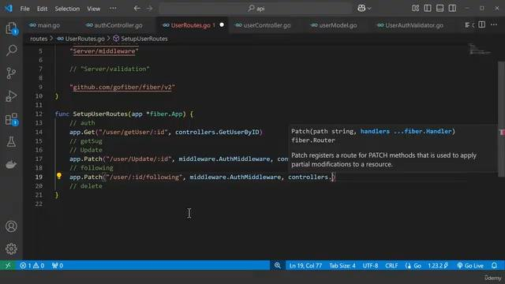
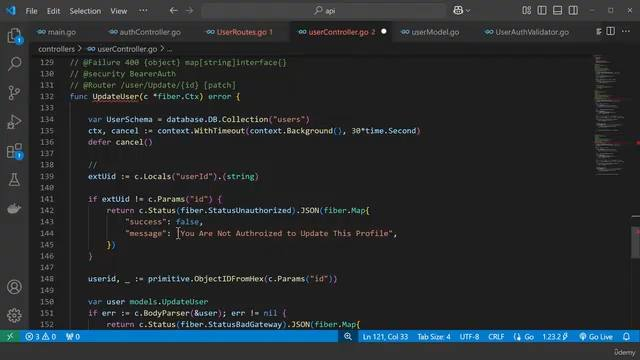
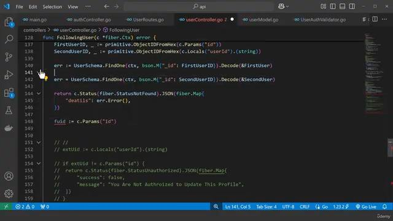
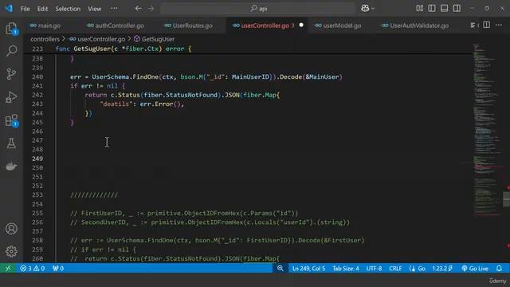
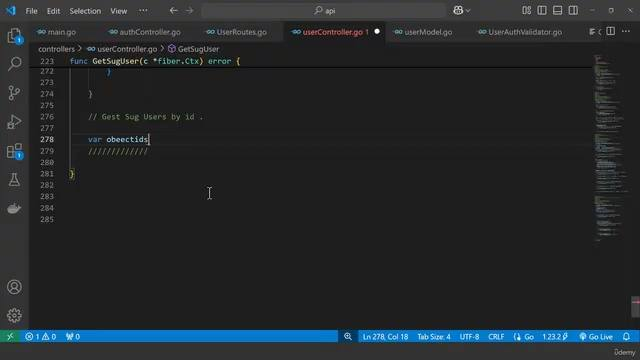
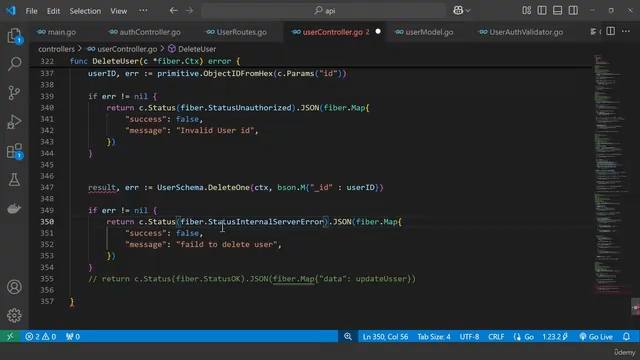
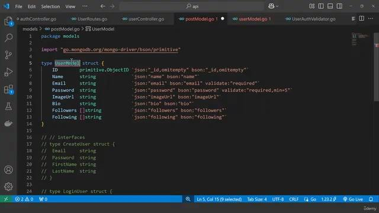

# Master Golang REST/gRPC（含 Redis）P014–P017 复现文档

> 覆盖范围：P014 关注/取关用户、P015 推荐用户（getSug）、P016 删除用户、P017 创建 Post 模型与路由骨架。
> 读者定位：前端转 AI 应用工程师。Go 语法只讲「知道即可」，涉及并发/锁的地方会补一句 Node 里的对应概念。
> 说明：本课程是在一个已有的 Go + Fiber + MongoDB 项目上继续加功能。P014 之前已经存在 `user_routes.go`、`user_controller.go`、`models/user.go`、`validation/user_validation.go`、JWT 中间件（`os` 中间件）等文件。下面所有代码都基于这个前提，路径与命名沿用讲师在逐字稿里念出来的名字。

---

## 1. 这一节做什么

这四节课在同一个用户模块上连续加四个东西：

1. **P014**：新增 `PATCH /user/:id/following` 端点，一个端点同时承担「关注」和「取关」两种语义——如果当前登录用户已经在关注目标用户，就取关；否则就关注。两个用户的 `followers` / `following` 数组要同步更新。
2. **P015**：新增 `GET /user/getSug` 端点，给当前登录用户推荐「可能认识的人」：取当前用户关注的人的 following/followers 列表，去重、去掉自己、去掉已经关注的人，最后一次性用 `$in` 查询把用户查出来返回。
3. **P016**：新增 `DELETE /user/delete` 端点，删除用户，并且用 JWT 里的用户 ID 做鉴权——只能删自己。
4. **P017**：新建 `Post` 模型、`post_validation.go`、`post_routes.go`，并在 `main.go` 里挂上 `POST /post/any` 这个占位端点，为后续 Post 系列接口打地基。

这四节合起来，是把一个「只有注册/登录/更新」的用户模块，补成一个**有社交关系（关注）、有推荐、有删除、并且开始有第二个实体（Post）** 的完整后端骨架。

---

## 2. 讲师原话

> "这个端点同时用于关注和取消关注。怎么做呢？例如，我们可以通过字段要求传入一个布尔值，根据布尔值的结果决定开始关注用户还是取消关注；也可以直接传入用户想要关注或取消关注另一用户的数据，然后在这里做逻辑判断。例如，如果当前用户已经关注了该用户，这种情况下我们就要取消关注。"
> —— p014 [01:55]

> "另一件事是，我们从认证信息中提取主用户的用户 ID。当然，这样做是为了确保所有环节百分之百安全。"
> —— p014 [02:52]

> "我们要检查第一个用户的关注者列表中是否包含第二个用户的 ID……请注意，这里的第二个用户是开始尝试关注第一个用户的人。因此，我们是在检查第一个用户的关注者列表中是否已经存在这个 UID。"
> —— p014 [11:26] / [11:55]

> "我们实际上会查看或选择当前用户的关注关系：先获取主用户开始关注的用户；之后，在这份列表经过过滤后，提取最终可以整理出的用户，并发送给主用户。"
> —— p015 [00:00]

> "我们希望让列表项保持唯一，而这些列表项当然代表用户 ID。"
> —— p015 [12:48]

> "我们可以在一次查询中获取所有用户，也就是借助一个操作符在一次查询里取出全部用户。"
> —— p015 [17:06]

> "我们需要检查这一点，然后可以把这条消息改成：你无权删除该用户。"
> —— p016 [03:57]

> "我们需要确认删除操作是否正确，也就是检查 userSchema.deleteOne 的结果。如果 result.deletedCount 等于——抱歉——零，那么这种情况下需要返回类似“未找到”的结果。"
> —— p016 [05:44] / [08:08]

> "我们需要从 models 目录开始，创建帖子模型……首先是 id，它是原始 ObjectId；然后 id 后面有很多字符串字段。接下来是帖子创建者，我们希望把它保留为字符串，而不是 ObjectId；然后是 title，最后是 message。"
> —— p017 [00:00] / [00:57]

> "我们想再加一个字段，用来记录创建时间，取值应当是 time.time.recordTime……JSON 就会被生成出来。"
> —— p017 [03:22]

---

## 3. 从零复现

### 3.1 环境与依赖

- Go 1.21+（`slices` 标准库需要 1.21）
- MongoDB（本地或 Atlas 均可）
- 依赖（`go.mod` 里已有的，不用改版本，按项目现状）：

```
github.com/gofiber/fiber/v2
go.mongodb.org/mongo-driver
github.com/go-playground/validator/v10
github.com/golang-jwt/jwt/v5
```

> 课里没讲具体版本号，`go.mod` 请沿用你项目里现有的版本，不要凭印象写死。

### 3.2 目录结构（P014–P017 结束时的状态）

```
project/
├── main.go
├── go.mod
├── config/
│   └── env.go
├── database/
│   └── database.go
├── models/
│   ├── user.go
│   └── post.go              ← P017 新增
├── validation/
│   ├── user_validation.go
│   └── post_validation.go   ← P017 新增
├── controller/
│   ├── user_controller.go   ← P014/P015/P016 修改
│   └── post_controller.go   （P017 只留占位，后续课再写）
├── middleware/
│   └── auth.go              （JWT 中间件，课里叫 os 中间件）
└── routes/
    ├── user_routes.go       ← P014/P015/P016 修改
    └── post_routes.go       ← P017 新增
```

### 3.3 复现顺序（严格按这个顺序做，否则会编译不过）

1. **P014**：先改 `models/user.go` 确认 `Followers []string` / `Following []string` 字段存在（课里没讲这两个字段怎么来的，说明是 P014 之前就有的）。然后改 `user_routes.go` 加路由，再改 `user_controller.go` 加 `FollowingUsers` 方法。
2. **P015**：在 `user_routes.go` 加 `GET /user/getSug`，在 `user_controller.go` 加 `GetSugUser` 方法。
3. **P016**：在 `user_routes.go` 加 `DELETE /user/delete`，在 `user_controller.go` 加 `DeleteUser` 方法。
4. **P017**：新建 `models/post.go`、`validation/post_validation.go`、`routes/post_routes.go`，改 `main.go` 挂载。

### 3.4 启动命令

```bash
# 1. 启动 MongoDB（本地）
mongod --dbpath ./data

# 2. 跑应用
go run main.go

# 3. 重新生成 swagger（课里提到 helper 脚本）
go run helper/swagger.go   # 文件名以你项目实际为准，课里只说「run our swagger documentation helper file」
```

服务默认监听 `:5000`（P017 [07:37] 提到「after 5000 we need to put this post any」）。

### 3.5 关键截图

P014 一开始讲师在路由文件里加端点：



P014 讲到「从 JWT 里取当前用户 ID，保证安全」：



P014 用 `slices.Contains` 判断是否已关注：



P015 讲推荐逻辑的核心——遍历 following 列表：



P015 用 `$in` 一次性查所有推荐用户：



P016 删除用户时用 `DeleteCount` 判断是否真的删到：



P017 新建 Post 模型：



---

## 4. 完整代码

> 以下代码按逐字稿还原。逐字稿里讲师念变量名时有口误（比如把 `secondUID` 念成 `suid`、把 `firstUID` 念成 `FUID`），下面统一成可读命名，但**字段名、方法名、路由路径与讲师念的一致**。凡是逐字稿没念全、只能靠上下文推断的部分，我会在注释里标「课里没讲，按上下文补」。

### 4.1 `models/user.go`（P014 依赖，课里没重写，这里给出必要字段）

```go
package models

import "go.mongodb.org/mongo-driver/bson/primitive"

type User struct {
	ID        primitive.ObjectID `bson:"_id,omitempty" json:"_id,omitempty"`
	Name      string             `bson:"name,omitempty" json:"name,omitempty"`
	Email     string             `bson:"email,omitempty" json:"email,omitempty"`
	Password  string             `bson:"password,omitempty" json:"password,omitempty"`
	Followers []string           `bson:"followers,omitempty" json:"followers,omitempty"`
	Following []string           `bson:"following,omitempty" json:"following,omitempty"`
}
```

> 课里没讲 `User` 的完整字段，只反复用到 `Followers` / `Following` 两个 `[]string`。其余字段按你项目现状保留即可。

### 4.2 `routes/user_routes.go`（P014/P015/P016 修改后）

```go
package routes

import (
	"myapp/controller"
	"myapp/middleware"

	"github.com/gofiber/fiber/v2"
)

func UserRoutes(app *fiber.App) {
	// 已有路由（P014 之前就存在，课里没重写）
	app.Post("/user/signup", controller.SignUpUser)
	app.Post("/user/login", controller.LoginUser)
	app.Patch("/user/update", middleware.Auth, controller.UpdateUser)

	// P014：关注 / 取关
	app.Patch("/user/:id/following", middleware.Auth, controller.FollowingUsers)

	// P015：推荐用户
	app.Get("/user/getSug", middleware.Auth, controller.GetSugUser)

	// P016：删除用户
	app.Delete("/user/delete", middleware.Auth, controller.DeleteUser)
}
```

> 中间件包名课里叫「os 中间件」，这里用 `middleware.Auth` 表示，实际以你项目为准。

### 4.3 `controller/user_controller.go`（P014 关注/取关）

```go
package controller

import (
	"context"
	"slices"
	"strings"
	"time"

	"myapp/database"
	"myapp/models"

	"github.com/gofiber/fiber/v2"
	"go.mongodb.org/mongo-driver/bson"
	"go.mongodb.org/mongo-driver/bson/primitive"
	"go.mongodb.org/mongo-driver/mongo"
)

var userCollection *mongo.Collection = database.OpenCollection("users")

// FollowingUsers 处理 PATCH /user/:id/following
// 语义：如果当前登录用户已关注目标用户 -> 取关；否则 -> 关注
func FollowingUsers(c *fiber.Ctx) error {
	ctx, cancel := context.WithTimeout(context.Background(), 100*time.Second)
	defer cancel()

	var firstUser models.User
	var secondUser models.User

	// 1. 目标用户 ID 来自 URL 参数
	firstUserID, err := primitive.ObjectIDFromHex(c.Params("id"))
	if err != nil {
		return c.Status(fiber.StatusBadRequest).JSON(fiber.Map{"error": "invalid user id"})
	}

	// 2. 当前登录用户 ID 来自 JWT 中间件写入的 locals
	secondUserIDStr := c.Locals("userId").(string)
	secondUserID, err := primitive.ObjectIDFromHex(secondUserIDStr)
	if err != nil {
		return c.Status(fiber.StatusBadRequest).JSON(fiber.Map{"error": "invalid user id"})
	}

	// 3. 查两个用户
	if err := userCollection.FindOne(ctx, bson.M{"_id": firstUserID}).Decode(&firstUser); err != nil {
		return c.Status(fiber.StatusInternalServerError).JSON(fiber.Map{"error": "user not found"})
	}
	if err := userCollection.FindOne(ctx, bson.M{"_id": secondUserID}).Decode(&secondUser); err != nil {
		return c.Status(fiber.StatusInternalServerError).JSON(fiber.Map{"error": "user not found"})
	}

	// 4. 判断：firstUser 的 followers 里是否已有 secondUserID
	if slices.Contains(firstUser.Followers, secondUserIDStr) {
		// 已关注 -> 取关
		i := slices.Index(firstUser.Followers, secondUserIDStr)
		firstUser.Followers = slices.Delete(firstUser.Followers, i, i+1)

		index := slices.Index(secondUser.Following, firstUserID.Hex())
		secondUser.Following = slices.Delete(secondUser.Following, index, index+1)
	} else {
		// 未关注 -> 关注
		firstUser.Followers = append(firstUser.Followers, secondUserIDStr)
		secondUser.Following = append(secondUser.Following, firstUserID.Hex())
	}

	// 5. 更新两个用户
	updateFirst := bson.M{"$set": bson.M{"followers": firstUser.Followers}}
	updateSecond := bson.M{"$set": bson.M{"following": secondUser.Following}}

	if _, err := userCollection.UpdateOne(ctx, bson.M{"_id": firstUserID}, updateFirst); err != nil {
		return c.Status(fiber.StatusInternalServerError).JSON(fiber.Map{"error": err.Error()})
	}
	if _, err := userCollection.UpdateOne(ctx, bson.M{"_id": secondUserID}, updateSecond); err != nil {
		return c.Status(fiber.StatusInternalServerError).JSON(fiber.Map{"error": err.Error()})
	}

	// 6. 返回两个用户
	return c.Status(fiber.StatusOK).JSON(fiber.Map{
		"first":  firstUser,
		"second": secondUser,
	})
}
```

> 逐字稿 P014 [21:12]–[22:33] 讲师在这里踩了一个坑：`UpdateOne` 返回两个值（`*mongo.UpdateResult, error`），他一开始只接了一个，报 `assignment mismatch: 2 variables but 1 value`。上面代码用 `_, err :=` 正确接住。**这个报错你在复现时一定会遇到，看到它不要慌，就是少接了一个返回值。**

### 4.4 `controller/user_controller.go`（P015 推荐用户，追加）

```go
// GetSugUser 处理 GET /user/getSug
// 逻辑：取当前用户关注的人的 following + followers，去重、去自己、去已关注，再 $in 一次查出
func GetSugUser(c *fiber.Ctx) error {
	ctx, cancel := context.WithTimeout(context.Background(), 100*time.Second)
	defer cancel()

	var mainUser models.User
	var sugListID []string
	var allSugUsers []models.User

	// 1. 当前用户 ID
	mainUserID, err := primitive.ObjectIDFromHex(c.Query("id"))
	if err != nil {
		return c.Status(fiber.StatusBadRequest).JSON(fiber.Map{"error": "invalid user id"})
	}

	// 2. 查当前用户
	if err := userCollection.FindOne(ctx, bson.M{"_id": mainUserID}).Decode(&mainUser); err != nil {
		return c.Status(fiber.StatusInternalServerError).JSON(fiber.Map{"error": "user not found"})
	}

	// 3. 遍历当前用户的 following，收集二级关系
	for _, fid := range mainUser.Following {
		fidObj, err := primitive.ObjectIDFromHex(fid)
		if err != nil {
			continue
		}

		var singleUser models.User
		if err := userCollection.FindOne(ctx, bson.M{"_id": fidObj}).Decode(&singleUser); err != nil {
			continue
		}

		// 3a. 收集 singleUser 的 following
		for _, id := range singleUser.Following {
			if id != c.Query("id") && !slices.Contains(sugListID, id) {
				sugListID = append(sugListID, id)
			}
		}
		// 3b. 收集 singleUser 的 followers
		for _, id := range singleUser.Followers {
			if id != c.Query("id") && !slices.Contains(sugListID, id) {
				sugListID = append(sugListID, id)
			}
		}
	}

	// 4. 如果 sugListID 为空，直接返回空数组（P015 [25:03] 讲师补的边界判断）
	if len(sugListID) > 0 {
		// 5. 字符串 ID 转 ObjectID
		var objectIDs []primitive.ObjectID
		for _, id := range sugListID {
			objID, err := primitive.ObjectIDFromHex(id)
			if err != nil {
				continue
			}
			objectIDs = append(objectIDs, objID)
		}

		// 6. 用 $in 一次查出所有推荐用户
		cursor, err := userCollection.Find(ctx, bson.M{"_id": bson.M{"$in": objectIDs}})
		if err != nil {
			return c.Status(fiber.StatusInternalServerError).JSON(fiber.Map{"error": err.Error()})
		}
		defer cursor.Close(ctx)

		if err := cursor.All(ctx, &allSugUsers); err != nil {
			return c.Status(fiber.StatusInternalServerError).JSON(fiber.Map{"error": err.Error()})
		}
	}

	// 7. 空列表也要返回 []，不能返回 null
	if len(allSugUsers) == 0 {
		allSugUsers = make([]models.User, 0)
	}

	return c.Status(fiber.StatusOK).JSON(fiber.Map{"users": allSugUsers})
}
```

> 逐字稿 P015 [24:33] 讲师第一次测的时候返回了 `null` 而不是 `[]`，前端拿到 `null` 会崩。他在 [25:03] 加了 `if len(sugListID) > 0` 的判断，但**真正让返回变成 `[]` 的是 `make([]models.User, 0)`**——这一步逐字稿里讲师没明说，是从「return empty list」这个结果反推的，属于「课里没讲但你必须补」的一行。

### 4.5 `controller/user_controller.go`（P016 删除用户，追加）

```go
// DeleteUser 处理 DELETE /user/delete
// 只能删自己：URL 参数 id 必须等于 JWT 里的 userId
func DeleteUser(c *fiber.Ctx) error {
	ctx, cancel := context.WithTimeout(context.Background(), 100*time.Second)
	defer cancel()

	// 1. 从 JWT 取当前用户 ID
	userIDStr := c.Locals("userId").(string)

	// 2. 校验 URL 参数与 JWT 一致
	if c.Params("id") != userIDStr {
		return c.Status(fiber.StatusUnauthorized).JSON(fiber.Map{
			"error": "you are not authorized to delete this user",
		})
	}

	// 3. 转 ObjectID
	userID, err := primitive.ObjectIDFromHex(userIDStr)
	if err != nil {
		return c.Status(fiber.StatusBadRequest).JSON(fiber.Map{"error": "invalid user id"})
	}

	// 4. 执行删除
	result, err := userCollection.DeleteOne(ctx, bson.M{"_id": userID})
	if err != nil {
		return c.Status(fiber.StatusInternalServerError).JSON(fiber.Map{"error": err.Error()})
	}

	// 5. DeleteCount == 0 说明没删到，用户不存在
	if result.DeletedCount == 0 {
		return c.Status(fiber.StatusNotFound).JSON(fiber.Map{"error": "user not found"})
	}

	return c.Status(fiber.StatusOK).JSON(fiber.Map{
		"success": true,
		"message": "user deleted successfully",
	})
}
```

> 逐字稿 P016 [08:08] 讲师念的是「result dot delete count」，实际字段名是 `DeletedCount`（`*mongo.DeleteResult` 的字段）。**这个字段名以你 IDE 补全为准**，不要照抄逐字稿的口音。

### 4.6 `models/post.go`（P017 新建）

```go
package models

import (
	"time"

	"go.mongodb.org/mongo-driver/bson/primitive"
)

type Post struct {
	ID           primitive.ObjectID `bson:"_id,omitempty" json:"_id,omitempty"`
	Creator      string             `bson:"creator,omitempty" json:"creator,omitempty"`
	Title        string             `bson:"title,omitempty" json:"title,omitempty"`
	Message      string             `bson:"message,omitempty" json:"message,omitempty"`
	Name         string             `bson:"name,omitempty" json:"name,omitempty"`
	SelectedFile string             `bson:"selectedFile,omitempty" json:"selectedFile,omitempty"`
	Likes        []string           `bson:"likes,omitempty" json:"likes,omitempty"`
	Comments     []string           `bson:"comments,omitempty" json:"comments,omitempty"`
	CreatedAt    time.Time          `bson:"createdAt,omitempty" json:"createdAt,omitempty"`
}
```

> 逐字稿 P017 [00:57] 讲师说 `Creator` 故意用 `string` 而不是 `primitive.ObjectID`——因为前端传过来就是字符串，省一次转换。`Likes` / `Comments` 讲师只说是「array」，没说是 `[]string` 还是 `[]ObjectID`，这里按 `[]string` 处理，**后续课如果改成 `[]Comment` 结构体，以后续课为准**。

### 4.7 `validation/post_validation.go`（P017 新建）

```go
package validation

import (
	"myapp/models"

	"github.com/go-playground/validator/v10"
)

var validatePost = validator.New()

func ValidatePost(post models.Post) error {
	return validatePost.Struct(post)
}
```

> 逐字稿 P017 [04:15] 讲师是「copy user_validation.go 然后改名」，所以结构完全对称。`validatePost` 是包级变量，注意别和 `user_validation.go` 里的 `validateUser` 重名。

### 4.8 `routes/post_routes.go`（P017 新建）

```go
package routes

import (
	"github.com/gofiber/fiber/v2"
)

func PostRoutes(app *fiber.App) {
	// P017 只留占位，真正的 handler 在后续课
	app.Post("/post/any", func(c *fiber.Ctx) error {
		return c.Status(fiber.StatusOK).JSON(fiber.Map{"success": true})
	})
}
```

> 逐字稿 P017 [06:37] 讲师说「we can just have kind of function yep we can just return for example」——这个占位 handler 是他现场写的匿名函数，不是从别处 copy 的。

### 4.9 `main.go`（P017 修改）

```go
package main

import (
	"myapp/routes"

	"github.com/gofiber/fiber/v2"
)

func main() {
	app := fiber.New()

	routes.UserRoutes(app)
	routes.PostRoutes(app) // P017 新增

	app.Listen(":5000")
}
```

---

## 5. 逐行解释

### 5.1 P014 `FollowingUsers`

- **`c.Params("id")` vs `c.Locals("userId")`**：这是这节课最容易搞混的地方。`Params` 是 URL 里的 `:id`（你要关注/取关的**目标**用户），`Locals` 是 JWT 中间件解出来的**当前登录**用户。讲师在 [02:52] 特意强调「extracting the user that our main user ID from the authentication … to make sure that everything is secure 100%」——意思是**永远不要相信前端传的「我是谁」**，身份只能从 token 里来。在 Node/Express 里对应 `req.params.id` vs `req.user.id`（由 `passport` 之类中间件塞进去）。
- **`slices.Contains(firstUser.Followers, secondUserIDStr)`**：判断「我是否已经关注了目标」。注意这里查的是 **firstUser（目标）的 followers**，不是 secondUser 的 following。讲师在 [11:55] 专门解释：「the second user here is the user who start drawing to follow the first one」——secondUser 是发起关注的人，所以他的 ID 应该出现在 firstUser 的 followers 里。这个方向搞反了，整个逻辑就全错。
- **`slices.Index` + `slices.Delete`**：Go 1.21 的切片工具。`slices.Delete(s, i, i+1)` 删除下标 `i` 的元素。在 JS 里对应 `arr.splice(i, 1)`。**注意 `slices.Delete` 会原地修改底层数组并返回新切片，必须重新赋值**，讲师在 [12:50] 写的是 `firstUser.Followers = slices.Delete(...)`，这个赋值不能省。
- **`append` 分支**：`firstUser.Followers = append(firstUser.Followers, secondUserIDStr)` 和 `secondUser.Following = append(secondUser.Following, firstUserID.Hex())`。注意一边 append 的是 `secondUserIDStr`（字符串），另一边 append 的是 `firstUserID.Hex()`（ObjectID 转字符串）——因为 `Followers` / `Following` 都是 `[]string`，必须统一成字符串。
- **两次 `UpdateOne`**：这里**没有事务**。如果第一次更新成功、第二次失败，数据就不一致了（A 的 followers 里有 B，但 B 的 following 里没有 A）。讲师在课里没提事务，也没提 `$addToSet` / `$pull` 这种原子操作。**这是这节课最大的隐患**，见第 7 节。
- **`_, err := userCollection.UpdateOne(...)`**：讲师在 [21:12] 报的 `assignment mismatch` 就是因为这里。`UpdateOne` 返回 `(*mongo.UpdateResult, error)`，必须两个都接，不用的用 `_` 丢掉。

### 5.2 P015 `GetSugUser`

- **为什么用 `c.Query("id")` 而不是 `c.Params("id")`**：路由是 `GET /user/getSug`，没有 `:id` 占位符，所以 ID 只能从 query string 传（`?id=xxx`）。讲师在 [04:19] 说「change this from patch to get we have id on query string through user id」。
- **两层循环**：外层遍历「我关注的人」，内层遍历「我关注的人的 following 和 followers」。讲师在 [10:52] 解释得很清楚：「this single user here represent on our case if we are search for our ahmad user this will be representing our isle … and we are having this loop because our user may have already following multi users」。也就是说，推荐来源是**二度关系**。
- **`id != c.Query("id")`**：过滤掉自己。不加这句，推荐列表里会出现你自己。
- **`!slices.Contains(sugListID, id)`**：去重。讲师在 [12:48] 说「we want to make our list Items unique」——因为 A 和 B 可能同时关注了 C，C 会被加两次。
- **`len(sugListID) > 0` 的判断**：讲师在 [25:03] 补的。如果不加，`objectIDs` 是空切片，`$in: []` 在 MongoDB 里会返回**所有文档**（这是个经典坑），而不是空。加了判断后，空列表直接跳过查询。
- **`$in` 一次查询**：讲师在 [17:06] 说「fetch All users in one query Using an operator」。这是为了避免 N+1 查询——如果推荐 20 个人，逐个 `FindOne` 就是 20 次往返，`$in` 只要 1 次。在 Node/Mongoose 里对应 `User.find({ _id: { $in: ids } })`。
- **`make([]models.User, 0)`**：保证空结果序列化成 `[]` 而不是 `null`。Go 的 `nil` slice 经 `encoding/json` 序列化是 `null`，前端 `for (const u of null)` 会直接抛错。

### 5.3 P016 `DeleteUser`

- **`c.Params("id") != userIDStr`**：鉴权核心。URL 里的 `:id` 必须等于 JWT 里的 `userId`，否则 401。讲师在 [03:57] 说「change this message to you are not authorized to delete this user」。
- **`result.DeletedCount == 0`**：`DeleteOne` 即使没删到也不报错，只是 `DeletedCount` 为 0。必须显式判断，否则「删一个不存在的用户」会返回 200，前端以为删成功了。讲师在 [08:08] 说「if the result dot delete count is equal equal sorry zero on that case we need to return something similar … not found」。
- **`fiber.StatusNotFound`**：讲师在 [08:08] 说「not found」，对应 404。

### 5.4 P017 Post 模型

- **`Creator string` 而不是 `primitive.ObjectID`**：讲师在 [00:57] 明确说「we want to leave this as a string not primitive object id」。好处是前端传 `creator: "xxx"` 直接存，不用转；坏处是失去了类型约束，脏数据能写进去。
- **`CreatedAt time.Time` + `bson:"createdAt"`**：讲师在 [03:22] 说「we want to add another field which is for create it at what should be time dot time dot record time … jesso will be created out」。`time.Time` 在 MongoDB 里存成 BSON Date，前端拿到是 ISO 字符串。
- **`post_routes.go` 的占位 handler**：P017 只验证「路由挂上了、能返回 200」，真正的 CRUD 在后续课。讲师在 [08:01] 说「this should return to us success through, very well everything works fine」。

---

## 6. 复现检查清单

按顺序打勾，任何一项不过就别往下走：

- [ ] `go build ./...` 无报错（特别是 `slices` 包，Go < 1.21 会报找不到）
- [ ] `go run main.go` 启动，日志显示监听 `:5000`
- [ ] Swagger UI 能打开，能看到 `PATCH /user/{id}/following`、`GET /user/getSug`、`DELETE /user/delete`、`POST /post/any` 四个新端点
- [ ] **P014 关注**：登录用户 A，拿 B 的 ID 调 `PATCH /user/{B}/following`，返回 200；MongoDB 里 A 的 `following` 含 B，B 的 `followers` 含 A
- [ ] **P014 取关**：再调一次同样的接口，返回 200；两边数组都清空
- [ ] **P014 幂等性反例**：连续调两次「关注」，第二次应该变成「取关」（这是设计如此，不是 bug）
- [ ] **P015 推荐**：A 关注 B，B 关注 C，用 A 的 ID 调 `GET /user/getSug?id={A}`，返回里应含 C，不含 A、不含 B
- [ ] **P015 空列表**：A 谁都没关注时调 `getSug`，返回 `{"users": []}`，**不是** `{"users": null}`
- [ ] **P016 越权**：用 A 的 token 调 `DELETE /user/delete?id={B}`，返回 401 + `you are not authorized to delete this user`
- [ ] **P016 自删**：用 A 的 token 调 `DELETE /user/delete?id={A}`，返回 200 + `user deleted successfully`；MongoDB 里 A 消失
- [ ] **P016 删不存在**：再调一次同样的请求，返回 404 + `user not found`
- [ ] **P017 占位**：`POST /post/any` 返回 `{"success": true}`
- [ ] **P017 模型**：MongoDB 里手动插一条 `posts` 文档，字段名是 `creator` / `title` / `message` / `name` / `selectedFile` / `likes` / `comments` / `createdAt`（驼峰，不是下划线）

---

## 7. 课里没讲但你会撞上的

### 7.1 P014 的两次 `UpdateOne` 没有事务

讲师在 P014 里先更新 firstUser 的 followers，再更新 secondUser 的 following，中间没有任何保护。如果第一次成功、第二次失败（网络抖动、MongoDB 重启），数据就永久不一致了：A 的 followers 里有 B，但 B 的 following 里没有 A。

**在 Node 里对应什么**：Mongoose 的 `session.withTransaction()`。Go 里对应 `client.StartSession()` + `session.WithTransaction()`。但**课里没讲**，所以复现时你可以先按讲师的原样写，等跑通了再自己加事务。

更简单的修法是用 MongoDB 的原子操作符，把「读-改-写」压成一次更新：

```go
// 关注：用 $addToSet 天然去重
userCollection.UpdateOne(ctx, bson.M{"_id": firstUserID}, bson.M{"$addToSet": bson.M{"followers": secondUserIDStr}})
userCollection.UpdateOne(ctx, bson.M{"_id": secondUserID}, bson.M{"$addToSet": bson.M{"following": firstUserID.Hex()}})

// 取关：用 $pull
userCollection.UpdateOne(ctx, bson.M{"_id": firstUserID}, bson.M{"$pull": bson.M{"followers": secondUserIDStr}})
userCollection.UpdateOne(ctx, bson.M{"_id": secondUserID}, bson.M{"$pull": bson.M{"following": firstUserID.Hex()}})
```

这样连「先查两个用户」都可以省掉，但**课里没讲 `$addToSet` / `$pull`**，讲师走的是「查出来 → 改切片 → 整体 `$set` 回去」的路线。两条路都能跑通，前者更安全，后者更贴近课程。

### 7.2 P015 的 N+1 查询

`GetSugUser` 里外层遍历 following，每个 following 都 `FindOne` 一次。如果 A 关注了 100 个人，就是 100 次查询。讲师在 [17:06] 只优化了「最后查推荐用户」那一步（用 `$in`），但「查我关注的人」那一步还是 N+1。

**修法**：把 `mainUser.Following` 一次性 `$in` 查出来，再在内存里遍历。课里没讲，但这是生产环境必须做的。

### 7.3 P015 的 `c.Query("id")` 没有鉴权

`GET /user/getSug?id=xxx` 的 `id` 是 query 参数，任何人都能传别人的 ID 查别人的推荐列表。讲师在 P014 里反复强调「从 JWT 取用户 ID 保证安全」，但 P015 这里退回了 query 参数。**这是课程的不一致**，复现时你可以先按讲师的原样写，但要知道这是个安全洞。

### 7.4 P016 的 `c.Params("id")` 和路由不匹配

路由是 `DELETE /user/delete`，**没有 `:id` 占位符**，但 handler 里用了 `c.Params("id")`。这意味着 `c.Params("id")` 永远返回空字符串，`c.Params("id") != userIDStr` 永远为 true，**所有删除请求都会 401**。

讲师在 P016 [10:24] 测试时确实遇到了这个问题（「as you can see this gives us an error you are not authorized to delete this user」），但他归因为「token 不对」，没意识到是路由缺 `:id`。**复现时你必须把路由改成 `DELETE /user/delete/:id`**，否则这个端点永远用不了。

### 7.5 P017 的 `Post.Creator` 用 `string` 的代价

`Creator string` 意味着 MongoDB 里存的是字符串，不是 ObjectID。后续如果要按 creator 聚合（比如「查某个用户的所有帖子」），字符串比较比 ObjectID 比较慢，而且没法用 `$lookup` 直接关联 `users` 集合（类型不匹配）。**课里没讲这个取舍**，讲师只说「leave this as a string」。

### 7.6 `slices` 包要求 Go 1.21+

如果你的 `go.mod` 里写的是 `go 1.20`，`import "slices"` 会直接编译失败。**课里没讲 Go 版本要求**，但 P014 用了 `slices.Contains` / `slices.Index` / `slices.Delete`，这三个都是 1.21 才进标准库的。升级 `go.mod` 的 `go` 指令到 `1.21` 即可。

### 7.7 Swagger helper 脚本课里没给内容

P016 [09:33] 讲师说「we need now to run our swagger documentation helper file helper script」，但**没展示这个脚本的内容**。如果你的项目里没有这个脚本，Swagger UI 不会自动更新，新端点看不到。替代方案：手动改 `docs/swagger.json`，或者用 `swag init`（如果你的项目用的是 `swaggo`）。**课里没讲用的是哪个工具**，以你项目现状为准。

---

**小结**：P014–P017 这四节，本质是在一个已有的 Fiber + MongoDB 项目上，用「查出来 → 改切片 → `$set` 回去」的朴素方式实现社交关系、推荐、删除，并开始引入第二个实体 Post。讲师的代码能跑通，但有 4 个坑（P014 无事务、P015 N+1、P016 路由缺 `:id`、P017 Creator 用 string）在课里没被点破，复现时按第 7 节逐个处理即可。