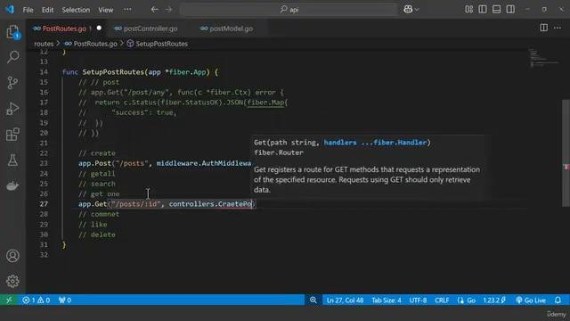
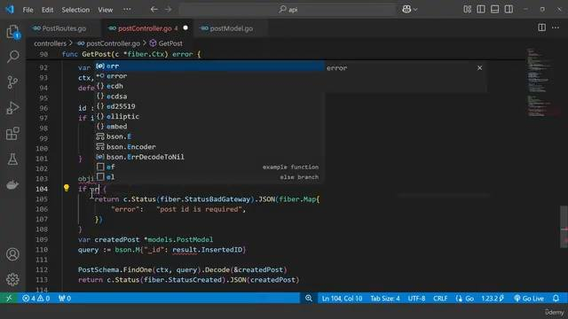
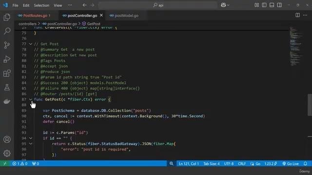
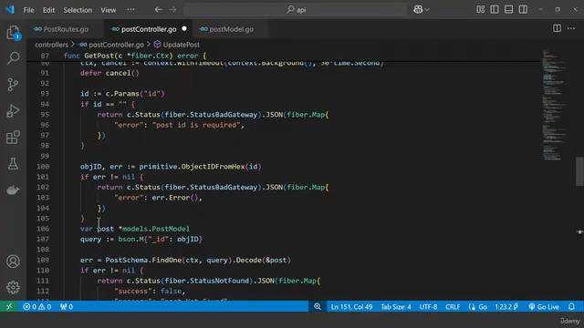
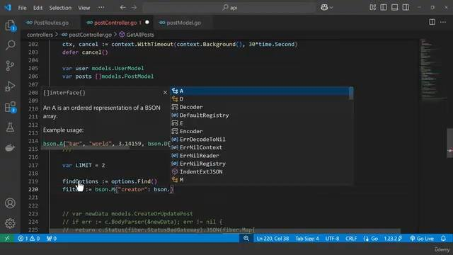
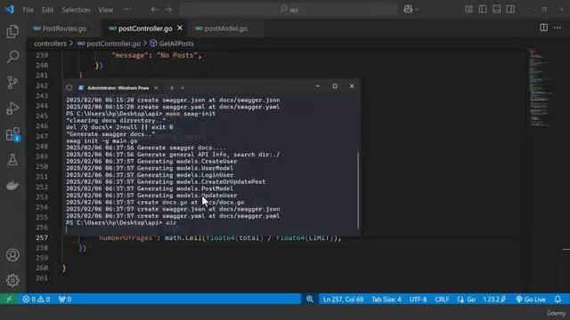
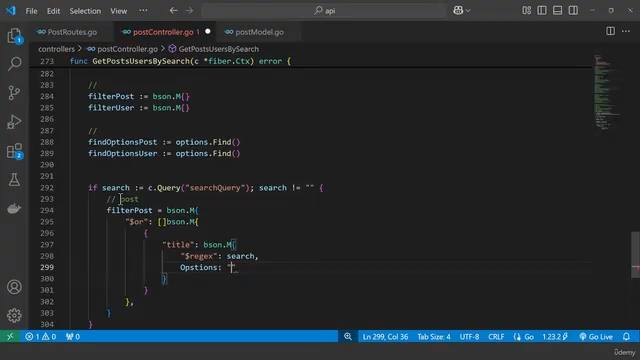
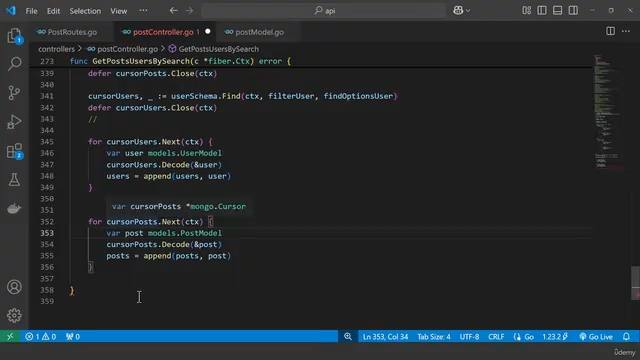

# Master Golang REST/gRPC（含 Redis）— P018–P021 复现文档

> 覆盖内容：`GET /posts/:id`（按 ID 取单条）、`PATCH /posts/:id`（带鉴权的更新）、`GET /posts`（分页 + 关注流）、`GET /posts/search`（用户与帖子联合搜索）。
> 技术栈：Go + Fiber + MongoDB（官方 `mongo-driver`）+ Swagger（`swag`）。Redis 在这四集里**没有出现**，课里没讲。

---

## 1. 这一节做什么

这四集是在同一个 Fiber 项目里，围绕 `posts` 资源把 CRUD 补完，并加上两个“读”接口：

| 集数 | 端点 | 方法 | 作用 | 关键点 |
|---|---|---|---|---|
| P018 | `/posts/:id` | GET | 按 ID 取单条帖子 | 路径参数 `id` 校验 → 转 `primitive.ObjectID` → 查库 |
| P019 | `/posts/:id` | PATCH | 更新帖子 | 先查旧帖 → 比对 `creator` 与 `c.locals.userId` → 只允许改 title/message/selectedFile |
| P020 | `/posts` | GET | 分页拉取“我 + 我关注的人”的帖子 | query 取 `page`、`id`；拼 `$in` 过滤；`skip/limit/sort` 分页；返回 `totalPages` |
| P021 | `/posts/search` | GET | 同时搜用户和帖子 | 两个 filter、两个 cursor、两个循环；`$or` + `$regex` |

四集共用同一套模式：**Swagger 注释 → 路由 → controller → 参数校验 → Mongo 查询 → 统一 JSON 返回**。把这一套吃透，后面加任何端点都是复制粘贴改字段。

从复现角度看，这一节真正要建立的是“接口闭环”意识：每加一个端点，先确定路由方法和路径，再确定参数从哪里来（路径参数、query、body、还是 middleware 注入的登录态），然后确定 Mongo 查询条件与返回结构，最后用 Swagger 和实际请求验证。四集里 P018 是最小读接口，P019 引入“先读后写 + 鉴权”，P020 引入“多条件过滤 + 分页”，P021 引入“多集合查询 + 模糊搜索”。复杂度是递进的，不是四套互不相关的代码。复现时不要只看 controller，路由顺序、middleware 注入、Mongo 字段名、返回空数组还是 `null`，都会直接影响前端能不能正常使用。

---

## 2. 讲师原话（带出处）

- 关于为什么 PATCH 而不是 PUT：
  > "we are using patch as always of course you can use put but i prefer to use patch"
  > —— p019 [00:00]

- 关于更新接口的鉴权思路（先取旧帖再比对 creator）：
  > "we need to have kind of authorization we need to make sure that the create a post is the first one we need actually to get the post"
  > —— p019 [04:11]

  > "if this AuthPost.creator is not equal for this C.locals user id ... you are not authorized to update this post"
  > —— p019 [07:29]

- 关于分页接口为什么要把“我”和“我关注的人”合并成一个列表：
  > "we will deal with our main user and his friends as just like one thing ... if we say that our main user have a post ID of one and his friends has other IDs, we want to deal with all these posts equally. By this way, we will get the latest created posts correctly."
  > —— p020 [06:46]

- 关于分页的 skip 计算：
  > "we want to skip ... this page minus 1 and all this will be multiplied with ... this limit"
  > —— p020 [13:05]

- 关于搜索接口的定位：
  > "this actually will work for post users and post at the same time meaning This will give us a results for users and posts as well."
  > —— p021 [00:00]

- 关于 P021 踩的坑（路由路径忘了加 `/search`）：
  > "I think I noted where is exactly the error it is actually on this part here on the pass ... we didn't change the pass at the same time we should have search here"
  > —— p021 [13:19]

---

## 3. 从零复现

### 3.1 环境与依赖

课里没给 `go.mod` 的完整内容，以下按逐字稿里出现的 import 反推，**版本号课里没讲**，用 `go get` 拉最新即可：

```bash
# 目录结构（课里隐含，按 Fiber 项目惯例）
mkdir -p myapp/{controllers,routes,models,config}
cd myapp
go mod init myapp

go get github.com/gofiber/fiber/v2
go get go.mongodb.org/mongo-driver/mongo
go get go.mongodb.org/mongo-driver/bson
go get go.mongodb.org/mongo-driver/bson/primitive
go get github.com/go-playground/validator/v10

# Swagger 生成器（课里反复用 make swag / swag init）
go install github.com/swaggo/swag/cmd/swag@latest
```

> 课里用 `make swag` 和 `make` 两个 Makefile 目标，Makefile 内容课里没展示。等价命令是 `swag init` 和 `go run .`。

上面命令逐条解释如下：`mkdir -p` 一次性创建多个目录，`-p` 表示父目录不存在就一起创建，已存在也不报错；`cd myapp` 进入模块根目录；`go mod init myapp` 初始化 Go module，模块名 `myapp` 会和后文 import 里的 `myapp/controllers`、`myapp/models` 对应，如果你的模块名改成别的，代码里的 import 路径也要同步改。`go get` 会把依赖写入 `go.mod` 和 `go.sum`，其中 `mongo`、`bson`、`primitive` 同属官方 MongoDB driver；`validator` 对应 P019 路由里出现的 `validation.ValidatePost`，但课里没展示校验实现，需要自己补。`go install ...swag@latest` 安装的是 Swagger 命令行工具，安装后要确认 `$(go env GOPATH)/bin` 或 `$(go env GOBIN)` 在 `PATH` 里，否则执行 `swag init` 会提示 command not found。

常见环境错误与排查：如果 `go get` 卡住或 404，先检查网络和 `GOPROXY`；如果启动时报 `cannot find package "myapp/controllers"`，通常是 `go.mod` 的 module 名和 import 路径不一致；如果 Swagger 页面没有新接口，通常是改完注释后没有重新执行 `swag init`，或者生成目录没有在 `main.go` 中导入；如果 Mongo 连接失败，先确认 `mongodb://localhost:27017` 本机服务是否启动、端口是否被占用、是否需要用容器或远程 URI。前端开发中可以把这一节类比为“创建项目、安装依赖、配置构建命令”：`go mod init` 类似 `npm init`，`go get` 类似 `npm install`，`swag init` 类似生成接口文档或类型声明。

### 3.2 目录结构（按逐字稿推断）

```
myapp/
├── main.go
├── go.mod
├── Makefile              # 课里没给内容，自己写：swag: swag init ; run: go run .
├── config/
│   └── database.go       # 课里提到 "connect"，内容未展示
├── models/
│   ├── post.go
│   └── user.go
├── controllers/
│   └── post_controller.go
└── routes/
    └── post_routes.go
```

这个结构是 Fiber 项目里常见的分层：`routes` 只负责注册路径和中间件，`controllers` 负责处理请求与响应，`models` 定义 BSON/JSON 结构，`config` 负责连接数据库。课里没有完整展示这些文件，所以复现时不要把“推断目录”当成讲师逐行写过的内容；它的作用是让代码有地方放。前端项目可以类比为 `pages/api` 或 `routes` 负责路由，`controllers/services` 负责业务，`models/types` 定义数据结构。排查目录类问题时，重点看 import 路径、包名是否一致，以及是否出现循环依赖。Go 的包名和目录名不强制完全一致，但按目录名命名最不容易出错。

### 3.3 复现步骤（严格按四集顺序）

**Step 1（P018）— 加 GET /posts/:id**

1. 在 `routes/post_routes.go` 里加一行 `app.Get("/posts/:id", controllers.GetPost)`。
2. 在 `controllers/post_controller.go` 里复制 `CreatePost` 的骨架，改名 `GetPost`。
3. 删掉 body 解析、删掉 user 相关字段，只留 `id := c.Params("id")`。
4. 空串校验 → `primitive.ObjectIDFromHex(id)` → `PostSchema.FindOne`。
5. 返回 200 + `fiber.Map{"post": post}`；找不到返回 404 + `{"success": false, "message": "post not found"}`。
6. `make` 重启 → Swagger 里 `GET /posts/{id}` 试一下，能拿到刚创建的那条。

这一段的完整理解是：路径 `/posts/:id` 里的 `:id` 是 Fiber 的参数占位符，请求 `/posts/abc` 时 `c.Params("id")` 得到 `abc`。`primitive.ObjectIDFromHex` 只接受 24 位十六进制字符串，传普通字符串会返回错误，所以必须显式处理成 400。`FindOne` 的 filter 用 `bson.M{"_id": objID}`，不能把字符串直接塞进去，否则类型不匹配。`Decode` 时如果 struct 的 `bson` tag 和数据库字段名不一致，可能不报错但字段为零值，排查时要用 Mongo shell 或 Compass 看一眼真实文档。前端对照：这相当于详情页根据路由参数 `id` 调 `GET /posts/:id`，前端要处理 200、400、404 三种状态，不能只判断 `response.ok`。

**Step 2（P019）— 加 PATCH /posts/:id**

1. 路由：`app.Patch("/posts/:id", middleware, validation.ValidatePost, controllers.UpdatePost)`。
2. controller 里先 `FindOne` 出旧帖 `authPost`。
3. 比对 `authPost.Creator != c.Locals("userId").(string)` → 403 "you are not authorized to update this post"。
4. 解析 body 到 `newData`，只把 `title / message / selectedFile` 三个字段写回。
5. `UpdateOne` 用 `primitive.ObjectIDFromHex(authPost.ID)` 作 filter。
6. 返回 200 + `{"data": ...}`；出错 500。

这里的重点是“先读后写”：鉴权信息不在 body 里，必须先从数据库读旧帖，拿到 `creator`，再和 middleware 注入的 `userId` 比较。`c.Locals("userId")` 如果 middleware 没注入，会得到 `nil`，类型断言 `.(string)` 可能 panic；稳妥写法是 `currentUserID, ok := c.Locals("userId").(string)`，不 ok 直接 401 或 403。PATCH 的语义是局部更新，所以用 `$set` 只改允许字段；不要直接把 body 整个写回，否则前端可以偷偷改 `creator`。常见错误：路由里 middleware 顺序不对，导致 controller 拿不到用户；body 字段名和 struct tag 不一致，更新成空字符串；filter 用错类型，导致 `matchedCount=0`。前端对照：PATCH 请求要带 token，前端不能只根据按钮是否禁用来做权限，后端必须再校验一次。

**Step 3（P020）— 加 GET /posts（分页 + 关注流）**

1. 路由：`app.Get("/posts", controllers.GetAllPosts)`。
2. 从 query 取 `id`（用户 ID）和 `page`（默认 1）。
3. 查当前用户 → 拿到 `following` 列表 → `append(following, userId)`。
4. 构造 filter：`{"creator": {"$in": following}}`。
5. `CountDocuments` 得 `total`；`FindOptions` 设 `Skip=(page-1)*limit`、`Limit=limit`、`Sort={"createdAt": -1}`（课里口述是 `_id, -1`，见第 7 节）。
6. 遍历 cursor 拼 `posts` 数组，返回 `{"data": posts, "page": page, "totalPages": ceil(total/limit)}`。

复现时先确认 query 参数：`id` 是当前登录用户 ID，`page` 默认从 1 开始，小于 1 时归一到 1。`following := append(user.Following, userID)` 的目的是把“自己”也放进 `$in`，否则自己的帖子不会出现在关注流里。`CountDocuments` 不分页，用来算总页数；`Find` 才分页。`skip` 是 `(page-1)*limit`，第 1 页跳过 0 条，第 2 页跳过 `limit` 条。`posts := make([]models.Post, 0)` 是为了空结果返回 `[]` 而不是 `null`，前端列表渲染时更安全。常见错误：`limit` 写成 0 或负数导致查询异常；`page` 不是数字时 `Atoi` 返回 0，需要自己兜底；`total` 为 0 时提前 404，前端要把它当成“暂无内容”而不是接口故障。前端对照：这就是常见的无限滚动或分页列表，前端根据 `page`、`totalPages` 决定是否继续加载。

**Step 4（P021）— 加 GET /posts/search**

1. 路由：`app.Get("/posts/search", controllers.GetPostsUsersBySearch)`。**注意 `/search` 必须写在 `/posts/:id` 之前**，否则会被 `:id` 吃掉（课里没明说，但这是 Fiber 路由匹配顺序的常识，见第 7 节）。
2. 从 query 取 `search`。
3. 构造 `filterPost`：`{"$or": [{"title": {"$regex": search}}, {"description": {"$regex": search}}]}`。
4. 构造 `filterUser`：`{"$or": [{"name": {"$regex": search}}, {"email": {"$regex": search}}]}`。
5. 两个 cursor 各跑一遍循环，分别 append 到 `posts` 和 `users`。
6. 返回 `{"users": users, "posts": posts}`。

这一段先要理解“联合搜索”不是 Mongo 的 join，而是同一个关键词分别查两个集合，再把两个结果数组并列返回。`$or` 表示多个条件任一命中，`$regex` 做模糊匹配，`Options: "i"` 表示大小写不敏感。两个 cursor 都要关闭，循环里 `Decode` 失败时原代码是 `continue`，排查时要看是否因为字段类型不一致导致大量跳过。常见错误：路由顺序写成 `/posts/:id` 在前，访问 `/posts/search` 时 `id` 变成字符串 `search`，随后 `ObjectIDFromHex` 失败返回 400；搜索关键词为空时 filter 为空，会返回全量数据，前端要决定是否允许空搜索；Post 的搜索条件用了 `description`，但 model 里出现的是 `message`，如果数据库没有 `description`，按消息内容搜索不会命中。前端对照：搜索框通常做防抖，空关键词可以不请求或请求全量；返回两个数组时，前端要分别渲染“用户结果”和“帖子结果”，不要假设两个数组一定等长。

---

## 4. 完整代码

> 以下代码按逐字稿逐句还原。课里没展示的部分（`config/database.go`、`models` 的完整字段、`middleware`、`validation`）用注释标出「课里没讲」，只保留能跑通的最小骨架。

### 4.1 `models/post.go`

```go
package models

import "go.mongodb.org/mongo-driver/bson/primitive"

// 课里只出现了 title / message / selectedFile / creator 四个字段，
// 其余字段（createdAt 等）课里没讲，这里不编造。
type Post struct {
	ID           primitive.ObjectID `bson:"_id,omitempty" json:"_id,omitempty"`
	Title        string             `bson:"title" json:"title"`
	Message      string             `bson:"message" json:"message"`
	SelectedFile string             `bson:"selectedFile" json:"selectedFile"`
	Creator      string             `bson:"creator" json:"creator"`
}
```

这个 struct 是 P018 和 P019 能跑通的基础。`bson` tag 决定从 Mongo 解码时找哪个字段，`json` tag 决定返回给前端时叫什么名字。`_id` 用 `omitempty` 可以避免空 ID 被序列化；但查询时仍要传 `primitive.ObjectID`。如果前端发现返回字段是空的，优先检查 Mongo 文档字段名和 `bson` tag 是否一致。课里没展示 `createdAt`，所以后文排序用 `_id`，不要凭空假设数据库里有 `createdAt`。

### 4.2 `models/user.go`

```go
package models

import "go.mongodb.org/mongo-driver/bson/primitive"

// 课里只用到 name / email / following 三个字段，其余课里没讲。
type User struct {
	ID        primitive.ObjectID `bson:"_id,omitempty" json:"_id,omitempty"`
	Name      string             `bson:"name" json:"name"`
	Email     string             `bson:"email" json:"email"`
	Following []string           `bson:"following" json:"following"`
}
```

`Following` 是字符串数组，P020 会把它和当前用户 ID 一起放进 `$in`。这里要特别注意：如果数据库里 `following` 存的是 ObjectID 数组而不是字符串数组，`$in` 传入字符串会匹配不上。复现时用 Mongo shell 看一眼 `typeof` 或实际值。`Name`、`Email` 是 P021 搜索用户时用到的字段；如果实际字段名不同，要同步改 filter。

### 4.3 `controllers/post_controller.go`（四集合并）

```go
package controllers

import (
	"context"
	"math"
	"strconv"
	"time"

	"myapp/models"

	"github.com/gofiber/fiber/v2"
	"go.mongodb.org/mongo-driver/bson"
	"go.mongodb.org/mongo-driver/bson/primitive"
	"go.mongodb.org/mongo-driver/mongo"
	"go.mongodb.org/mongo-driver/mongo/options"
)

// PostSchema / UserSchema 在课里是包级变量，由 config 包初始化后注入。
// 课里没展示初始化代码，这里声明为变量，main.go 里赋值。
var (
	PostSchema *mongo.Collection
	UserSchema *mongo.Collection
)

// ---------- P018: GET /posts/:id ----------

// GetPost godoc
// @Summary      Get post by id
// @Description  Get a single post by its id
// @Tags         posts
// @Produce      json
// @Param        id   path      string  true  "Post ID"
// @Success      200  {object}  map[string]interface{}
// @Router       /posts/{id} [get]
func GetPost(c *fiber.Ctx) error {
	id := c.Params("id")
	if id == "" {
		return c.Status(fiber.StatusBadRequest).JSON(fiber.Map{
			"success": false,
			"message": "id is required",
		})
	}

	objID, err := primitive.ObjectIDFromHex(id)
	if err != nil {
		return c.Status(fiber.StatusBadRequest).JSON(fiber.Map{
			"success": false,
			"message": "invalid id",
		})
	}

	ctx, cancel := context.WithTimeout(context.Background(), 10*time.Second)
	defer cancel()

	var post models.Post
	err = PostSchema.FindOne(ctx, bson.M{"_id": objID}).Decode(&post)
	if err != nil {
		return c.Status(fiber.StatusNotFound).JSON(fiber.Map{
			"success": false,
			"message": "post not found",
		})
	}

	return c.Status(fiber.StatusOK).JSON(fiber.Map{
		"post": post,
	})
}

// ---------- P019: PATCH /posts/:id ----------

// UpdatePost godoc
// @Summary      Update post
// @Description  Update post details (title / message / selectedFile only)
// @Tags         posts
// @Produce      json
// @Param        id   path      string  true  "Post ID"
// @Success      200  {object}  map[string]interface{}
// @Router       /posts/{id} [patch]
func UpdatePost(c *fiber.Ctx) error {
	// 1) 先取旧帖，用于鉴权
	postID := c.Params("id")
	objID, err := primitive.ObjectIDFromHex(postID)
	if err != nil {
		return c.Status(fiber.StatusBadRequest).JSON(fiber.Map{
			"success": false,
			"message": "invalid id",
		})
	}

	ctx, cancel := context.WithTimeout(context.Background(), 10*time.Second)
	defer cancel()

	var authPost models.Post
	if err := PostSchema.FindOne(ctx, bson.M{"_id": objID}).Decode(&authPost); err != nil {
		return c.Status(fiber.StatusNotFound).JSON(fiber.Map{
			"success": false,
			"message": "post not found",
		})
	}

	// 2) 鉴权：creator 必须等于当前登录用户
	// c.Locals("userId") 由 middleware 注入，课里没展示 middleware 实现
	currentUserID, _ := c.Locals("userId").(string)
	if authPost.Creator != currentUserID {
		return c.Status(fiber.StatusForbidden).JSON(fiber.Map{
			"success": false,
			"message": "you are not authorized to update this post",
		})
	}

	// 3) 解析 body
	var newData struct {
		Title        string `json:"title"`
		Message      string `json:"message"`
		SelectedFile string `json:"selectedFile"`
	}
	if err := c.BodyParser(&newData); err != nil {
		return c.Status(fiber.StatusBadRequest).JSON(fiber.Map{
			"success": false,
			"message": "invalid body",
		})
	}

	// 4) 只更新三个字段
	update := bson.M{
		"$set": bson.M{
			"title":        newData.Title,
			"message":      newData.Message,
			"selectedFile": newData.SelectedFile,
		},
	}

	result, err := PostSchema.UpdateOne(ctx, bson.M{"_id": objID}, update)
	if err != nil {
		return c.Status(fiber.StatusInternalServerError).JSON(fiber.Map{
			"success": false,
			"message": "internal server error",
		})
	}

	return c.Status(fiber.StatusOK).JSON(fiber.Map{
		"data": result,
	})
}

// ---------- P020: GET /posts ----------

// GetAllPosts godoc
// @Summary      Get all posts
// @Description  Get paginated posts of current user and followed users
// @Tags         posts
// @Produce      json
// @Param        page  query     int     false  "Page number"
// @Param        id    query     string  true   "User ID"
// @Success      200   {object}  map[string]interface{}
// @Router       /posts [get]
func GetAllPosts(c *fiber.Ctx) error {
	userID := c.Query("id")
	page, _ := strconv.Atoi(c.Query("page", "1"))
	if page < 1 {
		page = 1
	}

	ctx, cancel := context.WithTimeout(context.Background(), 10*time.Second)
	defer cancel()

	// 1) 取当前用户，拿到 following 列表
	objID, err := primitive.ObjectIDFromHex(userID)
	if err != nil {
		return c.Status(fiber.StatusBadRequest).JSON(fiber.Map{
			"success": false,
			"message": "invalid user id",
		})
	}

	var user models.User
	if err := UserSchema.FindOne(ctx, bson.M{"_id": objID}).Decode(&user); err != nil {
		return c.Status(fiber.StatusNotFound).JSON(fiber.Map{
			"success": false,
			"message": "user not found",
		})
	}

	// 2) 关注列表 + 自己
	following := append(user.Following, userID)

	// 3) 过滤条件
	filter := bson.M{
		"creator": bson.M{"$in": following},
	}

	// 4) 总数
	total, err := PostSchema.CountDocuments(ctx, filter)
	if err != nil {
		return c.Status(fiber.StatusInternalServerError).JSON(fiber.Map{
			"success": false,
			"message": "internal server error",
		})
	}
	if total == 0 {
		return c.Status(fiber.StatusNotFound).JSON(fiber.Map{
			"success": false,
			"message": "no posts",
		})
	}

	// 5) 分页参数
	const limit = 2
	skip := int64((page - 1) * limit)

	findOptions := options.Find()
	findOptions.SetSkip(skip)
	findOptions.SetLimit(int64(limit))
	// 课里口述是 "_id, -1"，即按 _id 倒序
	findOptions.SetSort(bson.D{{Key: "_id", Value: -1}})

	cursor, err := PostSchema.Find(ctx, filter, findOptions)
	if err != nil {
		return c.Status(fiber.StatusInternalServerError).JSON(fiber.Map{
			"success": false,
			"message": "internal server error",
		})
	}
	defer cursor.Close(ctx)

	posts := make([]models.Post, 0)
	for cursor.Next(ctx) {
		var post models.Post
		if err := cursor.Decode(&post); err != nil {
			continue
		}
		posts = append(posts, post)
	}

	// 6) 总页数
	totalPages := int(math.Ceil(float64(total) / float64(limit)))

	return c.Status(fiber.StatusOK).JSON(fiber.Map{
		"data":       posts,
		"page":       page,
		"totalPages": totalPages,
	})
}

// ---------- P021: GET /posts/search ----------

// GetPostsUsersBySearch godoc
// @Summary      Get posts & users by search query
// @Description  Get posts and users matching the search query
// @Tags         posts
// @Produce      json
// @Param        search  query     string  true  "Search query"
// @Success      200     {object}  map[string]interface{}
// @Router       /posts/search [get]
func GetPostsUsersBySearch(c *fiber.Ctx) error {
	search := c.Query("search")

	ctx, cancel := context.WithTimeout(context.Background(), 10*time.Second)
	defer cancel()

	// 1) 两个 filter
	filterPost := bson.M{}
	filterUser := bson.M{}

	if search != "" {
		filterPost = bson.M{
			"$or": []bson.M{
				{"title": bson.M{"$regex": primitive.Regex{Pattern: search, Options: "i"}}},
				{"description": bson.M{"$regex": primitive.Regex{Pattern: search, Options: "i"}}},
			},
		}
		filterUser = bson.M{
			"$or": []bson.M{
				{"name": bson.M{"$regex": primitive.Regex{Pattern: search, Options: "i"}}},
				{"email": bson.M{"$regex": primitive.Regex{Pattern: search, Options: "i"}}},
			},
		}
	}

	// 2) 查帖子
	postCursor, err := PostSchema.Find(ctx, filterPost, options.Find())
	if err != nil {
		return c.Status(fiber.StatusInternalServerError).JSON(fiber.Map{
			"success": false,
			"message": "internal server error",
		})
	}
	defer postCursor.Close(ctx)

	posts := make([]models.Post, 0)
	for postCursor.Next(ctx) {
		var post models.Post
		if err := postCursor.Decode(&post); err != nil {
			continue
		}
		posts = append(posts, post)
	}

	// 3) 查用户
	userCursor, err := UserSchema.Find(ctx, filterUser, options.Find())
	if err != nil {
		return c.Status(fiber.StatusInternalServerError).JSON(fiber.Map{
			"success": false,
			"message": "internal server error",
		})
	}
	defer userCursor.Close(ctx)

	users := make([]models.User, 0)
	for userCursor.Next(ctx) {
		var user models.User
		if err := userCursor.Decode(&user); err != nil {
			continue
		}
		users = append(users, user)
	}

	return c.Status(fiber.StatusOK).JSON(fiber.Map{
		"users": users,
		"posts": posts,
	})
}
```

以上代码块是四集合并后的最小还原。复现时建议按 P018→P021 逐段粘贴，不要一次全贴，否则出问题很难定位是哪一集引入的。尤其是 P019 的 `c.Locals("userId")` 依赖 middleware，P021 的路由顺序依赖注册顺序，这两处不是 controller 内能自测的。

### 4.4 `routes/post_routes.go`

```go
package routes

import (
	"myapp/controllers"

	"github.com/gofiber/fiber/v2"
)

func PostRoutes(app *fiber.App) {
	// 注意：/posts/search 必须写在 /posts/:id 之前
	app.Get("/posts/search", controllers.GetPostsUsersBySearch)
	app.Get("/posts/:id", controllers.GetPost)
	app.Get("/posts", controllers.GetAllPosts)
	app.Patch("/posts/:id", controllers.UpdatePost)
}
```

路由文件里 `/posts/search` 放在 `/posts/:id` 前面是关键。Fiber 按注册顺序匹配，`/posts/search` 如果后注册，会被 `:id` 捕获。`/posts` 和 `/posts/:id` 不冲突，但 `/posts/search` 和 `/posts/:id` 冲突。前端对照：这类似前端路由里静态路径要优先于动态参数路径，否则 `/posts/search` 会被 `/posts/:id` 页面接管。

### 4.5 `main.go`（最小可跑骨架）

```go
package main

import (
	"context"
	"log"
	"time"

	"myapp/controllers"
	"myapp/routes"

	"github.com/gofiber/fiber/v2"
	"go.mongodb.org/mongo-driver/mongo"
	"go.mongodb.org/mongo-driver/mongo/options"
)

func main() {
	// 课里没展示 config/database.go，这里内联最小连接逻辑
	ctx, cancel := context.WithTimeout(context.Background(), 10*time.Second)
	defer cancel()

	client, err := mongo.Connect(ctx, options.Client().ApplyURI("mongodb://localhost:27017"))
	if err != nil {
		log.Fatal(err)
	}
	db := client.Database("myapp")

	controllers.PostSchema = db.Collection("posts")
	controllers.UserSchema = db.Collection("users")

	app := fiber.New()
	routes.PostRoutes(app)

	log.Fatal(app.Listen(":3000"))
}
```

`main.go` 里最重要的是把 `PostSchema`、`UserSchema` 赋值，否则 controller 里调用会 nil pointer。`mongo.Connect` 只创建客户端，真正首次操作时才建立连接；如果启动时不报错但请求时报连接错误，检查 Mongo 服务、URI、数据库名。`defer cancel()` 在 `main` 里不会一直等到程序结束前执行吗？这里 `defer cancel()` 会在 `main` 返回时执行，但 `main` 因 `Listen` 阻塞，实际影响不大；生产代码应更细粒度管理 context。前端对照：这相当于后端启动时初始化数据库连接池，前端不需要关心，但接口 500 时要看后端日志。

### 4.6 `Makefile`

```makefile
swag:
	swag init

run:
	go run .

# 课里用 `make` 直接重启，等价于：
all: run
```

Makefile 里每个目标下面必须是 Tab 缩进，不是空格；如果报 `missing separator`，检查缩进。`make swag` 生成文档，`make` 走 `all` 目标执行 `run`。如果 `swag` 命令找不到，把 `$(go env GOPATH)/bin` 加入 `PATH`。前端可类比为 `npm run dev`、`npm run build`，只是这里把生成文档和启动服务拆成两个目标。

---

## 5. 逐行解释

### 5.1 P018 `GetPost`

- `id := c.Params("id")`：Fiber 的路径参数，对应路由里的 `:id`。在 Express 里就是 `req.params.id`。
- `if id == ""`：课里原话 "ID is required"，返回 400。这是防御性校验，正常路由匹配到 `:id` 时不会为空，但保留无害。
- `primitive.ObjectIDFromHex(id)`：MongoDB 的 `_id` 是 12 字节的 ObjectID，字符串必须转成这个类型才能查。**这一步失败说明前端传了非法 ID**，返回 400。
- `PostSchema.FindOne(ctx, bson.M{"_id": objID})`：`bson.M` 是 `map[string]interface{}` 的别名，等价于 Mongo shell 里的 `{_id: ObjectId("...")}`。
- `Decode(&post)`：把 BSON 反序列化到 struct。**注意 struct 的 `bson` tag 必须和数据库字段名一致**，否则解出来是零值。
- 返回 `fiber.Map{"post": post}`：课里原话 "我们把它改成只用 post"，即 key 叫 `post`。

补充排查：如果 `FindOne` 返回 `mongo.ErrNoDocuments`，当前代码统一当 404，这是合理的；但如果返回的是 context deadline 或其他驱动错误，也变成 404 会掩盖真实问题。更细的写法是 errors.Is 判断 `ErrNoDocuments`，其他错误给 500。前端对照：详情页拿到 404 应该显示“内容不存在”，拿到 400 应该提示 ID 非法，不要都弹同一个错误。

### 5.2 P019 `UpdatePost`

- **为什么先 FindOne 再 Update**：课里原话 "我们需要确保创建帖子是第一步，实际上我们需要先获取帖子"。因为鉴权需要知道这条帖子的 `creator` 是谁，而 `creator` 不在请求体里，只能从库里读。
- `authPost.Creator != currentUserID`：字符串直接比较。`c.Locals("userId")` 是 Fiber 的上下文变量，由 middleware 在 JWT 校验后写入。**课里没展示 middleware 实现**，只说了 "这和我们在这里提取的名称完全一样"。
- `bson.M{"$set": bson.M{...}}`：MongoDB 的局部更新操作符，只改指定字段，其余字段不动。**这就是 PATCH 语义**——如果换成 PUT，应该整体替换文档。
- `UpdateOne` 的 filter 用 `objID` 而不是 `authPost.ID`：课里原话 "我们不需要检查错误，因为这是从数据库返回给我们的"，即 `authPost.ID` 已经是 `primitive.ObjectID` 类型，但为了和前面 `FindOne` 保持一致，这里直接用 `objID` 更稳。
- 返回 `fiber.Map{"data": result}`：课里原话 "fiber map 数据的指针"，即 key 叫 `data`，值是 `*mongo.UpdateResult`。

补充排查：`c.Locals("userId").(string)` 在值不存在时会 panic，原代码用了 `_` 忽略 ok，实际项目建议判断。`UpdateOne` 成功不代表改到了文档，要看 `result.MatchedCount`；如果为 0，可能是 ID 不存在或 filter 类型不对。PATCH 只更新三个字段，未传字段会变成空字符串，因为 `newData` 零值就是 `""`；如果前端只想改 title，需要后端先取旧值再合并，或者用指针字段判断是否传了。课里没展开这一点，复现时会遇到“只改一个字段，其他字段被清空”的问题。

### 5.3 P020 `GetAllPosts`

- `following := append(user.Following, userID)`：把“我”也加进关注列表，这样一次查询就能拿到“我 + 我关注的人”的所有帖子。课里原话解释得很清楚："我们会把主用户和他的好友当作一个整体来处理"。
- `bson.M{"creator": bson.M{"$in": following}}`：`$in` 是 Mongo 的“属于数组任一元素”操作符，等价于 SQL 的 `WHERE creator IN (...)`。
- `CountDocuments`：先查总数，用于算 `totalPages`。**注意这里没有分页**，是全量 count。
- `skip := int64((page - 1) * limit)`：第 1 页 skip 0，第 2 页 skip 2（limit=2 时）。课里原话 "这个页码减 1，然后全部乘以……这个 limit"。
- `findOptions.SetSort(bson.D{{Key: "_id", Value: -1}})`：按 `_id` 倒序，即最新创建的在前。课里口述是 "id 写成连字符连字符一"，即 `-1`。**注意课里说的是 `_id` 不是 `createdAt`**，因为 `createdAt` 字段课里没定义。
- `posts := make([]models.Post, 0)`：**必须用 `make` 而不是 `var posts []models.Post`**，否则空结果会序列化成 `null` 而不是 `[]`。课里原话 "我们可以直接让 posts 等于不追加，把这个删掉，改成创建一个空帖子，这里传零"。
- `math.Ceil(float64(total) / float64(limit))`：向上取整。比如 total=5、limit=2，得 3 页。

补充排查：`append(user.Following, userID)` 可能复用底层数组，安全写法是先复制一份；`$in` 数组里如果混入空字符串或 ObjectID 字符串，可能查不到；`total==0` 提前 404 会让前端分页组件拿不到 `totalPages=0`，如果前端需要空列表而不是错误，可以改成 200 返回空数组。前端对照：分页接口通常返回 `data`、`page`、`totalPages`，前端根据 `page < totalPages` 判断是否还有下一页。

### 5.4 P021 `GetPostsUsersBySearch`

- `filterPost = bson.M{"$or": []bson.M{...}}`：`$or` 是 Mongo 的“任一条件满足”，配合 `$regex` 实现模糊搜索。
- `primitive.Regex{Pattern: search, Options: "i"}`：`i` 表示大小写不敏感。课里原话 "我们需要把它作为原始正则表达式传进去"。
- **两个 cursor 分别遍历**：课里没有用 `$lookup` 或聚合，而是简单粗暴地查两次、循环两次。优点是代码直白，缺点是两次 round-trip。
- `defer postCursor.Close(ctx)`：**必须关 cursor**，否则连接池会泄漏。课里原话 "我们想关闭它，但这个 ctx"。
- 返回 `fiber.Map{"users": users, "posts": posts}`：课里原话 "返回用户，以及用户的帖子"，即两个 key 并列。

补充排查：`primitive.Regex` 在新版 driver 中可能建议用 `bson.RegEx`，编译报错时按版本替换；`$regex` 不加索引会全表扫描，数据量大时慢；如果搜索关键词包含正则特殊字符，可能被当成正则语法，生产环境要做转义或改用文本索引。前端对照：搜索接口返回两个集合，前端要分别处理 loading 和空状态；空关键词是否请求全量，要由前后端约定，不能默认。

---

## 6. 复现检查清单

跑完四集后，按这个清单逐项验证：

- [ ] `go build ./...` 无报错  
  验证方法：在模块根目录执行，确认所有包能编译；如果报 import 错误，检查 `go.mod` module 名和代码里的 `myapp/...` 是否一致。
- [ ] `swag init` 成功生成 `docs/` 目录  
  验证方法：看根目录是否出现 `docs/docs.go`、`swagger.json`、`swagger.yaml`；如果命令找不到，把 `GOPATH/bin` 加入 `PATH`。
- [ ] `go run .` 启动在 `:3000`  
  验证方法：终端无 fatal；浏览器访问 `http://localhost:3000` 或 Swagger UI，确认端口没被占用。
- [ ] Swagger UI 里能看到 4 个新端点：`GET /posts/{id}`、`PATCH /posts/{id}`、`GET /posts`、`GET /posts/search`  
  验证方法：重新执行 `swag init` 并重启服务；确认注释里的 `@Router` 路径和方法正确。
- [ ] **P018**：先 `POST /posts` 创建一条，拿到 `_id`，再 `GET /posts/{id}` 能返回同一条  
  验证方法：记录创建返回的 `_id`，请求详情，逐字段比对 title、message、selectedFile、creator。
- [ ] **P018**：传一个非法 ID（如 `abc`），返回 400  
  验证方法：请求 `GET /posts/abc`，确认状态码 400，body 里 message 为 `invalid id`。
- [ ] **P019**：用创建者账号 PATCH 自己的帖子，返回 200，再 GET 确认三个字段已变  
  验证方法：带创建者 token，body 只传要改的字段，PATCH 后再 GET，确认数据库实际值变了。
- [ ] **P019**：用另一个账号 PATCH 别人的帖子，返回 403 "你无权更新这个帖子"  
  验证方法：换 token 或换 `userId`，确认不是 200，且没有发生更新。
- [ ] **P019**：PATCH 时少传 `title`，返回 400（课里原话 "你会收到消息和记录，请求返回 400 错误"）  
  验证方法：清空 title 或不传 title，确认 validation 中间件拦截；如果没拦截，检查 `validation.ValidatePost` 是否挂到路由上。
- [ ] **P020**：`GET /posts?id=<我的ID>&page=1` 返回我 + 我关注的人的帖子，按 `_id` 倒序  
  验证方法：准备两条不同 creator 的帖子，确认都在结果里；比较 `_id` 顺序是否从大到小。
- [ ] **P020**：`page=2` 返回下一页，`totalPages` 正确  
  验证方法：造 5 条帖子、limit=2，确认第 1 页 2 条、第 2 页 2 条、第 3 页 1 条，`totalPages=3`。
- [ ] **P020**：传一个没有关注任何人、也没发过帖的 ID，返回 404 "no posts"  
  验证方法：用一个干净用户 ID 请求，确认 `CountDocuments` 为 0 时走 404；如果业务需要空数组，记录这是当前实现约定。
- [ ] **P021**：`GET /posts/search?search=ahmed` 同时返回 `users` 和 `posts` 两个数组  
  验证方法：响应 JSON 里必须同时有 `users` 和 `posts`，即使其中一个为空也应是数组。
- [ ] **P021**：`search=a` 返回包含 `a` 的所有用户和帖子（大小写不敏感）  
  验证方法：准备大小写混合数据，确认 `Options: "i"` 生效；确认 `/posts/search` 没被 `/posts/:id` 捕获。
- [ ] **P021**：`search=` 空串时，返回全部（因为 `if search != ""` 不成立，filter 为空）  
  验证方法：请求空 search，确认返回全量而不是 400；如果不想返回全量，需要在代码里加空串校验。

---

## 7. 课里没讲但你会撞上的（表格：现象 / 原因 / 怎么办）

| 现象 | 原因 | 怎么办 |
|---|---|---|
| 访问 `/posts/search` 返回 400 invalid id，或根本没进搜索 controller | 路由顺序问题：`/posts/:id` 先注册，`search` 被当成 `:id` 的值；P021 讲师也踩过路径忘加 `/search` 的坑 | 把 `app.Get("/posts/search", ...)` 放在 `app.Get("/posts/:id", ...)` 之前；改完路由重启并重新看启动日志 |
| PATCH 时 controller 拿不到用户，甚至 panic | `c.Locals("userId")` 由 middleware 注入，但 middleware 实现课里没展示；key 名或类型不对会得到 nil | 自己写 JWT 中间件，解析 token 后 `c.Locals("userId", claims.UserID)`；读取时用 `currentUserID, ok := c.Locals("userId").(string)` 判断 |
| 启动后请求接口 500 或 nil pointer | `config/database.go` 课里没给，`PostSchema`、`UserSchema` 可能没有初始化 | 用 4.5 节的最小连接逻辑先跑通；生产环境把连接抽到 `config` 包并加超时、连接池参数 |
| PATCH 少传 title 没返回 400 | 路由里挂了 `validation.ValidatePost`，但校验逻辑课里没展示，可能没实现或没挂上 | 用 `go-playground/validator` 写校验；确认路由中间件顺序是 middleware → validation → controller |
| 分页排序不稳定或全部相等 | 代码按 `_id` 倒序，课里没定义 `createdAt`；如果自己加了 `createdAt` 但创建时没写入，排序会失效 | 要么继续用 `_id`（ObjectID 自带时间戳），要么在 CreatePost 里显式写 `createdAt: time.Now()` 并建索引 |
| `totalPages` 出现 0 或前端分页异常 | `math.Ceil(0/2)=0`，但当前代码在 `total==0` 时提前 404；如果改了提前返回逻辑，边界会暴露 | 明确空结果约定：返回 200 + 空数组 + `totalPages=0`，或保留 404；前端按约定处理 |
| 搜索很慢，数据量大时超时 | P021 用 `$regex` 模糊搜索，默认全表扫描，没有索引 | 建文本索引如 `db.posts.createIndex({title: "text", description: "text"})` 并改用 `$text`；或至少给搜索字段建合适索引 |
| `append(user.Following, userID)` 后原切片被意外修改 | Go slice 的 `append` 在 cap 足够时复用底层数组 | 安全写法：`following := append([]string{}, user.Following...)`，再 `append(following, userID)` |
| 用最新 Mongo driver 编译报 `primitive.Regex` 相关错误 | 课里用 `primitive.Regex`，新版 driver 更推荐 `bson.RegEx`；版本差异课里没讲 | 按当前 driver 版本替换为 `bson.RegEx{Pattern: search, Options: "i"}`，或锁定与课程一致的 driver 版本 |
| 按标题找 Redis，但 P018–P021 完全没有 Redis 代码 | 课程标题带“(含 Redis)”，但这四集里没有出现 Redis；课里没讲 | 这四集先按 Mongo + Fiber 复现，Redis 部分等后续集数；不要在这四集里强行加 Redis 缓存，否则会改变课程事实 |
| 搜索帖子时用 message 搜不到，但 title 能搜到 | 原代码 filterPost 用 `description`，而 model 里出现的是 `message`；如果数据库字段是 `message`，`description` 条件不会命中 | 统一字段名：要么把 filter 改成 `message`，要么确认数据库确实有 `description`；改完用 Mongo shell 验证字段存在 |

---

## 附：关键截图

P018 讲师在路由文件里加 `GET /posts/:id`，可以看到 `app.Get` 和 `controllers.GetPost` 的写法：



P018 讲师在 controller 里写 `primitive.ObjectIDFromHex` 校验：



P019 讲师在 PATCH 路由上挂 middleware 和 validation：



P019 鉴权比对 `authPost.creator` 与 `c.locals.userId`：



P020 讲师构造 `$in` 过滤和分页参数：



P020 讲师用 `math.Ceil` 算总页数：



P021 讲师构造 `$or` + `$regex` 的搜索过滤：



P021 讲师发现路由路径漏了 `/search`：

