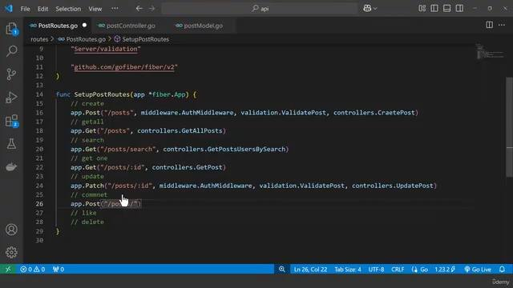
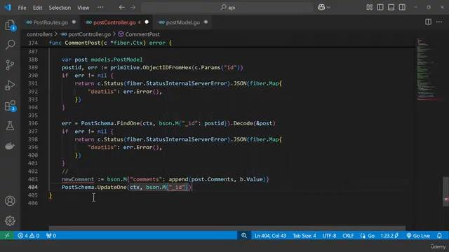
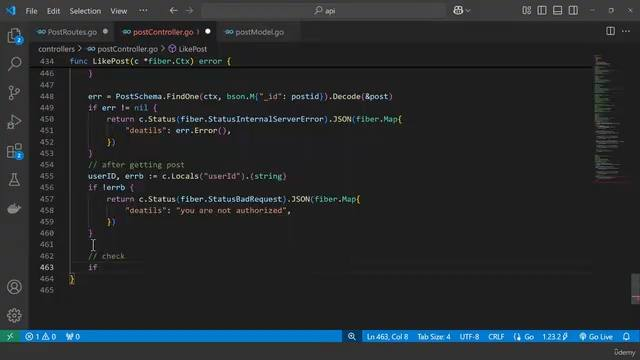
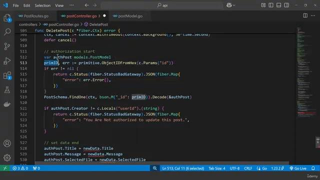
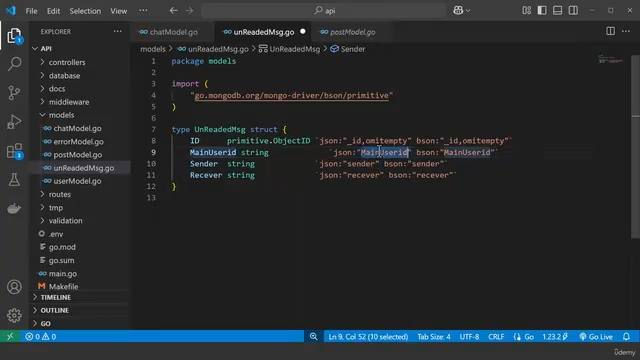
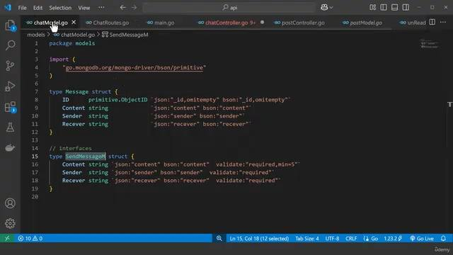
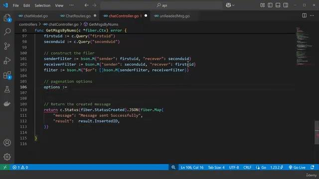

# Master Golang REST/gRPC（含 Redis）P22–P27 复现文档：帖子评论 / 点赞 / 删除 + 聊天消息与未读计数

> 适用读者：前端转 AI 应用工程师。Go 语法只讲到「能照着敲」的程度，遇到并发/锁会补一句 Node 里的对应物。
> 覆盖范围：P22 创建评论、P23 点赞/取消点赞、P24 删除帖子、P25 聊天数据模型、P26 发送消息（含未读计数 upsert）、P27 分页拉取两人之间的消息。
> 说明：逐字稿是英文自动转写，里面大量口误（"command" 其实是 "comment"，"peso" 是 "bson"，"mixwag" 是 "make swag"）。本文按讲师**实际意图**还原，凡是逐字稿没讲清的地方都明确标注「课里没讲」。

---

## 1. 这一节做什么

这 6 集是在一个已经跑起来的 Fiber + MongoDB 项目上继续加功能。前置状态（P22 之前已经存在，课里没讲怎么搭，只在本节里被反复引用）：

- 一个 Fiber 应用，入口在 `main.go`，里面调用 `routes.SetupPostRoutes(app)` 之类的注册函数；
- 已经有一套 **JWT 鉴权中间件**，它把登录用户的 id 写进 `c.Locals("user_id")`（P23 里讲师就是从这里取的）；
- 已经有一个 `Post` 模型和 `posts` 集合，`Post` 里有 `comments` 字段（P22 开头说「we already have it」）；
- 已经有一套 Swagger 注释 + `make swag` 生成文档的流程（P23/P26/P27 都执行了 `make swag`）；
- 已经有一个 `User` 模型和登录接口，用来拿 token。

本节新增的东西，按依赖顺序：

| 顺序 | 集数 | 产出 |
|---|---|---|
| 1 | P22 | `POST /post/:id/comment` 创建评论，把评论 append 进 post 的 `comments` 数组 |
| 2 | P23 | `PATCH /post/:id/like` 点赞/取消点赞（toggle），维护 `likes` 数组 |
| 3 | P24 | `DELETE /post/:id` 删除帖子，只有作者能删 |
| 4 | P25 | 新建 `chatmodel.go`：`Message` 和 `UnreadMessage` 两个模型 |
| 5 | P26 | `POST /chat/send-message` 发消息 + upsert 未读计数 |
| 6 | P27 | `GET /chat/get-msgs-by-nums` 按分页拉两人之间的消息，并做数组反转 |

一句话概括这 6 集的工程价值：**它演示了 MongoDB 里三种最典型的写模式**——数组 push（评论）、数组 toggle（点赞）、计数器 upsert（未读消息），以及一个「两人会话」的查询建模（P27 的 `$or` 双 filter）。

从学习路径上看，这 6 集不是单纯加几个 handler，而是在训练三件事：第一，如何把 URL 参数、请求体、登录用户身份三样东西组合进一次数据库写入；第二，如何用「先查再改再写回」的方式快速实现功能，同时知道它在并发下有什么代价；第三，如何把一个聊天场景拆成「消息集合」和「未读计数集合」两张表来建模。前端转过来时，可以把它类比成：P22/P23 类似在 React 里先 `find` 到对象再改数组再整体 `setState`；P24 类似后端版的「只有作者能删」；P26/P27 类似聊天列表的「未读数 + 分页拉历史消息」。区别是 Go 里类型断言、错误返回、游标关闭都要显式写，不能靠 JS 运行时兜底。

另外，本节所有接口都依赖已有的鉴权中间件和数据库连接初始化。复现时不要一上来就盯着新 handler，先确认旧项目能正常启动、能登录、能拿到 token、能访问 Swagger。只要前置状态不对，后面每个新接口都会表现成「401」「空数据」或「连不上集合」，排查成本会成倍增加。

---

## 2. 讲师原话（带出处）

P22 开头，讲师说明这个端点的定位：

> "we will start building command post endpoint ... we need to add a dynamic port here. I'm going to say the score ID." —— p022 [00:00]–[00:29]

（"command post" = comment post，"dynamic port" = dynamic param，即 `/post/:id/comment`。）

P22 讲评论怎么存：

> "we want to append this post dot comments with this b dot value" —— p022 [07:18]

P23 讲点赞的核心思路，这是本节最清楚的一段设计说明：

> "if the user already liked the post so we will make it unlike the post and if he is like the post or not like the post we will start make it like the post and how we are actually define this simply we will add all the user who like this specific post on the list include all their IDs" —— p023 [01:48]–[02:18]

P23 讲 toggle 的实现手段（用 `slices.Contains` + `slices.Delete`）：

> "we can now come here and check and just say f slice or slices dot contains contains what this post likes user ID" —— p023 [05:36]

P24 讲删除的权限判断：

> "we are comparing the post id from a web id post.creator actually from a web id that we extracted from the authentication port or authentication middleware here and if they are not the same we return you are not authorized to delete this post" —— p024 [03:12]–[03:41]

P25 讲为什么未读消息要单独建一个模型：

> "The main user ID in that case will be the receiver of the messages ... the other user ID on that case here on that record on each record actually having this model will be descender" —— p025 [03:40]–[04:36]

（"descender" = the sender。）

P26 讲 upsert 的必要性：

> "we want also to create or update the already did message record that between these two users" —— p026 [00:00]

P26 讲 `SetUpsert(true)` 的作用：

> "if you come down here you'll see absurd sets the value for upsets field this is why we need to use this" —— p026 [14:09]

（"absurd" = upsert。）

P27 讲为什么要反转数组：

> "if you let's just imagine that we want to return this to our real users the message number 8 send it or show it before the message number 9 that's how exactly we need to reverse this" —— p027 [19:37]–[20:05]

读这些原话时要注意：自动转写把很多技术词听错了，不能按字面去搜包名或字段名。比如 "command post" 对应的是 comment post，"dynamic port" 对应 dynamic param，"absurd" 对应 upsert，"descender" 对应 sender。复现时以代码上下文和 MongoDB 的常见用法为准。讲师原话的价值主要在于确认设计意图：P23 是「已点则取消，未点则点上」；P25 的未读记录是「收件人视角」；P26 是「没有就建、有就更新」；P27 是因为按 `_id` 倒序取出，返回前要反转成正序。凡是原话没给出完整代码的地方，下文都按代码事实标注「课里没讲」，不把猜测写成课程结论。

---

## 3. 从零复现

### 3.1 环境与依赖

课里没给 `go.mod` 的完整内容，但根据代码里出现的 import，你需要这些包（版本课里没讲，用当时最新即可）：

```bash
go mod init github.com/yourname/social-app
go get github.com/gofiber/fiber/v2
go get go.mongodb.org/mongo-driver
go get github.com/swaggo/fiber-swagger
go get github.com/swaggo/swag/cmd/swag
```

这几条命令的作用要分清：`go mod init` 只创建模块声明，不会下载依赖；`go get` 会把依赖写进 `go.mod` 并下载到本地模块缓存；`github.com/swaggo/swag/cmd/swag` 是命令行工具，装好后才能在项目根目录执行 `swag init`。如果你在代理受限的环境里执行失败，先检查 `GOPROXY`、网络和模块代理配置，不要急着怀疑业务代码。常见错误是 `go: command not found`（Go 没装或 PATH 没配）、`module declares its path as ...`（`go mod init` 的模块名和 import 路径不一致）、`missing go.sum entry`（没有执行 `go mod tidy`）。排查顺序就是：`go version` → `go env GOPROXY` → `go mod tidy` → 再跑项目。前端可以对照为：`go mod init` 类似 `npm init`，`go get` 类似 `npm install`，`go mod tidy` 类似根据 import 自动整理依赖。

`make swag` 这个 Makefile 目标课里没给内容，按 Swag 官方文档写即可，通常是：

```makefile
swag:
	swag init -g main.go -o docs
```

注意 Makefile 里命令行前面必须是 Tab，不是空格；这是第一次写 Makefile 最容易踩的坑。`swag init -g main.go` 表示从 `main.go` 入口扫描注释，`-o docs` 表示输出到 `docs/`。如果 `make swag` 报 `swag: command not found`，说明 `swag` 没进 PATH，可以检查 `$(go env GOPATH)/bin` 是否在 PATH 里。如果 Swagger 页面能打开但新接口不出现，先确认新 handler 上方的 godoc 注释格式是否完整，再重新执行 `make swag` 并重启服务。

### 3.2 目录结构（本节涉及的部分）

```
.
├── main.go
├── Makefile
├── controllers/
│   ├── post_controller.go      # P22/P23/P24 都改这个文件
│   └── chat_controller.go      # P26/P27 新建并改这个文件
├── models/
│   ├── post_model.go           # 已存在，P22 往里加 CreateCommentBody
│   └── chatmodel.go            # P25 新建
├── routes/
│   ├── post_routes.go          # 已存在，P22/P23/P24 加路由
│   └── chat_routes.go          # P26 新建
└── docs/                       # swag 生成，不要手改
```

这个结构不是课程强制要求的，但按它放文件最容易对照视频。`models` 只放数据结构和请求体，`controllers` 放 handler，`routes` 只做 URL 到 handler 的绑定，`docs` 是生成物。前端可以把它类比成：`models` 像 TypeScript 的 interface/type，`controllers` 像 API route handler，`routes` 像 Express Router 的注册表。不要把数据库查询散落在 `routes` 里，否则后面查问题时很难定位是路由没挂上，还是 handler 里查询条件写错。

### 3.3 复现步骤（严格按依赖顺序）

**Step 1（P22）**：在 `models/post_model.go` 里加 `CreateCommentBody`；在 `controllers/post_controller.go` 里加 `CreateComment`；在 `routes/post_routes.go` 里注册 `POST /post/:id/comment`。

**Step 2（P23）**：在 `controllers/post_controller.go` 里加 `LikePost`；在 `routes/post_routes.go` 里注册 `PATCH /post/:id/like`。

**Step 3（P24）**：在 `controllers/post_controller.go` 里加 `DeletePost`；在 `routes/post_routes.go` 里注册 `DELETE /post/:id`。

**Step 4（P25）**：新建 `models/chatmodel.go`，写 `Message` 和 `UnreadMessage` 两个 struct。

**Step 5（P26）**：新建 `routes/chat_routes.go` 和 `controllers/chat_controller.go`；在 `main.go` 里加 `routes.SetupChatRoutes(app)`；实现 `SendMessage`。

**Step 6（P27）**：在 `chat_controller.go` 里加 `GetMessagesByNums`；在 `chat_routes.go` 里注册 `GET /chat/get-msgs-by-nums`。

**Step 7**：`make swag` → `go run main.go` → 打开 `http://localhost:3000/swagger/index.html` 逐条验证（验证清单见第 6 节）。

执行顺序不要随意打乱。P22/P23/P24 共用 `Post` 模型和 `post_controller.go`，先做 P22 可以验证「读 post → 改数组 → 写回」这条链路是否通；P23 复用同一条链路，只改变数组操作；P24 则验证权限判断和删除结果。P25 只是定义模型，不注册路由，所以它单独做不会立刻有 HTTP 效果，但必须先做，否则 P26/P27 的 import 和 struct 字段无从谈起。P26 先做发送消息，P27 再做查询，因为查询需要先有数据；如果先做 P27，你只能看到空数组，无法判断分页和反转是否正确。

常见排查顺序是：路由没生效，先看 `main.go` 有没有调用 `SetupPostRoutes` / `SetupChatRoutes`；接口 404，先看 Swagger 注释里的 `@Router` 和实际 `app.Post` 路径是否一致；接口 401，先看有没有带 `Bearer <token>`，以及中间件写入 `c.Locals` 的 key 是否和 handler 读取的 key 一致；查询为空，先用 MongoDB 客户端直接查集合，确认数据到底写没写进去。前端对照：Swagger 的 Try it out 类似 Postman，Authorize 类似在 axios 里统一加 `Authorization` header。

### 3.4 关键截图

P22 讲师在 VS Code 里改路由，把 `/post/:id/comment` 挂上去：



P22 讲师把评论 append 进 `post.comments` 并准备 `UpdateOne`：



P23 讲师用 `slices.Contains` 判断用户是否已点赞：



P24 讲师写删除前的作者校验：



P25 讲师在 chatmodel.go 里定义 UnreadMessage 的字段：



P26 讲师写 upsert 的 filter 和 `$inc` / `$set`：



P27 讲师写分页的 skip/limit 计算：



看截图时重点不是抄 UI，而是对照「文件位置、函数名、路由路径、字段名」。比如 P22 的截图能确认 `/post/:id/comment` 是挂在 post 路由文件里的；P23 的截图能确认点赞判断用的是切片操作；P25 的截图能确认未读模型字段的拼写；P26 的截图能确认 filter 的 main/other 方向和 `$inc` 字段名；P27 的截图能确认分页是 `skip = from * limit`。如果你写完后行为不对，先拿截图和代码逐项对照，通常能发现路径拼错、字段名拼错或方向写反。

---

## 4. 完整代码

> 以下每个文件都是**完整可保存**的。课里没给的 import 我按代码里实际用到的符号补齐；如果你项目里已有同名文件，只把新增的函数/struct 合并进去即可。

### 4.1 `models/post_model.go`（P22 新增部分）

```go
package models

import "go.mongodb.org/mongo-driver/bson/primitive"

// Post 是 P22 之前就存在的模型，这里只列出本节会用到的字段。
// 课里没给完整定义，字段名以你项目实际为准。
type Post struct {
	ID       primitive.ObjectID   `bson:"_id,omitempty"`
	Creator  string               `bson:"creator"`
	Comments []Comment            `bson:"comments"`
	Likes    []string             `bson:"likes"`
}

type Comment struct {
	ID      primitive.ObjectID `bson:"_id,omitempty"`
	UserID  string             `bson:"user_id"`
	Content string             `bson:"content"`
}

// CreateCommentBody 是 P22 新增的请求体。
// 讲师原话：从已有的 CreatePostBody 复制，删掉前两个字段，只留 value。
type CreateCommentBody struct {
	Value string `json:"value" validate:"required"`
}
```

### 4.2 `controllers/post_controller.go`（P22/P23/P24 三个 handler）

```go
package controllers

import (
	"slices"

	"github.com/gofiber/fiber/v2"
	"go.mongodb.org/mongo-driver/bson"
	"go.mongodb.org/mongo-driver/bson/primitive"
	"go.mongodb.org/mongo-driver/mongo"

	"yourmodule/models"
)

// ---------- P22: 创建评论 ----------

// CreateComment godoc
// @Summary      Create a comment on a post
// @Tags         posts
// @Accept       json
// @Produce      json
// @Param        id   path      string                    true  "Post ID"
// @Param        body body      models.CreateCommentBody  true  "Comment body"
// @Success      200  {object}  map[string]interface{}
// @Router       /post/{id}/comment [post]
func CreateComment(c *fiber.Ctx) error {
	postCollection := GetPostCollection() // 课里没讲这个 helper，按你项目实际取集合的方式替换

	postID, err := primitive.ObjectIDFromHex(c.Params("id"))
	if err != nil {
		return c.Status(fiber.StatusBadRequest).JSON(fiber.Map{"error": "invalid post id"})
	}

	var body models.CreateCommentBody
	if err := c.BodyParser(&body); err != nil {
		return c.Status(fiber.StatusBadRequest).JSON(fiber.Map{"error": "invalid body"})
	}

	var post models.Post
	if err := postCollection.FindOne(c.Context(), bson.M{"_id": postID}).Decode(&post); err != nil {
		return c.Status(fiber.StatusInternalServerError).JSON(fiber.Map{"error": "post not found"})
	}

	userID, _ := c.Locals("user_id").(string)

	newComment := models.Comment{
		ID:      primitive.NewObjectID(),
		UserID:  userID,
		Content: body.Value,
	}

	post.Comments = append(post.Comments, newComment)

	if _, err := postCollection.UpdateOne(
		c.Context(),
		bson.M{"_id": postID},
		bson.M{"$set": bson.M{"comments": post.Comments}},
	); err != nil {
		return c.Status(fiber.StatusInternalServerError).JSON(fiber.Map{"error": "failed to add comment"})
	}

	// 讲师在这里留了一个 TODO：create notification。课里没实现。
	var updated models.Post
	if err := postCollection.FindOne(c.Context(), bson.M{"_id": postID}).Decode(&updated); err != nil {
		return c.Status(fiber.StatusInternalServerError).JSON(fiber.Map{"error": "failed to fetch post"})
	}

	return c.Status(fiber.StatusOK).JSON(fiber.Map{
		"data":  updated,
		"added": newComment,
	})
}

// ---------- P23: 点赞 / 取消点赞 ----------

// LikePost godoc
// @Summary      Like or unlike a post by its ID
// @Tags         posts
// @Produce      json
// @Param        id   path      string  true  "Post ID"
// @Success      200  {object}  map[string]interface{}
// @Router       /post/{id}/like [patch]
func LikePost(c *fiber.Ctx) error {
	postCollection := GetPostCollection()

	postID, err := primitive.ObjectIDFromHex(c.Params("id"))
	if err != nil {
		return c.Status(fiber.StatusBadRequest).JSON(fiber.Map{"error": "invalid post id"})
	}

	var post models.Post
	if err := postCollection.FindOne(c.Context(), bson.M{"_id": postID}).Decode(&post); err != nil {
		return c.Status(fiber.StatusInternalServerError).JSON(fiber.Map{"error": "post not found"})
	}

	userID, ok := c.Locals("user_id").(string)
	if !ok {
		return c.Status(fiber.StatusBadRequest).JSON(fiber.Map{"error": "unauthorized"})
	}

	if slices.Contains(post.Likes, userID) {
		i := slices.Index(post.Likes, userID)
		post.Likes = slices.Delete(post.Likes, i, i+1)
	} else {
		post.Likes = append(post.Likes, userID)
		// 讲师在这里留了 TODO：create notification。课里没实现。
	}

	if _, err := postCollection.UpdateOne(
		c.Context(),
		bson.M{"_id": postID},
		bson.M{"$set": bson.M{"likes": post.Likes}},
	); err != nil {
		return c.Status(fiber.StatusInternalServerError).JSON(fiber.Map{"error": "failed to update likes"})
	}

	var updated models.Post
	if err := postCollection.FindOne(c.Context(), bson.M{"_id": postID}).Decode(&updated); err != nil {
		return c.Status(fiber.StatusInternalServerError).JSON(fiber.Map{"error": "failed to fetch post"})
	}

	return c.Status(fiber.StatusOK).JSON(fiber.Map{"data": updated})
}

// ---------- P24: 删除帖子 ----------

// DeletePost godoc
// @Summary      Delete post by id
// @Description  Need to provide post token for post creator
// @Tags         posts
// @Produce      json
// @Param        id   path      string  true  "Post ID"
// @Success      200  {object}  map[string]interface{}
// @Router       /post/{id} [delete]
func DeletePost(c *fiber.Ctx) error {
	postCollection := GetPostCollection()

	postID, err := primitive.ObjectIDFromHex(c.Params("id"))
	if err != nil {
		return c.Status(fiber.StatusBadRequest).JSON(fiber.Map{"error": "invalid post id"})
	}

	var post models.Post
	if err := postCollection.FindOne(c.Context(), bson.M{"_id": postID}).Decode(&post); err != nil {
		return c.Status(fiber.StatusInternalServerError).JSON(fiber.Map{"error": "post not found"})
	}

	userID, _ := c.Locals("user_id").(string)
	if post.Creator != userID {
		return c.Status(fiber.StatusUnauthorized).JSON(fiber.Map{"error": "you are not authorized to delete this post"})
	}

	result, err := postCollection.DeleteOne(c.Context(), bson.M{"_id": postID})
	if err != nil {
		return c.Status(fiber.StatusInternalServerError).JSON(fiber.Map{"error": "failed to delete post"})
	}

	if result.DeletedCount == 1 {
		return c.Status(fiber.StatusOK).JSON(fiber.Map{"message": "post deleted successfully"})
	}

	return c.Status(fiber.StatusBadRequest).JSON(fiber.Map{"error": "can't delete post"})
}
```

### 4.3 `routes/post_routes.go`（P22/P23/P24 新增路由）

```go
package routes

import (
	"github.com/gofiber/fiber/v2"

	"yourmodule/controllers"
)

func SetupPostRoutes(app *fiber.App) {
	// ... 课里没讲的已有路由（create post / get posts / update post）保留原样 ...

	app.Post("/post/:id/comment", controllers.CreateComment)
	app.Patch("/post/:id/like", controllers.LikePost)
	app.Delete("/post/:id", controllers.DeletePost)
}
```

### 4.4 `models/chatmodel.go`（P25 新建）

```go
package models

import "go.mongodb.org/mongo-driver/bson/primitive"

// Message 对应 messages 集合。
// 讲师原话：三个 string 字段，content / sender / receiver。
type Message struct {
	ID       primitive.ObjectID `bson:"_id,omitempty"`
	Content  string             `bson:"content"`
	Sender   string             `bson:"sender"`
	Receiver string             `bson:"receiver"`
}

// UnreadMessage 对应 unreaded_messages 集合。
// 讲师原话：mainUserID 是 receiver，otherUserID 是 sender。
// 注意字段名拼写：讲师明确说 "this actually kind of misspelling but let's just keep it as it is"，
// 所以是 Unreaded 不是 Unread。
type UnreadMessage struct {
	ID                    primitive.ObjectID `bson:"_id,omitempty"`
	MainUserID            string             `bson:"main_user_id"`
	OtherUserID           string             `bson:"other_user_id"`
	NumOfUnreadedMessages int                `bson:"num_of_unreaded_messages"`
	IsReaded              bool               `bson:"is_readed"`
}
```

### 4.5 `controllers/chat_controller.go`（P26/P27）

```go
package controllers

import (
	"strconv"

	"github.com/gofiber/fiber/v2"
	"go.mongodb.org/mongo-driver/bson"
	"go.mongodb.org/mongo-driver/mongo"
	"go.mongodb.org/mongo-driver/mongo/options"

	"yourmodule/models"
)

// ---------- P26: 发送消息 ----------

// SendMessage godoc
// @Summary      Send message to friends
// @Description  Sending a message from one user to another
// @Tags         chat
// @Accept       json
// @Produce      json
// @Param        body body      models.Message  true  "Users and message details"
// @Success      201  {object}  map[string]interface{}
// @Router       /chat/send-message [post]
func SendMessage(c *fiber.Ctx) error {
	messageCollection := GetMessageCollection()
	unreadCollection := GetUnreadMessageCollection()

	var msg models.Message
	if err := c.BodyParser(&msg); err != nil {
		return c.Status(fiber.StatusBadRequest).JSON(fiber.Map{"error": "invalid body"})
	}

	// 1) 存消息
	result, err := messageCollection.InsertOne(c.Context(), msg)
	if err != nil {
		return c.Status(fiber.StatusInternalServerError).JSON(fiber.Map{"error": "failed to save message"})
	}

	// 2) upsert 未读计数
	filter := bson.M{
		"main_user_id":  msg.Receiver,
		"other_user_id": msg.Sender,
	}
	update := bson.M{
		"$inc": bson.M{"num_of_unreaded_messages": 1},
		"$set": bson.M{"is_readed": false},
	}
	opts := options.FindOneAndUpdate().SetUpsert(true)

	var unread models.UnreadMessage
	err = unreadCollection.FindOneAndUpdate(c.Context(), filter, update, opts).Decode(&unread)
	if err != nil && err != mongo.ErrNoDocuments {
		return c.Status(fiber.StatusInternalServerError).JSON(fiber.Map{"error": "failed to update unreaded message count"})
	}

	return c.Status(fiber.StatusCreated).JSON(fiber.Map{
		"message": "message sent successfully",
		"result":  result.InsertedID,
	})
}

// ---------- P27: 分页拉取两人之间的消息 ----------

// GetMessagesByNums godoc
// @Summary      Get messages by pagination
// @Description  Get messages by nums between two users by pagination
// @Tags         chat
// @Produce      json
// @Param        from     query     int     true  "page number, start from 0"
// @Param        firstUID query     string  true  "first user id"
// @Param        secondUID query    string  true  "second user id"
// @Success      200  {object}  map[string]interface{}
// @Router       /chat/get-msgs-by-nums [get]
func GetMessagesByNums(c *fiber.Ctx) error {
	messageCollection := GetMessageCollection()

	from, err := strconv.Atoi(c.Query("from"))
	if err != nil {
		return c.Status(fiber.StatusBadRequest).JSON(fiber.Map{"error": err.Error()})
	}

	firstUID := c.Query("firstUID")
	secondUID := c.Query("secondUID")

	// 两人会话：A→B 或 B→A 都算
	senderFilter := bson.M{"sender": firstUID, "receiver": secondUID}
	receiverFilter := bson.M{"sender": secondUID, "receiver": firstUID}
	realFilter := bson.M{"$or": []bson.M{senderFilter, receiverFilter}}

	limit := int64(2) // 讲师为了测试写死 2，生产环境应改成可配置
	opts := options.Find()
	opts.SetSort(bson.M{"_id": -1})
	opts.SetSkip(int64(from) * limit)
	opts.SetLimit(limit)

	cursor, err := messageCollection.Find(c.Context(), realFilter, opts)
	if err != nil {
		return c.Status(fiber.StatusInternalServerError).JSON(fiber.Map{"error": "failed to retrieve messages"})
	}
	defer cursor.Close(c.Context())

	messages := []models.Message{}
	for cursor.Next(c.Context()) {
		var m models.Message
		if err := cursor.Decode(&m); err != nil {
			return c.Status(fiber.StatusInternalServerError).JSON(fiber.Map{"error": "failed to decode message"})
		}
		messages = append(messages, m)
	}

	if len(messages) == 0 {
		messages = []models.Message{}
	}

	// 反转数组：因为按 _id 倒序取，返回给用户时要正序
	for i := 0; i < len(messages)/2; i++ {
		j := len(messages) - 1 - i
		messages[i], messages[j] = messages[j], messages[i]
	}

	return c.Status(fiber.StatusOK).JSON(fiber.Map{"messages": messages})
}
```

### 4.6 `routes/chat_routes.go`（P26 新建）

```go
package routes

import (
	"github.com/gofiber/fiber/v2"

	"yourmodule/controllers"
)

func SetupChatRoutes(app *fiber.App) {
	app.Post("/chat/send-message", controllers.SendMessage)
	app.Get("/chat/get-msgs-by-nums", controllers.GetMessagesByNums)
}
```

### 4.7 `main.go`（P26 新增一行）

```go
package main

import (
	"github.com/gofiber/fiber/v2"

	"yourmodule/routes"
)

func main() {
	app := fiber.New()

	// ... 课里没讲的中间件、DB 连接、Swagger 挂载保留原样 ...

	routes.SetupPostRoutes(app)
	routes.SetupChatRoutes(app) // P26 新增

	app.Listen(":3000")
}
```

---

## 5. 逐行解释

### P22 CreateComment

- `primitive.ObjectIDFromHex(c.Params("id"))`：MongoDB 的 `_id` 是 12 字节的 ObjectID，URL 里传的是 24 位 hex 字符串，必须转。**在 JS/Node 里对应 `new ObjectId(req.params.id)`**，转失败会抛异常，所以这里必须判 `err`。常见错误是复制 post id 时多了空格、少了字符，或者把 `_id` 和别的业务 id 搞混；表现是接口返回 `invalid post id`。排查时把 URL 里的 id 打到日志里，数一下长度是不是 24 位 hex。
- `c.BodyParser(&body)`：Fiber 把 JSON body 反序列化进 struct。**对应 Express 的 `req.body`**，但 Go 需要显式声明目标类型。如果前端发的是 `{"content":"x"}` 而 struct 里是 `json:"value"`，解析不会报错但字段为空，最后评论内容就是空字符串；所以字段名要和 Swagger/前端约定一致。
- `post.Comments = append(post.Comments, newComment)`：Go 的 append 可能重新分配底层数组，所以必须把**整个** `post.Comments` 写回数据库，不能只写新元素。这就是为什么用 `$set: {comments: post.Comments}` 而不是 `$push`。讲师选了「读-改-写」而不是原子 `$push`，**课里没讲为什么**——代价是并发下两个评论可能互相覆盖。**在 Node 里这等价于 `doc.comments.push(x); await doc.save()`**，同样有竞态。
- `c.Locals("user_id")`：Fiber 的请求级上下文存储，鉴权中间件写、handler 读。**对应 Express 的 `req.user`**。如果这里拿到空字符串，先检查中间件到底有没有跑、key 名是不是 `user_id`、token 是否有效。前端可以在请求拦截器里确认 `Authorization` 头确实带上了。
- 最后再 `FindOne` 一次拿更新后的 post 返回——讲师原话是「we need to get that post one more time and we return it」。多一次查询，但保证返回的是 DB 里的真实状态。前端拿到 `data.comments` 后可以直接替换本地状态，不必再手动 push 一次，避免本地状态和数据库不一致。

### P23 LikePost

- `slices.Contains(post.Likes, userID)`：Go 1.21+ 的标准库泛型函数，判断切片里有没有这个值。**JS 里就是 `arr.includes(userID)`**。如果你的 Go 版本低于 1.21，这里会编译失败，需要改成手写 for 循环；这是常见环境问题，不要误判成业务逻辑错。
- `slices.Index` + `slices.Delete(post.Likes, i, i+1)`：先找下标再删。`slices.Delete` 是**原地修改**，返回新长度。讲师原话「because we getting the this will return to us the specific index of it so by this way we can simply remove it」。删除后一定要把返回值重新赋给 `post.Likes`，否则切片长度没更新，写回数据库的仍是旧数组。
- 注意 `slices.Delete` 之后切片尾部元素会被清零，但长度已变，写回 DB 时 `$set` 的是新切片，没问题。
- 这个 toggle 同样是「读-改-写」，**并发下两个用户同时点赞可能丢一个**。课里没讲怎么解决；如果要原子化，应该用 `$addToSet` / `$pull` 两个 update 操作符，但讲师没提。
- `c.Locals("user_id").(string)` 的类型断言：讲师在 P23 [04:13] 踩了个坑——他一开始写 `error := c.Locals(...)`，编译器报「cannot use ... as error」，因为 `Locals` 返回 `interface{}`。最后改成 `userID, ok := ...(string)` 才对。**这就是 Go 没有隐式类型转换的代价，JS 里 `req.user.id` 直接用就行**。排查时如果 `ok` 是 false，说明中间件没写值或写的不是 string，先看中间件实现。

### P24 DeletePost

- 权限判断是**先查 post 再比 creator**，不是先比再查。讲师原话「we are comparing the post id from a web id post.creator」。顺序很重要：必须先拿到 post 才知道 creator 是谁。如果先比登录用户和 URL 里的 id，逻辑就完全错了，因为 URL 里是 post id，不是用户 id。
- `result.DeletedCount == 1`：MongoDB 的 `DeleteOne` 返回 `DeleteResult`，`DeletedCount` 是实际删除条数。**这个字段名是逐字稿里讲师亲口说的「deleted post count or deleted count」**，以实际 driver 输出为准。如果返回 0，说明查询条件没匹配到，常见原因是 post id 转错了或帖子已经被删。
- 失败分支返回 `fiber.StatusBadRequest` + `"无法删除帖子"`——讲师原话在 [06:03] 附近有一大段重复的 "sorry"，实际就是这一句。前端处理时要区分 401（不是作者）和 400（删除动作没成功），不要一律提示「网络错误」。

### P25 chatmodel.go

- `Message` 三个字段全是 `string`，**没有时间戳**。课里没讲为什么，但 P27 排序用的是 `_id` 倒序（ObjectID 前 4 字节是时间戳，所以等价于按创建时间倒序）。这意味着同一秒内的消息顺序不严格，排查分页顺序问题时要知道这个前提。
- `UnreadMessage` 的字段名是 `NumOfUnreadedMessages`（`Unreaded` 是拼写错误），讲师明确说「let's just keep it as it is」。**你如果改成 `Unread`，P26 的 `$inc` 字段名和 P27 的查询都要跟着改，否则对不上。** 排查「未读数一直不变」时，第一件事就是核对 struct tag 里的 `bson` 名和数据库里的字段名是否完全一致。
- `IsReaded` 同理，是 `Readed` 不是 `Read`。MongoDB 不会因为字段名拼错而报错，它只会新增一个字段或匹配不到，所以这类问题很隐蔽。
- `MainUserID` = receiver，`OtherUserID` = sender。这个方向很重要：**未读是「收件人视角」的计数**，所以 main 是 receiver。前端展示「谁给谁发」时，不要把这个方向弄反。

### P26 SendMessage

- 先 `InsertOne` 存消息，再 upsert 未读计数。**两步不在一个事务里**，如果第二步失败，消息已存但计数没加。课里没讲怎么处理，生产环境应该用 MongoDB 事务（需要 replica set）。复现时如果看到消息集合有数据但未读集合没变，先查第二步的 filter 方向是否写反。
- `filter` 是 `{main_user_id: receiver, other_user_id: sender}`——注意方向：**A 发给 B，未读记录是「B 的 main，A 的 other」**。这是本节最容易写反的一处。前端对照：相当于「收件箱」按收件人聚合，而不是按发件人聚合。
- `$inc: {num_of_unreaded_messages: 1}`：原子自增，**这是本节唯一一个真正原子的写操作**。JS 里对应 `{ $inc: { count: 1 } }`。如果连续发两条，第二次应该是在同一条记录上从 1 变 2，而不是新增记录；如果不是，检查 upsert 的 filter 是否包含足够字段。
- `$set: {is_readed: false}`：每次发新消息都把已读状态重置。讲师原话「we can use set operator this time so ... is a read it this should be false」。
- `options.FindOneAndUpdate().SetUpsert(true)`：**没有匹配就插入**。讲师原话「absurd sets the value for upsets field」。这是 MongoDB 的 upsert 语义，**JS 里 `findOneAndUpdate(filter, update, { upsert: true })` 完全一样**。常见错误是忘了 `SetUpsert(true)`，结果第一次发消息时未读记录根本不存在，`$inc` 也没有目标可加。
- `err != mongo.ErrNoDocuments`：upsert 模式下理论上不会返回 `ErrNoDocuments`（因为会插入），但讲师还是判了。**这个错误常量名是 driver 里的，以实际 import 为准**。
- 返回 `result.InsertedID`：`InsertOneResult` 的字段，**逐字稿里讲师说的是「result can be a result.inserted」**，完整字段名以 driver 为准。前端如果要用消息 id 做乐观更新，可以取这个值，但要注意它返回的是 ObjectID 序列化后的形式。

### P27 GetMessagesByNums

- `strconv.Atoi(c.Query("from"))`：query 参数都是 string，要转 int。**JS 里 `parseInt(req.query.from)`**。如果前端没传 `from`，`Atoi("")` 会报错并返回 400；复现时 Swagger 里必须填 `from=0`，不要留空。
- 三个 query 参数：`from`（页码）、`firstUID`、`secondUID`。讲师在 Swagger 注释里把后两个标成 `query` 而不是 `path`，所以 URL 是 `?from=0&firstUID=xxx&secondUID=yyy`。常见错误是把它们写成 path 参数，导致 Swagger 生成的 URL 和实际路由不一致。
- `$or: [{sender: A, receiver: B}, {sender: B, receiver: A}]`：**这是「两人会话」的标准建模**。讲师原话「there is a chance that the conversation between two users our first user may be the sender or the receiver and same for the second user」。如果只查单向，交换两个用户 id 后结果会变空，这是验证 `$or` 是否写对的关键检查点。
- `opts.SetSort(bson.M{"_id": -1})`：按 `_id` 倒序，即最新的在前。**为什么不用时间戳字段？因为 Message 模型里根本没有时间戳字段**（P25 只定义了三个 string）。前端对照：相当于先按创建时间倒序取最新一页，再反转成正序展示。
- `opts.SetSkip(int64(from) * limit)` + `SetLimit(limit)`：标准分页。`limit` 讲师写死 2 为了测试，**生产环境应该从 query 读**。排查分页重复/遗漏时，先确认排序字段稳定；这里用 `_id`，同一秒内多条消息的顺序可能不稳定。
- `defer cursor.Close(c.Context())`：Go 的 defer 在函数返回时执行，保证 cursor 一定关闭。**JS 里对应 `try/finally` 或 `await cursor.close()`**。如果忘了关闭，长时间运行会积累游标资源。
- `for cursor.Next(ctx)` + `cursor.Decode(&m)`：遍历游标。**JS 里 `for await (const doc of cursor)`**。`cursor.Next` 返回 false 时循环结束，循环后通常还应检查 `cursor.Err()`；课程代码没写，但排查时如果结果莫名少数据，可以补这个检查。
- 反转数组那段：讲师原话「we can use some of dynamic programming」——其实不是 DP，就是双指针原地反转。`for i := 0; i < len/2; i++ { j := len-1-i; swap }`。**JS 里 `arr.reverse()` 一行搞定**，Go 标准库没有泛型 reverse（`slices.Reverse` 是 Go 1.21+ 才有，讲师没用，可能当时版本不够）。
- `if len(messages) == 0 { messages = []models.Message{} }`：保证空结果返回 `[]` 而不是 `null`。**这是给前端用的，JS 里 `JSON.stringify([])` 是 `"[]"`，但 Go 的 nil slice 序列化成 `null`**。前端如果直接 `messages.map(...)`，拿到 `null` 会崩；所以这个兜底不是多余，而是接口契约的一部分。

---

## 6. 复现检查清单

按顺序打勾，任何一步失败就停在那里排查。每条后面的「怎么验证」是判据，不要只看接口返回 200 就认为通过，要同时看数据库和返回体。

**环境**
- [ ] `go mod tidy` 无报错。怎么验证：命令退出码为 0，`go.mod`/`go.sum` 没有未解析依赖；如果报 `missing go.sum entry`，重新执行 `go mod tidy` 并检查网络/代理。
- [ ] `make swag` 成功生成 `docs/`，Swagger UI 能打开。怎么验证：浏览器访问 `http://localhost:3000/swagger/index.html` 能看到页面，新加的 `/post/{id}/comment`、`/chat/send-message` 等接口出现在列表里；如果页面 404，先看 `main.go` 是否挂载了 swagger handler。
- [ ] `go run main.go` 启动无 panic，日志显示监听 3000。怎么验证：终端没有红色 panic，`curl http://localhost:3000` 或浏览器访问有响应；如果端口占用，换端口或杀掉旧进程。

**P22 评论**
- [ ] 登录拿到 token，Swagger 里 Authorize 填 `Bearer <token>`。怎么验证：不带 token 调需要鉴权的接口应返回 401；带上后不再 401，说明中间件和 token 格式正确。
- [ ] `GET /post` 拿到一个 post 的 id，确认它的 `comments` 是 `[]`。怎么验证：响应 JSON 里该 post 的 `comments` 字段是数组；如果是 `null`，说明旧数据没有初始化，但新评论仍可 append。
- [ ] `POST /post/:id/comment` body `{"value": "first comment"}` 返回 200，响应里 `data.comments` 长度 +1。怎么验证：对比请求前后 `GET /post` 的 comments 长度，并检查新评论的 `content` 是否等于 `first comment`。
- [ ] 再发一条 `{"value": "second comment"}`，刷新 `GET /post`，确认**两条都在**（验证 append 没覆盖）。怎么验证：comments 数组里同时存在 `first comment` 和 `second comment`；如果只剩一条，说明写回时覆盖了旧数组或并发测试互相干扰。

**P23 点赞**
- [ ] `PATCH /post/:id/like` 第一次调用，响应里 `data.likes` 包含当前用户 id。怎么验证：从登录响应或 token payload 里拿到当前用户 id，和 `likes` 数组元素逐字比对。
- [ ] 再调一次，`data.likes` 里该 id 消失（toggle 生效）。怎么验证：第二次响应中 `likes` 不包含该 id；再查一次 `GET /post` 确认数据库也已更新。
- [ ] 再调一次，又出现（验证可反复 toggle）。怎么验证：第三次响应中该 id 重新出现，且数组里没有重复 id。

**P24 删除**
- [ ] 用**别人**的 post id 调 `DELETE /post/:id`，返回 401 + `"你无权删除此帖子"`。怎么验证：换一个不是当前登录用户创建的 post，确认状态码和错误文案；再用 `GET /post` 确认它仍在。
- [ ] 刷新 `GET /post`，确认那条 post **还在**。怎么验证：按 id 在列表里查找，存在即通过；如果消失，说明权限判断之前就执行了删除，顺序写错了。
- [ ] 用**自己**的 post id 调 `DELETE /post/:id`，返回 200 + `"帖子已成功删除"`。怎么验证：先创建一条自己的 post，记录 id，再删除；确认 `DeletedCount` 分支命中。
- [ ] 刷新 `GET /post`，确认那条 post **没了**。怎么验证：按 id 在列表里查找不到；如果还能查到，检查是否删错了 collection 或 id 转错。

**P26 发消息**
- [ ] `POST /chat/send-message` body `{"content":"first","sender":"<A>","receiver":"<B>"}` 返回 201。怎么验证：响应里有 `message sent successfully` 和 `result`；同时到 `messages` 集合确认多了一条记录。
- [ ] 查 `unreaded_messages` 集合，出现一条 `{main_user_id: B, other_user_id: A, num_of_unreaded_messages: 1, is_readed: false}`。怎么验证：用 MongoDB 客户端按 `main_user_id=B` 查，确认方向是「收件人 B 为主，发件人 A 为其他」。
- [ ] 再发一条，同一条记录的 `num_of_unreaded_messages` 变成 2（**不是新增一条**，验证 upsert）。怎么验证：查集合里 `main_user_id=B, other_user_id=A` 的记录数量仍为 1，计数字段为 2；如果变成两条记录，说明 upsert filter 没匹配上。
- [ ] 反向发（B→A），`unreaded_messages` 里出现**第二条**记录（main/other 方向反了）。怎么验证：查 `main_user_id=A, other_user_id=B` 的记录存在，计数为 1；这证明方向不是写死的。

**P27 拉消息**
- [ ] `GET /chat/get-msgs-by-nums?from=0&firstUID=<A>&secondUID=<B>` 返回 2 条（limit 写死 2）。怎么验证：响应 `messages` 数组长度为 2；如果为 0，先确认前面已经发了至少 2 条 A/B 之间的消息。
- [ ] 返回的 2 条是**正序**（早的在前），不是倒序。怎么验证：对比消息内容顺序；按 `_id` 倒序取出来后反转，最早发出的应排在最前。
- [ ] `from=1` 返回接下来的 2 条。怎么验证：与 `from=0` 的结果不重复，并且是更早的一页；如果重复，检查 skip 计算。
- [ ] 交换 `firstUID` 和 `secondUID`，返回结果**相同**（验证 `$or` 双向）。怎么验证：两次响应的消息 id 集合一致；如果交换后为空，说明 `$or` 只写了一边。
- [ ] `from` 传非数字，返回 400。怎么验证：请求 `?from=abc...`，状态码应为 400，响应里有 `Atoi` 相关错误信息。

---

## 7. 课里没讲但你会撞上的

下表把课程里没有展开、但复现时大概率会遇到的问题按「现象 / 原因 / 怎么办」列出来。原第 7 节列出的 10 条都保留在表中，并补上排查动作；这些排查动作属于工程建议，不改变课程已经给出的事实。

| 现象 | 原因 | 怎么办 |
|---|---|---|
| 编译报 `GetPostCollection undefined` / `GetMessageCollection undefined` | **`GetPostCollection()` / `GetMessageCollection()` 这些 helper 课里没给**。讲师在视频里直接用了某个全局变量或函数，但没展示定义。 | 自己从 `main.go` 的 DB 连接里把 collection 暴露出来，或者用依赖注入传进 handler；先在项目里全局搜索这些函数是否存在，再决定是补 helper 还是改调用方式。 |
| 鉴权接口里取不到用户 id，点赞/评论写入空用户 | **`c.Locals("user_id")` 的 key 名课里没明说**。P23 讲师说「from a web id that we extracted from the authentication middleware」，但没展示中间件代码。 | 检查中间件实际写入的 key 是 `"user_id"` 还是 `"userId"`/`"user"`；用日志打印 `c.Locals` 的全部值，确认 key 和类型都一致后再改 handler。 |
| 两个人同时评论/点赞，后写的覆盖先写的 | **评论和点赞都是「读-改-写」，并发会丢更新**。P22 的 `$set: {comments: [...]}` 和 P23 的 `$set: {likes: [...]}` 都是把整个数组覆盖。 | 正确做法是用 `$push`（评论）和 `$addToSet`/`$pull`（点赞），但讲师没讲；Node 里等价于 `Model.updateOne({_id}, { $push: { comments: c } })`。复现阶段可以先接受这个限制，但要知道它不是并发安全的。 |
| 消息发出去了，但未读数没加 | **P26 的「存消息 + 加未读」不是事务**。第二步失败会导致消息存了但计数没加。 | 生产环境要用 MongoDB 事务（需要 replica set），或者至少做补偿/重试；排查时先看第二步的 filter 方向、字段名和 `SetUpsert(true)` 是否都正确。 |
| 分页参数能传很大，数据库压力大 | **P27 的 `limit` 写死 2**。讲师原话「just make it two for testing」。 | 上线前必须改成从 query 读，并且加一个上限（比如最大 50），否则 `?limit=1000000` 会拖垮 DB；改的时候同步更新 Swagger 注释。 |
| 同一秒内多条消息顺序不稳定 | **P27 用 `_id` 排序而不是时间戳**。因为 `Message` 模型没有时间戳字段。ObjectID 前 4 字节是秒级时间戳，**同一秒内的多条消息顺序不保证**。 | 如果要严格顺序，得加 `created_at` 字段并按它排序；复现阶段可以在测试时避免同一秒高频发送，或接受这个限制。 |
| 未读数不变、已读状态对不上 | **`Unreaded` / `Readed` 是拼写错误**。讲师明确说保留。 | 你如果「修正」成 `Unread`，P26 的 `$inc` 字段名、P27 的查询、前端消费的 JSON key 全都要改，否则静默失败（MongoDB 不报错，只是字段对不上）；最稳的是先按课程拼写走通，再统一重构。 |
| 评论/点赞后没有通知 | **P22 和 P23 里的 `// TODO: create notification` 课里没实现**。讲师两次留了 TODO 就跳过了。 | 如果你要补，需要先有 notification 的 model 和 collection，课里没讲；复现阶段不要把 TODO 当成已实现功能，测试时也不要等通知出现。 |
| Swagger Try it out 404 | **Swagger 注释里的 `@Router` 路径必须和实际注册的路由一致**。P26 讲师特意说「we need to make sure that we have the same name」。 | 对照 `routes/*.go` 里的 `app.Post/Get/Patch/Delete` 路径和 handler 上方 `@Router`，不一致就改注释后重新 `make swag` 并重启。 |
| 前端拿到 `{"messages": null}` 后 `map` 报错 | **Go 的 nil slice 序列化成 `null`**。P27 里讲师特意加了 `if len(messages) == 0 { messages = []models.Message{} }`。 | 保留这个兜底；前端也要做防御，判断 `Array.isArray(messages)`。JS 里 `[]` 和 `null` 在前端 `Array.isArray` 判断下行为完全不同，这是前端转 Go 最容易踩的坑之一。 |
| 照抄代码后编译器报 `imported and not used` | Go 对未使用的 import 是硬错误；课程代码片段里可能保留了当前片段用不到的包。 | 按实际使用增删 import，或先让 IDE 自动整理；不要为了消错把 import 改成 `_`，除非你明确知道它是副作用导入。 |
| 路由 404 但 handler 编译通过 | 常见原因是 `main.go` 没调用对应的 `Setup*Routes`，或路径多了/少了一层。 | 先看启动日志和 `main.go` 注册顺序；再用 `curl -i` 看具体状态码。Swagger 能显示但请求 404，优先怀疑 `@Router` 和实际注册路径不一致。 |