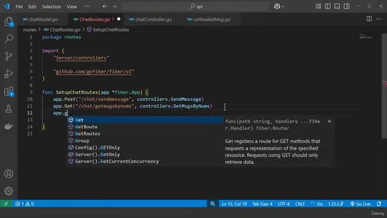
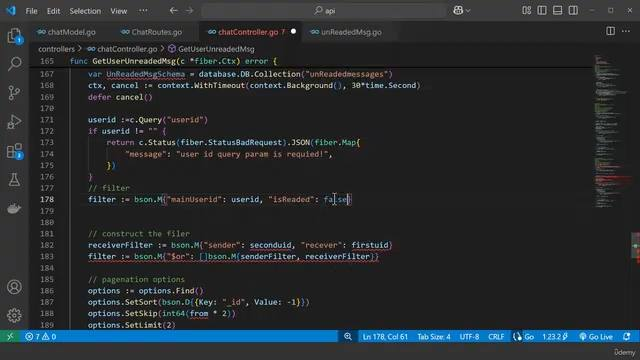
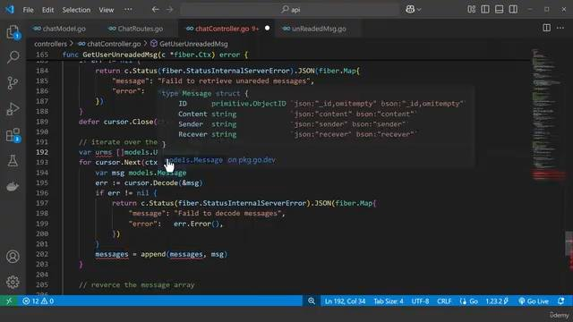
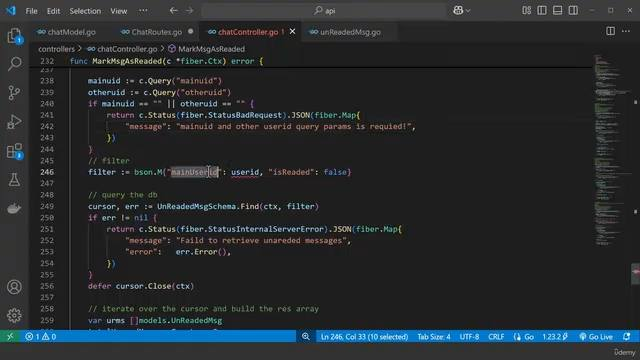
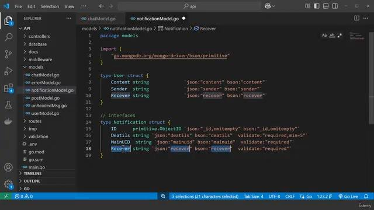
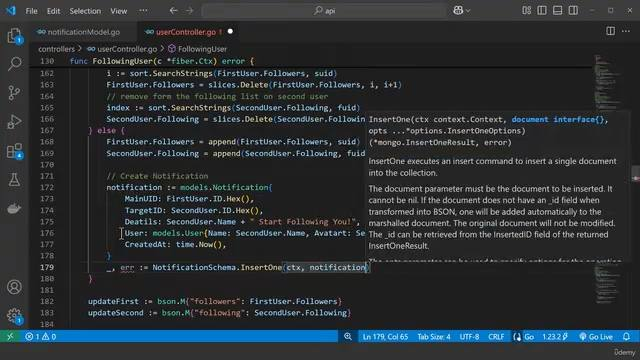
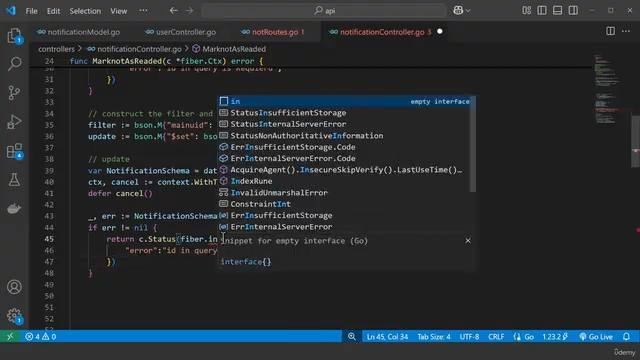

# Master Golang REST/gRPC（含 Redis）P028–P033 复现文档

> 覆盖范围：P028 未读消息统计接口 → P029 标记消息已读接口 → P030 通知模型 → P031 在关注/点赞/评论三处写入通知 → P032 用户详情补返回帖子列表 → P033 通知的两个接口（标记已读、按用户拉取）。
>
> 读者定位：前端转 AI 应用工程师。Go 语法会标注「知道即可」，涉及并发/事务的地方会补一句 JS/Node 里的对应概念。

---

## 1. 这一节做什么

这六节课把「聊天」和「通知」两个模块的后端接口补完，全部基于 Fiber + MongoDB（mongo-driver）实现。具体产出：

| 节 | 产出 | 路由 |
|---|---|---|
| P028 | 按主用户 ID 聚合未读消息：返回每条未读记录 + 未读总数 | `GET /chat/get-user-unreaded-message` |
| P029 | 把「主用户 ↔ 某用户」之间的未读消息全部置为已读（`isRead=true`、`numOfUnreadedMessages=0`），不存在则创建 | `GET /chat/mark-msg-as-read` |
| P030 | 新建 `Notification` 模型（详情、主用户 ID、目标 ID、是否已读、内嵌 user 对象） | 无路由，纯模型 |
| P031 | 在「关注用户 / 点赞帖子 / 评论帖子」三处业务里插入通知记录 | 复用已有路由 |
| P032 | 用户详情接口补上「该用户发布的所有帖子」 | 复用 `GET /user/:id` |
| P033 | 通知模块两个接口：标记单条通知已读、按主用户 ID 拉取全部通知（按创建时间倒序） | `GET /notification/mark-not-as-read`、`GET /notification/get-user-notification` |

一句话概括这一段的工程意义：**P028/P029 是「读状态」的双向操作（查未读、清未读），P030–P033 是「事件驱动写通知 + 读通知」的完整闭环**。做完这一段，前端聊天页的红点数和通知页的列表就有真实数据源了。

从前后端协作角度看，这一段可以拆成三条前端可见的链路。第一条是聊天未读链路：前端进入聊天列表或聊天详情时，用 `user_id` 调 P028 拿未读记录和总数，用来渲染每个会话的红点以及底部 Tab 的总红点；用户点开某个会话后，前端调 P029 把「主用户 ↔ 对方」这条记录清成已读，然后重新拉 P028 或本地把对应红点数清零。第二条是通知写入链路：P031 不新增路由，而是在关注、点赞、评论三个已有动作成功后顺手写一条通知，因此前端不需要额外调用「创建通知」接口，只要原有业务成功，通知就应该出现在接收者的列表里。第三条是通知读取链路：P033 提供标记单条已读和按用户拉取全部通知两个 GET 接口，前端通知页用 `user_id` 拉列表，用 `isRead` 区分已读未读样式，用 `id` 调标记已读。理解这三条链路后，复现时就知道每个接口的返回字段对应前端哪个状态，而不是只照着代码抄一遍。

另外要注意，P030 虽然是「纯模型」，但它是后面所有通知逻辑的地基。没有 `Notification` 结构体，P031 的 `InsertOne` 和 P033 的 `Find` 都没有类型可解码，编译会直接失败。所以实际动手时不要按视频顺序先写 P028/P029 再写 P030，而应按依赖顺序先建模型，再补路由和控制器。这个顺序在 3.2 节会再强调一次。

---

## 2. 讲师原话

> "我们希望能够展示未读消息总数，以及主用户与其他用户之间的未读消息数。"
> —— p028 [00:00]

> "我们想取出这两条记录并得到总数，也就是 9、2 和 12，也就是说未读消息总数是 12。"
> —— p028 [00:58]

> "当我们的用户打开他与其他人之间的聊天框时，这一步实际上就会发生，所以如果该记录不存在，这时就应该创建它。"
> —— p029 [01:57]

> "我们需要把这里改成 true，并把未读消息数设为零。"
> —— p029 [02:26]

> "这个主用户 ID 将指向要为其创建通知的用户；目标 ID 则……例如有三种会产生通知的情况：第一种是有人开始关注我们的用户。"
> —— p030 [02:21]

> "目标 ID 会指向那个开始关注我们主用户的用户；第二和第三种情况是，当某个用户开始创建、评论或点赞我们的帖子时，此时目标 ID 会指向该帖子。"
> —— p030 [02:51]

> "我们实际上漏掉了这件事，先快速修一下；这里其实也应该把用户帖子返回。"
> —— p032 [00:00]

> "我们希望把它们全部返回，即使这个值是 true 也一样；在前端部分，我们可以通过这个布尔值来区分它们。"
> —— p033 [24:03]

这些原话对应到实现时有几个落点：P028 的返回值必须同时包含「记录数组」和「总数」，不能只返回数组让前端自己累加；P029 的语义是「打开聊天框就清未读」，并且记录不存在时要能创建；P030 的 `MainUID` 是通知接收者，`TargetID` 在关注场景指向关注者、在点赞/评论场景指向帖子；P032 是补返回帖子列表；P033 拉取通知时不过滤已读，已读未读都返回，由前端用 `isRead` 区分。复现时如果发现接口能跑但前端红点或通知页表现不对，优先回到这几条原话核对字段语义。

---

## 3. 从零复现

### 3.1 前置条件

- 已完成前面章节：Fiber 项目骨架、MongoDB 连接、`User` / `Post` / `Message`（聊天消息）三个模型、JWT 中间件（`c.Locals("user_id")` 可取到当前登录用户 ID）、Swagger 已接入（`make swag init`）。
- 本地已跑起 MongoDB（默认 `mongodb://localhost:27017`，库名以你项目里 `config` 为准）。
- 目录结构（本节涉及的文件）：

```
project/
├── main.go
├── models/
│   ├── user.go
│   ├── post.go
│   ├── message.go
│   └── notification.go        ← P030 新建
├── routes/
│   ├── chat.go                ← P028/P029 改
│   ├── notification.go        ← P033 新建
│   └── user.go
├── controllers/
│   ├── chat.go                ← P028/P029 改
│   ├── notification.go        ← P033 新建
│   └── user.go                ← P031/P032 改
└── docs/                      ← swag 生成，勿手改
```

在动手前建议先做三项检查。第一，确认 MongoDB 进程可连接：如果 `go run main.go` 启动时报连接超时，先检查 MongoDB 是否启动、连接字符串是否和 `config` 一致、端口是否被占用。第二，确认 JWT 中间件确实把当前用户 ID 放进了 `c.Locals`，否则 P031 里取当前用户会拿不到值；前端对照上，这相当于 Node/Express 里 `req.user.id` 是否被鉴权中间件正确赋值。第三，确认 `make swag init` 在你的项目里可用；它通常执行的是 `swag init`，生成 `docs/docs.go`、`swagger.json`、`swagger.yaml`。如果你的项目没有 Makefile，等价命令是 `swag init -g main.go -o docs`，不要手改 `docs/` 下的生成文件。

### 3.2 复现步骤（按依赖顺序）

**Step 1｜P030：先建模型。** 没有 `Notification` 模型，P031 的写入和 P033 的读取都编译不过。所以虽然课里 P030 排在 P028/P029 之后，实际动手时建议先做 P030。建完模型后先执行一次 `go build ./...` 或 `go run main.go`，确认没有字段类型或 import 错误。常见错误是 `primitive.ObjectID` 没导入 `go.mongodb.org/mongo-driver/bson/primitive`，或者 `time.Time` 没导入 `time`。

**Step 2｜P028：加未读消息统计路由 + 控制器。** 在 `routes/chat.go` 注册 `GET /chat/get-user-unreaded-message`，在 `controllers/chat.go` 实现：从 query 取 `user_id` → 用 `messageSchema.Find` 过滤 `mainUID == user_id && isRead == false` → 遍历游标累加 `numOfUnreadedMessages` → 返回 `{messages, totalUnreadedMessagesCount}`。这里的关键排查点是参数判空：如果 Swagger 明明传了 `user_id` 却返回 400，先检查判断条件是不是写成了 `!= ""`，正确应是 `== ""`。前端对照上，这个接口等价于 `fetch('/chat/get-user-unreaded-message?user_id=' + id)`，返回的 `messages` 用于会话列表，`totalUnreadedMessagesCount` 用于总红点。

**Step 3｜P029：加标记已读路由 + 控制器。** 注册 `GET /chat/mark-msg-as-read`，控制器从 query 取 `mainUID` 和 `otherUID`，用 `FindOneAndUpdate` + `$set` 把 `isRead=true`、`numOfUnreadedMessages=0`，`options.SetUpsert(true)` 保证记录不存在时创建。常见错误是参数名不一致：路由和 Swagger 写的是 `mainUID` / `otherUID`，前端也必须用这两个 key；如果前端传了 `main_user_id`，控制器取不到就会返回 400。验证时先调 P029 再调 P028，观察对应记录是否从未读列表消失。

**Step 4｜P031：在三处业务里插通知。** 关注用户（`controllers/user.go` 的 follow 逻辑）、点赞帖子、评论帖子（`controllers/post.go` 或对应文件）里，各插一段 `notificationSchema.InsertOne`。点赞/评论两处需要先用 `c.Locals("user_id")` 查库拿到当前用户对象，才能填 `notification.User`。常见错误有两个：一是 `ObjectID` 直接转字符串，必须用 `.Hex()`；二是插入通知失败时没有返回 500，导致前端以为业务成功但通知页没数据。排查时可以在插入后打印 `InsertedID`，再用 Mongo 客户端查 `notifications` 集合。

**Step 5｜P032：用户详情补帖子列表。** 在 `controllers/user.go` 的 `GetUser` 里，用 `postSchema.Find` 过滤 `creator == userID`，遍历游标 append 到 `posts` 数组，随用户对象一起返回。常见错误是 `c.Params("id")` 取不到值却直接用，导致查询条件为空；实际应先取 `strID := c.Params("id")`，并确认路由是 `GET /user/:id`。前端对照上，用户主页从原来只拿 `user` 变成一次拿 `user + posts`，可以减少一次帖子列表请求。

**Step 6｜P033：通知模块两个接口。** 新建 `routes/notification.go` 和 `controllers/notification.go`，在 `main.go` 里调用 `setupNotificationRoutes(app)`。两个接口都是 GET：`/notification/mark-not-as-read?id=xxx` 和 `/notification/get-user-notification?user_id=xxx`。常见错误是路由参数名和 `c.Query` 的 key 不一致，例如路由写 `:id` 但控制器读 `user_id`，或者前端把 `user_id` 写成 `userId`。排查时先在 Swagger 里单独试跑，确认每个接口只依赖 query 参数，不依赖 path 参数。

**Step 7｜重新生成 Swagger 并重启。**

```bash
make swag init
go run main.go
```

`make swag init` 的作用是重新扫描控制器上的 Swagger 注释并生成文档；如果新增了路由但 Swagger UI 里看不到，通常是没重新生成或注释里的 `@Router` 写错。`go run main.go` 会编译并启动服务，如果报端口占用，先停掉旧进程；如果报 Mongo 连接失败，先回到 3.1 检查数据库。启动成功后，前端或 Swagger 即可按下面的截图和代码逐项试跑。

### 3.3 关键截图

P028 讲师在路由文件里新增未读消息接口，注意路径拼接方式：



P028 控制器里构造 filter（`mainUID == userID && isRead == false`）并遍历游标累加未读数：



P028 最终 Swagger 试跑，返回两条记录、总数 12：



P029 标记已读的 `$set` 更新体（`isRead=true`、`numOfUnreadedMessages=0`）：



P030 新建 notification 模型，三个 string 字段 + bool + 内嵌 user：



P031 在关注逻辑里插入通知记录：



P033 通知控制器里用 `SetSort` 按 `createdAt` 倒序：



看截图时不要只看界面结果，要对照三处：路由文件里路径是否和控制器函数名对应；控制器里 filter 字段名是否和模型 bson tag 一致；Swagger 试跑时 query 参数名是否和 `c.Query` 一致。这三处任何一处不一致，都会表现为 400、空数组或查不到数据。

---

## 4. 完整代码

> 以下代码按逐字稿还原。变量名、字段名严格沿用讲师口述（`mainUID`、`targetID`、`isRead`、`numOfUnreadedMessages`、`details`、`user`）。**如果你的项目里已有同名变量，请以你项目为准对齐**。课里没给出的 import 路径按常规 Fiber 项目补全，标注了「课里没讲」的地方请按你项目实际调整。

### 4.1 `models/notification.go`（P030 新建）

```go
package models

import (
	"time"

	"go.mongodb.org/mongo-driver/bson/primitive"
)

type Notification struct {
	ID        primitive.ObjectID `bson:"_id,omitempty" json:"_id,omitempty"`
	Details   string             `bson:"details" json:"details"`
	MainUID   string             `bson:"mainUID" json:"mainUID"`
	TargetID  string             `bson:"targetID" json:"targetID"`
	IsRead    bool               `bson:"isRead" json:"isRead"`
	CreatedAt time.Time          `bson:"createdAt" json:"createdAt"`
	User      User               `bson:"user" json:"user"`
}
```

这个模型里 `bson` tag 决定 Mongo 里的字段名，`json` tag 决定返回给前端的字段名。两边目前同名，前端拿到的就是 `details`、`mainUID`、`targetID`、`isRead`、`createdAt`、`user`。如果后续改 tag，要同时检查 P031 插入和 P033 查询是否还匹配。

### 4.2 `routes/chat.go`（P028/P029 追加）

```go
package routes

import (
	"yourmodule/controllers"

	"github.com/gofiber/fiber/v2"
)

func SetupChatRoutes(app *fiber.App) {
	// ... 前面章节已有的路由 ...

	app.Get("/chat/get-user-unreaded-message", controllers.GetUserUnreadedMessage)
	app.Get("/chat/mark-msg-as-read", controllers.MarkMsgAsRead)
}
```

路由文件只负责把 URL 绑定到控制器函数。排查时如果访问 404，先确认这个 `SetupChatRoutes` 是否在 `main.go` 里被调用，再确认路径是否多了或少了 `/chat` 前缀。前端拼接 URL 时也要和这里完全一致。

### 4.3 `controllers/chat.go`（P028 新增函数）

```go
// GetUserUnreadedMessage godoc
// @Summary      Get unreaded messages count and records for user
// @Description  Returns unreaded message records and total count for a given main user
// @Tags         chat
// @Param        user_id  query  string  true  "Main user ID"
// @Success      200
// @Router       /chat/get-user-unreaded-message [get]
func GetUserUnreadedMessage(c *fiber.Ctx) error {
	userID := c.Query("user_id")
	if userID == "" {
		return c.Status(fiber.StatusBadRequest).JSON(fiber.Map{
			"message": "user_id query param is required",
		})
	}

	filter := bson.M{
		"mainUID": userID,
		"isRead":  false,
	}

	cursor, err := messageSchema.Find(c.Context(), filter)
	if err != nil {
		return c.Status(fiber.StatusInternalServerError).JSON(fiber.Map{
			"message": "failed to retrieve unreaded messages",
			"error":   err.Error(),
		})
	}
	defer cursor.Close(c.Context())

	var urms []models.Message
	totalUnreadedMessagesCount := 0

	for cursor.Next(c.Context()) {
		var urm models.Message
		if err := cursor.Decode(&urm); err != nil {
			return c.Status(fiber.StatusInternalServerError).JSON(fiber.Map{
				"message": "failed to decode the unreaded message",
				"error":   err.Error(),
			})
		}
		if !urm.IsRead {
			totalUnreadedMessagesCount += urm.NumOfUnreadedMessages
		}
		urms = append(urms, urm)
	}

	if len(urms) == 0 {
		urms = []models.Message{}
	}

	return c.Status(fiber.StatusOK).JSON(fiber.Map{
		"messages":                   urms,
		"totalUnreadedMessagesCount": totalUnreadedMessagesCount,
	})
}
```

这个接口的返回体有两个字段：`messages` 给前端渲染逐条未读会话，`totalUnreadedMessagesCount` 给前端渲染总红点。注意最后的空数组处理，目的是让 JSON 返回 `[]` 而不是 `null`，前端可以直接 `.map` 或 `.length`。

### 4.4 `controllers/chat.go`（P029 新增函数）

```go
// MarkMsgAsRead godoc
// @Summary      Mark messages as read for users
// @Description  Update the record, make isRead true and numOfUnreadedMessages 0
// @Tags         chat
// @Param        mainUID   query  string  true  "Main user ID"
// @Param        otherUID  query  string  true  "Other user ID"
// @Success      200
// @Router       /chat/mark-msg-as-read [get]
func MarkMsgAsRead(c *fiber.Ctx) error {
	mainUID := c.Query("mainUID")
	otherUID := c.Query("otherUID")

	if mainUID == "" || otherUID == "" {
		return c.Status(fiber.StatusBadRequest).JSON(fiber.Map{
			"message": "main UID and other user ID query params are required",
		})
	}

	filter := bson.M{
		"mainUID":  mainUID,
		"otherUID": otherUID,
	}

	update := bson.M{
		"$set": bson.M{
			"isRead":                 true,
			"numOfUnreadedMessages":  0,
		},
	}

	opts := options.FindOneAndUpdate().SetUpsert(true).SetReturnDocument(options.After)

	var updatedDoc models.Message
	result := messageSchema.FindOneAndUpdate(c.Context(), filter, update, opts)
	if result.Err() != nil {
		return c.Status(fiber.StatusInternalServerError).JSON(fiber.Map{
			"message": "failed to mark message as read",
			"error":   result.Err().Error(),
		})
	}

	if err := result.Decode(&updatedDoc); err != nil {
		return c.Status(fiber.StatusInternalServerError).JSON(fiber.Map{
			"message": "failed to decode updated document",
			"error":   err.Error(),
		})
	}

	return c.Status(fiber.StatusOK).JSON(fiber.Map{
		"isMarked": true,
	})
}
```

这个接口的返回体很短，只有 `isMarked`。前端拿到 true 后可以本地清零红点，也可以重新调 P028 刷新。注意 `FindOneAndUpdate` 的错误要通过 `result.Err()` 取，这是和普通 `Find` 不同的地方。

### 4.5 `controllers/user.go`（P031 关注处插通知 + P032 补帖子列表）

```go
// 关注用户时插入通知（P031）
notification := models.Notification{
	MainUID:   firstUser.ID.Hex(),
	TargetID:  secondUser.ID.Hex(),
	Details:   secondUser.Name + " started following you",
	User: models.User{
		Name:  secondUser.Name,
		ImageURL: secondUser.ImageURL,
	},
	CreatedAt: time.Now(),
}

_, err = notificationSchema.InsertOne(c.Context(), notification)
if err != nil {
	return c.Status(fiber.StatusInternalServerError).JSON(fiber.Map{
		"message": "failed to create notification",
		"error":   err.Error(),
	})
}
```

```go
// 用户详情补帖子列表（P032）
findOptions := options.Find()

postResult, err := postSchema.Find(c.Context(), bson.M{"creator": strID}, findOptions)
if err != nil {
	return c.Status(fiber.StatusInternalServerError).JSON(fiber.Map{
		"error": err.Error(),
	})
}
defer postResult.Close(c.Context())

var posts []models.Post
for postResult.Next(c.Context()) {
	var singlePost models.Post
	if err := postResult.Decode(&singlePost); err != nil {
		return c.Status(fiber.StatusInternalServerError).JSON(fiber.Map{
			"error": err.Error(),
		})
	}
	posts = append(posts, singlePost)
}

if len(posts) == 0 {
	posts = []models.Post{}
}

return c.Status(fiber.StatusOK).JSON(fiber.Map{
	"user":  user,
	"posts": posts,
})
```

关注处插通知时，`MainUID` 是被关注者，`TargetID` 是关注者；点赞和评论处的写法类似，只是 `Details` 文案和 `TargetID` 语义不同。P032 返回体里的 `posts` 同样做了空数组处理，前端用户主页可以直接渲染空列表状态。

### 4.6 `routes/notification.go`（P033 新建）

```go
package routes

import (
	"yourmodule/controllers"

	"github.com/gofiber/fiber/v2"
)

func SetupNotificationRoutes(app *fiber.App) {
	app.Get("/notification/mark-not-as-read", controllers.MarkNotificationAsRead)
	app.Get("/notification/get-user-notification", controllers.GetUserNotification)
}
```

注意这两个路径都是 `/notification/...`，前端通知页调用时不要漏掉前缀。如果 Swagger 里能看到但前端 404，优先检查前端 baseURL 和后端端口是否一致。

### 4.7 `controllers/notification.go`（P033 新建）

```go
package controllers

import (
	"yourmodule/models"

	"github.com/gofiber/fiber/v2"
	"go.mongodb.org/mongo-driver/bson"
	"go.mongodb.org/mongo-driver/bson/primitive"
	"go.mongodb.org/mongo-driver/mongo/options"
)

// MarkNotificationAsRead godoc
// @Summary      Mark notification as read for a user
// @Tags         notifications
// @Param        id  query  string  true  "Notification ID"
// @Success      200
// @Router       /notification/mark-not-as-read [get]
func MarkNotificationAsRead(c *fiber.Ctx) error {
	id := c.Query("id")
	if id == "" {
		return c.Status(fiber.StatusBadRequest).JSON(fiber.Map{
			"message": "id param is required",
		})
	}

	filter := bson.M{
		"_id": bson.M{
			"$regex":   id,
			"$options": "i",
		},
	}

	update := bson.M{
		"$set": bson.M{
			"isRead": true,
		},
	}

	_, err := notificationSchema.UpdateOne(c.Context(), filter, update)
	if err != nil {
		return c.Status(fiber.StatusInternalServerError).JSON(fiber.Map{
			"message": "failed to mark notification as read",
			"error":   err.Error(),
		})
	}

	opts := options.Find().SetSort(bson.M{"createdAt": -1})

	cursor, err := notificationSchema.Find(c.Context(), filter, opts)
	if err != nil {
		return c.Status(fiber.StatusInternalServerError).JSON(fiber.Map{
			"message": "failed to retrieve the updated notification",
			"error":   err.Error(),
		})
	}
	defer cursor.Close(c.Context())

	var notifications []models.Notification
	if err := cursor.All(c.Context(), &notifications); err != nil {
		return c.Status(fiber.StatusInternalServerError).JSON(fiber.Map{
			"message": "failed to get notifications",
			"error":   err.Error(),
		})
	}

	return c.Status(fiber.StatusOK).JSON(fiber.Map{
		"notifications": notifications,
	})
}

// GetUserNotification godoc
// @Summary      Get all notifications for a user
// @Tags         notifications
// @Param        user_id  query  string  true  "Main user ID"
// @Success      200
// @Router       /notification/get-user-notification [get]
func GetUserNotification(c *fiber.Ctx) error {
	userID := c.Query("user_id")
	if userID == "" {
		return c.Status(fiber.StatusBadRequest).JSON(fiber.Map{
			"message": "user_id param is required",
		})
	}

	filter := bson.M{"mainUID": userID}
	opts := options.Find().SetSort(bson.M{"createdAt": -1})

	cursor, err := notificationSchema.Find(c.Context(), filter, opts)
	if err != nil {
		return c.Status(fiber.StatusInternalServerError).JSON(fiber.Map{
			"message": "failed to retrieve notifications",
			"error":   err.Error(),
		})
	}
	defer cursor.Close(c.Context())

	var notifications []models.Notification
	if err := cursor.All(c.Context(), &notifications); err != nil {
		return c.Status(fiber.StatusInternalServerError).JSON(fiber.Map{
			"message": "failed to get notifications",
			"error":   err.Error(),
		})
	}

	if len(notifications) == 0 {
		notifications = []models.Notification{}
	}

	return c.Status(fiber.StatusOK).JSON(fiber.Map{
		"notifications": notifications,
	})
}
```

`MarkNotificationAsRead` 先 `UpdateOne` 再 `Find`，所以它的响应是更新后的通知列表；`GetUserNotification` 只按 `mainUID` 查全部通知，不过滤 `isRead`。两者都用 `createdAt: -1` 倒序，前端拿到后不需要再排序。

### 4.8 `main.go`（P033 追加一行）

```go
func main() {
	app := fiber.New()

	// ... 前面章节已有的 setup ...

	setupNotificationRoutes(app) // ← P033 新增

	app.Listen(":3000")
}
```

如果启动后通知接口 404，先确认这一行确实在 `app.Listen` 之前执行。前端对照上，后端启动成功后，通知页请求 `/notification/get-user-notification?user_id=...` 应能返回 `notifications` 数组。

---

## 5. 逐行解释

### 5.1 P028 未读消息统计

- `userID := c.Query("user_id")`：从 URL query 取主用户 ID。**注意**：课里讲师一开始把判断写成了 `if userID != ""`，导致 Swagger 试跑时明明传了参数却报「user_id query param is required」，后来改成 `== ""` 才通过（p028 [13:15] 讲师原话「this should be equal equal」）。这是本节最容易踩的坑。前端对照：在 JS 里相当于 `new URLSearchParams(location.search).get('user_id')`，取不到时返回 `null`，后端这里取不到是空字符串。
- `filter := bson.M{"mainUID": userID, "isRead": false}`：只查「主用户是我」且「未读」的消息。`bson.M` 就是 Go 里的 map，等价于 JS 里的 `{ mainUID: userID, isRead: false }`。常见错误是字段名大小写和模型 bson tag 不一致，例如模型里是 `mainUID` 却写成 `mainUid`，Mongo 不会报错，只会查不到数据。
- `messageSchema.Find(c.Context(), filter)`：返回游标（cursor），不是数组。**在 Node 里对应 `collection.find(filter)` 返回的 Cursor**，需要 `for await` 或 `.toArray()` 才能拿到数据。排查时如果返回 500，先看 `err.Error()` 里是否有连接或字段类型问题。
- `defer cursor.Close(c.Context())`：函数返回前关闭游标。Go 的 `defer` 等价于 JS 的 `try/finally` 里的 finally 块。忘记关闭游标不会立刻报错，但连接多时可能累积资源问题。
- `totalUnreadedMessagesCount += urm.NumOfUnreadedMessages`：每条未读消息记录里自带一个「未读数」字段，累加得到总数。课里演示的两条记录分别是 9 和 2，总数 12（p028 [00:58]）。前端对照：这个总数直接对应底部 Tab 红点数字，不要在前端再按数组长度算。
- `if len(urms) == 0 { urms = []models.Message{} }`：保证空结果返回 `[]` 而不是 `null`，前端不用做空判断。**这是讲师在 p028 [11:26] 特意补的**。验证方法：用没有未读消息的用户 ID 调接口，检查 JSON 里是 `"messages":[]`。

### 5.2 P029 标记已读

- `filter := bson.M{"mainUID": mainUID, "otherUID": otherUID}`：定位「我和某个人」这条会话记录。前端对照：打开和某人的聊天框时，当前登录用户是 `mainUID`，对方是 `otherUID`，两个参数都必须传。
- `update := bson.M{"$set": bson.M{"isRead": true, "numOfUnreadedMessages": 0}}`：`$set` 是 MongoDB 的更新操作符，只改指定字段。**在 JS 里对应 `updateOne(filter, { $set: {...} })`**。常见错误是把 `$set` 写成普通对象，Mongo 会把它当替换文档处理，可能覆盖其他字段。
- `options.FindOneAndUpdate().SetUpsert(true).SetReturnDocument(options.After)`：
  - `SetUpsert(true)`：记录不存在就创建。这就是讲师说的「this should actually create that record if it not exist」（p029 [01:57]）。
  - `SetReturnDocument(options.After)`：返回更新后的文档，而不是更新前的。
- `result.Err()`：`FindOneAndUpdate` 返回的是 `SingleResult`，错误要通过 `.Err()` 拿，不是直接返回 error。**这是 Go mongo-driver 的坑**，和 JS 的 `await` 直接抛错不一样。排查时如果看到空指针或解码失败，先检查是否漏了 `.Err()`。
- 返回 `{"isMarked": true}`：课里讲师在 p029 [10:35] 说「this is marked」，前端据此判断成功。前端可以在成功后本地把该会话红点清零，或重新拉 P028。

### 5.3 P030 通知模型

- `MainUID string`：通知的「接收者」，即「谁该看到这条通知」。前端通知页按当前登录用户 ID 查这个字段。
- `TargetID string`：通知的「触发源」。讲师原话（p030 [02:21]）分三种情况：
  - 关注：TargetID = 关注你的那个用户的 ID
  - 点赞/评论：TargetID = 被点赞/评论的帖子 ID
- `IsRead bool`：前端用这个字段区分「已读/未读」通知，讲师在 p033 [24:03] 明确说「on the front end part we can differentiate between them using this pulley end」。前端对照：列表项可以根据 `isRead` 加粗或显示小圆点。
- `User User`：内嵌一个完整的 user 对象（名字 + 头像），这样前端渲染通知列表时不用再发一次请求查用户。**这是典型的「反范式设计」**，用存储冗余换查询性能。常见错误是插入时只填了 `Name` 没填 `ImageURL`，导致前端头像为空；排查时直接看通知文档里的 `user` 子对象。
- `CreatedAt time.Time`：用于 P033 的倒序排序。前端拿到列表后最新通知应在最前。

### 5.4 P031 三处插通知

- 关注处：`MainUID = firstUser.ID.Hex()`（被关注者）、`TargetID = secondUser.ID.Hex()`（关注者）、`Details = secondUser.Name + " started following you"`。**注意 `.Hex()`**：`primitive.ObjectID` 转字符串必须调 `.Hex()`，直接 `string(id)` 会得到乱码。排查时如果通知里 `mainUID` 看起来像乱码，就是漏了 `.Hex()`。
- 点赞/评论处：需要先用 `c.Locals("user_id")` 拿到当前登录用户 ID，再查库拿完整 user 对象。讲师在 p031 [05:20] 说「we need to extract the user id and then get the user from the database」，为此专门在 `controllers/user.go` 里抽了一个 `GetUserByID` 函数复用。前端对照：点赞/评论请求本身已经带了 JWT，后端从 Locals 取用户，不需要前端额外传当前用户 ID。
- 三处插入都用 `notificationSchema.InsertOne(c.Context(), notification)`，错误处理统一返回 500 + `"创建通知失败"`。常见排查：如果业务成功了但通知没出现，先看 `InsertOne` 是否返回错误，再看 `notifications` 集合里是否有文档，最后看 `MainUID` 是否是接收者 ID。

### 5.5 P032 用户详情补帖子

- `bson.M{"creator": strID}`：按帖子创建者过滤。`strID` 是 URL 参数 `:id` 转成的字符串。常见错误是变量名写错或没从 `c.Params("id")` 取值，导致过滤条件为空。
- `defer postResult.Close(c.Context())` + `for postResult.Next(...)` + `postResult.Decode(&singlePost)`：标准的游标遍历三件套。**在 Node 里对应 `for await (const doc of cursor)`**。
- `if len(posts) == 0 { posts = []models.Post{} }`：同 P028，保证空数组而非 null。前端对照：用户主页可以直接 `posts.map(...)`，不用先判断 null。
- 返回体从原来的 `{user}` 变成 `{user, posts}`，前端用户主页可以直接一次请求拿全。验证时用一个没有发过帖的用户 ID，检查 `posts` 是否为 `[]`。

### 5.6 P033 通知接口

**标记已读（MarkNotificationAsRead）：**

- `filter := bson.M{"_id": bson.M{"$regex": id, "$options": "i"}}`：用正则匹配 `_id`，`$options: "i"` 表示不区分大小写。**这是讲师在 p033 [07:57] 特意加的**，因为前端传的 id 大小写可能和库里不一致。常见排查：如果更新了 0 条，先确认 `id` 是否是通知 `_id` 的字符串，不要传成 `mainUID`。
- `notificationSchema.UpdateOne(...)`：只更新，不返回文档。和 P029 的 `FindOneAndUpdate` 不同。前端对照：这个接口成功后，前端可以用返回的 `notifications` 覆盖本地列表。
- 更新完再 `Find` 一次拿最新列表，`SetSort(bson.M{"createdAt": -1})` 按创建时间倒序。**`-1` 是降序，`1` 是升序**，等价于 SQL 的 `ORDER BY createdAt DESC`。
- 讲师在 p033 [12:11] 一度把 sort key 写成 `createdAt` 但不确定，最后确认是 `createdAt`（和模型字段一致）。排查时如果顺序不对，检查 sort key 是否和 bson tag 完全一致。

**按用户拉取（GetUserNotification）：**

- `filter := bson.M{"mainUID": userID}`：只查「主用户是我」的通知。前端对照：通知页用当前登录用户 ID 调这个接口，不要传成触发者 ID。
- 同样 `SetSort(bson.M{"createdAt": -1})` 倒序。
- 讲师在 p033 [21:40] 调试时发现返回空，原因是路由参数名写成了 `:id` 但控制器读的是 `user_id`，改成 `user_id` 后才通。**这是第二个高频坑**：路由参数名和 `c.Query` 的 key 必须一致。
- 讲师明确说「we want to return all of them even if it's true」（p033 [24:03]），即**不过滤已读**，已读未读都返回，前端自己用 `isRead` 区分。验证时先标记一条已读，再拉列表，确认该条仍在返回结果里且 `isRead=true`。

---

## 6. 复现检查清单

按顺序勾，全过说明这一段跑通了：

- [ ] `models/notification.go` 已创建，字段名 `details / mainUID / targetID / isRead / createdAt / user` 与代码一致。验证：打开文件逐字段对照，再 `go build ./...` 确认无编译错误。
- [ ] `routes/chat.go` 里两条新路由已注册，路径分别是 `/chat/get-user-unreaded-message` 和 `/chat/mark-msg-as-read`。验证：启动后访问错误路径看是否 404，访问正确路径看是否进入控制器。
- [ ] `routes/notification.go` 已创建，`main.go` 里调用了 `setupNotificationRoutes(app)`。验证：Swagger 或浏览器访问 `/notification/get-user-notification?user_id=test`，不应 404。
- [ ] `make swag init` 执行成功，Swagger UI 里能看到 4 个新接口。验证：刷新 Swagger 页面，按 `chat` 和 `notifications` tag 筛选。
- [ ] **P028 试跑**：传一个真实主用户 ID，返回 `messages` 数组 + `totalUnreadedMessagesCount`，数值和库里未读记录对得上（课里演示是 9+2=12）。验证：用 Mongo 客户端查同条件文档，手工累加 `numOfUnreadedMessages` 对比。
- [ ] **P028 边界**：不传 `user_id`，返回 400 + `"查询参数 user_id 为必填项"`（注意判断是 `== ""` 不是 `!= ""`）。验证：Swagger 里清空参数直接 Execute。
- [ ] **P029 试跑**：传 `mainUID` + `otherUID`，返回 `{"isMarked": true}`。验证：用一对真实用户 ID，确认 HTTP 200 且响应体字段正确。
- [ ] **P029 验证**：再调 P028，刚才那条未读记录消失，总数减少。验证：先记录 P028 返回总数，调 P029 后再调 P028，对比总数和数组。
- [ ] **P029 幂等**：重复调 P029，不报错，`isRead` 保持 true。验证：连续调两次 P029，第二次仍返回 `isMarked:true`。
- [ ] **P031 关注**：A 关注 B 后，用 B 的 ID 调 P033 的 `get-user-notification`，能看到 `"A 开始关注你"`。验证：先关注，再查 B 的通知列表，检查 `details` 和 `user.name`。
- [ ] **P031 点赞**：A 点赞 B 的帖子后，B 的通知列表多一条 `"A 点赞了你的帖子"`。验证：点赞前后各拉一次 B 的通知列表，对比条数。
- [ ] **P031 评论**：A 评论 B 的帖子后，B 的通知列表多一条 `"A 评论了你的帖子"`。验证：评论后查 B 的通知列表，检查 `targetID` 是否是帖子 ID。
- [ ] **P032 用户详情**：调 `GET /user/:id`，返回体里同时有 `user` 和 `posts`，`posts` 是该用户发的所有帖子。验证：用有帖子和无帖子两个用户分别调，检查非空数组和空数组。
- [ ] **P033 标记已读**：传通知 `id`，返回的 `notifications` 里对应记录 `isRead=true`。验证：先拉列表找一个未读 id，调标记接口后检查该 id 的 `isRead`。
- [ ] **P033 拉取**：传 `user_id`，返回该用户全部通知，按 `createdAt` 倒序（最新的在最前）。验证：插入两条不同时间通知，检查返回顺序。
- [ ] **P033 空结果**：传一个没有通知的 user_id，返回 `{"notifications": []}` 而不是 `null`。验证：用一个新注册用户 ID 调接口，看 JSON 字段。

---

## 7. 课里没讲但你会撞上的

| 现象 | 原因 | 怎么办 |
|---|---|---|
| 编译报 `undefined: notificationSchema` / `messageSchema` / `postSchema` | 课里直接用了这三个变量，但没演示定义；它们通常是 `controllers` 包里的包级变量，在 `main.go` 或 `controllers/init.go` 初始化，例如 `var notificationSchema *mongo.Collection = client.Database("yourdb").Collection("notifications")` | 按你项目已有模式补初始化，确认包级变量在控制器使用前已赋值；启动时打印集合名做检查。 |
| P033 标记已读报类型错误或更新 0 条 | `filter := bson.M{"_id": bson.M{"$regex": id, "$options": "i"}}` 对 `_id`（`ObjectID` 类型）做正则匹配，MongoDB 某些版本会报类型错误；课里演示能跑通，但本地可能不兼容 | 改成 `bson.M{"_id": objectID}`，先 `primitive.ObjectIDFromHex(id)` 转成 ObjectID 再查；如果前端传的 id 不是 24 位 hex，先返回 400 并提示格式错误。 |
| P031 取当前用户时 panic 或拿到空值 | 课里说「we need to extract the user id」，但没演示断言代码；`c.Locals("user_id")` 的类型可能是 `string` 也可能是 `primitive.ObjectID` | 实际写法是 `userID := c.Locals("user_id").(string)`，如果 JWT 中间件存的是 `primitive.ObjectID` 则要相应调整；加 `ok` 判断避免断言失败 panic。 |
| `FindOneAndUpdate` 的 `SetReturnDocument` 编译不过 | 课里用的是 `options.After`，对应 mongo-driver v1.x；如果你用的是 v2，API 有变化 | 以 `go.mod` 里实际版本为准查官方文档；先 `go list -m go.mongodb.org/mongo-driver` 看版本，再决定用 `SetReturnDocument` 还是旧 API。 |
| 关注/点赞/评论成功，但通知偶尔丢 | P031 三处插通知都是「先查用户、再插通知」两步，中间没有事务；查用户成功但插通知失败会丢通知 | 生产环境补事务：Go 里用 `client.StartSession()` + `session.WithTransaction()`，对应 Node 的 `session.withTransaction()`；至少要在插入失败时返回 500 并记录日志。 |
| P028 总数和前端红点对不上 | `numOfUnreadedMessages` 的累加逻辑依赖写入方正确维护；P028 只是读，真正维护这个字段的是发消息那段代码 | 检查发消息侧是否在未读时正确 `$inc`；用 Mongo 客户端直接看消息文档的 `numOfUnreadedMessages` 是否和预期一致。 |
| P029 之后多出一条「空记录」 | `SetUpsert(true)` 在 `mainUID` + `otherUID` 组合从未存在过时会创建一条只有 `isRead=true`、`numOfUnreadedMessages=0` 的记录，其他字段为空 | 前端展示时判空；后端如果不想创建空记录，可先 `FindOne` 判断是否存在，再决定是否 upsert；或在创建时补默认字段。 |
| Swagger 里 `id` 显示为 string，但实际是 ObjectID | P033 里 `@Param id query string true` 只是文档展示，`_id` 实际是 `ObjectID`；Swagger 注释不影响运行 | 前端对接时知道传的是 24 位 hex 字符串；后端用 `primitive.ObjectIDFromHex` 转换并处理转换失败。 |
| `make swag init` 命令不存在 | 课里直接敲 `make swag init`，依赖项目里的 Makefile；你的项目可能没有这个目标 | 等价命令是 `swag init -g main.go -o docs`；先确认 `swag` 已安装（`go install github.com/swaggo/swag/cmd/swag@latest`），再执行。 |
| P032 查不到帖子或 `strID` 为空 | 讲师说「we have this srt which is string id」，但没演示 `strID` 怎么从 `c.Params("id")` 拿；实际写法是 `strID := c.Params("id")` | 检查路由是否为 `GET /user/:id`，控制器里是否先取 `c.Params("id")`；打印 `strID` 确认非空，再拼 `bson.M{"creator": strID}`。 |

---

**小结**：这六节课的核心是「读状态」和「事件通知」两条链路。P028/P029 是聊天未读的双向操作，P030–P033 是通知的写读闭环。最容易踩的坑是 P028 的 `== ""` 判断、P033 的路由参数名一致性、以及 `FindOneAndUpdate` 的 `.Err()` 取错方式。按第 6 节清单逐项验证，能跑通就说明这一段复现成功。