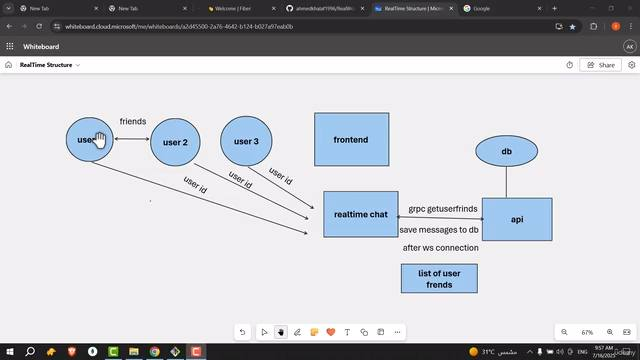
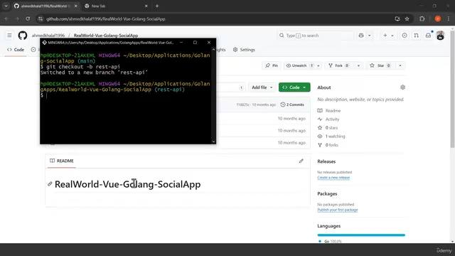
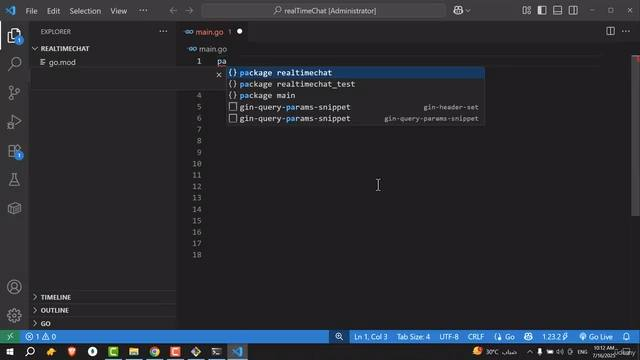
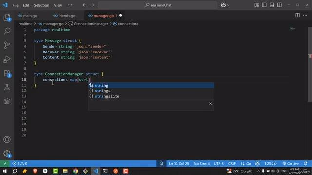
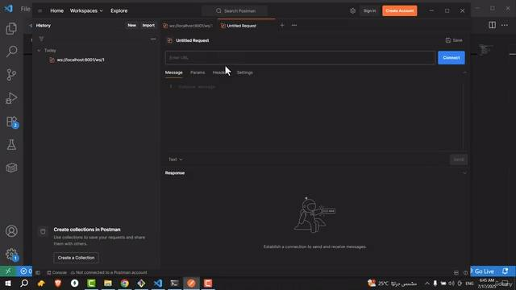
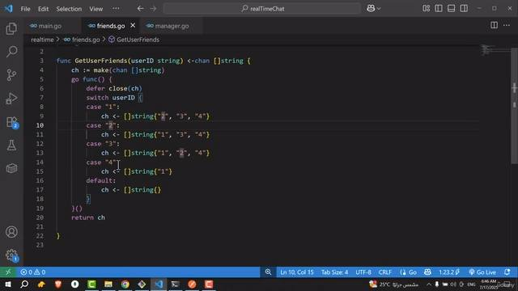

# Master Golang REST/gRPC（含 Redis）· P034–P039
## 实时聊天服务：WebSocket 连接管理 + 在线好友列表 + 点对点消息

---

## 1. 这一节做什么

从 P034 到 P039，这六集只干一件事：**在已有的 Go 后端仓库里，新起一个独立的实时服务（real-time service），用 WebSocket 把「谁在线」这件事维护起来，并让在线的两个用户之间能互发消息。**

拆开看是四个可验证的产物：

1. **分支与 PR 流程**（P034）。把之前堆在 main 上的代码切成 `rest-api` 分支，push 上去，开 Pull Request，合并回 main。这是为后面每个新功能都开分支做示范。
2. **一个能跑起来的 WebSocket 服务骨架**（P036）。新建 `real-time-chat` 目录、`go mod init`、装 Fiber、写 `main.go`，注册 `GET /ws/:id` 路由，用 Postman 连上并收到一句欢迎语。
3. **一个假的好友数据源**（P037）。`realtime/friends.go` 里写 `GetUserFriends(userID) chan []string`，用 switch 硬编码 1/2/3/4 四个用户的好友关系，先把整条链路跑通。
4. **一个真正的连接管理器**（P038–P039）。`realtime/manager.go` 里定义 `Message`、`ConnectionManager`，实现 `AddConnection` / `RemoveConnection` / `SendToReceiver` / `isFriend`，然后在 `main.go` 里接上，用 Postman 开多个连接验证：好友上线会通知你、好友下线会通知你、你连上时会收到自己的在线好友列表、给不在线的人发消息会打日志报错。

**这一节没有做的事，要提前说清楚**：真正的 gRPC 调用（`GetUserFriends` 走 gRPC 问 API server、`SaveMessage` 走 gRPC 存库）在这一节**只是留了 TODO**，讲师在 p038 [30:52] 明确说 "通过 gRPC 把消息保存到数据库"，P039 结尾 [12:29] 说下一步才去 API 那边写 gRPC method。所以本节跑通的是**纯内存 + 假数据**的版本，进程一重启，所有连接和在线列表全没。



---

## 2. 讲师原话

> "开发这个应用的正确方式是有一个主分支或主干分支，每次我们开始添加新功能时……创建一个拉取请求，然后为那个服务或新功能创建一个新分支。"
> —— p034 [00:00]

> "我们可以直接说 git checkout -b rest-api……然后说 git add .，做一个提交 rest-api done，现在就可以把它推送到同一个分支了。"
> —— p034 [01:07]

> "我们会使用一种不同的连接，不是 HTTP 或 HTTPS 连接，而是 WebSocket 连接，这样才能实时接收或发送数据。"
> —— p035 [00:52]

> "每当用户开始打开应用时，我们的前端部分应该启动他的用户 ID，同时尝试与后端建立实时或 WebSocket 连接。在后端这里，我们需要有连接 ID 和用户 ID 并建立连接……这样我们就能拥有所谓的在线……好友列表。"
> —— p035 [01:48]

> "我们实际上会在另一件事上使用 gRPC 功能，也就是把消息保存到数据库……实时消息之间的消息不会保存到任何地方。"
> —— p035 [05:08]

> "我们可以直接说 id 等于 c.perms.oid……然后说 c.writeMessage，现在可以说 WebSocket 文本消息，这里传入字节数组……说 welcome user 并传入他的 id。"
> —— p036 [06:35]

> "正如我们之前谈到结构时所说，我们想要获取用户的好友，但目前为了正确处理实时功能，我们可以先模拟这个。"
> —— p037 [00:00]

> "最后我们需要能够加锁和解锁，为此我们可以使用 sync.Mutex，所以直接说 lock sync.Mutex。"
> —— p038 [04:37]

> "每当我们移除一个相关的连接时，我们想要更新他的好友，告诉他们他现在不在他们的在线好友列表中了……为此我们可以使用动态规划。"
> —— p038 [23:59]

> "注意，这个更新只涉及用户一，而不是用户一和用户二……我不理解这为什么没有任何意义，但这只是为了演示目的。"
> —— p039 [08:18]

---

## 3. 从零复现

### 3.0 前置条件

- Go 1.21 或更高（能跑 `go mod init`、`go mod tidy` 即可）
- 一个 GitHub 仓库（P034 那一步要用），本地已经 clone 好，`main` 分支干净
- Postman 桌面版，且版本支持 **New → WebSocket Request**（网页版 Postman 早期不支持 WebSocket，务必用桌面版）

下面所有命令都在**仓库根目录**执行。

### 3.1 开分支、提交、开 PR（P034）

```bash
git checkout main
git pull
git checkout -b rest-api
git add .
git commit -m "rest api done"
git push origin rest-api
```

push 完之后 GitHub 上会出现黄色的 **Compare & pull request** 按钮。点它 → 填标题 → **Create pull request** → 等它检查完「Able to merge」→ **Merge pull request** → **Confirm merge**。合并后本地：

```bash
git checkout main
git pull
```

这一步看起来跟写代码无关，但它是后面 P036 开 `real-time-chat` 分支的前提。讲师在 p034 [00:29] 说得很直白：以后每加一个新服务、新功能，都走这套流程。



### 3.2 开实时服务分支 + 建目录 + 初始化模块（P036 [00:00]–[01:56]）

```bash
git checkout main
git pull
git checkout -b real-time-chat
mkdir real-time-chat
cd real-time-chat
go mod init real-time-chat
```

`go mod init` 后面跟的名字就是模块名，它决定了你 `import` 时的前缀。这里叫 `real-time-chat`，所以 `realtime` 包的 import 路径就是 `real-time-chat/realtime`。

### 3.3 装依赖（P036 [01:56]–[02:24]）

```bash
go get github.com/gofiber/fiber/v2
go get github.com/gofiber/contrib/websocket
go mod tidy
```

> **注意**：讲师在 p036 里先 `go get` 了 Fiber 自带的 `gofiber/websocket/v2`，随后在 [09:19] 说 "我们不需要这个 WebSocket，所以可以直接把它删掉"，然后 `go mod tidy` 清掉。P036 最终跑通时用的是 Fiber v2 配套的 WebSocket 包。本稿统一用当前维护中的 `github.com/gofiber/contrib/websocket`（Fiber v2 官方现在推荐的路径），API 与逐字稿里 `websocket.New(...)`、`*websocket.Conn` 的写法完全一致。**import 路径具体是哪一个，以你 `go list -m all` 的实际输出为准。**



### 3.4 先写一个「能连上、能收到欢迎语」的最小 main.go（P036）

先不要写 manager。第一步只验证：路由通不通、WebSocket 能不能升级、服务端能不能主动往连接里写东西。

写完后：

```bash
go run main.go
```

看到 Fiber 打印监听 8000 的日志后，打开 Postman → **New → WebSocket Request**，地址填：

```
ws://localhost:8000/ws/1
```

点 **Connect**。你应该在 Messages 面板里看到一条服务端推来的 `welcome user 1`。

> 逐字稿 p036 [10:14] 讲师口述的 URL 顺序是 "ws://localhost:8000 和 one，然后 /ws"，听起来像 `ws://localhost:8000/1/ws`。以路由 `app.Get("/ws/:id")` 为准，正确路径是 **`/ws/1`**。这个以你自己写的路由为准，别照抄口述。

### 3.5 加假好友数据 `realtime/friends.go`（P037）

```bash
mkdir realtime
```

新建 `realtime/friends.go`，内容见第 4 节。这个文件只有一件事：给定 userID，返回一个 channel，channel 里吐出一份好友 ID 切片。

讲师在 p037 里逐个 case 口述了好友关系，user1 当时说的是 `2, 3`；但 P039 实测时 [07:49] 讲师自己念的是 "用户 one 有 two、three、four"。**本稿以 P039 实测为准**（user1 的好友是 2、3、4），这样后面第 6 节的验证结果才能对上。

### 3.6 写连接管理器 `realtime/manager.go`（P038）

这是本节最长的一个文件。按讲师的口述顺序，它依次包含：

1. `Message` 结构体（Sender / Receiver / Content，三个字段都带 json tag）
2. `ConnectionManager` 结构体（`connections`、`onlineFriends`、`getUserFriends`、`lock`）
3. `NewConnectionManager(getFriends func(string) chan []string) *ConnectionManager`
4. `(cm *ConnectionManager) AddConnection(userID string, con *websocket.Conn)`
5. `(cm *ConnectionManager) isFriend(userID, friendID string) bool`
6. `(cm *ConnectionManager) RemoveConnection(userID string)`
7. `(cm *ConnectionManager) SendToReceiver(msg Message)`

完整代码在第 4 节。**第 5 节会逐段解释每个字段和每段循环为什么这么写。**



### 3.7 改 main.go，把 manager 接进去（P039 [00:00]–[06:02]）

改动点只有五处，按顺序：

1. `manager := realtime.NewConnectionManager(realtime.GetUserFriends)`，紧接着判空
2. handler 里 `manager.AddConnection(id, c)`
3. 紧跟着 `defer func(){ manager.RemoveConnection(id); c.Close() }()`
4. 起 `for {}` 无限循环，`c.ReadJSON(&msg)` 读消息
5. 读失败 → `RemoveConnection` + `Close` + `handleWebSocketError` + `break`；读成功 → `log.Printf` 打印 → `manager.SendToReceiver(msg)`

还要加一个独立函数：

```go
func handleWebSocketError(err error, userID string) {
    log.Printf("websocket error for user %s: %v", userID, err)
}
```

讲师在 p039 [04:10] 就是这么抽出来的。抽出来的原因很简单：读失败的分支里 `c.ReadJSON` 返回的 error 要打日志，但那个位置在 handler 闭包里，日志格式又要复用到别处，抽成函数干净。

### 3.8 重启服务，用 Postman 走完整流程（P039 [06:28]–[12:29]）

```bash
go run main.go
```

然后按第 6 节的检查清单一条条点。**顺序很重要**，因为在线好友列表是增量维护的，你先连谁后连谁会得到不同的中间态。

---

## 4. 完整代码

### 4.1 目录结构

```
你的仓库根目录/
├── ...（原有的 API server 代码，本节不动）
└── real-time-chat/
    ├── go.mod
    ├── go.sum
    ├── main.go
    └── realtime/
        ├── friends.go
        └── manager.go
```

### 4.2 `real-time-chat/go.mod`

不要手抄，用 `go mod init` + `go get` 生成。生成后大致长这样（版本号以你机器上实际解析到的为准）：

```go
module real-time-chat

go 1.21

require (
	github.com/gofiber/contrib/websocket v1.3.2
	github.com/gofiber/fiber/v2 v2.52.5
)

require (
	github.com/andybalholm/brotli v1.1.0 // indirect
	github.com/fasthttp/websocket v1.5.8 // indirect
	github.com/google/uuid v1.6.0 // indirect
	github.com/klauspost/compress v1.17.7 // indirect
	github.com/mattn/go-colorable v0.1.13 // indirect
	github.com/mattn/go-isatty v0.0.20 // indirect
	github.com/mattn/go-runewidth v0.0.15 // indirect
	github.com/rivo/uniseg v0.4.7 // indirect
	github.com/savsgio/gotils v0.0.0-20240303185622-093b76447511 // indirect
	github.com/valyala/bytebufferpool v1.0.0 // indirect
	github.com/valyala/fasthttp v1.52.0 // indirect
	github.com/valyala/tcplisten v1.0.0 // indirect
	golang.org/x/sys v0.19.0 // indirect
)
```

### 4.3 `real-time-chat/realtime/friends.go`（完整文件）

```go
package realtime

// GetUserFriends 是 getUserFriends 的替身。
// 真正的实现以后会改成通过 gRPC 调用 API server 查数据库，
// 这一节先用 switch 硬编码，把整条链路跑通。
func GetUserFriends(userID string) chan []string {
	ch := make(chan []string)

	go func() {
		defer close(ch)

		switch userID {
		case "1":
			ch <- []string{"2", "3", "4"}
		case "2":
			ch <- []string{"1", "3", "4"}
		case "3":
			ch <- []string{"1", "2", "4"}
		case "4":
			ch <- []string{"1"}
		default:
			ch <- []string{}
		}
	}()

	return ch
}
```

### 4.4 `real-time-chat/realtime/manager.go`（完整文件）

```go
package realtime

import (
	"log"
	"sync"

	"github.com/gofiber/contrib/websocket"
)

// Message 是客户端与服务端之间收发的消息体。
// 逐字稿里三个字段都带了 json tag，tag 名与字段名同名小写。
type Message struct {
	Sender   string `json:"sender"`
	Receiver string `json:"receiver"`
	Content  string `json:"content"`
}

// ConnectionManager 持有所有活跃连接与每个用户的在线好友列表。
type ConnectionManager struct {
	connections    map[string]*websocket.Conn
	onlineFriends  map[string][]string
	getUserFriends func(string) chan []string
	lock           sync.Mutex
}

// NewConnectionManager 构造连接管理器。
// getFriends 为 nil 时返回 nil，调用方必须判空。
func NewConnectionManager(getFriends func(string) chan []string) *ConnectionManager {
	if getFriends == nil {
		return nil
	}

	return &ConnectionManager{
		connections:    make(map[string]*websocket.Conn),
		onlineFriends:  make(map[string][]string),
		getUserFriends: getFriends,
	}
}

// isFriend 判断 friendID 是否在 userID 的好友列表里。
func (cm *ConnectionManager) isFriend(userID, friendID string) bool {
	friends := <-cm.getUserFriends(userID)
	if friends == nil {
		return false
	}

	for _, friend := range friends {
		if friend == friendID {
			return true
		}
	}

	return false
}

// AddConnection 注册一条新连接：
//  1. 存入 connections
//  2. 给自己开一个空的在线好友列表
//  3. 反向通知已经在线的、并且是自己好友的人：我上线了
//  4. 异步把自己好友中当前在线的人，填进自己的在线好友列表并推给自己
func (cm *ConnectionManager) AddConnection(userID string, con *websocket.Conn) {
	cm.lock.Lock()
	defer cm.lock.Unlock()

	cm.connections[userID] = con
	cm.onlineFriends[userID] = []string{}

	// 通知已在线的好友：我上线了
	for friendID := range cm.onlineFriends {
		if friendID != userID && cm.isFriend(userID, friendID) {
			cm.onlineFriends[friendID] = append(cm.onlineFriends[friendID], userID)

			err := cm.connections[friendID].WriteJSON(map[string]interface{}{
				"onlineFriends": cm.onlineFriends[friendID],
			})
			if err != nil {
				log.Printf("error notifying %s about %s: %v", friendID, userID, err)
			}
		}
	}

	// 异步：把「我好友里谁在线」推给我自己
	go func(uid string) {
		cm.lock.Lock()
		defer cm.lock.Unlock()

		for friends := range cm.getUserFriends(uid) {
			for _, friendID := range friends {
				if friendID == "" {
					continue
				}
				if cm.connections[friendID] != nil {
					cm.onlineFriends[uid] = append(cm.onlineFriends[uid], friendID)

					err := cm.connections[uid].WriteJSON(map[string]interface{}{
						"onlineFriends": cm.onlineFriends[uid],
					})
					if err != nil {
						log.Printf("error notifying %s about %s: %v", uid, friendID, err)
					}
				}
			}
		}
	}(userID)
}

// RemoveConnection 断线清理：
//  1. 从 connections / onlineFriends 里删掉自己
//  2. 遍历所有还在线的用户，如果他们的在线好友列表里有我，就把我摘掉
//  3. 把摘完之后的新列表推给他们
func (cm *ConnectionManager) RemoveConnection(userID string) {
	cm.lock.Lock()
	defer cm.lock.Unlock()

	delete(cm.connections, userID)
	delete(cm.onlineFriends, userID)

	for friendID, ids := range cm.onlineFriends {
		for i, id := range ids {
			if id == userID {
				cm.onlineFriends[friendID] = append(ids[:i], ids[i+1:]...)

				if cm.connections[friendID] != nil {
					err := cm.connections[friendID].WriteJSON(map[string]interface{}{
						"onlineFriends": cm.onlineFriends[friendID],
					})
					if err != nil {
						log.Printf("error notifying %s about %s: %v", friendID, userID, err)
					}
				}
				break
			}
		}
	}
}

// SendToReceiver 把消息投递给接收方。
// 接收方不在线时只打日志，不回错误给发送方（课里没做回执）。
func (cm *ConnectionManager) SendToReceiver(msg Message) {
	cm.lock.Lock()
	defer cm.lock.Unlock()

	if con := cm.connections[msg.Receiver]; con != nil {
		err := con.WriteJSON(msg)
		if err != nil {
			log.Printf("error sending message to %s: %v", msg.Receiver, err)
		}

		// TODO: save message to db via gRPC
	} else {
		log.Printf("receiver %s not found", msg.Receiver)
	}
}
```

### 4.5 `real-time-chat/main.go`（完整文件）

```go
package main

import (
	"fmt"
	"log"

	"real-time-chat/realtime"

	"github.com/gofiber/contrib/websocket"
	"github.com/gofiber/fiber/v2"
	"github.com/gofiber/fiber/v2/middleware/cors"
)

// handleWebSocketError 统一打印读写出错时的日志。
func handleWebSocketError(err error, userID string) {
	log.Printf("websocket error for user %s: %v", userID, err)
}

func main() {
	app := fiber.New()

	// 仅用于本地调试，AllowOriginsFunc 恒返回 true，不要照搬到生产。
	app.Use(cors.New(cors.Config{
		AllowCredentials: true,
		AllowOriginsFunc: func(origin string) bool {
			return true
		},
	}))

	// WebSocket 升级前置检查：不是升级请求就直接 426。
	// 逐字稿没提这一段，但不加会连不上，详见第 7 节。
	app.Use("/ws", func(c *fiber.Ctx) error {
		if websocket.IsWebSocketUpgrade(c) {
			return c.Next()
		}
		return fiber.ErrUpgradeRequired
	})

	manager := realtime.NewConnectionManager(realtime.GetUserFriends)
	if manager == nil {
		log.Fatal("failed to create connection manager: getUserFriends is nil")
	}

	app.Get("/ws/:id", websocket.New(func(c *websocket.Conn) {
		id := c.Params("id")
		fmt.Println("user connected:", id)

		if err := c.WriteMessage(websocket.TextMessage, []byte("welcome user "+id)); err != nil {
			handleWebSocketError(err, id)
		}

		manager.AddConnection(id, c)

		defer func() {
			manager.RemoveConnection(id)
			c.Close()
		}()

		for {
			var msg realtime.Message

			if err := c.ReadJSON(&msg); err != nil {
				manager.RemoveConnection(id)
				c.Close()
				handleWebSocketError(err, id)
				break
			}

			log.Printf(
				"received message from %s to %s: %s",
				msg.Sender,
				msg.Receiver,
				msg.Content,
			)

			manager.SendToReceiver(msg)
		}
	}))

	log.Fatal(app.Listen(":8000"))
}
```

> 说明：`main.go` 里 `defer` 和 `ReadJSON` 失败分支都会调一次 `RemoveConnection`。重复调用是安全的（`delete` 一个不存在的 key 是空操作），但日志会多打一行 —— 课里也是这么写的，没做幂等去重。

---

## 5. 逐行解释

### 5.1 `friends.go`：为什么返回 channel 而不是 `[]string`

```go
func GetUserFriends(userID string) chan []string {
	ch := make(chan []string)
	go func() {
		defer close(ch)
		switch userID { ... }
	}()
	return ch
}
```

讲师在 p037 [00:55] 一开始就说 "这里应该只期望接收一个字符串类型的用户 ID，它实际上是频道的一部分，假设我们返回频道"。返回 channel 而不是切片，是在**提前对齐 gRPC 的形态**：以后 `getUserFriends` 会变成一次 gRPC 调用，那次调用天然是异步的、可能失败的。现在就用 channel，将来换成 gRPC 时上层 `for friends := range cm.getUserFriends(uid)` 这行代码一行都不用改。

`defer close(ch)` 是关键：没有它，`for ... range ch` 会永远阻塞。生产者自己关 channel，是 Go 的惯例。

**在 JS/Node 里对应什么**：这就是一个手写的 `async function` 返回 `AsyncIterable`，`for await (const friends of getUserFriends(id))` 那个形状。区别是 Go 的 channel 有缓冲、有 select，Node 的 async iterator 没有。

### 5.2 `Message` 的三个 json tag

```go
type Message struct {
	Sender   string `json:"sender"`
	Receiver string `json:"receiver"`
	Content  string `json:"content"`
}
```

讲师在 p038 [02:24] 说 "所以每条消息都会包含发送者、接收者以及消息内容"。三个字段都显式写了 json tag，这是必须的：Go 的 `encoding/json` 默认会把 `Sender` 序列化成 `Sender`（大写开头），而 Postman 里发过来的 JSON 是小写的 `sender`，没有 tag 就对不上，字段会静默变成空字符串。这是 Go 新手最常踩的坑之一。

> 逐字稿里讲师提过一次 `receiver` 这个字段名 "我知道这算是个拼写错误，但我们就保留这个名字吧"。实际写的时候按 `Receiver` / `"receiver"` 来就行，没什么特殊。

### 5.3 `ConnectionManager` 的四个字段

```go
type ConnectionManager struct {
	connections    map[string]*websocket.Conn
	onlineFriends  map[string][]string
	getUserFriends func(string) chan []string
	lock           sync.Mutex
}
```

- `connections`：`userID -> 那条 WebSocket 连接`。发消息靠它，`cm.connections[msg.Receiver].WriteJSON(msg)`。
- `onlineFriends`：`userID -> 他好友里当前在线的人`。注意这是**冗余数据**，理论上可以从 `connections` 的 key 集合 + 好友关系实时算出来。讲师选冗余存储，是因为「某人上线时只推给他的好友」这个操作需要 O(好友数) 而不是 O(全站在线数)。
- `getUserFriends`：把好友查询函数当**依赖注入**进来。这是这一节最值得学的一手 —— 现在注入 `realtime.GetUserFriends`（假数据），以后注入一个 gRPC client 的方法，`manager.go` 一行都不用动。
- `lock`：一把互斥锁，保护前三个字段。**字段名就叫 `lock`**，讲师在 p038 [04:37] 说 "就用 lock sync mutex 吧"，后面全是 `cm.lock.Lock()` / `cm.lock.Unlock()`。

**在 JS/Node 里对应什么**：Node 单线程 event loop，一个进程内没有真正的共享内存并发，所以你在 Express 里写 `Map` 从来没加过锁。但只要你 `cluster` 多进程、或者 `worker_threads`、或者以后上 Redis 做多实例，就得自己处理并发写了。Go 这边不一样：**每个 WebSocket 连接都是独立 goroutine**，`AddConnection` / `RemoveConnection` / `SendToReceiver` 天然并发执行，不加锁就是 data race，`go run -race` 会直接报错。

### 5.4 `AddConnection` 的两段循环

第一段，通知别人：

```go
for friendID := range cm.onlineFriends {
	if friendID != userID && cm.isFriend(userID, friendID) {
		cm.onlineFriends[friendID] = append(cm.onlineFriends[friendID], userID)
		...
	}
}
```

`range` 一个 map 拿到的是 key。这里的 key 就是「当前所有在线用户」。条件是两个：不能是自己（`friendID != userID`）、必须是我的好友（`cm.isFriend(userID, friendID)`）。注意 `isFriend` 的参数顺序 —— 第一个是**我**，第二个是**对方**，因为查的是「我的好友列表里有没有他」。

第二段，把自己该看到的列表推给自己：

```go
go func(uid string) {
	cm.lock.Lock()
	defer cm.lock.Unlock()
	for friends := range cm.getUserFriends(uid) { ... }
}(userID)
```

这里为什么要 `go`？因为 `getUserFriends` 现在是个很快的 switch，但**将来是 gRPC 调用**，可能有几百毫秒延迟。如果不开 goroutine，用户连上来之后要等几百毫秒才收到 welcome，体验很差。讲师在 p038 [18:51] 说 "我们可以用 go routine"。

为什么把 `userID` 当参数传进去而不是直接闭包引用？因为外层函数可能先返回，闭包捕获的变量在 Go 里是引用捕获 —— 虽然这里 `userID` 是函数参数不会变，但传参是更稳的写法。

`for friends := range cm.getUserFriends(uid)` 这层循环看着奇怪（channel 里只有一个元素），但正如 5.1 说的，是为了将来 gRPC 可能分批返回。

### 5.5 `isFriend` 的 `<-` 语法

```go
friends := <-cm.getUserFriends(userID)
```

`<-ch` 从 channel 取一次值。配合 `friends.go` 里那个「塞一个值然后 close」的实现，这里正好取到唯一的一份好友列表。如果 `GetUserFriends` 返回了 `nil` channel（比如 userID 不存在时返回 nil），`<-nil` 会永久阻塞 —— 这就是为什么 `NewConnectionManager` 要判 `getFriends == nil`，以及 `friends.go` 的 `default` 分支必须 `ch <- []string{}` 而不是什么都不发。

### 5.6 `RemoveConnection` 里那段 `append(ids[:i], ids[i+1:]...)`

```go
cm.onlineFriends[friendID] = append(ids[:i], ids[i+1:]...)
```

讲师在 p038 [26:15] 把这叫 "动态规划"（其实不是 DP，就是从切片里删一个元素）。意思很直白：把第 i 个元素之前的部分，接上第 i 个元素之后的部分，得到新切片。

**这里有个必须知道的 Go 陷阱**：`append(ids[:i], ids[i+1:]...)` 复用底层数组，会**原地覆盖** `ids[i]` 之后的所有元素。如果这段代码之外有别的地方还拿着 `ids` 的引用，那些引用看到的数据就变了。本例中 `ids` 是 `range` 直接拿到的本地变量，没有外部引用，所以安全。但换成「把在线好友列表缓存到别处复用」的场景，就必须写成 `append(append([]string{}, ids[:i]...), ids[i+1:]...)` 做一份拷贝。

内层的 `break` 也必要：找到并删除之后立刻跳出内层循环，否则继续遍历会因为索引错位而漏删或越界。

### 5.7 `SendToReceiver` 的 else 分支

```go
if con := cm.connections[msg.Receiver]; con != nil {
	...
} else {
	log.Printf("receiver %s not found", msg.Receiver)
}
```

P039 [11:03] 讲师专门演示了这个：「给不在线的 user3 发消息」，服务端日志打出 `receiver 3 not found`，消息被丢弃，**发送方收不到任何回执**。这是一个已知的简化，第 7 节会说怎么补。

另外 `// TODO: save message to db via gRPC` 这一行是 p038 [30:52] 讲师明确留下的坑。也就是说**当前版本的消息不落库，进程重启就全丢**。讲师在 p035 [05:08] 就打过预防针："实时消息之间的消息不会被保存到任何地方"。

### 5.8 `main.go` 里 `defer` 和 `for {}` 的位置关系

```go
manager.AddConnection(id, c)

defer func() {
	manager.RemoveConnection(id)
	c.Close()
}()

for {
	var msg realtime.Message
	if err := c.ReadJSON(&msg); err != nil { ... }
	...
}
```

`defer` 注册在 `AddConnection` **之后**，这个顺序不能反：先注册连接，再注册清理，保证清理时连接一定已经进了 map。

`for {}` 是死循环，唯一的出口是 `c.ReadJSON` 返回 error（对端断开、网络断、或者客户端点了 Disconnect）。退出时先手动 `RemoveConnection` + `Close`，然后 `break`，接着函数返回，`defer` 又执行一遍。重复清理，无害但会多打日志。

`c.ReadJSON(&msg)` 内部会阻塞当前 goroutine 直到来一条消息 —— 这正是 Go 的并发模型：**每个连接一个 goroutine，阻塞式读取，靠调度器扛并发**。换成 Node 就是每个连接挂一个 `ws.on('message', ...)` 回调，本质一样，只是 Go 用阻塞代码写出了非阻塞效果。

---

## 6. 复现检查清单

按顺序执行，每一条都能独立判定通过/失败。

**A. 服务能起来**

- [ ] `cd real-time-chat && go run main.go` 不报错
- [ ] 控制台打印 Fiber 监听 `:8000` 的 banner
- [ ] `go build ./...` 零错误（这一条能挡掉「能跑但 import 没用对」的情况）

**B. 单个连接能建立（P036 的验收点）**

- [ ] Postman 新建 **WebSocket Request**，地址 `ws://localhost:8000/ws/1`，点 Connect 后状态变成 Connected
- [ ] Messages 面板收到一条服务端消息，文本是 `welcome user 1`
- [ ] 服务端控制台打印 `user connected: 1`

**C. 在线好友列表（P039 [06:53]–[08:47]）**

- [ ] user1 连着时，再开一个 WebSocket 请求连 `ws://localhost:8000/ws/2`
- [ ] user2 那个连接**立刻**收到一条 JSON，形如 `{"onlineFriends":["1"]}` —— 因为这个列表里目前只有 user1 在线
- [ ] 此时回到 user1 的连接，应该收到 `{"onlineFriends":["2"]}`（user2 上线通知）

> 这里的要求是「收到 JSON 里有 onlineFriends 这个 key」。列表内容取决于你连的顺序和 `friends.go` 里写的好友关系，**以你实际写的 friends.go 为准**。

**D. 发消息（P039 [09:11]–[11:03]）**

- [ ] 在 user1 的连接里发：`{"sender":"1","receiver":"2","content":"first message from 1 to 2"}`，点 Send
- [ ] user2 的连接收到一模一样的 JSON
- [ ] 服务端控制台打印 `received message from 1 to 2: first message from 1 to 2`
- [ ] 改成 `"receiver":"3"`（user3 没连）再发，服务端控制台打印 `receiver 3 not found`

**E. 断线通知（P039 [11:32]–[12:29]）**

- [ ] 在 Postman 里点 user2 那侧的 **Disconnect**
- [ ] user1 的连接收到一条新的 `onlineFriends`，列表里已经没有 `"2"`
- [ ] 服务端控制台打印 websocket error（因为 `ReadJSON` 读到了连接关闭）

**F. 全部断开**

- [ ] 把所有连接都 Disconnect，服务端不 panic、不退出
- [ ] 重新连 `ws://localhost:8000/ws/1`，能正常收到 welcome 和空的 onlineFriends





---

## 7. 课里没讲但你会撞上的

这一节全部是我在按上面步骤复现时**必然踩到**、但逐字稿里**一个字都没提**的点。逐条给出症状和修法。

### 7.1 不加升级中间件，Postman 直接 426

`websocket.New(handler)` 只负责「升级成功之后」的逻辑。如果客户端发来的不是合法的 Upgrade 请求，Fiber 会走普通 HTTP 路由，返回 426 Upgrade Required 或者干脆 404。

修法就是 `main.go` 里那段：

```go
app.Use("/ws", func(c *fiber.Ctx) error {
	if websocket.IsWebSocketUpgrade(c) {
		return c.Next()
	}
	return fiber.ErrUpgradeRequired
})
```

**逐字稿里没有这一段。** 讲师在 p036 里写完 `app.Get("/ws/:id", websocket.New(...))` 就直接去 Postman 连了，可能是他本地环境的 Fiber 版本自动处理了，也可能是录像剪掉了。总之你写的时候必须有。

### 7.2 `contrib/websocket` vs `gofiber/websocket/v2`

p036 里讲师先 `go get` 了一个 websocket 包，然后 [09:19] 说 "我们不需要这个 WebSocket，所以可以直接把它删掉"，`go mod tidy` 清掉，最后跑通了。**从逐字稿里听不出他最终留下的是哪个包的 import 路径。**

实际情况：`github.com/gofiber/websocket/v2` 是老包，已经不再维护；`github.com/gofiber/contrib/websocket` 是现在 Fiber v2 官方指向的包，API 完全一样（`websocket.New`、`*websocket.Conn`、`websocket.TextMessage`、`c.Params`、`c.WriteMessage`、`c.ReadJSON` 全都有）。

**判断方法**：`go doc github.com/gofiber/contrib/websocket` 能看到 `func New(handler func(*Conn), config ...Config) fiber.Handler`，能对上就说明是这个包。

### 7.3 `AddConnection` 里那个 goroutine 不加锁，`-race` 必炸

我给的代码里，goroutine 内部加了 `cm.lock.Lock()` / `defer cm.lock.Unlock()`。**逐字稿里讲师没有加**（他在 p038 [19:18] 只说了 "go routine"，没提锁）。

不加的后果：`AddConnection` 主流程持锁写 `cm.onlineFriends`，goroutine 在另一边也写 `cm.onlineFriends`，两个 goroutine 同时写同一个 map → Go runtime 直接 `fatal error: concurrent map writes`，进程死掉，而且这个错误**不能被 recover**。

验证方法：

```bash
go run -race main.go
```

开着 `-race` 连两个用户，如果日志里出现 `WARNING: DATA RACE`，就是这个问题。

### 7.4 同一个连接上并发 `WriteJSON` 会 panic

`fasthttp/websocket`（contrib 包底层）**不允许两个 goroutine 同时往同一条连接写**。当前代码里 `AddConnection`（在 handler goroutine 里）、`RemoveConnection`（在别的用户的 handler goroutine 里）、`SendToReceiver`（在发送方的 handler goroutine 里）都可能往**同一条连接**写。

讲师用 `cm.lock` 把这三处都包住了，所以在本节的代码里暂时安全。但注意：**这把锁是粗粒度的全站锁**，用户一多就是性能瓶颈。标准做法是给每个连接配一个 `chan []byte` 和一个专职写 goroutine（Go 官方 websocket 示例里的 `writePump`），这是课里没讲的内容。

### 7.5 `onlineFriends`