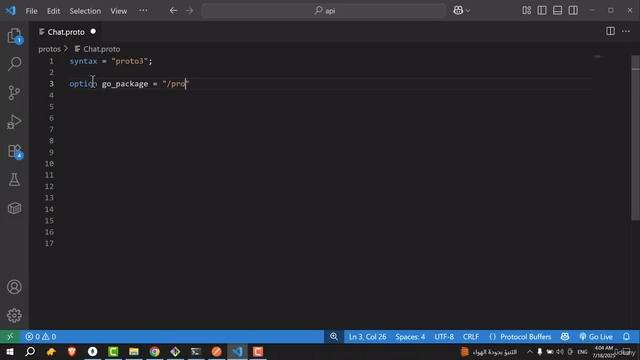
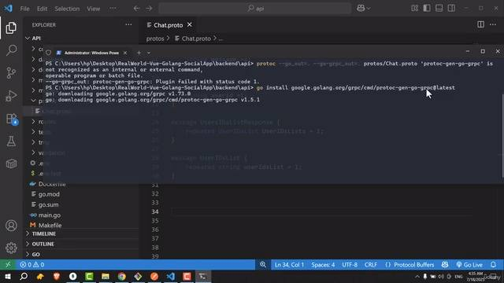
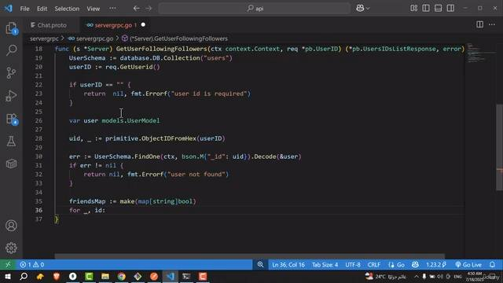
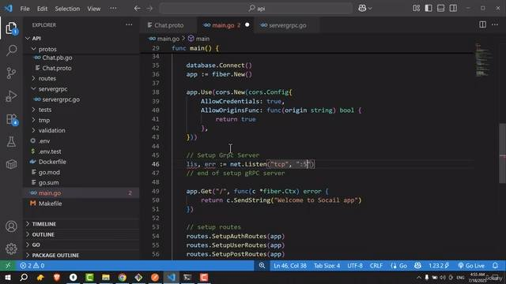
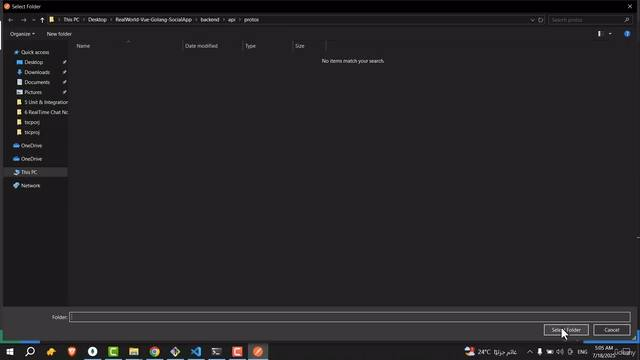
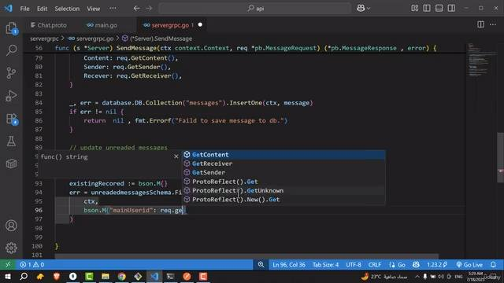
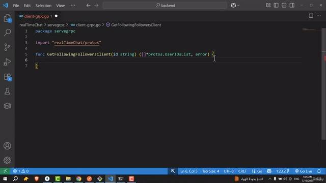
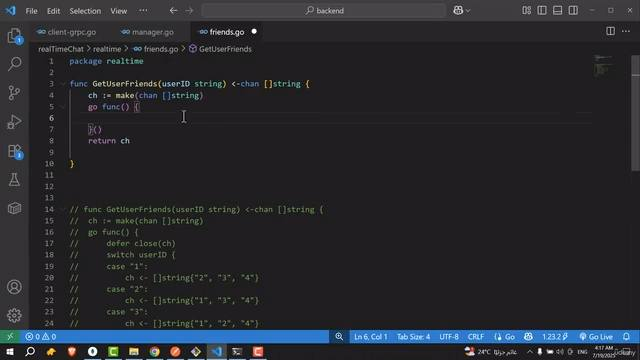

# Master Golang REST/gRPC（含 Redis）— P040–P043 复现文档

> 覆盖范围：P040（编写 chat.proto 并生成 Go 代码）、P041（实现 gRPC 服务端与 GetUserFollowingFollowers）、P042（实现 SendMessage 落库与未读计数）、P043（在 realtime 服务里接入 gRPC 客户端并完成联调 + 提交 PR。
>
> 读者定位：前端转 AI 应用工程师。文中涉及 Go 语法的地方会标注「知道即可」，涉及并发/连接的地方会补一句「在 JS/Node 里对应什么」。

---

## 1. 这一节做什么

这四节课把项目从「只有 REST + WebSocket」推进到「后端 API 提供 gRPC 服务，realtime 服务作为 gRPC 客户端调用它」。具体交付物是四件事：

1. **P040**：在 `backend/api` 下新建 `protos/chat.proto`，定义 `RealTimeChatService`，包含两个 RPC：`GetUserFollowingFollowers`（拿好友 ID 列表）和 `SendMessage`（发消息）。然后用 `protoc` 生成 `chat.pb.go` 与 `chat_grpc.pb.go`，再 `go mod tidy` 拉齐依赖。
2. **P041**：在 `backend/api` 下新建 `server` 包，写 `server/grpc.go`，实现 `GetUserFollowingFollowers`：查 Mongo 的 `users` 集合，把 following 和 followers 两个列表用 map 去重合并，返回 `UserIDsListResponse`。然后在 `main.go` 里监听 `5000` 端口、注册服务、开反射、用 goroutine 起 `Serve`。最后用 Postman 的 gRPC 面板导入 proto 实测。
3. **P042**：在同一个 `server/grpc.go` 里加 `SendMessage`：校验 sender/receiver 非空、两边用户都存在、把消息插入 `messages` 集合、再对 `unreadedmessages` 集合做「有则 `$inc` + `$set`，无则 insert」的 upsert 逻辑。
4. **P043**：把 `chat.proto` 复制到 realtime 项目，生成同样的 Go 代码；新建 `server_grpc/client_grpc.go`，封装 `GetUserFollowingFollowers` 和 `SendMessage` 两个客户端函数；在 realtime 的 manager 里替换掉原来「模拟好友列表」的 TODO，改成真正调 gRPC；最后 `git commit / push / PR / merge`，再开新分支 `real-time-notification`。

一句话总结：**P040 造接口，P041 造服务端读接口，P042 造服务端写接口，P043 造客户端并接线。**

---

## 2. 讲师原话（带出处）

> "我们将开始为 API 实现 gRPC 服务端；如果你还记得上一讲的内容，现在需要做的是能够带着用户 ID 向我们的 API 发送 gRPC 请求，并收到包含好友 ID 的用户好友列表响应。"
> —— p040 [00:00]

> "我们需要创建两个不同的函数，一个用于发送消息，一个用于接收消息；它们都与聊天相关，所以可以把这个文件叫作 chat.proto。"
> —— p040 [00:58]

> "之后我们可以定义服务，把这个服务叫作实时聊天服务；它的第一个 RPC 是 GetUserFollowingFollowers，需要传入用户 ID，并返回一个用户 ID 列表作为响应。"
> —— p040 [03:38]

> "注意，这里的这个数字指的是参数本身的位置，明白吗？当然，proto 文件就是这样工作的。"
> —— p040 [06:52]

> "我们需要先安装一个包，可以直接执行 go install google.golang.org/protobuf/cmd/protoc-gen-go@latest。"
> —— p040 [10:13]

> "我们需要运行或安装 protobuf 编译器，可以在 GitHub.com 的 protobuf 编译器发布页找到它。"
> —— p040 [13:22]

> "我们需要打开系统变量，点击“编辑”，再点击“新建”，然后添加这一项：C:\protoc\bin。"
> —— p040 [17:04]

> "现在安装完成后，我们可以再次运行命令吗？实际上可以，现在已经生成了 chat.pb.go 和 chat_grpc.pb.go。"
> —— p040 [19:16]

> "这里第一件事是添加一个结构体，并嵌入 UnimplementedRealTimeChatServer。"
> —— p041 [00:58]

> "我们想创建一个类似好友映射的东西，我觉得可以用动态规划来实现；所以就直接写 friends map，它等于我们要创建的 map[string]bool。"
> —— p041 [06:52]

> "这里的想法是返回一个去重后的列表：如果我们的用户，也就是用户 1，在他的关注列表和粉丝列表里都有同一个 ID，说明他和这个好友互相关注，那么最后我们只想把这个 ID 返回一次。"
> —— p041 [07:48]

> "第一件事是在指定端口上监听，所以这里可以写一个错误变量；我们可以使用 net.Listen，指定网络类型为 TCP，另一个参数就是端口，设为 5000。"
> —— p041 [11:51]

> "我们想用类似 Postman 的工具来测试，而且要做的事情很多，所以我想注册反射。"
> —— p041 [15:28]

> "实际上我们应该用协程来调用它，所以可以在这里写 go func()，让 grpcServer.Serve 返回的错误进入错误处理。"
> —— p041 [18:15]

> "我们将开始实现 SendMessage，也就是保存消息的函数或 RPC。"
> —— p042 [00:00]

> "首先，我们可以用这个请求来获取发送者；接收者那边已经有这个内置方法了。"
> —— p042 [01:29]

> "两者都找到了，现在可以保存消息了。"
> —— p042 [06:29]

> "最后，我们要更新未读消息的数据结构。"
> —— p042 [08:26]

> "我们可以使用 bson.M 和 $inc，就像之前做过的那样，对未读消息数量执行 $inc 加 1。"
> —— p042 [10:40]

> "如果已经有记录，就更新它；但如果没有呢？这种情况下我们可以检查错误是否不等于 0，明白吗？如果是这样，就可以写 else if err != nil，这些都会进入未读消息数据结构的 InsertOne 操作。"
> —— p042 [12:31]

> "我们将开始在实时聊天里使用 gRPC 方法；记住，我们在这里模拟获取用户好友，同时也要在发送消息时通过 gRPC 把它保存下来。"
> —— p043 [00:00]

> "为了能够使用这个 gRPC API，我们首先需要有一份相同的 proto 文件，所以需要复制这个文件，然后回到实时聊天目录里新建一个文件。"
> —— p043 [00:28]

> "我们想用 grpc.Dial 建立一个连接；这里添加目标地址，可以直接使用端口，端口应该是 5001。"
> —— p043 [04:55]

> "因为到目前为止我们还没有任何凭据来使用 gRPC；如果你检查这一项，它会告诉我们 grpc.Dial 已弃用，应改用 grpc.NewClient。"
> —— p043 [05:50]

> "我们可以调用 gRPC 客户端函数，明白吗？可以直接写 userFriends, err := grpcClient.GetUserFollowingAndFollowers，然后传入用户 ID。"
> —— p043 [16:52]

> "我们需要提交这些改动，对，需要提交；可以直接把提交信息写成“实时聊天完成”，最后再推送上去。"
> —— p043 [27:04]

---

## 3. 从零复现

### 3.1 前置条件

- 已按前面课程完成：`backend/api`（Gin REST + Mongo 连接 + JWT）与 `realtime`（WebSocket manager）两个项目可运行。
- 本机已装 Go（讲师未在逐字稿里给出版本号，**课里没讲**具体 Go 版本，建议用 1.21+）。
- 本机已装 MongoDB 并可连接（连接串沿用前面课程在 `backend/api` 里的配置，**课里没讲**具体环境变量名，请按你项目里已有的 Mongo URI 配置）。
- 本机已装 Postman（用于 gRPC 面板测试）。

### 3.2 步骤 A：安装 protoc 与 Go 插件（P040）

1. **装 Go 插件**（讲师原话命令，注意 `protoc-gen-go` 与 `protoc-gen-go-grpc` 是两个不同的二进制）：

```bash
go install google.golang.org/protobuf/cmd/protoc-gen-go@latest
go install google.golang.org/grpc/cmd/protoc-gen-go-grpc@latest
```

> 讲师在 p040 [10:13] 先敲错了一次（`go get` 形式），在 [11:08] 修正为 `go install`；在 [18:46] 补装 `protoc-gen-go-grpc`，因为第一次生成时报了 `protoc-gen-go-grpc is not recognized`。

2. **装 protoc 编译器本体**：从 GitHub 的 `protobuf/protobuf` releases 页下载 Windows 64 位压缩包（讲师在 [13:50]–[14:44] 演示），解压到例如 `C:\protoc`，把 `C:\protoc\bin` 加入系统 `Path`（讲师在 [17:04] 演示「系统变量 → Path → 编辑 → 新建」）。重开终端后 `protoc --version` 应能打印版本号。

3. **确认两个插件在 PATH 里**：`protoc-gen-go` 与 `protoc-gen-go-grpc` 默认装到 `%GOPATH%\bin`，确保该目录也在 `Path` 里。

### 3.3 步骤 B：写 chat.proto 并生成代码（P040）

1. 在 `backend/api` 下新建目录 `protos/`，新建文件 `protos/chat.proto`（完整内容见第 4 节）。
2. 在 `backend/api` 目录下执行生成命令（讲师在 [12:03] 与 [18:00] 给出的命令）：

```bash
protoc --go_out=. --go-grpc_out=. protos/chat.proto
```

3. 生成后应看到 `protos/chat.pb.go` 与 `protos/chat_grpc.pb.go`（讲师在 [19:16] 明确点名这两个文件）。
4. 在 `backend/api` 下执行：

```bash
go mod tidy
```

讲师在 [20:10] 说明这一步会拉入 `protobuf`、`reflect` 等依赖。

### 3.4 步骤 C：实现 gRPC 服务端（P041）

1. 在 `backend/api` 下新建目录 `server/`，新建 `server/grpc.go`（完整内容见第 4 节）。
2. 修改 `backend/api/main.go`，在已有代码下方追加 gRPC 启动块（完整片段见第 4 节）。
3. 装反射包（讲师在 [15:57] 演示）：

```bash
go get google.golang.org/grpc/reflection
```

4. 运行：

```bash
go run main.go
```

5. 打开 Postman → New → gRPC → 地址填 `localhost:5000` → Import proto → 选 `backend/api/protos/chat.proto` → 选 `GetUserFollowingFollowers` → 传一个真实存在的 user id → Invoke。预期返回 `userIdsList` 里是去重后的好友 ID。

> 讲师在 [22:31] 遇到 `user not found`，在 [23:26] 排查后确认是 Mongo URI 没更新，改完重跑就通了。你如果也遇到，先查 Mongo 连接串。

### 3.5 步骤 D：实现 SendMessage（P042）

1. 在 `server/grpc.go` 里追加 `SendMessage` 方法（完整内容见第 4 节）。
2. 重跑 `go run main.go`。
3. Postman 里选 `SendMessage`，填 `sender`、`receiver`、`content`，Invoke。预期返回 `message` 字段等于你传的 content。
4. 去 Mongo 里看：`messages` 集合多一条；`unreadedmessages` 集合里对应 receiver 的记录 `numOfUnreadedMessages` 从 0 变 1，再发一条变 2。
5. 故意传一个不存在的 receiver，预期返回 `receiver not found`（讲师在 [19:37] 演示过）。

### 3.6 步骤 E：realtime 接入 gRPC 客户端（P043）

1. 把 `backend/api/protos/chat.proto` 复制到 `realtime/protos/chat.proto`（讲师在 [00:28] 强调「不需要同名，但同名方便」）。
2. 在 `realtime` 目录下执行同样的生成命令与 `go mod tidy`。
3. 新建 `realtime/server_grpc/client_grpc.go`（完整内容见第 4 节）。
4. 修改 realtime 的 manager：把原来「模拟好友列表」的 TODO 换成调 `server_grpc.GetUserFollowingFollowersClient`；把「保存消息」的 TODO 换成调 `server_grpc.SendMessageClient`（完整片段见第 4 节）。
5. 两个项目都跑起来：`backend/api` 里 `go run main.go`（gRPC 在 5000），`realtime` 里 `go run main.go`。
6. Postman 用 WebSocket 面板连 `ws://localhost:<realtime端口>/ws/<userId>`，连上后应收到 `onlineFriends` 列表，且列表内容来自 gRPC 而不是模拟数据。
7. 通过 realtime 发一条消息，去 Mongo 的 `messages` 与 `unreadedmessages` 验证落库。

> 讲师在 [04:55] 说客户端连的是 `5001`，但服务端在 [12:17] 监听的是 `5000`。**这是逐字稿里出现的端口不一致**，请以你实际服务端监听的端口为准（本文档统一用 `5000`）。如果你照抄 `5001` 会连不上，这是复现时最容易踩的坑。

### 3.7 步骤 F：提交（P043 末尾）

```bash
git add .
git commit -m "real time chat done"
git push origin real-time-chat
```

然后在 GitHub 上开 PR、merge，回到本地：

```bash
git checkout main
git pull
git checkout -b real-time-notification
```

---

## 4. 完整代码

### 4.1 `backend/api/protos/chat.proto`

```proto
syntax = "proto3";

option go_package = "./protos";

service RealTimeChatService {
  rpc GetUserFollowingFollowers(UserID) returns (UserIDsListResponse);
  rpc SendMessage(MessageRequest) returns (MessageResponse);
}

message UserID {
  string userID = 1;
}

message UserIDsList {
  repeated string userID = 1;
}

message UserIDsListResponse {
  repeated UserIDsList userIdsList = 1;
}

message MessageRequest {
  string content = 1;
  string sender = 2;
  string receiver = 3;
}

message MessageResponse {
  string message = 1;
}
```

> 说明：讲师在 p040 里对 `UserIDsListResponse` 的嵌套结构讲得比较绕（[07:51]–[09:46]），最终形态是「响应里放一个 repeated 的 `UserIDsList`，每个 `UserIDsList` 里再放 repeated 的 `userID`」。上面这版是按讲师最终口述还原的；如果你生成后发现 Postman 里字段层级和你预期不同，以 `chat.pb.go` 里实际生成的字段名为准。

### 4.2 `backend/api/server/grpc.go`

```go
package server

import (
	"context"
	"fmt"

	"go.mongodb.org/mongo-driver/bson"
	"go.mongodb.org/mongo-driver/bson/primitive"

	"<你的模块路径>/database"
	"<你的模块路径>/models"
	pb "<你的模块路径>/protos"
)

type Server struct {
	pb.UnimplementedRealTimeChatServiceServer
}

func (s *Server) GetUserFollowingFollowers(ctx context.Context, req *pb.UserID) (*pb.UserIDsListResponse, error) {
	userSchema := database.DB.Collection("users")

	userID := req.GetUserID()
	if userID == "" {
		return nil, fmt.Errorf("userID is required")
	}

	uid, err := primitive.ObjectIDFromHex(userID)
	if err != nil {
		return nil, fmt.Errorf("invalid userID")
	}

	var user models.UserModel
	err = userSchema.FindOne(ctx, bson.M{"_id": uid}).Decode(&user)
	if err != nil {
		return nil, fmt.Errorf("user not found")
	}

	friendsMap := make(map[string]bool)
	for _, id := range user.Following {
		friendsMap[id] = true
	}
	for _, id := range user.Followers {
		friendsMap[id] = true
	}

	friends := []string{}
	for id := range friendsMap {
		friends = append(friends, id)
	}

	return &pb.UserIDsListResponse{
		UserIdsList: []*pb.UserIDsList{
			{UserID: friends},
		},
	}, nil
}

func (s *Server) SendMessage(ctx context.Context, req *pb.MessageRequest) (*pb.MessageResponse, error) {
	if req.GetSender() == "" || req.GetReceiver() == "" {
		return nil, fmt.Errorf("sender and receiver are required")
	}

	userSchema := database.DB.Collection("users")

	senderID, err := primitive.ObjectIDFromHex(req.GetSender())
	if err != nil {
		return nil, fmt.Errorf("invalid sender")
	}
	receiverID, err := primitive.ObjectIDFromHex(req.GetReceiver())
	if err != nil {
		return nil, fmt.Errorf("invalid receiver")
	}

	var senderUser models.UserModel
	err = userSchema.FindOne(ctx, bson.M{"_id": senderID}).Decode(&senderUser)
	if err != nil {
		return nil, fmt.Errorf("sender not found")
	}

	var receiverUser models.UserModel
	err = userSchema.FindOne(ctx, bson.M{"_id": receiverID}).Decode(&receiverUser)
	if err != nil {
		return nil, fmt.Errorf("receiver not found")
	}

	message := bson.M{
		"content":  req.GetContent(),
		"sender":   req.GetSender(),
		"receiver": req.GetReceiver(),
	}

	_, err = database.DB.Collection("messages").InsertOne(ctx, message)
	if err != nil {
		return nil, fmt.Errorf("fail to save message to db")
	}

	unreadedSchema := database.DB.Collection("unreadedmessages")

	var existingRecord bson.M
	err = unreadedSchema.FindOneAndUpdate(
		ctx,
		bson.M{
			"mainUserId":  req.GetReceiver(),
			"otherUserId": req.GetSender(),
		},
		bson.M{
			"$inc": bson.M{"numOfUnreadedMessages": 1},
			"$set": bson.M{"isReaded": false},
		},
	).Decode(&existingRecord)

	if err != nil {
		_, insertErr := unreadedSchema.InsertOne(ctx, bson.M{
			"mainUserId":             req.GetReceiver(),
			"otherUserId":            req.GetSender(),
			"numOfUnreadedMessages":  1,
			"isReaded":               false,
		})
		if insertErr != nil {
			return nil, fmt.Errorf("fail to update unreaded messages")
		}
	}

	return &pb.MessageResponse{
		Message: req.GetContent(),
	}, nil
}
```

> 注意：`models.UserModel` 的字段名（`Following` / `Followers`）与 `database.DB` 的导出方式，请以你前面课程里已有的定义为准。讲师在 p041 [05:33] 用的是 `models.UserModel` 与 `database.DB`，但**课里没讲**这两个符号的确切定义，本文档按讲师口述的用法还原。

### 4.3 `backend/api/main.go` 追加片段

```go
// 在已有 main() 里、gin 启动之前追加：

lis, err := net.Listen("tcp", ":5000")
if err != nil {
	log.Fatalf("failed to listen: %v", err)
}

grpcServer := grpc.NewServer()
pb.RegisterRealTimeChatServiceServer(grpcServer, &server.Server{})
reflection.Register(grpcServer)

go func() {
	if err := grpcServer.Serve(lis); err != nil {
		log.Fatalf("failed to serve: %v", err)
	}
}()

log.Println("grpc server running on port 5000")
```

需要的 import（按你项目实际模块路径调整）：

```go
import (
	"net"

	"google.golang.org/grpc"
	"google.golang.org/grpc/reflection"

	pb "<你的模块路径>/protos"
	"<你的模块路径>/server"
)
```

### 4.4 `realtime/protos/chat.proto`

与 4.1 完全一致（复制粘贴即可）。

### 4.5 `realtime/server_grpc/client_grpc.go`

```go
package server_grpc

import (
	"context"
	"log"

	"google.golang.org/grpc"
	"google.golang.org/grpc/credentials/insecure"

	pb "<你的 realtime 模块路径>/protos"
)

func GetUserFollowingFollowersClient(id string) ([]string, error) {
	conn, err := grpc.NewClient("localhost:5000", grpc.WithTransportCredentials(insecure.NewCredentials()))
	if err != nil {
		log.Fatalf("did not connect: %v", err)
		return nil, err
	}
	defer conn.Close()

	client := pb.NewRealTimeChatServiceClient(conn)

	ctx := context.Background()
	req := &pb.UserID{UserID: id}

	resp, err := client.GetUserFollowingFollowers(ctx, req)
	if err != nil {
		log.Printf("error while calling GetUserFollowingFollowers gRPC: %v", err)
		return nil, err
	}

	return resp.GetUserIdsList()[0].GetUserID(), nil
}

func SendMessageClient(sender, receiver, content string) error {
	conn, err := grpc.NewClient("localhost:5000", grpc.WithTransportCredentials(insecure.NewCredentials()))
	if err != nil {
		log.Fatalf("did not connect: %v", err)
		return err
	}
	defer conn.Close()

	client := pb.NewRealTimeChatServiceClient(conn)

	ctx := context.Background()
	req := &pb.MessageRequest{
		Sender:   sender,
		Receiver: receiver,
		Content:  content,
	}

	_, err = client.SendMessage(ctx, req)
	if err != nil {
		log.Printf("error while calling SendMessage gRPC: %v", err)
		return err
	}

	return nil
}
```

> 讲师在 p043 [05:50] 提到 `grpc.Dial` 已 deprecated，改用 `grpc.NewClient`。上面这版用的是 `grpc.NewClient`。如果你本地 grpc-go 版本较老没有 `NewClient`，退回 `grpc.Dial` 也能跑，但会有 deprecation 警告。

### 4.6 realtime manager 接线片段

```go
// 保存消息：把原来的 TODO 换成
err := server_grpc.SendMessageClient(msg.Sender, msg.Receiver, msg.Content)
if err != nil {
	log.Printf("error saving message to grpc: %s %v", msg.Receiver, err)
}

// 取好友列表：把原来的模拟数据换成
func (m *Manager) getFriends(userID string, ch chan []string) {
	defer close(ch)

	userFriends, err := server_grpc.GetUserFollowingFollowersClient(userID)
	if err != nil {
		fmt.Println("error on friends method")
		ch <- []string{}
		return
	}

	friends := []string{}
	for _, id := range userFriends {
		friends = append(friends, id)
	}

	ch <- friends
}
```

> 讲师在 p043 [16:25] 说「保持同样的函数签名，传 userID、返回 channel」，上面这版按这个口述还原。你项目里 manager 的实际方法名/字段名可能不同，按你已有的改。

---

## 5. 逐行解释

**proto 部分**

- `syntax = "proto3"`：固定写法，proto3 才支持 `repeated` 这种不带 `required` 的字段。
- `option go_package = "./protos"`：告诉 `protoc-gen-go` 生成的 Go 包路径。讲师在 [03:13] 写的是 `slash produce`（口误），实际就是 `./protos`。
- `service RealTimeChatService`：服务名。后面 `RegisterRealTimeChatServiceServer` 和 `NewRealTimeChatServiceClient` 这两个函数名都是从这里派生的——讲师在 p043 [07:16] 特意强调「名字是从 service 名派生的，不用自己记」。
- `rpc GetUserFollowingFollowers(UserID) returns (UserIDsListResponse)`：一个 RPC = 一个方法。入参 `UserID`、出参 `UserIDsListResponse`。
- `string userID = 1` 里的 `1`：讲师在 [06:52] 解释「这个数字指的是参数的位置」。**它不是默认值，是字段编号**，proto 序列化时靠它对齐字段。改编号会导致新旧客户端不兼容。
- `repeated string userID = 1`：`repeated` = 数组。在 Go 里生成 `[]string`，在 JS/TS 里对应 `string[]`。
- `UserIDsListResponse` 里再套一层 `repeated UserIDsList`：这是讲师 [07:51]–[09:46] 反复调整后的结构。**为什么这么绕**：proto 不允许直接把 `repeated string` 作为顶层响应字段的「列表的列表」，必须包一层 message。你如果觉得别扭，可以简化成 `repeated string userIds = 1`，但那就和讲师最终代码不一致，Postman 里字段层级也会变。

**服务端部分**

- `type Server struct { pb.UnimplementedRealTimeChatServiceServer }`：讲师在 [00:58] 说「include the unimplemented real-time chat server」。这是 gRPC 的向前兼容机制——你不实现的方法会走这个嵌入 struct 的默认实现（返回 Unimplemented），不会 panic。**在 JS/Node 里对应什么**：类似你实现一个 interface 时只实现部分方法，剩下的用默认 stub 兜底。
- `func (s *Server) GetUserFollowingFollowers(ctx context.Context, req *pb.UserID) (...)`：方法名、参数类型必须和 proto 生成的一致，否则编译期就报「method not found」。讲师在 [02:45] 强调「keep the same name」。
- `req.GetUserID()`：proto 生成的 getter，比直接 `req.UserID` 安全（nil 时返回零值）。讲师在 p042 [01:29] 说「this message is created for us... we can directly use it to get the sender parameters」。
- `primitive.ObjectIDFromHex(userID)`：Mongo 的 `_id` 是 12 字节 ObjectID，字符串要转。**在 JS/Node 里对应什么**：`ObjectId(id)` from `mongodb` 包。
- `friendsMap := make(map[string]bool)` + 两次 range：讲师在 [06:52] 叫它「dynamic programming」，实际就是**用 map 做去重**。following 和 followers 两个列表可能有交集（互相关注），合并后只保留一份。**在 JS/Node 里对应什么**：`new Set([...following, ...followers])`。
- `return &pb.UserIDsListResponse{...}, nil`：第二个返回值是 error，没错误就 `nil`。讲师在 [10:29] 说「add null cause this expecting from us to return an error」。
- `net.Listen("tcp", ":5000")`：监听 TCP 5000。`:5000` 等价 `0.0.0.0:5000`。
- `grpc.NewServer()` + `RegisterRealTimeChatServiceServer`：注册服务。讲师在 [14:07] 说「it will always be named register + service name」。
- `reflection.Register(grpcServer)`：开反射。**为什么需要**：Postman 的 gRPC 面板靠反射自动发现方法，不开反射就得手动 import proto。讲师在 [15:28] 说「I want to register this with the reflection」。
- `go func() { grpcServer.Serve(lis) }()`：讲师在 [18:15] 说「we should use goRoutine」。**为什么**：`Serve` 是阻塞的，不开 goroutine 会卡住 main，后面的 gin 就起不来。**在 JS/Node 里对应什么**：类似 `server.listen()` 本身就是非阻塞的，Node 不需要你手动开线程；Go 这里必须显式 `go`。

**SendMessage 部分**

- `req.GetSender() == "" || req.GetReceiver() == ""`：空校验。讲师在 p042 [01:56] 说「if request gets sender... equal to empty string on that case we can just return nil and fmt errorf sender and receiver for required」。
- 两次 `FindOne` 查 sender 和 receiver：讲师在 [03:21] 说「first of all we need to check if both of them are exist or not」。**为什么**：防止给不存在的用户发消息，也防止脏数据进 `messages`。
- `InsertOne(ctx, message)`：消息落库。字段 `content / sender / receiver` 是讲师在 [06:58] 口述的。
- `FindOneAndUpdate` + `$inc` + `$set`：讲师在 [10:40] 说「dollar sign ink or increment... num of 1 readed messages」。`$inc` 是原子自增，`$set` 把 `isReaded` 置 false。**在 JS/Node 里对应什么**：`collection.findOneAndUpdate(filter, { $inc: {...}, $set: {...} })`，语义完全一样。
- `if err != nil { InsertOne(...) }`：讲师在 [12:31] 说「if we have already existing record to update it but what if we don't have so on that case... insert one」。这是**手写的 upsert**——先尝试更新，更新失败（记录不存在）就插入。Mongo 原生有 `upsert: true` 选项，讲师没用，是手写分支。**在 JS/Node 里对应什么**：`findOneAndUpdate(filter, update, { upsert: true })` 一行搞定，但讲师这里手写是为了在 insert 时能塞初始字段（`numOfUnreadedMessages: 1`、`isReaded: false`）。
- `return &pb.MessageResponse{Message: req.GetContent()}, nil`：讲师在 [14:52] 说「return pointer of PEP dot message response message request dot get content」。**为什么回显 content**：让调用方能确认「服务端收到的就是你发的」，Postman 里也方便肉眼验证。

**客户端部分**

- `grpc.NewClient("localhost:5000", grpc.WithTransportCredentials(insecure.NewCredentials()))`：讲师在 [04:55] 说端口 `5001`，但服务端是 `5000`——**以服务端为准**。`insecure.NewCredentials()` 是因为还没配 TLS，讲师在 [05:50] 说「till now we didn't have any credentials」。
- `defer conn.Close()`：函数返回时关连接。**在 JS/Node 里对应什么**：类似 `finally { await client.close() }`。
- `pb.NewRealTimeChatServiceClient(conn)`：从 service 名派生。讲师在 [07:16] 说「this will be created by default whenever we run the command」。
- `resp.GetUserIdsList()[0].GetUserID()`：因为 proto 里是「列表套列表」，取第 0 个元素的 `UserID` 字段。**这是最容易 panic 的地方**——如果服务端返回空列表，`[0]` 会越界。讲师没做保护，你复现时建议加 `if len(...) == 0 { return nil, nil }`。
- `ch <- friends` + `defer close(ch)`：Go 的 channel 通信。**在 JS/Node 里对应什么**：类似 `EventEmitter` 或 `async iterator`，但 Go 的 channel 是类型安全且阻塞的。讲师在 [16:52] 说「defer close this channel」。
- `log.Fatalf` vs `log.Printf`：`Fatalf` 会 `os.Exit(1)`，`Printf` 只打日志。讲师在客户端连接失败处用 `Fatalf`（[06:19]），在调用失败处用 `Printf`（[09:36]）——**这个区别很重要**：连接失败是致命的，单次调用失败不该杀进程。

---

## 6. 复现检查清单

按顺序打勾，任何一项不过就别往下走：

- [ ] `protoc --version` 能打印版本号（不是 `not recognized`）
- [ ] `protoc-gen-go` 与 `protoc-gen-go-grpc` 都在 PATH 里（`where protoc-gen-go` 有输出）
- [ ] `backend/api/protos/chat.proto` 存在，`protoc --go_out=. --go-grpc_out=. protos/chat.proto` 无报错
- [ ] `backend/api/protos/chat.pb.go` 与 `chat_grpc.pb.go` 都已生成
- [ ] `backend/api` 下 `go mod tidy` 无报错
- [ ] `backend/api/server/grpc.go` 编译通过（`go build ./...`）
- [ ] `go run main.go` 后日志出现 `grpc server running on port 5000`
- [ ] Postman gRPC 面板能 import `chat.proto` 并列出两个方法
- [ ] `GetUserFollowingFollowers` 传真实 user id 返回去重后的 ID 列表（不是 `user not found`）
- [ ] `GetUserFollowingFollowers` 传空 id 返回 `userID is required`
- [ ] `SendMessage` 传合法 sender/receiver/content 返回 content 回显
- [ ] Mongo `messages` 集合多一条记录
- [ ] Mongo `unreadedmessages` 集合对应记录 `numOfUnreadedMessages` 递增
- [ ] `SendMessage` 传不存在的 receiver 返回 `receiver not found`
- [ ] `realtime/protos/chat.proto` 与 `backend/api` 版本一致
- [ ] `realtime` 下生成命令与 `go mod tidy` 都成功
- [ ] `realtime/server_grpc/client_grpc.go` 编译通过
- [ ] realtime manager 里两处 TODO 都已替换为 gRPC 调用
- [ ] 两个服务同时跑，WebSocket 连上后 `onlineFriends` 来自 gRPC（不是模拟数据）
- [ ] 通过 realtime 发消息，Mongo 里能看到落库
- [ ] `git commit` / `push` / PR / merge 完成，`main` 分支已 pull 到最新
- [ ] 新分支 `real-time-notification` 已创建

---

## 7. 课里没讲但你会撞上的

1. **端口 5000 vs 5001 的矛盾**。讲师在 p043 [04:55] 说客户端连 `5001`，但 p041 [12:17] 服务端监听 `5000`。逐字稿里没有解释这个差异，也没有演示改端口。**你照抄 5001 会连不上**。本文档统一用 `5000`，如果你要改，两边一起改。

2. **`models.UserModel` 的字段名**。讲师在 p041 [05:33] 用 `models.UserModel`，在 [07:19] range `user.Following` 和 `user.Followers`，但**课里没讲**这两个字段在 model 里的确切定义（是 `[]string` 还是 `[]primitive.ObjectID`）。如果是后者，`friendsMap[id] = true` 那行会编译失败，需要先 `.Hex()` 转字符串。以你前面课程里已有的 model 定义为准。

3. **`database.DB` 的导出方式**。讲师在 p042 [02:52] 用 `database.DB.Collection(...)`，但**课里没讲** `DB` 是包级变量还是函数返回。如果是 `database.GetDB()` 这种函数，所有 `database.DB` 都要改。

4. **`resp.GetUserIdsList()[0]` 的越界风险**。讲师在 p043 [10:06] 直接 `return response.GetUserIdsList()[0].GetUserID()`，没做长度检查。如果服务端返回空列表（比如用户没有好友），客户端会 panic。**建议你加一行 `if len(resp.GetUserIdsList()) == 0 { return nil, nil }`**。这是讲师没讲但线上必踩的坑。

5. **`grpc.NewClient` 的版本要求**。讲师在 p043 [05:50] 说 `grpc.Dial` 已 deprecated，但 `grpc.NewClient` 是较新版本才有的 API。如果你 `go mod tidy` 拉到的 grpc-go 版本较老，会报 `undefined: grpc.NewClient`。**课里没讲**具体版本号，遇到就 `go get google.golang.org/grpc@latest`。

6. **`FindOneAndUpdate` 的返回值处理**。讲师在 p042 [09:43] 用 `FindOneAndUpdate(...).Decode(&existingRecord)`，但**课里没讲** `existingRecord` 后续怎么用——实际上代码里 decode 完就没再用，只是靠 `err` 判断记录是否存在。这在 Mongo 驱动里是可行的（记录不存在时 `Decode` 返回 `ErrNoDocuments`），但语义上有点绕。**在 JS/Node 里对应什么**：`findOneAndUpdate` 返回 `null` 时你就知道要 insert，逻辑一样。

7. **`unreadedmessages` 的字段名拼写**。讲师全程用 `unreaded`（不是 `unread`），字段是 `numOfUnreadedMessages`、`isReaded`、`mainUserId`、`otherUserId`。**这些拼写是讲师项目里既有的**，你如果前面课程里建的是 `unread`，这里要统一，否则查不到记录。

8. **并发安全**。`friendsMap` 是函数内局部变量，没有并发问题；但 `database.DB` 是全局连接，Mongo 驱动本身是并发安全的。**课里没讲**这一点，但你如果后续在 goroutine 里调 `SendMessage`，不需要额外加锁。**在 JS/Node 里对应什么**：Node 单线程本来就没这个问题，Go 这里靠驱动保证。

9. **proto 文件两处维护**。讲师在 p043 [00:28] 是手动复制 `chat.proto` 到 realtime。**课里没讲**怎么同步——实际项目里要么用 monorepo 共享目录，要么用 `go generate` 脚本。你复现时如果改了 proto 忘了同步，realtime 会编译失败或字段对不上。

10. **Postman gRPC 面板的 proto import 路径**。讲师在 p041 [20:08] 演示 import 时选的是 `desktop/realtime-backend/api/protos/chat.proto`，路径里有 `realtime-backend` 这一层。**课里没讲**你的项目根目录叫什么，按你实际的选。

---

**截图索引（本文档实际插入的 8 张）**

- p040 [03:38]：proto 里定义 service 与第一个 RPC
- p040 [19:16]：生成成功，`chat.pb.go` / `chat_grpc.pb.go` 出现
- p041 [06:52]：friends map 去重逻辑
- p041 [11:51]：`net.Listen("tcp", ":5000")`
- p041 [20:08]：Postman gRPC 面板 import proto
- p042 [10:40]：`$inc` 更新未读计数
- p043 [04:55]：gRPC 客户端连接（注意端口）
- p043 [16:52]：realtime 里调 gRPC 客户端取好友















